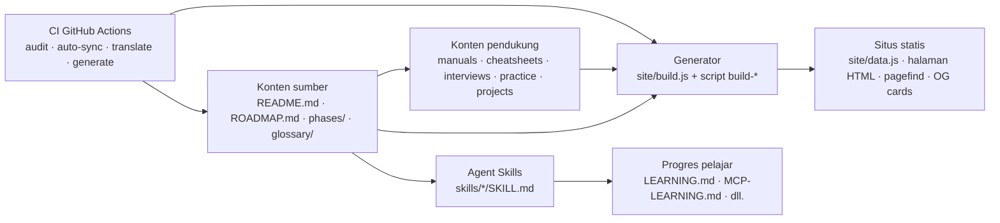

# Ringkasan Eksekutif — AI Engineering from Scratch

## 1. Apa proyek ini?

`AI Engineering from Scratch` adalah **kurikulum open-source (MIT)** berbasis repositori GitHub
`rohitg00/ai-engineering-from-scratch` yang mengajarkan rekayasa AI dengan pendekatan
**"bangun dari awal, lalu gunakan alat produksi"**. Filosofinya dinyatakan langsung di
`README.md:88-90`: *"Sebuah panggilan framework menyembunyikan bagian yang rusak"* — peserta menulis versi kecil
backpropagation, tokenizer, attention, dan agent loop dengan tangan, menjalankannya, lalu
melihat bagaimana library produksi melakukan hal yang sama.

Repositori ini bukan aplikasi SaaS. Produk utamanya adalah **pelajaran** (`docs/en.md`), kode yang
bisa dijalankan, kuis, dan artefak yang bisa dipakai ulang. Tiga permukaan konsumsi:

1. **Situs web statis** di `aiengineeringfromscratch.com` (tanpa setup).
2. **Coding agent sebagai tutor** melalui 18 Agent Skills yang dipasang dengan
   `npx skills add rohitg00/ai-engineering-from-scratch`.
3. **Kode lokal** yang bisa dijalankan langsung dari klon repositori.

> Sumber: `README.md:14-26`, `README.md:221-302`, `AGENTS.md` (Philosophy).

## 2. Skala proyek (hasil hitungan langsung)

| Metrik | Nilai | Keterangan |
|---|---|---|
| Ukuran repositori | ~184,3 MB | 16.626 file |
| Phase | 20 | direktori `phases/NN-*` |
| Pelajaran | 542 | direktori dengan `docs/en.md` |
| File `quiz.json` | 392 | ~72% dari pelajaran |
| File `main.*` | 942 | Python 474, TypeScript 373, Rust 45, Julia 34, Go 16 |
| Pelajaran dengan `outputs/` | 478 | artefak siap pakai |
| Pelajaran dengan `notebook/` | 295 | placeholder kosong (hanya `.gitkeep`) |
| Agent Skills | 18 | direktori `skills/*/SKILL.md` |
| Manual | 8 + `_shared` | 8 manual siap (`manuals/<id>/`) plus pustaka bersama |
| Bahasa terjemahan README | 33 | `i18n/<lang>/README.md`; registry `languages.json` memuat 41 bahasa, switcher README menampilkan 34 (Inggris + 33) |
| File TypeScript/JS | 774 `.js` + 728 `.ts` | sebagian besar di situs, kode pelajaran, projects |
| Dokumen markdown | 3.570 | termasuk konten kurikulum dan pendukung |

Distribusi pelajaran per phase (dari header tabel `README.md`):

| Phase | Nama | Pelajaran |
|---|---|---:|
| 0 | Setup & Tooling | 13 |
| 1 | Math Foundations | 22 |
| 2 | ML Fundamentals | 21 |
| 3 | Deep Learning Core | 13 |
| 4 | Computer Vision | 28 |
| 5 | NLP: Foundations to Advanced | 29 |
| 6 | Speech & Audio | 17 |
| 7 | Transformers Deep Dive | 16 |
| 8 | Generative AI | 15 |
| 9 | Reinforcement Learning | 12 |
| 10 | LLMs from Scratch | 24 |
| 11 | LLM Engineering | 17 |
| 12 | Multimodal AI | 25 |
| 13 | Tools & Protocols | 45 |
| 14 | Agent Engineering | 54 |
| 15 | Autonomous Systems | 22 |
| 16 | Multi-Agent & Swarms | 25 |
| 17 | Infrastructure & Production | 29 |
| 18 | Ethics, Safety & Alignment | 30 |
| 19 | Capstone Projects | 85 |
| **Total** | | **542** |

Kurikulum dikelompokkan menjadi enam volume (Foundations, Deep Learning, Language, LLMs,
Agents, Production) dengan graf dependensi phase yang dituangkan dalam diagram Mermaid di
`README.md:412-438`.

## 3. Arsitektur konseptual

Arsitektur deploy adalah **SSG + serverless**: seluruh halaman dibangun statis saat build,
hanya 11 handler di `api/` yang berjalan per permintaan (lesson markdown, katalog, OG image,
endpoint MCP). `vercel.json` menjalankan delapan perintah build berurutan dengan output `site/`.

Prinsip penting: **konten sumber bersifat kanonik, turunan bersifat generated**.
`README.md`, `ROADMAP.md`, dan `glossary/terms.md` di-parse oleh `site/build.js` menjadi
`site/data.js`; `catalog.json`, `site/data.js`, `site/langs.js`, dan `package-lock.json` tidak
pernah di-commit (`AGENTS.md` Automation Contract, `CONTRIBUTING.md:12-33`).

## 4. Temuan lintas-subsistem

### 4.1 Kontrak pelajaran yang ketat

Kontrak yang ditetapkan `AGENTS.md` menyatakan setiap pelajaran memiliki `docs/en.md` dengan
frontmatter wajib (`Type`, `Languages`, `Prerequisites`, `Time`) dan 4-6 learning objectives;
kode `main.<lang>` dengan header 4-6 baris; minimal 5 unit test; serta `quiz.json` berisi tepat
6 pertanyaan (1 pre, 3 check, 2 post, `correct` zero-indexed). Diagram hanya Mermaid atau SVG.
Pola inti isinya adalah
**The Problem → The Concept → Build It → Use It → Ship It → Exercises**. Diagram sangat
lazim: 530 dokumen memakai 553 fence `figure` dan 395 fence Mermaid. Detail ada di
`01-struktur-kurikulum.md`.

### 4.2 Dua "mesin" pembelajaran yang berjalan paralel

- Sitemap web memiliki rute `/learn/...`, `/manual-*`, `/project.html`, `/learning-paths.html`,
  dan lain-lain (lihat `02-arsitektur-situs.md`).
- Agent Skills mengubah coding agent menjadi tutor interaktif yang menyimpan progres ke file
  markdown tertentu, misalnya `LEARNING.md`, `MCP-LEARNING.md`, `CLAUDE-CERTIFICATION.md`, dan
  `INTERVIEW-LEARNING.md` (lihat `03-sistem-pembelajaran.md`). Tujuh berkas state tersebut
  dibuat di direktori kerja peserta dan tidak di-check-in; `INTERVIEW-LEARNING.md` bersifat
  append-only dan hanya ditulis oleh skill `interview-prep`. Sertifikasi mencakup 33 pelajaran
  Claude + 34 MCPA dalam lima track (CCAO-F, CCDV-F, CCAR-F, CCAR-P, MCPA).

### 4.3 Bukti dan audit adalah budaya repositori

Hampir semua subsistem punya "gate": `audit_lessons.py`, `audit_certifications.py`,
`audit_manuals.js` (harus `TOTAL 0`), `build-cheatsheets.js --check`,
`site/build-interviews.js --check`, `practice/validate.py`, `project_test.py`, dan
`audit_lesson_figures.js`. Aturan komit (`feat(phase-NN/MM): <slug>`, ≤72 karakter),
review bot (CodeRabbit, Devin), dan dependency allowlist mengunci konsistensi. Detail ada di
`05-automasi-dan-tata-kelola.md`.

### 4.4 Internasionalisasi tanpa biaya per-view

Bahasa Inggris adalah sumber kanonik. Terjemahan pelajaran **tidak pernah di-commit ke `main`**;
mereka dihasilkan oleh NLLB-200 di GitHub Actions dan disimpan pada branch `translations`, lalu
di-fetch situs pada runtime. Sertifikasi sengaja dikecualikan dari terjemahan dan pipeline buku.
Detail ada di `04-konten-pendukung.md`.

### 4.5 Konten pendukung juga tunduk pada kontrak bukti

Delapan manual memakai capture kit nyata dan audit `TOTAL 0`; 156 cheat sheet memiliki file
evidence; bank interview berisi 482 soal, 60 skenario, dan denylist nama perusahaan; 52 soal
practice memiliki mutant yang harus gagal; 104 proyek memiliki grader bertahap. Pola yang sama
berulang: **sumber kanonik → generator → validator deterministik → artefak turunan yang tidak
di-commit**. Detail ada di `04-konten-pendukung.md`.

## 5. Inkonsistensi yang perlu dicatat

Beberapa angka di dalam repositori tidak sinkron satu sama lain pada saat analisis:

| Sumber | Klaim | Realitas/fakta lain |
|---|---|---|
| `README.md:20,30` | 542 lessons, 20 phases | Sesuai dengan 542 direktori `docs/en.md`. |
| `ROADMAP.md:7` | Total estimasi waktu ~332 jam | `ROADMAP.md:655` menyebut ~1.081 hours, sedangkan jumlah estimasi 20 header fase ~1.170 jam (Fase 19 saja ~620 jam); `README.md:383-390` memberi estimasi 60-306 jam per jalur. |
| `ROADMAP.md:655` | 523 pelajaran, 523 selesai | README dan filesystem menunjukkan 542 pelajaran. |
| `AGENTS.md` dependency table | Python/TS/Rust/Julia saja | `README.md:20` juga menyebut Go; ada 16 file `main.go` di pelajaran. |
| `AGENTS.md` lesson contract | `code/tests/` 5+ test per pelajaran | Hanya 104 dari 542 pelajaran yang memiliki direktori `code/tests/`; sebagian besar test ditanam di file kode lain atau belum ada. |
| Kontrak `quiz.json` | Setiap pelajaran punya 6 soal (1 pre + 3 check + 2 post) | Hanya 392/542 pelajaran memiliki `quiz.json`; dari situ 55 berupa array polos dan hanya 127 yang mengikuti skema kanonik 6 soal. Phase 6, 8, 9, 12, 15 tidak memilikinya sama sekali. |
| `AGENTS.md` / `README.md` | `notebook/` untuk eksperimen Jupyter | 295 direktori `notebook/` seluruhnya hanya berisi `.gitkeep`; tidak ada satu pun berkas `.ipynb`. |
| `AGENTS.md` | Artefak reusable di `outputs/` | 478 pelajaran punya direktori `outputs/`, berisi 409 artefak `skill-*` dan 100 `prompt-*`. |
| `README.md:678` vs `ROADMAP.md:228` | Fase 8 = 15 pelajaran | Tabel ROADMAP hanya sampai nomor 19 dengan gaps (15-18 tidak ada). |
| `AGENTS.md` CI gate table | 4 gate | `curriculum.yml` aktual menjalankan 6 job (audit, lesson-tests, lesson-ports, readme-counts-sync, site-rebuild, readme-counts-drift). |
| `LESSON_TEMPLATE.md` | "tidak ada komentar dalam kode" | `AGENTS.md` mewajibkan header komentar 4-6 baris yang menyitasi `docs/en.md`. |
| `check_quiz_bias.py` | Gate bias jawaban | `BASELINE_RATE = 0.84` berarti ~84% soal terdeteksi length-biased; gate hanya mencegah regresi, bukan memperbaiki. |
| `CHANGELOG.md` | Entri terbaru 2026-04 | `AGENTS.md` ditinjau 2026-10-23 dan CI aktif hingga November 2026 — utang dokumentasi rilis. |

Catatan-catatan ini merupakan observasi faktual, bukan penilaian kualitas; angka kanonik yang
digunakan seluruh dokumen analisis adalah **542 pelajaran** sebagaimana dinyatakan README dan
dibuktikan oleh sistem file.
