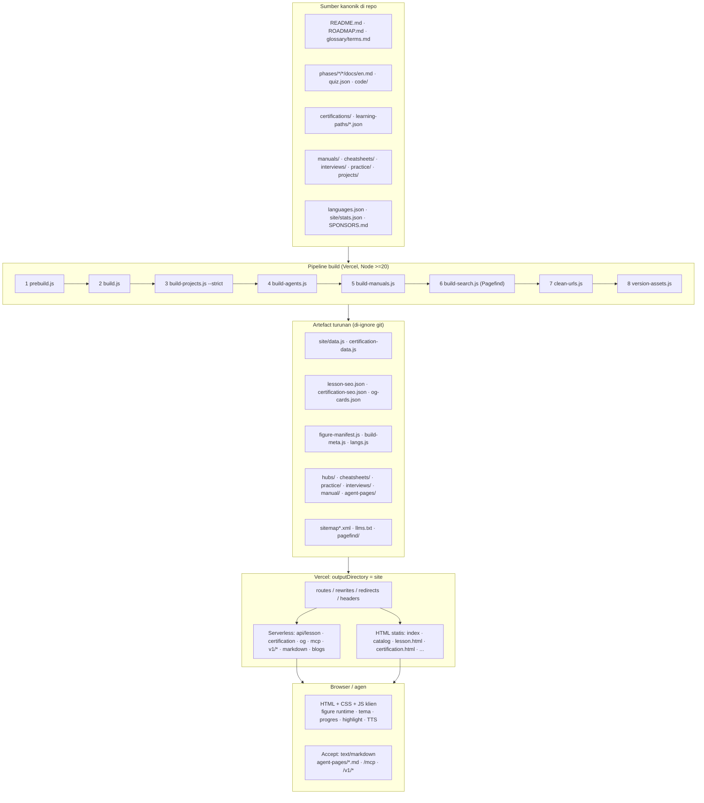
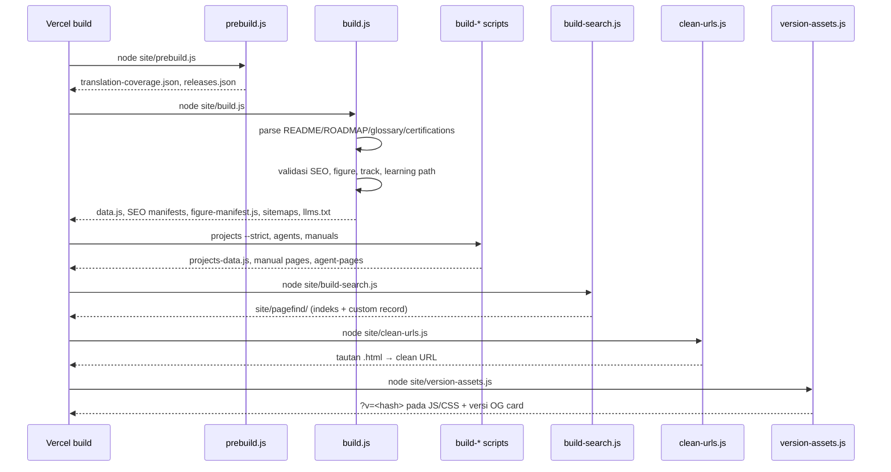

# Analisis Arsitektur Situs — `ai-engineering-from-scratch`

**Lokasi repositori:** `C:\Users\Hendra\Downloads\ai-engineering-from-scratch`
**Lingkup:** `site/`, `api/`, `lib/`, `web/`, `assets/`, `book/`, `vercel.json`, `languages.json`, `requirements.txt`, `package.json`, plus konfigurasi deploy dan workflow yang bersentuhan dengan situs.
**Tanggal analisis:** 24 November 2026
**Metode:** pembacaan konfigurasi build/deploy, generator, handler serverless, runtime klien, stylesheet, jalur buku, dan daftest yang tersedia. Seluruh jalur file di bawah relatif terhadap akar repositori sumber. Tidak ada file di repositori yang diubah.

---

## 0. Ringkasan eksekutif

| Aspek | Temuan utama | Bukti |
|---|---|---|
| Model aplikasi | **Pembangkit situs statis (static-site generator, SSG) + fungsi serverless**, bukan SPA dan bukan SaaS. Hampir semua halaman adalah HTML hasil build; hanya 11 handler Node di `api/` yang dijalankan on-demand. | `vercel.json:2-5`, `api/*.js` |
| Entry point deploy | `vercel.json` memerintahkan delapan perintah build berurutan, output akhir dari direktori `site`, `framework: null`, `trailingSlash: false`. | `vercel.json:2-5,799` |
| Generator inti | `site/build.js` (~115 KB) adalah orkestrator utama: parse sumber kanonik, validasi, tulis `data.js`, manifest SEO, manifest figure, sitemap, `llms.txt`, dan blok HTML generatif. | `site/build.js`, `AGENTS.md` |
| Turutan build | `prebuild → build → build-projects --strict → build-agents → build-manuals → build-search → clean-urls → version-assets`. Urutan bersifat material: hash aset dibuat paling akhir. | `vercel.json:2` |
| Rute | `vercel.json` memuat 7 `routes`, ~50 `rewrites`, ~15 `redirects`, dan ~20 aturan `headers`. Rute kunci: `/learn/<phase>/<lesson>` → `/api/lesson`, `/certification` → `/api/certification`, `/og/<type>/<id>.png` → `/api/og`, `/mcp` → `/api/mcp`. | `vercel.json:6-908` |
| Negosiasi konten | Halaman yang sama melayani `text/html` atau `text/markdown` lewat header `Accept`; permintaan Markdown dialihkan ke file `agent-pages/*.md`. | `vercel.json:55-64,84-93,127-140`, `api/lesson.js:607-618` |
| Figure system | Penulis menulis fence ```figure``` di `docs/en.md`; build menghasilkan `figure-manifest.js`; klien memuat **hanya provider yang dibutuhkan** secara lazy dengan query `?v=<hash>`. 78 file provider, ~553 pemakaian fence. | `site/lesson-markdown.js:126-127`, `site/build.js:585-660`, `site/lesson-figures.js:1586-1634` |
| Tema & interaktivitas | CSS variabel light/dark, mode `system/light/dark` di `localStorage`, RTL via atribut `dir`, reduced-motion, print stylesheet, highlight lokal, command palette, TTS, progres, Pagefind. | `site/style.css:1-82,97-101`, `site/theme-menu.js:1-27`, `site/lesson.html:2832-2966` |
| Jalur buku | Enam volume dari `book/volumes.json`, dirakit `scripts/build_book.py` dengan pandoc; PDF memakai xelatex + Lua filter dan **hanya release asset**, tidak di-commit. | `book/README.md:1-27`, `scripts/build_book.py:1-41`, `.github/workflows/build-book.yml:35` |
| File hasil build | Sebagian besar output generator masuk `.gitignore` (baris 91–145). `site/data.js` adalah pengecualian penting: diresultsulkan CI dan dikembalikan setelah validasi lokal sesuai `AGENTS.md`. | `.gitignore:91-145`, `AGENTS.md` (Automation contract) |
| Pengujian | 49 berkas `site/test_*.js` dengan `node --test`, dijalankan berkelompok oleh `curriculum.yml`; audit figure memakai Chrome dan harus `TOTAL 0`. | `site/test_*.js`, `.github/workflows/curriculum.yml:191-204`, `lesson-figures.yml:35-68` |
| Dependensi | Situs hanya butuh Node ≥20 + empat devDependency (`shiki`, `@shikijs/langs`, `@shikijs/themes`, `pagefind`). `requirements.txt` **bukan** untuk situs, melainkan untuk kode pelajaran Python. | `package.json:1-15`, `requirements.txt:1-18` |
| `web/` | Kosong secara substansi (hanya `.gitkeep`) — tidak ada aplikasi web terpisah. | `web/.gitkeep` |

**Tema sentral:** repositori adalah *sumber kebenaran*, situs adalah *proyeksi turunannya*. Alur yang berulang di seluruh sistem: **sumber kanonik → generator deterministik → artefak turunan yang tidak di-commit → validator/CI → deploy**. Serverless function hanya dipakai bila konten harus dirakit per permintaan (pelajaran, sertifikasi, OG image, API agen).

---

## 1. Peta arsitektur keseluruhan



**Gambar 1 — Alur proyeksi konten.** Sumber kanonik tidak pernah diedit oleh generator; generator hanya menulis ke direktori `site/`, `generated/`, dan `dist/book/`.



**Gambar 2 — Urutan eksekusi build.** `version-assets.js` sengaja terakhir supaya hash mencakup semua tulisan sebelumnya, termasuk rewrite dari `clean-urls.js`.

---

## 2. Konfigurasi dan titik masuk

### 2.1 `package.json`

| Field | Nilai | Arti |
|---|---|---|
| `name` | `ai-engineering-from-scratch-site` | Paket privat untuk alat build situs |
| `private` / `license` | `true` / `MIT` | Tidak dipublikasikan ke npm |
| `engines.node` | `>=20` | Build memakai fitur Node modern (`Object.hasOwn`, `import()` ESM dari CJS, dll.) |
| `devDependencies` | `shiki 4.5.0`, `@shikijs/langs 4.5.0`, `@shikijs/themes 4.5.0`, `pagefind 1.5.2` | Shiki untuk syntax highlighting saat build; Pagefind untuk indeks pencarian |
| `scripts` | tidak ada | Semua perintah dipanggil eksplisit dari `vercel.json` dan workflow |

Tidak ada dependency runtime. Ini konsisten dengan aturan `AGENTS.md`: JS situs memakai API bawaan Node, dan klien memakai vanilla JS tanpa framework.

### 2.2 `vercel.json`

```json
{
  "buildCommand": "node site/prebuild.js && node site/build.js && node site/build-projects.js --strict && node site/build-agents.js && node site/build-manuals.js && node site/build-search.js && node site/clean-urls.js && node site/version-assets.js",
  "outputDirectory": "site",
  "framework": null,
  "installCommand": "npm install --no-audit --no-fund",
  "trailingSlash": false
}
```

Sumber: `vercel.json:2-5,799`.

Konsekuensi dari konfigurasi ini:

- **`framework: null`** — Vercel tidak menjalankan framework detector; seluruh HTML sudah jadi sebelum deploy.
- **`outputDirectory: "site"`** — direktori `site/` adalah akar publik. File seperti `site/data.js`, `site/lesson.html`, `site/pagefind/`, dan `site/og-cards.json` semuanya tersedia sebagai aset statis.
- **`trailingSlash: false`** — URL kanonik tanpa slash akhir; aturan `redirects` di `vercel.json:800-906` membuang slash dan `.html`.
- **`installCommand`** — `package-lock.json` sengaja tidak di-track (`.gitignore:19`), sehingga install selalu menyelesaikan versi dari `package.json` pada saat deploy.

### 2.3 Tidak ada Vercel Cron

`vercel.json` **tidak** memiliki kunci `crons`. Pekerjaan terjadwal berada di GitHub Actions, misalnya `cheatsheets-generate.yml:4-5` dengan `cron: '17 4 * * 1'` (generate cheat sheet mingguan). Workflow lain (`interviews-generate.yml`, `practice-generate.yml`, `translate.yml`, `build-book.yml`, `manuals.yml`) memakai `workflow_dispatch` dan/atau trigger `release`. Jadi pembagiannya: **Vercel = serving + build sekali per deploy; GitHub Actions = audit, regenerasi konten, dan pekerjaan berkala.**

---

## 3. Pipeline build statis

### 3.1 Delapan tahap

| # | Perintah | Input utama | Output utama | Catatan |
|---|---|---|---|---|
| 1 | `node site/prebuild.js` | layanan terjemahan & rilis eksternal | `site/translation-coverage.json`, `site/releases.json` | Mengambil data yang tidak bisa dihitung murni dari repo |
| 2 | `node site/build.js` | `README.md`, `ROADMAP.md`, `glossary/terms.md`, `phases/`, `certifications/`, `learning-paths/`, `languages.json`, `site/stats.json`, `SPONSORS.md` | `site/data.js`, `certification-data.js`, `lesson-seo.json`, `certification-seo.json`, `figure-manifest.js`, `og-cards.json`, `build-meta.js`, `langs.js`, sitemap, `llms.txt`, blok HTML generatif | Generator inti + validator |
| 3 | `node site/build-projects.js --strict` | `projects/` | `site/projects-data.js`, `site/project-content/`, halaman project | `--strict` membuat error gagal build |
| 4 | `node site/build-agents.js` | HTML statis + `lib/agent-content.js` | `site/agent-pages/*.md`, bagian discovery di `llms.txt` | Menyajikan versi Markdown untuk agen |
| 5 | `node site/build-manuals.js` | `manuals/<id>/manual.json` + `sections/` | `site/manuals-data.js`, `site/manual/<id>/*.html`, `site/manuals.html`, sitemap manual | Halaman manual turunan |
| 6 | `node site/build-search.js` | HTML hasil build + `docs/en.md` + bank interview | `site/pagefind/` | Pagefind; **skip** bila `pagefind` belum terinstall (`build-search.js:181-220`) |
| 7 | `node site/clean-urls.js` | seluruh HTML | tautan `.html` → clean URL, `generated/agent-content.json` | Konsistensi URL sebelum hash |
| 8 | `node site/version-assets.js` | referensi JS/CSS lokal + registry kartu OG | `?v=<hash>` pada tiap aset, versi `og:image` | Cache busting; hash juga mencakup `lib/og-render.js` dan `lib/og-fonts/` |

### 3.2 Apa yang dilakukan `site/build.js`

Generator utama melakukan empat kelas pekerjaan:

**a. Parsing sumber kanonik.** Tabel phase dan lesson diambil dari `README.md`; status dari `ROADMAP.md`; istilah dari `glossary/terms.md`; graf prasyarat dari `learning-paths/*.json`; metadata sertifikasi dari `certifications/*`; teks pelajaran dari `phases/*/*/docs/en.md`; daftar bahasa dari `languages.json`; statistik dari `site/stats.json`; sponsor dari `SPONSORS.md`.

**b. Validasi yang menggagalkan build.** Di antaranya: dokumen pelajaran hilang atau ekstra, `canonical` URL/title duplikat, ID figure tanpa provider, urutan route sertifikasi tidak cocok, siklus atau prasyarat maju pada learning path, dan kesalahan glossary. Validasi ini membuat `data.js` tidak pernah menyimpan rujukan rusak.

**c. Penulisan manifest.** Bukti baris:

| Output | Bukti di `site/build.js` |
|---|---|
| `lesson-seo.json`, `certification-seo.json` | `:1347-1348` |
| `certification.html` hasil injeksi blok | `:1681` |
| `build-meta.js` | `:2178` |
| `langs.js` | `:2196` |
| output utama (`data.js`) | `:2309` |
| `og-cards.json` | `:2334` |
| `sitemap-*.xml`, `sitemap-index.xml` | `:2362,2409,2437,2445` |
| `llms.txt` | `:2554` |
| `figure-manifest.js` | `:643-659` |

**d. Sinkronisasi blok dalam file yang *di-commit*.** `build.js` menyuntik atau mengganti wilayah bertanda seperti `<!-- AIFS:LESSON-SEO:START -->` / `END` di template, juga blok katalog dan sertifikasi. Pola yang sama dipakai handler serverless (`api/lesson.js:12-17`).

### 3.3 Manifest figure dibangun saat build, bukan disimpan

`site/figure-manifest.js` **tidak ada** di salinan kerja yang diperiksa (akan dibuat oleh `build.js`). Prosesnya (`site/build.js:585-660`):

1. `discoverFigureProviderOrder()` menggabungkan urutan eksplisit `FIGURE_PROVIDER_ORDER` (`:59`) dengan file `figures*.js` baru yang belum dikenal, diurutkan.
2. `buildFigureProviderManifest()` membaca sumber tiap provider, menghitung hash, lalu mencocokkan setiap ID figure yang dipakai di dokumen dengan provider yang menyebut ID itu.
3. Provider yang tidak menyelesaikan ID menghasilkan error — tidak ada fallback diam-diam.
4. `serializeFigureProviderManifest()` menulis tiga global: `AIFS_FIGURE_PROVIDER_ORDER`, `AIFS_FIGURE_PROVIDER_VERSIONS`, `AIFS_FIGURE_PROVIDERS`.
5. `syncFigureAssetVersions()` menulis ulang tag `<script>` di `lesson.html` agar memakai `?v=<hash>` terbaru.

Urutan itu **perilaku publik**: pendaftaran belakangan menimpa pendaftaran awal, misalnya `figures-tools3.js` → `figures-mcp.js` (`site/build.js:57-58`).

### 3.4 Pencarian

`site/build-search.js` memakai API Pagefind secara programsatik:

- Sumber HTML: `practice/`, `practice/tracks/`, `cheatsheets/`, `hubs/phase/`, `hubs/glossary/`, `manual/<id>/` (`build-search.js:10-50`).
- Custom record: interview (`build-interviews.js`) dan pelajaran yang sudah `complete` (`lessonSearchRecords()`, `:164-179`). Teks pelajaran dibersihkan dari fence kode, math, dan markdown sebelum dibatasi 12.000 karakter (`:67-161`).
- Filter Pagefind: `type`, `topic`, `level`, `role`, `phase`.
- Output `site/pagefind/` diberi header `immutable` satu tahun di `vercel.json:489-495`.

### 3.5 Clean URL dan versioning

- `site/clean-urls.js` mengubah tautan internal `*.html` menjadi URL bersih dan melakukan hal yang sama pada `generated/agent-content.json`, sehingga API agen tidak membocorkan nama file fisik.
- `site/version-assets.js` menghitung hash lokal untuk setiap `.js`/`.css` yang dirujuk HTML, menambahkan `?v=<hash>`, dan memanggil `stampCards()` dari `lib/og-cards.js` untuk memperbarui `?v=` pada URL `/og/...png`. Aset remote, inline code, komentar, dan tautan halaman tidak disentuh (dijamin oleh `test_asset_cache.js`).

---

## 4. Output generatif dan aturan "jangan di-commit"

`.gitignore:91-145` berisi daftar eksplisit. Ringkasan kelompoknya:

| Kelompok | Contoh jalur | Baris `.gitignore` |
|---|---|---|
| Katalog & metadata build | `catalog.json`, `site/build-meta.js`, `site/langs.js` | 91, 101, 116 |
| SEO & manifest | `site/lesson-seo.json`, `certification-seo.json`, `og-cards.json`, `figure-manifest.js` | 103-106 |
| Data hasil fetch | `site/translation-coverage.json`, `site/releases.json` | 98-99 |
| Sitemap | `site/sitemap.xml`, `sitemap-index.xml`, `sitemap-lessons-*.xml`, `sitemap-glossary.xml`, `sitemap-phases.xml`, `sitemap-cheatsheets.xml`, `sitemap-practice.xml`, `sitemap-interviews.xml`, `sitemap-manuals.xml` | 95-97, 127-129, 132, 135, 140 |
| Teks agen | `site/llms.txt`, `site/agent-pages/`, `generated/agent-content.json` | 100, 123-124 |
| Halaman turunan | `site/hubs/`, `site/cheatsheets/`, `site/practice/`, `site/interviews/`, `site/manual/`, `site/manual-*.html`, `site/manuals.html`, `site/manuals-data.js` | 125, 130, 133, 136, 138-142 |
| Peta klien | `site/cheatsheet-map.json`, `site/practice-map.json`, `site/lesson-terms.json`, `site/interviews.json` | 126, 131, 134, 137 |
| Proyek | `site/projects-data.js`, `site/project-content/` | 120-121 |
| Cari & kode | `site/pagefind/`, `site/lesson-code/` | 143-144 |
| Buku | `book/_build/`, `dist/` (lewat aturan umum `dist/`) | 107, 11 |

**Nuansa `site/data.js`:** berkas ini berukuran ~1,08 MB dan memang ada di salinan kerja, tetapi dihasilkan oleh `site/build.js:2309`. `AGENTS.md` menyatakan `site/data.js` *dibangun ulang oleh CI pada push ke main* dan memerintahkan `git checkout -- site/data.js` setelah validasi lokal. Jadi bukan "dilarang ada di repo", melainkan **"jangan kirim versi hasil build lokal sebagai perubahan"** — beda dengan file di atas yang benar-benar di-ignore.

**Template yang tetap di-commit** adalah file HTML sumber: `site/index.html`, `catalog.html`, `lesson.html`, `certification.html`, `certifications.html`, `glossary.html`, `roadmap.html`, `about.html`, `developer.html`, `skills.html`, `learning-paths.html`, `projects.html`, `project.html`, `highlights.html`, `blogs.html`, `sponsors.html`, `assessment.html`, `contact.html`, `privacy.html`, `whats-new.html`, `how-to-learn.html`, tiga halaman `inside-*`, dan `404.html` (26 berkas `.html`). Blok dinamisnya disuntikkan pada saat build atau oleh serverless function.

---

## 5. Rute, halaman, dan serverless function

### 5.1 Kategori rute di `vercel.json`

| Jenis | Contoh | Tujuan |
|---|---|---|
| `routes` (paling awal) | `/blogs(\.html)?` → `/api/blogs` | Mengubah legacy `.html` ke handler |
| `routes` dengan `has: accept text/markdown` | `/` → `/agent-pages/index.md` | Negosiasi konten untuk root |
| `rewrites` ke fungsi | `/lesson`, `/learn/:cleanPhase/:cleanLesson`, `/certification`, `/mcp`, `/api/:missing*` | Konten per-request |
| `rewrites` ke HTML | `/about`, `/catalog`, `/glossary`, `/roadmap`, `/practice`, `/interviews`, `/cheatsheets`, `/phase/:slug`, `/manual/:id/:section` | Clean URL ke file hasil build |
| `rewrites` Markdown-bersyarat | `/glossary/:page`, `/phase/:page`, `/practice/:page`, `/interviews/:card/:page`, `/developer`, `/docs`, `/api` | `Accept: text/markdown` → `agent-pages/*.md`; jika tidak → HTML |
| `redirects` permanen | `/index.html` → `/`, `/*.html` → clean, `/hubs/phase/x.html` → `/phase/x`, `/manual/:m/:s` → `/:m/:s` | Kanonisasi URL |
| `redirects` sementara | `/phase` → `/catalog`, `/project` tanpa `?id` → `/projects` | fallback |

Pola negosiasi konten yang berulang:

```json
{
  "source": "/catalog",
  "has": [{ "type": "header", "key": "accept", "value": "(?i).*text/markdown.*" }],
  "destination": "/agent-pages/catalog.md"
}
```

Sumber: `vercel.json:127-140` (pola serupa untuk ~15 halaman).

### 5.2 Pemetaan clean URL → file

| URL publik | File hasil build | Bukti |
|---|---|---|
| `/` | `site/index.html` | `vercel.json:817-825` |
| `/learn/<phase>/<lesson>` | `/api/lesson?cleanPhase=...&cleanLesson=...` | `vercel.json:72-74`, `lib/hub-routes.js:16-19` |
| `/phase/<slug>` | `site/hubs/phase/<slug>.html` | `vercel.json:172-185`, `lib/hub-routes.js:7-14` |
| `/glossary/<slug>` | `site/hubs/glossary/<slug>.html` | `vercel.json:157-170`, `lib/hub-routes.js:25-27` |
| `/certification?id=<track>` | `/api/certification` | `vercel.json:76-78` |
| `/cheatsheets/<topic>` | `site/cheatsheets/<topic>.html` | `vercel.json:187-193` |
| `/practice/<page>`, `/practice/tracks/<page>` | `site/practice/...` | `vercel.json:195-227` |
| `/interviews/<card>/<page>` | `site/interviews/<card>/<page>.html` | `vercel.json:229-261` |
| `/manual-<id>/<section>` | `site/manual/<manual>/<section>.html` | `vercel.json:448-454,837-845` |
| `/og/<type>/<id>.png` | `/api/og?type=<type>&id=<id>` | `vercel.json:47-53` |
| `/.well-known/mcp.json` | `site/server.json` | `vercel.json:436-438` |
| `/api/openapi.json` | `site/openapi.json` | `vercel.json:440-442` |

Konversi jalur pelajaran pusat ada di `lib/hub-routes.js`: `phases/13-tools-and-protocols/43-bytecode-and-managed-formats` → `/learn/tools-and-protocols/bytecode-and-managed-formats` (prefix numerik dibuang).

### 5.3 Serverless functions

| Handler | Peran | `maxDuration` / `includeFiles` (`vercel.json:755-798`) |
|---|---|---|
| `api/lesson.js` | Merakit halaman pelajaran per permintaan; `text/markdown` bila diminta; 406 bila sumber Markdown tidak ada; `Vary: Accept`, `Content-Language`; region SEO/FALLBACK/HUBS diisi dari marker | 10 dtk; template + SEO + `lesson-code/**` + `languages.json` + `docs/en.md` + font OG |
| `api/certification.js` | Halaman track sertifikasi dengan region SEO/FALLBACK yang sama | 10 dtk; `certification.html`, `certification-seo.json`, font OG |
| `api/og.js` | Menggambar kartu 1200×630 PNG; tipe statis `page/project/manual/term/phase`, plus kartu lesson/track dinamis | 10 dtk; SEO manifest, `og-cards.json`, `site/anatomy/*.png`, `og-render.js` |
| `api/markdown.js`, `api/v1/markdown.js` | Melayani Markdown halaman dari `lib/agent-content.js` `PAGES` | 10 dtk; `site/*.html`, `agent-pages/*.md`; `excludeFiles: site/**/*.js` |
| `api/mcp.js` | Endpoint MCP, protokol `2025-11-25` (kompatibel `2025-06-18`, `2025-03-26`); tool `search_curriculum` dan `read_resource`, annotations read-only | 10 dtk; `generated/agent-content.json` |
| `api/v1/catalog.js`, `api/v1/resource.js` | API JSON untuk katalog dan resource; validasi query, `Accept: application/json`, rate limiter `createLimiter()`, cacheable | 10 dtk; `generated/agent-content.json` |
| `api/blogs.js`, `api/writing.js` | Daftar tulisan dari `site/portfolio-source.js`; `writing.js` = `createHandler({ article: true })` | 10 dtk; `site/blogs.html` |
| `api/not-found.js` | Halaman 404 untuk rute API yang tidak dikenal (`/api/:missing*`) | 10 dtk; `site/404.html` |

Detail `api/lesson.js`:

- `localizedTemplate()` mengganti `<html lang="en">` dengan `lang` yang diminta dan menambah `dir="rtl"` untuk bahasa RTL (`api/lesson.js:549-553`).
- `representation(accept)` memilih representasi; `text/markdown` dikirim dengan `Content-Type: text/markdown`, bila tidak tersedia → 406 (`:607-618`).
- HTML dirakit dengan mengganti tiga wilayah bertanda: `LESSON-SEO`, `LESSON-FALLBACK`, `LESSON-HUBS` (`:12-17,622-624`).
- `includeFiles` membatasi bundling: hanya template, manifest, jalur pelajaran yang dipakai, dan aset OG yang masuk ke function — menjaga ukuran function tetap kecil.

Detail `api/og.js`:

- Regex ID ketat: `^[a-z0-9][a-z0-9-]*(?:/[a-z0-9][a-z0-9-]*){0,3}$` (`:7`).
- Dua kebijakan cache: `IMMUTABLE` 1 tahun untuk URL berversi dan `MOVED` 300 detik untuk kartu tanpa versi (`:9-10`).
- `RENDERED_LIMIT = 64` membatasi render dynamic (`:11`).

### 5.4 Header dan cache

| Policy | Bukti | Efek |
|---|---|---|
| Gambar/font: `max-age=86400, s-maxage=604800, stale-while-revalidate=2592000` | `vercel.json:480-487` | Aset visual di-cache lama tapi bisa segar di background |
| Pagefind: `max-age=31536000, immutable` | `vercel.json:489-495` | Indeks berversi aman di-cache permanen |
| JS/CSS: `max-age=0, must-revalidate` | `vercel.json:498-505` | Hash `?v=` memberi versi; file tanpa versi selalu dicek ulang |
| `certification-data.js`, `projects-data.js`, `build-meta.js`: `no-cache, must-revalidate` | `vercel.json:507-532` | Data yang bisa berubah cepat |
| HTML & halaman clean: `Vary: Accept, Accept-Encoding` | `vercel.json:534-571` | Cache terpisah untukHTML dan Markdown |
| `X-Robots-Tag: noindex` untuk `/highlights`, `/practice/data`, `practice_check.py` | `vercel.json:460-478,646-671` | Halaman utilitas tidak masuk indeks |
| `Content-Type: text/markdown` untuk `llms.txt` dan `agent-pages/*.md` | `vercel.json:686-753` | Agen menerima MIME yang benar |
| `Access-Control-Allow-Origin: *` untuk `interviews.json` | `vercel.json:608-632` | Bank interview bisa dikonsumsi pihak ketiga |

---

## 6. Sistem figure

### 6.1 Dari fence ke widget

Penulisan di `docs/en.md`:

```figure
kv-cache
```

`site/lesson-markdown.js:126-127` menerjemahkannya menjadi:

```html
<div class="lesson-figure" data-figure="kv-cache"></div>
```

Fence ini **tidak** digambar saat build; ia menjadi *host* yang di-hidrasi di browser oleh `site/lesson-figures.js` (komentar di baris 1-8 file itu).

### 6.2 Runtime klien

`site/lesson-figures.js` (~86 KB, vanilla, tanpa dependency) menyediakan:

| Fitur | Bukti |
|---|---|
| Stylesheet scoped yang disuntik sekali (`#lf-styles`), memakai CSS var tema | `:12-20` |
| Toolkit bersama `window.LF`: `el`, `svgEl`, `slider`, `select`, `fmtInt`, `raf`, `uid`, `motion`, `smil`, `textWidth`, `wrapText`, `hold`, `register` | `:1643-1651` |
| Mount/unmount: `mountLessonFigures(root)`, `disposeHost`, `disposeRoot`, autoplay, controller gerak | `:1632-1641` |
| Deteksi host: `.lesson-figure[data-figure]`, penanda `data-figure-missing` bila tidak ada provider | `:926-928,1546-1560` |
| Lazy loading provider: `requiredProviders()` membaca `AIFS_FIGURE_PROVIDERS`, `loadProvider()` menyuntik `<script async=false>` dengan `?v=<hash>` | `:1586-1629` |
| Eksposur global | `AIFS_loadFigureProviders`, `mountLessonFigures`, `LESSON_FIGURES`, `AIFSFigureRuntime`, `LF` (`:1632-1651`) |

Alur di template pelajaran (`site/lesson.html:4120-4131`): setelah Markdown dirender dan blok Mermaid/math diproses, klien memanggil `AIFS_loadFigureProviders(article)` lalu `mountLessonFigures(article)` pada `assetPromise.then(...)`. Jadi hanya provider yang benar-benar dipakai halaman yang diunduh.

`site/figures.js` (~46 KB) berisi explainer SVG animasi generik (`tokenizer-bpe`, `ngram-machine`, `attention-matrix`, `embedding-arithmetic`, `transformer-block`, dan versi compact `kv-cache`, `loss-curve`, dll., `:1-15,901-912`). Modul bertema lain menyediakan ratusan figure tambahan.

### 6.3 Skala dan validasi

| Metrik | Nilai (dari pemeriksaan sistem file) |
|---|---|
| File `site/figures*.js` | 78 |
| Kemunculan fence ```figure``` di `phases/**/docs/en.md` dan `certifications/**/lessons/**/docs/en.md` | 553 |
| ID unik terdaftar (perkiraan dari pola kutipan pada file provider) | ~646 |
| File provider terbesar | `figures-mcp.js` ~114 KB, `figures-mcpa-certifications.js` ~98 KB, `figures-agent-skills.js` ~67 KB |

Audit geometri figure berjalan di `.github/workflows/lesson-figures.yml:35-68` pada PR/push yang menyentuh `docs/en.md`, `figures*.js`, `lesson-figures.js`, `lesson.html`, atau `build.js`. `AGENTS.md` mewajibkan `scripts/audit_lesson_figures.js` dengan Chrome menampilkan **`TOTAL 0`**.

### 6.4 Diagram Mermaid dan matematika

Fence `mermaid` tidak melewati jalur figure; `site/lesson-markdown.js:128-136` membungkusnya dalam `.mermaid-container` dengan `<pre class="mermaid">` sumber, toolbar `Expand`, dan `.mermaid-render` kosong. CSS dan modalnya ada di `site/lesson.html:1286-1419`; rendering dilakukan klien. Ini sesuai aturan `AGENTS.md`: diagram hanya Mermaid atau SVG, tidak ada box-drawing ASCII.

---

## 7. Interaktivitas klien, tema, dan styling

### 7.1 Script yang dimuat halaman pelajaran

Bukti: `site/lesson.html:2832-2866,2962-2966`.

| Script | Fungsi |
|---|---|
| `build-meta.js`, `langs.js`, `lang-picker.js` | Metadata build, daftar bahasa, pemilih bahasa (termasuk RTL) |
| `data.js` | Katalog hasil build (phase, lesson, glossary, dll.) |
| `content-source.js`, `lesson-markdown.js` | Memilih sumber konten dan merender Markdown di browser |
| `progress.js` | Progres belajar lokal |
| `highlights-anchor.js`, `highlights-store.js`, `highlights.js` | Anchor, penyimpanan, dan UI highlight; tahan fault penyimpanan (`test_highlights_store.js`) |
| `lesson-walkthrough.js` | Panduan langkah per langkah |
| `header.js`, `code-copy.js`, `cmdpalette.js` | Header, tombol salin (perintah `bash` saja), command palette |
| `lesson-figures.js`, `figure-manifest.js` | Runtime dan peta provider figure |
| `tts.js` (~68 KB) | Text-to-speech navigasi (`test_tts_navigation.js`) |

Halaman lain memakai `certifications.js` (~58 KB), `roadmap.js` (~47 KB), `pagefind` UI, dan skrip proyek/practice. `web/` tidak memuat aplikasi tambahan — isinya hanya `.gitkeep`.

### 7.2 Tema

`site/style.css` mendefinisikan dua set token:

- Light: `:root` di `:1-54` — `--bg: #fafaf5`, `--ink: #1a1a1a`, `--blueprint: #3553ff`, font `VT323` (display), `Source Serif 4` (body), `JetBrains Mono` (mono). Font dimuat dari Google Fonts di `site/lesson.html:27-29`.
- Dark: `[data-theme="dark"]` di `:56-82` — `--bg: #0a0d1a`, `--ink: #e8e6dc`, `--blueprint: #6b8eff`.

`site/theme-menu.js` mengelola `system | light | dark`, menyimpan preferensi di `localStorage` dengan kunci `theme`, dan menresolve `system` melalui `matchMedia('(prefers-color-scheme: dark)')` (`:1-31`). Figure memakai variabel yang sama sehingga mengikuti tema tanpa logika tambahan.

Aksesibilitas/responsif: `prefers-reduced-motion` di beberapa titik (`:97-101,1123,1961,2050,2271,2403`), stylesheet cetak (`:1163,2570,2630`), breakpoint 1440/1024/820/768/600/480 px. Syntax highlighting dilakukan saat build dengan Shiki (`site/lib/code.js`) dan dipresentasikan lewat `site/code.css`.

### 7.3 Aset statis

- `assets/readme/`, `assets/sponsors/` — gambar untuk dokumentasi dan sponsor.
- `site/assets/`, `site/logos/`, `site/anatomy/` — aset publik; `site/anatomy/*.png` secara eksplisit dibundling ke `api/og.js` (`vercel.json:766`).
- `site/stats.json`, `site/ui-strings.json`, `site/openapi.json`, `site/server.json` — data konfigurasi statis.

---

## 8. Jalur buku dan PDF

### 8.1 Kontrak

`book/README.md:3` menyatakan buku adalah **pendamping**, bukan pengganti: figure interaktif, kuis, dan kode tetap di situs/repo; setiap bab ditutup tautan kembali ke web.

| Volume | Judul | Phase | Sumber |
|---|---|---|---|
| 1 | Foundations | 00–02 | `book/README.md:9-16` |
| 2 | Deep Learning | 03, 04, 06 | sama |
| 3 | Language | 05, 07 | sama |
| 4 | Large Language Models | 08–11 | sama |
| 5 | Agents | 12–16 | sama |
| 6 | Production | 17–19 | sama |

Definisi mesin ada di `book/volumes.json`.

### 8.2 Build

```bash
python3 scripts/build_book.py                  # semua volume, EPUB
python3 scripts/build_book.py --volume language
python3 scripts/build_book.py --pdf            # tambah PDF (xelatex + font DejaVu)
python3 scripts/build_book.py --assemble-only  # markdown saja
```

Sumber: `book/README.md:20-26`, `scripts/build_book.py:3-8`.

`scripts/build_book.py`:

- Mengambil `CONFIG` dari `book/volumes.json`, menulis perantara ke `book/_build/`, hasil akhir ke `dist/book/` (`:28-35`).
- Memakai `LESSON_DIR_RE`, `read_h1`, `slug_to_title` dari `scripts/build_catalog.py` agar daftar pelajaran konsisten dengan katalog situs (`:25-26`).
- `urls_for()` membangun tiga tautan per bab: `web` (`/learn/<phase>/<lesson>`), `code`, dan `repo` (`:64-70`).
- `continue_box()` membuat blok `::: {.continue-online}` berisi tautan ke figure, kode, dan kuis online (`:73-90`).
- Mendeteksi `mmdc` (Mermaid CLI); bila tidak ada, diagram menjadi pointer ke edisi web (`:41`).
- `--lang` memilih sumber terjemahan dari `i18n/<lang>/phases/...` bila tersedia, jika tidak jatuh ke `docs/en.md` (`:101-110`).

Kustomisasi PDF ada di `book/theme.tex`, `book/pdf-layout.lua`, `book/math-blocks.lua`, dan `book/literal-tokens.lua`.

### 8.3 CI dan aturan commit

`.github/workflows/build-book.yml` membangun EPUB pada setiap push; PDF hanya pada `release` atau `workflow_dispatch` (`:35`). `AGENTS.md` menegaskan PDF adalah *release asset*, **never committed**, dan `dist/` berada di `.gitignore:11`. Ini memisahkan jalur buku dari jalur situs: buku tidak ikut delapan langkah build Vercel.

### 8.4 Hubungan `requirements.txt`

`requirements.txt` berisi `numpy`, `matplotlib`, `jupyter`, `torch`, `torchvision`, `torchaudio`, `transformers`, `datasets`, `tokenizers`, `accelerate`, `scikit-learn`, `pandas`, `pillow`, `librosa`, `soundfile`, `tiktoken`, `anthropic`, `openai` (`:1-18`). Ini adalah dependency **kode pelajaran/eksperimen**, bukan dependency build situs. Situs tidak menginstal requirements ini saat deploy.

---

## 9. Suites pengujian situs

Terdapat **49** berkas `site/test_*.js`. Mereka dijalankan dengan `node --test` dan dikelompokkan di `.github/workflows/curriculum.yml:191-204`.

| Kelompok | Contoh berkas | Yang dijaga |
|---|---|---|
| Build artifact & cache | `test_build_artifacts.js` (~123 KB), `test_asset_cache.js` | Keluarga aset punya cache key sama di tiap halaman; manifest SEO mencakup semua pelajaran; hash tidak menyentuh tautan |
| Rute & URL | `test_clean_urls.js`, `test_static_preview_routes.js` | Konsistensi rewrite/redirect dengan `vercel.json` |
| Konten pelajaran | `test_lesson_code.js`, `test_lesson_headings.js`, `test_lesson_markdown_links.js`, `test_lesson_math.js`, `test_quiz_placement.js` | Render kode per bahasa, tautan, math, dan penempatan kuis |
| Figure & machine | `test_project_figure_runtime.js`, `test_gpu_machine.js`, `test_decompiler_machine.js`, `test_agent_machine.js`, `test_budget_project_figures.js`, `test_dataset_project_figures.js`, `test_semantic_project_figures.js` | Kevalidan keadaan, kontrol, dan arithmetic figure interaktif |
| Tema & UI | `test_theme_menu.js`, `test_overlays.js`, `test_ui_i18n.js`, `test_highlights*.js`, `test_tts_navigation.js`, `test_lesson_walkthrough.js` | Mode tema, overlay, i18n UI, highlight tahan fault, TTS |
| Konten pendukung | `test_manuals.js`, `test_cheatsheets.js`, `test_interviews.js`, `test_practice*.js`, `test_projects*.js`, `test_catalog.js`, `test_sponsors.js`, `test_writing_*.js` | Kontrak tiap subsistem |
| Agen & SEO | `test_build_agents.js`, `test_learning_paths.js`, `test_agent_machine.js`, `test_semantic_project_figures.js` | Urutan discovery `llms.txt`, graf prasyarat |

Perintah validasi lokal dari `AGENTS.md` yang relevan untuk situs:

```bash
node --test site/test_*.js
node site/build.js && node --test site/test_*.js
node site/build-cheatsheets.js --check && node site/build-cheatsheets.js --check-quality
node scripts/interviews/validate.js && node site/build-interviews.js --check
CHROME_PATH=<chrome> NODE_PATH=<dir>/node_modules node scripts/audit_lesson_figures.js
```

---

## 10. Deployment, CI/CD, dan tanggung jawab masing-masing

| Permukaan | Yang terjadi | Tempat |
|---|---|---|
| Deploy Vercel | Jalankan 8 perintah build, sajikan `site/`, aktifkan 11 serverless function | `vercel.json` |
| Audit kurikulum | `audit_lessons.py`, `audit_certifications.py`, cek quiz bias, test situs, lalu build | `.github/workflows/curriculum.yml:191-204` |
| Auto-sync main | `readme-counts-sync` membangun katalog dan memperbaiki hitungan README; `site-rebuild` menulis ulang `site/data.js` | `curriculum.yml`, `AGENTS.md` (Automation contract) |
| Drift PR | `readme-counts-drift` bersifat advisory; main menyembuhkan diri saat merge | `curriculum.yml:429-446` |
| Figure | Audit geometri dengan Chrome; harus `TOTAL 0` | `lesson-figures.yml` |
| Buku | EPUB tiap push; PDF saat release/dispatch | `build-book.yml` |
| Generasi konten | Cheat sheet terjadwal mingguan; interview/practice/manual/terjemahan via dispatch | `cheatsheets-generate.yml:4-5`, `interviews-generate.yml`, `practice-generate.yml`, `manuals.yml`, `translate.yml` |
| Terjemahan | Terjemahan pelajaran ke branch `translations`; README terjemahan tetap di main | `languages.json:1-3`, `.gitignore:109-116`, `translate.yml` |

Aturan operasional penting dari `AGENTS.md`:

- `catalog.json`, `site/data.js`, dan `site/data.js` hasil build **jangan dikirim** sebagai perubahan PR; CI yang memperbarui.
- Setiap perubahan `site/` harus diikuti `node site/build.js && node --test site/test_*.js`, lalu `git checkout -- site/data.js`.
- Jika `grep -c 'tree/main/phases/NN-' site/data.js` bernilai 0, baris README phase kehilangan tautan markdown — penyebab umum phase hilang dari situs.

---

## 11. Penilaian arsitektur

**Kekuatan**

1. **Determinisme.** Hampir semua keluaran bisa dibangun ulang dari teks di repo; tidak ada database atau state server yang harus dipindahkan.
2. **Pemisahan konsumsi.** HTML untuk pembaca, Markdown untuk agen, PNG untuk sosial, JSON untuk API — semuanya berasal dari sumber yang sama lewat negosiasi `Accept` dan rewrite.
3. **Hidrasi minimal.** Figure dimuat malas per halaman, tanpa framework, dan memakai token tema yang sama dengan situs.
4. **Gate ketat.** Validasi figure, SEO, rute, dan kontrak konten berjalan sebelum deploy; build sengaja gagal daripada menerbitkan rujukan rusak.
5. **Hemat dependensi.** Empat devDependency untuk seluruh situs; runtime serverless murni Node stdlib.

**Titik yang perlu dijaga**

1. **Urutan build rapuh.** Mengubah urutan delapan perintah bisa merusak hash `?v=` atau clean URL. Ini sudah diuji sebagian (`test_asset_cache.js`, `test_clean_urls.js`), tetapi tetap kontrak implisit.
2. **Template yang di-commit ikut ditulis generator.** `lesson.html` mendapat tag `?v=` baru saat build (`site/build.js:625-640`); setelah validasi lokal perlu dikembalikan agar tidak menimbulkan diff noise.
3. **`figure-manifest.js` tidak ada sebelum build.** Pemeriksaan statis atau editor yang mengharapkan file itu akan menemui kekosongan sampai `site/build.js` dijalankan.
4. **`web/` adalah placeholder.** Jika ada rencana aplikasi web terpisah, tidak ada fondasi yang bisa dipakai ulang di sana saat ini.
5. **Banyak aturan rute manual di `vercel.json`.** ~50 rewrite dan ~15 redirect harus sinkron dengan generator hub; `test_clean_urls.js` dan `test_static_preview_routes.js` menjadi penjaga utamanya.

---

## 12. Daftar bukti utama

| Topik | File |
|---|---|
| Build & deploy | `vercel.json`, `package.json`, `site/prebuild.js`, `site/build.js`, `site/version-assets.js`, `site/clean-urls.js` |
| Generator pendukung | `site/build-projects.js`, `site/build-agents.js`, `site/build-manuals.js`, `site/build-search.js`, `site/build-cheatsheets.js`, `site/build-interviews.js` |
| Handler | `api/lesson.js`, `api/certification.js`, `api/og.js`, `api/markdown.js`, `api/mcp.js`, `api/blogs.js`, `api/writing.js`, `api/not-found.js`, `api/v1/catalog.js`, `api/v1/markdown.js`, `api/v1/resource.js` |
| Library bersama | `lib/og-cards.js`, `lib/og-render.js`, `lib/agent-content.js`, `lib/agent-http.js`, `lib/agent-schemas.js`, `lib/hub-routes.js`, `lib/lesson-document.js`, `lib/lesson-translations.js` |
| Figure & klien | `site/lesson-figures.js`, `site/figures.js`, `site/figures-*.js`, `site/lesson-markdown.js`, `site/lesson.html`, `site/theme-menu.js`, `site/tts.js` |
| Styling | `site/style.css`, `site/code.css`, `site/certifications.css`, `site/highlights.css`, `site/lesson-walkthrough.css`, `site/lib/code.js` |
| Buku | `book/README.md`, `book/volumes.json`, `book/theme.tex`, `book/pdf-layout.lua`, `book/math-blocks.lua`, `book/literal-tokens.lua`, `scripts/build_book.py`, `requirements.txt` |
| Pengujian & aturan | `site/test_*.js`, `scripts/audit_lesson_figures.js`, `.github/workflows/*.yml`, `.gitignore`, `AGENTS.md`, `languages.json` |

---

*Dokumen ini dibuat dari pembacaan langsung sistem file pada 24 November 2026. Repositori sumber tidak dimodifikasi.*
