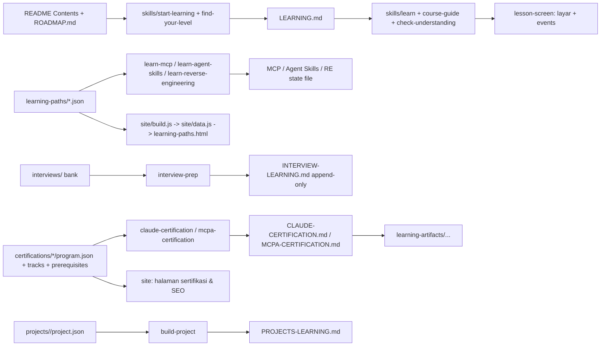

# Analisis Sistem Pembelajaran & Tutor — `ai-engineering-from-scratch`

Laporan ini menganalisis subsistem pembelajaran/tutor di repositori
`C:\Users\Hendra\Downloads\ai-engineering-from-scratch`. Fokus: 18 *agent skill*
di `skills/`, manifest di `learning-paths/`, program sertifikasi di
`certifications/` (Claude + MCPA), wrapper `.claude/skills/`, direktori
`outputs/`, serta konvensi berkas state pembelajar. Semua simpulan bersumber
dari berkas di dalam repositori; tidak ada berkas repositori yang diubah.

---

## 1. Ringkasan eksekutif

Sistem ini bukan sekadar kumpulan dokumentasi, melainkan **lapisan tutor
berbasis agen** di atas kurikulum 542 pelajaran / 20 fase. Arsitekturnya terdiri
dari lima lapis:

| Lapis | Lokasi | Peran |
|---|---|---|
| Tutor (agen) | `skills/` (18 skill) + `.claude/skills/` (cermin identik) | Mengajar satu sesi/interaksi, mengajukan prediksi, kuis, menjalankan lab, menulis state |
| Rute terfokus | `learning-paths/*.json` (13 manifest) | Urutan pelajaran, prasyarat, *checkpoint evidence*, gerbang keamanan, estimasi waktu |
| Sertifikasi | `certifications/claude/` + `certifications/mcpa/` (420 berkas) | Program, track, graf prasyarat, asesmen, dan 67 pelajaran sertifikasi paritas penuh |
| State pembelajar | `LEARNING.md`, `MCP-LEARNING.md`, `AGENT-SKILLS-LEARNING.md`, `REVERSE-ENGINEERING-LEARNING.md`, `CLAUDE-CERTIFICATION.md`, `MCPA-CERTIFICATION.md`, `INTERVIEW-LEARNING.md`, `PROJECTS-LEARNING.md` | Progres milik pembelajar, dibuat di *working directory*, bukan di-commit |
| Situs | `site/build.js`, `site/data.js`, `site/learning-paths.*`, `site/test_learning_paths.js` | Mengonsumsi manifest sebagai data, memvalidasi rute, membangun halaman rute + SEO |

Prinsip lintas sistem yang menonjol: **satu sesi = satu unit kerja** (satu
pelajaran, satu tahap proyek, satu pertanyaan wawancara, satu mode sertifikasi),
**jangan pernah membocorkan jawaban sebelum pembelajar menjawab**, **bukti
harus diamati** (bukan sekadar "tes lulus"), dan **state rute tidak boleh
dicampur** (`learn` tidak boleh menimpa state MCP, misalnya).

---

## 2. Katalog lengkap 18 skill (`skills/`)

Setiap direktori skill memiliki `SKILL.md` dengan frontmatter YAML
(`name`, umumnya `version`, `description` berisi *trigger phrases*, dan
`tags`). Empat skill juga punya `agents/openai.yaml` sebagai adapter antarmuka
untuk host OpenAI: `claude-certification`, `interview-prep`, `lesson-screen`,
`mcpa-certification`.

### 2.1 Tabel ringkas: trigger, tujuan, state, dan verifikasi

| # | Skill (`skills/<n>/SKILL.md`) | Pemicu utama | Tujuan | State yang ditulis | Mengajar / memverifikasi |
|---|---|---|---|---|---|
| 1 | `start-learning` | "start learning", "onboard me", "create my learning plan" | Onboarding sekali jadi: wawancara 3 pertanyaan + tes penempatan → rencana 20 fase | `LEARNING.md` | Menentukan phase masuk, status Skip/Review/Do/Done, estimasi jam dari `ROADMAP.md` |
| 2 | `find-your-level` | "find my level", "placement test", "which phase" | Kuis penempatan 5 area × 2 soal = 10 soal | Tidak ada (hasil dipakai `start-learning`) | Area: Math, Classical ML, Deep Learning, NLP & Transformers, Applied AI; kunci di `references/answer-key.md` |
| 3 | `learn` | "next lesson", "teach me", "resume learning" | Tutor satu pelajaran interaktif | `LEARNING.md` (progress log + review queue) | Problem → konsep → build-it → use-it → see-it → kuis `post`; <70% masuk review queue |
| 4 | `check-understanding` | `/check-understanding 13`, "quiz me on phase 2" | Kuis satu fase, 8 soal yang dibuat dari `docs/en.md` | Tidak ada | 4 konseptual + 4 praktis; grade Mastered/Almost/Developing/Start Over; review per pelajaran |
| 5 | `course-guide` | "where do I learn", "I'm stuck on", "teach me MCP" | Router topik → 1–3 pelajaran tepat + skill berikutnya | Tidak ada | Sumber: `README.md` Contents + `glossary/terms.md`; mengalihkan ke rute fokus |
| 6 | `learn-mcp` | "start/resume MCP path" | Tutor rute MCP 17 pelajaran | `MCP-LEARNING.md` | Wire evidence JSON-RPC, era protokol, gerbang deployment publik; mode Executable/Conceptual |
| 7 | `learn-agent-skills` | "start/resume Agent Skills" | Tutor rute 5 pelajaran (22, 24, 25, 26, 27) | `AGENT-SKILLS-LEARNING.md` | Instalasi host nyata, discovery, routing, sandbox/trust, eval & portability |
| 8 | `learn-reverse-engineering` | "start/resume Reverse Engineering" | Tutor rute 14 pelajaran (32–45) | `REVERSE-ENGINEERING-LEARNING.md` | ELF/Mach-O, disassembly, lifting, SSA, bukti, ABI, diffing; hanya biner sendiri |
| 9 | `build-project` | "build a project", "next project stage" | Tutor satu tahap proyek; peserta yang menulis kode | `PROJECTS-LEARNING.md` | Grader `scripts/project_test.py`, 3 level hint, tidak membuka `solution/` / `heldout/` |
| 10 | `claude-certification` | pilih/mulai/lanjut CCAO-F, CCDV-F, CCAR-F, CCAR-P | Empat mode: onboarding, lesson, assessment, remediation | `CLAUDE-CERTIFICATION.md` | Track JSON, lab nyata + tes, artifact milik peserta, kuis ≥70%, diagnostic/mock |
| 11 | `mcpa-certification` | prepare MCPA, mock, remediasi | Tutor sertifikasi MCPA satu track (`mcpa-f`) | `MCPA-CERTIFICATION.md` | Protokol 2026-07-28, `check_mcpa_wire.py`, diagnostic + 3 mock, capstone offline |
| 12 | `interview-prep` | "mock interview", "incident scenario", "review my gaps" | Satu pertanyaan/skenario per giliran, nilai, lalu arahkan ke pelajaran | `INTERVIEW-LEARNING.md` (**append-only**) | Penilaian 0–3 → level word, bucket penilaian, gap → lesson/manual/practice |
| 13 | `blueprint-figure` | "draw a figure", "sequence figure" | Satu SVG statis untuk satu klaim mekanisme | Tidak ada | 9 jenis figur, 10 hue, 8 gaya panah, cek keterbacaan & markup |
| 14 | `course-style` | "course style", "check my prose" | Referensi token warna/font/label/prosa/aksesibilitas | Tidak ada | `FIG_005`, `Fig. 4.1`, kalimat ≤25 kata, reduced motion, fokus 2px |
| 15 | `motion-figure` | "animated figure", "slider widget", "dither masthead" | Figur bergerak: 3 tier | Tidak ada | SMIL, widget ES5, mekanisme dengan *computed verdict*, dither WebGL, audit `TOTAL 0` |
| 16 | `isometric-explainer` | "isometric explainer", "explain this as a machine" | Halaman mesin isometrik interaktif | Tidak ada | Model `simulate(config)` murni + tes; 40–80/80–150/>150 bagian; verifikasi headless |
| 17 | `lesson-screen` | "open the lesson screen", "visualize this lesson" | Layar browser di samping terminal untuk figur & jejak kode | Tidak ada (build disalin ke `learning-artifacts/`) | CLI `start/status/events/publish/practice/shot/stop`; klik = petunjuk, bukan bukti |
| 18 | `write-manual` | "write a manual", "audit the manual" | Manual 60–100 halaman pada satu versi yang dipaku | Tidak ada (authoring) | Sumber berperingkat, capture offline, audit wajib `TOTAL 0`, dua audit independen |

### 2.2 Tutor kurikulum umum

**`start-learning`** (`skills/start-learning/SKILL.md`) adalah pintu masuk.
Sebelum onboarding umum ia melakukan *resume routing*: memetakan setiap berkas
state ke pemiliknya (`LEARNING.md`→`learn`, `MCP-LEARNING.md`→`learn-mcp`,
`MCP-ENGINEERING-LEARNING.md`→nama lama untuk rute MCP yang sama,
`AGENT-SKILLS-LEARNING.md`, `REVERSE-ENGINEERING-LEARNING.md`,
`CLAUDE-CERTIFICATION.md`, `INTERVIEW-LEARNING.md`). Jika rute fokus diminta,
ia **tidak** menjalankan placement dan **tidak** membuat `LEARNING.md`, melainkan
mengalihkan ke tutor rute terkait. Jika `LEARNING.md` sudah ada, pilihannya
hanya tiga: lanjutkan, ulangi placement (hanya bagian Placement/Path), atau
arsipkan sebagai `LEARNING-<YYYY-MM-DD>.md` setelah konfirmasi eksplisit.
Tiga pertanyaan wawancara hanya menangkap niat; pengetahuan diukur oleh
`find-your-level`. Template state terdiri dari `Mission`, `Placement`, `Path`
(20 baris fase), `Progress log`, `Review queue`.

**`find-your-level`** menjalankan kuis 10 soal per putaran dua soal dengan
*answer isolation*: kunci di `skills/find-your-level/references/answer-key.md`
tidak boleh dibaca sebelum jawaban putaran berjalan dikirim, dan placeholder
balasan harus netral `Reply with Q1: <letter>, Q2: <letter>.`. Pemetaan skor:
0–3 → Fase 1; 4–5 → Fase 3; 6–7 → Fase 7; 8–9 → Fase 11; 10 → Fase 14.
Area dengan 1/2 pada fase yang terlewati ditandai `Review` (mis. NLP 1/2 →
Fase 5 dan 7). Jam diambil dari `ROADMAP.md`, bukan angka hardcode.

**`learn`** adalah tutor inti, satu pelajaran per invokasi. Sumber konten
`phases/<phase>/<lesson>/docs/en.md`, `quiz.json`, dan daftar pelajaran di
`README.md`; fallback `https://raw.githubusercontent.com/rohitg00/ai-engineering-from-scratch/main/<path>`.
Alurnya: Step 0 cari state → Step 1 *warm-up recall* 2 soal pelajaran
sebelumnya → Step 2 ajarkan sesuai kerangka pelajaran → Step 3 kuis `stage=post`
→ Step 4 tulis baris Progress log (skor <70% → Review queue; akhir fase →
`Done` + sarankan `check-understanding`) → Step 5 penutup dua baris. Kunci
jawaban tidak boleh terlihat sebelum peserta menjawab; klik layar tidak pernah
hitung sebagai jawaban kuis.

**`check-understanding`** menerima nomor 0–19 atau alias fase (tabel pemetaan
lengkap di `SKILL.md` baris 29–50), membaca seluruh `docs/en.md` fase itu, lalu
membuat 8 soal (4 konseptual, 4 praktis) yang diberikan satu per satu dengan
isolasi jawaban. Nilai 7–8 = Mastered, 5–6 = Almost, 3–4 = Developing, 0–2 =
Start Over; untuk Fase 19, ucapan "selesai seluruh kurikulum" hanya boleh
muncul jika `LEARNING.md` menunjukkan Fase 0–18 Done/Skip.

**`course-guide`** memakai tabel Contents di `README.md` sebagai *single source
of truth* dan menerima enam bentuk pertanyaan (topik, *struggle*, meta,
sertifikasi, MCP, Agent Skills). Untuk *struggle*, ia membuka `docs/en.md`
kandidat sebelum merekomendasikan (mis. loss NaN → pelajaran loss function dan
stabilitas numerik, bukan FAQ framework). Jawaban dibatasi ±12 baris dan
diakhiri aksi dengan sintaks host yang benar.

### 2.3 Tutor rute fokus

**`learn-mcp`** mengikuti urutan manifest `learning-paths/model-context-protocol.json`
bukan urutan numerik: 06, 07, 08, 09, 10, 11, 12, 13, 14, 15, 16, 18, 17, 28,
29, 30, 31. Capstone opsional Lesson 23 hanya setelah 17 pelajaran wajib dan
prasyarat Lesson 19/20 selesai. Ia menetapkan *evidence mode*: Executable
(jika ada clone + Python 3; rekam cwd, perintah, exit code, request id, method,
era protokol, hasil, dengan token/secret disamarkan) atau Conceptual (hand
trace, runtime/transport/auth/deployment tetap `Pending`). Migrasi
`MCP-ENGINEERING-LEARNING.md` → `MCP-LEARNING.md` dilakukan byte-for-byte; jika
kedua berkas ada, konflik dilaporkan, bukan ditimpa. **Public deployment gate**
meminta checkpoint Lesson 15, tinjauan target & otoritas, dan konfirmasi
eksplisit sebelum bind non-loopback/ publikasi registry.

**`learn-agent-skills`** memakai `learning-paths/agent-skills.json`, urutan
wajib 22 → 24 → 25 → 26 → 27 (Lesson 23 opsional). *Real-lab preflight*:
`node`, `npx`, `python3`, host pilihan, scope instalasi yang bisa ditulis, dan
`TARGET_ROOT`. Sebelum Lesson 26, Lesson 25 harus `Done` **dan** check
`tool-poisoning-and-untrusted-instructions` berstatus `Confirmed`; jika tidak,
Lesson 15 ditawarkan sebagai refresher di luar rute. Ia tidak menginstal,
mengubah, atau menghapus sistem eksternal tanpa konfirmasi.

**`learn-reverse-engineering`** memakai 14 pelajaran Phase 13 nomor 32–45.
Scope etis tegas: hanya program yang dibuat sendiri atau ada izin tertulis;
tidak mencakup bypass proteksi, DRM, atau perangkat lunak orang lain.
Preflight Python ≥3.10 + check `own-binaries-only`; `clang` opsional (tanpa itu
Lesson 36 melaporkan `unknown`). Checkpoint per pelajaran sangat spesifik,
misalnya 13/33 harus cocok dengan `llvm-objdump` dan membangun CFG +
dominator untuk `grade`, 13/44 mencocokkan fungsi lintas level optimasi.

**`build-project`** bekerja pada `projects/<id>/project.json`,
`stages/<id>/docs/en.md`, `starter/`, dan `tests/`. Ia **tidak pernah** membuka
`projects/<id>/solution/` atau `heldout/` kecuali untuk mendiagnosis kegagalan,
dan tetap memberi hint, bukan kode. Satu tahap per sesi; grader dijalankan
bersama dengan `python3 scripts/project_test.py <id> --stage <N> --path <workspace>`;
tiga level hint; refleksi memakai pertanyaan "Check yourself". Di akhir,
`--strict --report completion.json` untuk sertifikat lokal.

### 2.4 Tutor sertifikasi

**`claude-certification`** (`skills/claude-certification/SKILL.md`, 305 baris)
mengubah repo menjadi tutor empat mode. Sumber kebenaran:
`certifications/claude/program.json`, `tracks/<exam-code>.json`,
`docs/en.md`, `code/main.py`, `code/tests/`, `outputs/`, `quiz.json`, dan
path asesmen yang dideklarasikan track. Onboarding menyampaikan batas
independensi dalam dua kalimat, lalu hanya tiga pertanyaan; pemetaan hasil:
`ccao-f` (pengetahuan kerja, tanpa coding), `ccdv-f` (builder aplikasi),
`ccar-f` (arsitek menengah), `ccar-p` (arsitek senior). Mode Lesson:
recall 2 soal → Explain and Challenge (termasuk `Interactive Lab`) →
jalankan `python3 <lesson>/code/main.py` dan `python3 -m unittest discover -s <lesson>/code/tests -v` → post-quiz. *Guided no-code* untuk CCAO-F: agen
menjalankan validator, peserta tetap mengambil keputusan dan mengisi artifact
di `learning-artifacts/claude/<exam-code>/<lesson-slug>/`. Lesson ditandai
`Complete` hanya jika penjelasan benar, lab/tests lulus (atau keterbatasan
lingkungan tercatat), artifact dibuat/dibela, dan post-quiz ≥70%. Mode
Assessment memakai JSON asesmen yang sudah ada, skor *exact set equality*
tanpa partial credit, dan menyatakan bahwa persentase mentah bukan skala
Anthropic 100–1000. Lesson 30 memiliki simulator offline; mode wire API nyata
hanya dengan izin, jaringan, `ANTHROPIC_API_KEY`, dan `ANTHROPIC_MODEL`.

**`mcpa-certification`** mengikuti pola yang sama untuk satu track `mcpa-f`.
Sumber tambahan: `certifications/mcpa/research/source-verification-ledger.md`
dan `research/mcp-2026-07-28-brief.md`; tutor mengajarkan revisi protokol
2026-07-28 sebagai versi terkini (tanpa `initialize`, tanpa session, tanpa
`Mcp-Session-Id`; `_meta` memuat versi & capabilities; `server/discover`), dan
memakai `python3 scripts/check_mcpa_wire.py <lesson-path>` saat transkrip
diubah. Artifact peserta di `learning-artifacts/mcpa/<lesson-slug>/`. Tiga
mock dengan penekanan berbeda (operasional, wire-level, trade-off desain &
keamanan) dipakai bergantian saat retake. Capstone wajib:
`33-mcpa-capstone-readiness`; semua lab offline, tanpa API key atau jaringan.

### 2.5 Wawancara, figur, visualisasi, dan manual

**`interview-prep`** memiliki aturan paling keras: "Never show any part of an
answer before the learner has answered." Bagian jawaban yang dilarang
ditampilkan meliputi `Short answer`, `Full answer`, `Expected:` follow-up,
`Wrong answers`, `Taught in`, `Walkthrough`, `Resolution`, `Wrong turns`,
`Generalize`. Sumber: `interviews/topics.yaml`, `roles.yaml`, item di
`interviews/questions/<card-id>/`, skenario di `interviews/scenarios/<id>/`,
loop di `interviews/loops/<role-id>.md`, kontrak di `interviews/AUTHORING.md`.
Enam mode: Setup, Question, Scenario, Loop, Review, Score-and-close. Nilai 0–3
diterjemahkan ke kata `missed/partial/working/strong`; bucket temuan:
Got it, Missing, Wrong turn, Unsupported number, Shaky reasoning, Strength
pattern (dua terakhir berlabel *inferred*). Setiap gap diberi 1–3 target path
dan tanggal jatuh tempo. State `INTERVIEW-LEARNING.md` **append-only** dengan
ID `P-`, `A-`, `G-` dan kolom `Supersedes` (lihat
`skills/interview-prep/references/state-file.md`).

**`blueprint-figure`** menghasilkan satu SVG statis per klaim (≤28 kata) pada
grid 640 unit. Sembilan jenis: sequence, structure, flow, comparison,
timeline, tree, state, decision, layers. Makna warna tetap: `rose`=failure,
`grey`=di luar subjek, `amber`=lifecycle, `teal`=durable state; delapan gaya
panah (solid ink = call, dashed ink = reply, solid teal = write, dashed amber
= state change, solid plum = model call, dashed olive = efek eksternal,
dotted indigo = stream/event, dashed rose = failure). Teks ≥11 unit,
`viewBox="0 0 640 H"` dengan H ≤760, `<title>`/`<desc>` ≥40 karakter, tanpa
`style`/script/link/image. Skrip disimpan di sebelah SVG dan SVG tidak boleh
disunting manual.

**`course-style`** adalah lapisan referensi (tidak menggambar): token light
dan dark (`--blueprint` `#3553ff`/`#6b8eff`), font, label `FIG_005`, sub-figure
`FIG_005.A`, label manual `Fig. 4.1` / id `fig-4-1`, aturan prosa (kalimat
≤25 kata, instruksi ≤20 kata, tanpa em/en dash, semicolon, kontraksi, atau
kata "may"), durations 160/180/220/250 ms, reduced-motion, fokus 2px, target
sentuh ≥44px.

**`motion-figure`** punya tiga tier: (1) figur pelajaran berbasis `figure`
fence dengan SMIL atau widget slider (ES5, tanpa `setInterval`/
`requestAnimationFrame`, ≤55 elemen SVG, loop 2.5–6 detik), (2) mekanisme HTML
dengan satu kontrol dan *verdict* yang dihitung, (3) dither field WebGL dengan
maksimal 30 fps dan fallback statis. Validasi: `node scripts/audit_lesson_figures.js --only <name>` harus `TOTAL 0`.

**`isometric-explainer`** membangun halaman mesin isometrik dengan model
`simulate(config)` murni dan deterministik sebagai satu-sumber kebenaran;
gerakan, readout, dan narasi semuanya berasal dari event model. Tingkatan
ukuran: Figure 40–80 bagian, Hero 80–150, lebih dari 150 butuh persetujuan.
Elevasi kamera 30°, satu azimuth, transisi dengan spring 64/14.2, verifikasi
headless pada desktop/telepon dan kedua tema.

**`lesson-screen`** adalah server web lokal + satu tab browser; tutor tetap
mengajar di terminal. Perintah: `start`, `status`, `events`, `publish`,
`practice`, `shot`, `stop`. Layar disimpan di `.lesson-screen/screens/`;
tutor menulis satu berkas HTML baru per langkah dan membaca `CLI events`
sebelum setiap balasan. Ia mengutamakan *figure fence* yang sudah terdaftar,
lalu bisa membangun figur baru: Blueprint (5–10 mnt), Mechanism (15–25 mnt),
Isometric (40–90 mnt), 3D (60–120 mnt). Aturan kebenaran: angka harus dari
pelajaran atau run nyata; jawaban tidak boleh muncul di layar; klik hanya
petunjuk; setiap figur buatan harus bertuliskan bahwa tutor yang membuatnya
dan belum ditinjau penulis kursus. Halaman practice berisi Brief, Drill,
Review (1, 3, 7, 16 hari), Go deeper; progresnya disimpan di browser dan
tidak mengubah state tutor.

**`write-manual`** adalah skill authoring, bukan tutor pembelajar: manual
60–100 halaman, 6–8 bagian + referensi, ±25 seksi, 30–40 figur, pin versi,
sumber berperingkat, *conflict register*, capture kit di `capture/out/`, dan
audit `node scripts/audit_manuals.js --manual <id>` yang harus `TOTAL 0`
pada *staged tree*.

---

## 3. Instalasi dan pemanggilan lintas host

### 3.1 Instalasi tutor

Bukti di `README.md` baris 22–26 dan 227–235:

```bash
npx skills add rohitg00/ai-engineering-from-scratch
```

Perintah ini menulis ke direktori skill host/scope yang dipilih installer,
misalnya `.claude/skills/`, `.cursor/skills/`, `.codex/skills/`, atau folder
lain yang didukung (`README.md` baris 248–250). Prasyarat yang disarankan:
Node.js, `npx`, dan `python3` (`node --version`, `npx --version`,
`python3 --version`). Tutor dapat membaca konten langsung dari GitHub sehingga
clone tidak wajib; lab rute fokus yang bisa dijalankan membutuhkan `python3`.

Tabel invokasi di `README.md` baris 252–258:

| Host | Mulai kursus | Mulai MCP | Mulai Agent Skills | Kuis fase |
|---|---|---|---|---|
| Codex | `start-learning` atau pilih dari `/skills` | `learn-mcp` atau `/skills` | `learn-agent-skills` atau `/skills` | `check-understanding 13` atau `/skills` |
| Claude Code | `/start-learning` | `/learn-mcp` | `/learn-agent-skills` | `/check-understanding 13` |
| Host lain | `Use start-learning to begin the course.` | `Use learn-mcp to start the Model Context Protocol (MCP) path.` | `Use learn-agent-skills to start the Agent Skills Engineering path.` | `Use check-understanding to quiz me on Phase 13.` |

Aturan yang berulang di hampir semua `SKILL.md`: **nama skill portabel,
sintaks invokasi milik host**. Jika host tidak diketahui, pakai bahasa alami.
`course-guide`, `start-learning`, `learn`, `build-project`, `interview-prep`,
dan tutor sertifikasi masing-masing memuat *host invocation contract*/
tabel serupa agar agen tidak mengajarkan slash command Claude Code sebagai
sintaks universal.

### 3.2 Wrapper `.claude/skills/`

`.claude/skills/` berisi 18 direktori dengan nama sama persis seperti
`skills/`. Pemeriksaan hash SHA-256 menunjukkan kedua pohon identik byte-for-byte
(74 berkas di masing-masing pohon; 0 berkas yang berbeda). Jadi ini **cermin
check-in**, bukan symlink dan bukan wrapper yang memuat teks berbeda:
Claude Code menemukan skill otomatis lewat `.claude/skills/`, sementara host
portabel memakai `skills/`. `AGENTS.md` baris 186–189 dan 203–206 secara
eksplisit menyebut kedua jalur ini untuk mode sertifikasi dan wawancara.

Empat skill memiliki `agents/openai.yaml` berisi `display_name`,
`short_description`, dan `default_prompt`, misalnya
`skills/mcpa-certification/agents/openai.yaml`:
`"Use mcpa-certification to prepare for the MCPA certification and teach me the next step."`

### 3.3 `outputs/` dan artifact pelajaran

Direktori `outputs/` di akar repo hanya berupa kerangka registri:
`outputs/index.json` berisi
`{"version":"1.0.0","prompts":[],"skills":[],"agents":[],"mcp_servers":[]}`
dan empat subdiri dengan `.gitkeep` (`agents/`, `mcp-servers/`, `prompts/`,
`skills/`). Artifact nyata berada di `phases/**/outputs/`: 478 direktori
`outputs`, 598 berkas, 409 berkas bernama `skill-*`. `README.md` baris 1326
menyebut 414 skill dan 100 prompt yang dipasang lewat:

```bash
python3 scripts/install_skills.py <target> [--layout skills|by-phase|flat] [--type all] [--phase N] [--tag TAG] [--dry-run] [--force]
```

`scripts/install_skills.py` berjalan pada pola
`phases/**/outputs/{skill,prompt,agent}-*.md` dan bundle
`phases/**/outputs/<name>/SKILL.md`, menulis `manifest.json` di target.
Ini berbeda dengan 18 skill tutor: yang pertama adalah *artifact hasil
pelajaran*, yang kedua adalah *tutor itu sendiri*.

---

## 4. Manifest `learning-paths/`

### 4.1 Strukturnya

Ada 13 berkas JSON plus `CAREER-PRACTICE.md`. Dua bentuk schema:

**Rute tutor terfokus** (`model-context-protocol.json`, `agent-skills.json`,
`reverse-engineering.json`) memuat kunci:
`schemaVersion`, `id`, `title`, `summary`, `estimatedMinutes`, `stateFile`,
`prerequisites[]`, `invocation` (`codex`, `claudeCode`, `portableFallback`),
`conceptualFallback`, `quickStart`, `lessons[]`, `optionalLessons[]`
(`publicDeploymentGate` hanya pada manifest MCP). Setiap `prerequisites`
punya `type` (`knowledge`/`software`/`host`/`lesson`), `required`, `title`,
`description`, dan opsional `id` untuk *check* yang stabil. Setiap lesson
punya `order`, `phase`, `lesson`, `title`, `path`, `minutes`, `required`,
`checkpointEvidence[]` (MCP) atau `checkpoint` (Agent Skills/RE), serta
`prerequisitePaths`/`prerequisiteChecks` bila ada gerbang.

**Rute karier** (`kind: "career-route"`) memuat metadata peran
(`workFamily`, `commonTitles`, `keywords`, `decisionPrompt`, `mission`,
`responsibilities`, `goodFitIf`, `baseline`, `boundary`, `timeNote`),
`portfolioProof`, `projects[]`, `readinessCriteria`, `coverage`
(`strong`/`partial`/`outsideCourse`), `completionClaim`, `sourceBasis`,
`estimatedMinutes`, `stages[]` (berisi `lessonPaths[]` + `artifact`), dan
`lessons[]`. Empat manifest dasar lainnya
(`building-and-deploying-ai-applications.json`, `shaping-the-build.json`,
`software-engineering-fundamentals.json`, `using-coding-agents.json`) memakai
bentuk ringkas: `schemaVersion`, `id`, `title`, `summary`, `estimatedMinutes`,
`lessons[]`.

### 4.2 Daftar manifest, jumlah pelajaran, dan state

| Manifest | Jenis | Pelajaran | Tahap | Estimasi (menit) | State file |
|---|---|---:|---:|---:|---|
| `agent-skills.json` | Tutor fokus | 5 (+1 opsional) | 1 | 570 | `AGENT-SKILLS-LEARNING.md` |
| `model-context-protocol.json` | Tutor fokus | 17 (+1 opsional) | 1 | 1395 | `MCP-LEARNING.md` |
| `reverse-engineering.json` | Tutor fokus | 14 | 1 | 1945 | `REVERSE-ENGINEERING-LEARNING.md` |
| `agentic-ai-engineer.json` | career-route | 14 | 4 | 865 | — |
| `ai-data-engineer.json` | career-route | 11 | 4 | 915 | — |
| `ai-developer-relations-engineer.json` | career-route | 11 | 4 | 905 | — |
| `ai-evaluation-reliability-engineer.json` | career-route | 12 | 4 | 750 | — |
| `applied-ai-engineer.json` | career-route | 12 | 4 | 885 | — |
| `forward-deployed-ai-engineer.json` | career-route | 12 | 4 | 865 | — |
| `building-and-deploying-ai-applications.json` | domain dasar | 12 | 1 | 780 | — |
| `shaping-the-build.json` | domain dasar | 8 | 1 | 550 | — |
| `software-engineering-fundamentals.json` | domain dasar | 13 | 1 | 730 | — |
| `using-coding-agents.json` | domain dasar | 16 | 1 | 900 | — |

`CAREER-PRACTICE.md` adalah panduan praktik: satu proyek yang sama dibawa
melalui empat domain dasar dan satu rute karier, dengan *evidence bundle*
(brief keputusan, kontrol agen, verifikasi independen, rekord efektivitas
cek, laporan biaya per hasil, catatan pemangku kepentingan, catatan umpan
balik/insiden). Ini menegaskan bahwa rute karier adalah *overlay spesialis*,
bukan pengganti fondasi.

### 4.3 Urutan dan gerbang penting

- MCP: `06,07,08,09,10,11,12,13,14,15,16,18,17,28,29,30,31`; Lesson 23
  opsional hanya setelah ke-17 pelajaran + Lesson 19 dan 20.
- Agent Skills: `22,24,25,26,27`; Lesson 26 terkunci sampai Lesson 25 `Done`
  dan `tool-poisoning-and-untrusted-instructions` `Confirmed`.
- Reverse Engineering: `32` sampai `45`; Lesson 32 terkunci sampai
  `own-binaries-only` `Confirmed`.
- MCP `publicDeploymentGate`: `checkpointLessonPath` = Lesson 15
  (`15-mcp-security-tool-poisoning`), berlaku sebelum bind non-loopback,
  ingress bersama, endpoint hosted, atau publikasi registry.

### 4.4 Bagaimana situs mengonsumsinya

`site/build.js` baris 334–389 berfungsi `parseLearningPaths(repoRoot, phases)`:
membaca semua `*.json` di `learning-paths/`, memvalidasi `id` unik, normalisasi
prasyarat dan `prerequisiteChecks`, lalu menggabungkan data judul/URL dari tabel
`README.md` (manifest memiliki *intent* & pacing, README memiliki judul & URL).
Hasilnya ditulis ke `site/data.js` sebagai konstanta `LEARNING_PATHS`
(baris 2300). Fungsi `buildSeoManifests` (baris 840–887) memetakan tiap
`lesson.path` ke `learningPathIds` untuk SEO. Halaman
`site/learning-paths.html` + `site/learning-paths.js` + `.css` menyajikan
pemilih rute dan rute karier; `site/build-projects.js` baris 176–179
memvalidasi bahwa setiap `route.projects` merujuk proyek yang siap; ada pula
`site/test_learning_paths.js` sebagai pengujian. `site/data.js` adalah berkas
generate yang dibangun ulang CI dan tidak diedit manual.

---

## 5. Sistem sertifikasi (`certifications/`, 420 berkas)

### 5.1 Komposisi berkas

| Bagian | Jumlah berkas |
|---|---:|
| `certifications/claude/` | 204 |
| ├ `lessons/` | 182 |
| ├ `assessments/` | 8 |
| ├ `tracks/` | 4 |
| ├ `research/` | 5 |
| └ `references/` | 1 |
| `certifications/mcpa/` | 215 |
| ├ `lessons/` | 204 |
| ├ `assessments/` | 4 |
| ├ `tracks/` | 1 |
| └ `research/` | 2 |
| `certifications/README.md` | 1 |
| **Total** | **420** |

Jumlah direktori pelajaran: 33 untuk Claude dan 34 untuk MCPA. Pemeriksaan
terhadap 67 `docs/en.md` menunjukkan **semua** memiliki kelima seksi paritas
penuh (`Interactive Lab`, `Practice Lab`, `Shipped Artifact`, `Verify It`,
`Capstone Connection`), semua memuat `figure` fence, dan semua memiliki
direktori `outputs/`.

### 5.2 `program.json`: kebijakan program

| Field | Claude | MCPA |
|---|---|---|
| `id` | `claude-certifications` | `mcpa-certification` |
| `provider` | Anthropic | Agentic AI Foundation |
| `lastVerified` | 2026-08-09 | 2026-09-24 |
| `guideVersion` / effective | 1.0 / July 2026 | 1.0 / September 2026 |
| Notifikasi akses | Terbatas pada organisasi Claude Partner Network | Pendaftaran terbuka via Linux Foundation Training |
| `specVersion` | — | `2026-07-28` |
| `tracks` | `claude-ccao-f`, `claude-ccdv-f`, `claude-ccar-f`, `claude-ccar-p` | `mcpa-f` |
| `prerequisitesPath` | `certifications/claude/prerequisites.json` | `certifications/mcpa/prerequisites.json` |
| Scoring notice | Persentase latihan mentah, **bukan** skala 100–1000 Anthropic | Persentase mentah; skor lulus resmi MCPA tidak dipublikasikan |

Disclaimer independensi tercantum eksplisit: Claude — "not affiliated with,
endorsed by, sponsored by, or authorized by Anthropic"; MCPA — "not affiliated
with ... the Agentic AI Foundation or the Linux Foundation". Keduanya menyatakan
tidak memuat soal ujian live dan panduan resmi yang berlaku.

### 5.3 Track: kode ujian, bobot domain, rute, asesmen

| Track file | Kode | Kredensial | Butir / menit / biaya | Domain & bobot (%) | Rute | Deep dive | Study plan |
|---|---|---|---|---|---:|---:|---:|
| `claude/tracks/ccao-f.json` | CCAO-F | Claude Certified Associate – Foundations | 60 / 120 / $99 | Prompting 14; Output Evaluation 21; Product & Model 12; Workflow Integration 16; Configuration 12; Governance 15; Troubleshooting 10 | 9 | 5 | 2 (14 & 28 hari) |
| `claude/tracks/ccdv-f.json` | CCDV-F | Claude Certified Developer – Foundations | 53 / 120 / $125 | Agents 14.7; Applications 33.1; Claude Code 3.1; Eval 2.6; Model Selection 16.8; Prompt & Context 11.0; Security 8.1; Tools & MCP 10.6 | 15 | 6 | 2 (21 & 42 hari) |
| `claude/tracks/ccar-f.json` | CCAR-F | Claude Certified Architect – Foundations | 60 / 120 / $125 | Agentic Architecture 27; Tool Design/MCP 18; Claude Code 20; Prompt & Structured Output 20; Context & Reliability 15 | 21 | 5 | 2 (28 & 49 hari) |
| `claude/tracks/ccar-p.json` | CCAR-P | Claude Certified Architect – Professional | 63 / 120 / $175 | Solution Design 17; Models/Prompting/Context 13; Integration 19; Eval 16; Governance 14; Stakeholder 14; Dev Productivity 7 | 25 | 7 | 2 (35 & 63 hari) |
| `mcpa/tracks/mcpa-f.json` | MCPA | Model Context Protocol Associate | 60 / 90 / $250 (item count & passing score tidak dipublikasikan) | Fundamentals 16; Architecture 14; Interactions 26; Security 24; Use Cases 20 | 34 | 17 | — |

Setiap track memiliki `credential`, `level`, `accent`, `badge`, `audience`,
`recommendedExperience`, `summary`, `exam` (`items`, `timeLimitMinutes`,
`feeUsd`, `validityMonths`, `format`, `delivery`, `guideVersion`/`effective`,
`officialGuideUrl`), `domains[].objectives[]`, `lessons[]` berisi
`{path, domains[], role, required}` dengan peran `orientation`/`core`/`review`/
`capstone`, `deepDives[]` (pelajaran Phase sebagai pendalaman), `assessments[]`,
dan (Claude) `studyPlans[]` berisi `durationDays`, `hoursPerWeek`, `milestones[]`.

Rute Claude berakhir di capstone masing-masing: `29-associate-workflow-capstone`,
`30-developer-application-capstone`, `31-architect-foundations-scenario-capstone`,
`32-architect-professional-system-capstone`; MCPA berakhir di
`33-mcpa-capstone-readiness`. Rute diawali `00-certification-strategy` (Claude)
atau `00-mcp-exam-strategy` (MCPA).

### 5.4 Graf prasyarat

`certifications/claude/prerequisites.json` dan
`certifications/mcpa/prerequisites.json` berbentuk
`{"version":1,"lessons":{"<path>":["<path prasyarat>", ...]}}`. Claude:
33 entri, dari `00` (kosong) hingga capstone dengan banyak prasyarat lintas
cabang, misalnya `21-long-context-reliability` mensyaratkan Lesson 17, 18, 20;
`28-stakeholder-communication` mensyaratkan 22 dan 27. MCPA: 34 entri berupa
rantai linear `00 → 01 → ... → 33`. `AGENTS.md` mewajibkan setiap rute track
memuat prasyarat internal sebelum pelajaran yang mengonsumsinya; ini diverifikasi
oleh audit sertifikasi.

### 5.5 Skema asesmen dan isinya

Skema asesmen berbeda dari `quiz.json` pelajaran karena mendukung
jawaban ganda. Field: `id`, `version`, `track`, `kind` (`diagnostic`/`mock`),
`title`, `timeLimitMinutes`, `questions[]`. Tiap soal: `id`, `domain`,
`objective`, `type` (`single`/`multiple`), `prompt`, `options[]`,
`correct[]` (array indeks; tepat satu untuk `single`, minimal dua untuk
`multiple`), `explanation`, `references[]` (path pelajaran). Contoh nyata:
`certifications/mcpa/assessments/mcpa-f/diagnostic.json` soal `mcpa-f-diag-001`
memiliki `correct: [1]` dan referensi
`certifications/mcpa/lessons/02-the-integration-problem`.

| Program | Diagnostic | Mock |
|---|---|---|
| Claude | ccao-f 14 soal/25 mnt; ccdv-f 16/30; ccar-f 15/30; ccar-p 14/30 | masing-masing 1 mock: 60, 53, 60, 63 soal / 120 mnt |
| MCPA | 30 soal / 30 mnt | 3 mock × 60 soal / 90 mnt: operasional, wire-level, trade-off desain & keamanan |

Catatan kecil: tabel di `certifications/claude/GETTING_STARTED.md` baris 58
menulis diagnostic CCAO-F 16 soal, tetapi `assessments/ccao-f/diagnostic.json`
berisi 14 soal; track JSON dan berkas asesmenlah yang dipakai tutor sebagai
sumber kebenaran.

### 5.6 Kontrak pelajaran sertifikasi

Setiap pelajaran memiliki:
`docs/en.md` (frontmatter Judul, hook, **Type**, **Languages**,
**Prerequisites**, **Time**, `## Learning Objectives`), `code/main.py`,
`code/tests/test_*.py` (≥5 tes deterministik), `quiz.json` (6 soal:
`pre`, 3 × `check`, 2 × `post`), dan `outputs/` berisi artifact referensi yang
**sudah terisi**, bukan lembar kosong. Contoh
`certifications/claude/lessons/16-multi-agent-orchestration-and-delegation/docs/en.md`
memuat seksi wajib pada baris 190–227: `Interactive Lab` dengan
` ```figure ` bernama `16-multi-agent-topology`, `Practice Lab`,
`Shipped Artifact` (menunjuk `outputs/orchestration-contract.md`),
`Verify It` (dua perintah Python), dan `Capstone Connection`. Konseptual pun
harus praktis: policy scorer, threat-model checker, ADR validator, approval
simulator, evidence grader, atau scenario runner — bukan API palsu.

`certifications/mcpa/GETTING_STARTED.md` dan versi Claude memuat panduan
AI-native: clone → `/<nama-skill>` di Claude Code, `npx skills add ...` untuk
Codex/Cursor/langsung, atau prompt tempel untuk harness tanpa skill lokal.
Keduanya menegaskan enam kewajiban peserta (jelaskan, prediksi & manipulasi,
jalankan lab & tes, bangun/bela artifact, lulus kuis, remediasi domain lemah)
dan lokasi artifact milik peserta.

---

## 6. Konvensi berkas state pembelajar

Berkas state **tidak** di-check-in ke repositori (pencarian tidak menemukan
`LEARNING.md`, `MCP-LEARNING.md`, dll. di pohon repo). Tutor membuatnya di
*current working directory* peserta. Aturan umum: satu berkas = satu pemilik,
jangan dicampur, jangan ditimpa, arsipkan hanya setelah konfirmasi.

| Berkas state | Pemilik | Perilaku penulisan | Isi khas |
|---|---|---|---|
| `LEARNING.md` | `start-learning` (buat), `learn` (update) | Diarsipkan `LEARNING-<tanggal>.md` untuk "start over" | Mission; Placement; Path 20 fase; Progress log; Review queue |
| `MCP-LEARNING.md` | `learn-mcp` | Migrasi dari `MCP-ENGINEERING-LEARNING.md`; konflik jika keduanya ada | Route (Current, Evidence mode); Environment; Public deployment gate; Progress 17 baris; Wire evidence; Notes |
| `AGENT-SKILLS-LEARNING.md` | `learn-agent-skills` | Preserve notes/evidence; lanjut baris `Next`/`In progress` | Route 5 baris; Prerequisite check (host, scope, Lesson 15, tool poisoning); Progress; Notes |
| `REVERSE-ENGINEERING-LEARNING.md` | `learn-reverse-engineering` | Lesson 32 `Locked` sampai `own-binaries-only` Confirmed | Route 14 baris; Prerequisite check (Python 3.10, clang); Progress; Notes |
| `CLAUDE-CERTIFICATION.md` | `claude-certification` | Arsip `CLAUDE-CERTIFICATION-<exam>-<tanggal>.md` saat ganti track/restart | Goal; Active track; Route; Domain readiness; Review queue; Assessment attempts |
| `MCPA-CERTIFICATION.md` | `mcpa-certification` | Arsip `MCPA-CERTIFICATION-<tanggal>.md` | Sama, untuk track tunggal `mcpa-f` |
| `INTERVIEW-LEARNING.md` | `interview-prep` | **Append-only**; perubahan = baris baru dengan `Supersedes` | Profile (`P-`), Attempts (`A-`), Gaps (`G-`); Status open/closed; Due |
| `PROJECTS-LEARNING.md` | `build-project` | Dapat memuat beberapa proyek; tidak menimpa catatan lama | Per proyek: Started, Workspace, Mode, Current stage; tabel Stage/Grader result/Date/Note |

Aturan *resume routing* muncul di `start-learning`, `learn`, `course-guide`, dan
`interview-prep`: jika pengguna menyebut rute, langsung ke pemiliknya; jika
tidak disebut, kumpulkan pemilik berkas yang ada (dua nama MCP digabung);
jika hanya satu, lanjutkan ke sana; jika dua atau lebih, tanya dulu; **jangan**
mengambil rute dari tanggal berkas terbaru dan **jangan** menggabungkan progres
rute ke `LEARNING.md`. Legacy alias `learn-mcp-engineering` diterima hanya
untuk mencapai `learn-mcp`.

Artifact peserta tidak boleh menimpa artifact referensi:
`learning-artifacts/claude/<exam-code>/<lesson-slug>/`,
`learning-artifacts/mcpa/<lesson-slug>/`, dan
`learning-artifacts/<phase>-<lesson>/` untuk build `lesson-screen` yang ingin
disimpan. `AGENTS.md` menegaskan: jangan memodifikasi artifact checklist-in
sebagai hasil kerja peserta.

---

## 7. Aturan `AGENTS.md` yang mengikat mode tutor

Dua blok yang diminta secara khusus (`AGENTS.md` baris 184–210):

1. **AI-native certification learner mode** — ketika pengguna meminta memilih,
   memulai, melanjutkan, belajar, berlatih, atau menilai sertifikasi Claude,
   agen **wajib membaca dan mengikuti**
   `skills/claude-certification/SKILL.md` sebelum mengajar. Berlaku untuk
   Codex dan harness lain yang membaca `AGENTS.md`; Claude Code juga
   menemukan salinan di `.claude/skills/`. Repo diperlakukan sebagai tutor
   interaktif: baca track manifest, ajarkan satu pelajaran route setiap kali,
   jalankan skenario dan tes sungguhan, minta artifact milik peserta di
   `learning-artifacts/`, nilai kuis/asesmen tersimpan, dan simpan progres di
   `CLAUDE-CERTIFICATION.md`. Kurikulum sertifikasi sengaja berada di luar
   pipeline pembukuan buku dan terjemahan mesin, serta English-only.
2. **Interview practice learner mode** — untuk mock interview, pertanyaan,
   skenario insiden, loop peran, atau tinjauan gap, agen **wajib membaca**
   `skills/interview-prep/SKILL.md` sebelum bertanya. Tutor bertanya satu item,
   berhenti menunggu jawaban peserta, menilai terhadap bank, lalu mengalihkan
   setiap gap ke pelajaran dan seksi manual yang disebut item. **Tidak boleh**
   menampilkan bagian jawaban sebelum peserta menjawab. State berada di
   `INTERVIEW-LEARNING.md`, file append-only yang tidak ditulis skill lain.

Aturan pendukung lain yang relevan: diagram hanya Mermaid atau SVG (tanpa
box-drawing ASCII), setiap blok kode harus punya tag bahasa, implementasi
original (tidak mengutip repo kurikulum eksternal), dependency allowlist
(stdlib-first), dan validasi per-PR lewat `audit_lessons.py` /
`audit_certifications.py`.

---

## 8. Alur data end-to-end (ringkasan)



---

## 9. Temuan dan catatan penting

1. **18 skill tutor, bukan 18 artifact pelajaran.** `skills/` adalah tutor;
   `phases/**/outputs/` adalah artifact yang dihasilkan pelajaran (409 berkas
   `skill-*`), dipasang dengan `scripts/install_skills.py`, bukan `npx skills add`.
2. **`.claude/skills/` identik byte-for-byte** dengan `skills/` (74 berkas per
   pohon). Memperbarui satu salinan tanpa salinan lain akan membuat Claude
   Code dan host portabel melihat instruksi berbeda.
3. **State adalah milik peserta, bukan repo.** Tidak ada berkas state yang
   di-check-in; tutor membuatnya di direktori kerja peserta. `learn` tidak
   boleh memasukkan state MCP/Agent Skills/RE/sertifikasi/wawancara ke
   `LEARNING.md`.
4. **Bukti lebih penting dari "tes lulus".** `learn-mcp` secara eksplisit
   melarang memakai unit test sebagai pengganti bukti protokol, dan melarang
   menyimpulkan HTTP dari fungsi in-process, otorisasi dari autentikasi, atau
   konformasi dari satu SDK. `learn-agent-skills` dan RE juga meminta path,
   cwd, argv, dan exit code.
5. **Isolasi jawaban adalah kontrak lintas skill** (`find-your-level`, `learn`,
   `check-understanding`, tutor sertifikasi, `lesson-screen`, dan terutama
   `interview-prep`). Klik layar `lesson-screen` tidak pernah menjadi jawaban
   kuis atau bukti lab.
6. **Gerbang keamanan bersifat eksplisit**: MCP butuh konfirmasi deployment
   publik + checkpoint Lesson 15; Agent Skills butuh check tool-poisoning;
   Reverse Engineering butuh `own-binaries-only`; sertifikasi Claude butuh
   izin eksplisit untuk mode wire API live.
7. **Dua ketidaksesuaian kecil yang perlu diwaspadai** (bukan programmer error,
   tapi sumber kebenaran harus jelas): tabel `GETTING_STARTED.md` Claude
   menyebut 16 soal diagnostic CCAO-F sedangkan berkas asesmen berisi 14; dan
   track MCPA menyimpan `"items": 60` bersama `"itemCountPublished": false`,
   sehingga tutor harus menyampaikan angka 60 sebagai perkiraan/internal,
   bukan sebagai fakta resmi yang dipublish.
8. **Skor latihan bukan skor resmi.** Claude memakai skala 100–1000 untuk ujian
   resmi, sementara curriculum melaporkan persentase mentah; MCPA tidak
   mempublikasikan passing score. Tutor dilarang menjanjikan kelulusan.

---

## 10. Kesimpulan

Sistem pembelajaran repo ini adalah **tutor berbasis protokol**:

- `skills/` menyediakan 18 peran tutor dengan kontrak host-portable, isolasi
  jawaban, dan state ownership yang ketat.
- `learning-paths/` mengubah kumpulan pelajaran menjadi rute bermakna dengan
  urutan non-numerik, prasyarat, checkpoint bukti, dan gerbang keamanan; situs
  mengonsumsinya lewat `site/build.js` → `site/data.js`.
- `certifications/` (420 berkas) menambah lima track ujian dengan bobot domain
  publik, graf prasyarat, asesmen original, dan 67 pelajaran yang semuanya
  memenuhi seksi paritas penuh.
- State pembelajar selalu di luar artifact referensi, dan aturan `AGENTS.md`
  memastikan agen berperilaku sebagai tutor interaktif, bukan pembaca pasif atau
  pengisi jawaban.

Kekuatan utamanya adalah konsistensi: hampir setiap skill mengulang kontrak
yang sama — satu unit per sesi, prediksi sebelum penjelasan, bukti sebelum
status `Done`, dan tidak pernah membocorkan jawaban lebih awal.
