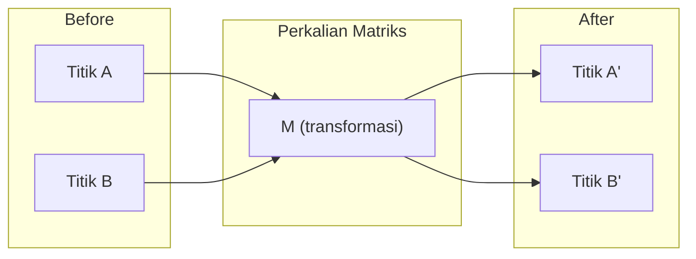
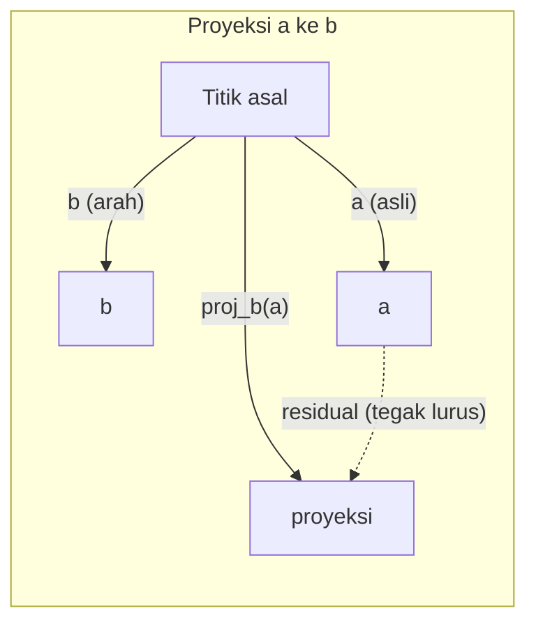

# Intuisi Aljabar Linear

> Setiap model AI hanyalah matematika matriks yang memakai topi mewah.

**Jenis:** Belajar
**Bahasa:** Python, Julia
**Prasyarat:** Fase 0
**Waktu:** ~60 menit

## Tujuan Pembelajaran

- Menerapkan operasi vektor dan matriks (penjumlahan, produk titik, perkalian matriks) dari awal dalam Python
- Menjelaskan secara geometris apa yang dilakukan produk titik, proyeksi, dan proses Gram-Schmidt
- Menentukan kebebasan linear, peringkat, dan basis dari sekumpulan vektor menggunakan reduksi baris
- Mengaitkan konsep aljabar linear dengan aplikasinya di AI: embedding, skor atensi, dan LoRA

## Masalah

Buka makalah ML mana pun. Pada halaman pertama, Anda akan melihat vektor, matriks, produk titik, dan transformasi. Tanpa intuisi aljabar linear, semuanya hanya simbol. Dengan intuisi itu, Anda dapat melihat apa yang sebenarnya dilakukan sebuah jaringan saraf — memindahkan titik-titik di ruang.

Anda tidak perlu menjadi ahli matematika. Anda perlu melihat apa arti operasi-operasi ini secara geometris, lalu menulisnya sendiri dalam kode.

## Konsep

### Vektor Adalah Titik (dan Arah)

Vektor hanyalah daftar bilangan. Tetapi bilangan-bilangan itu punya makna — ia adalah koordinat di ruang.

**Vektor 2D [3, 2]:**

| x | y | Titik |
|---|---|-------|
| 3 | 2 | Vektor ini menunjuk dari titik asal (0,0) ke (3, 2) pada bidang |

Vektor ini memiliki magnitudo $\sqrt{3^2 + 2^2} = \sqrt{13}$ dan menunjuk ke atas serta ke kanan.

Dalam AI, vektor mewakili segalanya:
- Sebuah kata → vektor 768 bilangan ("maknanya" dalam ruang embedding)
- Sebuah gambar → vektor jutaan nilai piksel
- Seorang pengguna → vektor preferensi

### Matriks Adalah Transformasi

Sebuah matriks mengubah satu vektor menjadi vektor lain. Matriks dapat memutar, menskalakan, meregangkan, atau memproyeksikan.



Dalam AI, matriks itulah modelnya:
- Bobot jaringan saraf → matriks yang mengubah masukan menjadi keluaran
- Skor atensi → matriks yang menentukan apa yang harus difokuskan
- Embedding → matriks yang memetakan kata ke vektor

### Produk Titik Mengukur Kemiripan

Produk titik dari dua vektor memberi tahu Anda seberapa mirip keduanya.

```math
\begin{aligned}
a \cdot b &= a_1 \times b_1 + a_2 \times b_2 + \cdots + a_n \times b_n \\[4pt]
\text{Arah sama:} \quad a \cdot b &> 0 \quad \text{(mirip)} \\
\text{Tegak lurus:} \quad a \cdot b &= 0 \quad \text{(tidak terkait)} \\
\text{Arah berlawanan:} \quad a \cdot b &< 0 \quad \text{(tidak mirip)}
\end{aligned}
```

Inilah persisnya cara kerja mesin pencari, sistem rekomendasi, dan RAG — mencari vektor dengan produk titik yang tinggi.

### Kebebasan Linear

Vektor dikatakan bebas linear jika tidak ada vektor dalam himpunan yang dapat ditulis sebagai kombinasi vektor-vektor lainnya. Jika $v_1, v_2, v_3$ bebas linear, ketiganya merentang ruang 3D. Jika salah satunya merupakan kombinasi dari yang lain, ketiganya hanya merentang sebuah bidang.

Mengapa ini penting bagi AI: matriks fitur Anda sebaiknya memiliki kolom-kolom yang bebas linear. Jika dua fitur berkorelasi sempurna (bergantung linear), model tidak dapat membedakan pengaruh keduanya. Ini menyebabkan multikolinearitas dalam regresi — matriks bobot menjadi tidak stabil, dan perubahan kecil pada masukan menghasilkan ayunan keluaran yang liar.

**Contoh konkret:**

```
v1 = [1, 0, 0]
v2 = [0, 1, 0]
v3 = [2, 1, 0]   # v3 = 2*v1 + v2
```

$v_1$ dan $v_2$ bebas linear — tidak ada yang merupakan kelipatan skalar maupun kombinasi dari yang lain. Tetapi $v_3 = 2 v_1 + v_2$, sehingga $\lbrace v_1, v_2, v_3 \rbrace$ adalah himpunan yang bergantung. Ketiga vektor ini semuanya terletak pada bidang xy. Bagaimanapun Anda mengombinasikannya, Anda tidak akan mencapai [0, 0, 1]. Anda memiliki tiga vektor, tetapi hanya dua dimensi kebebasan.

Dalam sebuah dataset: jika feature_3 = 2*feature_1 + feature_2, menambahkan feature_3 memberi model nol informasi baru. Lebih buruk lagi, hal ini membuat persamaan normal menjadi singular — tidak ada solusi unik untuk bobot.

### Basis dan Peringkat

Basis adalah himpunan minimal vektor-vektor bebas linear yang merentang seluruh ruang. Jumlah vektor basis adalah dimensi ruang tersebut.

Basis standar untuk ruang 3D adalah {[1,0,0], [0,1,0], [0,0,1]}. Tetapi tiga vektor bebas linear apa pun dalam ruang 3D membentuk basis yang sah. Pemilihan basis adalah pemilihan sistem koordinat.

Peringkat matriks = jumlah kolom bebas linear = jumlah baris bebas linear. Jika $\text{rank} < \min(\text{rows}, \text{cols})$, matriks tersebut kekurangan peringkat. Ini berarti:
- Sistem memiliki tak terhingga banyak solusi (atau tidak ada solusi)
- Informasi hilang dalam transformasi
- Matriks tidak dapat diinvers

| Situasi | Peringkat | Artinya bagi ML |
|---------|-----------|-----------------|
| Peringkat penuh $(\text{rank} = \min(m, n))$ | Maksimum yang mungkin | Dengan jumlah baris minimal sejumlah kolom (peringkat kolom penuh), solusi kuadrat terkecil bersifat unik. Dengan baris lebih sedikit daripada kolom, tak terhingga solusi cocok persis. |
| Kekurangan peringkat $(\text{rank} < \min(m, n))$ | Di bawah maksimum | Fitur bersifat redudan. Tak terhingga solusi bobot. Diperlukan regularisasi. |
| Peringkat 1 | 1 | Setiap kolom adalah salinan skala dari satu vektor. Semua data terletak pada satu garis. |
| Hampir kekurangan peringkat (nilai singular kecil) | Secara numerik rendah | Matriks berkondisi buruk. Noise masukan kecil menyebabkan perubahan keluaran besar. Gunakan pemotongan SVD atau regresi ridge. |

### Proyeksi

Memproyeksikan vektor **a** ke vektor **b** menghasilkan komponen **a** dalam arah **b**:

```math
\mathop{\mathrm{proj}}_b(a) = \frac{a \cdot b}{b \cdot b} \, b
```

Residual $(a - \mathop{\mathrm{proj}}_b(a))$ tegak lurus terhadap $b$. Dekomposisi ortogonal ini menjadi dasar pemasangan kuadrat terkecil.

Proyeksi ada di mana-mana dalam ML:
- Regresi linear meminimalkan jarak dari pengamatan ke ruang kolom — solusinya adalah sebuah proyeksi
- PCA memproyeksikan data ke arah-arah varians maksimum
- Atensi pada transformer menghitung proyeksi kueri ke kunci



**Contoh:** $a = [3, 4]$, $b = [1, 0]$

$\mathop{\mathrm{proj}}_b(a) = (3 \cdot 1 + 4 \cdot 0) / (1 \cdot 1 + 0 \cdot 0) \cdot [1, 0] = 3 \cdot [1, 0] = [3, 0]$

Proyeksi ini menghilangkan komponen y. Ini adalah reduksi dimensi dalam bentuk paling sederhana — buang arah-arah yang tidak Anda pedulikan.

### Proses Gram-Schmidt

Mengubah sekumpulan vektor bebas linear menjadi basis ortonormal. Ortonormal berarti setiap vektor memiliki panjang 1 dan setiap pasangannya tegak lurus.

Algoritmenya:
1. Ambil vektor pertama, normalisasi
2. Ambil vektor kedua, kurangi proyeksinya ke vektor pertama, lalu normalisasi
3. Ambil vektor ketiga, kurangi proyeksinya ke semua vektor sebelumnya, lalu normalisasi
4. Ulangi untuk vektor-vektor sisanya

```
Masukan:  v1, v2, v3, ... (bebas linear)

u1 = v1 / |v1|

w2 = v2 - (v2 dot u1) * u1
u2 = w2 / |w2|

w3 = v3 - (v3 dot u1) * u1 - (v3 dot u2) * u2
u3 = w3 / |w3|

Keluaran: u1, u2, u3, ... (basis ortonormal)
```

Inilah cara kerja dekomposisi QR di dalamnya. Q adalah basis ortonormal, R menangkap koefisien proyeksi. Dekomposisi QR digunakan dalam:
- Menyelesaikan sistem linear (lebih stabil daripada eliminasi Gauss)
- Menghitung nilai eigen (algoritme QR)
- Regresi kuadrat terkecil (metode numerik standar)

```figure
eigen-directions
```

## Bangun dari Awal

### Langkah 1: Vektor dari awal (Python)

```python
class Vector:
    def __init__(self, components):
        self.components = list(components)
        self.dim = len(self.components)

    def __add__(self, other):
        return Vector([a + b for a, b in zip(self.components, other.components)])

    def __sub__(self, other):
        return Vector([a - b for a, b in zip(self.components, other.components)])

    def dot(self, other):
        return sum(a * b for a, b in zip(self.components, other.components))

    def magnitude(self):
        return sum(x**2 for x in self.components) ** 0.5

    def normalize(self):
        mag = self.magnitude()
        return Vector([x / mag for x in self.components])

    def cosine_similarity(self, other):
        return self.dot(other) / (self.magnitude() * other.magnitude())

    def __repr__(self):
        return f"Vector({self.components})"


a = Vector([1, 2, 3])
b = Vector([4, 5, 6])

print(f"a + b = {a + b}")
print(f"a · b = {a.dot(b)}")
print(f"|a| = {a.magnitude():.4f}")
print(f"cosine similarity = {a.cosine_similarity(b):.4f}")
```

### Langkah 2: Matriks dari awal (Python)

```python
class Matrix:
    def __init__(self, rows):
        self.rows = [list(row) for row in rows]
        self.shape = (len(self.rows), len(self.rows[0]))

    def __matmul__(self, other):
        if isinstance(other, Vector):
            return Vector([
                sum(self.rows[i][j] * other.components[j] for j in range(self.shape[1]))
                for i in range(self.shape[0])
            ])
        rows = []
        for i in range(self.shape[0]):
            row = []
            for j in range(other.shape[1]):
                row.append(sum(
                    self.rows[i][k] * other.rows[k][j]
                    for k in range(self.shape[1])
                ))
            rows.append(row)
        return Matrix(rows)

    def transpose(self):
        return Matrix([
            [self.rows[j][i] for j in range(self.shape[0])]
            for i in range(self.shape[1])
        ])

    def __repr__(self):
        return f"Matrix({self.rows})"


rotation_90 = Matrix([[0, -1], [1, 0]])
point = Vector([3, 1])

rotated = rotation_90 @ point
print(f"Original: {point}")
print(f"Rotated 90°: {rotated}")
```

### Langkah 3: Mengapa ini penting bagi AI

```python
import random

random.seed(42)
weights = Matrix([[random.gauss(0, 0.1) for _ in range(3)] for _ in range(2)])
input_vector = Vector([1.0, 0.5, -0.3])

output = weights @ input_vector
print(f"Input (3D): {input_vector}")
print(f"Output (2D): {output}")
print("This is what a neural network layer does -- matrix multiplication.")
```

### Langkah 4: Versi Julia

```julia
a = [1.0, 2.0, 3.0]
b = [4.0, 5.0, 6.0]

println("a + b = ", a + b)
println("a · b = ", a ⋅ b)       # Julia mendukung operator Unicode
println("|a| = ", √(a ⋅ a))
println("cosine = ", (a ⋅ b) / (√(a ⋅ a) * √(b ⋅ b)))

# Perkalian matriks-vektor
W = [0.1 -0.2 0.3; 0.4 0.5 -0.1]
x = [1.0, 0.5, -0.3]
println("Wx = ", W * x)
println("This is a neural network layer.")
```

### Langkah 5: Kebebasan linear dan proyeksi dari awal (Python)

```python
def is_linearly_independent(vectors):
    n = len(vectors)
    dim = len(vectors[0].components)
    mat = Matrix([v.components[:] for v in vectors])
    rows = [row[:] for row in mat.rows]
    rank = 0
    for col in range(dim):
        pivot = None
        for row in range(rank, len(rows)):
            if abs(rows[row][col]) > 1e-10:
                pivot = row
                break
        if pivot is None:
            continue
        rows[rank], rows[pivot] = rows[pivot], rows[rank]
        scale = rows[rank][col]
        rows[rank] = [x / scale for x in rows[rank]]
        for row in range(len(rows)):
            if row != rank and abs(rows[row][col]) > 1e-10:
                factor = rows[row][col]
                rows[row] = [rows[row][j] - factor * rows[rank][j] for j in range(dim)]
        rank += 1
    return rank == n


def project(a, b):
    scalar = a.dot(b) / b.dot(b)
    return Vector([scalar * x for x in b.components])


def gram_schmidt(vectors):
    orthonormal = []
    for v in vectors:
        w = v
        for u in orthonormal:
            proj = project(w, u)
            w = w - proj
        if w.magnitude() < 1e-10:
            continue
        orthonormal.append(w.normalize())
    return orthonormal


v1 = Vector([1, 0, 0])
v2 = Vector([1, 1, 0])
v3 = Vector([1, 1, 1])
basis = gram_schmidt([v1, v2, v3])
for i, u in enumerate(basis):
    print(f"u{i+1} = {u}")
    print(f"  |u{i+1}| = {u.magnitude():.6f}")

print(f"u1 · u2 = {basis[0].dot(basis[1]):.6f}")
print(f"u1 · u3 = {basis[0].dot(basis[2]):.6f}")
print(f"u2 · u3 = {basis[1].dot(basis[2]):.6f}")
```

## Gunakan

Sekarang hal yang sama dengan NumPy — apa yang benar-benar Anda pakai di praktik:

```python
import numpy as np

a = np.array([1, 2, 3], dtype=float)
b = np.array([4, 5, 6], dtype=float)

print(f"a + b = {a + b}")
print(f"a · b = {np.dot(a, b)}")
print(f"|a| = {np.linalg.norm(a):.4f}")
print(f"cosine = {np.dot(a, b) / (np.linalg.norm(a) * np.linalg.norm(b)):.4f}")

W = np.random.randn(2, 3) * 0.1
x = np.array([1.0, 0.5, -0.3])
print(f"Wx = {W @ x}")
```

### Peringkat, Proyeksi, dan QR dengan NumPy

```python
import numpy as np

A = np.array([[1, 2], [2, 4]])
print(f"Rank: {np.linalg.matrix_rank(A)}")

a = np.array([3, 4])
b = np.array([1, 0])
proj = (np.dot(a, b) / np.dot(b, b)) * b
print(f"Projection of {a} onto {b}: {proj}")

Q, R = np.linalg.qr(np.random.randn(3, 3))
print(f"Q is orthogonal: {np.allclose(Q @ Q.T, np.eye(3))}")
print(f"R is upper triangular: {np.allclose(R, np.triu(R))}")
```

### PyTorch — Tensor Adalah Vektor dengan Diferensiasi Otomatis

```python
import torch

x = torch.randn(3, requires_grad=True)
y = torch.tensor([1.0, 0.0, 0.0])

similarity = torch.dot(x, y)
similarity.backward()

print(f"x = {x.data}")
print(f"y = {y.data}")
print(f"dot product = {similarity.item():.4f}")
print(f"d(dot)/dx = {x.grad}")
```

Gradien produk titik terhadap x hanyalah y. PyTorch menghitungnya secara otomatis. Setiap operasi dalam jaringan saraf dibangun dari operasi-operasi seperti ini — perkalian matriks, produk titik, proyeksi — dan diferensiasi otomatis melacak gradien melalui semuanya.

Anda baru saja membangun dari awal apa yang dilakukan NumPy dalam satu baris. Kini Anda tahu apa yang terjadi di balik layar.

## Kirimkan

Pelajaran ini menghasilkan:
- `outputs/prompt-linear-algebra-tutor.md` — sebuah prompt bagi asisten AI untuk mengajar aljabar linear melalui intuisi geometris

## Kaitan

Semua yang ada di pelajaran ini terkait dengan bagian-bagian tertentu dari AI modern:

| Konsep | Tempat munculnya |
|--------|------------------|
| Produk titik | Skor atensi pada transformer, kemiripan kosinus pada RAG |
| Perkalian matriks | Setiap lapisan jaringan saraf, setiap transformasi linear |
| Kebebasan linear | Seleksi fitur, menghindari multikolinearitas |
| Peringkat | Menentukan apakah sistem dapat diselesaikan, LoRA (adaptasi peringkat rendah) |
| Proyeksi | Regresi linear (memproyeksikan ke ruang kolom), PCA |
| Gram-Schmidt / QR | Pemecah numerik, perhitungan nilai eigen |
| Basis ortonormal | Komputasi numerik yang stabil, transformasi pemutihan |

LoRA layak mendapat perhatian khusus. Ia melakukan fine-tuning pada model bahasa besar dengan menguraikan pembaruan bobot menjadi matriks-matriks peringkat rendah. Alih-alih memperbarui matriks bobot 4096x4096 (16 juta parameter), LoRA memperbarui dua matriks berukuran 4096x16 dan 16x4096 (131 ribu parameter). Kendala peringkat-16 berarti LoRA mengasumsikan pembaruan bobot hidup di subruang berdimensi 16 dari ruang penuh berdimensi 4096. Itulah aljabar linear yang benar-benar bekerja.

## Latihan

1. Terapkan `Vector.angle_between(other)` yang mengembalikan sudut dalam derajat antara dua vektor
2. Buat matriks penskalaan 2D yang menggandakan koordinat x dan melipatgandakan koordinat y tiga kali, lalu terapkan pada vektor [1, 1]
3. Dengan 5 vektor acak menyerupai kata (dimensi 50), temukan dua yang paling mirip menggunakan kemiripan kosinus
4. Verifikasi bahwa keluaran Gram-Schmidt benar-benar ortonormal: periksa bahwa setiap pasangan memiliki produk titik 0 dan setiap vektor memiliki magnitudo 1
5. Buat matriks 3x3 dengan peringkat 2. Verifikasi menggunakan metode `rank()`. Lalu jelaskan objek geometris apa yang direntang oleh kolom-kolomnya.
6. Proyeksikan vektor [1, 2, 3] ke [1, 1, 1]. Apa yang diwakili hasilnya secara geometris?

### Petunjuk

**Latihan 1.** Mulailah dari `cosine_similarity`, jaga nilai tetap antara -1 dan 1, lalu ambil kosinus balik dan ubah radian menjadi derajat. Periksa bahwa `Vector([1, 0])` dan `Vector([0, 1])` menghasilkan 90 dan sebuah vektor terhadap dirinya sendiri menghasilkan 0.

**Latihan 2.** Letakkan dua faktor skala pada diagonal matriks 2x2 dan isi 0 pada dua sel lainnya. Hasil untuk [1, 1] harus [2, 3].

**Latihan 3.** Hitung kemiripan kosinus untuk setiap pasangan dari 5 vektor (10 pasangan) dan simpan nilai terbesar. Uji loop Anda terlebih dahulu dengan sebuah vektor terhadap dirinya sendiri, yang harus menghasilkan 1.

**Latihan 4.** Gunakan `gram_schmidt` pada tiga vektor bebas linear, lalu hitung `dot` untuk setiap pasangan dan `magnitude` untuk setiap vektor. Bandingkan dengan toleransi seperti `1e-9`, karena bilangan floating point tidak menghasilkan nol persis.

**Latihan 5.** Jadikan baris atau kolom ketiga sebagai jumlah dua pertama, sehingga satu arah terulang. `rank()` harus mengembalikan 2, dan kolom-kolomnya lalu merentang sebuah bidang yang melalui titik asal.

**Latihan 6.** Hitung skala $\frac{a \cdot b}{b \cdot b}$ dan kalikan $b$ dengan skala itu, atau panggil `project_onto`. Periksa bahwa sisa $a$ dikurangi proyeksi memiliki produk titik 0 dengan [1, 1, 1].

## Istilah Kunci

| Istilah | Kata orang | Makna sebenarnya |
|---------|------------|------------------|
| Vektor | "Sebuah panah" | Daftar bilangan yang mewakili sebuah titik atau arah dalam ruang berdimensi n |
| Matriks | "Tabel bilangan" | Transformasi yang memetakan vektor dari satu ruang ke ruang lain |
| Produk titik | "Kalikan lalu jumlahkan" | Ukuran seberapa searah dua vektor — inti dari pencarian kemiripan |
| Embedding | "Semacam sihir AI" | Vektor yang mewakili makna sesuatu (kata, gambar, pengguna) |
| Kebebasan linear | "Saling tidak bertumpang tindih" | Tidak ada vektor dalam himpunan yang dapat ditulis sebagai kombinasi yang lain |
| Peringkat | "Berapa dimensi" | Jumlah kolom (atau baris) bebas linear dalam sebuah matriks |
| Proyeksi | "Bayangannya" | Komponen satu vektor dalam arah vektor lain |
| Basis | "Sumbu koordinat" | Himpunan minimal vektor bebas linear yang merentang ruang |
| Ortonormal | "Vektor satuan yang tegak lurus" | Vektor yang saling tegak lurus dan masing-masing memiliki panjang 1 |

## Ringkasan

| Rumus | Makna |
|-------|-------|
| $a \cdot b = \sum_i a_i b_i$ | Produk titik. Ia mengukur kesearahan dan menjadi inti skor atensi serta kemiripan kosinus |
| $\cos\theta = \frac{a \cdot b}{\lvert a\rvert \lvert b\rvert}$ | Sudut antara vektor. 1 berarti arah sama, 0 berarti ortogonal |
| $\lvert a\rvert = \sqrt{a \cdot a}$ | Magnitudo (panjang) vektor |
| $y = Ax, y_i = \sum_j A_{ij} x_j$ | Perkalian matriks-vektor. Sebuah lapisan jaringan saraf menerapkannya pada setiap masukan |
| $\text{proj}_b a = \frac{a \cdot b}{b \cdot b} b$ | Proyeksi $a$ ke $b$, bagian dari $a$ yang searah $b$ |
| $b^\perp = a - \text{proj}_b a$ | Komponen $a$ yang tegak lurus $b$, dipakai dalam Gram-Schmidt |
| $\text{rank}(A) \leq \min(m,n)$ | Peringkat, jumlah kolom bebas linear. Ia menentukan apakah $Ax = b$ punya solusi |
| $\Delta W = BA$, $B$ is 4096×16, $A$ is 16×4096 | Pembaruan peringkat rendah. LoRA mengganti pembaruan 4096×4096 (16 juta parameter) dengan dua faktor peringkat-16 (131 ribu parameter) |
| Basis ortonormal: $\lvert v_i\rvert = 1, v_i \cdot v_j = 0$ | Transformasi yang stabil dan dapat dibalik, seperti pemutihan dan dekomposisi QR |
