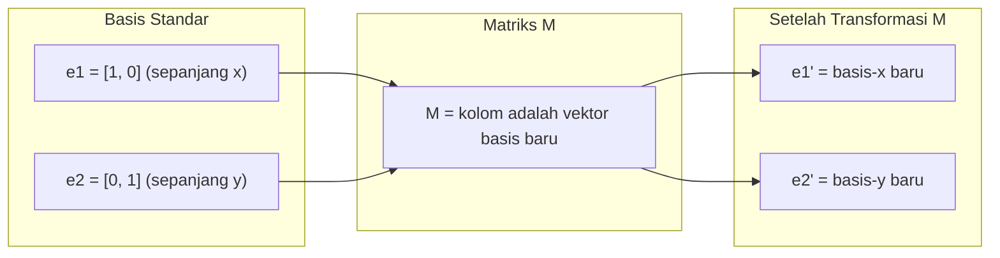
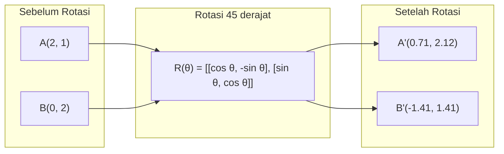
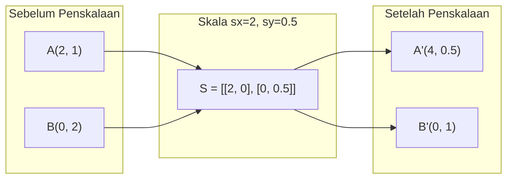
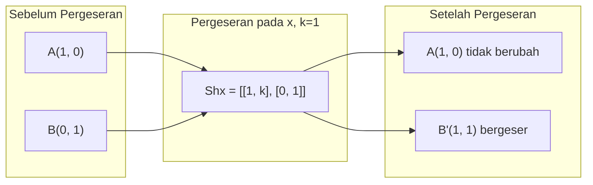
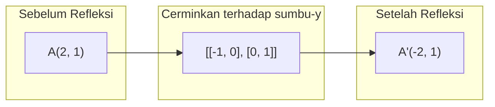
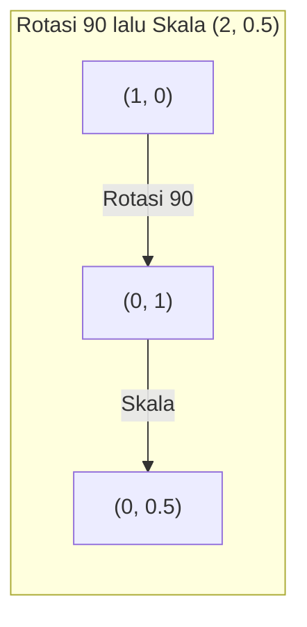
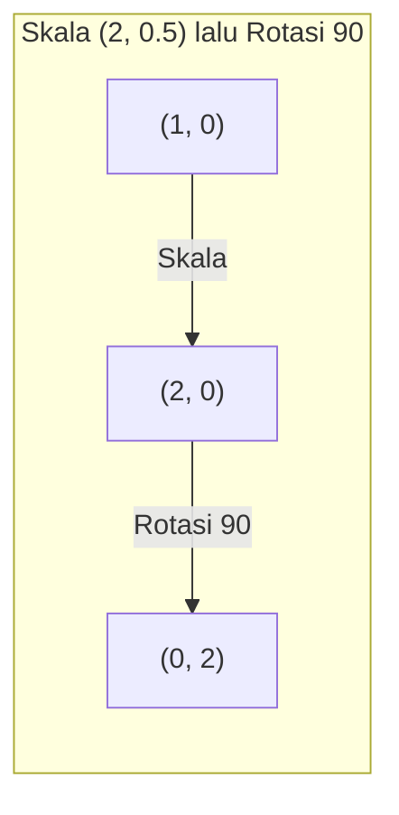

# Transformasi Matriks

> Matriks adalah mesin yang membentuk ulang ruang. Pahami apa yang dilakukannya pada setiap titik, dan Anda memahami keseluruhan transformasi.

**Jenis:** Bangun
**Bahasa:** Python, Julia
**Prasyarat:** Fase 1, Pelajaran 01-02 (Intuisi Aljabar Linear, Operasi Vektor & Matriks)
**Waktu:** ~75 menit

## Tujuan Pembelajaran

- Menyusun matriks rotasi, penskalaan, pergeseran (shearing), dan refleksi serta menerapkannya pada titik 2D dan 3D
- Menggabungkan beberapa transformasi melalui perkalian matriks dan memverifikasi bahwa urutan penting
- Menghitung nilai eigen dan vektor eigen matriks 2x2 dari persamaan karakteristik
- Menjelaskan mengapa nilai eigen menentukan arah PCA, kestabilan RNN, dan perilaku pengelompokan spektral

## Masalahnya

Anda membaca tentang PCA dan melihat "temukan vektor eigen dari matriks kovarian." Anda membaca tentang kestabilan model dan melihat "periksa apakah semua nilai eigen memiliki magnitudo kurang dari 1." Anda membaca tentang augmentasi data dan melihat "terapkan rotasi acak." Semua ini tidak masuk akal sampai Anda memahami apa yang dilakukan matriks terhadap ruang secara geometris.

Matriks bukan sekadar kisi-kisi angka. Matriks adalah mesin spasial. Matriks rotasi memutar titik. Matriks penskalaan meregangkannya. Matriks pergeseran memiringkannya. Setiap transformasi yang diterapkan jaringan saraf pada data adalah salah satu operasi ini atau gabungannya. Pelajaran ini membuat operasi-operasi itu menjadi konkret.

## Konsepnya

### Transformasi sebagai matriks

Setiap transformasi linear dalam 2D dapat ditulis sebagai matriks 2x2. Matriks memberi tahu Anda dengan tepat ke mana vektor basis [1, 0] dan [0, 1] berakhir. Semuanya mengikuti dari situ.



### Rotasi

Rotasi 2D dengan sudut $\theta$ menjaga jarak dan sudut tetap utuh. Rotasi memindahkan setiap titik sepanjang busur lingkaran.



Pada 3D, Anda berputar mengelilingi sebuah sumbu. Setiap sumbu memiliki matriks rotasinya sendiri:

```math
\begin{aligned}
R_z(\theta) &= \begin{bmatrix} \cos\theta & -\sin\theta & 0 \\ \sin\theta & \cos\theta & 0 \\ 0 & 0 & 1 \end{bmatrix} \quad \text{Rotasi mengelilingi sumbu-z (bidang x-y berputar, z tetap)} \\[6pt]
R_x(\theta) &= \begin{bmatrix} 1 & 0 & 0 \\ 0 & \cos\theta & -\sin\theta \\ 0 & \sin\theta & \cos\theta \end{bmatrix} \quad \text{Rotasi mengelilingi sumbu-x (bidang y-z berputar, x tetap)} \\[6pt]
R_y(\theta) &= \begin{bmatrix} \cos\theta & 0 & \sin\theta \\ 0 & 1 & 0 \\ -\sin\theta & 0 & \cos\theta \end{bmatrix} \quad \text{Rotasi mengelilingi sumbu-y (bidang x-z berputar, y tetap)}
\end{aligned}
```

### Penskalaan

Penskalaan meregang atau memampatkan sepanjang setiap sumbu secara independen.



### Pergeseran (Shearing)

Pergeseran memiringkan satu sumbu sementara sumbu lainnya tetap. Pergeseran mengubah persegi panjang menjadi jajar genjang.



Matriks pergeseran:
- `Shx = [[1, k], [0, 1]]` menggeser $x$ sebesar $k \cdot y$
- `Shy = [[1, 0], [k, 1]]` menggeser $y$ sebesar $k \cdot x$

### Refleksi

Refleksi mencerminkan titik-titik melintasi sebuah sumbu atau garis.



Matriks refleksi:
- Cerminkan terhadap sumbu-y: `[[-1, 0], [0, 1]]`
- Cerminkan terhadap sumbu-x: `[[1, 0], [0, -1]]`

### Komposisi: merangkai transformasi

Menerapkan transformasi A lalu B sama dengan mengalikan matriksnya: `result = B @ A @ point`. Urutan penting. Rotasi lalu penskalaan menghasilkan hasil yang berbeda dengan penskalaan lalu rotasi.



Tersusun: `S @ R = [[0, -2], [0.5, 0]]`



Tersusun: `R @ S = [[0, -0.5], [2, 0]]`

Hasil berbeda. Perkalian matriks tidak komutatif.

### Nilai Eigen dan Vektor Eigen

Kebanyakan vektor berubah arah ketika suatu matriks mengenainya. Vektor eigen istimewa: matriks hanya menskalakannya, tidak pernah memutarnya. Faktor penskalaan itu adalah nilai eigen.

```
A @ v = lambda * v

v adalah vektor eigen (arah yang bertahan)
lambda adalah nilai eigen (seberapa besar regangannya)

Contoh: A = | 2  1 |
             | 1  2 |

Vektor eigen [1, 1] dengan nilai eigen 3:
  A @ [1,1] = [3, 3] = 3 * [1, 1]     (arah sama, diskalakan 3)

Vektor eigen [1, -1] dengan nilai eigen 1:
  A @ [1,-1] = [1, -1] = 1 * [1, -1]  (arah sama, tidak berubah)
```

Matriks meregangkan ruang sebesar 3x sepanjang [1, 1] dan membiarkan [1, -1] tidak berubah. Setiap arah lain adalah campuran dari keduanya.

### Dekomposisi Eigen

Jika suatu matriks memiliki $n$ vektor eigen yang saling bebas linear, matriks itu dapat didekomposisi:

```
A = V @ D @ V^(-1)

V = matriks yang kolomnya adalah vektor eigen
D = matriks diagonal dari nilai eigen
V^(-1) = invers dari V

Ini berarti: rotasi ke koordinat vektor eigen, skala sepanjang setiap sumbu, rotasi kembali.
```

### Mengapa nilai eigen penting

**PCA.** Vektor eigen dari matriks kovarian adalah komponen utama. Nilai eigen memberi tahu Anda seberapa besar variansi yang ditangkap setiap komponen. Urutkan berdasarkan nilai eigen, ambil $k$ teratas, dan Anda mendapatkan reduksi dimensi.

**Kestabilan.** Pada jaringan rekuren dan sistem dinamik, nilai eigen dengan magnitudo > 1 menyebabkan keluaran meledak. Magnitudo < 1 menyebabkannya menghilang. Ini adalah masalah gradien menghilang/meledak yang dinyatakan dalam satu kalimat.

**Metode spektral.** Jaringan saraf graf menggunakan nilai eigen dari matriks adjacency. Pengelompokan spektral menggunakan nilai eigen dari Laplacian. Vektor eigen mengungkap struktur graf.

### Determinan sebagai faktor penskalaan volume

Determinan dari matriks transformasi memberi tahu Anda seberapa besar matriks itu menskalakan luas (2D) atau volume (3D).

```
det = 1:   luas terjaga (rotasi)
det = 2:   luas berlipat ganda
det = 0:   ruang hancur ke dimensi lebih rendah (singular)
det = -1:  luas terjaga tetapi orientasi terbalik (refleksi)

| det(Rotation) | = 1        (selalu)
| det(Scale sx, sy) | = sx * sy
| det(Shear) | = 1           (luas terjaga)
| det(Reflection) | = -1     (orientasi terbalik)
```

```figure
matrix-transform
```

## Bangunlah

### Langkah 1: Matriks transformasi dari awal (Python)

```python
import math

def rotation_2d(theta):
    c, s = math.cos(theta), math.sin(theta)
    return [[c, -s], [s, c]]

def scaling_2d(sx, sy):
    return [[sx, 0], [0, sy]]

def shearing_2d(kx, ky):
    return [[1, kx], [ky, 1]]

def reflection_x():
    return [[1, 0], [0, -1]]

def reflection_y():
    return [[-1, 0], [0, 1]]

def mat_vec_mul(matrix, vector):
    return [
        sum(matrix[i][j] * vector[j] for j in range(len(vector)))
        for i in range(len(matrix))
    ]

def mat_mul(a, b):
    rows_a, cols_b = len(a), len(b[0])
    cols_a = len(a[0])
    return [
        [sum(a[i][k] * b[k][j] for k in range(cols_a)) for j in range(cols_b)]
        for i in range(rows_a)
    ]

point = [1.0, 0.0]
angle = math.pi / 4

rotated = mat_vec_mul(rotation_2d(angle), point)
print(f"Rotate (1,0) by 45 deg: ({rotated[0]:.4f}, {rotated[1]:.4f})")

scaled = mat_vec_mul(scaling_2d(2, 3), [1.0, 1.0])
print(f"Scale (1,1) by (2,3): ({scaled[0]:.1f}, {scaled[1]:.1f})")

sheared = mat_vec_mul(shearing_2d(1, 0), [1.0, 1.0])
print(f"Shear (1,1) kx=1: ({sheared[0]:.1f}, {sheared[1]:.1f})")

reflected = mat_vec_mul(reflection_y(), [2.0, 1.0])
print(f"Reflect (2,1) across y: ({reflected[0]:.1f}, {reflected[1]:.1f})")
```

### Langkah 2: Komposisi transformasi

```python
R = rotation_2d(math.pi / 2)
S = scaling_2d(2, 0.5)

rotate_then_scale = mat_mul(S, R)
scale_then_rotate = mat_mul(R, S)

point = [1.0, 0.0]
result1 = mat_vec_mul(rotate_then_scale, point)
result2 = mat_vec_mul(scale_then_rotate, point)

print(f"Rotate 90 then scale: ({result1[0]:.2f}, {result1[1]:.2f})")
print(f"Scale then rotate 90: ({result2[0]:.2f}, {result2[1]:.2f})")
print(f"Same? {result1 == result2}")
```

### Langkah 3: Nilai eigen dari awal (2x2)

Untuk matriks 2x2 `[[a, b], [c, d]]`, nilai eigen memecahkan persamaan karakteristik: $\lambda^2 - (a+d)\lambda + (ad - bc) = 0$.

```python
def eigenvalues_2x2(matrix):
    a, b = matrix[0]
    c, d = matrix[1]
    trace = a + d
    det = a * d - b * c
    discriminant = trace ** 2 - 4 * det
    if discriminant < 0:
        real = trace / 2
        imag = (-discriminant) ** 0.5 / 2
        return (complex(real, imag), complex(real, -imag))
    sqrt_disc = discriminant ** 0.5
    return ((trace + sqrt_disc) / 2, (trace - sqrt_disc) / 2)

def eigenvector_2x2(matrix, eigenvalue):
    a, b = matrix[0]
    c, d = matrix[1]
    if abs(b) > 1e-10:
        v = [b, eigenvalue - a]
    elif abs(c) > 1e-10:
        v = [eigenvalue - d, c]
    else:
        if abs(a - eigenvalue) < 1e-10:
            v = [1, 0]
        else:
            v = [0, 1]
    mag = (v[0] ** 2 + v[1] ** 2) ** 0.5
    return [v[0] / mag, v[1] / mag]

A = [[2, 1], [1, 2]]
vals = eigenvalues_2x2(A)
print(f"Matrix: {A}")
print(f"Eigenvalues: {vals[0]:.4f}, {vals[1]:.4f}")

for val in vals:
    vec = eigenvector_2x2(A, val)
    result = mat_vec_mul(A, vec)
    scaled = [val * vec[0], val * vec[1]]
    print(f"  lambda={val:.1f}, v={[round(x,4) for x in vec]}")
    print(f"    A@v = {[round(x,4) for x in result]}")
    print(f"    l*v = {[round(x,4) for x in scaled]}")
```

### Langkah 4: Determinan sebagai faktor penskalaan volume

```python
def det_2x2(matrix):
    return matrix[0][0] * matrix[1][1] - matrix[0][1] * matrix[1][0]

print(f"det(rotation 45) = {det_2x2(rotation_2d(math.pi/4)):.4f}")
print(f"det(scale 2,3)   = {det_2x2(scaling_2d(2, 3)):.1f}")
print(f"det(shear kx=1)  = {det_2x2(shearing_2d(1, 0)):.1f}")
print(f"det(reflect y)   = {det_2x2(reflection_y()):.1f}")

singular = [[1, 2], [2, 4]]
print(f"det(singular)     = {det_2x2(singular):.1f}")
print("Singular: columns are proportional, space collapses to a line.")
```

## Gunakanlah

NumPy menangani semuanya dengan rutinitas yang dioptimalkan.

```python
import numpy as np

theta = np.pi / 4
R = np.array([[np.cos(theta), -np.sin(theta)],
              [np.sin(theta),  np.cos(theta)]])

point = np.array([1.0, 0.0])
print(f"Rotate (1,0) by 45 deg: {R @ point}")

S = np.diag([2.0, 3.0])
composed = S @ R
print(f"Scale(2,3) after Rotate(45): {composed @ point}")

A = np.array([[2, 1], [1, 2]], dtype=float)
eigenvalues, eigenvectors = np.linalg.eig(A)
print(f"\nEigenvalues: {eigenvalues}")
print(f"Eigenvectors (columns):\n{eigenvectors}")

for i in range(len(eigenvalues)):
    v = eigenvectors[:, i]
    lam = eigenvalues[i]
    print(f"  A @ v{i} = {A @ v}, lambda * v{i} = {lam * v}")

print(f"\ndet(R) = {np.linalg.det(R):.4f}")
print(f"det(S) = {np.linalg.det(S):.1f}")

B = np.array([[3, 1], [0, 2]], dtype=float)
vals, vecs = np.linalg.eig(B)
D = np.diag(vals)
V = vecs
reconstructed = V @ D @ np.linalg.inv(V)
print(f"\nEigendecomposition A = V @ D @ V^-1:")
print(f"Original:\n{B}")
print(f"Reconstructed:\n{reconstructed}")
```

### Rotasi 3D dengan NumPy

```python
def rotation_3d_z(theta):
    c, s = np.cos(theta), np.sin(theta)
    return np.array([[c, -s, 0], [s, c, 0], [0, 0, 1]])

def rotation_3d_x(theta):
    c, s = np.cos(theta), np.sin(theta)
    return np.array([[1, 0, 0], [0, c, -s], [0, s, c]])

point_3d = np.array([1.0, 0.0, 0.0])
rotated_z = rotation_3d_z(np.pi / 2) @ point_3d
rotated_x = rotation_3d_x(np.pi / 2) @ point_3d

print(f"\n3D point: {point_3d}")
print(f"Rotate 90 around z: {np.round(rotated_z, 4)}")
print(f"Rotate 90 around x: {np.round(rotated_x, 4)}")
```

## Rilis

Pelajaran ini membangun fondasi geometris untuk PCA (Fase 2) dan analisis bobot jaringan saraf. Kode nilai eigen/vektor eigen yang dibangun di sini adalah algoritme yang sama yang mendukung reduksi dimensi, pengelompokan spektral, dan analisis kestabilan dalam sistem ML produksi.

## Latihan

1. Terapkan rotasi, penskalaan, dan pergeseran pada persegi satuan (sudut-sudut di [0,0], [1,0], [1,1], [0,1]). Cetak sudut-sudut hasil transformasi untuk masing-masing. Verifikasi bahwa rotasi menjaga jarak antarsudut.

2. Temukan nilai eigen matriks [[4, 2], [1, 3]] secara manual menggunakan persamaan karakteristik. Lalu verifikasi dengan fungsi buatan Anda dari awal dan dengan NumPy.

3. Buat komposisi tiga transformasi (rotasi 30 derajat, skala [1.5, 0.8], pergeseran dengan kx=0.3) dan terapkan pada 8 titik yang tersusun membentuk lingkaran. Cetak koordinat sebelum dan sesudah. Hitung determinan matriks hasil komposisi dan verifikasi bahwa nilainya sama dengan hasil kali determinan masing-masing.

### Petunjuk

**Latihan 1.** Terapkan `rotation_2d`, `scaling_2d`, dan `shearing_2d` pada setiap sudut dengan `mat_vec_mul`. Untuk rotasi, hitung 4 panjang sisi dan 2 diagonal sebelum dan sesudah; masing-masing harus tetap sama.

**Latihan 2.** Tulis persamaan karakteristik $\lambda^2 - (\text{trace})\lambda + \det = 0$ dan selesaikan. Periksa bahwa kedua nilai Anda berjumlah trace (7) dan hasil kalinya adalah determinan (10), lalu bandingkan dengan `eigenvalues_2x2` dan `np.linalg.eigvals`.

**Latihan 3.** Bangun ketiga matriks, dengan `shearing_2d(0.3, 0)` untuk pergeseran, kalikan dengan `mat_mul` sesuai urutan penerapan, dan terapkan hasilnya pada 8 titik $(\cos\theta, \sin\theta)$. Rotasi memiliki determinan 1 dan pergeseran memiliki determinan 1, sehingga `det_2x2` dari komposisi harus sama dengan $1.5 \times 0.8 = 1.2$.

## Istilah Kunci

| Istilah | Yang orang katakan | Arti sebenarnya |
|------|----------------|----------------------|
| Matriks rotasi | "Memutar benda" | Matriks ortogonal yang memindahkan titik sepanjang busur lingkaran sambil menjaga jarak dan sudut. Determinan selalu 1. |
| Matriks penskalaan | "Membuat benda lebih besar" | Matriks diagonal yang meregang atau memampatkan secara independen sepanjang setiap sumbu. Determinan adalah hasil kali faktor penskalaan. |
| Matriks pergeseran | "Memiringkan benda" | Matriks yang menggeser satu koordinat secara proporsional terhadap koordinat lain, mengubah persegi panjang menjadi jajar genjang. Determinan adalah 1. |
| Refleksi | "Mencerminkan benda" | Matriks yang membalik ruang melintasi sebuah sumbu atau bidang. Determinan adalah -1. |
| Komposisi | "Melakukan dua hal" | Mengalikan matriks transformasi untuk merangkai operasi. Urutan penting: B @ A berarti terapkan A lebih dulu, lalu B. |
| Vektor eigen | "Arah istimewa" | Arah yang hanya diskalakan oleh matriks, tidak pernah diputar. Sidik jari dari transformasi. |
| Nilai eigen | "Seberapa besar regangannya" | Faktor skalar yang dengannya matriks menskalakan vektor eigen. Bisa negatif (pembalikan) atau kompleks (rotasi). |
| Dekomposisi eigen | "Mengurai matriks" | Menulis matriks sebagai $V D V^{-1}$, memisahkannya menjadi arah dan magnitudo penskalaan fundamentalnya. |
| Determinan | "Satu angka dari matriks" | Faktor yang dengannya transformasi menskalakan luas (2D) atau volume (3D). Nol berarti transformasi tidak dapat dibalik. |
| Persamaan karakteristik | "Asal-usul nilai eigen" | $\det(A - \lambda I) = 0$. Polinomial yang akar-akarnya adalah nilai eigen. |

## Bacaan Lanjutan

- [3Blue1Brown: Linear Transformations](https://www.3blue1brown.com/lessons/linear-transformations) -- intuisi visual tentang bagaimana matriks membentuk ulang ruang
- [3Blue1Brown: Eigenvectors and Eigenvalues](https://www.3blue1brown.com/lessons/eigenvalues) -- penjelasan visual terbaik tentang arti geometris vektor eigen
- [MIT 18.06 Lecture 21: Eigenvalues and Eigenvectors](https://ocw.mit.edu/courses/18-06-linear-algebra-spring-2010/) -- pembahasan klasik Gilbert Strang
