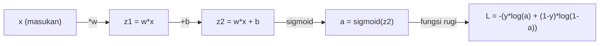
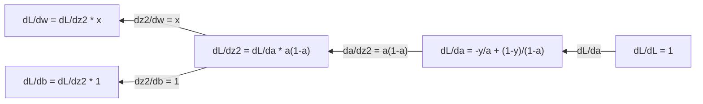
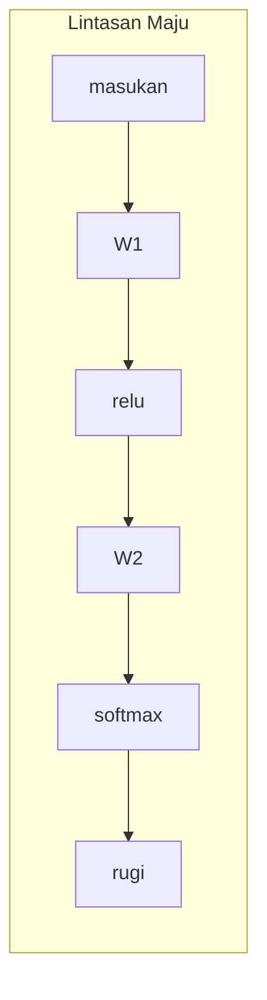
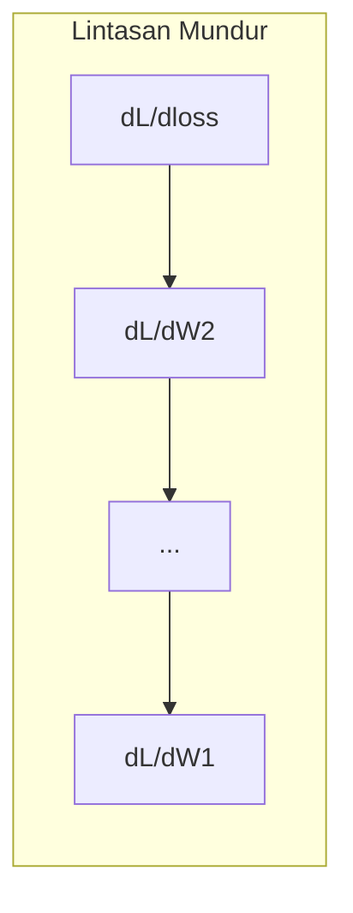

# Kalkulus untuk Pembelajaran Mesin

> Turunan memberi tahu Anda arah mana yang menurun. Itu saja yang dibutuhkan jaringan saraf untuk belajar.

**Jenis:** Belajar
**Bahasa:** Python
**Prasyarat:** Fase 1, Pelajaran 01-03
**Waktu:** ~60 menit

## Tujuan Pembelajaran

- Menghitung turunan numerik dan analitik untuk fungsi ML umum ($x^2$, sigmoid, cross-entropy)
- Mengimplementasikan penurunan gradien dari awal untuk meminimalkan fungsi rugi dalam 1D dan 2D
- Menurunkan gradien model regresi linear dan melatihnya melalui pembaruan bobot manual
- Menjelaskan matriks Hessian, pendekatan deret Taylor, dan kaitannya dengan metode optimasi

## Masalahnya

Anda memiliki jaringan saraf dengan jutaan bobot. Setiap bobot adalah tombol. Anda perlu mencari tahu ke arah mana memutar setiap tombol agar model menjadi sedikit lebih benar. Kalkulus memberi Anda arah itu.

Tanpa kalkulus, melatih jaringan saraf berarti mencoba perubahan acak dan berharap yang terbaik. Dengan turunan, Anda tahu dengan tepat bagaimana setiap bobot memengaruhi galat. Anda memutar setiap tombol ke arah yang benar, setiap kali.

## Konsepnya

### Apa itu turunan?

Turunan mengukur laju perubahan. Untuk fungsi $y = f(x)$, turunan $f'(x)$ memberi tahu Anda: jika Anda menggeser $x$ sedikit sekali, seberapa besar $y$ berubah?

Secara geometris, turunan adalah kemiringan garis singgung di suatu titik.

**$f(x) = x^2$:**

| $x$ | $f(x)$ | $f'(x)$ (kemiringan) |
|---|------|---------------|
| 0 | 0    | 0 (datar, di dasar) |
| 1 | 1    | 2 |
| 2 | 4    | 4 (kemiringan garis singgung di titik ini) |
| 3 | 9    | 6 |

Pada $x=2$, kemiringannya adalah 4. Jika Anda menggeser $x$ sedikit ke kanan, $y$ meningkat sekitar 4 kali lipat dari jumlah itu. Pada $x=0$, kemiringannya 0. Anda berada di dasar mangkuk.

Definisi formalnya:

```math
f'(x) = \lim_{h \to 0} \frac{f(x + h) - f(x)}{h}
```

Dalam kode, Anda melewati limit dan hanya memakai $h$ yang sangat kecil. Itulah turunan numerik.

### Turunan parsial: satu variabel pada satu waktu

Fungsi nyata memiliki banyak masukan. Rugi jaringan saraf bergantung pada ribuan bobot. Turunan parsial menjaga semua variabel tetap konstan kecuali satu, lalu mengambil turunan terhadap variabel itu.

```math
\begin{aligned}
f(x, y) &= x^2 + 3xy + y^2 \\[4pt]
\frac{\partial f}{\partial x} &= 2x + 3y \quad \text{(anggap } y \text{ sebagai konstanta)} \\
\frac{\partial f}{\partial y} &= 3x + 2y \quad \text{(anggap } x \text{ sebagai konstanta)}
\end{aligned}
```

Setiap turunan parsial menjawab: jika saya menggeser hanya bobot ini, bagaimana rugi berubah?

### Gradien: vektor dari semua turunan parsial

Gradien mengumpulkan semua turunan parsial ke dalam satu vektor. Untuk fungsi $f(x, y, z)$, gradiennya adalah:

```math
\nabla f = \left[ \frac{\partial f}{\partial x}, \frac{\partial f}{\partial y}, \frac{\partial f}{\partial z} \right]
```

Gradien menunjuk ke arah kenaikan paling curam. Untuk meminimalkan fungsi, bergeraklah ke arah sebaliknya.

**Plot kontur $f(x,y) = x^2 + y^2$:**

Fungsi membentuk mangkuk dengan lingkaran konsentris sebagai garis konturnya. Minimum berada di (0, 0).

| Titik | $\nabla f$ | $-\nabla f$ (arah penurunan) |
|-------|--------|----------------------------|
| (1, 1) | [2, 2] (menunjuk ke atas, menjauhi minimum) | [-2, -2] (menunjuk ke bawah, menuju minimum) |
| (0, 0) | [0, 0] (datar, di minimum) | [0, 0] |

Inilah penurunan gradien dalam gambar. Hitung gradien, balik tandanya, ambil satu langkah.

### Kaitan dengan optimasi

Melatih jaringan saraf adalah optimasi. Anda memiliki fungsi rugi $L(w_1, w_2, \ldots, w_n)$ yang mengukur seberapa salah model. Anda ingin meminimalkannya.

```
Aturan pembaruan penurunan gradien:

  w_new = w_old - learning_rate * dL/dw

Untuk setiap bobot:
  1. Hitung turunan parsial rugi terhadap bobot itu
  2. Kurangi bobot dengan hasil kali kecil dari turunan itu
  3. Ulangi
```

Laju pembelajaran mengontrol ukuran langkah. Terlalu besar dan Anda melampaui titik minimum. Terlalu kecil dan Anda merayap.

**Lanskap rugi (potongan 1D):**

Fungsi rugi $L(w)$ membentuk kurva dengan puncak dan lembah saat bobot $w$ berubah.

| Fitur | Deskripsi |
|---------|-------------|
| Minimum global | Titik terendah pada seluruh kurva -- solusi terbaik |
| Minimum lokal | Lembah yang lebih rendah dari sekitarnya tetapi bukan yang terendah secara keseluruhan |
| Kemiringan | Penurunan gradien mengikuti kemiringan ke bawah dari titik awal mana pun |

Penurunan gradien mengikuti kemiringan ke bawah. Penurunan gradien bisa terjebak dalam minimum lokal, tetapi dalam ruang berdimensi tinggi (jutaan bobot) ini jarang menjadi masalah praktis.

### Turunan numerik versus analitik

Ada dua cara untuk menghitung turunan.

Analitik: terapkan aturan kalkulus secara manual. Untuk $f(x) = x^2$, turunannya adalah $f'(x) = 2x$. Tepat. Cepat.

Numerik: perkiraan menggunakan definisi. Hitung $f(x+h)$ dan $f(x-h)$ untuk $h$ yang sangat kecil, lalu gunakan selisihnya.

```
Numerik (selisih pusat):

f'(x) ~= f(x + h) - f(x - h)
          -----------------------
                  2h

h = 0.0001 bekerja dengan baik dalam praktik
```

Turunan numerik lebih lambat tetapi bekerja untuk fungsi apa pun. Turunan analitik cepat tetapi mengharuskan Anda menurunkan rumusnya. Kerangka kerja jaringan saraf menggunakan pendekatan ketiga: diferensiasi otomatis, yang menghitung turunan tepat secara mekanis. Anda akan melihatnya di Fase 3.

### Turunan manual untuk fungsi sederhana

Ini adalah turunan yang akan Anda lihat berulang kali dalam ML.

```
Fungsi           Turunan          Digunakan dalam
--------        ----------       -------
f(x) = x^2     f'(x) = 2x      Fungsi rugi (MSE)
f(x) = wx + b  f'(w) = x        Lapisan linear (gradien terhadap bobot)
                f'(b) = 1        Lapisan linear (gradien terhadap bias)
                f'(x) = w        Lapisan linear (gradien terhadap masukan)
f(x) = e^x     f'(x) = e^x     Softmax, atensi
f(x) = ln(x)   f'(x) = 1/x     Rugi cross-entropy
f(x) = 1/(1+e^-x)  f'(x) = f(x)(1-f(x))   Aktivasi sigmoid
```

Untuk $f(x) = x^2$:

```
f(x) = x^2    f'(x) = 2x

  x    f(x)   f'(x)   arti
  -2    4      -4      kemiringan miring ke kiri (menurun)
  -1    1      -2      kemiringan miring ke kiri (menurun)
   0    0       0      datar (minimum!)
   1    1       2      kemiringan miring ke kanan (menaik)
   2    4       4      kemiringan miring ke kanan (menaik)
```

Untuk $f(w) = wx + b$ dengan $x=3$, $b=1$:

```
f(w) = 3w + 1    f'(w) = 3

Turunan terhadap w adalah x saja.
Jika x besar, perubahan kecil pada w menyebabkan perubahan besar pada keluaran.
```

### Aturan rantai

Saat fungsi-fungsi digabung, aturan rantai memberi tahu Anda cara melakukan diferensiasi.

```
Jika y = f(g(x)), maka dy/dx = f'(g(x)) * g'(x)

Contoh: y = (3x + 1)^2
  luar: f(u) = u^2       f'(u) = 2u
  dalam: g(x) = 3x + 1    g'(x) = 3
  dy/dx = 2(3x + 1) * 3 = 6(3x + 1)
```

Jaringan saraf adalah rantai fungsi: masukan -> linear -> aktivasi -> linear -> aktivasi -> rugi. Propagasi balik adalah aturan rantai yang diterapkan berulang kali dari keluaran ke masukan. Itulah keseluruhan algoritmenya.

### Matriks Hessian

Gradien memberi tahu Anda kemiringan. Hessian memberi tahu Anda kelengkungan.

Hessian adalah matriks turunan parsial orde kedua. Untuk fungsi $f(x_1, x_2, \ldots, x_n)$, entri $(i, j)$ dari Hessian adalah:

```math
H_{ij} = \frac{\partial^2 f}{\partial x_i \, \partial x_j}
```

Untuk fungsi 2 variabel $f(x, y)$:

```math
H = \begin{bmatrix} \dfrac{\partial^2 f}{\partial x^2} & \dfrac{\partial^2 f}{\partial x \, \partial y} \\[8pt] \dfrac{\partial^2 f}{\partial y \, \partial x} & \dfrac{\partial^2 f}{\partial y^2} \end{bmatrix}
```

**Apa yang dikatakan Hessian pada titik kritis (di mana gradien = 0):**

| Sifat Hessian | Arti | Permukaan contoh |
|-----------------|---------|-----------------|
| Definit positif (semua nilai eigen > 0) | Minimum lokal | Mangkuk menghadap ke atas |
| Definit negatif (semua nilai eigen < 0) | Maksimum lokal | Mangkuk menghadap ke bawah |
| Indefinit (nilai eigen campuran) | Titik pelana | Bentuk pelana kuda |

**Contoh:** $f(x, y) = x^2 - y^2$ (fungsi pelana)

```
df/dx = 2x       df/dy = -2y
d^2f/dx^2 = 2    d^2f/dy^2 = -2    d^2f/dxdy = 0

H = | 2   0 |
    | 0  -2 |

Nilai eigen: 2 dan -2 (satu positif, satu negatif)
--> Titik pelana di (0, 0)
```

Bandingkan dengan $f(x, y) = x^2 + y^2$ (sebuah mangkuk):

```
H = | 2  0 |
    | 0  2 |

Nilai eigen: 2 dan 2 (keduanya positif)
--> Minimum lokal di (0, 0)
```

**Mengapa Hessian penting dalam ML:**

Metode Newton menggunakan Hessian untuk mengambil langkah optimasi yang lebih baik daripada penurunan gradien. Alih-alih hanya mengikuti kemiringan, metode ini mempertimbangkan kelengkungan:

```math
\begin{aligned}
\text{Pembaruan Newton:} \quad & w_{\text{new}} = w_{\text{old}} - H^{-1} \cdot \text{gradient} \\
\text{Penurunan gradien:} \quad & w_{\text{new}} = w_{\text{old}} - \text{lr} \cdot \text{gradient}
\end{aligned}
```

Metode Newton konvergen lebih cepat karena Hessian "menskalakan ulang" gradien -- arah yang curam mendapat langkah lebih kecil, arah yang datar mendapat langkah lebih besar.

Masalahnya: untuk jaringan saraf dengan $N$ parameter, Hessian berukuran $N \times N$. Model dengan 1 juta parameter membutuhkan matriks dengan 1 triliun entri. Itulah sebabnya kita menggunakan pendekatan.

| Metode | Yang digunakan | Biaya | Konvergensi |
|--------|-------------|------|-------------|
| Penurunan gradien | Turunan pertama saja | $O(N)$ per langkah | Lambat (linier) |
| Metode Newton | Hessian penuh | $O(N^3)$ per langkah | Cepat (kuadratik) |
| L-BFGS | Perkiraan Hessian dari riwayat gradien | $O(N)$ per langkah | Sedang (superlinier) |
| Adam | Laju adaptif per parameter (perkiraan Hessian diagonal) | $O(N)$ per langkah | Sedang |
| Gradien natural | Matriks informasi Fisher (Hessian statistik) | $O(N^2)$ per langkah | Cepat |

Dalam praktiknya, Adam adalah pengoptimal bawaan untuk pembelajaran mendalam. Adam memperkirakan informasi orde kedua secara murah dengan melacak rata-rata dan varians berjalan dari gradien per parameter.

### Pendekatan Deret Taylor

Fungsi mulus apa pun dapat didekati secara lokal oleh polinomial:

```math
f(x + h) = f(x) + f'(x)\,h + \frac{1}{2} f''(x)\,h^2 + \frac{1}{6} f'''(x)\,h^3 + \cdots
```

Semakin banyak suku yang Anda sertakan, semakin baik pendekatannya -- tetapi hanya di sekitar titik $x$.

**Mengapa deret Taylor penting untuk ML:**

- **Taylor orde pertama = penurunan gradien.** Saat Anda memakai $f(x + h) \approx f(x) + f'(x) h$, Anda membuat pendekatan linear. Penurunan gradien meminimalkan model linear ini untuk memilih $h = -\text{lr} \cdot f'(x)$.

- **Taylor orde kedua = metode Newton.** Dengan memakai $f(x + h) \approx f(x) + f'(x) h + \frac{1}{2} f''(x) h^2$, Anda mendapat model kuadratik. Meminimalkannya menghasilkan $h = -f'(x)/f''(x)$ -- langkah Newton.

- **Desain fungsi rugi.** MSE dan cross-entropy bersifat mulus, yang berarti deret Taylor mereka berperilaku baik. Ini bukan kebetulan. Rugi yang mulus membuat optimasi dapat diprediksi.

```
Orde pendekatan        Yang ditangkap      Metode optimasi
-------------------    -----------------   -------------------
Orde 0 (konstan)       Hanya nilainya      Pencarian acak
Orde 1 (linear)        Kemiringan          Penurunan gradien
Orde 2 (kuadratik)     Kelengkungan        Metode Newton
Orde lebih tinggi      Struktur lebih halus  Jarang dipakai di ML
```

Wawasan kuncinya: semua optimasi berbasis gradien pada dasarnya adalah mendekati fungsi rugi secara lokal dan melangkah menuju minimum dari pendekatan itu.

### Integral dalam ML

Turunan memberi tahu Anda laju perubahan. Integral menghitung akumulasi -- luas di bawah kurva.

Dalam ML, Anda jarang menghitung integral secara manual, tetapi konsepnya ada di mana-mana:

**Probabilitas.** Untuk peubah acak kontinu dengan rapat $p(x)$:

```math
P(a < X < b) = \int_a^b p(x) \, dx
```

Luas di bawah kurva rapat probabilitas antara $a$ dan $b$ adalah probabilitas untuk berada dalam rentang itu.

**Nilai harapan.** Hasil rata-rata yang dibobot oleh probabilitas:

```math
\mathbb{E}[f(X)] = \int f(x) \, p(x) \, dx
```

Rugi harapan atas distribusi data adalah integral. Pelatihan meminimalkan pendekatan empirisnya.

**Divergensi KL.** Mengukur seberapa berbeda dua distribusi:

```math
\mathrm{KL}(p \,\|\, q) = \int p(x) \log \frac{p(x)}{q(x)} \, dx
```

Digunakan dalam VAE, distilasi pengetahuan, dan inferensi Bayes.

**Konstanta normalisasi.** Dalam inferensi Bayes:

```math
p(w \mid \text{data}) = \frac{p(\text{data} \mid w) \, p(w)}{\int p(\text{data} \mid w) \, p(w) \, dw}
```

Penyebut adalah integral atas semua nilai parameter yang mungkin. Penyebut ini sering sulit dihitung, sehingga kita menggunakan pendekatan seperti MCMC dan inferensi variasional.

| Konsep integral | Tempat munculnya dalam ML |
|-----------------|----------------------|
| Luas di bawah kurva | Probabilitas dari fungsi rapat |
| Nilai harapan | Fungsi rugi, minimisasi risiko |
| Divergensi KL | VAE, optimasi kebijakan, distilasi |
| Normalisasi | Posterior Bayes, penyebut softmax |
| Likelihood marginal | Perbandingan model, evidence lower bound (ELBO) |

### Aturan Rantai Multivariabel dalam Graf Komputasi

Aturan rantai tidak hanya berlaku untuk fungsi skalar dalam satu baris. Dalam jaringan saraf, variabel bercabang dan bergabung. Berikut cara turunan mengalir melalui satu forward pass sederhana:



Backward pass menghitung gradien dari kanan ke kiri:



Setiap panah mengalikan dengan turunan lokal. Gradien untuk parameter apa pun adalah hasil kali semua turunan lokal sepanjang jalur dari rugi ke parameter itu. Saat jalur bercabang dan bergabung, Anda menjumlahkan kontribusinya (aturan rantai multivariabel).

Itulah seluruh propagasi balik: aturan rantai yang diterapkan secara sistematis melalui graf komputasi, dari keluaran ke masukan.

### Matriks Jacobian

Saat suatu fungsi memetakan vektor ke vektor (seperti lapisan jaringan saraf), turunannya adalah matriks. Jacobian memuat semua turunan parsial dari setiap keluaran terhadap setiap masukan.

Untuk $f: \mathbb{R}^n \to \mathbb{R}^m$, Jacobian $J$ adalah matriks $m \times n$:

| | $x_1$ | $x_2$ | ... | $x_n$ |
|---|---|---|---|---|
| $f_1$ | $\partial f_1/\partial x_1$ | $\partial f_1/\partial x_2$ | ... | $\partial f_1/\partial x_n$ |
| $f_2$ | $\partial f_2/\partial x_1$ | $\partial f_2/\partial x_2$ | ... | $\partial f_2/\partial x_n$ |
| ... | ... | ... | ... | ... |
| $f_m$ | $\partial f_m/\partial x_1$ | $\partial f_m/\partial x_2$ | ... | $\partial f_m/\partial x_n$ |

Anda tidak akan menghitung Jacobian secara manual untuk jaringan saraf. PyTorch menangannya. Namun, mengetahui keberadaannya membantu Anda memahami bentuk (shape) dalam propagasi balik: jika suatu lapisan memetakan $\mathbb{R}^n$ ke $\mathbb{R}^m$, Jacobian-nya adalah $m \times n$. Gradien mengalir mundur melalui transpos matriks ini.

### Mengapa ini penting untuk jaringan saraf

Setiap bobot dalam jaringan saraf mendapat gradien. Gradien memberi tahu Anda cara menyesuaikan bobot itu untuk mengurangi rugi.





Setiap pembaruan bobot:
- `W1 = W1 - lr * dL/dW1`
- `W2 = W2 - lr * dL/dW2`

Forward pass menghitung prediksi dan rugi. Backward pass menghitung gradien rugi terhadap setiap bobot. Lalu setiap bobot mengambil langkah kecil ke bawah. Ulangi jutaan kali. Itulah pembelajaran mendalam.

```figure
derivative-tangent
```

## Bangunlah

### Langkah 1: Turunan numerik dari awal

```python
def numerical_derivative(f, x, h=1e-7):
    return (f(x + h) - f(x - h)) / (2 * h)

def f(x):
    return x ** 2

for x in [-2, -1, 0, 1, 2]:
    numerical = numerical_derivative(f, x)
    analytical = 2 * x
    print(f"x={x:2d}  f'(x) numerical={numerical:.6f}  analytical={analytical:.1f}")
```

Turunan numerik cocok dengan turunan analitik hingga banyak tempat desimal.

### Langkah 2: Turunan parsial dan gradien

```python
def numerical_gradient(f, point, h=1e-7):
    gradient = []
    for i in range(len(point)):
        point_plus = list(point)
        point_minus = list(point)
        point_plus[i] += h
        point_minus[i] -= h
        partial = (f(point_plus) - f(point_minus)) / (2 * h)
        gradient.append(partial)
    return gradient

def f_multi(point):
    x, y = point
    return x**2 + 3*x*y + y**2

grad = numerical_gradient(f_multi, [1.0, 2.0])
print(f"Numerical gradient at (1,2): {[f'{g:.4f}' for g in grad]}")
print(f"Analytical gradient at (1,2): [2*1+3*2, 3*1+2*2] = [{2*1+3*2}, {3*1+2*2}]")
```

### Langkah 3: Penurunan gradien untuk mencari minimum f(x) = x^2

```python
x = 5.0
lr = 0.1
for step in range(20):
    grad = 2 * x
    x = x - lr * grad
    print(f"step {step:2d}  x={x:8.4f}  f(x)={x**2:10.6f}")
```

Mulai dari $x=5$, setiap langkah mendekati $x=0$ (minimum).

### Langkah 4: Penurunan gradien pada fungsi 2D

```python
def f_2d(point):
    x, y = point
    return x**2 + y**2

point = [4.0, 3.0]
lr = 0.1
for step in range(30):
    grad = numerical_gradient(f_2d, point)
    point = [p - lr * g for p, g in zip(point, grad)]
    loss = f_2d(point)
    if step % 5 == 0 or step == 29:
        print(f"step {step:2d}  point=({point[0]:7.4f}, {point[1]:7.4f})  f={loss:.6f}")
```

### Langkah 5: Membandingkan turunan numerik dan analitik

```python
import math

test_functions = [
    ("x^2",      lambda x: x**2,          lambda x: 2*x),
    ("x^3",      lambda x: x**3,          lambda x: 3*x**2),
    ("sin(x)",   lambda x: math.sin(x),   lambda x: math.cos(x)),
    ("e^x",      lambda x: math.exp(x),   lambda x: math.exp(x)),
    ("1/x",      lambda x: 1/x,           lambda x: -1/x**2),
]

x = 2.0
print(f"{'Function':<12} {'Numerical':>12} {'Analytical':>12} {'Error':>12}")
print("-" * 50)
for name, f, df in test_functions:
    num = numerical_derivative(f, x)
    ana = df(x)
    err = abs(num - ana)
    print(f"{name:<12} {num:12.6f} {ana:12.6f} {err:12.2e}")
```

### Langkah 6: Menghitung Hessian secara numerik

```python
def hessian_2d(f, x, y, h=1e-5):
    fxx = (f(x + h, y) - 2 * f(x, y) + f(x - h, y)) / (h ** 2)
    fyy = (f(x, y + h) - 2 * f(x, y) + f(x, y - h)) / (h ** 2)
    fxy = (f(x + h, y + h) - f(x + h, y - h) - f(x - h, y + h) + f(x - h, y - h)) / (4 * h ** 2)
    return [[fxx, fxy], [fxy, fyy]]

def saddle(x, y):
    return x ** 2 - y ** 2

def bowl(x, y):
    return x ** 2 + y ** 2

H_saddle = hessian_2d(saddle, 0.0, 0.0)
H_bowl = hessian_2d(bowl, 0.0, 0.0)
print(f"Saddle Hessian: {H_saddle}")  # [[2, 0], [0, -2]] -- tanda campuran
print(f"Bowl Hessian:   {H_bowl}")    # [[2, 0], [0, 2]]  -- keduanya positif
```

Hessian dari fungsi pelana memiliki nilai eigen 2 dan -2 (tanda campuran, mengonfirmasi titik pelana). Mangkuk memiliki nilai eigen 2 dan 2 (keduanya positif, mengonfirmasi minimum).

### Langkah 7: Pendekatan Taylor dalam praktik

```python
import math

def taylor_approx(f, f_prime, f_double_prime, x0, h, order=2):
    result = f(x0)
    if order >= 1:
        result += f_prime(x0) * h
    if order >= 2:
        result += 0.5 * f_double_prime(x0) * h ** 2
    return result

x0 = 0.0
for h in [0.1, 0.5, 1.0, 2.0]:
    true_val = math.sin(h)
    t1 = taylor_approx(math.sin, math.cos, lambda x: -math.sin(x), x0, h, order=1)
    t2 = taylor_approx(math.sin, math.cos, lambda x: -math.sin(x), x0, h, order=2)
    print(f"h={h:.1f}  sin(h)={true_val:.4f}  order1={t1:.4f}  order2={t2:.4f}")
```

Di sekitar $x_0=0$, $\sin(x) \approx x$ (Taylor orde pertama). Pendekatan ini sangat baik untuk $h$ kecil tetapi gagal untuk $h$ besar. Inilah sebabnya penurunan gradien bekerja paling baik dengan laju pembelajaran kecil -- setiap langkah mengasumsikan pendekatan linear akurat.

### Langkah 8: Mengapa ini penting untuk jaringan saraf

```python
import random

random.seed(42)

w = random.gauss(0, 1)
b = random.gauss(0, 1)
lr = 0.01

xs = [1.0, 2.0, 3.0, 4.0, 5.0]
ys = [3.0, 5.0, 7.0, 9.0, 11.0]

for epoch in range(200):
    total_loss = 0
    dw = 0
    db = 0
    for x, y in zip(xs, ys):
        pred = w * x + b
        error = pred - y
        total_loss += error ** 2
        dw += 2 * error * x
        db += 2 * error
    dw /= len(xs)
    db /= len(xs)
    total_loss /= len(xs)
    w -= lr * dw
    b -= lr * db
    if epoch % 40 == 0 or epoch == 199:
        print(f"epoch {epoch:3d}  w={w:.4f}  b={b:.4f}  loss={total_loss:.6f}")

print(f"\nLearned: y = {w:.2f}x + {b:.2f}")
print(f"Actual:  y = 2x + 1")
```

Setiap loop pelatihan berbasis gradien mengikuti pola ini: prediksi, hitung rugi, hitung gradien, perbarui bobot.

## Gunakanlah

Dengan NumPy, operasi yang sama menjadi lebih cepat dan lebih ringkas:

```python
import numpy as np

x = np.array([1, 2, 3, 4, 5], dtype=float)
y = np.array([3, 5, 7, 9, 11], dtype=float)

w, b = np.random.randn(), np.random.randn()
lr = 0.01

for epoch in range(200):
    pred = w * x + b
    error = pred - y
    loss = np.mean(error ** 2)
    dw = np.mean(2 * error * x)
    db = np.mean(2 * error)
    w -= lr * dw
    b -= lr * db

print(f"Learned: y = {w:.2f}x + {b:.2f}")
```

Anda baru saja membangun penurunan gradien dari awal. PyTorch mengotomatiskan perhitungan gradien, tetapi loop pembaruannya identik.

## Latihan

1. Implementasikan `numerical_second_derivative(f, x)` dengan memanggil `numerical_derivative` dua kali. Verifikasi bahwa turunan kedua dari $x^3$ di $x=2$ adalah 12.
2. Gunakan penurunan gradien untuk mencari minimum $f(x, y) = (x - 3)^2 + (y + 1)^2$. Mulai dari $(0, 0)$. Jawabannya harus konvergen ke $(3, -1)$.
3. Tambahkan momentum ke loop penurunan gradien: pertahankan vektor kecepatan yang mengakumulasi gradien masa lalu. Bandingkan kecepatan konvergensi dengan dan tanpa momentum pada $f(x) = x^4 - 3x^2$.

### Petunjuk

**Latihan 1.** Definisikan fungsi bantu yang mengembalikan `numerical_derivative(f, x)` dan berikan fungsi bantu itu lagi ke `numerical_derivative`. Jika hasilnya berisik, gunakan langkah lebih besar seperti `h=1e-4` untuk kedua pemanggilan; nilainya di $x=2$ harus mendekati 12.

**Latihan 2.** Tulis gradien $(2(x - 3), 2(y + 1))$ atau gunakan `numerical_gradient`, lalu panggil `gradient_descent_nd` dari $(0, 0)$. Cetak titik setiap 10 langkah; titik itu harus bergerak menuju $(3, -1)$ dan rugi harus turun mendekati 0.

**Latihan 3.** Simpan kecepatan `v`, perbarui dengan `v = momentum * v - lr * grad`, lalu tambahkan `v` ke `x`. Hitung langkah yang dibutuhkan setiap metode untuk mencapai gradien mendekati 0; minimum berada di $x = \pm\sqrt{1.5} \approx \pm 1.225$.

## Istilah Kunci

| Istilah | Yang orang katakan | Arti sebenarnya |
|------|----------------|----------------------|
| Turunan | "Kemiringannya" | Laju perubahan fungsi di suatu titik. Memberi tahu Anda seberapa besar keluaran berubah per satuan perubahan masukan. |
| Turunan parsial | "Turunan satu variabel" | Turunan terhadap satu variabel sementara semua variabel lain dijaga konstan. |
| Gradien | "Arah kenaikan paling curam" | Vektor dari semua turunan parsial. Menunjuk ke arah yang membuat fungsi naik paling cepat. |
| Penurunan gradien | "Turun ke bawah" | Kurangi parameter dengan gradien (dikalikan laju pembelajaran) untuk menurunkan rugi. Inti dari pelatihan jaringan saraf. |
| Laju pembelajaran | "Ukuran langkah" | Skalar yang mengontrol seberapa besar setiap langkah penurunan gradien. Terlalu besar: menyimpang. Terlalu kecil: konvergen lambat. |
| Aturan rantai | "Kalikan turunannya" | Aturan untuk mendiferensiasi fungsi gabungan: $\frac{df}{dx} = \frac{df}{dg} \cdot \frac{dg}{dx}$. Dasar matematis propagasi balik. |
| Jacobian | "Matriks turunan" | Saat fungsi memetakan vektor ke vektor, Jacobian adalah matriks semua turunan parsial keluaran terhadap masukan. |
| Turunan numerik | "Selisih hingga" | Mendekati turunan dengan mengevaluasi fungsi di dua titik yang berdekatan dan menghitung kemiringan di antaranya. |
| Propagasi balik | "Autodiff mode mundur" | Menghitung gradien lapis demi lapis dari keluaran ke masukan menggunakan aturan rantai. Cara jaringan saraf belajar. |
| Hessian | "Matriks turunan kedua" | Matriks semua turunan parsial orde kedua. Menggambarkan kelengkungan fungsi. Hessian definit positif di titik kritis berarti minimum lokal. |
| Deret Taylor | "Pendekatan polinomial" | Mendekati fungsi di sekitar titik menggunakan turunannya: $f(x+h) \approx f(x) + f'(x)h + \frac{1}{2}f''(x)h^2 + \cdots$ Dasar untuk memahami mengapa penurunan gradien dan metode Newton bekerja. |
| Integral | "Luas di bawah kurva" | Akumulasi suatu besaran atas suatu rentang. Dalam ML, integral mendefinisikan probabilitas, nilai harapan, dan divergensi KL. |

## Bacaan Lanjutan

- [3Blue1Brown: Essence of Calculus](https://www.3blue1brown.com/topics/calculus) - intuisi visual untuk turunan, integral, dan aturan rantai
- [Stanford CS231n: Backpropagation](https://cs231n.github.io/optimization-2/) - cara gradien mengalir melalui lapisan jaringan saraf
