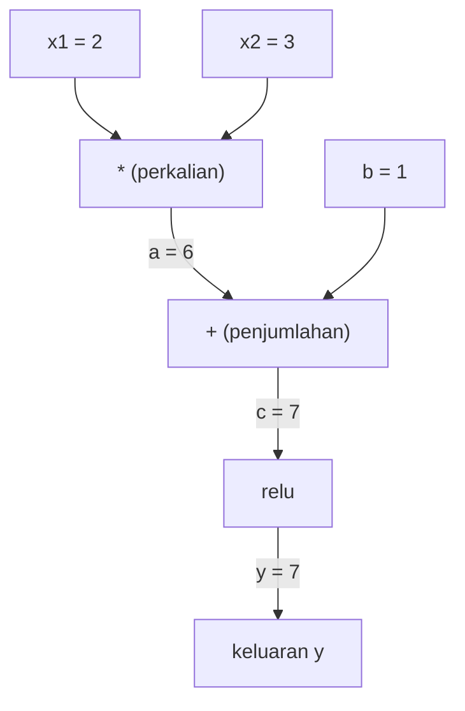
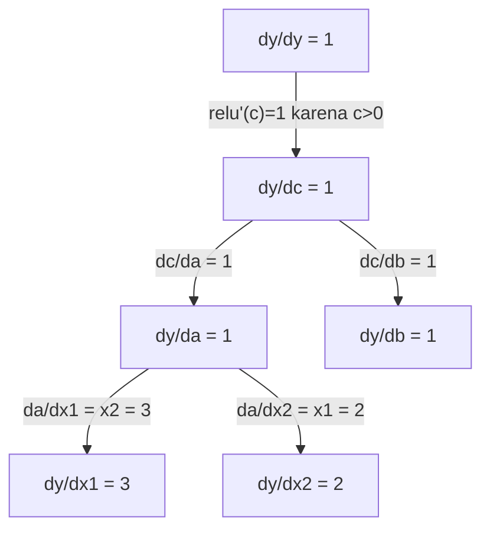

# Aturan Rantai & Diferensiasi Otomatis

> Aturan rantai adalah mesin di balik setiap jaringan saraf yang belajar.

**Jenis:** Bangun
**Bahasa:** Python
**Prasyarat:** Fase 1, Pelajaran 04 (Turunan & Gradien)
**Waktu:** ~90 menit

## Tujuan Pembelajaran

- Membangun mesin autograd minimal (kelas Value) yang mencatat operasi dan menghitung gradien melalui autodiff mode mundur
- Mengimplementasikan forward pass dan backward pass melalui graf komputasi menggunakan pengurutan topologis
- Menyusun dan melatih perceptron multilayer pada XOR hanya dengan mesin autograd buatan dari awal
- Memverifikasi kebenaran autodiff menggunakan pemeriksaan gradien terhadap selisih hingga numerik

## Masalahnya

Anda dapat menghitung turunan fungsi sederhana. Tetapi jaringan saraf bukan fungsi sederhana. Jaringan saraf adalah ratusan fungsi yang digabung: perkalian matriks, tambah bias, terapkan aktivasi, perkalian matriks lagi, softmax, rugi cross-entropy. Keluarannya adalah fungsi dari fungsi dari fungsi.

Untuk melatih jaringan, Anda membutuhkan gradien rugi terhadap setiap bobot. Melakukannya secara manual mustahil untuk jutaan parameter. Melakukannya secara numerik (selisih hingga) terlalu lambat.

Aturan rantai memberi Anda matematikanya. Diferensiasi otomatis memberi Anda algoritmenya. Bersama keduanya memungkinkan Anda menghitung gradien tepat melalui gabungan fungsi apa pun dalam waktu yang sebanding dengan satu forward pass.

Begitulah cara kerja PyTorch, TensorFlow, dan JAX. Anda akan membangun versi mini dari awal.

## Konsepnya

### Aturan Rantai

Jika $y = f(g(x))$, turunan $y$ terhadap $x$ adalah:

```math
\frac{dy}{dx} = \frac{dy}{dg} \cdot \frac{dg}{dx} = f'(g(x)) \cdot g'(x)
```

Kalikan turunan-turunan sepanjang rantai. Setiap mata rantai menyumbangkan turunan lokalnya.

Contoh: $y = \sin(x^2)$

```math
\begin{aligned}
g(x) &= x^2 \qquad & g'(x) &= 2x \\
f(g) &= \sin(g) \qquad & f'(g) &= \cos(g) \\[4pt]
\frac{dy}{dx} &= \cos(x^2) \cdot 2x
\end{aligned}
```

Untuk gabungan yang lebih dalam, rantai diperpanjang:

```math
\begin{aligned}
y &= f(g(h(x))) \\[4pt]
\frac{dy}{dx} &= f'(g(h(x))) \cdot g'(h(x)) \cdot h'(x)
\end{aligned}
```

Setiap lapisan dalam jaringan saraf adalah satu mata rantai dalam rantai ini.

### Graf Komputasi

Graf komputasi membuat aturan rantai menjadi visual. Setiap operasi menjadi sebuah simpul. Data mengalir maju melalui graf. Gradien mengalir mundur.

**Forward pass (hitung nilai):**



**Backward pass (hitung gradien):**



Backward pass menerapkan aturan rantai di setiap simpul, menyebarkan gradien dari keluaran ke masukan.

### Mode Maju versus Mode Mundur

Ada dua cara untuk menerapkan aturan rantai melalui graf.

**Mode maju** dimulai dari masukan dan mendorong turunan ke depan. Mode ini menghitung $dx/dx = 1$ dan menyebarkannya melalui setiap operasi. Baik jika Anda memiliki sedikit masukan dan banyak keluaran.

```
Mode maju: seed dx/dx = 1, sebarkan ke depan

  x = 2       (dx/dx = 1)
  a = x^2     (da/dx = 2x = 4)
  y = sin(a)  (dy/dx = cos(a) * da/dx = cos(4) * 4 = -2.615)
```

**Mode mundur** dimulai dari keluaran dan menarik gradien ke belakang. Mode ini menghitung $dy/dy = 1$ dan menyebarkannya secara terbalik melalui setiap operasi. Baik jika Anda memiliki banyak masukan dan sedikit keluaran.

```
Mode mundur: seed dy/dy = 1, sebarkan ke belakang

  y = sin(a)  (dy/dy = 1)
  a = x^2     (dy/da = cos(a) = cos(4) = -0.654)
  x = 2       (dy/dx = dy/da * da/dx = -0.654 * 4 = -2.615)
```

Jaringan saraf memiliki jutaan masukan (bobot) dan satu keluaran (rugi). Mode mundur menghitung semua gradien dalam satu backward pass. Inilah sebabnya propagasi balik menggunakan mode mundur.

| Mode | Seed | Arah | Terbaik saat |
|------|------|-----------|-----------|
| Maju | $dx_i/dx_i = 1$ | Masukan ke keluaran | Sedikit masukan, banyak keluaran |
| Mundur | $dy/dy = 1$ | Keluaran ke masukan | Banyak masukan, sedikit keluaran (jaringan saraf) |

### Bilangan Dual untuk Mode Maju

Mode maju dapat diimplementasikan dengan elegan menggunakan bilangan dual. Bilangan dual berbentuk $a + b\epsilon$ dengan $\epsilon^2 = 0$.

```
Bilangan dual: (nilai, turunan)

(2, 1) berarti: nilainya 2, turunan terhadap x adalah 1

Aturan aritmetika:
  (a, a') + (b, b') = (a+b, a'+b')
  (a, a') * (b, b') = (a*b, a'*b + a*b')
  sin(a, a')         = (sin(a), cos(a)*a')
```

Berikan masukan variabel dengan turunan 1. Turunan menyebar otomatis melalui setiap operasi.

### Membangun Mesin Autograd

Mesin autograd membutuhkan tiga hal:

1. **Pembungkusan Value.** Bungkus setiap angka dalam objek yang menyimpan nilai dan gradiennya.
2. **Pencatatan graf.** Setiap operasi mencatat masukan dan fungsi gradien lokalnya.
3. **Backward pass.** Urutkan graf secara topologis, lalu telusuri secara terbalik, menerapkan aturan rantai di setiap simpul.

Itulah yang dilakukan `autograd` PyTorch. Kelas `torch.Tensor` membungkus nilai, mencatat operasi saat `requires_grad=True`, dan menghitung gradien saat Anda memanggil `.backward()`.

### Cara Kerja Autograd PyTorch di Balik Layar

Saat Anda menulis kode PyTorch:

```python
x = torch.tensor(2.0, requires_grad=True)
y = x ** 2 + 3 * x + 1
y.backward()
print(x.grad)  # 7.0 = 2*x + 3 = 2*2 + 3
```

Secara internal PyTorch:

1. Membuat simpul `Tensor` untuk `x` dengan `requires_grad=True`
2. Setiap operasi (`**`, `*`, `+`) membuat simpul baru dan mencatat fungsi backward
3. `y.backward()` memicu autodiff mode mundur melalui graf yang tercatat
4. `grad_fn` setiap simpul menghitung gradien lokal dan meneruskannya ke simpul induk
5. Gradien terakumulasi dalam atribut `.grad` melalui penjumlahan (bukan penggantian)

Graf bersifat dinamis (define-by-run). Graf baru dibangun pada setiap forward pass. Inilah sebabnya PyTorch mendukung alur kontrol (if/else, loop) di dalam model.

```figure
chain-rule
```

## Bangunlah

### Langkah 1: Kelas Value

```python
class Value:
    def __init__(self, data, children=(), op=''):
        self.data = data
        self.grad = 0.0
        self._backward = lambda: None
        self._prev = set(children)
        self._op = op

    def __repr__(self):
        return f"Value(data={self.data:.4f}, grad={self.grad:.4f})"
```

Setiap `Value` menyimpan data numeriknya, gradiennya (awalnya nol), fungsi backward, dan penunjuk ke simpul anak yang menghasilkannya.

### Langkah 2: Operasi aritmetika dengan pelacakan gradien

```python
    def __add__(self, other):
        other = other if isinstance(other, Value) else Value(other)
        out = Value(self.data + other.data, (self, other), '+')
        def _backward():
            self.grad += out.grad
            other.grad += out.grad
        out._backward = _backward
        return out

    def __mul__(self, other):
        other = other if isinstance(other, Value) else Value(other)
        out = Value(self.data * other.data, (self, other), '*')
        def _backward():
            self.grad += other.data * out.grad
            other.grad += self.data * out.grad
        out._backward = _backward
        return out

    def relu(self):
        out = Value(max(0, self.data), (self,), 'relu')
        def _backward():
            self.grad += (1.0 if out.data > 0 else 0.0) * out.grad
        out._backward = _backward
        return out
```

Setiap operasi membuat closure yang tahu cara menghitung gradien lokal dan mengalikannya dengan gradien hulu (`out.grad`). `+=` menangani kasus di mana suatu nilai digunakan dalam beberapa operasi.

### Langkah 3: Backward pass

```python
    def backward(self):
        topo = []
        visited = set()
        def build_topo(v):
            if v not in visited:
                visited.add(v)
                for child in v._prev:
                    build_topo(child)
                topo.append(v)
        build_topo(self)

        self.grad = 1.0
        for v in reversed(topo):
            v._backward()
```

Pengurutan topologis memastikan gradien setiap simpul dihitung sepenuhnya sebelum disebarkan ke simpul anaknya. Gradien awal (seed) adalah 1.0 ($dy/dy = 1$).

### Langkah 4: Operasi tambahan untuk mesin yang lengkap

Kelas Value dasar menangani penjumlahan, perkalian, dan relu. Mesin autograd sungguhan membutuhkan lebih banyak. Berikut operasi yang Anda butuhkan untuk membangun jaringan saraf:

```python
    def __neg__(self):
        return self * -1

    def __sub__(self, other):
        return self + (-other)

    def __radd__(self, other):
        return self + other

    def __rmul__(self, other):
        return self * other

    def __rsub__(self, other):
        return other + (-self)

    def __pow__(self, n):
        out = Value(self.data ** n, (self,), f'**{n}')
        def _backward():
            self.grad += n * (self.data ** (n - 1)) * out.grad
        out._backward = _backward
        return out

    def __truediv__(self, other):
        return self * (other ** -1) if isinstance(other, Value) else self * (Value(other) ** -1)

    def exp(self):
        import math
        e = math.exp(self.data)
        out = Value(e, (self,), 'exp')
        def _backward():
            self.grad += e * out.grad
        out._backward = _backward
        return out

    def log(self):
        import math
        out = Value(math.log(self.data), (self,), 'log')
        def _backward():
            self.grad += (1.0 / self.data) * out.grad
        out._backward = _backward
        return out

    def tanh(self):
        import math
        t = math.tanh(self.data)
        out = Value(t, (self,), 'tanh')
        def _backward():
            self.grad += (1 - t ** 2) * out.grad
        out._backward = _backward
        return out
```

**Mengapa setiap operasi penting:**

| Operasi | Aturan backward | Digunakan dalam |
|-----------|--------------|---------|
| `__sub__` | Menggunakan ulang add + neg | Perhitungan rugi (pred - target) |
| `__pow__` | $n \cdot x^{n-1}$ | Aktivasi polinomial, MSE ($\text{galat}^2$) |
| `__truediv__` | Menggunakan ulang mul + pow(-1) | Normalisasi, penskalaan laju pembelajaran |
| `exp` | $\exp(x) \cdot \text{hulu}$ | Softmax, log-likelihood |
| `log` | $(1/x) \cdot \text{hulu}$ | Rugi cross-entropy, log probabilitas |
| `tanh` | $(1 - \tanh^2) \cdot \text{hulu}$ | Fungsi aktivasi klasik |

Bagian yang cerdas: `__sub__` dan `__truediv__` didefinisikan menggunakan operasi yang sudah ada. Mereka mendapat gradien yang benar secara otomatis karena aturan rantai menyusun melalui operasi add/mul/pow yang mendasarinya.

### Langkah 5: MLP mini dari awal

Dengan kelas Value yang lengkap, Anda dapat membangun jaringan saraf. Tanpa PyTorch. Tanpa NumPy. Hanya Value dan aturan rantai.

```python
import random

class Neuron:
    def __init__(self, n_inputs):
        self.w = [Value(random.uniform(-1, 1)) for _ in range(n_inputs)]
        self.b = Value(0.0)

    def __call__(self, x):
        act = sum((wi * xi for wi, xi in zip(self.w, x)), self.b)
        return act.tanh()

    def parameters(self):
        return self.w + [self.b]

class Layer:
    def __init__(self, n_inputs, n_outputs):
        self.neurons = [Neuron(n_inputs) for _ in range(n_outputs)]

    def __call__(self, x):
        return [n(x) for n in self.neurons]

    def parameters(self):
        return [p for n in self.neurons for p in n.parameters()]

class MLP:
    def __init__(self, sizes):
        self.layers = [Layer(sizes[i], sizes[i+1]) for i in range(len(sizes)-1)]

    def __call__(self, x):
        for layer in self.layers:
            x = layer(x)
        return x[0] if len(x) == 1 else x

    def parameters(self):
        return [p for layer in self.layers for p in layer.parameters()]
```

Sebuah `Neuron` menghitung `tanh(w1*x1 + w2*x2 + ... + b)`. `Layer` adalah daftar neuron. `MLP` menumpuk lapisan. Setiap bobot adalah `Value`, sehingga memanggil `loss.backward()` menyebarkan gradien ke setiap parameter.

**Pelatihan pada XOR:**

```python
random.seed(42)
model = MLP([2, 4, 1])  # 2 masukan, 4 neuron tersembunyi, 1 keluaran

xs = [[0, 0], [0, 1], [1, 0], [1, 1]]
ys = [-1, 1, 1, -1]  # pola XOR (memakai -1/1 untuk tanh)

for step in range(100):
    preds = [model(x) for x in xs]
    loss = sum((p - y) ** 2 for p, y in zip(preds, ys))

    for p in model.parameters():
        p.grad = 0.0
    loss.backward()

    lr = 0.05
    for p in model.parameters():
        p.data -= lr * p.grad

    if step % 20 == 0:
        print(f"step {step:3d}  loss = {loss.data:.4f}")

print("\nPredictions after training:")
for x, y in zip(xs, ys):
    print(f"  input={x}  target={y:2d}  pred={model(x).data:6.3f}")
```

Inilah micrograd. Loop pelatihan jaringan saraf lengkap dalam Python murni dengan diferensiasi otomatis. Setiap kerangka kerja pembelajaran mendalam komersial melakukan hal yang sama dalam skala besar.

### Langkah 6: Pemeriksaan gradien

Bagaimana Anda tahu autodiff Anda benar? Bandingkan dengan turunan numerik. Inilah pemeriksaan gradien.

```python
def gradient_check(build_expr, x_val, h=1e-7):
    x = Value(x_val)
    y = build_expr(x)
    y.backward()
    autodiff_grad = x.grad

    y_plus = build_expr(Value(x_val + h)).data
    y_minus = build_expr(Value(x_val - h)).data
    numerical_grad = (y_plus - y_minus) / (2 * h)

    diff = abs(autodiff_grad - numerical_grad)
    return autodiff_grad, numerical_grad, diff
```

Uji pada ekspresi yang kompleks:

```python
def expr(x):
    return (x ** 3 + x * 2 + 1).tanh()

ad, num, diff = gradient_check(expr, 0.5)
print(f"Autodiff:  {ad:.8f}")
print(f"Numerical: {num:.8f}")
print(f"Difference: {diff:.2e}")
# Selisih harus < 1e-5
```

Pemeriksaan gradien sangat penting saat mengimplementasikan operasi baru. Jika backward pass Anda memiliki bug, pemeriksaan numerik akan menangkapnya. Setiap implementasi pembelajaran mendalam yang serius menjalankan pemeriksaan gradien selama pengembangan.

**Kapan menggunakan pemeriksaan gradien:**

| Situasi | Apakah perlu pemeriksaan gradien? |
|-----------|-------------------|
| Menambahkan operasi baru ke autograd Anda | Ya, selalu |
| Men-debug loop pelatihan yang tidak konvergen | Ya, periksa gradien terlebih dahulu |
| Pelatihan produksi | Tidak, terlalu lambat (2x forward pass per parameter) |
| Tes unit untuk kode autograd | Ya, otomatisasi |

### Langkah 7: Verifikasi terhadap perhitungan manual

```python
x1 = Value(2.0)
x2 = Value(3.0)
a = x1 * x2          # a = 6.0
b = a + Value(1.0)    # b = 7.0
y = b.relu()          # y = 7.0

y.backward()

print(f"y = {y.data}")          # 7.0
print(f"dy/dx1 = {x1.grad}")   # 3.0 (= x2)
print(f"dy/dx2 = {x2.grad}")   # 2.0 (= x1)
```

Pemeriksaan manual: `y = relu(x1*x2 + 1)`. Karena `x1*x2 + 1 = 7 > 0`, relu adalah identitas.
`dy/dx1 = x2 = 3`. `dy/dx2 = x1 = 2`. Mesin sesuai.

## Gunakanlah

### Verifikasi terhadap PyTorch

```python
import torch

x1 = torch.tensor(2.0, requires_grad=True)
x2 = torch.tensor(3.0, requires_grad=True)
a = x1 * x2
b = a + 1.0
y = torch.relu(b)
y.backward()

print(f"PyTorch dy/dx1 = {x1.grad.item()}")  # 3.0
print(f"PyTorch dy/dx2 = {x2.grad.item()}")  # 2.0
```

Gradien sama. Mesin Anda menghitung hasil yang sama dengan PyTorch karena matematikanya sama: autodiff mode mundur melalui aturan rantai.

### Ekspresi yang lebih kompleks

```python
a = Value(2.0)
b = Value(-3.0)
c = Value(10.0)
f = (a * b + c).relu()  # relu(2*(-3) + 10) = relu(4) = 4

f.backward()
print(f"df/da = {a.grad}")  # -3.0 (= b)
print(f"df/db = {b.grad}")  #  2.0 (= a)
print(f"df/dc = {c.grad}")  #  1.0
```

## Rilis

Pelajaran ini menghasilkan:
- `outputs/skill-autodiff.md` -- skill untuk membangun dan men-debug sistem autograd
- `code/autodiff.py` -- mesin autograd minimal yang dapat Anda kembangkan

Kelas Value yang dibangun di sini adalah fondasi loop pelatihan jaringan saraf di Fase 3.

## Latihan

1. Tambahkan `__pow__` ke kelas Value agar Anda dapat menghitung `x ** n`. Verifikasi bahwa $\frac{d}{dx}(x^3)$ di $x=2$ sama dengan `12.0`.

2. Tambahkan `tanh` sebagai fungsi aktivasi. Verifikasi bahwa $\tanh'(0) = 1$ dan $\tanh'(2) = 0.0707$ (perkiraan).

3. Bangun graf komputasi untuk satu neuron: `y = relu(w1*x1 + w2*x2 + b)`. Hitung kelima gradien dan verifikasi terhadap PyTorch.

4. Implementasikan autodiff mode maju menggunakan bilangan dual. Buat kelas `Dual` dan verifikasi bahwa hasilnya sama dengan mesin mode mundur Anda.

### Petunjuk

**Latihan 1.** `Value` sudah mendefinisikan `__pow__`. Baca `_backward`-nya dan konfirmasi bahwa ia menerapkan $n x^{n-1}$ pada gradien yang masuk. Jalankan `x = Value(2.0)`, `y = x ** 3`, `y.backward()`; `x.grad` harus 12.0.

**Latihan 2.** Gunakan $\tanh'(x) = 1 - \tanh(x)^2$ di `_backward`. Periksa terhadap selisih hingga Anda sendiri: $\frac{\tanh(x + h) - \tanh(x - h)}{2h}$ harus sesuai di $x = 0$ dan $x = 2$.

**Latihan 3.** Bangun `w1*x1 + w2*x2 + b` dari objek `Value`, terapkan `relu`, dan panggil `backward`. Sebelum membandingkan dengan PyTorch, periksa secara manual: jika masukan ke `relu` positif, gradien untuk `w1` sama dengan `x1`; jika negatif, kelima gradien adalah 0.

**Latihan 4.** Simpan nilai dan turunan di setiap `Dual`, dan gunakan aturan hasil kali $(a, a')(b, b') = (ab, a'b + ab')$ untuk perkalian. Beri masukan turunan awal 1 dan bandingkan hasilnya dengan `x.grad` dari mesin mode mundur untuk fungsi yang sama.

## Istilah Kunci

| Istilah | Yang orang katakan | Arti sebenarnya |
|------|----------------|----------------------|
| Aturan rantai | "Kalikan turunannya" | Turunan fungsi gabungan sama dengan hasil kali turunan lokal setiap fungsi, dievaluasi di titik yang tepat |
| Graf komputasi | "Diagram jaringan" | Graf asiklik berarah yang simpulnya adalah operasi dan sisi-sisinya membawa nilai (maju) atau gradien (mundur) |
| Mode maju | "Mendorong turunan ke depan" | Autodiff yang menyebarkan turunan dari masukan ke keluaran. Satu pass per variabel masukan. |
| Mode mundur | "Propagasi balik" | Autodiff yang menyebarkan gradien dari keluaran ke masukan. Satu pass per variabel keluaran. |
| Autograd | "Gradien otomatis" | Sistem yang mencatat operasi pada nilai, membangun graf, dan menghitung gradien tepat melalui aturan rantai |
| Bilangan dual | "Nilai ditambah turunan" | Bilangan berbentuk $a + b\epsilon$ ($\epsilon^2 = 0$) yang membawa informasi turunan melalui aritmetika |
| Pengurutan topologis | "Urutan dependensi" | Mengurutkan simpul graf agar setiap simpul muncul setelah semua dependensinya. Diperlukan untuk penyebaran gradien yang benar. |
| Akumulasi gradien | "Tambahkan, jangan ganti" | Saat suatu nilai masuk ke beberapa operasi, gradiennya adalah jumlah dari semua kontribusi gradien yang masuk |
| Graf dinamis | "Define by run" | Graf komputasi yang dibangun ulang pada setiap forward pass, memungkinkan alur kontrol Python di dalam model (gaya PyTorch) |
| Pemeriksaan gradien | "Verifikasi numerik" | Membandingkan gradien autodiff dengan gradien selisih hingga numerik untuk memverifikasi kebenaran. Sangat penting untuk debugging. |
| MLP | "Perceptron multilayer" | Jaringan saraf dengan satu atau lebih lapisan tersembunyi neuron. Setiap neuron menghitung jumlah bobot ditambah bias, lalu menerapkan fungsi aktivasi. |
| Neuron | "Jumlah bobot + aktivasi" | Unit dasar: $\text{keluaran} = \text{aktivasi}(w_1 x_1 + w_2 x_2 + \cdots + b)$. Bobot dan bias adalah parameter yang dapat dipelajari. |

## Bacaan Lanjutan

- [3Blue1Brown: Backpropagation calculus](https://www.youtube.com/watch?v=tIeHLnjs5U8) -- penjelasan visual aturan rantai dalam jaringan saraf
- [PyTorch Autograd mechanics](https://pytorch.org/docs/stable/notes/autograd.html) -- cara kerja sistem sungguhan
- [Baydin et al., Automatic Differentiation in Machine Learning: a Survey](https://arxiv.org/abs/1502.05767) -- referensi komprehensif
