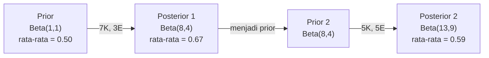

# Teorema Bayes

> Probabilitas adalah tentang apa yang Anda harapkan. Teorema Bayes adalah tentang apa yang Anda pelajari.

**Jenis:** Bangun
**Bahasa:** Python, TypeScript
**Prasyarat:** Fase 1, Pelajaran 06 (Dasar-Dasar Probabilitas)
**Waktu:** ~75 menit

## Tujuan Pembelajaran

- Menerapkan teorema Bayes untuk menghitung probabilitas posterior dari prior, likelihood, dan evidence
- Membangun klasifikator teks Naive Bayes dari awal dengan pemulusan Laplace dan komputasi dalam ruang log
- Membandingkan estimasi MLE dan MAP serta menjelaskan bagaimana MAP bersesuaian dengan regularisasi L2
- Mengimplementasikan pembaruan Bayes berurutan menggunakan prior konjugat Beta-Binomial untuk pengujian A/B

## Masalahnya

Sebuah tes medis akurat 99%. Hasil tes Anda positif. Berapa peluang Anda benar-benar mengidap penyakit itu?

Kebanyakan orang menjawab 99%. Jawaban yang sebenarnya bergantung pada seberapa langka penyakit itu. Jika 1 dari 10.000 orang mengidapnya, hasil positif hanya memberi Anda peluang sekitar 1% untuk sakit. 99% sisanya adalah alarm palsu dari orang-orang sehat.

Ini bukan pertanyaan jebakan. Ini teorema Bayes. Setiap filter spam, setiap diagnosis medis, setiap model pembelajaran mesin yang mengukur ketidakpastian menggunakan penalaran yang persis sama. Anda mulai dengan sebuah keyakinan. Anda melihat bukti. Anda memperbarui keyakinan itu.

Jika Anda membangun sistem ML tanpa memahami ini, Anda akan salah menafsirkan keluaran model, menetapkan ambang batas yang buruk, dan merilis prediksi yang terlalu percaya diri.

## Konsepnya

### Dari probabilitas gabungan ke teorema Bayes

Anda sudah mengetahui dari Pelajaran 06 bahwa probabilitas bersyarat adalah:

```math
P(A \mid B) = \frac{P(A \text{ dan } B)}{P(B)}
```

Dan secara simetris:

```math
P(B \mid A) = \frac{P(A \text{ dan } B)}{P(A)}
```

Kedua ekspresi memiliki pembilang yang sama: $P(A \text{ dan } B)$. Samakan keduanya dan susun ulang:

```math
\begin{aligned}
P(A \text{ dan } B) &= P(A \mid B) \cdot P(B) = P(B \mid A) \cdot P(A) \\[4pt]
&\text{Oleh karena itu:} \\[4pt]
P(A \mid B) &= \frac{P(B \mid A) \cdot P(A)}{P(B)}
\end{aligned}
```

Itulah teorema Bayes. Empat besaran, satu persamaan.

### Empat bagiannya

| Bagian | Nama | Artinya |
|---|---|---|
| $P(A \mid B)$ | Posterior | Keyakinan Anda yang diperbarui tentang $A$ setelah melihat bukti $B$ |
| $P(B \mid A)$ | Likelihood | Seberapa mungkin bukti $B$ jika $A$ benar |
| $P(A)$ | Prior | Keyakinan Anda tentang $A$ sebelum melihat bukti apa pun |
| $P(B)$ | Evidence | Probabilitas total melihat $B$ di semua kemungkinan |

Suku evidence $P(B)$ berperan sebagai penormalisasi. Anda dapat mengembangkannya dengan hukum probabilitas total:

```math
P(B) = P(B \mid A) \cdot P(A) + P(B \mid \text{bukan } A) \cdot P(\text{bukan } A)
```

### Contoh tes medis

Sebuah penyakit menyerang 1 dari 10.000 orang. Tesnya akurat 99% (mendeteksi 99% orang sakit dan memberikan positif palsu 1% dari waktu).

```math
\begin{aligned}
P(\text{sakit}) &= 0.0001 \quad \text{(prior: penyakit ini langka)} \\
P(\text{positif} \mid \text{sakit}) &= 0.99 \quad \text{(likelihood: tes mendeteksinya)} \\
P(\text{positif} \mid \text{sehat}) &= 0.01 \quad \text{(laju positif palsu)} \\[6pt]
P(\text{positif}) &= P(\text{positif} \mid \text{sakit}) \cdot P(\text{sakit}) + P(\text{positif} \mid \text{sehat}) \cdot P(\text{sehat}) \\
&= 0.99 \cdot 0.0001 + 0.01 \cdot 0.9999 \\
&= 0.000099 + 0.009999 \\
&= 0.010098 \\[6pt]
P(\text{sakit} \mid \text{positif}) &= P(\text{positif} \mid \text{sakit}) \cdot P(\text{sakit}) / P(\text{positif}) \\
&= 0.99 \cdot 0.0001 / 0.010098 \\
&= 0.0098 \\
&= 0.98\%
\end{aligned}
```

Kurang dari 1%. Prior mendominasi. Ketika suatu kondisi langka, bahkan tes yang akurat menghasilkan lebih banyak positif palsu. Inilah sebabnya dokter memesan tes konfirmasi.

### Contoh filter spam

Anda menerima email yang mengandung kata "lottery". Apakah itu spam?

```math
\begin{aligned}
P(\text{spam}) &= 0.3 \quad \text{(30\% email adalah spam)} \\
P(\text{"lottery"} \mid \text{spam}) &= 0.05 \quad \text{(5\% email spam mengandung "lottery")} \\
P(\text{"lottery"} \mid \text{bukan spam}) &= 0.001 \quad \text{(0,1\% email sah mengandung "lottery")} \\[6pt]
P(\text{"lottery"}) &= 0.05 \cdot 0.3 + 0.001 \cdot 0.7 \\
&= 0.015 + 0.0007 \\
&= 0.0157 \\[6pt]
P(\text{spam} \mid \text{"lottery"}) &= 0.05 \cdot 0.3 / 0.0157 \\
&= 0.955 \\
&= 95.5\%
\end{aligned}
```

Satu kata menggeser probabilitas dari 30% menjadi 95,5%. Filter spam sungguhan menerapkan Bayes pada ratusan kata secara bersamaan.

### Naive Bayes: asumsi kemerdekaan

Naive Bayes memperluas ini ke banyak fitur dengan mengasumsikan semua fitur saling merdeka secara bersyarat jika kelasnya diketahui:

```math
P(\text{kelas} \mid \text{fitur}_1, \text{fitur}_2, \ldots, \text{fitur}_n) = \frac{P(\text{kelas}) \cdot P(\text{fitur}_1 \mid \text{kelas}) \cdot P(\text{fitur}_2 \mid \text{kelas}) \cdots P(\text{fitur}_n \mid \text{kelas})}{P(\text{fitur}_1, \text{fitur}_2, \ldots, \text{fitur}_n)}
```

Bagian "naive" adalah asumsi kemerdekaan itu. Dalam teks, kemunculan kata tidak saling merdeka ("New" dan "York" berkorelasi). Namun asumsi ini bekerja dengan sangat baik dalam praktik karena klasifikator hanya perlu memberi peringkat kelas, bukan menghasilkan probabilitas terkalibrasi.

Karena penyebutnya sama untuk semua kelas, Anda dapat mengabaikannya dan hanya membandingkan pembilang:

```math
\text{skor}(\text{kelas}) = P(\text{kelas}) \cdot \prod_i P(\text{fitur}_i \mid \text{kelas})
```

Pilih kelas dengan skor tertinggi.

### Estimasi likelihood maksimum (MLE)

Bagaimana Anda memperoleh $P(\text{fitur} \mid \text{kelas})$ dari data pelatihan? Dengan menghitung.

```math
P(\text{"free"} \mid \text{spam}) = \frac{\text{jumlah email spam yang mengandung "free"}}{\text{total email spam}}
```

Inilah MLE: pilih nilai parameter yang membuat data yang diamati paling mungkin. Anda memaksimalkan fungsi likelihood, yang untuk hitungan diskrit menyederhana menjadi frekuensi relatif.

Masalahnya: jika sebuah kata tidak pernah muncul dalam spam saat pelatihan, MLE memberinya probabilitas nol. Satu kata yang belum pernah terlihat membunuh seluruh perkalian. Perbaiki dengan pemulusan Laplace:

```math
P(\text{kata} \mid \text{kelas}) = \frac{\text{count}(\text{kata}, \text{kelas}) + 1}{\text{total\_words\_in\_class} + \text{vocabulary\_size}}
```

Menambahkan 1 pada setiap hitungan memastikan tidak ada probabilitas yang benar-benar nol.

Sebuah kata yang tidak pernah muncul di pesan pelatihan mana pun tidak masuk kosakata. `predict` melewatkannya, karena kata itu tidak memberi bukti untuk kelas mana pun.

### Maksimum posteriori (MAP)

MLE bertanya: parameter apa yang memaksimalkan $P(\text{data} \mid \text{parameters})$?

MAP bertanya: parameter apa yang memaksimalkan $P(\text{parameters} \mid \text{data})$?

Menurut teorema Bayes:

```math
P(\text{parameters} \mid \text{data}) \propto P(\text{data} \mid \text{parameters}) \cdot P(\text{parameters})
```

MAP menambahkan prior pada parameter itu sendiri. Jika Anda meyakini parameter sebaiknya kecil, Anda menyandikan keyakinan itu sebagai prior yang menghukum nilai besar. Ini identik dengan regularisasi L2 dalam ML. Penalti "ridge" pada regresi ridge secara harfiah adalah prior Gauss pada bobot.

| Estimasi | Dioptimalkan | Padanan dalam ML |
|---|---|---|
| MLE | $P(\text{data} \mid \text{params})$ | Pelatihan tanpa regularisasi |
| MAP | $P(\text{data} \mid \text{params}) \cdot P(\text{params})$ | Regularisasi L2 / L1 |

### Bayes versus frequentist: perbedaan praktisnya

Frequentist memperlakukan parameter sebagai nilai tak diketahui yang tetap. Mereka bertanya: "Jika saya mengulang percobaan ini berkali-kali, apa yang akan terjadi?"

Bayesian memperlakukan parameter sebagai distribusi. Mereka bertanya: "Dengan apa yang telah saya amati, apa keyakinan saya tentang parameter ini?"

Untuk membangun sistem ML, perbedaan praktisnya:

| Aspek | Frequentist | Bayesian |
|---|---|---|
| Keluaran | Estimasi titik | Distribusi atas nilai |
| Ketidakpastian | Selang kepercayaan (tentang prosedur) | Selang kredibel (tentang parameter) |
| Data sedikit | Dapat overfit | Prior berperan sebagai regularisasi |
| Komputasi | Biasanya lebih cepat | Sering memerlukan pengambilan sampel (MCMC) |

Kebanyakan ML produksi bersifat frequentist (SGD, estimasi titik). Metode Bayes bersinar ketika Anda membutuhkan ketidakpastian yang terkalibrasi (keputusan medis, sistem kritis keselamatan) atau ketika data langka (few-shot learning, cold start).

### Mengapa penalaran Bayes penting bagi ML

Hubungannya lebih dalam sekadar analogi:

**Prior adalah regularisasi.** Prior Gauss pada bobot adalah regularisasi L2. Prior Laplace adalah L1. Setiap kali Anda menambahkan suku regularisasi, Anda sedang membuat pernyataan Bayes tentang nilai parameter yang Anda harapkan.

**Posterior adalah ketidakpastian.** Satu probabilitas prediksi tidak memberi tahu apa pun tentang seberapa yakin model terhadap estimasi itu. Metode Bayes memberi Anda distribusi: "Saya berpikir $P(\text{spam})$ berada antara 0,8 dan 0,95."

**Pembaruan Bayes adalah pembelajaran daring.** Posterior hari ini menjadi prior besok. Ketika model melihat data baru, ia memperbarui keyakinannya secara inkremental alih-alih melatih ulang dari awal.

**Perbandingan model bersifat Bayes.** Bayesian information criterion (BIC), marginal likelihood, dan Bayes factor semuanya menggunakan penalaran Bayes untuk memilih antarmodel tanpa overfit.

```figure
bayes-update
```

## Bangunlah

### Langkah 1: Fungsi teorema Bayes

```python
def bayes(prior, likelihood, false_positive_rate):
    evidence = likelihood * prior + false_positive_rate * (1 - prior)
    posterior = likelihood * prior / evidence
    return posterior

result = bayes(prior=0.0001, likelihood=0.99, false_positive_rate=0.01)
print(f"P(sick|positive) = {result:.4f}")
```

### Langkah 2: Klasifikator Naive Bayes

```python
import math
from collections import defaultdict

class NaiveBayes:
    def __init__(self, smoothing=1.0):
        self.smoothing = smoothing
        self.class_counts = defaultdict(int)
        self.word_counts = defaultdict(lambda: defaultdict(int))
        self.class_word_totals = defaultdict(int)
        self.vocab = set()

    def train(self, documents, labels):
        for doc, label in zip(documents, labels):
            self.class_counts[label] += 1
            words = doc.lower().split()
            for word in words:
                self.word_counts[label][word] += 1
                self.class_word_totals[label] += 1
                self.vocab.add(word)

    def predict(self, document):
        words = [word for word in document.lower().split() if word in self.vocab]
        total_docs = sum(self.class_counts.values())
        vocab_size = len(self.vocab)
        best_class = None
        best_score = float("-inf")
        for cls in self.class_counts:
            score = math.log(self.class_counts[cls] / total_docs)
            for word in words:
                count = self.word_counts[cls].get(word, 0)
                total = self.class_word_totals[cls]
                score += math.log((count + self.smoothing) / (total + self.smoothing * vocab_size))
            if score > best_score:
                best_score = score
                best_class = cls
        return best_class
```

Log probabilitas mencegah underflow. Mengalikan banyak probabilitas kecil menghasilkan angka yang terlalu kecil untuk titik mengambang. Menjumlahkan log probabilitas stabil secara numerik dan ekuivalen secara matematis.

### Langkah 3: Latih pada data spam

```python
train_docs = [
    "win free money now",
    "free lottery ticket winner",
    "claim your prize today free",
    "urgent offer free cash",
    "congratulations you won free",
    "meeting tomorrow at noon",
    "project update attached",
    "can we schedule a call",
    "quarterly report review",
    "lunch on thursday sounds good",
    "team standup notes attached",
    "please review the pull request",
]

train_labels = [
    "spam", "spam", "spam", "spam", "spam",
    "ham", "ham", "ham", "ham", "ham", "ham", "ham",
]

classifier = NaiveBayes()
classifier.train(train_docs, train_labels)

test_messages = [
    "free money waiting for you",
    "meeting rescheduled to friday",
    "you won a free prize",
    "please review the attached report",
]

for msg in test_messages:
    print(f"  '{msg}' -> {classifier.predict(msg)}")
```

### Langkah 4: Periksa probabilitas yang dipelajari

```python
def show_top_words(classifier, cls, n=5):
    vocab_size = len(classifier.vocab)
    total = classifier.class_word_totals[cls]
    probs = {}
    for word in classifier.vocab:
        count = classifier.word_counts[cls].get(word, 0)
        probs[word] = (count + classifier.smoothing) / (total + classifier.smoothing * vocab_size)
    sorted_words = sorted(probs.items(), key=lambda x: x[1], reverse=True)
    for word, prob in sorted_words[:n]:
        print(f"    {word}: {prob:.4f}")

print("\nTop spam words:")
show_top_words(classifier, "spam")
print("\nTop ham words:")
show_top_words(classifier, "ham")
```

## Gunakanlah

Scikit-learn menyediakan implementasi Naive Bayes siap produksi:

```python
from sklearn.feature_extraction.text import CountVectorizer
from sklearn.naive_bayes import MultinomialNB
from sklearn.metrics import classification_report

vectorizer = CountVectorizer()
X_train = vectorizer.fit_transform(train_docs)
clf = MultinomialNB()
clf.fit(X_train, train_labels)

X_test = vectorizer.transform(test_messages)
predictions = clf.predict(X_test)
for msg, pred in zip(test_messages, predictions):
    print(f"  '{msg}' -> {pred}")
```

Algoritmanya sama. `CountVectorizer` menangani tokenisasi dan pembentukan kosakata. `MultinomialNB` menangani pemulusan dan log probabilitas secara internal. Versi buatan Anda melakukan hal yang sama dalam 40 baris.

## Rilis

Kelas `NaiveBayes` yang dibangun di sini mendemonstrasikan pipeline lengkap: tokenisasi, estimasi probabilitas dengan pemulusan Laplace, dan prediksi dalam ruang log. Kode di `code/bayes.py` berjalan dari awal hingga akhir tanpa dependensi selain pustaka standar Python. Port TypeScript di `code/bayes.ts` hanya menggunakan pustaka standar Node.

### Prior Konjugat

Ketika prior dan posterior termasuk dalam keluarga distribusi yang sama, prior tersebut disebut "konjugat". Ini membuat pembaruan Bayes menjadi bersih secara aljabar — Anda memperoleh posterior bentuk tertutup tanpa integrasi numerik.

| Likelihood | Prior Konjugat | Posterior | Contoh |
|---|---|---|---|
| Bernoulli | $\text{Beta}(a, b)$ | $\text{Beta}(a + \text{keberhasilan}, b + \text{kegagalan})$ | Estimasi bias lemparan koin |
| Normal (varians diketahui) | $\text{Normal}(\mu_0, \sigma_0)$ | Normal(rata-rata tertimbang, varians lebih kecil) | Kalibrasi sensor |
| Poisson | $\text{Gamma}(a, b)$ | $\text{Gamma}(a + \text{jumlah hitungan}, b + n)$ | Pemodelan laju kedatangan |
| Multinomial | $\text{Dirichlet}(\alpha)$ | $\text{Dirichlet}(\alpha + \text{hitungan})$ | Pemodelan topik, model bahasa |

Mengapa ini penting: tanpa prior konjugat, Anda memerlukan pengambilan sampel Monte Carlo atau inferensi variasional untuk mendekati posterior. Dengan prior konjugat, Anda cukup memperbarui dua angka.

Distribusi Beta adalah prior konjugat paling umum dalam praktik. $\text{Beta}(a, b)$ menyatakan keyakinan Anda tentang sebuah parameter probabilitas. Rata-ratanya adalah $a/(a+b)$. Semakin besar $a+b$, semakin terkonsentrasi (yakin) distribusinya.

Kasus khusus prior Beta:
- $\text{Beta}(1, 1)$ = seragam. Anda tidak memiliki pendapat tentang parameter itu.
- $\text{Beta}(10, 10)$ = memuncak di 0,5. Anda sangat yakin parameter itu dekat 0,5.
- $\text{Beta}(1, 10)$ = condong ke 0. Anda yakin parameter itu kecil.

Aturan pembaruannya sangat sederhana:

```math
\begin{aligned}
\text{Prior:} \quad & \text{Beta}(a, b) \\
\text{Data:} \quad & s \text{ keberhasilan}, f \text{ kegagalan} \\
\text{Posterior:} \quad & \text{Beta}(a + s, b + f)
\end{aligned}
```

Tanpa integral. Tanpa pengambilan sampel. Hanya penjumlahan.

### Pembaruan Bayes Berurutan

Inferensi Bayes secara alami bersifat berurutan. Posterior hari ini menjadi prior besok. Inilah cara sistem nyata belajar secara inkremental tanpa memproses ulang semua data historis.

Contoh konkret: mengestimasi apakah sebuah koin adil.

**Hari 1: Belum ada data.**
Mulai dengan $\text{Beta}(1, 1)$ — prior seragam. Anda tidak punya pendapat.
- Rata-rata prior: 0,5
- Prior datar di seluruh [0, 1]

**Hari 2: Amati 7 kepala, 3 ekor.**
$\text{Posterior} = \text{Beta}(1 + 7, 1 + 3) = \text{Beta}(8, 4)$
- Rata-rata posterior: $8/12 = 0.667$
- Bukti menunjukkan koin itu condong ke kepala

**Hari 3: Amati 5 kepala dan 5 ekor lagi.**
Gunakan posterior kemarin sebagai prior hari ini.
$\text{Posterior} = \text{Beta}(8 + 5, 4 + 5) = \text{Beta}(13, 9)$
- Rata-rata posterior: $13/22 = 0.591$
- Data baru yang seimbang menarik estimasi kembali ke arah 0,5



Urutan pengamatan tidak penting. $\text{Beta}(1,1)$ yang diperbarui dengan ke-12 kepala dan ke-8 ekor sekaligus menghasilkan $\text{Beta}(13, 9)$ — hasil yang sama. Pembaruan berurutan dan pembaruan batch ekuivalen secara matematis. Tetapi pembaruan berurutan memungkinkan Anda mengambil keputusan di setiap langkah tanpa menyimpan data mentah.

Ini adalah dasar pembelajaran daring dalam sistem ML produksi. Thompson sampling untuk bandit, sistem rekomendasi inkremental, dan detektor anomali streaming semuanya menggunakan pola ini.

### Hubungan dengan Pengujian A/B

Pengujian A/B adalah inferensi Bayes yang menyamar.

Skenario: Anda menguji dua warna tombol. Varian A (biru) dan varian B (hijau). Anda ingin tahu mana yang lebih banyak diklik.

Pengujian A/B Bayes:

1. **Prior.** Mulai dengan $\text{Beta}(1, 1)$ untuk kedua varian. Tidak ada preferensi awal.
2. **Data.** Varian A: 50 klik dari 1000 tayangan. Varian B: 65 klik dari 1000 tayangan.
3. **Posterior.**
   - A: $\text{Beta}(1 + 50, 1 + 950) = \text{Beta}(51, 951)$. Rata-rata = 0.051
   - B: $\text{Beta}(1 + 65, 1 + 935) = \text{Beta}(66, 936)$. Rata-rata = 0.066
4. **Keputusan.** Hitung $P(B > A)$ — probabilitas bahwa laju konversi sejati B lebih tinggi daripada A.

Menghitung $P(B > A)$ secara analitis itu sulit. Namun Monte Carlo membuatnya mudah:

```
1. Ambil 100.000 sampel dari Beta(51, 951)  -> samples_A
2. Ambil 100.000 sampel dari Beta(66, 936)  -> samples_B
3. P(B > A) = fraksi sampel di mana B > A
```

Jika $P(B > A) > 0.95$, rilis varian B. Jika antara 0,05 dan 0,95, teruskan mengumpulkan data. Jika $P(B > A) < 0.05$, rilis varian A.

Keunggulan dibanding pengujian A/B frequentist:
- Anda mendapat pernyataan probabilitas langsung: "ada peluang 97% bahwa B lebih baik"
- Tidak ada kebingungan p-value. Tidak ada "gagal menolak hipotesis nol" yang bertele-tele.
- Anda dapat memeriksa hasil kapan saja tanpa meningkatkan laju positif palsu (tidak ada "masalah mengintip")
- Anda dapat memasukkan pengetahuan sebelumnya (misalnya, tes terdahulu menunjukkan laju konversi biasanya 3-8%)

| Aspek | A/B Frequentist | A/B Bayes |
|---|---|---|
| Keluaran | p-value | $P(B > A)$ |
| Interpretasi | "Seberapa mengejutkan data ini jika A=B?" | "Seberapa mungkin B lebih baik daripada A?" |
| Penghentian awal | Meningkatkan positif palsu | Aman kapan saja (dengan prior yang dipilih baik dan model yang ditentukan tepat) |
| Pengetahuan sebelumnya | Tidak digunakan | Disandikan sebagai prior Beta |
| Aturan keputusan | $p < 0.05$ | $P(B > A) > \text{ambang}$ |

## Latihan

1. **Beberapa tes.** Seorang pasien dinyatakan positif dua kali pada tes independen (keduanya akurat 99%, prevalensi penyakit 1 dari 10.000). Berapa $P(\text{sakit})$ setelah kedua tes? Gunakan posterior dari tes pertama sebagai prior untuk tes kedua.

2. **Dampak pemulusan.** Jalankan klasifikator spam dengan nilai pemulusan 0,01; 0,1; 1,0; dan 10,0. Bagaimana probabilitas kata teratas berubah? Apa yang terjadi dengan smoothing=0 dan sebuah kata yang hanya muncul pada ham?

3. **Tambah fitur.** Perluas kelas `NaiveBayes` agar juga menggunakan panjang pesan (pendek/panjang) sebagai fitur di samping hitungan kata. Estimasi $P(\text{pendek} \mid \text{spam})$ dan $P(\text{pendek} \mid \text{ham})$ dari data pelatihan dan masukkan ke dalam skor prediksi.

4. **MAP dengan tangan.** Dengan data teramati (7 kepala dalam 10 lemparan koin), hitung estimasi MAP untuk bias menggunakan prior $\text{Beta}(2,2)$. Bandingkan dengan estimasi MLE ($7/10$).

### Petunjuk

**Latihan 1.** Panggil `bayes` sekali untuk memperoleh posterior setelah tes 1, lalu panggil lagi dengan posterior itu sebagai prior. `sequential_bayes(prior, likelihood, false_positive_rate, 2)` harus memberikan nilai yang sama, mendekati 0,5.

**Latihan 2.** Buat satu `NaiveBayes(smoothing=s)` untuk setiap nilai, latih dengan data yang sama, dan cetak `top_words` untuk masing-masing. Dengan smoothing 0, kata yang tidak pernah muncul dalam spam mendapat probabilitas 0, sehingga lognya tidak terdefinisi.

**Latihan 3.** Hitung berapa pesan spam dan ham yang pendek, bagi dengan jumlah pesan di setiap kelas, dan tambahkan log dari rasio itu ke skor di `predict`. Periksa bahwa kedua probabilitas untuk setiap kelas berjumlah 1.

**Latihan 4.** Dengan prior $\text{Beta}(\alpha, \beta)$, estimasi MAP adalah $\frac{h + \alpha - 1}{n + \alpha + \beta - 2}$. Masukkan $h = 7$, $n = 10$; hasilnya harus berada di antara MLE (0,7) dan modus prior (0,5).

## Istilah Kunci

| Istilah | Yang sering dikatakan | Arti sebenarnya |
|---|---|---|
| Prior | "Tebakan awal saya" | $P(\text{hypothesis})$ sebelum mengamati bukti. Dalam ML: suku regularisasi. |
| Likelihood | "Seberapa cocok datanya" | $P(\text{evidence} \mid \text{hypothesis})$. Seberapa mungkin data teramati di bawah hipotesis tertentu. |
| Posterior | "Keyakinan saya yang diperbarui" | $P(\text{hypothesis} \mid \text{evidence})$. Prior dikali likelihood, lalu dinormalisasi. |
| Evidence | "Konstanta penormalisasi" | $P(\text{data})$ di semua hipotesis. Memastikan posterior berjumlah 1. |
| Naive Bayes | "Klasifikator teks sederhana itu" | Klasifikator yang mengasumsikan fitur saling merdeka jika kelasnya diketahui. Bekerja baik meskipun asumsinya salah. |
| Pemulusan Laplace | "Pemulusan tambah-satu" | Menambahkan hitungan kecil pada setiap fitur untuk mencegah probabilitas nol dari data yang belum terlihat. |
| MLE | "Gunakan frekuensinya saja" | Pilih parameter yang memaksimalkan $P(\text{data} \mid \text{parameters})$. Tanpa prior. Dapat overfit pada data sedikit. |
| MAP | "MLE dengan prior" | Pilih parameter yang memaksimalkan $P(\text{data} \mid \text{parameters}) \cdot P(\text{parameters})$. Setara dengan MLE teregulasi. |
| Log-probabilitas | "Bekerja dalam ruang log" | Menggunakan $\log(P)$ alih-alih $P$ untuk menghindari underflow titik mengambang saat mengalikan banyak angka kecil. |
| Positif palsu | "Alarm yang salah" | Tes menyatakan positif, tetapi keadaan sebenarnya negatif. Menyebabkan falasi laju dasar. |

## Bacaan Lanjutan

- [3Blue1Brown: Bayes' theorem](https://www.youtube.com/watch?v=HZGCoVF3YvM) - penjelasan visual dengan contoh tes medis
- [Stanford CS229: Generative Learning Algorithms](https://cs229.stanford.edu/main_notes.pdf) - Naive Bayes dan hubungannya dengan model diskriminatif
- [Think Bayes](https://greenteapress.com/wp/think-bayes/) - buku gratis, statistik Bayes dengan kode Python
- [scikit-learn Naive Bayes](https://scikit-learn.org/stable/modules/naive_bayes.html) - implementasi siap produksi dan kapan menggunakan tiap varian
