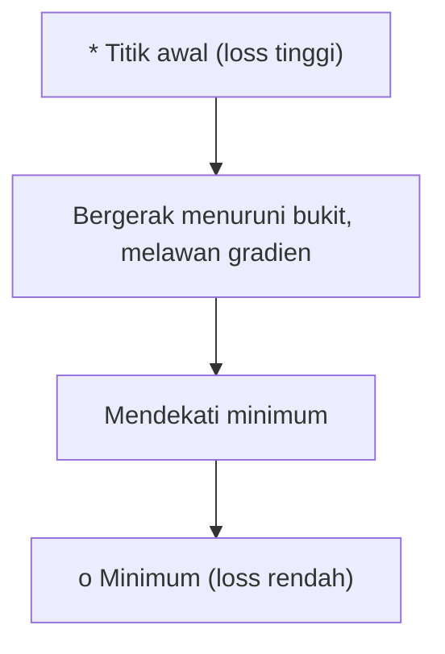
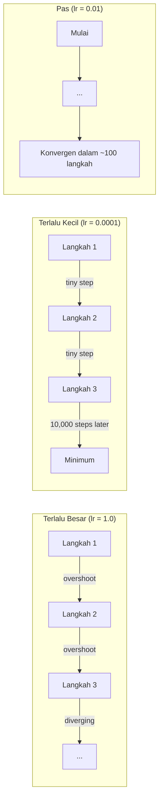
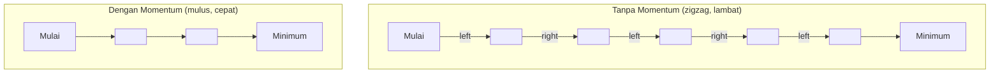
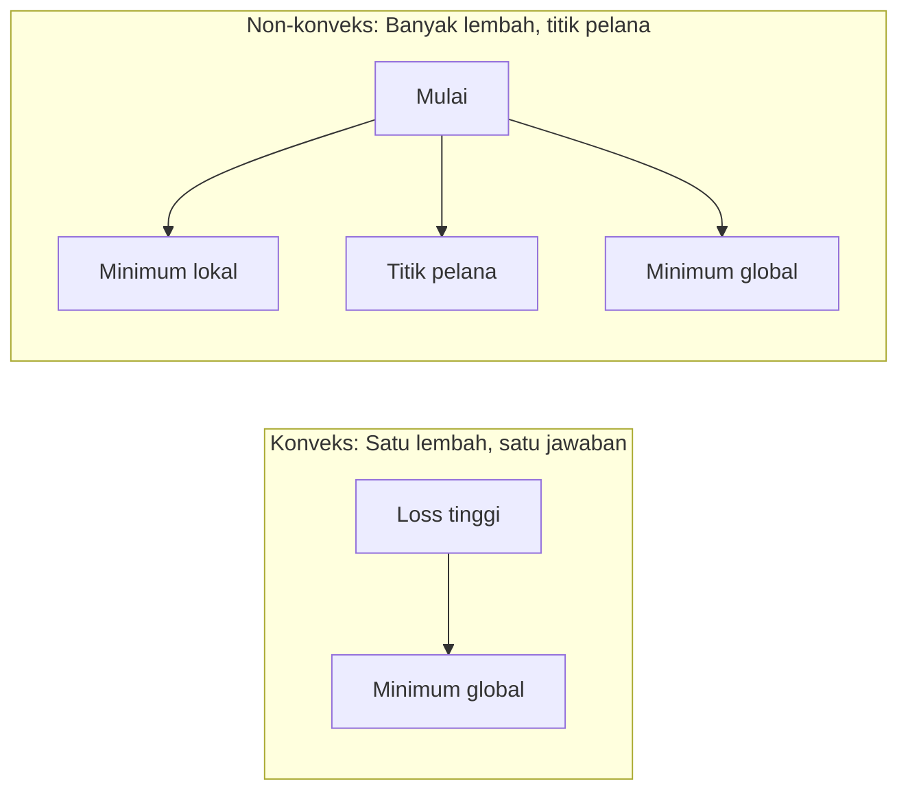
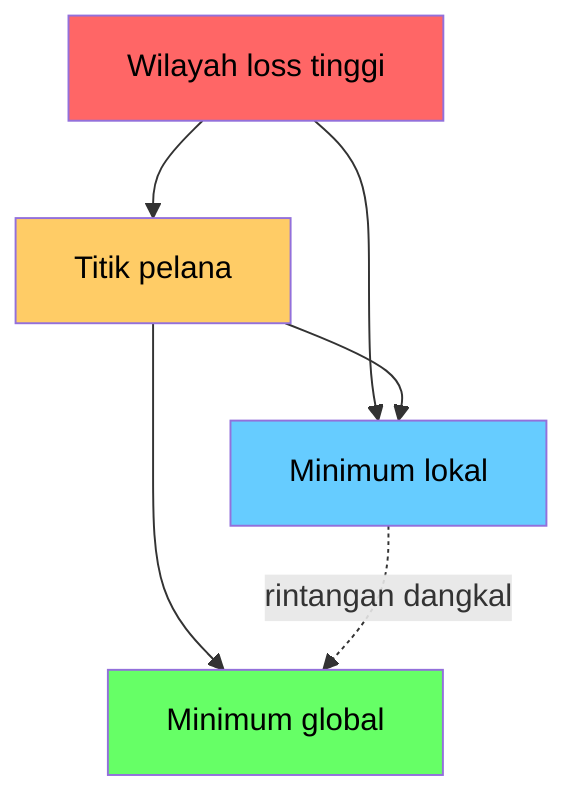

# Optimasi

> Melatih jaringan saraf tidak lebih dari sekadar menemukan dasar lembah.

**Jenis:** Bangun
**Bahasa:** Python
**Prasyarat:** Fase 1, Pelajaran 04-05 (Turunan, Gradien)
**Waktu:** ~75 menit

## Tujuan Pembelajaran

- Implementasikan gradient descent biasa, SGD dengan momentum, dan Adam dari awal
- Bandingkan konvergensi pengoptimal pada fungsi Rosenbrock dan jelaskan mengapa Adam menyesuaikan laju pembelajaran per bobot
- Bedakan lanskap loss konveks dan non-konveks serta jelaskan peran titik pelana dalam dimensi tinggi
- Konfigurasikan jadwal laju pembelajaran (peluruhan bertahap, cosine annealing, warmup) untuk kestabilan pelatihan

## Masalahnya

Anda memiliki fungsi loss. Fungsi itu memberi tahu seberapa salah model Anda. Anda memiliki gradien. Gradien itu memberi tahu arah mana yang membuat loss semakin buruk. Sekarang Anda memerlukan strategi untuk berjalan menuruni bukit.

Pendekatan naifnya sederhana: bergerak berlawanan dengan gradien. Skala langkahnya dengan suatu bilangan yang disebut laju pembelajaran. Ulangi. Itulah gradient descent, dan cara ini berhasil. Namun, "berhasil" memiliki catatan. Laju pembelajaran terlalu besar dan Anda akan melampaui lembah seluruhnya, memantul dari dinding ke dinding. Terlalu kecil dan Anda merayap menuju jawaban melalui ribuan langkah yang tidak perlu. Masuk ke titik pelana dan Anda berhenti bergerak meskipun belum menemukan minimum.

Setiap pengoptimal dalam pembelajaran mendalam adalah jawaban atas pertanyaan yang sama: bagaimana Anda sampai ke dasar lembah lebih cepat dan lebih andal?

## Konsepnya

### Arti optimasi

Optimasi adalah mencari nilai masukan yang meminimalkan (atau memaksimalkan) suatu fungsi. Dalam pembelajaran mesin, fungsi itu adalah loss. Masukannya adalah bobot model. Pelatihan adalah optimasi.

```
minimize L(w) with:
  L = fungsi rugi
  w = bobot model (bisa berjuta-juta parameter)
```

### Gradient descent (biasa)

Pengoptimal paling sederhana. Hitung gradien loss terhadap setiap bobot. Geser setiap bobot ke arah berlawanan dengan gradiennya. Skala langkahnya dengan laju pembelajaran.

```math
w = w - \text{lr} \cdot \text{gradient}
```

Itulah seluruh algoritmenya. Satu baris.



### Laju pembelajaran: hyperparameter paling penting

Laju pembelajaran mengontrol ukuran langkah. Nilainya menentukan segala hal tentang konvergensi.



Tidak ada rumus untuk laju pembelajaran yang tepat. Anda menemukannya lewat percobaan. Titik awal yang umum: 0.001 untuk Adam, 0.01 untuk SGD dengan momentum.

### SGD vs batch vs mini-batch

Gradient descent biasa menghitung gradien atas seluruh dataset sebelum mengambil satu langkah. Ini disebut batch gradient descent. Caranya stabil, tetapi lambat.

Stochastic gradient descent (SGD) menghitung gradien pada satu sampel acak dan langsung melangkah. Hasilnya berisik, tetapi cepat.

Mini-batch gradient descent mengambil jalan tengah. Hitung gradien atas batch kecil (32, 64, 128, 256 sampel), lalu melangkah. Inilah yang sebenarnya digunakan semua orang.

| Varian | Ukuran batch | Kualitas gradien | Kecepatan per langkah | Kebisingan |
|---|---|---|---|---|
| Batch GD | Seluruh dataset | Eksak | Lambat | Tidak ada |
| SGD | 1 sampel | Sangat berisik | Cepat | Tinggi |
| Mini-batch | 32-256 | Estimasi baik | Seimbang | Sedang |

Kebisingan pada SGD dan mini-batch bukanlah bug. Kebisingan itu membantu melarikan diri dari minimum lokal yang dangkal dan titik pelana.

### Momentum: bola yang berguling menuruni bukit

Gradient descent biasa hanya melihat gradien saat ini. Jika gradien berzigzag (umum di lembah sempit), kemajuannya lambat. Momentum mengatasi hal ini dengan mengakumulasikan gradien masa lalu ke dalam suku kecepatan.

```math
\begin{aligned}
v &= \beta \cdot v + \text{gradient} \\
w &= w - \text{lr} \cdot v
\end{aligned}
```

Analoginya: sebuah bola yang berguling menuruni bukit. Bola itu tidak berhenti dan mulai lagi di setiap gundukan. Bola itu membangun kecepatan pada arah yang konsisten dan meredam osilasi.



`beta` (biasanya 0.9) mengontrol seberapa banyak riwayat yang dipertahankan. beta yang lebih besar berarti momentum lebih kuat, lintasan lebih mulus, tetapi respons lebih lambat terhadap perubahan arah.

### Adam: laju pembelajaran adaptif

Bobot yang berbeda memerlukan laju pembelajaran yang berbeda. Bobot yang jarang mendapat gradien besar sebaiknya mengambil langkah lebih besar saat akhirnya mendapatkannya. Bobot yang terus-menerus mendapat gradien besar sebaiknya mengambil langkah lebih kecil.

Adam (Adaptive Moment Estimation) melacak dua hal per bobot:

1. Momen pertama ($m$): rata-rata bergerak dari gradien (seperti momentum)
2. Momen kedua ($v$): rata-rata bergerak dari gradien kuadrat (besaran gradien)

```math
\begin{aligned}
m &= \beta_1 \cdot m + (1 - \beta_1) \cdot \text{gradient} \\
v &= \beta_2 \cdot v + (1 - \beta_2) \cdot \text{gradient}^2 \\[4pt]
\hat{m} &= m / (1 - \beta_1^t) \quad \text{bias correction} \\
\hat{v} &= v / (1 - \beta_2^t) \quad \text{bias correction} \\[4pt]
w &= w - \text{lr} \cdot \hat{m} / (\sqrt{\hat{v}} + \epsilon)
\end{aligned}
```

Pembagian dengan `sqrt(v_hat)` adalah wawasan kuncinya. Bobot dengan gradien besar dibagi dengan bilangan besar (langkah efektif kecil). Bobot dengan gradien kecil dibagi dengan bilangan kecil (langkah efektif besar). Setiap bobot mendapat laju pembelajaran adaptifnya sendiri.

Hyperparameter bawaan: `lr=0.001, beta1=0.9, beta2=0.999, epsilon=1e-8`. Nilai bawaan ini bekerja dengan baik untuk sebagian besar masalah.

### Jadwal laju pembelajaran

Laju pembelajaran tetap adalah kompromi. Di awal pelatihan, Anda menginginkan langkah besar agar kemajuan cepat. Di akhir pelatihan, Anda menginginkan langkah kecil untuk menyetel halus di dekat minimum.

Jadwal yang umum:

| Jadwal | Rumus | Kasus penggunaan |
|---|---|---|
| Peluruhan bertahap | $\text{lr} = \text{lr} \cdot \text{factor}$ setiap $N$ epoch | Sederhana, kendali manual |
| Peluruhan eksponensial | $\text{lr} = \text{lr}_0 \cdot \text{decay}^t$ | Penurunan mulus |
| Cosine annealing | $\text{lr} = \text{lr} _{\min} + 0.5 \cdot (\text{lr} _{\max} - \text{lr} _{\min}) \cdot (1 + \cos(\pi t / T))$ | Transformer, pelatihan modern |
| Warmup + peluruhan | Naik linier, lalu peluruhan | Model besar, mencegah ketidakstabilan awal |

### Konveks vs non-konveks

Fungsi konveks tidak memiliki minimum lokal yang buruk: setiap minimum lokal adalah minimum global. Untuk fungsi konveks mulus yang memiliki minimum, gradient descent dengan laju pembelajaran yang cukup kecil akan konvergen ke sana. Fungsi kuadrat seperti $f(x) = x^2$ bersifat konveks, dan minimum-nya unik.

Fungsi loss jaringan saraf bersifat non-konveks. Fungsi-fungsi itu memiliki banyak minimum lokal, titik pelana, dan wilayah datar.



Dalam praktiknya, minimum lokal pada jaringan saraf berdimensi tinggi jarang menjadi masalah. Kebanyakan minimum lokal memiliki nilai loss yang dekat dengan minimum global. Titik pelana (datar pada beberapa arah, melengkung pada arah lain) adalah rintangan yang sesungguhnya. Momentum dan kebisingan dari mini-batch membantu melarikan diri darinya.

### Visualisasi lanskap loss

Loss adalah fungsi dari semua bobot. Untuk model dengan 1 juta bobot, lanskap loss berada dalam ruang berdimensi 1.000.001. Kita memvisualisasikannya dengan memilih dua arah acak dalam ruang bobot dan memplot loss sepanjang arah tersebut, menghasilkan permukaan 2D.



Minimum yang tajam memiliki generalisasi yang buruk. Minimum yang landai memiliki generalisasi yang baik. Ini salah satu alasan SGD dengan momentum sering mengungguli Adam dalam akurasi uji akhir: kebisingannya mencegah model menetap di minimum yang tajam.

```figure
gradient-descent
```

## Bangunlah

### Langkah 1: Tentukan fungsi uji

Fungsi Rosenbrock adalah benchmark optimasi klasik. Minimum-nya berada di (1, 1), di dalam lembah melengkung yang sempit yang mudah ditemukan tetapi sulit diikuti.

```math
f(x, y) = (1 - x)^2 + 100 \cdot (y - x^2)^2
```

```python
def rosenbrock(params):
    x, y = params
    return (1 - x) ** 2 + 100 * (y - x ** 2) ** 2

def rosenbrock_gradient(params):
    x, y = params
    df_dx = -2 * (1 - x) + 200 * (y - x ** 2) * (-2 * x)
    df_dy = 200 * (y - x ** 2)
    return [df_dx, df_dy]
```

### Langkah 2: Gradient descent biasa

```python
class GradientDescent:
    def __init__(self, lr=0.001):
        self.lr = lr

    def step(self, params, grads):
        return [p - self.lr * g for p, g in zip(params, grads)]
```

### Langkah 3: SGD dengan momentum

```python
class SGDMomentum:
    def __init__(self, lr=0.001, momentum=0.9):
        self.lr = lr
        self.momentum = momentum
        self.velocity = None

    def step(self, params, grads):
        if self.velocity is None:
            self.velocity = [0.0] * len(params)
        self.velocity = [
            self.momentum * v + g
            for v, g in zip(self.velocity, grads)
        ]
        return [p - self.lr * v for p, v in zip(params, self.velocity)]
```

### Langkah 4: Adam

```python
class Adam:
    def __init__(self, lr=0.001, beta1=0.9, beta2=0.999, epsilon=1e-8):
        self.lr = lr
        self.beta1 = beta1
        self.beta2 = beta2
        self.epsilon = epsilon
        self.m = None
        self.v = None
        self.t = 0

    def step(self, params, grads):
        if self.m is None:
            self.m = [0.0] * len(params)
            self.v = [0.0] * len(params)

        self.t += 1

        self.m = [
            self.beta1 * m + (1 - self.beta1) * g
            for m, g in zip(self.m, grads)
        ]
        self.v = [
            self.beta2 * v + (1 - self.beta2) * g ** 2
            for v, g in zip(self.v, grads)
        ]

        m_hat = [m / (1 - self.beta1 ** self.t) for m in self.m]
        v_hat = [v / (1 - self.beta2 ** self.t) for v in self.v]

        return [
            p - self.lr * mh / (vh ** 0.5 + self.epsilon)
            for p, mh, vh in zip(params, m_hat, v_hat)
        ]
```

### Langkah 5: Jalankan dan bandingkan

```python
def optimize(optimizer, func, grad_func, start, steps=5000):
    params = list(start)
    history = [params[:]]
    for _ in range(steps):
        grads = grad_func(params)
        params = optimizer.step(params, grads)
        history.append(params[:])
    return history

start = [-1.0, 1.0]

gd_history = optimize(GradientDescent(lr=0.0005), rosenbrock, rosenbrock_gradient, start)
sgd_history = optimize(SGDMomentum(lr=0.0001, momentum=0.9), rosenbrock, rosenbrock_gradient, start)
adam_history = optimize(Adam(lr=0.01), rosenbrock, rosenbrock_gradient, start)

for name, history in [("GD", gd_history), ("SGD+M", sgd_history), ("Adam", adam_history)]:
    final = history[-1]
    loss = rosenbrock(final)
    print(f"{name:6s} -> x={final[0]:.6f}, y={final[1]:.6f}, loss={loss:.8f}")
```

Keluaran yang diharapkan: Adam konvergen paling cepat. SGD dengan momentum mengikuti lintasan yang lebih mulus. GD biasa bergerak lambat di sepanjang lembah sempit.

## Gunakanlah

Dalam praktiknya, gunakan pengoptimal PyTorch atau JAX. Pustaka-pustaka itu menangani grup parameter, weight decay, pemotongan gradien, dan akselerasi GPU.

```python
import torch

model = torch.nn.Linear(784, 10)

sgd = torch.optim.SGD(model.parameters(), lr=0.01, momentum=0.9)
adam = torch.optim.Adam(model.parameters(), lr=0.001)
adamw = torch.optim.AdamW(model.parameters(), lr=0.001, weight_decay=0.01)

scheduler = torch.optim.lr_scheduler.CosineAnnealingLR(adam, T_max=100)
```

Aturan praktis:

- Mulailah dengan Adam (lr=0.001). Cara ini bekerja untuk sebagian besar masalah tanpa penyetelan.
- Beralihlah ke SGD dengan momentum (lr=0.01, momentum=0.9) ketika Anda membutuhkan akurasi akhir terbaik dan mampu melakukan lebih banyak penyetelan.
- Gunakan AdamW (Adam dengan weight decay yang dipisahkan) untuk transformer.
- Selalu gunakan jadwal laju pembelajaran untuk pelatihan yang berlangsung lebih dari beberapa epoch.
- Jika pelatihan tidak stabil, turunkan laju pembelajaran. Jika pelatihan terlalu lambat, naikkanlah.

## Kirimkan

Pelajaran ini menghasilkan sebuah prompt untuk memilih pengoptimal yang tepat. Lihat `outputs/prompt-optimizer-guide.md`.

Kelas-kelas pengoptimal yang dibangun di sini muncul kembali di Fase 3 ketika kita melatih jaringan saraf dari awal.

## Latihan

1. **Sapuan laju pembelajaran.** Jalankan gradient descent biasa pada fungsi Rosenbrock dengan laju pembelajaran [0.0001, 0.0005, 0.001, 0.005, 0.01]. Plot atau cetak loss akhir setelah 5000 langkah untuk masing-masing. Temukan laju pembelajaran terbesar yang masih konvergen.

2. **Perbandingan momentum.** Jalankan SGD dengan nilai momentum [0.0, 0.5, 0.9, 0.99] pada fungsi Rosenbrock. Lacak loss pada setiap langkah. Nilai momentum mana yang konvergen paling cepat? Mana yang melampaui sasaran?

3. **Keluar dari titik pelana.** Definisikan fungsi $f(x, y) = x^2 - y^2$ (sebuah titik pelana di titik origin). Mulailah dari (0.01, 0.01). Bandingkan perilaku GD biasa, SGD dengan momentum, dan Adam. Mana yang berhasil keluar dari titik pelana?

4. **Implementasikan peluruhan laju pembelajaran.** Tambahkan jadwal peluruhan eksponensial ke kelas `GradientDescent`: `lr = lr_0 * 0.999^step`. Bandingkan konvergensi dengan dan tanpa peluruhan pada fungsi Rosenbrock.

### Petunjuk

**Latihan 1.** Ulangi untuk setiap laju pembelajaran, buat `GradientDescent(lr=...)` untuk masing-masing, dan berikan kepada `optimize` bersama `rosenbrock` dan `rosenbrock_gradient`. Proses yang divergen menunjukkan loss yang meningkat atau menjadi `nan`; minimum berada di $(1, 1)$ dengan loss 0.

**Latihan 2.** Buat `SGDMomentum(momentum=m)` untuk setiap nilai dan catat loss setelah setiap langkah. Gunakan `find_convergence_step` untuk membandingkan kecepatan, dan cari loss yang naik-turun untuk mendeteksi pelampauan.

**Latihan 3.** Tulis gradien $(2x, -2y)$ dan jalankan ketiga pengoptimal dari (0.01, 0.01). Cetak $y$ setiap 100 langkah: pengoptimal yang berhasil keluar adalah yang membuat $\lvert y \rvert$ tumbuh besar.

**Latihan 4.** Simpan `lr_0` dan penghitung langkah di `GradientDescent`, lalu hitung `lr = lr_0 * 0.999 ** step` di dalam `step`. Cetak laju pembelajaran pada langkah 0 dan langkah 1000; nilainya harus turun dari `lr_0` menjadi sekitar $0.37 \times \text{lr}_0$.

## Istilah Kunci

| Istilah | Ungkapan orang | Makna sebenarnya |
|---|---|---|
| Gradient descent | "Turun ke bawah" | Perbarui bobot dengan mengurangkan gradien yang diskalakan oleh laju pembelajaran. Pengoptimal paling dasar. |
| Laju pembelajaran | "Ukuran langkah" | Skalar yang mengontrol seberapa jauh setiap pembaruan menggeser bobot. Terlalu besar menyebabkan divergensi. Terlalu kecil membuang komputasi. |
| Momentum | "Terus bergulir" | Akumulasikan gradien masa lalu menjadi vektor kecepatan. Meredam osilasi dan mempercepat pergerakan pada arah yang konsisten. |
| SGD | "Pengambilan sampel acak" | Stochastic gradient descent. Hitung gradien pada subset acak, bukan seluruh dataset. Dalam praktiknya hampir selalu berarti mini-batch SGD. |
| Mini-batch | "Potongan data" | Subset kecil dari data pelatihan (32-256 sampel) yang digunakan untuk mengestimasi gradien. Menyeimbangkan kecepatan dan akurasi gradien. |
| Adam | "Pengoptimal bawaan" | Adaptive Moment Estimation. Melacak rata-rata bergerak gradien dan gradien kuadrat per bobot untuk memberikan laju pembelajaran sendiri pada setiap bobot. |
| Koreksi bias | "Perbaiki mulai dingin" | Momen pertama dan kedua Adam diinisialisasi ke nol. Koreksi bias membagi dengan $(1 - \beta^t)$ untuk mengompensasi pada langkah-langkah awal. |
| Jadwal laju pembelajaran | "Ubah lr dari waktu ke waktu" | Fungsi yang menyesuaikan laju pembelajaran selama pelatihan. Langkah besar di awal, langkah kecil di akhir. |
| Fungsi konveks | "Satu lembah" | Fungsi yang setiap minimum lokalnya adalah minimum global. Gradient descent selalu menemukannya. Loss jaringan saraf tidak konveks. |
| Titik pelana | "Datar, tetapi bukan minimum" | Titik yang gradiennya nol, tetapi merupakan minimum pada beberapa arah dan maksimum pada arah lain. Umum terjadi pada dimensi tinggi. |
| Lanskap loss | "Medannya" | Fungsi loss yang diplot atas ruang bobot. Divisualisasikan dengan mengiris sepanjang dua arah acak. |
| Konvergensi | "Sampai ke sana" | Pengoptimal telah mencapai titik di mana langkah lanjutan tidak lagi secara bermakna menurunkan loss. |

## Bacaan Lanjutan

- [Sebastian Ruder: An overview of gradient descent optimization algorithms](https://ruder.io/optimizing-gradient-descent/) - tinjauan komprehensif semua pengoptimal utama
- [Why Momentum Really Works (Distill)](https://distill.pub/2017/momentum/) - visualisasi interaktif dinamika momentum
- [Adam: A Method for Stochastic Optimization (Kingma & Ba, 2014)](https://arxiv.org/abs/1412.6980) - makalah Adam orisinal, mudah dibaca dan pendek
- [Visualizing the Loss Landscape of Neural Nets (Li et al., 2018)](https://arxiv.org/abs/1712.09913) - makalah yang menunjukkan minimum tajam versus minimum landai
