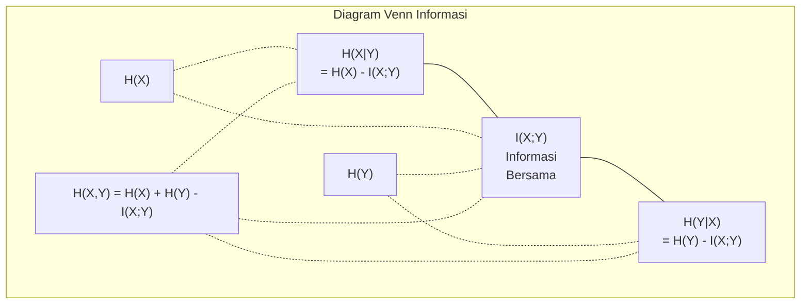

# Teori Informasi

> Teori informasi mengukur kejutan. Fungsi rugi dibangun di atasnya.

**Jenis:** Pelajari
**Bahasa:** Python, TypeScript
**Prasyarat:** Fase 1, Pelajaran 06 (Probabilitas)
**Waktu:** ~60 menit

## Tujuan Pembelajaran

- Hitung entropi, cross-entropy, dan divergensi KL dari awal serta jelaskan hubungan di antara ketiganya
- Turunkan mengapa meminimalkan fungsi rugi cross-entropy setara dengan memaksimalkan log-likelihood
- Hitung informasi bersama antara fitur dan target untuk mengurutkan kepentingan fitur
- Jelaskan perpleksitas sebagai ukuran kosakata efektif yang dipilih oleh model bahasa

## Masalahnya

Anda memanggil `CrossEntropyLoss()` di setiap model klasifikasi yang Anda latih. Anda melihat "perpleksitas" di setiap makalah model bahasa. Anda membaca tentang divergensi KL dalam VAE, distilasi, dan RLHF. Konsep-konsep ini tidak terputus satu sama lain. Semuanya adalah ide yang sama dengan topi yang berbeda.

Teori informasi memberi Anda bahasa untuk bernalar tentang ketidakpastian, kompresi, dan prediksi. Claude Shannon menciptakannya pada 1948 untuk menyelesaikan masalah komunikasi. Ternyata, melatih jaringan saraf adalah masalah komunikasi: model berusaha mengirimkan label yang benar melalui kanal yang berisik berupa bobot yang dipelajari.

Pelajaran ini membangun setiap rumus dari awal agar Anda melihat dari mana rumus itu berasal dan mengapa rumus itu bekerja.

## Konsepnya

### Kandungan Informasi (Kejutan)

Ketika sesuatu yang tidak mungkin terjadi, peristiwa itu membawa lebih banyak informasi. Koin yang jatuh dengan sisi kepala? Tidak mengejutkan. Memenangkan lotre? Sangat mengejutkan.

Kandungan informasi dari sebuah peristiwa dengan probabilitas $p$ adalah:

```math
I(x) = -\log(p(x))
```

Menggunakan log dasar 2 memberi Anda bits. Menggunakan log alami memberi Anda nats. Ide yang sama, satuan yang berbeda.

```
Peristiwa              Probabilitas    Kejutan (bits)
Koin adil, sisi kepala  0.5            1.0
Dadu, angka 6           0.167          2.58
Peristiwa 1-dalam-1000  0.001          9.97
Peristiwa pasti         1.0            0.0
```

Peristiwa yang pasti membawa informasi nol. Anda sudah tahu peristiwa itu akan terjadi.

### Entropi (Kejutan Rata-rata)

Entropi adalah kejutan ekspektasian di semua hasil yang mungkin dari suatu distribusi.

```math
H(P) = -\sum_{x} p(x) \log(p(x))
```

Koin adil memiliki entropi maksimum untuk variabel biner: 1 bit. Koin yang bias (99% sisi kepala) memiliki entropi rendah: 0,08 bit. Anda sudah tahu apa yang akan terjadi, sehingga setiap lemparan hampir tidak memberi tahu apa pun.

```math
\begin{aligned}
\text{Koin adil:} \quad & H = -(0.5 \log_2(0.5) + 0.5 \log_2(0.5)) = 1.0 \text{ bit} \\
\text{Koin bias:} \quad & H = -(0.99 \log_2(0.99) + 0.01 \log_2(0.01)) = 0.08 \text{ bits}
\end{aligned}
```

Entropi mengukur ketidakpastian yang tidak dapat direduksi dalam suatu distribusi. Anda tidak dapat melakukan kompresi di bawahnya.

### Cross-Entropy (Fungsi Rugi yang Anda Gunakan Setiap Hari)

Cross-entropy mengukur kejutan rata-rata ketika Anda menggunakan distribusi $Q$ untuk mengodekan peristiwa yang sebenarnya berasal dari distribusi $P$.

```math
H(P, Q) = -\sum_{x} p(x) \log(q(x))
```

$P$ adalah distribusi sejati (label-labelnya). $Q$ adalah prediksi model Anda. Jika $Q$ cocok sempurna dengan $P$, cross-entropy sama dengan entropi. Ketidaksesuaian apa pun membuatnya lebih besar.

Dalam klasifikasi, $P$ adalah vektor one-hot (kelas sejati berprobabilitas 1, sisanya 0). Ini menyederhanakan cross-entropy menjadi:

```math
H(P, Q) = -\log(q(\text{true\_class}))
```

Itulah seluruh rumus fungsi rugi cross-entropy untuk klasifikasi. Maksimalkan probabilitas prediksi untuk kelas yang benar.

### Divergensi KL (Jarak Antar Distribusi)

Divergensi KL mengukur seberapa besar kejutan tambahan yang Anda dapatkan dari penggunaan $Q$, alih-alih $P$.

```math
\begin{aligned}
D_{KL}(P \,\|\, Q) &= \sum_{x} p(x) \log(p(x) / q(x)) \\
&= H(P, Q) - H(P)
\end{aligned}
```

Cross-entropy adalah entropi ditambah divergensi KL. Karena entropi distribusi sejati konstan selama pelatihan, meminimalkan cross-entropy sama dengan meminimalkan divergensi KL. Anda mendorong distribusi model Anda menuju distribusi sejati.

Divergensi KL tidak simetris: $D_{KL}(P \Vert Q) \ne D_{KL}(Q \Vert P)$. Nilai ini bukan ukuran jarak sejati.

### Informasi Bersama

Informasi bersama mengukur seberapa banyak mengetahui satu variabel memberi tahu Anda tentang variabel lain.

```math
\begin{aligned}
I(X; Y) &= H(X) - H(X \mid Y) \\
&= H(X) + H(Y) - H(X, Y)
\end{aligned}
```

Jika $X$ dan $Y$ independen, informasi bersama bernilai nol. Mengetahui salah satunya tidak memberi tahu apa pun tentang yang lain. Jika keduanya berkorelasi sempurna, informasi bersama sama dengan entropi dari masing-masing variabel.

Dalam pemilihan fitur, informasi bersama yang tinggi antara sebuah fitur dan target berarti fitur itu berguna. Informasi bersama yang rendah berarti fitur itu berupa kebisingan.

### Entropi Bersyarat

$H(Y \mid X)$ mengukur seberapa besar ketidakpastian yang tersisa tentang $Y$ setelah Anda mengamati $X$.

```math
H(Y \mid X) = H(X,Y) - H(X)
```

Dua kondisi ekstrem:
- Jika $X$ sepenuhnya menentukan $Y$, maka $H(Y \mid X) = 0$. Mengetahui $X$ menghilangkan semua ketidakpastian tentang $Y$. Contoh: $X$ = suhu dalam Celsius, $Y$ = suhu dalam Fahrenheit.
- Jika $X$ tidak memberi tahu apa pun tentang $Y$, maka $H(Y \mid X) = H(Y)$. Mengetahui $X$ sama sekali tidak mengurangi ketidakpastian Anda. Contoh: $X$ = lemparan koin, $Y$ = cuaca besok.

Entropi bersyarat selalu tidak negatif dan tidak pernah melebihi $H(Y)$:

```math
0 \le H(Y \mid X) \le H(Y)
```

Dalam pembelajaran mesin, entropi bersyarat muncul pada pohon keputusan. Pada setiap pemisahan, algoritme memilih fitur $X$ yang meminimalkan $H(Y \mid X)$ -- fitur yang menghilangkan ketidakpastian paling besar tentang label $Y$.

### Entropi Gabungan

$H(X,Y)$ adalah entropi dari distribusi gabungan $X$ dan $Y$ secara bersama-sama.

```math
H(X,Y) = -\sum_{x} \sum_{y} p(x,y) \log(p(x,y))
```

Sifat utama:

```math
H(X,Y) \le H(X) + H(Y)
```

Kesamaan berlaku ketika $X$ dan $Y$ independen. Jika keduanya berbagi informasi, entropi gabungan lebih kecil daripada jumlah entropi masing-masing. Entropi yang "hilang" itulah informasi bersama.



Hubungan-hubungannya:
- $H(X,Y) = H(X) + H(Y \mid X) = H(Y) + H(X \mid Y)$
- $I(X;Y) = H(X) - H(X \mid Y) = H(Y) - H(Y \mid X)$
- $H(X,Y) = H(X) + H(Y) - I(X;Y)$

### Informasi Bersama (Pendalaman)

Informasi bersama $I(X;Y)$ mengukur seberapa besar mengetahui satu variabel mengurangi ketidakpastian tentang variabel yang lain.

```math
\begin{aligned}
I(X;Y) &= H(X) - H(X \mid Y) \\
&= H(Y) - H(Y \mid X) \\
&= H(X) + H(Y) - H(X,Y) \\
&= \sum_{x} \sum_{y} p(x,y) \log\left(\frac{p(x,y)}{p(x) \, p(y)}\right)
\end{aligned}
```

Sifat-sifat:
- $I(X;Y) \ge 0$ selalu. Anda tidak pernah kehilangan informasi dengan mengamati sesuatu.
- $I(X;Y) = 0$ jika dan hanya jika $X$ dan $Y$ independen.
- $I(X;Y) = I(Y;X)$. Sifatnya simetris, tidak seperti divergensi KL.
- $I(X;X) = H(X)$. Sebuah variabel berbagi seluruh informasinya dengan dirinya sendiri.

**Informasi bersama untuk pemilihan fitur.** Dalam ML, Anda menginginkan fitur yang informatif tentang target. Informasi bersama memberi Anda cara berprinsip untuk mengurutkan fitur:

1. Untuk setiap fitur $X_i$, hitung $I(X_i; Y)$ dengan $Y$ sebagai variabel target.
2. Urutkan fitur berdasarkan skor MI.
3. Pertahankan $k$ fitur teratas.

Cara ini bekerja untuk hubungan apa pun antara fitur dan target -- linier, nonlinear, monotonik, atau bukan. Korelasi Pearson hanya menangkap hubungan linier. MI menangkap ketergantungan apa pun, tetapi dengan data terbatas, estimasinya memerlukan sampel yang cukup dan pembiningan yang masuk akal.

| Metode | Yang terdeteksi | Biaya komputasi | Menangani data kategorikal? |
|---|---|---|---|
| Korelasi Pearson | Hubungan linier | $O(n)$ | Tidak |
| Korelasi Spearman | Hubungan monotonik | $O(n \log n)$ | Tidak |
| Informasi bersama | Ketergantungan statistik apa pun | $O(n \log n)$ dengan pembiningan | Ya |

### Label Smoothing dan Cross-Entropy

Klasifikasi standar menggunakan target keras: [0, 0, 1, 0]. Kelas sejati mendapat probabilitas 1, sisanya 0. Label smoothing menggantinya dengan target lunak:

```math
\text{soft\_target} = (1 - \epsilon) \cdot \text{hard\_target} + \epsilon / \text{num\_classes}
```

Dengan $\epsilon = 0.1$ dan 4 kelas:
- Target keras:  [0, 0, 1, 0]
- Target lunak:  [0.025, 0.025, 0.925, 0.025]

Dari sudut pandang teori informasi, label smoothing meningkatkan entropi distribusi target. Target one-hot keras memiliki entropi 0 -- tidak ada ketidakpastian. Target lunak memiliki entropi positif.

Mengapa ini membantu:
- Mencegah model mendorong logits ke nilai ekstrem (logits tak terhingga diperlukan untuk mencocokkan target one-hot secara sempurna di bawah cross-entropy)
- Bertindak sebagai regularisasi: model tidak boleh 100% percaya diri
- Meningkatkan kalibrasi: probabilitas prediksi lebih mencerminkan ketidakpastian sejati
- Mengurangi kesenjangan antara perilaku pelatihan dan inferensi

Fungsi rugi cross-entropy dengan label smoothing menjadi:

```math
L = (1 - \epsilon) \cdot \text{CE}(\text{hard\_target}, \text{prediction}) + \epsilon \cdot H_{\text{uniform}}(\text{prediction})
```

Suku kedua menghukum prediksi yang jauh dari distribusi seragam -- regularisasi langsung terhadap kepercayaan diri.

### Mengapa Cross-Entropy Adalah Fungsi Rugi Klasifikasi

Tiga sudut pandang, kesimpulan yang sama.

**Sudut pandang teori informasi.** Cross-entropy mengukur berapa banyak bit yang Anda buang dengan menggunakan distribusi model, alih-alih distribusi sejati. Meminimalkannya membuat model Anda menjadi pengode realitas yang paling efisien.

**Sudut pandang likelihood maksimum.** Untuk $N$ sampel pelatihan dengan kelas sejati $y_i$:

```math
\begin{aligned}
\text{Likelihood} &= \prod_i q(y_i) \\
\text{Log-likelihood} &= \sum_i \log(q(y_i)) \\
\text{Negative log-likelihood} &= -\sum_i \log(q(y_i))
\end{aligned}
```

Baris terakhir itu adalah fungsi rugi cross-entropy. Meminimalkan cross-entropy = memaksimalkan likelihood data pelatihan di bawah model Anda.

**Sudut pandang gradien.** Gradien cross-entropy terhadap logits adalah (prediksi - nilai sejati). Bersih, stabil, dan cepat dihitung. Inilah sebabnya cross-entropy berpasangan sempurna dengan softmax.

### Bits vs Nats

Satu-satunya perbedaan adalah dasar logaritma.

```
log dasar 2   -> bits      (tradisi teori informasi)
log dasar e   -> nats      (konvensi pembelajaran mesin)
log dasar 10  -> hartleys  (jarang digunakan)
```

1 nat = $1/\ln(2)$ bits = 1,4427 bit. PyTorch dan TensorFlow menggunakan log alami (nats) secara bawaan.

### Perpleksitas

Perpleksitas adalah eksponensial dari cross-entropy. Nilainya memberi tahu Anda jumlah efektif pilihan yang sama kemungkinannya yang sedang diragukan model.

```math
\begin{aligned}
\text{Perplexity} &= 2^{H(P,Q)} \quad \text{(if using bits)} \\
\text{Perplexity} &= e^{H(P,Q)} \quad \text{(if using nats)}
\end{aligned}
```

Model bahasa dengan perpleksitas 50, rata-rata, sebingung seolah-olah harus memilih secara seragam dari 50 token berikutnya yang mungkin. Semakin rendah, semakin baik.

GPT-2 mencapai perpleksitas ~30 pada benchmark umum. Model modern berada di angka satu digit untuk domain yang terwakili dengan baik.

```figure
entropy-kl
```

## Bangunlah

### Langkah 1: Kandungan informasi dan entropi

```python
import math

def information_content(p, base=2):
    if p <= 0 or p > 1:
        return float('inf') if p <= 0 else 0.0
    return -math.log(p) / math.log(base)

def entropy(probs, base=2):
    return sum(
        p * information_content(p, base)
        for p in probs if p > 0
    )

fair_coin = [0.5, 0.5]
biased_coin = [0.99, 0.01]
fair_die = [1/6] * 6

print(f"Fair coin entropy:   {entropy(fair_coin):.4f} bits")
print(f"Biased coin entropy: {entropy(biased_coin):.4f} bits")
print(f"Fair die entropy:    {entropy(fair_die):.4f} bits")
```

### Langkah 2: Cross-entropy dan divergensi KL

```python
def cross_entropy(p, q, base=2):
    total = 0.0
    for pi, qi in zip(p, q):
        if pi > 0:
            if qi <= 0:
                return float('inf')
            total += pi * (-math.log(qi) / math.log(base))
    return total

def kl_divergence(p, q, base=2):
    return cross_entropy(p, q, base) - entropy(p, base)

true_dist = [0.7, 0.2, 0.1]
good_model = [0.6, 0.25, 0.15]
bad_model = [0.1, 0.1, 0.8]

print(f"Entropy of true dist:     {entropy(true_dist):.4f} bits")
print(f"CE (good model):          {cross_entropy(true_dist, good_model):.4f} bits")
print(f"CE (bad model):           {cross_entropy(true_dist, bad_model):.4f} bits")
print(f"KL divergence (good):     {kl_divergence(true_dist, good_model):.4f} bits")
print(f"KL divergence (bad):      {kl_divergence(true_dist, bad_model):.4f} bits")
```

### Langkah 3: Cross-entropy sebagai fungsi rugi klasifikasi

```python
def softmax(logits):
    max_logit = max(logits)
    exps = [math.exp(z - max_logit) for z in logits]
    total = sum(exps)
    return [e / total for e in exps]

def cross_entropy_loss(true_class, logits):
    probs = softmax(logits)
    return -math.log(probs[true_class])

logits = [2.0, 1.0, 0.1]
true_class = 0

probs = softmax(logits)
loss = cross_entropy_loss(true_class, logits)

print(f"Logits:      {logits}")
print(f"Softmax:     {[f'{p:.4f}' for p in probs]}")
print(f"True class:  {true_class}")
print(f"Loss:        {loss:.4f} nats")
print(f"Perplexity:  {math.exp(loss):.2f}")
```

### Langkah 4: Cross-entropy sama dengan negative log-likelihood

```python
import random

random.seed(42)

n_samples = 1000
n_classes = 3
true_labels = [random.randint(0, n_classes - 1) for _ in range(n_samples)]
model_logits = [[random.gauss(0, 1) for _ in range(n_classes)] for _ in range(n_samples)]

ce_loss = sum(
    cross_entropy_loss(label, logits)
    for label, logits in zip(true_labels, model_logits)
) / n_samples

nll = -sum(
    math.log(softmax(logits)[label])
    for label, logits in zip(true_labels, model_logits)
) / n_samples

print(f"Cross-entropy loss:      {ce_loss:.6f}")
print(f"Negative log-likelihood: {nll:.6f}")
print(f"Difference:              {abs(ce_loss - nll):.2e}")
```

### Langkah 5: Informasi bersama

```python
def mutual_information(joint_probs, base=2):
    rows = len(joint_probs)
    cols = len(joint_probs[0])

    margin_x = [sum(joint_probs[i][j] for j in range(cols)) for i in range(rows)]
    margin_y = [sum(joint_probs[i][j] for i in range(rows)) for j in range(cols)]

    mi = 0.0
    for i in range(rows):
        for j in range(cols):
            pxy = joint_probs[i][j]
            if pxy > 0:
                mi += pxy * math.log(pxy / (margin_x[i] * margin_y[j])) / math.log(base)
    return mi

independent = [[0.25, 0.25], [0.25, 0.25]]
dependent = [[0.45, 0.05], [0.05, 0.45]]

print(f"MI (independent): {mutual_information(independent):.4f} bits")
print(f"MI (dependent):   {mutual_information(dependent):.4f} bits")
```

## Gunakanlah

Konsep yang sama menggunakan NumPy, seperti yang akan Anda gunakan dalam praktiknya:

```python
import numpy as np

def np_entropy(p):
    p = np.asarray(p, dtype=float)
    mask = p > 0
    result = np.zeros_like(p)
    result[mask] = p[mask] * np.log(p[mask])
    return -result.sum()

def np_cross_entropy(p, q):
    p, q = np.asarray(p, dtype=float), np.asarray(q, dtype=float)
    mask = p > 0
    return -(p[mask] * np.log(q[mask])).sum()

def np_kl_divergence(p, q):
    return np_cross_entropy(p, q) - np_entropy(p)

true = np.array([0.7, 0.2, 0.1])
pred = np.array([0.6, 0.25, 0.15])
print(f"Entropy:    {np_entropy(true):.4f} nats")
print(f"Cross-ent:  {np_cross_entropy(true, pred):.4f} nats")
print(f"KL div:     {np_kl_divergence(true, pred):.4f} nats")
```

Anda membangun dari awal apa yang dilakukan `torch.nn.CrossEntropyLoss()` secara internal. Sekarang Anda tahu mengapa loss turun selama pelatihan: distribusi prediksi model Anda semakin mendekati distribusi sejati, diukur dalam nats informasi yang terbuang.

## Latihan

1. Hitung entropi alfabet Inggris dengan asumsi distribusi seragam (26 huruf). Lalu estimasikan menggunakan frekuensi huruf yang sebenarnya. Mana yang lebih tinggi dan mengapa?

2. Sebuah model menghasilkan logits [5.0, 2.0, 0.5] untuk sampel dengan kelas sejati 1. Hitung fungsi rugi cross-entropy secara manual, lalu verifikasi dengan fungsi `cross_entropy_loss` Anda. Logits seperti apa yang akan menghasilkan loss nol?

3. Tunjukkan bahwa divergensi KL tidak simetris. Pilih dua distribusi $P$ dan $Q$, lalu hitung $D_{KL}(P \Vert Q)$ dan $D_{KL}(Q \Vert P)$. Jelaskan mengapa keduanya berbeda.

4. Bangun fungsi yang menghitung perpleksitas untuk urutan prediksi token. Diberikan daftar pasangan (true_token_index, predicted_logits), kembalikan perpleksitas dari urutan tersebut.

### Petunjuk

**Latihan 1.** Panggil `entropy` dengan 26 probabilitas yang sama; hasilnya harus $\log_2 26 \approx 4.70$ bit. Frekuensi huruf yang sebenarnya tidak seragam, sehingga entropinya harus lebih rendah.

**Latihan 2.** Hitung `softmax` dari logits, lalu $-\ln$ dari probabilitas pada indeks 1, dan bandingkan dengan `cross_entropy_loss(1, logits)`; keduanya harus mendekati 3.06. Loss mendekati 0 hanya ketika logit untuk kelas 1 jauh lebih besar daripada dua logit lainnya.

**Latihan 3.** Gunakan dua distribusi kecil dengan bentuk berbeda, misalnya $P = [0.9, 0.1]$ dan $Q = [0.5, 0.5]$, lalu panggil `kl_divergence` dalam dua urutan. Kedua nilai harus berbeda, karena setiap arah membobot rasio log dengan distribusi yang berbeda.

**Latihan 4.** Untuk setiap pasangan, hitung `cross_entropy_loss(true_token_index, predicted_logits)`, ambil rata-ratanya, lalu berikan kepada `perplexity`. Periksa dengan logits seragam atas $V$ token: perpleksitasnya harus $V$.

## Istilah Kunci

| Istilah | Ungkapan orang | Makna sebenarnya |
|---|---|---|
| Kandungan informasi | "Kejutan" | Jumlah bit (atau nats) yang dibutuhkan untuk mengodekan sebuah peristiwa: $-\log(p)$ |
| Entropi | "Keacakan" | Kejutan rata-rata di semua hasil dari suatu distribusi. Mengukur ketidakpastian yang tidak dapat direduksi. |
| Cross-entropy | "Fungsi rugi" | Rata-rata kejutan ketika menggunakan distribusi model $Q$ untuk mengodekan peristiwa dari distribusi sejati $P$. |
| Divergensi KL | "Jarak antar distribusi" | Bit tambahan yang terbuang dengan menggunakan $Q$, alih-alih $P$. Sama dengan cross-entropy dikurangi entropi. Tidak simetris. |
| Informasi bersama | "Seberapa terkait X dan Y" | Penurunan ketidakpastian tentang $X$ berkat mengetahui $Y$. Nol berarti independen. |
| Softmax | "Ubah logits menjadi probabilitas" | Eksponensiasi dan normalisasi. Memetakan vektor bernilai riil apa pun menjadi distribusi probabilitas yang valid. |
| Perpleksitas | "Seberapa bingung modelnya" | Eksponensial dari cross-entropy. Ukuran kosakata efektif yang dipilih model pada setiap langkah. |
| Bits | "Satuan Shannon" | Informasi yang diukur dengan log dasar 2. Satu bit menyelesaikan satu lemparan koin adil. |
| Nats | "Satuan ML" | Informasi yang diukur dengan log alami. Digunakan secara bawaan oleh PyTorch dan TensorFlow. |
| Negative log-likelihood | "Fungsi rugi NLL" | Identik dengan fungsi rugi cross-entropy untuk label one-hot. Meminimalkannya memaksimalkan probabilitas prediksi yang benar. |

## Bacaan Lanjutan

- [Shannon 1948: A Mathematical Theory of Communication](https://people.math.harvard.edu/~ctm/home/text/others/shannon/entropy/entropy.pdf) - makalah orisinal yang masih mudah dibaca
- [Visual Information Theory (Chris Olah)](https://colah.github.io/posts/2015-09-Visual-Information/) - penjelasan visual terbaik tentang entropi dan divergensi KL
- [PyTorch CrossEntropyLoss docs](https://pytorch.org/docs/stable/generated/torch.nn.CrossEntropyLoss.html) - bagaimana kerangka kerja mengimplementasikan apa yang baru saja Anda bangun
