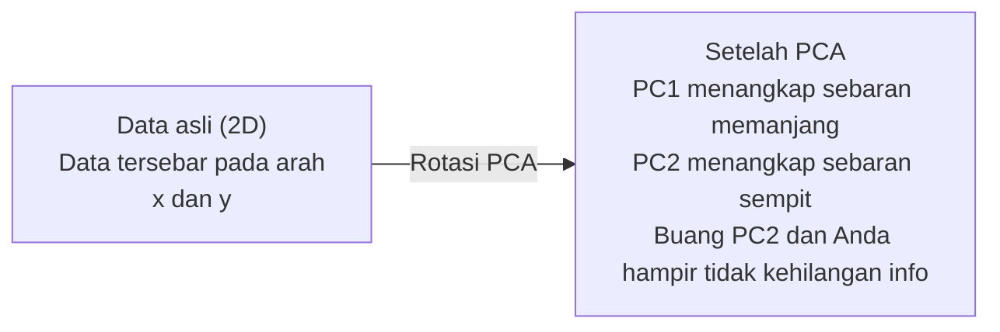

# Reduksi Dimensi

> Data berdimensi tinggi memiliki struktur. Anda menemukannya dengan melihat dari sudut yang tepat.

**Jenis:** Bangun
**Bahasa:** Python, TypeScript
**Prasyarat:** Fase 1, Pelajaran 01 (Intuisi Aljabar Linear), 02 (Vektor, Matriks & Operasi), 03 (Nilai Eigen & Vektor Eigen), 06 (Probabilitas & Distribusi)
**Waktu:** ~90 menit

## Tujuan Pembelajaran

- Implementasikan PCA dari awal: pusatkan data, hitung matriks kovarians, lakukan dekomposisi eigen, dan proyeksikan
- Gunakan rasio varians terjelaskan dan metode siku untuk memilih jumlah komponen utama
- Bandingkan PCA, t-SNE, dan UMAP untuk memvisualisasikan digit MNIST dalam 2D serta jelaskan trade-off-nya
- Terapkan kernel PCA dengan kernel RBF untuk memisahkan struktur data nonlinear yang tidak dapat ditangani PCA standar

## Masalahnya

Anda memiliki dataset dengan 784 fitur per sampel. Mungkin itu adalah nilai piksel dari digit tulisan tangan. Mungkin tingkat ekspresi gen. Mungkin sinyal perilaku pengguna. Anda tidak dapat memvisualisasikan 784 dimensi. Anda tidak dapat memplotnya. Anda bahkan tidak dapat memikirkannya.

Namun, sebagian besar dari 784 fitur itu bersifat redundan. Informasi yang sebenarnya hidup pada permukaan yang jauh lebih kecil. Sebuah "7" tulisan tangan tidak memerlukan 784 bilangan independen untuk menggambarkannya. Ia hanya memerlukan beberapa: sudut goresan, panjang garis melintang, seberapa besar kemiringannya. Sisanya adalah kebisingan.

Reduksi dimensi menemukan permukaan yang lebih kecil itu. Reduksi dimensi mengambil data 784 dimensi Anda dan mengompresnya menjadi 2, 10, atau 50 dimensi sambil mempertahankan struktur yang penting.

## Konsepnya

### Kutukan dimensi

Ruang berdimensi tinggi tidak intuitif. Tiga hal menjadi rusak seiring bertambahnya dimensi.

**Jarak menjadi tidak bermakna.** Pada dimensi tinggi, jarak antara dua titik acak mana pun konvergen ke nilai yang sama. Jika setiap titik kurang lebih berjarak sama dari titik lain, pencarian tetangga terdekat berhenti bekerja.

```
Dimensi      Rasio jarak rata-rata (maks/min antar titik acak)
2            ~5.0
10           ~1.8
100          ~1.2
1000         ~1.02
```

**Volume terkonsentrasi di sudut.** Sebuah hiper kubus satuan dalam $d$ dimensi memiliki $2^d$ sudut. Dalam 100 dimensi, hampir seluruh volume berada di sudut-sudut, jauh dari pusat. Titik-titik data menyebar ke tepi dan model Anda kekurangan data di bagian dalam.

**Anda memerlukan data secara eksponensial lebih banyak.** Untuk mempertahankan kepadatan sampel yang sama dalam suatu ruang, beralih dari 2D ke 20D berarti Anda memerlukan $10^{18}$ kali lebih banyak data. Data Anda tidak pernah cukup. Reduksi dimensi membawa kepadatan data kembali ke tingkat yang dapat dikerjakan.

### PCA: menemukan arah yang penting

Principal Component Analysis (PCA) menemukan sumbu-sumbu tempat data Anda paling banyak bervariasi. PCA memutar sistem koordinat Anda sehingga sumbu pertama menangkap varians terbesar, sumbu kedua menangkap varians berikutnya, dan seterusnya.

Algoritmenya:

```
1. Pusatkan data          (kurangi rata-rata dari setiap fitur)
2. Hitung kovarians       (bagaimana fitur bergerak bersama)
3. Dekomposisi eigen      (temukan arah utama)
4. Urutkan nilai eigen    (varians terbesar lebih dulu)
5. Proyeksikan            (pertahankan k vektor eigen teratas, buang sisanya)
```

Mengapa dekomposisi eigen? Matriks kovarians bersifat simetris dan semi-definit positif. Vektor-vektor eigennya adalah arah-arah ortogonal dalam ruang fitur. Nilai-nilai eigen memberi tahu seberapa besar varians yang ditangkap setiap arah. Vektor eigen dengan nilai eigen terbesar mengarah pada arah varians maksimum.



- **Sebelum PCA:** Awan data tersebar secara diagonal melintasi kedua sumbu x dan y
- **Setelah PCA:** Sistem koordinat diputar sehingga PC1 sejajar dengan arah varians maksimum (sebaran memanjang) dan PC2 sejajar dengan arah varians minimum (sebaran sempit)
- **Reduksi dimensi:** Membuang PC2 memproyeksikan data ke PC1 dengan kehilangan informasi yang sangat sedikit

### Rasio varians terjelaskan

Setiap komponen utama menangkap sebagian dari total varians. Rasio varians terjelaskan memberi tahu seberapa besar.

```
Komponen     Nilai eigen   Rasio terjelaskan  Kumulatif
PC1          4.73          0.473              0.473
PC2          2.51          0.251              0.724
PC3          1.12          0.112              0.836
PC4          0.89          0.089              0.925
...
```

Ketika varians terjelaskan kumulatif mencapai 0.95, Anda tahu bahwa sekian komponen menangkap 95% informasi. Semua setelah itu sebagian besar adalah kebisingan.

### Memilih jumlah komponen

Tiga strategi:

1. **Ambang.** Pertahankan komponen yang cukup untuk menjelaskan 90-95% varians.
2. **Metode siku.** Plot varians terjelaskan per komponen. Cari penurunan yang tajam.
3. **Kinerja hilir.** Gunakan PCA sebagai praproses. Sapu nilai $k$ dan ukur akurasi model Anda. $k$ terbaik adalah titik di mana akurasi mendatar.

### t-SNE: mempertahankan lingkungan terdekat

t-Distributed Stochastic Neighbor Embedding (t-SNE) dirancang untuk visualisasi. Metode ini memetakan data berdimensi tinggi ke 2D (atau 3D) sambil mempertahankan titik-titik yang saling dekat.

Intuisinya: dalam ruang asli, hitung distribusi probabilitas atas pasangan titik berdasarkan jaraknya. Titik yang dekat mendapat probabilitas tinggi. Titik yang jauh mendapat probabilitas rendah. Lalu temukan tata letak 2D yang mempertahankan distribusi probabilitas yang sama. Titik-titik yang bertetangga dalam 784 dimensi tetap bertetangga dalam 2D.

Sifat-sifat utama t-SNE:
- Nonlinear. Metode ini dapat membuka manifold kompleks yang tidak dapat dibuka PCA.
- Stokastik. Setiap kali dijalankan menghasilkan tata letak yang berbeda.
- Parameter perplexity mengontrol berapa banyak tetangga yang dipertimbangkan (rentang umum: 5-50).
- Jarak antar klaster pada keluaran tidak bermakna. Hanya klaster-klaster itulah yang bermakna.
- Lambat pada dataset besar. $O(n^2)$ secara bawaan.

### UMAP: lebih cepat, struktur global lebih baik

Uniform Manifold Approximation and Projection (UMAP) bekerja serupa dengan t-SNE, tetapi dengan dua keunggulan:
- Lebih cepat. Metode ini menggunakan graf tetangga terdekat aproksimatif, alih-alih menghitung semua jarak berpasangan.
- Struktur global lebih baik. Posisi relatif klaster pada keluaran cenderung lebih bermakna daripada pada t-SNE.

UMAP membangun graf berbobot dalam ruang berdimensi tinggi ("representasi topologis kabur"), lalu menemukan tata letak berdimensi rendah yang mempertahankan graf itu sebaik mungkin.

Parameter utama:
- `n_neighbors`: berapa banyak tetangga yang mendefinisikan struktur lokal (mirip dengan perplexity). Nilai lebih besar mempertahankan lebih banyak struktur global.
- `min_dist`: seberapa rapat titik-titik berkumpul pada keluaran. Nilai lebih rendah menghasilkan klaster yang lebih padat.

### Kapan menggunakan mana

| Metode | Kasus penggunaan | Yang dipertahankan | Kecepatan |
|---|---|---|---|
| PCA | Praproses sebelum pelatihan | Varians global | Cepat (eksak), bekerja pada jutaan sampel |
| PCA | Visualisasi eksploratoris cepat | Struktur linier | Cepat |
| t-SNE | Plot 2D berkualitas publikasi | Lingkungan lokal | Lambat (ideal < 10k sampel) |
| UMAP | Visualisasi 2D dalam skala besar | Lokal + sebagian struktur global | Sedang (menangani jutaan) |
| PCA | Reduksi fitur untuk model | Fitur yang diurutkan berdasarkan varians | Cepat |
| t-SNE / UMAP | Memahami struktur klaster | Pemisahan klaster | Sedang hingga lambat |

Aturan praktis: gunakan PCA untuk praproses dan kompresi data. Gunakan t-SNE atau UMAP ketika Anda perlu memvisualisasikan struktur dalam 2D.

### Kernel PCA

PCA standar menemukan subruang linier. PCA memutar sistem koordinat Anda dan membuang sumbu. Namun, bagaimana jika data terletak pada manifold nonlinear? Sebuah lingkaran dalam 2D tidak dapat dipisahkan oleh garis mana pun. PCA standar tidak akan membantu.

Kernel PCA menerapkan PCA dalam ruang fitur berdimensi tinggi yang diinduksi oleh fungsi kernel, tanpa menghitung secara eksplisit koordinat dalam ruang tersebut. Inilah kernel trick -- ide yang sama di balik SVM.

Algoritmenya:
1. Hitung matriks kernel $K$ dengan $K_{ij} = k(x_i, x_j)$
2. Pusatkan matriks kernel dalam ruang fitur
3. Dekomposisi eigen matriks kernel yang sudah dipusatkan
4. Vektor eigen teratas (diskalakan oleh $1/\sqrt{\text{eigenvalue}}$) adalah proyeksinya

Fungsi kernel yang umum:

| Kernel | Rumus | Cocok untuk |
|---|---|---|
| RBF (Gaussian) | $\exp(-\gamma \lVert x - y \rVert^2)$ | Sebagian besar data nonlinear, manifold mulus |
| Polynomial | $(x \cdot y + c)^d$ | Hubungan polinomial |
| Sigmoid | $\tanh(\alpha x \cdot y + c)$ | Pemetaan seperti jaringan saraf |

Kapan menggunakan kernel PCA versus PCA standar:

| Kriteria | PCA standar | Kernel PCA |
|---|---|---|
| Struktur data | Subruang linier | Manifold nonlinear |
| Kecepatan | $O(\min(n^2 d, d^2 n))$ | $O(n^2 d + n^3)$ |
| Keterafsiran | Komponen adalah kombinasi linier dari fitur | Komponen tidak memiliki tafsiran fitur langsung |
| Skalabilitas | Bekerja pada jutaan sampel | Matriks kernel berukuran $n \times n$, dibatasi memori |
| Rekonstruksi | Transformasi invers langsung | Memerlukan aproksimasi pra-citra |

Contoh klasik: lingkaran konsentris dalam 2D. Dua cincin titik, satu di dalam yang lain. PCA standar memproyeksikan keduanya ke garis yang sama -- tidak berguna untuk klasifikasi. Kernel PCA dengan kernel RBF memetakan lingkaran dalam dan lingkaran luar ke wilayah yang berbeda, sehingga keduanya dapat dipisahkan secara linier.

### Error Rekonstruksi

Seberapa baik reduksi dimensi Anda? Anda mengompres 784 dimensi menjadi 50. Apa yang Anda hilang?

Ukur error rekonstruksi:
1. Proyeksikan data ke $k$ dimensi: $X_{\text{reduced}} = X W_k$
2. Rekonstruksi: $\hat{X} = X_{\text{reduced}} W_k^T$
3. Hitung MSE: $\text{mean}((X - \hat{X})^2)$

Untuk PCA, error rekonstruksi memiliki hubungan yang bersih dengan varians terjelaskan:

```math
\begin{aligned}
\text{Reconstruction error} &= \text{sum of eigenvalues NOT included} \\
\text{Total variance} &= \text{sum of ALL eigenvalues} \\
\text{Fraction lost} &= \frac{\text{sum of dropped eigenvalues}}{\text{sum of all eigenvalues}}
\end{aligned}
```

Rasio varians terjelaskan untuk setiap komponen adalah:

```math
\text{explained\_ratio}_k = \frac{\text{eigenvalue}_k}{\sum \text{all eigenvalues}}
```

Memplot varians terjelaskan kumulatif terhadap jumlah komponen menghasilkan kurva "siku". Jumlah komponen yang tepat adalah di mana:
- Kurva mendatar (pengembalian yang semakin menurun)
- Varians kumulatif melintasi ambang Anda (biasanya 0.90 atau 0.95)
- Kinerja tugas hilir mendatar

Error rekonstruksi berguna tidak hanya untuk memilih $k$. Anda dapat menggunakannya untuk deteksi anomali: sampel dengan error rekonstruksi tinggi adalah pencilan yang tidak cocok dengan subruang yang dipelajari. Ini adalah dasar deteksi anomali berbasis PCA dalam sistem produksi.

```figure
pca-axes
```

## Bangunlah

Port TypeScript ada di `code/dim_reduction.ts`. Demo MNIST memerlukan scikit-learn, sehingga hanya berjalan dalam Python.

```bash
python3 code/dim_reduction.py
npx tsx code/dim_reduction.ts
```

### Langkah 1: PCA dari awal

```python
import numpy as np

class PCA:
    def __init__(self, n_components):
        self.n_components = n_components
        self.components = None
        self.mean = None
        self.eigenvalues = None
        self.explained_variance_ratio_ = None

    def fit(self, X):
        self.mean = np.mean(X, axis=0)
        X_centered = X - self.mean

        cov_matrix = np.cov(X_centered, rowvar=False)

        eigenvalues, eigenvectors = np.linalg.eigh(cov_matrix)

        sorted_idx = np.argsort(eigenvalues)[::-1]
        eigenvalues = eigenvalues[sorted_idx]
        eigenvectors = eigenvectors[:, sorted_idx]

        self.components = eigenvectors[:, :self.n_components].T
        self.eigenvalues = eigenvalues[:self.n_components]
        total_var = np.sum(eigenvalues)
        self.explained_variance_ratio_ = self.eigenvalues / total_var

        return self

    def transform(self, X):
        X_centered = X - self.mean
        return X_centered @ self.components.T

    def fit_transform(self, X):
        self.fit(X)
        return self.transform(X)
```

### Langkah 2: Uji pada data sintetis

```python
np.random.seed(42)
n_samples = 500

t = np.random.uniform(0, 2 * np.pi, n_samples)
x1 = 3 * np.cos(t) + np.random.normal(0, 0.2, n_samples)
x2 = 3 * np.sin(t) + np.random.normal(0, 0.2, n_samples)
x3 = 0.5 * x1 + 0.3 * x2 + np.random.normal(0, 0.1, n_samples)

X_synthetic = np.column_stack([x1, x2, x3])

pca = PCA(n_components=2)
X_reduced = pca.fit_transform(X_synthetic)

print(f"Original shape: {X_synthetic.shape}")
print(f"Reduced shape:  {X_reduced.shape}")
print(f"Explained variance ratios: {pca.explained_variance_ratio_}")
print(f"Total variance captured: {sum(pca.explained_variance_ratio_):.4f}")
```

### Langkah 3: Digit MNIST dalam 2D

```python
from sklearn.datasets import fetch_openml

mnist = fetch_openml("mnist_784", version=1, as_frame=False, parser="auto")
X_mnist = mnist.data[:5000].astype(float)
y_mnist = mnist.target[:5000].astype(int)

pca_mnist = PCA(n_components=50)
X_pca50 = pca_mnist.fit_transform(X_mnist)
print(f"50 components capture {sum(pca_mnist.explained_variance_ratio_):.2%} of variance")

pca_2d = PCA(n_components=2)
X_pca2d = pca_2d.fit_transform(X_mnist)
print(f"2 components capture {sum(pca_2d.explained_variance_ratio_):.2%} of variance")
```

### Langkah 4: Bandingkan dengan sklearn

```python
from sklearn.decomposition import PCA as SklearnPCA
from sklearn.manifold import TSNE

sklearn_pca = SklearnPCA(n_components=2)
X_sklearn_pca = sklearn_pca.fit_transform(X_mnist)

print(f"\nOur PCA explained variance:     {pca_2d.explained_variance_ratio_}")
print(f"Sklearn PCA explained variance: {sklearn_pca.explained_variance_ratio_}")

diff = np.abs(np.abs(X_pca2d) - np.abs(X_sklearn_pca))
print(f"Max absolute difference: {diff.max():.10f}")

tsne = TSNE(n_components=2, perplexity=30, random_state=42)
X_tsne = tsne.fit_transform(X_mnist)
print(f"\nt-SNE output shape: {X_tsne.shape}")
```

### Langkah 5: Perbandingan UMAP

```python
try:
    from umap import UMAP

    reducer = UMAP(n_components=2, n_neighbors=15, min_dist=0.1, random_state=42)
    X_umap = reducer.fit_transform(X_mnist)
    print(f"UMAP output shape: {X_umap.shape}")
except ImportError:
    print("Install umap-learn: pip install umap-learn")
```

## Gunakanlah

PCA sebagai praproses sebelum klasifier:

```python
from sklearn.decomposition import PCA as SklearnPCA
from sklearn.linear_model import LogisticRegression
from sklearn.model_selection import train_test_split
from sklearn.metrics import accuracy_score

X_train, X_test, y_train, y_test = train_test_split(
    X_mnist, y_mnist, test_size=0.2, random_state=42
)

results = {}
for k in [10, 30, 50, 100, 200]:
    pca_k = SklearnPCA(n_components=k)
    X_tr = pca_k.fit_transform(X_train)
    X_te = pca_k.transform(X_test)

    clf = LogisticRegression(max_iter=1000, random_state=42)
    clf.fit(X_tr, y_train)
    acc = accuracy_score(y_test, clf.predict(X_te))
    var_captured = sum(pca_k.explained_variance_ratio_)
    results[k] = (acc, var_captured)
    print(f"k={k:>3d}  accuracy={acc:.4f}  variance={var_captured:.4f}")
```

Kinerja mendatar jauh sebelum 784 dimensi. Dataran itu adalah titik operasi Anda.

## Kirimkan

Pelajaran ini menghasilkan:
- `outputs/skill-dimensionality-reduction.md` - sebuah skill untuk memilih teknik reduksi dimensi yang tepat bagi suatu tugas

## Latihan

1. Ubah kelas `PCA` agar mendukung `inverse_transform`. Rekonstruksi digit MNIST dari 10, 50, dan 200 komponen. Cetak error rekonstruksi (rata-rata selisih kuadrat terhadap data asli) untuk masing-masing.

2. Jalankan t-SNE pada subset MNIST yang sama dengan nilai perplexity 5, 30, dan 100. Jelaskan bagaimana keluaran berubah. Mengapa perplexity memengaruhi kepadatan klaster?

3. Ambil dataset dengan 50 fitur yang hanya 5 di antaranya informatif (buat dengan `sklearn.datasets.make_classification`). Terapkan PCA dan periksa apakah kurva varians terjelaskan mengidentifikasi dengan benar bahwa data tersebut secara efektif berdimensi 5.

### Petunjuk

**Latihan 1.** Baca `inverse_transform` di kelas `PCA` dan latih satu model untuk setiap jumlah komponen. Hitung `reconstruction_error` untuk 10, 50, dan 200 komponen; error harus turun seiring bertambahnya jumlah komponen.

**Latihan 2.** Latih `sklearn.manifold.TSNE` tiga kali pada subset yang sama, hanya mengubah `perplexity`, dengan `random_state` yang sama. Perplexity rendah melihat lebih sedikit tetangga, jadi harapkan kelompok kecil yang rapat; perplexity tinggi melihat lebih banyak tetangga, jadi harapkan kelompok yang lebih besar dan lebih mulus.

**Latihan 3.** Panggil `make_classification(n_features=50, n_informative=5, n_redundant=45)`, latih `PCA`, dan cetak varians terjelaskan kumulatif. Fitur redundan adalah kombinasi linier dari fitur informatif, sehingga kurva mencapai hampir 1,0 pada 5 komponen. Lalu coba `n_redundant=0`: 45 fitur lainnya adalah kebisingan independen, sehingga kurva tidak mendatar.

## Istilah Kunci

| Istilah | Ungkapan orang | Makna sebenarnya |
|---|---|---|
| Kutukan dimensi | "Terlalu banyak fitur" | Jarak, volume, dan kepadatan data semuanya berperilaku kontra-intuitif seiring pertumbuhan dimensi. Model memerlukan data secara eksponensial lebih banyak untuk mengompensasinya. |
| PCA | "Reduksi dimensi" | Putar sistem koordinat Anda agar sumbu sejajar dengan arah varians maksimum, lalu buang sumbu ber-varians rendah. |
| Komponen utama | "Sebuah arah yang penting" | Vektor eigen dari matriks kovarians. Arah dalam ruang fitur tempat data paling banyak bervariasi. |
| Rasio varians terjelaskan | "Seberapa banyak info yang dimiliki komponen ini" | Fraksi total varians yang ditangkap oleh satu komponen utama. Jumlahkan $k$ rasio teratas untuk melihat seberapa banyak yang dipertahankan oleh $k$ komponen. |
| Matriks kovarians | "Bagaimana fitur berkorelasi" | Matriks simetris yang entri $(i,j)$-nya mengukur bagaimana fitur $i$ dan fitur $j$ bergerak bersama. Entri diagonal adalah varians masing-masing. |
| t-SNE | "Plot klaster itu" | Metode nonlinear yang memetakan data berdimensi tinggi ke 2D dengan mempertahankan probabilitas lingkungan berpasangan. Baik untuk visualisasi, bukan untuk praproses. |
| UMAP | "t-SNE yang lebih cepat" | Metode nonlinear berbasis analisis topologi data. Mempertahankan struktur lokal dan sebagian struktur global. Skalanya lebih baik daripada t-SNE. |
| Perplexity | "Tombol t-SNE" | Mengontrol jumlah efektif tetangga yang dipertimbangkan setiap titik. Perplexity rendah fokus pada struktur yang sangat lokal. Perplexity tinggi menangkap pola yang lebih luas. |
| Manifold | "Permukaan tempat data hidup" | Permukaan berdimensi lebih rendah yang tertanam dalam ruang berdimensi lebih tinggi. Selembar kertas yang diremas dalam 3D adalah manifold 2D. |

## Bacaan Lanjutan

- [A Tutorial on Principal Component Analysis](https://arxiv.org/abs/1404.1100) (Shlens) - turunan PCA yang jelas dari dasar
- [How to Use t-SNE Effectively](https://distill.pub/2016/misread-tsne/) (Wattenberg et al.) - panduan interaktif tentang jebakan t-SNE dan pilihan parameter
- [UMAP documentation](https://umap-learn.readthedocs.io/) - teori dan panduan praktis dari penulis UMAP
