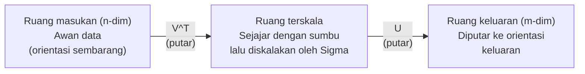
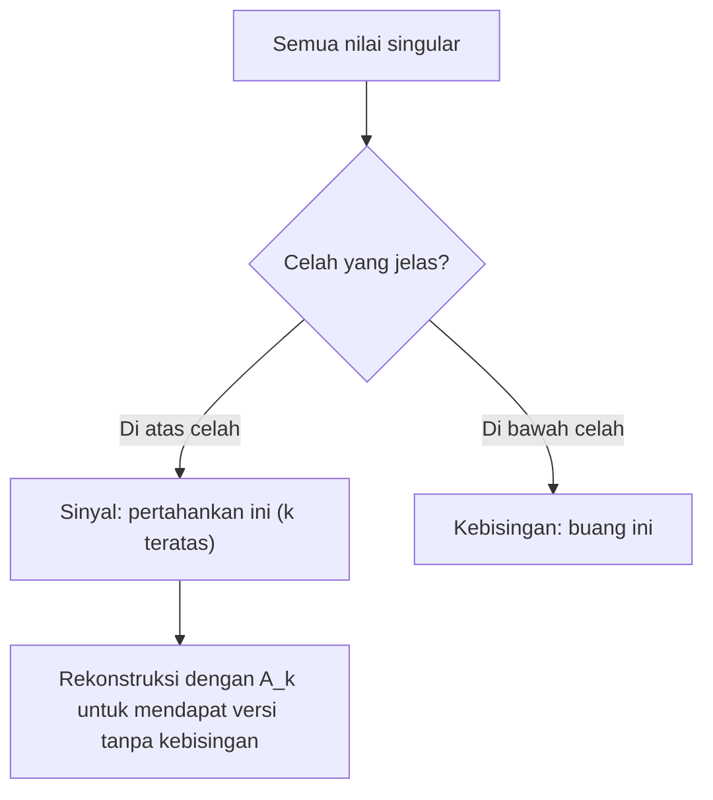

# Dekomposisi Nilai Singular

> SVD adalah pisau lipat Swiss dari aljabar linear. Setiap matriks memilikinya. Setiap ilmuwan data membutuhkannya.

**Jenis:** Bangun
**Bahasa:** Python, Julia
**Prasyarat:** Fase 1, Pelajaran 01 (Intuisi Aljabar Linear), 02 (Vektor & Operasi Matriks), 03 (Transformasi Matriks)
**Waktu:** ~120 menit

## Tujuan Pembelajaran

- Implementasikan SVD melalui iterasi daya dan jelaskan makna geometris dari $U$, $\Sigma$, dan $V^T$
- Terapkan SVD terpotong untuk kompresi gambar dan ukur rasio kompresi terhadap error rekonstruksi
- Hitung pseudoinverse Moore-Penrose melalui SVD untuk menyelesaikan sistem least-squares yang terlalu menentukan
- Hubungkan SVD dengan PCA, sistem rekomendasi (faktor laten), dan Latent Semantic Analysis dalam NLP

## Masalahnya

Anda memiliki matriks 1000x2000. Mungkin itu adalah peringkat film oleh pengguna. Mungkin tabel frekuensi istilah-dokumen. Mungkin nilai piksel dari sebuah gambar. Anda perlu mengompresnya, menghilangkan kebisingannya, menemukan struktur tersembunyi di dalamnya, atau menyelesaikan sistem least-squares dengannya. Dekomposisi eigen hanya bekerja pada matriks persegi. Bahkan saat itu, dekomposisi eigen mensyaratkan matriks memiliki himpunan lengkap vektor eigen yang independen secara linier.

SVD bekerja pada matriks apa pun. Bentuk apa pun. Pangkat apa pun. Tanpa syarat. SVD menguraikan matriks menjadi tiga faktor yang mengungkap geometri dari apa yang dilakukan matriks itu terhadap ruang. SVD adalah faktorisasi paling umum dan paling berguna dalam seluruh aljabar linear.

## Konsepnya

### Apa yang dilakukan SVD secara geometris

Setiap matriks, terlepas dari bentuknya, melakukan tiga operasi secara berurutan: memutar, menskalakan, memutar lagi. SVD membuat dekomposisi ini menjadi eksplisit.

```math
\underset{\substack{m \times n \\ \text{(any)}}}{A} = \underset{\substack{m \times m \\ \text{(rotate)}}}{U} \cdot \underset{\substack{m \times n \\ \text{(scale)}}}{\Sigma} \cdot \underset{\substack{n \times n \\ \text{(rotate)}}}{V^T}
```

Dengan matriks $A$ apa pun, SVD menguraikannya menjadi:
- $V^T$ memutar vektor-vektor dalam ruang masukan (berdimensi $n$)
- $\Sigma$ menskalakan sepanjang setiap sumbu (meregangkan atau mengompres)
- $U$ memutar hasilnya ke dalam ruang keluaran (berdimensi $m$)



Bayangkan begini. Anda menyerahkan sebuah matriks kepada SVD. SVD memberi tahu Anda: "Matriks ini mengambil bola masukan, memutarnya dengan $V^T$, lalu meregangkannya menjadi elipsoid dengan $\Sigma$, kemudian memutar elipsoid itu dengan $U$." Nilai-nilai singular adalah panjang sumbu-sumbu elipsoid tersebut.

### Dekomposisi lengkap

Untuk matriks $A$ berbentuk $m \times n$:

```math
\begin{aligned}
& A = U \cdot \Sigma \cdot V^T \\[6pt]
& \text{where:} \\
& \quad U \text{ is } m \times m, \text{ orthogonal } (U^T U = I) \\
& \quad \Sigma \text{ is } m \times n, \text{ diagonal (singular values on the diagonal)} \\
& \quad V \text{ is } n \times n, \text{ orthogonal } (V^T V = I) \\[6pt]
& \text{The singular values } \sigma_1 \ge \sigma_2 \ge \cdots \ge \sigma_r > 0 \\
& \text{where } r = \mathop{\mathrm{rank}}(A)
\end{aligned}
```

Kolom-kolom $U$ disebut vektor singular kiri. Kolom-kolom $V$ disebut vektor singular kanan. Entri diagonal $\Sigma$ disebut nilai singular. Nilai-nilai itu selalu tidak negatif dan secara konvensi diurutkan menurun.

### Vektor singular kiri, nilai singular, vektor singular kanan

Setiap komponen SVD memiliki makna geometris yang berbeda.

**Vektor singular kanan (kolom-kolom $V$):** Vektor-vektor ini membentuk basis ortonormal untuk ruang masukan ($\mathbb{R}^n$). Vektor-vektor itu adalah arah-arah dalam ruang masukan yang dipetakan matriks ke arah-arah ortogonal dalam ruang keluaran. Anggap saja sebagai sistem koordinat alami untuk domain.

**Nilai singular (diagonal $\Sigma$):** Nilai-nilai ini adalah faktor penskalaan. Nilai singular ke-i memberi tahu seberapa besar matriks meregangkan vektor di sepanjang vektor singular kanan ke-i. Nilai singular nol berarti matriks menghancurkan arah itu seluruhnya.

**Vektor singular kiri (kolom-kolom $U$):** Vektor-vektor ini membentuk basis ortonormal untuk ruang keluaran ($\mathbb{R}^m$). Vektor singular kiri ke-i adalah arah dalam ruang keluaran tempat vektor singular kanan ke-i mendarat (setelah diskalakan).

Hubungan di antara ketiganya:

```
A * v_i = sigma_i * u_i

Matriks A mengambil vektor singular kanan ke-i, v_i,
menskalakannya dengan sigma_i, dan memetakannya ke vektor singular kiri ke-i, u_i.
```

Ini memberi Anda gambaran per koordinat tentang apa yang dilakukan matriks mana pun.

### Bentuk hasil kali luar

SVD dapat ditulis sebagai jumlah matriks berpangkat 1:

```
A = sigma_1 * u_1 * v_1^T + sigma_2 * u_2 * v_2^T + ... + sigma_r * u_r * v_r^T

Setiap suku sigma_i * u_i * v_i^T adalah matriks berpangkat 1 (hasil kali luar).
Matriks lengkap adalah jumlah dari r matriks tersebut, dengan r sebagai pangkatnya.
```

Bentuk ini adalah dasar dari aproksimasi pangkat rendah. Setiap suku menambahkan satu lapis struktur. Suku pertama menangkap pola paling penting. Suku kedua menangkap pola penting berikutnya. Dan seterusnya. Memotong jumlah ini memberi Anda aproksimasi terbaik yang mungkin pada pangkat tertentu.

```math
\begin{aligned}
\text{Rank-1 approx:} \quad & A_1 = \sigma_1 u_1 v_1^T \\
& \text{(captures the dominant pattern)} \\[6pt]
\text{Rank-2 approx:} \quad & A_2 = \sigma_1 u_1 v_1^T + \sigma_2 u_2 v_2^T \\
& \text{(captures the two most important patterns)} \\[6pt]
\text{Rank-}k\text{ approx:} \quad & A_k = \text{sum of top } k \text{ terms} \\
& \text{(optimal by the Eckart-Young theorem)}
\end{aligned}
```

### Hubungan dengan dekomposisi eigen

SVD dan dekomposisi eigen terhubung sangat erat. Nilai dan vektor singular dari $A$ berasal langsung dari nilai dan vektor eigen dari $A^T A$ dan $A A^T$.

```
A^T A = V * Sigma^T * U^T * U * Sigma * V^T
      = V * Sigma^T * Sigma * V^T
      = V * D * V^T

dengan D = Sigma^T * Sigma adalah matriks diagonal dengan sigma_i^2 pada diagonalnya.

Jadi:
- Vektor singular kanan (V) adalah vektor eigen dari A^T A
- Nilai singular kuadrat (sigma_i^2) adalah nilai eigen dari A^T A

Demikian pula:
A A^T = U * Sigma * V^T * V * Sigma^T * U^T
      = U * Sigma * Sigma^T * U^T

Jadi:
- Vektor singular kiri (U) adalah vektor eigen dari A A^T
- Nilai eigen dari A A^T juga sigma_i^2
```

Hubungan ini memberi tahu Anda tiga hal:
1. Nilai singular selalu riil dan tidak negatif (nilai tersebut adalah akar kuadrat dari nilai eigen matriks semi-definit positif).
2. Anda dapat menghitung SVD melalui dekomposisi eigen dari $A^T A$, tetapi ini mengkuadratkan bilangan kondisi dan kehilangan presisi numerik. Algoritme SVD khusus menghindari hal ini.
3. Ketika $A$ berbentuk persegi dan simetris semi-definit positif, SVD dan dekomposisi eigen adalah hal yang sama.

### SVD terpotong: aproksimasi pangkat rendah

Teorema Eckart-Young-Mirsky menyatakan bahwa aproksimasi $\text{rank-}k$ terbaik untuk $A$ (baik dalam norma Frobenius maupun norma spektral) diperoleh dengan mempertahankan hanya $k$ nilai singular teratas dan vektor-vektor yang bersesuaian:

```math
\begin{aligned}
& A_k = U_k \cdot \Sigma_k \cdot V_k^T \\[6pt]
& \text{where:} \\
& \quad U_k \text{ is } m \times k \quad \text{(first } k \text{ columns of } U\text{)} \\
& \quad \Sigma_k \text{ is } k \times k \quad \text{(top-left } k \times k \text{ block of } \Sigma\text{)} \\
& \quad V_k \text{ is } n \times k \quad \text{(first } k \text{ columns of } V\text{)} \\[6pt]
& \text{Approximation error} = \sigma_{k+1} \quad \text{(in spectral norm)} \\
& \text{Approximation error} = \sqrt{\sigma_{k+1}^2 + \cdots + \sigma_r^2} \quad \text{(in Frobenius norm)}
\end{aligned}
```

Ini bukan sekadar aproksimasi yang "bagus". Secara terbukti, ini adalah aproksimasi terbaik yang mungkin pada pangkat $k$. Tidak ada matriks $\text{rank-}k$ lain yang lebih dekat ke $A$.

| Komponen | Besaran relatif | Dipertahankan dalam aproksimasi pangkat 3? |
|---|---|---|
| $\sigma_1$ | Terbesar | Ya |
| $\sigma_2$ | Besar | Ya |
| $\sigma_3$ | Sedang-besar | Ya |
| $\sigma_4$ | Sedang | Tidak (error) |
| $\sigma_5$ | Sedang-kecil | Tidak (error) |
| $\sigma_6$ | Kecil | Tidak (error) |
| $\sigma_7$ | Sangat kecil | Tidak (error) |
| $\sigma_8$ | Sangat kecil sekali | Tidak (error) |

Pertahankan 3 teratas: $A_3$ menangkap tiga nilai singular terbesar. Error = nilai-nilai sisanya ($\sigma_4$ hingga $\sigma_8$).

Jika nilai singular menurun cepat, $k$ kecil sudah menangkap sebagian besar matriks. Jika nilai singular menurun lambat, matriks itu tidak memiliki struktur pangkat rendah.

### Kompresi gambar dengan SVD

Gambar skala abu-abu adalah matriks intensitas piksel. Gambar 800x600 memiliki 480,000 nilai. SVD memungkinkan Anda mengaproksimasinya dengan jauh lebih sedikit nilai.

```
Gambar asli: 800 x 600 = 480,000 nilai

SVD dengan pangkat k:
  U_k:      800 x k nilai
  Sigma_k:  k nilai
  V_k:      600 x k nilai
  Total:    k * (800 + 600 + 1) = k * 1401 nilai

  k=10:   14,010 nilai   (2.9% dari asli)
  k=50:   70,050 nilai  (14.6% dari asli)
  k=100: 140,100 nilai  (29.2% dari asli)

  Rasio kompresi membaik saat k semakin kecil,
  tetapi kualitas visual menurun.
```

Wawasan kuncinya: gambar alami memiliki nilai singular yang menurun cepat. Beberapa nilai singular pertama menangkap struktur umum (bentuk, gradien). Nilai-nilai berikutnya menangkap detail halus dan kebisingan. Memotong pada pangkat 50 sering menghasilkan gambar yang tampak hampir identik dengan aslinya sambil menggunakan penyimpanan 85% lebih sedikit.

### SVD untuk sistem rekomendasi

Netflix Prize membuat teknik ini terkenal. Anda memiliki matriks peringkat pengguna-film yang sebagian besar entrinya kosong.

```
             Movie1  Movie2  Movie3  Movie4  Movie5
  User1      [  5      ?       3       ?       1  ]
  User2      [  ?      4       ?       2       ?  ]
  User3      [  3      ?       5       ?       ?  ]
  User4      [  ?      ?       ?       4       3  ]

  ? = peringkat tidak diketahui
```

Idenya: matriks peringkat ini memiliki pangkat rendah. Selera pengguna tidak sepenuhnya independen. Ada segelintir faktor laten (aksi versus drama, lama versus baru, intelektual versus visceral) yang menjelaskan sebagian besar preferensi.

SVD pada matriks peringkat (yang sudah diisi) menguraikannya menjadi:
- $U$: profil pengguna dalam ruang faktor laten
- $\Sigma$: kepentingan setiap faktor laten
- $V^T$: profil film dalam ruang faktor laten

Peringkat film yang diprediksi untuk seorang pengguna adalah hasil kali titik antara profil penggunanya dan profil film tersebut (dibobot oleh nilai singular). Aproksimasi pangkat rendah mengisi entri-entri yang kosong.

Dalam praktiknya, Anda menggunakan varian seperti SVD inkremental Simon Funk atau ALS (alternating least squares) yang menangani data yang hilang secara langsung. Namun, ide intinya sama: dekomposisi faktor laten melalui SVD.

### SVD dalam NLP: Latent Semantic Analysis

Latent Semantic Analysis (LSA), juga disebut Latent Semantic Indexing (LSI), menerapkan SVD pada matriks istilah-dokumen.

```
             Doc1   Doc2   Doc3   Doc4
  "cat"      [  3      0      1      0  ]
  "dog"      [  2      0      0      1  ]
  "fish"     [  0      4      1      0  ]
  "pet"      [  1      1      1      1  ]
  "ocean"    [  0      3      0      0  ]

Setelah SVD dengan pangkat k=2:

  Setiap dokumen menjadi sebuah titik dalam "ruang konsep" 2D.
  Setiap istilah menjadi sebuah titik dalam ruang 2D yang sama.
  Dokumen tentang topik serupa berkumpul bersama.
  Istilah dengan makna serupa berkumpul bersama.

  "cat" dan "dog" berakhir saling dekat (hewan peliharaan darat).
  "fish" dan "ocean" berakhir saling dekat (konsep air).
  Doc1 dan Doc3 berkumpul jika memiliki topik serupa.
```

LSA adalah salah satu metode awal yang berhasil menangkap kesamaan semantik dari teks mentah. Metode ini bekerja karena istilah yang sinonim cenderung muncul dalam dokumen yang serupa, sehingga SVD mengelompokkannya ke dalam dimensi laten yang sama. Embedding kata modern (Word2Vec, GloVe) dapat dipandang sebagai keturunan dari ide ini.

### SVD untuk penghilangan kebisingan

Pada data yang berisik, sinyal terkonsentrasi pada nilai singular teratas, sementara kebisingan tersebar di semua nilai singular. Pemotongan menghilangkan lantai kebisingan.

**Nilai singular sinyal bersih:**

| Komponen | Besaran | Jenis |
|---|---|---|
| $\sigma_1$ | Sangat besar | Sinyal |
| $\sigma_2$ | Besar | Sinyal |
| $\sigma_3$ | Sedang | Sinyal |
| $\sigma_4$ | Mendekati nol | Dapat diabaikan |
| $\sigma_5$ | Mendekati nol | Dapat diabaikan |

**Nilai singular sinyal berisik (kebisingan ditambahkan ke semuanya):**

| Komponen | Besaran | Jenis |
|---|---|---|
| $\sigma_1$ | Sangat besar | Sinyal |
| $\sigma_2$ | Besar | Sinyal |
| $\sigma_3$ | Sedang | Sinyal |
| $\sigma_4$ | Kecil | Kebisingan |
| $\sigma_5$ | Kecil | Kebisingan |
| $\sigma_6$ | Kecil | Kebisingan |
| $\sigma_7$ | Kecil | Kebisingan |



Teknik ini digunakan dalam pemrosesan sinyal, pengukuran ilmiah, dan pembersihan data. Setiap kali Anda memiliki matriks yang rusak akibat kebisingan aditif, SVD terpotong adalah cara berprinsip untuk memisahkan sinyal dari kebisingan.

### Pseudoinverse melalui SVD

Pseudoinverse Moore-Penrose $A^+$ menggeneralisasi invers matriks ke matriks non-persegi dan matriks singular. SVD membuat perhitungannya menjadi mudah.

```
Jika A = U * Sigma * V^T, maka:

A+ = V * Sigma+ * U^T

dengan Sigma+ dibentuk oleh:
  1. Transpos Sigma (tukar baris dan kolom)
  2. Ganti setiap entri diagonal bukan nol sigma_i dengan 1/sigma_i
  3. Biarkan nol tetap nol

Untuk A (m x n):      A+ adalah (n x m)
Untuk Sigma (m x n):  Sigma+ adalah (n x m)
```

Pseudoinverse menyelesaikan masalah least-squares. Jika $Ax = b$ tidak memiliki solusi eksak (sistem terlalu menentukan), maka $x = A^+ b$ adalah solusi least-squares (meminimalkan $\lVert Ax - b \rVert$).

```
Sistem terlalu menentukan (lebih banyak persamaan daripada variabel):

  [1  1]         [3]
  [2  1] x   =   [5]       Tidak ada solusi eksak.
  [3  1]         [6]

  x_ls = A+ b = V * Sigma+ * U^T * b

  Ini memberi x yang meminimalkan jumlah kuadrat residual.
  Hasil sama dengan persamaan normal (A^T A)^(-1) A^T b,
  tetapi lebih stabil secara numerik.
```

### Keunggulan kestabilan numerik

Menghitung dekomposisi eigen dari $A^T A$ mengkuadratkan nilai singular (nilai eigen dari $A^T A$ adalah $\sigma_i^2$). Ini mengkuadratkan bilangan kondisi, memperbesar kesalahan numerik.

```
Contoh:
  A memiliki nilai singular [1000, 1, 0.001]
  Bilangan kondisi A: 1000 / 0.001 = 10^6

  A^T A memiliki nilai eigen [10^6, 1, 10^{-6}]
  Bilangan kondisi A^T A: 10^6 / 10^{-6} = 10^{12}

  Menghitung SVD langsung: bekerja dengan bilangan kondisi 10^6
  Menghitung melalui A^T A: bekerja dengan bilangan kondisi 10^{12}
                           (6 digit presisi tambahan hilang)
```

Algoritme SVD modern (bidiagonalisasi Golub-Kahan) bekerja langsung pada $A$, tidak pernah membentuk $A^T A$. Inilah sebabnya Anda harus selalu lebih memilih `np.linalg.svd(A)` daripada `np.linalg.eig(A.T @ A)`.

### Hubungan dengan PCA

PCA ADALAH SVD pada data yang dipusatkan. Ini bukan analogi. Ini benar-benar komputasi yang sama.

```
Diberikan matriks data X (n_samples x n_features), sudah dipusatkan (rata-rata dikurangkan):

Matriks kovarians: C = (1/(n-1)) * X^T X

PCA mencari vektor eigen dari C. Tetapi:

  X = U * Sigma * V^T    (SVD dari X)

  X^T X = V * Sigma^2 * V^T

  C = (1/(n-1)) * V * Sigma^2 * V^T

Jadi komponen utama adalah tepat vektor singular kanan V.
Varians terjelaskan untuk setiap komponen adalah sigma_i^2 / (n-1).

Di sklearn, PCA diimplementasikan menggunakan SVD, bukan dekomposisi eigen.
Implementasinya lebih cepat dan lebih stabil secara numerik.
```

Ini berarti semua yang Anda pelajari tentang reduksi dimensi di Pelajaran 10 adalah SVD di balik layar. PCA adalah aplikasi SVD yang paling umum dalam pembelajaran mesin.

```figure
svd-rank-reconstruction
```

## Bangunlah

### Langkah 1: SVD dari awal menggunakan iterasi daya

Idenya: untuk menemukan nilai singular terbesar dan vektor-vektornya, gunakan iterasi daya pada $A^T A$ (atau $A A^T$). Lalu kurangi matriks tersebut dan ulangi untuk nilai singular berikutnya.

```python
import numpy as np

def power_iteration(M, num_iters=100):
    n = M.shape[1]
    v = np.random.randn(n)
    v = v / np.linalg.norm(v)

    for _ in range(num_iters):
        Mv = M @ v
        v = Mv / np.linalg.norm(Mv)

    eigenvalue = v @ M @ v
    return eigenvalue, v

def svd_from_scratch(A, k=None):
    m, n = A.shape
    if k is None:
        k = min(m, n)

    sigmas = []
    us = []
    vs = []

    A_residual = A.copy().astype(float)

    for _ in range(k):
        AtA = A_residual.T @ A_residual
        eigenvalue, v = power_iteration(AtA, num_iters=200)

        if eigenvalue < 1e-10:
            break

        sigma = np.sqrt(eigenvalue)
        u = A_residual @ v / sigma

        sigmas.append(sigma)
        us.append(u)
        vs.append(v)

        A_residual = A_residual - sigma * np.outer(u, v)

    U = np.column_stack(us) if us else np.empty((m, 0))
    S = np.array(sigmas)
    V = np.column_stack(vs) if vs else np.empty((n, 0))

    return U, S, V
```

### Langkah 2: Uji dan bandingkan dengan NumPy

```python
np.random.seed(42)
A = np.random.randn(5, 4)

U_ours, S_ours, V_ours = svd_from_scratch(A)
U_np, S_np, Vt_np = np.linalg.svd(A, full_matrices=False)

print("Our singular values:", np.round(S_ours, 4))
print("NumPy singular values:", np.round(S_np, 4))

A_reconstructed = U_ours @ np.diag(S_ours) @ V_ours.T
print(f"Reconstruction error: {np.linalg.norm(A - A_reconstructed):.8f}")
```

### Langkah 3: Demo kompresi gambar

```python
def compress_image_svd(image_matrix, k):
    U, S, Vt = np.linalg.svd(image_matrix, full_matrices=False)
    compressed = U[:, :k] @ np.diag(S[:k]) @ Vt[:k, :]
    return compressed

image = np.random.seed(42)
rows, cols = 200, 300
image = np.random.randn(rows, cols)

for k in [1, 5, 10, 20, 50]:
    compressed = compress_image_svd(image, k)
    error = np.linalg.norm(image - compressed) / np.linalg.norm(image)
    original_size = rows * cols
    compressed_size = k * (rows + cols + 1)
    ratio = compressed_size / original_size
    print(f"k={k:>3d}  error={error:.4f}  storage={ratio:.1%}")
```

### Langkah 4: Penghilangan kebisingan

```python
np.random.seed(42)
clean = np.outer(np.sin(np.linspace(0, 4*np.pi, 100)),
                  np.cos(np.linspace(0, 2*np.pi, 80)))
noise = 0.3 * np.random.randn(100, 80)
noisy = clean + noise

U, S, Vt = np.linalg.svd(noisy, full_matrices=False)
denoised = U[:, :5] @ np.diag(S[:5]) @ Vt[:5, :]

print(f"Noisy error:    {np.linalg.norm(noisy - clean):.4f}")
print(f"Denoised error: {np.linalg.norm(denoised - clean):.4f}")
print(f"Improvement:    {(1 - np.linalg.norm(denoised - clean) / np.linalg.norm(noisy - clean)):.1%}")
```

### Langkah 5: Pseudoinverse

```python
A = np.array([[1, 1], [2, 1], [3, 1]], dtype=float)
b = np.array([3, 5, 6], dtype=float)

U, S, Vt = np.linalg.svd(A, full_matrices=False)
S_inv = np.diag(1.0 / S)
A_pinv = Vt.T @ S_inv @ U.T

x_svd = A_pinv @ b
x_lstsq = np.linalg.lstsq(A, b, rcond=None)[0]
x_pinv = np.linalg.pinv(A) @ b

print(f"SVD pseudoinverse solution:  {x_svd}")
print(f"np.linalg.lstsq solution:   {x_lstsq}")
print(f"np.linalg.pinv solution:    {x_pinv}")
```

## Gunakanlah

Demo lengkap yang dapat dijalankan ada di `code/svd.py`. Jalankan untuk melihat SVD diterapkan pada kompresi gambar, sistem rekomendasi, analisis semantik laten, dan penghilangan kebisingan.

```bash
python svd.py
```

Versi Julia di `code/svd.jl` mendemonstrasikan konsep yang sama menggunakan fungsi `svd()` bawaan Julia dan paket `LinearAlgebra`.

```bash
julia svd.jl
```

## Kirimkan

Pelajaran ini menghasilkan:
- `outputs/skill-svd.md` - sebuah skill untuk mengetahui kapan dan bagaimana menerapkan SVD dalam proyek nyata

## Latihan

1. Implementasikan SVD lengkap dari awal tanpa menggunakan iterasi daya. Sebagai gantinya, hitung dekomposisi eigen dari $A^T A$ untuk mendapatkan $V$ dan nilai-nilai singular, lalu hitung $U = A V \Sigma^{-1}$. Bandingkan akurasi numerik dengan versi iterasi daya Anda dan dengan NumPy.

2. Muat gambar skala abu-abu yang sebenarnya (atau ubah sebuah gambar menjadi skala abu-abu). Kompres pada pangkat 1, 5, 10, 25, 50, 100. Untuk setiap pangkat, hitung rasio kompresi dan error relatif. Temukan pangkat di mana gambar menjadi dapat diterima secara visual.

3. Bangun sistem rekomendasi mini. Buat matriks peringkat pengguna-film 10x8 dengan beberapa entri yang diketahui. Isi entri yang kosong dengan rata-rata baris. Hitung SVD dan rekonstruksi aproksimasi pangkat 3. Gunakan matriks hasil rekonstruksi untuk memprediksi peringkat yang kosong. Verifikasi bahwa prediksinya masuk akal.

4. Buat matriks istilah-dokumen 100x50 dengan 3 topik sintetis. Setiap topik memiliki 5 istilah yang terkait. Tambahkan kebisingan. Terapkan SVD dan verifikasi bahwa 3 nilai singular teratas jauh lebih besar daripada sisanya. Proyeksikan dokumen ke ruang laten 3D dan periksa bahwa dokumen dari topik yang sama berkumpul bersama.

5. Buat matriks pangkat rendah yang bersih (pangkat 3, ukuran 50x40) dan tambahkan kebisingan Gaussian pada berbagai tingkat ($\sigma$ = 0.1, 0.5, 1.0, 2.0). Untuk setiap tingkat kebisingan, temukan pangkat pemotongan optimal dengan menyapu $k$ dari 1 hingga 40 dan mengukur error rekonstruksi terhadap matriks bersih. Plot bagaimana $k$ optimal berubah terhadap tingkat kebisingan.

### Petunjuk

**Latihan 1.** Hitung $A^T A$, peroleh nilai dan vektor eigen dengan `np.linalg.eigh`, lalu urutkan menurun. Nilai singular adalah akar kuadrat dari nilai eigen; periksa bahwa $U \Sigma V^T$ membangun kembali $A$ dan bandingkan error-nya dengan `svd_from_scratch` dan `np.linalg.svd`.

**Latihan 2.** Panggil `truncated_svd` untuk setiap pangkat, bangun kembali gambar dengan `reconstruct`, dan gunakan `compression_ratio(m, n, k)` untuk ukurannya. Error relatif harus turun seiring bertambahnya pangkat, dan pangkat pertama di mana Anda tidak melihat blok yang jelas adalah jawabannya.

**Latihan 3.** Tandai sel yang kosong, isi dengan rata-rata baris, lalu bangun kembali aproksimasi pangkat 3 dengan `truncated_svd` dan `reconstruct`. Lalu ukur hasilnya: hitung prediksi di luar rentang peringkat, dan cetak perubahan terbesar pada sel yang diketahui. Aproksimasi pangkat 3 tidak menjamin salah satu dari sifat itu, jadi potong prediksi ke dalam rentang jika Anda memerlukan peringkat yang valid.

**Latihan 4.** Beri setiap topik blok 5 istilah dengan jumlah tinggi untuk dokumen-dokumennya, lalu tambahkan kebisingan kecil. Cetak nilai singular: 3 nilai pertama harus jauh lebih besar dari yang ke-4. Lalu warnai koordinat 3D berdasarkan topik dan periksa bahwa setiap topik membentuk satu kelompok.

**Latihan 5.** Buat matriks bersih sebagai hasil kali matriks acak 50x3 dan 3x40, lalu tambahkan kebisingan untuk setiap $\sigma$. Untuk setiap $k$, bandingkan rekonstruksi pangkat $k$ dengan matriks bersih; harapkan $k$ terbaik mendekati 3 untuk kebisingan rendah dan lebih kecil untuk kebisingan tinggi.

## Istilah Kunci

| Istilah | Ungkapan orang | Makna sebenarnya |
|---|---|---|
| SVD | "Faktor matriks apa pun" | Uraikan $A$ menjadi $U \Sigma V^T$ dengan $U$ dan $V$ ortogonal serta $\Sigma$ diagonal berentri tidak negatif. Bekerja pada matriks apa pun dengan bentuk apa pun. |
| Nilai singular | "Seberapa penting komponen ini" | Entri diagonal ke-$i$ dari $\Sigma$. Mengukur seberapa besar matriks meregangkan sepanjang arah utama ke-i. Selalu tidak negatif, diurutkan menurun. |
| Vektor singular kiri | "Arah keluaran" | Sebuah kolom $U$. Arah dalam ruang keluaran tempat vektor singular kanan ke-i dipetakan (setelah diskalakan oleh $\sigma_i$). |
| Vektor singular kanan | "Arah masukan" | Sebuah kolom $V$. Arah dalam ruang masukan yang dipetakan matriks ke vektor singular kiri ke-i (setelah diskalakan oleh $\sigma_i$). |
| SVD terpotong | "Aproksimasi pangkat rendah" | Pertahankan hanya $k$ nilai singular teratas dan vektor-vektornya. Menghasilkan aproksimasi $\text{rank-}k$ terbaik secara terbukti terhadap matriks asli (teorema Eckart-Young). |
| Pangkat | "Dimensionalitas sejati" | Jumlah nilai singular yang bukan nol. Menunjukkan berapa arah independen yang sebenarnya digunakan matriks. |
| Pseudoinverse | "Invers umum" | $V \Sigma^+ U^T$. Menginverskan nilai singular yang bukan nol, membiarkan nol tetap nol. Menyelesaikan masalah least-squares untuk matriks non-persegi atau singular. |
| Bilangan kondisi | "Seberapa sensitif terhadap kesalahan" | $\sigma_{\max} / \sigma_{\min}$. Bilangan kondisi yang besar berarti perubahan masukan kecil menyebabkan perubahan keluaran besar. SVD mengungkapnya secara langsung. |
| Faktor laten | "Variabel tersembunyi" | Dimensi dalam ruang pangkat rendah yang ditemukan oleh SVD. Dalam rekomendasi, faktor laten mungkin sesuai dengan preferensi genre. Dalam NLP, faktor itu mungkin sesuai dengan sebuah topik. |
| Norma Frobenius | "Ukuran total matriks" | Akar kuadrat dari jumlah kuadrat semua entri. Sama dengan akar kuadrat dari jumlah kuadrat nilai singular. Digunakan untuk mengukur error aproksimasi. |
| Teorema Eckart-Young | "SVD memberi kompresi terbaik" | Untuk pangkat target $k$ apa pun, SVD terpotong meminimalkan error aproksimasi di semua matriks $\text{rank-}k$ yang mungkin. |
| Iterasi daya | "Temukan vektor eigen terbesar" | Berulang kali kalikan vektor acak dengan matriks lalu normalisasi. Konvergen ke vektor eigen dengan nilai eigen terbesar. Blok dasar banyak algoritme SVD. |

## Bacaan Lanjutan

- [Gilbert Strang: Linear Algebra and Its Applications, Chapter 7](https://math.mit.edu/~gs/linearalgebra/) - pembahasan menyeluruh SVD beserta aplikasinya
- [3Blue1Brown: But what is the SVD?](https://www.youtube.com/watch?v=vSczTbgc8Rc) - intuisi geometris untuk SVD
- [We Recommend a Singular Value Decomposition](https://www.ams.org/publicoutreach/feature-column/fcarc-svd) - tinjauan yang mudah diakses dari American Mathematical Society
- [Netflix Prize and Matrix Factorization](https://sifter.org/~simon/journal/20061211.html) - postingan blog orisinal Simon Funk tentang SVD untuk rekomendasi
- [Latent Semantic Analysis](https://en.wikipedia.org/wiki/Latent_semantic_analysis) - aplikasi NLP orisinal dari SVD
- [Numerical Linear Algebra by Trefethen and Bau](https://people.maths.ox.ac.uk/trefethen/text.html) - standar emas untuk memahami algoritme SVD dan sifat numeriknya
