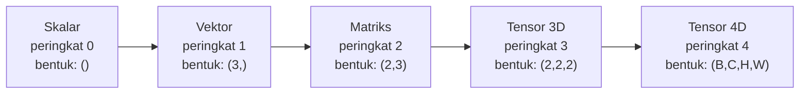
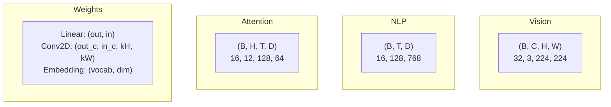
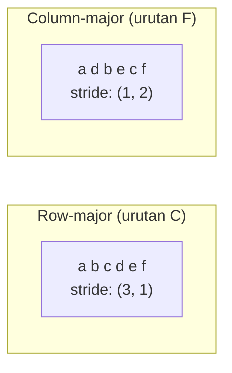
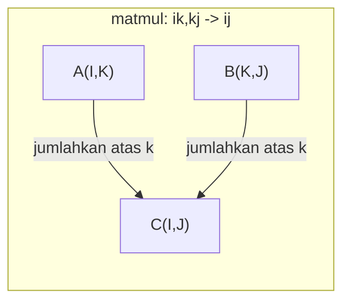

# Operasi Tensor

> Tensor adalah bahasa persekutuan antara data dan pembelajaran mendalam. Setiap gambar, setiap kalimat, setiap gradien mengalir melaluinya.

**Jenis:** Bangun
**Bahasa:** Python, TypeScript
**Prasyarat:** Fase 1, Pelajaran 01 (Intuisi Aljabar Linear), 02 (Vektor, Matriks & Operasi)
**Waktu:** ~90 menit

## Tujuan Pembelajaran

- Mengimplementasikan kelas tensor dari awal dengan bentuk (shape), stride, reshape, transpose, dan operasi elemen per elemen
- Menerapkan aturan broadcasting untuk beroperasi pada tensor dengan bentuk berbeda tanpa menyalin data
- Menulis ekspresi einsum untuk produk titik, perkalian matriks, produk luar, dan operasi bertatch
- Menelusuri bentuk tensor yang tepat pada setiap langkah self-attention multi-head

## Masalahnya

Anda membangun sebuah transformer. Forward pass-nya tampak rapi. Anda menjalankannya dan mendapat: `RuntimeError: mat1 and mat2 shapes cannot be multiplied (32x768 and 512x768)`. Anda menatap bentuknya. Anda mencoba transpose. Sekarang muncul `Expected 4D input (got 3D input)`. Anda menambahkan unsqueeze. Bagian lain menjadi rusak.

Galat bentuk adalah bug paling umum dalam kode pembelajaran mendalam. Secara konseptual galat itu tidak sulit — setiap operasi memiliki kontrak bentuk — tetapi galat itu berkembang biak dengan cepat. Sebuah transformer memiliki puluhan reshape, transpose, dan broadcasting yang dirangkai. Satu sumbu yang salah membuat galat merambat. Lebih buruk lagi, beberapa kesalahan bentuk sama sekali tidak memicu galat. Kesalahan itu diam-diam menghasilkan sampah dengan melakukan broadcasting pada dimensi yang salah atau menjumlahkan pada sumbu yang salah.

Matriks menangani hubungan berpasangan antara dua himpunan hal. Data nyata tidak muat dalam dua dimensi. Sekumpulan 32 gambar RGB berukuran 224x224 adalah tensor 4D: `(32, 3, 224, 224)`. Self-attention dengan 12 head juga 4D: `(batch, heads, seq_len, head_dim)`. Anda memerlukan struktur data yang digeneralisasi ke jumlah dimensi berapa pun, dengan operasi yang tersusun dengan rapi di semuanya. Struktur itu adalah tensor. Kuasai operasinya dan galat bentuk menjadi mudah didebug.

## Konsepnya

### Apa itu tensor

Tensor adalah larik multidimensi berisi bilangan dengan tipe data yang seragam. Jumlah dimensi disebut **peringkat** (atau **order**). Setiap dimensi adalah sebuah **sumbu**. **Bentuk** adalah tuple yang mencantumkan ukuran pada setiap sumbu.



Jumlah elemen = hasil kali semua ukuran. Bentuk `(2, 3, 4)` memuat $2 \cdot 3 \cdot 4 = 24$ elemen.

### Bentuk tensor dalam pembelajaran mendalam

Berbagai jenis data dipetakan ke bentuk tensor tertentu berdasarkan konvensi.



PyTorch menggunakan NCHW (channel lebih dulu). TensorFlow secara bawaan menggunakan NHWC (channel di belakang). Tata letak yang tidak cocok menyebabkan perlambatan senyap atau galat.

### Cara kerja tata letak memori

Larik 2D di memori adalah urutan byte 1D. **Stride** memberi tahu Anda berapa elemen yang harus dilewati untuk bergerak satu langkah pada setiap sumbu.



Transpose tidak memindahkan data. Transpose hanya menukar stride, membuat tensor menjadi **non-kontigu** — elemen untuk satu baris tidak lagi bersebelahan di memori.

### Aturan broadcasting

Broadcasting memungkinkan Anda beroperasi pada tensor dengan bentuk berbeda tanpa menyalin data. Sejajarkan bentuk dari kanan. Dua dimensi bersesuaian ketika keduanya sama atau salah satunya bernilai 1. Dimensi yang lebih sedikit ditambahi 1 di sisi kiri.

```
Tensor A:     (8, 1, 6, 1)
Tensor B:        (7, 1, 5)
B yang ditambah: (1, 7, 1, 5)
Hasil:        (8, 7, 6, 5)
```

### Einsum: operasi tensor universal

Einstein summation memberi label setiap sumbu dengan sebuah huruf. Sumbu yang ada di masukan tetapi tidak di keluaran akan dijumlahkan. Sumbu yang ada di keduanya dipertahankan.



Pola kunci: `i,i->` (produk titik), `i,j->ij` (produk luar), `ii->` (trace), `ij->ji` (transpose), `bij,bjk->bik` (perkalian matriks bertatch), `bhtd,bhsd->bhts` (skor atensi).

```figure
tensor-broadcast
```

## Bangunlah

Kode ada di `code/tensors.py`. Setiap langkah merujuk ke implementasi di sana. Port TypeScript di `code/tensors.ts` mencetak keluaran yang sama.

```bash
python3 code/tensors.py
npx tsx code/tensors.ts
```

### Langkah 1: Penyimpanan tensor dan stride

Sebuah tensor menyimpan daftar datar bilangan ditambah metadata bentuk. Stride memberi tahu logika pengindeksan cara memetakan indeks multidimensi ke posisi datar.

```python
class Tensor:
    def __init__(self, data, shape=None):
        if isinstance(data, (list, tuple)):
            self._data, self._shape = self._flatten_nested(data)
        elif isinstance(data, np.ndarray):
            self._data = data.flatten().tolist()
            self._shape = tuple(data.shape)
        else:
            self._data = [data]
            self._shape = ()

        if shape is not None:
            total = reduce(lambda a, b: a * b, shape, 1)
            if total != len(self._data):
                raise ValueError(
                    f"Cannot reshape {len(self._data)} elements into shape {shape}"
                )
            self._shape = tuple(shape)

        self._strides = self._compute_strides(self._shape)

    @staticmethod
    def _compute_strides(shape):
        if len(shape) == 0:
            return ()
        strides = [1] * len(shape)
        for i in range(len(shape) - 2, -1, -1):
            strides[i] = strides[i + 1] * shape[i + 1]
        return tuple(strides)
```

Untuk bentuk `(3, 4)`, stride-nya adalah `(4, 1)` — lewati 4 elemen untuk maju satu baris, lewati 1 elemen untuk maju satu kolom.

### Langkah 2: Reshape, squeeze, unsqueeze

Reshape mengubah bentuk tanpa mengubah urutan elemen. Jumlah elemen total harus tetap sama. Gunakan `-1` untuk satu dimensi agar ukurannya disimpulkan.

```python
t = Tensor(list(range(12)), shape=(2, 6))
r = t.reshape((3, 4))
r = t.reshape((-1, 3))
```

Squeeze menghapus sumbu berukuran 1. Unsqueeze menyisipkannya. Unsqueeze sangat penting untuk broadcasting — vektor bias `(D,)` yang ditambahkan ke batch `(B, T, D)` perlu di-unsqueeze menjadi `(1, 1, D)`.

```python
t = Tensor(list(range(6)), shape=(1, 3, 1, 2))
s = t.squeeze()
v = Tensor([1, 2, 3])
u = v.unsqueeze(0)
```

### Langkah 3: Transpose dan permute

Transpose menukar dua sumbu. Permute mengurutkan ulang semua sumbu. Inilah cara Anda berpindah antara NCHW dan NHWC.

```python
mat = Tensor(list(range(6)), shape=(2, 3))
tr = mat.transpose(0, 1)

t4d = Tensor(list(range(24)), shape=(1, 2, 3, 4))
perm = t4d.permute((0, 2, 3, 1))
```

Setelah transpose atau permute, tensor menjadi non-kontigu di memori. Di PyTorch, `view` gagal pada tensor non-kontigu — gunakan `reshape` atau panggil `.contiguous()` terlebih dahulu.

### Langkah 4: Operasi elemen per elemen dan reduksi

Operasi elemen per elemen (tambah, kali, kurang) diterapkan secara independen pada setiap elemen dan mempertahankan bentuk. Reduksi (sum, mean, max) menggugurkan satu atau lebih sumbu.

```python
a = Tensor([[1, 2], [3, 4]])
b = Tensor([[10, 20], [30, 40]])
c = a + b
d = a * 2
s = a.sum(axis=0)
```

Global average pooling dalam CNN: `(B, C, H, W).mean(axis=[2, 3])` menghasilkan `(B, C)`. Sequence mean pooling dalam NLP: `(B, T, D).mean(axis=1)` menghasilkan `(B, D)`.

### Langkah 5: Broadcasting dengan NumPy

Fungsi `demo_broadcasting_numpy()` di `tensors.py` menunjukkan pola intinya.

```python
activations = np.random.randn(4, 3)
bias = np.array([0.1, 0.2, 0.3])
result = activations + bias

images = np.random.randn(2, 3, 4, 4)
scale = np.array([0.5, 1.0, 1.5]).reshape(1, 3, 1, 1)
result = images * scale

a = np.array([1, 2, 3]).reshape(-1, 1)
b = np.array([10, 20, 30, 40]).reshape(1, -1)
outer = a * b
```

Jarak berpasangan lewat broadcasting: bentuk `(M, 2)` menjadi `(M, 1, 2)` dan `(N, 2)` menjadi `(1, N, 2)`, kurangkan, kuadratkan, jumlahkan pada sumbu terakhir, lalu akar kuadrat. Hasilnya: `(M, N)`.

### Langkah 6: Operasi einsum

Fungsi `demo_einsum()` dan `demo_einsum_gallery()` menelusuri setiap pola umum.

```python
a = np.array([1.0, 2.0, 3.0])
b = np.array([4.0, 5.0, 6.0])
dot = np.einsum("i,i->", a, b)

A = np.array([[1, 2], [3, 4], [5, 6]], dtype=float)
B = np.array([[7, 8, 9], [10, 11, 12]], dtype=float)
matmul = np.einsum("ik,kj->ij", A, B)

batch_A = np.random.randn(4, 3, 5)
batch_B = np.random.randn(4, 5, 2)
batch_mm = np.einsum("bij,bjk->bik", batch_A, batch_B)
```

Biaya komputasi sebuah kontraksi adalah hasil kali semua ukuran indeks (yang dipertahankan maupun yang dijumlahkan). Untuk `bij,bjk->bik` dengan $B=32$, $I=128$, $J=64$, $K=128$: $32 \cdot 128 \cdot 64 \cdot 128 = 33{,}554{,}432$ perkalian-penjumlahan.

### Langkah 7: Mekanisme atensi lewat einsum

Fungsi `demo_attention_einsum()` mengimplementasikan self-attention multi-head dari awal hingga akhir.

```python
B, H, T, D = 2, 4, 8, 16
E = H * D

X = np.random.randn(B, T, E)
W_q = np.random.randn(E, E) * 0.02

Q = np.einsum("bte,ek->btk", X, W_q)
Q = Q.reshape(B, T, H, D).transpose(0, 2, 1, 3)

scores = np.einsum("bhtd,bhsd->bhts", Q, K) / np.sqrt(D)
weights = softmax(scores, axis=-1)
attn_output = np.einsum("bhts,bhsd->bhtd", weights, V)

concat = attn_output.transpose(0, 2, 1, 3).reshape(B, T, E)
output = np.einsum("bte,ek->btk", concat, W_o)
```

Setiap langkah adalah operasi tensor: proyeksi (perkalian matriks lewat einsum), pemisahan head (reshape + transpose), skor atensi (perkalian matriks bertatch lewat einsum), jumlah tertimbang (perkalian matriks bertatch lewat einsum), penggabungan head (transpose + reshape), proyeksi keluaran (perkalian matriks lewat einsum).

## Gunakanlah

### Dari awal versus NumPy

| Operasi | Dari awal (kelas Tensor) | NumPy |
|---|---|---|
| Buat | `Tensor([[1,2],[3,4]])` | `np.array([[1,2],[3,4]])` |
| Reshape | `t.reshape((3,4))` | `a.reshape(3,4)` |
| Transpose | `t.transpose(0,1)` | `a.T` atau `a.transpose(0,1)` |
| Squeeze | `t.squeeze(0)` | `np.squeeze(a, 0)` |
| Sum | `t.sum(axis=0)` | `a.sum(axis=0)` |
| Einsum | T/A | `np.einsum("ij,jk->ik", a, b)` |

### Dari awal versus PyTorch

```python
import torch

t = torch.tensor([[1, 2, 3], [4, 5, 6]], dtype=torch.float32)
t.shape
t.stride()
t.is_contiguous()

t.reshape(3, 2)
t.unsqueeze(0)
t.transpose(0, 1)
t.transpose(0, 1).contiguous()

torch.einsum("ik,kj->ij", A, B)
```

PyTorch menambahkan autograd, dukungan GPU, dan kernel BLAS yang dioptimalkan. Semantik bentuknya identik. Jika Anda memahami versi dari awal, galat bentuk di PyTorch menjadi bisa dibaca.

### Setiap lapisan jaringan saraf sebagai operasi tensor

| Operasi | Bentuk Tensor | Einsum |
|---|---|---|
| Lapisan linear | `Y = X @ W.T + b` | `"bd,od->bo"` + bias |
| QKV atensi | `Q = X @ W_q` | `"btd,dh->bth"` |
| Skor atensi | `Q @ K.T / sqrt(d)` | `"bhtd,bhsd->bhts"` |
| Keluaran atensi | `softmax(scores) @ V` | `"bhts,bhsd->bhtd"` |
| Batch norm | `(X - mu) / sigma * gamma` | elemen per elemen + broadcast |
| Softmax | `exp(x) / sum(exp(x))` | elemen per elemen + reduksi |

## Rilis

Pelajaran ini menghasilkan dua prompt yang dapat digunakan kembali:

1. **`outputs/prompt-tensor-shapes.md`** -- Prompt sistematis untuk men-debug ketidaksesuaian bentuk tensor. Berisi tabel keputusan untuk setiap operasi umum (matmul, broadcast, cat, Linear, Conv2d, BatchNorm, softmax) dan tabel pencarian solusi.

2. **`outputs/prompt-tensor-debugger.md`** -- Prompt debugging langkah demi langkah yang Anda tempel ke asisten AI mana pun ketika galat bentuk menghalang Anda. Beri pesan galat dan bentuk tensor Anda, dan Anda mendapat perbaikan yang tepat.

## Latihan

1. **Mudah — Putaran pergi-balik reshape.** Ambil tensor berbentuk `(2, 3, 4)`. Ubah menjadi `(6, 4)`, lalu `(24,)`, lalu kembali ke `(2, 3, 4)`. Verifikasi bahwa urutan elemen tetap terjaga di setiap langkah dengan mencetak data datarnya.

2. **Sedang — Implementasikan broadcasting.** Perluas kelas `Tensor` dengan metode `broadcast_to(shape)` yang memperluas dimensi berukuran 1 agar sesuai dengan bentuk target. Lalu ubah `_elementwise_op` agar melakukan broadcasting otomatis sebelum beroperasi. Uji dengan bentuk `(3, 1)` dan `(1, 4)` yang menghasilkan `(3, 4)`.

3. **Sulit — Bangun einsum dari awal.** Implementasikan fungsi dasar `einsum(subscripts, *tensors)` yang menangani minimal: produk titik (`i,i->`), perkalian matriks (`ij,jk->ik`), produk luar (`i,j->ij`), dan transpose (`ij->ji`). Parse string subscript, identifikasi indeks yang dikontraksi, lalu loop atas semua kombinasi indeks. Bandingkan hasil Anda dengan `np.einsum`.

4. **Sulit — Pelacak bentuk atensi.** Tulis fungsi yang menerima `batch_size`, `seq_len`, `embed_dim`, dan `num_heads` sebagai masukan dan mencetak bentuk tepat di setiap langkah self-attention multi-head: masukan, proyeksi Q/K/V, pemisahan head, skor atensi, bobot softmax, jumlah tertimbang, penggabungan head, proyeksi keluaran. Verifikasi terhadap keluaran `demo_attention_einsum()`.

### Petunjuk

**Latihan 1.** Bangun tensor dari `list(range(24))` agar setiap elemen menampilkan posisinya sendiri. Setiap kali setelah `reshape`, cetak `flatten().to_list()` dan periksa bahwa isinya masih 0 sampai 23 secara berurutan.

**Latihan 2.** Suatu dimensi hanya dapat di-broadcast ketika kedua ukurannya sama atau salah satunya bernilai 1, jadi periksa aturan itu terlebih dahulu dan lempar galat jika dilanggar. Untuk bentuk `(3, 1)` dan `(1, 4)`, periksa bahwa entri `[i][j]` dari hasil sama dengan `a[i][0] + b[0][j]`, lalu bandingkan hasil lengkapnya dengan NumPy.

**Latihan 3.** Pisahkan subscript pada `->`. Huruf yang ada di masukan tetapi tidak di keluaran adalah indeks yang dijumlahkan, jadi loop atas semua nilai setiap huruf dan tambahkan ke posisi keluaran. Uji keempat kasus pada larik acak kecil dengan `np.allclose(mine, np.einsum(...))`.

**Latihan 4.** Mulai dengan ukuran head `embed_dim // num_heads` dan nyatakan bahwa `embed_dim % num_heads == 0`. Skor atensi berbentuk `(batch_size, num_heads, seq_len, seq_len)`, jadi cocokkan cetakan Anda dengan bentuk itu dan dengan bentuk yang dicetak `demo_attention_einsum()`.

## Istilah Kunci

| Istilah | Yang sering dikatakan | Arti sebenarnya |
|---|---|---|
| Tensor | "Matriks dengan lebih banyak dimensi" | Larik multidimensi dengan tipe seragam serta bentuk, stride, dan operasi yang terdefinisi |
| Peringkat | "Jumlah dimensi" | Jumlah sumbu. Matriks berperingkat 2, bukan peringkat yang sama dengan peringkat matriks |
| Bentuk | "Ukuran tensor" | Tuple yang mencantumkan ukuran pada setiap sumbu. `(2, 3)` berarti 2 baris, 3 kolom |
| Stride | "Tata letak memori" | Jumlah elemen yang dilewati untuk maju satu posisi pada setiap sumbu |
| Broadcasting | "Langsung berfungsi saat bentuk berbeda" | Sekumpulan aturan ketat: sejajarkan dari kanan, dimensi harus sama atau salah satunya bernilai 1 |
| Kontigu | "Tensor yang normal" | Elemen tersimpan berurutan di memori tanpa celah atau penataan ulang dari tata letak logisnya |
| Einsum | "Cara mewah menulis matmul" | Notasi umum yang mengekspresikan kontraksi tensor, produk luar, trace, atau transpose dalam satu baris |
| View | "Sama seperti reshape" | Tensor yang berbagi buffer memori sama tetapi dengan metadata bentuk/stride berbeda. Gagal pada data non-kontigu |
| Kontraksi | "Menjumlahkan suatu indeks" | Operasi umum di mana indeks yang sama antartensor dikalikan dan dijumlahkan, menghasilkan hasil berperingkat lebih rendah |
| NCHW / NHWC | "Format PyTorch versus TensorFlow" | Konvensi tata letak memori untuk tensor gambar. NCHW menaruh channel sebelum dimensi spasial, NHWC sesudahnya |

## Bacaan Lanjutan

- [NumPy Broadcasting](https://numpy.org/doc/stable/user/basics.broadcasting.html) -- Aturan resmi dengan contoh visual
- [PyTorch Tensor Views](https://pytorch.org/docs/stable/tensor_view.html) -- Kapan view berfungsi dan kapan ia menyalin
- [einops](https://github.com/arogozhnikov/einops) -- Pustaka yang membuat reshape tensor menjadi mudah dibaca dan aman
- [The Illustrated Transformer](https://jalammar.github.io/illustrated-transformer/) -- Memvisualisasikan bentuk tensor yang mengalir melalui atensi
- [Einstein Summation in NumPy](https://numpy.org/doc/stable/reference/generated/numpy.einsum.html) -- Dokumentasi lengkap einsum dengan contoh
