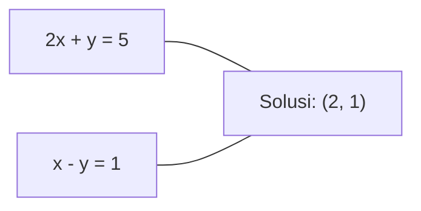
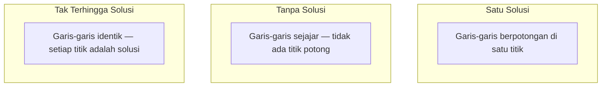

# Sistem Linear

> Menyelesaikan $Ax = b$ adalah masalah tertua dalam matematika yang masih menjalankan jaringan saraf Anda.

**Jenis:** Build
**Bahasa:** Python, TypeScript
**Prasyarat:** Fase 1, Pelajaran 01 (Intuisi Aljabar Linear), 02 (Vektor & Matriks), 03 (Transformasi Matriks)
**Waktu:** ~120 menit

## Tujuan Pembelajaran

- Menyelesaikan $Ax = b$ menggunakan eliminasi Gaussian dengan pivot sebagian dan substitusi balik
- Memfaktorkan matriks dengan dekomposisi LU, QR, dan Cholesky serta menjelaskan kapan masing-masing tepat digunakan
- Menurunkan persamaan normal untuk least squares dan menghubungkannya dengan regresi linear dan regresi ridge
- Mendiagnosis sistem yang terkondisi buruk menggunakan angka kondisi dan menerapkan regularisasi untuk menstabilkannya

## Masalahnya

Setiap kali Anda melatih regresi linear, Anda menyelesaikan sistem linear. Setiap kali Anda menghitung pencocokan least-squares, Anda menyelesaikan sistem linear. Setiap kali sebuah lapisan jaringan saraf menghitung `y = Wx + b`, ia mengevaluasi salah satu ruas dari sistem linear. Saat Anda menambahkan regularisasi, Anda mengubah sistemnya. Saat Anda menggunakan proses Gaussian, Anda memfaktorkan sebuah matriks. Saat Anda membalik matriks kovarians untuk jarak Mahalanobis, Anda menyelesaikan sistem linear.

Persamaan $Ax = b$ muncul di mana-mana. $A$ adalah matriks koefisien yang diketahui. $b$ adalah vektor keluaran yang diketahui. $x$ adalah vektor hal yang tidak diketahui yang ingin Anda cari. Dalam regresi linear, $A$ adalah matriks data Anda, $b$ adalah vektor target, dan $x$ adalah vektor bobot. Seluruh model bermuara pada ini: temukan $x$ sedemikian sehingga $Ax$ sedekat mungkin dengan $b$.

Pelajaran ini membangun setiap metode utama untuk menyelesaikan persamaan tersebut dari awal. Anda akan memahami mengapa beberapa metode cepat dan yang lainnya stabil, mengapa beberapa hanya bekerja untuk sistem persegi sementara yang lain menangani sistem yang overdetermined, dan mengapa angka kondisi matriks Anda menentukan apakah jawaban Anda berarti sama sekali.

## Konsepnya

### Arti geometris dari Ax = b

Sistem persamaan linear memiliki interpretasi geometris. Setiap persamaan mendefinisikan sebuah hyperplane. Solusinya adalah titik (atau himpunan titik) tempat semua hyperplane berpotongan.

```
2x + y = 5          Dua garis dalam 2D.
x - y  = 1          Keduanya berpotongan di x=2, y=1.
```



Tiga hal dapat terjadi:



Dalam bentuk matriks, "satu solusi" berarti $A$ dapat dibalik. "Tanpa solusi" berarti sistemnya tidak konsisten. "Tak terhingga solusi" berarti $A$ memiliki ruang nol. Kebanyakan masalah ML masuk dalam kategori "tidak ada solusi eksak" karena Anda memiliki lebih banyak persamaan (titik data) daripada hal yang tidak diketahui (parameter). Di situlah least squares berperan.

### Pandangan kolom vs pandangan baris

Ada dua cara membaca $Ax = b$.

**Pandangan baris.** Setiap baris $A$ mendefinisikan satu persamaan. Setiap persamaan adalah sebuah hyperplane. Solusinya adalah tempat semua persamaan itu berpotongan.

**Pandangan kolom.** Setiap kolom $A$ adalah sebuah vektor. Pertanyaannya menjadi: kombinasi linear apa dari kolom-kolom $A$ yang menghasilkan $b$?

```
A = | 2  1 |    b = | 5 |
    | 1 -1 |        | 1 |

Pandangan baris: selesaikan 2x + y = 5 dan x - y = 1 secara bersamaan.

Pandangan kolom: cari x1, x2 sedemikian sehingga:
  x1 * [2, 1] + x2 * [1, -1] = [5, 1]
  2 * [2, 1] + 1 * [1, -1] = [4+1, 2-1] = [5, 1]   cek.
```

Pandangan kolom lebih mendasar. Jika $b$ berada dalam ruang kolom $A$, sistem memiliki solusi. Jika tidak, Anda mencari titik terdekat di ruang kolom. Titik terdekat itulah solusi least-squares.

### Eliminasi Gaussian

Eliminasi Gaussian mengubah $Ax = b$ menjadi sistem segitiga atas $Ux = c$ yang Anda selesaikan dengan substitusi balik. Ini adalah metode paling langsung.

Algoritmenya:

```
1. Untuk setiap kolom k (kolom pivot):
   a. Temukan entri terbesar di kolom k pada atau di bawah baris k (pivot sebagian).
   b. Tukar baris itu dengan baris k.
   c. Untuk setiap baris i di bawah k:
      - Hitung pengali m = A[i][k] / A[k][k]
      - Kurangkan m kali baris k dari baris i.
2. Substitusi balik: selesaikan dari persamaan terakhir ke atas.
```

Contoh:

```
Awal:
| 2  1  1 | 8 |       R2 = R2 - (2)R1     | 2  1   1 |  8 |
| 4  3  3 |20 |  -->  R3 = R3 - (1)R1 --> | 0  1   1 |  4 |
| 2  3  1 |12 |                            | 0  2   0 |  4 |

                       R3 = R3 - (2)R2     | 2  1   1 |  8 |
                                       --> | 0  1   1 |  4 |
                                           | 0  0  -2 | -4 |

Substitusi balik:
  -2 * x3 = -4    -->  x3 = 2
  x2 + 2  = 4     -->  x2 = 2
  2*x1 + 2 + 2 = 8 --> x1 = 2
```

Eliminasi Gaussian membutuhkan $O(n^3)$ operasi. Untuk sistem $1000 \times 1000$, itu sekitar satu miliar operasi floating-point. Cepat, tetapi Anda dapat berbuat lebih baik jika perlu menyelesaikan beberapa sistem dengan $A$ yang sama.

### Pivot sebagian: mengapa ini penting

Tanpa pivoting, eliminasi Gaussian dapat gagal atau menghasilkan sampah. Jika elemen pivot bernilai nol, Anda membagi dengan nol. Jika nilainya kecil, Anda memperbesar kesalahan pembulatan.

```
Pivot buruk:                       Dengan pivot sebagian:
| 0.001  1 | 1.001 |            Tukar baris terlebih dahulu:
| 1      1 | 2     |            | 1      1 | 2     |
                                 | 0.001  1 | 1.001 |
m = 1/0.001 = 1000              m = 0.001/1 = 0.001
R2 = R2 - 1000*R1               R2 = R2 - 0.001*R1
| 0.001  1     | 1.001   |      | 1      1     | 2     |
| 0     -999   | -999.0  |      | 0      0.999 | 0.999 |

x2 = 1.000 (benar)              x2 = 1.000 (benar)
x1 = (1.001 - 1)/0.001          x1 = (2 - 1)/1 = 1.000 (benar)
   = 0.001/0.001 = 1.000        Stabil karena pengalinya kecil.
```

Dalam aritmetika floating-point dengan presisi terbatas, versi tanpa pivoting dapat kehilangan angka-angka signifikan. Pivot sebagian selalu memilih pivot terbesar yang tersedia untuk meminimalkan amplifikasi galat.

### Dekomposisi LU

Dekomposisi LU memfaktorkan $A$ menjadi matriks segitiga bawah $L$ dan matriks segitiga atas $U$: $A = LU$. Matriks $L$ menyimpan pengali-pengali dari eliminasi Gaussian. Matriks $U$ adalah hasil eliminasi.

```
A = L @ U

| 2  1  1 |   | 1  0  0 |   | 2  1   1 |
| 4  3  3 | = | 2  1  0 | @ | 0  1   1 |
| 2  3  1 |   | 1  2  1 |   | 0  0  -2 |
```

Mengapa memfaktorkan alih-alih sekadar mengeliminasi? Karena begitu Anda memiliki $L$ dan $U$, menyelesaikan $Ax = b$ untuk $b$ baru apa pun hanya berbiaya $O(n^2)$:

```math
\begin{aligned}
Ax &= b \\
LUx &= b \\
&\text{Misalkan } y = Ux\text{:} \\
Ly &= b \quad \text{(substitusi depan, } O(n^2)\text{)} \\
Ux &= y \quad \text{(substitusi balik, } O(n^2)\text{)}
\end{aligned}
```

Biaya $O(n^3)$ dibayar sekali saat faktorisasi. Setiap penyelesaian setelahnya adalah $O(n^2)$. Jika Anda perlu menyelesaikan 1000 sistem dengan $A$ yang sama tetapi vektor $b$ berbeda, LU menghemat faktor 1000/3 dalam total pekerjaan.

Dengan pivot sebagian, Anda mendapat $PA = LU$ di mana $P$ adalah matriks permutasi yang mencatat pertukaran baris.

### Dekomposisi QR

Dekomposisi QR memfaktorkan $A$ menjadi matriks ortogonal $Q$ dan matriks segitiga atas $R$: $A = QR$.

Matriks ortogonal memiliki sifat $Q^T Q = I$. Kolom-kolomnya adalah vektor-vektor ortonormal. Perkalian dengan $Q$ mempertahankan panjang dan sudut.

```
A = Q @ R

Q memiliki kolom-kolom ortonormal: Q^T Q = I
R adalah matriks segitiga atas

Untuk menyelesaikan Ax = b:
  QRx = b
  Rx = Q^T b    (cukup kalikan dengan Q^T, tidak perlu inversi)
  Lakukan substitusi balik untuk mendapatkan x.
```

QR lebih stabil secara numerik daripada LU untuk menyelesaikan masalah least squares. Proses Gram-Schmidt membangun $Q$ kolom demi kolom:

```
Diberikan kolom a1, a2, ... dari A:

q1 = a1 / ||a1||

q2 = a2 - (a2 . q1) * q1        (kurangkan proyeksi pada q1)
q2 = q2 / ||q2||                (normalisasi)

q3 = a3 - (a3 . q1) * q1 - (a3 . q2) * q2
q3 = q3 / ||q3||

R[i][j] = qi . aj    untuk i <= j
```

Setiap langkah menghilangkan komponen sepanjang semua vektor $q$ sebelumnya, menyisakan hanya arah ortogonal baru.

### Dekomposisi Cholesky

Ketika $A$ simetris ($A = A^T$) dan definit positif (semua nilai eigen positif), Anda dapat memfaktorkannya sebagai $A = L L^T$ dengan $L$ segitiga bawah. Ini adalah dekomposisi Cholesky.

```
A = L @ L^T

| 4  2 |   | 2  0 |   | 2  1 |
| 2  5 | = | 1  2 | @ | 0  2 |

L[i][i] = sqrt(A[i][i] - sum(L[i][k]^2 untuk k < i))
L[i][j] = (A[i][j] - sum(L[i][k]*L[j][k] untuk k < j)) / L[j][j]    untuk i > j
```

Cholesky dua kali lebih cepat daripada LU dan membutuhkan separuh penyimpanan. Metode ini hanya bekerja untuk matriks simetris definit positif, tetapi matriks seperti itu muncul terus-menerus:

- Matriks kovarians bersifat simetris semi-definit positif (definit positif dengan regularisasi).
- Matriks kernel dalam proses Gaussian bersifat simetris definit positif.
- Hessian dari fungsi konveks pada suatu minimum bersifat simetris definit positif.
- $A^T A$ selalu simetris semi-definit positif.

Dalam proses Gaussian, Anda memfaktorkan matriks kernel $K$ dengan Cholesky, lalu menyelesaikan $K \alpha = y$ untuk mendapatkan rata-rata prediktif. Faktor Cholesky juga memberi Anda log-determinan untuk likelihood marjinal: $\log \det(K) = 2 \sum \log(\mathop{\mathrm{diag}}(L))$.

### Least squares: ketika Ax = b tidak memiliki solusi eksak

Jika $A$ berukuran $m \times n$ dengan $m > n$ (lebih banyak persamaan daripada hal yang tidak diketahui), sistemnya overdetermined. Tidak ada solusi eksak. Sebagai gantinya, Anda meminimalkan galat kuadrat:

```
minimize ||Ax - b||^2

Ini adalah jumlah residu kuadrat:
  sum((A[i,:] @ x - b[i])^2 for i in range(m))
```

Peminimanya memenuhi persamaan normal:

```math
A^T A x = A^T b
```

Penurunan: kembangkan $\lVert Ax - b \rVert^2 = (Ax - b)^T (Ax - b) = x^T A^T A x - 2 x^T A^T b + b^T b$. Ambil gradien terhadap $x$, samakan dengan nol: $2 A^T A x - 2 A^T b = 0$.

```
Sistem awal (overdetermined, 4 persamaan, 2 hal yang tidak diketahui):
| 1  1 |         | 3 |
| 1  2 | x     = | 5 |       Tidak ada x eksak yang memenuhi ke-4 persamaan.
| 1  3 |         | 6 |
| 1  4 |         | 8 |

Persamaan normal:
A^T A = | 4  10 |    A^T b = | 22 |
        | 10 30 |            | 63 |

Selesaikan: x = [1.5, 1.7]

Ini adalah regresi linear. x[0] adalah intersep, x[1] adalah kemiringan.
```

### Persamaan normal = regresi linear

Hubungannya eksak. Dalam regresi linear, matriks data $X$ Anda memiliki satu baris per sampel dan satu kolom per fitur. Vektor target $y$ memiliki satu entri per sampel. Vektor bobot $w$ memenuhi:

```math
\begin{aligned}
X^T X w &= X^T y \\
w &= (X^T X)^{-1} X^T y
\end{aligned}
```

Ini adalah solusi bentuk tertutup untuk regresi linear. Setiap pemanggilan `sklearn.linear_model.LinearRegression.fit()` menghitung ini (atau yang setara via QR atau SVD).

Tambahkan suku regularisasi $\lambda I$ pada matriksnya dan Anda mendapat regresi ridge:

```math
\begin{aligned}
(X^T X + \lambda I) w &= X^T y \\
w &= (X^T X + \lambda I)^{-1} X^T y
\end{aligned}
```

Regularisasi membuat matriks lebih terkondisi dengan baik (lebih mudah dibalik secara akurat) dan mencegah overfitting dengan menyusutkan bobot ke arah nol. Matriks $X^T X + \lambda I$ selalu simetris definit positif ketika $\lambda > 0$, sehingga Anda dapat menggunakan Cholesky untuk menyelesaikannya.

### Pseudoinverse (Moore-Penrose)

Pseudoinverse $A^+$ menggeneralisasi inversi matriks ke matriks yang bukan persegi dan singular. Untuk matriks $A$ apa pun:

```math
\begin{aligned}
x &= A^+ b \\[4pt]
\text{di mana } A^+ &= V \Sigma^+ U^T \quad \text{(dihitung via SVD)}
\end{aligned}
```

$\Sigma^+$ dibentuk dengan mengambil kebalikan dari setiap nilai singular bukan nol dan mentranspos hasilnya. Jika $A = U \Sigma V^T$, maka $A^+ = V \Sigma^+ U^T$.

```
A = U Sigma V^T        (SVD)

Sigma = | 5  0 |       Sigma+ = | 1/5  0  0 |
        | 0  2 |                | 0  1/2  0 |
        | 0  0 |

A+ = V Sigma+ U^T
```

Pseudoinverse memberikan solusi least squares norma-minimum. Jika sistemnya memiliki:
- Satu solusi: $A^+ b$ memberikannya.
- Tidak ada solusi: $A^+ b$ memberikan solusi least squares.
- Tak terhingga solusi: $A^+ b$ memberikan solusi dengan $\lVert x \rVert$ terkecil.

`np.linalg.lstsq` dan `np.linalg.pinv` dari NumPy keduanya menggunakan SVD secara internal.

### Angka kondisi

Angka kondisi mengukur seberapa sensitif solusi terhadap perubahan kecil pada masukan. Untuk matriks $A$, angka kondisinya adalah:

```math
\kappa(A) = \lVert A \rVert \cdot \lVert A^{-1} \rVert = \frac{\sigma_{\max}}{\sigma_{\min}}
```

di mana $\sigma_{\max}$ dan $\sigma_{\min}$ adalah nilai singular terbesar dan terkecil.

```
Terkondisi baik (kappa ~ 1):        Terkondisi buruk (kappa ~ 10^15):
Perubahan kecil pada b -->           Perubahan kecil pada b -->
perubahan kecil pada x               perubahan besar pada x

| 2  0 |   kappa = 2/1 = 2          | 1   1          |   kappa ~ 10^15
| 0  1 |   aman diselesaikan        | 1   1+10^(-15) |   solusi adalah sampah
```

Aturan praktis:
- $\kappa < 100$: aman, solusi akurat.
- $\kappa \approx 10^k$: Anda kehilangan sekitar $k$ angka presisi dari aritmetika floating-point.
- $\kappa \approx 10^{16}$ (untuk float64): solusi tidak bermakna. Matriksnya secara efektif singular.

Dalam ML, kondisi buruk terjadi ketika fitur-fitur hampir kolinear. Regularisasi (menambahkan $\lambda I$) memperbaiki angka kondisi dari $\sigma_{\max} / \sigma_{\min}$ menjadi $(\sigma_{\max} + \lambda) / (\sigma_{\min} + \lambda)$.

### Metode iteratif: conjugate gradient

Untuk sistem jarang yang sangat besar (jutaan hal yang tidak diketahui), metode langsung seperti LU atau Cholesky terlalu mahal. Metode iteratif mendekati solusi dengan menyempurnakan tebakan selama banyak iterasi.

Conjugate gradient (CG) menyelesaikan $Ax = b$ ketika $A$ simetris definit positif. Metode ini menemukan solusi eksak dalam paling banyak $n$ iterasi (dalam aritmetika eksak), tetapi biasanya konvergen jauh lebih cepat jika nilai eigen $A$ mengelompok.

```
Sketsa algoritme:
  x0 = tebakan awal (sering kali nol)
  r0 = b - A x0           (residu)
  p0 = r0                 (arah pencarian)

  Untuk k = 0, 1, 2, ...:
    alpha = (rk . rk) / (pk . A pk)
    x_{k+1} = xk + alpha * pk
    r_{k+1} = rk - alpha * A pk
    beta = (r_{k+1} . r_{k+1}) / (rk . rk)
    p_{k+1} = r_{k+1} + beta * pk
    if ||r_{k+1}|| < tolerance: stop
```

CG digunakan dalam:
- Optimasi skala besar (metode Newton-CG)
- Menyelesaikan diskretisasi PDE
- Metode kernel yang matriks kernelnya terlalu besar untuk difaktorkan
- Preconditioning untuk penyelesai iteratif lain

Laju konvergensi bergantung pada angka kondisi. Sistem yang lebih terkondisi baik konvergen lebih cepat, yang merupakan alasan lain mengapa regularisasi membantu.

### Gambaran lengkap: metode mana, kapan

| Metode | Persyaratan | Biaya | Kasus penggunaan |
|--------|-------------|-------|------------------|
| Eliminasi Gaussian | $A$ persegi, tidak singular | $O(n^3)$ | Penyelesaian sekali jalan dari sistem persegi |
| Dekomposisi LU | $A$ persegi, tidak singular | $O(n^3)$ faktorisasi + $O(n^2)$ penyelesaian | Banyak penyelesaian dengan $A$ yang sama |
| Dekomposisi QR | $A$ apa pun ($m \ge n$) | $O(mn^2)$ | Least squares, stabil secara numerik |
| Cholesky | $A$ simetris definit positif | $O(n^3/3)$ | Matriks kovarians, proses Gaussian, regresi ridge |
| Persamaan normal | Overdetermined ($m > n$) | $O(mn^2 + n^3)$ | Regresi linear ($n$ kecil) |
| SVD / pseudoinverse | $A$ apa pun | $O(mn^2)$ | Sistem defisien peringkat, solusi norma-minimum |
| Conjugate gradient | $A$ simetris definit positif, jarang | $O(n \cdot k \cdot \text{nnz})$ | Sistem jarang besar, $k$ = iterasi |

### Kaitan dengan ML

Setiap metode dalam pelajaran ini muncul dalam ML produksi:

**Regresi linear.** Solusi bentuk tertutup menyelesaikan persamaan normal $X^T X w = X^T y$. Ini dilakukan via Cholesky (jika $n$ kecil) atau QR (jika stabilitas numerik penting) atau SVD (jika matriks mungkin defisien peringkat).

**Regresi ridge.** Menambahkan $\lambda I$ pada $X^T X$. Sistem teregulasi $(X^T X + \lambda I) w = X^T y$ selalu dapat diselesaikan via Cholesky karena $X^T X + \lambda I$ simetris definit positif untuk $\lambda > 0$.

**Proses Gaussian.** Rata-rata prediktif memerlukan penyelesaian $K \alpha = y$ dengan $K$ sebagai matriks kernel. Faktorisasi Cholesky dari $K$ adalah pendekatan standar. Log-likelihood marjinal menggunakan $\log \det(K) = 2 \sum \log(\mathop{\mathrm{diag}}(L))$.

**Inisialisasi jaringan saraf.** Inisialisasi ortogonal menggunakan dekomposisi QR untuk membuat matriks bobot yang kolom-kolomnya ortonormal. Ini mencegah keruntuhan sinyal pada jaringan dalam.

**Preconditioning.** Pengoptimal skala besar menggunakan Cholesky tidak lengkap atau LU tidak lengkap sebagai preconditioner untuk penyelesai conjugate gradient.

**Rekayasa fitur.** Angka kondisi $X^T X$ memberi tahu Anda apakah fitur-fitur Anda kolinear. Jika $\kappa$ besar, buang fitur atau tambahkan regularisasi.

```figure
linear-system-conditioning
```

## Bangun Sendiri

### Langkah 1: Eliminasi Gaussian dengan pivot sebagian

```python
import numpy as np

def gaussian_elimination(A, b):
    n = len(b)
    Ab = np.hstack([A.astype(float), b.reshape(-1, 1).astype(float)])

    for k in range(n):
        max_row = k + np.argmax(np.abs(Ab[k:, k]))
        Ab[[k, max_row]] = Ab[[max_row, k]]

        if abs(Ab[k, k]) < 1e-12:
            raise ValueError(f"Matrix is singular or nearly singular at pivot {k}")

        for i in range(k + 1, n):
            m = Ab[i, k] / Ab[k, k]
            Ab[i, k:] -= m * Ab[k, k:]

    x = np.zeros(n)
    for i in range(n - 1, -1, -1):
        x[i] = (Ab[i, -1] - Ab[i, i+1:n] @ x[i+1:n]) / Ab[i, i]

    return x
```

### Langkah 2: Dekomposisi LU

```python
def lu_decompose(A):
    n = A.shape[0]
    L = np.eye(n)
    U = A.astype(float).copy()
    P = np.eye(n)

    for k in range(n):
        max_row = k + np.argmax(np.abs(U[k:, k]))
        if max_row != k:
            U[[k, max_row]] = U[[max_row, k]]
            P[[k, max_row]] = P[[max_row, k]]
            if k > 0:
                L[[k, max_row], :k] = L[[max_row, k], :k]

        for i in range(k + 1, n):
            L[i, k] = U[i, k] / U[k, k]
            U[i, k:] -= L[i, k] * U[k, k:]

    return P, L, U

def lu_solve(P, L, U, b):
    n = len(b)
    Pb = P @ b.astype(float)

    y = np.zeros(n)
    for i in range(n):
        y[i] = Pb[i] - L[i, :i] @ y[:i]

    x = np.zeros(n)
    for i in range(n - 1, -1, -1):
        x[i] = (y[i] - U[i, i+1:] @ x[i+1:]) / U[i, i]

    return x
```

### Langkah 3: Dekomposisi Cholesky

```python
def cholesky(A):
    n = A.shape[0]
    L = np.zeros_like(A, dtype=float)

    for i in range(n):
        for j in range(i + 1):
            s = A[i, j] - L[i, :j] @ L[j, :j]
            if i == j:
                if s <= 0:
                    raise ValueError("Matrix is not positive definite")
                L[i, j] = np.sqrt(s)
            else:
                L[i, j] = s / L[j, j]

    return L
```

### Langkah 4: Least squares via persamaan normal

```python
def least_squares_normal(A, b):
    AtA = A.T @ A
    Atb = A.T @ b
    return gaussian_elimination(AtA, Atb)

def ridge_regression(A, b, lam):
    n = A.shape[1]
    AtA = A.T @ A + lam * np.eye(n)
    Atb = A.T @ b
    L = cholesky(AtA)
    y = np.zeros(n)
    for i in range(n):
        y[i] = (Atb[i] - L[i, :i] @ y[:i]) / L[i, i]
    x = np.zeros(n)
    for i in range(n - 1, -1, -1):
        x[i] = (y[i] - L.T[i, i+1:] @ x[i+1:]) / L.T[i, i]
    return x
```

### Langkah 5: Angka kondisi

```python
def condition_number(A):
    U, S, Vt = np.linalg.svd(A)
    return S[0] / S[-1]
```

## Gunakan

Menggabungkan semua bagian untuk regresi linear dan regresi ridge pada data nyata:

```python
np.random.seed(42)
X_raw = np.random.randn(100, 3)
w_true = np.array([2.0, -1.0, 0.5])
y = X_raw @ w_true + np.random.randn(100) * 0.1

X = np.column_stack([np.ones(100), X_raw])

w_ols = least_squares_normal(X, y)
print(f"OLS weights (ours):    {w_ols}")

w_np = np.linalg.lstsq(X, y, rcond=None)[0]
print(f"OLS weights (numpy):   {w_np}")
print(f"Max difference: {np.max(np.abs(w_ols - w_np)):.2e}")

w_ridge = ridge_regression(X, y, lam=1.0)
print(f"Ridge weights (ours):  {w_ridge}")

from sklearn.linear_model import Ridge
ridge_sk = Ridge(alpha=1.0, fit_intercept=False)
ridge_sk.fit(X, y)
print(f"Ridge weights (sklearn): {ridge_sk.coef_}")
```

## Kirim

Pelajaran ini menghasilkan:
- `code/linear_systems.py` yang berisi implementasi dari awal untuk eliminasi Gaussian, dekomposisi LU, dekomposisi Cholesky, least squares, dan regresi ridge
- `code/linear_systems.ts`, port TypeScript dari file yang sama. File ini membandingkan dengan penyelesai referensi kecil buatan sendiri, karena TypeScript tidak memiliki NumPy.
- Demonstrasi yang berfungsi bahwa persamaan normal dan LinearRegression dari sklearn menghasilkan bobot yang sama

## Latihan

1. Selesaikan sistem `[[1,2,3],[4,5,6],[7,8,10]] x = [6, 15, 27]` menggunakan eliminasi Gaussian Anda, penyelesai LU Anda, dan `np.linalg.solve`. Verifikasi bahwa ketiganya memberikan jawaban yang sama dalam toleransi floating-point.

2. Bangkitkan matriks acak 50x5 X dan target y = X @ w_true + noise. Selesaikan w menggunakan persamaan normal, QR (via `np.linalg.qr`), SVD (via `np.linalg.svd`), dan `np.linalg.lstsq`. Bandingkan keempat solusi. Ukur angka kondisi $X^T X$ dan jelaskan bagaimana ia memengaruhi metode mana yang Anda percaya.

3. Buat matriks hampir singular dengan membuat dua kolom hampir identik (mis. kolom 2 = kolom 1 + 1e-10 * noise). Hitung angka kondisinya. Selesaikan $Ax = b$ dengan dan tanpa regularisasi (tambahkan $0.01 I$). Bandingkan solusi dan residunya. Jelaskan mengapa regularisasi membantu.

4. Implementasikan algoritme conjugate gradient untuk matriks simetris definit positif acak 100x100. Hitung berapa iterasi yang dibutuhkan untuk konvergen dengan toleransi 1e-8. Bandingkan dengan maksimum teoretis $n$ iterasi.

5. Ukur waktu penyelesai Cholesky Anda vs penyelesai LU Anda vs `np.linalg.solve` pada matriks simetris definit positif berukuran 10, 50, 200, 500. Plot hasilnya. Verifikasi bahwa Cholesky kira-kira 2x lebih cepat daripada LU.

### Petunjuk

**Latihan 1.** Panggil `gaussian_elimination(A, b)`, lalu `lu_decompose(A)` diikuti `lu_solve(P, L, U, b)`, lalu `np.linalg.solve(A, b)`. Periksa setiap jawaban dengan `np.allclose(A @ x, b)` dan bandingkan ketiga jawaban dengan `np.allclose`.

**Latihan 2.** Gunakan `least_squares_normal` untuk persamaan normal dan tiga fungsi NumPy untuk metode lainnya. Keempat jawaban harus mendekati `w_true`. Bandingkan `condition_number(X.T @ X)` dengan `condition_number(X)`: yang pertama adalah kuadrat dari yang kedua, sehingga persamaan normal kehilangan presisi paling banyak.

**Latihan 3.** Harapkan angka kondisi di atas $10^{9}$. Selesaikan dengan `np.linalg.solve` dan dengan `ridge_regression(A, b, 0.01)`, lalu bandingkan `np.linalg.norm(x)` dan norma residu untuk masing-masing. Kedua residu bisa kecil, tetapi solusi tanpa regularisasi biasanya memiliki entri yang sangat besar.

**Latihan 4.** Buat matriks simetris definit positif dengan `B @ B.T + n * np.eye(n)`, sehingga setiap nilai eigen positif. Tambahkan penghitung pada loop dalam salinan `conjugate_gradient` Anda, lalu periksa bahwa norma residu akhir di bawah 1e-8 dan jumlahnya paling banyak 100.

**Latihan 5.** Gunakan matriks `B @ B.T + n * np.eye(n)` yang sama untuk ketiga penyelesai dan ukur waktu setiap penyelesaian dengan `time.perf_counter`, ambil yang terbaik dari beberapa kali percobaan. Cholesky membutuhkan sekitar setengah aritmetika LU, sehingga rasionya paling jelas pada ukuran yang lebih besar.

## Istilah Kunci

| Istilah | Yang orang katakan | Yang sebenarnya dimaksud |
|---------|-------------------|--------------------------|
| Sistem linear | "Selesaikan untuk x" | Himpunan persamaan linear $Ax = b$. Menemukan $x$ berarti menemukan masukan yang menghasilkan keluaran $b$ di bawah transformasi $A$. |
| Eliminasi Gaussian | "Reduksi baris" | Mengnolkan entri di bawah diagonal secara sistematis menggunakan operasi baris, menghasilkan sistem segitiga atas yang dapat diselesaikan dengan substitusi balik. $O(n^3)$. |
| Pivot sebagian | "Tukar baris demi stabilitas" | Sebelum mengeliminasi kolom $k$, tukar baris dengan nilai absolut terbesar di kolom tersebut ke posisi pivot. Mencegah pembagian dengan bilangan kecil. |
| Dekomposisi LU | "Faktorkan menjadi segitiga" | Tulis $A = LU$ dengan $L$ segitiga bawah (menyimpan pengali) dan $U$ segitiga atas (matriks hasil eliminasi). Mengamortisasi biaya $O(n^3)$ untuk banyak penyelesaian. |
| Dekomposisi QR | "Faktorisasi ortogonal" | Tulis $A = QR$ dengan $Q$ berkolom ortonormal dan $R$ segitiga atas. Lebih stabil daripada LU untuk least squares. |
| Dekomposisi Cholesky | "Akar kuadrat dari matriks" | Untuk $A$ simetris definit positif, tulis $A = LL^T$. Separuh biaya LU. Digunakan untuk matriks kovarians, matriks kernel, dan regresi ridge. |
| Least squares | "Pencocokan terbaik ketika eksak mustahil" | Minimalkan jumlah residu kuadrat $\lVert Ax - b \rVert^2$ ketika sistem overdetermined (lebih banyak persamaan daripada hal yang tidak diketahui). |
| Persamaan normal | "Jalan pintas kalkulus" | $A^T A x = A^T b$. Menyamakan gradien $\lVert Ax - b \rVert^2$ dengan nol. Ini ADALAH solusi bentuk tertutup regresi linear. |
| Pseudoinverse | "Inversi untuk matriks bukan persegi" | $A^+ = V \Sigma^+ U^T$ via SVD. Memberikan solusi least squares norma-minimum untuk matriks apa pun, persegi atau persegi panjang, singular atau tidak. |
| Angka kondisi | "Seberapa dapat dipercaya jawaban ini" | $\kappa = \sigma_{\max} / \sigma_{\min}$. Mengukur sensitivitas terhadap gangguan masukan. Kehilangan sekitar $\log_{10}(\kappa)$ angka presisi. |
| Regresi ridge | "Least squares teregulasi" | Selesaikan $(X^T X + \lambda I) w = X^T y$. Menambahkan $\lambda I$ memperbaiki kondisi dan menyusutkan bobot ke arah nol. Mencegah overfitting. |
| Conjugate gradient | "Ax=b iteratif untuk matriks besar" | Penyelesai iteratif untuk sistem simetris definit positif. Konvergen dalam paling banyak $n$ langkah. Praktis untuk sistem jarang besar yang faktorisasinya terlalu mahal. |
| Sistem overdetermined | "Data lebih banyak daripada parameter" | $m > n$ pada sistem $m\text{-by-}n$. Tidak ada solusi eksak. Least squares menemukan pendekatan terbaik. Ini adalah setiap masalah regresi. |
| Substitusi balik | "Selesaikan dari bawah ke atas" | Diberikan sistem segitiga atas, selesaikan persamaan terakhir lebih dulu, lalu substitusi mundur. $O(n^2)$. |
| Substitusi depan | "Selesaikan dari atas ke bawah" | Diberikan sistem segitiga bawah, selesaikan persamaan pertama lebih dulu, lalu substitusi maju. $O(n^2)$. Digunakan pada langkah L dari penyelesaian LU. |

## Bacaan Lebih Lanjut

- [MIT 18.06: Linear Algebra](https://ocw.mit.edu/courses/18-06-linear-algebra-spring-2010/) (Gilbert Strang) -- kursi definitif tentang sistem linear dan faktorisasi matriks
- [Numerical Linear Algebra](https://people.maths.ox.ac.uk/trefethen/text.html) (Trefethen & Bau) -- referensi standar untuk memahami stabilitas numerik, kondisi, dan mengapa algoritme gagal
- [Matrix Computations](https://www.press.jhu.edu/books/title/10678/matrix-computations) (Golub & Van Loan) -- referensi ensiklopedis untuk setiap algoritme matriks
- [3Blue1Brown: Inverse Matrices](https://www.3blue1brown.com/lessons/inverse-matrices) -- intuisi visual tentang arti menyelesaikan $Ax = b$ secara geometris
