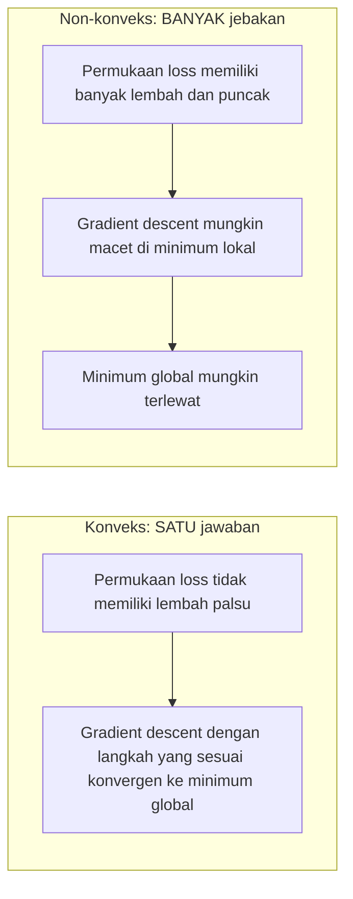
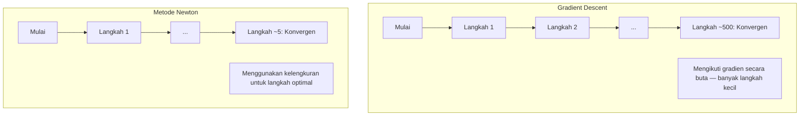
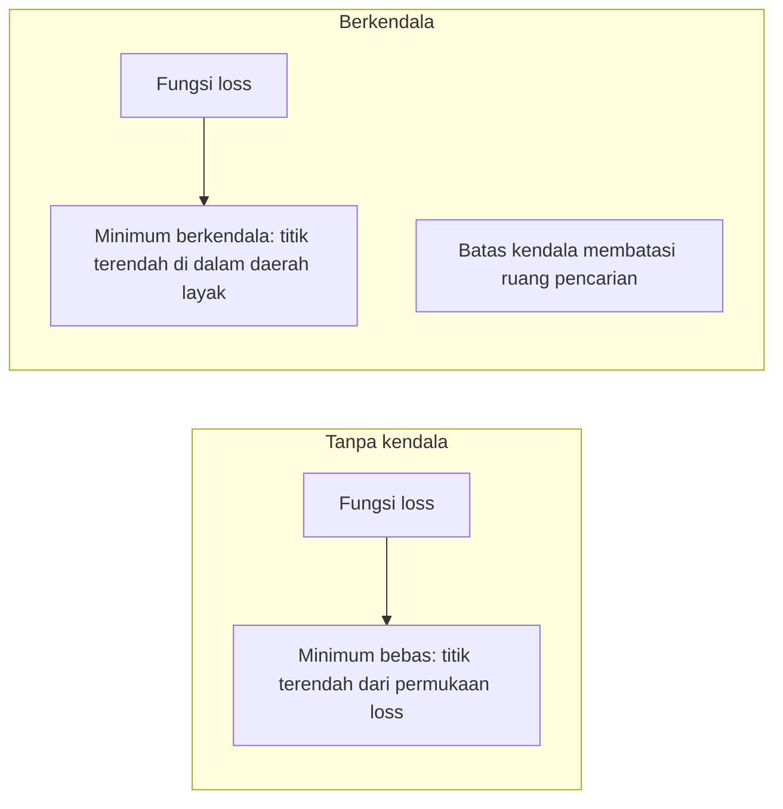
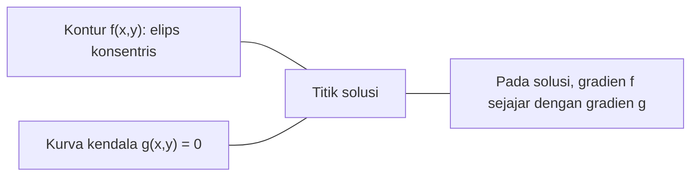

# Optimasi Konveks

> Masalah konveks memiliki satu lembah. Jaringan saraf memiliki jutaan. Mengetahui bedanya itu penting.

**Jenis:** Build
**Bahasa:** Python, TypeScript
**Prasyarat:** Fase 1, Pelajaran 04 (Kalkulus untuk ML), 08 (Optimasi)
**Waktu:** ~90 menit

## Tujuan Pembelajaran

- Menguji apakah suatu fungsi konveks menggunakan definisi, turunan kedua, dan kriteria Hessian
- Mengimplementasikan metode Newton dan membandingkan konvergensi kuadratnya dengan gradient descent
- Menyelesaikan masalah optimasi berkendala menggunakan pengali Lagrange dan menafsirkan kondisi KKT
- Menjelaskan mengapa lanskap loss jaringan saraf non-konveks namun SGD tetap menemukan solusi yang baik

## Masalahnya

Pelajaran 08 mengajarkan Anda gradient descent, momentum, dan Adam. Pengoptimal ini berjalan menuruni permukaan apa pun. Tetapi mereka tidak disertai jaminan. Gradient descent pada lanskap non-konveks mungkin mendarat di minimum lokal yang buruk, macet di titik pelana, atau berosilasi selamanya. Anda tetap menggunakannya karena jaringan saraf bersifat non-konveks dan tidak ada alternatif.

Namun banyak masalah dalam pembelajaran mesin bersifat konveks. Regresi linear, regresi logistik, SVM, LASSO, regresi ridge. Untuk masalah-masalah ini, ada sesuatu yang lebih kuat: optimasi dengan jaminan matematis. Masalah konveks tidak memiliki lembah palsu: setiap minimum lokal adalah minimum global. Untuk fungsi konveks mulus yang memiliki minimum, gradient descent dengan ukuran langkah yang sesuai konvergen ke minimum itu. Tidak perlu restart. Tidak perlu penjadwalan laju pembelajaran. Tidak perlu berdoa.

Memahami konveksitas melakukan tiga hal. Pertama, ia memberi tahu Anda kapan masalah Anda mudah (konveks) versus sulit (non-konveks). Kedua, ia memberi Anda alat yang lebih cepat seperti metode Newton untuk masalah konveks. Ketiga, ia menjelaskan konsep-konsep yang muncul di seluruh ML: regularisasi sebagai kendala, dualitas pada SVM, dan mengapa deep learning bekerja meskipun melanggar setiap sifat baik yang diberikan konveksitas.

## Konsepnya

### Himpunan konveks

Himpunan $S$ konveks jika untuk dua titik apa pun di $S$, ruas garis di antara keduanya seluruhnya berada di $S$.

| Himpunan konveks | Tidak konveks |
|---|---|
| **Persegi panjang**: dua titik mana pun di dalamnya dapat dihubungkan dengan ruas garis yang tetap berada di dalam | **Bentuk bintang/bulan sabit**: garis antara dua titik di dalam dapat keluar dari himpunan |
| **Segitiga**: sifat yang sama berlaku untuk semua titik di dalam | **Donat/annulus**: lubangnya berarti beberapa ruas garis keluar dari himpunan |
| Ruas garis antara dua titik mana pun tetap berada di dalam himpunan | Ruas garis antara beberapa pasangan titik keluar dari himpunan |

Uji formal: untuk titik $x, y$ apa pun di $S$ dan $t \in [0, 1]$ apa pun, titik $tx + (1-t)y$ juga berada di $S$.

Contoh himpunan konveks:
- Sebuah garis, sebuah bidang, seluruh $\mathbb{R}^n$
- Sebuah bola (lingkaran, bola, hypersphere)
- Sebuah setengah ruang: $\lbrace x : a^T x \le b \rbrace$
- Irisan dari sejumlah himpunan konveks apa pun

Contoh himpunan non-konveks:
- Sebuah donat (annulus)
- Gabungan dari dua lingkaran yang terpisah
- Himpunan apa pun yang memiliki "lekukan" atau "lubang"

### Fungsi konveks

Fungsi $f$ konveks jika domainnya adalah himpunan konveks dan untuk dua titik $x, y$ apa pun di domainnya serta $t \in [0, 1]$ apa pun:

```math
f(tx + (1-t)y) \le t f(x) + (1-t) f(y)
```

Secara geometris: ruas garis antara dua titik apa pun pada grafik berada di atas atau pada grafik tersebut.

| Sifat | Fungsi konveks | Fungsi non-konveks |
|---|---|---|
| **Uji ruas garis** | Garis antara dua titik apa pun pada grafik berada **di atas atau pada** kurva | Garis antara beberapa titik pada grafik turun **di bawah** kurva |
| **Bentuk** | Satu mangkuk/lembah yang melengkung ke atas | Beberapa puncak dan lembah dengan kelengkuran campuran |
| **Minimum lokal** | Setiap minimum lokal adalah minimum global | Beberapa minimum lokal mungkin ada pada ketinggian berbeda |

Fungsi konveks umum:
- $f(x) = x^2$ (parabola)
- $f(x) = \lvert x \rvert$ (nilai mutlak)
- $f(x) = e^x$ (eksponensial)
- $f(x) = \max(0, x)$ (ReLU, meskipun linear bertingkat)
- $f(x) = -\log(x)$ untuk $x > 0$ (log negatif)
- Fungsi linear apa pun $f(x) = a^T x + b$ (konveks sekaligus konkaf)

### Menguji konveksitas

Tiga uji praktis, dari yang paling mudah hingga paling ketat.

**Uji 1: Uji turunan kedua (1D).** Jika $f''(x) \ge 0$ untuk semua $x$, maka $f$ konveks.

- $f(x) = x^2$: $f''(x) = 2 \ge 0$. Konveks.
- $f(x) = x^3$: $f''(x) = 6x$. Negatif untuk $x < 0$. Tidak konveks.
- $f(x) = e^x$: $f''(x) = e^x > 0$. Konveks.

**Uji 2: Uji Hessian (multivariat).** Jika matriks Hessian $H(x)$ semi-definit positif untuk semua $x$, maka $f$ konveks. Hessian adalah matriks turunan parsial kedua.

**Uji 3: Uji definisi.** Periksa langsung pertidaksamaan $f(tx + (1-t)y) \le t f(x) + (1-t) f(y)$. Berguna untuk fungsi yang turunannya sulit dihitung.

### Mengapa konveksitas penting

Teorema pusat optimasi konveks:

**Untuk fungsi konveks, setiap minimum lokal adalah minimum global.**

Ini berarti gradient descent tidak bisa terjebak dalam minimum lokal yang buruk. Setiap minimum yang dapat dicapai memiliki loss yang sama. Untuk fungsi konveks mulus yang memiliki minimum, gradient descent dengan ukuran langkah yang sesuai dijamin konvergen ke nilai optimal.



Konsekuensinya:
- Tidak perlu restart acak
- Tidak perlu penjadwalan laju pembelajaran yang canggih
- Pembuktian konvergensi memungkinkan (laju bergantung pada sifat fungsi)
- Solusinya unik (kecuali pada region datar)

### Konveks vs non-konveks dalam ML

| Masalah | Konveks? | Mengapa |
|---------|----------|---------|
| Regresi linear (MSE) | Ya | Loss kuadratik dalam bobot |
| Regresi logistik | Ya | Log-loss konveks dalam bobot |
| SVM (hinge loss) | Ya | Maksimum dari fungsi-fungsi linear |
| LASSO (regresi L1) | Ya | Jumlah fungsi konveks bersifat konveks |
| Regresi ridge (L2) | Ya | Kuadratik + kuadratik = konveks |
| Jaringan saraf (loss apa pun) | Tidak | Aktivasi nonlinear menciptakan lanskap non-konveks |
| Klastering k-means | Tidak | Langkah penugasan diskrit |
| Faktorisasi matriks | Tidak | Hasil kali hal-hal yang tidak diketahui |

Model linear dengan loss konveks bersifat konveks. Begitu Anda menambahkan lapisan tersembunyi dengan aktivasi nonlinear, konveksitas pun rusak.

### Matriks Hessian

Hessian $H$ dari fungsi $f: \mathbb{R}^n \to \mathbb{R}$ adalah matriks $n \times n$ dari turunan parsial kedua.

```math
H_{ij} = \frac{\partial^2 f}{\partial x_i \, \partial x_j}
```

Untuk $f(x, y) = x^2 + 3xy + y^2$:

```math
\begin{gathered}
\begin{aligned}
\frac{\partial f}{\partial x} &= 2x + 3y & \frac{\partial^2 f}{\partial x^2} &= 2 & \frac{\partial^2 f}{\partial x \, \partial y} &= 3 \\
\frac{\partial f}{\partial y} &= 3x + 2y & \frac{\partial^2 f}{\partial y \, \partial x} &= 3 & \frac{\partial^2 f}{\partial y^2} &= 2
\end{aligned} \\[8pt]
H = \begin{bmatrix} 2 & 3 \\ 3 & 2 \end{bmatrix}
\end{gathered}
```

Hessian memberi tahu Anda tentang kelengkuran:
- Semua nilai eigen positif: fungsi melengkung ke atas di setiap arah (konveks di titik itu)
- Semua nilai eigen negatif: melengkung ke bawah di setiap arah (konkaf, maksimum lokal)
- Tanda campuran: titik pelana (melengkung ke atas di beberapa arah, ke bawah di arah lain)
- Nilai eigen nol: datar di arah itu (degenerat)

Untuk konveksitas, Hessian harus semi-definit positif (semua nilai eigen $\ge 0$) di mana-mana, bukan hanya di satu titik.

### Metode Newton

Gradient descent menggunakan informasi orde pertama (gradien). Metode Newton menggunakan informasi orde kedua (Hessian). Metode ini mencocokkan aproksimasi kuadratik di titik saat ini dan melompat langsung ke minimum dari kuadratik tersebut.

```math
\begin{aligned}
\text{Aturan pembaruan:} \quad & x_{\text{new}} = x - H^{-1} \cdot \text{gradient} \\
\text{Dibandingkan dengan gradient descent:} \quad & x_{\text{new}} = x - \text{lr} \cdot \text{gradient}
\end{aligned}
```

Metode Newton menggantikan laju pembelajaran skalar dengan invers Hessian. Ini secara otomatis menyesuaikan ukuran dan arah langkah berdasarkan kelengkuran lokal.



Keunggulan:
- Konvergensi kuadratik di dekat minimum (galat dikuadratkan setiap langkah)
- Tidak ada laju pembelajaran yang perlu disetel
- Invarian terhadap skala (bekerja terlepas dari bagaimana Anda memparameterisasi masalah)

Kelemahan:
- Menghitung Hessian membutuhkan memori $O(n^2)$ dan $O(n^3)$ untuk membalikkannya
- Untuk jaringan saraf dengan 1 juta bobot, itu adalah $10^{12}$ entri dan $10^{18}$ operasi
- Tidak praktis untuk deep learning

### Optimasi berkendala

Optimasi tanpa kendala: minimalkan $f(x)$ untuk semua $x$.
Optimasi berkendala: minimalkan $f(x)$ dengan kendala.

Masalah nyata memiliki kendala. Anda ingin meminimalkan biaya tetapi anggaran Anda terbatas. Anda ingin meminimalkan galat tetapi kompleksitas model Anda terbatas.



### Pengali Lagrange

Metode pengali Lagrange mengubah masalah berkendala menjadi masalah tanpa kendala.

Masalah: minimalkan $f(x)$ dengan kendala $g(x) = 0$.

Solusi: perkenalkan variabel baru (pengali Lagrange $\lambda$) dan selesaikan masalah tanpa kendala:

```math
L(x, \lambda) = f(x) + \lambda g(x)
```

Pada solusinya, gradien $L$ adalah nol:

```math
\begin{aligned}
\frac{\partial L}{\partial x} &= \frac{\partial f}{\partial x} + \lambda \frac{\partial g}{\partial x} = 0 \\
\frac{\partial L}{\partial \lambda} &= g(x) = 0
\end{aligned}
```

Intuisi geometris: pada minimum berkendala, gradien $f$ harus sejajar dengan gradien kendala $g$. Jika tidak sejajar, Anda dapat bergerak di sepanjang permukaan kendala dan menurunkan $f$ lebih lanjut.



Contoh: minimalkan $f(x,y) = x^2 + y^2$ dengan kendala $x + y = 1$.

```math
\begin{aligned}
L &= x^2 + y^2 + \lambda(x + y - 1) \\[4pt]
\frac{\partial L}{\partial x} &= 2x + \lambda = 0 \implies x = -\lambda/2 \\
\frac{\partial L}{\partial y} &= 2y + \lambda = 0 \implies y = -\lambda/2 \\
\frac{\partial L}{\partial \lambda} &= x + y - 1 = 0 \\[4pt]
&\text{Dari dua persamaan pertama: } x = y \\
&\text{Substitusi: } 2x = 1, \text{ sehingga } x = y = 0.5, \ \lambda = -1
\end{aligned}
```

Titik terdekat pada garis $x + y = 1$ dari titik asal adalah $(0.5, 0.5)$.

### Kondisi KKT

Kondisi Karush-Kuhn-Tucker memperluas pengali Lagrange ke kendala pertidaksamaan.

Masalah: minimalkan $f(x)$ dengan kendala $g_i(x) \le 0$ untuk $i = 1, \ldots, m$.

Kondisi KKT (diperlukan untuk optimalitas):

```math
\begin{aligned}
&\text{1. Stasioneritas:} && \frac{\partial f}{\partial x} + \sum_i \lambda_i \frac{\partial g_i}{\partial x} = 0 \\
&\text{2. Kelayakan primal:} && g_i(x) \le 0 \quad \text{untuk semua } i \\
&\text{3. Kelayakan dual:} && \lambda_i \ge 0 \quad \text{untuk semua } i \\
&\text{4. Kelonggaran komplementer:} && \lambda_i \, g_i(x) = 0 \quad \text{untuk semua } i
\end{aligned}
```

Kelonggaran komplementer adalah wawasan kunci: baik kendala aktif ($g_i = 0$, solusi berada di batas) maupun pengalinya nol (kendala tidak berpengaruh). Kendala yang tidak memengaruhi solusi memiliki $\lambda = 0$.

Kondisi KKT merupakan inti dari SVM. Vektor dukungan adalah titik-titik data tempat kendala aktif ($\lambda > 0$). Semua titik data lainnya memiliki $\lambda = 0$ dan tidak memengaruhi batas keputusan.

### Regularisasi sebagai optimasi berkendala

Regularisasi L1 dan L2 bukan trik sembarangan. Keduanya adalah masalah optimasi berkendala yang tersamar.

**Regularisasi L2 (Ridge):**

```math
\begin{aligned}
&\text{minimalkan } \text{Loss}(w) \text{ dengan kendala } \lVert w \rVert^2 \le t \\[4pt]
&\text{Bentuk tanpa kendala yang setara:} \\
&\text{minimalkan } \text{Loss}(w) + \lambda \lVert w \rVert^2
\end{aligned}
```

Kendala $\lVert w \rVert^2 \le t$ mendefinisikan sebuah bola (lingkaran dalam 2D, bola dalam 3D). Solusinya adalah tempat kontur loss pertama kali menyentuh bola ini.

**Regularisasi L1 (LASSO):**

```math
\begin{aligned}
&\text{minimalkan } \text{Loss}(w) \text{ dengan kendala } \lVert w \rVert_1 \le t \\[4pt]
&\text{Bentuk tanpa kendala yang setara:} \\
&\text{minimalkan } \text{Loss}(w) + \lambda \lVert w \rVert_1
\end{aligned}
```

Kendala $\lVert w \rVert_1 \le t$ mendefinisikan sebuah belah ketupat (persegi yang diputar dalam 2D).

| Sifat | Kendala L2 (lingkaran) | Kendala L1 (belah ketupat) |
|---|---|---|
| **Bentuk kendala** | Lingkaran (bola pada dimensi lebih tinggi) | Belah ketupat (persegi diputar dalam 2D) |
| **Tempat kontur loss menyentuh** | Batas mulus — titik mana pun pada lingkaran | Sudut — sejajar dengan sebuah sumbu |
| **Perilaku solusi** | Bobot kecil tetapi tidak nol | Beberapa bobot tepat nol (jarang) |
| **Hasil** | Penyusutan bobot | Pemilihan fitur |

Ini menjelaskan mengapa L1 menghasilkan model jarang (pemilihan fitur) sementara L2 hanya menyusutkan bobot. Belah ketupat memiliki sudut-sudut yang sejajar dengan sumbu. Kontur loss lebih mungkin menyentuh sudut, membuat satu atau lebih bobot tepat menjadi nol.

### Dualitas

Setiap masalah optimasi berkendala (primal) memiliki masalah pendamping (dual). Untuk masalah konveks, primal dan dual memiliki nilai optimal yang sama. Ini adalah dualitas kuat.

Fungsi dual Lagrangian:

```math
\begin{aligned}
&\text{Primal:} && \text{minimalkan } f(x) \text{ dengan kendala } g(x) \le 0 \\
&\text{Lagrangian:} && L(x, \lambda) = f(x) + \lambda g(x) \\
&\text{Fungsi dual:} && d(\lambda) = \min_x L(x, \lambda) \\
&\text{Masalah dual:} && \text{maksimalkan } d(\lambda) \text{ dengan kendala } \lambda \ge 0
\end{aligned}
```

Mengapa dualitas penting:
- Masalah dual terkadang lebih mudah diselesaikan daripada primal
- SVM diselesaikan dalam bentuk dualnya, di mana masalah bergantung pada hasil kali titik antar titik data (memungkinkan kernel trick)
- Dual memberikan batas bawah pada optimum primal, berguna untuk memeriksa kualitas solusi

Secara khusus untuk SVM:

```
Primal: temukan w, b yang memaksimalkan margin 2/||w|| dengan kendala
        y_i(w^T x_i + b) >= 1 untuk semua i

Dual:   maksimalkan sum(alpha_i) - 0.5 * sum_ij(alpha_i * alpha_j * y_i * y_j * x_i^T x_j)
        dengan kendala alpha_i >= 0 dan sum(alpha_i * y_i) = 0

Dual hanya melibatkan hasil kali titik x_i^T x_j.
Ganti x_i^T x_j dengan K(x_i, x_j) untuk mendapatkan kernel trick.
```

### Mengapa deep learning bekerja meskipun non-konveks

Fungsi loss jaringan saraf sangat non-konveks. Berdasarkan setiap ukuran klasik, mengoptimalkannya seharusnya gagal. Namun stochastic gradient descent secara andal menemukan solusi yang baik. Beberapa faktor menjelaskannya.

**Kebanyakan minimum lokal sudah cukup baik.** Dalam ruang berdimensi tinggi, titik kritis acak (tempat gradien nol) sangat dominan berupa titik pelana, bukan minimum lokal. Beberapa minimum lokal yang ada cenderung memiliki nilai loss dekat dengan minimum global. Terjebak dalam minimum lokal yang mengerikan sangat tidak mungkin ketika ruang parameter berjuta-juta dimensi.

**Titik pelana, bukan minimum lokal, adalah hambatan yang sebenarnya.** Pada fungsi dengan $n$ parameter, titik pelana memiliki campuran arah kelengkuran positif dan negatif. Untuk titik kritis acak dalam dimensi tinggi, probabilitas bahwa semua $n$ nilai eigen positif (minimum lokal) kira-kira $2^{-n}$. Hampir semua titik kritis adalah titik pelana. Derau SGD membantu keluar dari titik-titik itu.

**Overparameterisasi menghaluskan lanskap.** Jaringan dengan parameter lebih banyak daripada contoh pelatihan memiliki permukaan loss yang lebih halus dan lebih terhubung. Jaringan yang lebih lebar memiliki lebih sedikit minimum lokal yang buruk. Ini berlawanan dengan intuisi tetapi konsisten secara empiris.

**Struktur lanskap loss:**

| Sifat | Ruang dimensi rendah | Ruang dimensi tinggi |
|---|---|---|
| **Lanskap** | Banyak puncak dan lembah terpisah | Lembah yang terhubung secara halus |
| **Minimum** | Banyak minimum lokal terpisah | Sedikit minimum lokal buruk; kebanyakan near-optimal |
| **Navigasi** | Sulit menemukan minimum global | Banyak jalur menuju solusi yang baik |
| **Titik kritis** | Campuran minimum lokal dan titik pelana | Sangat dominan titik pelana, bukan minimum lokal |

**Derau stokastik bertindak sebagai regularisasi implisit.** Mini-batch SGD menambahkan derau yang mencegah pengendapan pada minimum tajam. Minimum tajam mengalami overfitting; minimum datar melakukan generalisasi lebih baik. Derau memihak optimasi ke arah region datar pada lanskap loss.

### Metode orde kedua dalam praktik

Metode Newton murni tidak praktis untuk model besar. Beberapa aproksimasi membuat informasi orde kedua dapat digunakan.

**L-BFGS (Limited-memory BFGS):** Mengaproksimasi invers Hessian menggunakan $m$ selisih gradien terakhir. Membutuhkan memori $O(mn)$ alih-alih $O(n^2)$. Bekerja baik untuk masalah hingga ~10.000 parameter. Digunakan dalam ML klasik (regresi logistik, CRF) tetapi bukan deep learning.

**Gradien alami:** Menggunakan matriks informasi Fisher (Hessian ekspektasi dari log-likelihood) alih-alih Hessian standar. Ini memperhitungkan geometri distribusi probabilitas. K-FAC (Kronecker-Factored Approximate Curvature) mengaproksimasi matriks Fisher sebagai hasil kali Kronecker, membuatnya praktis untuk jaringan saraf.

**Optimasi tanpa Hessian:** Menggunakan conjugate gradient untuk menyelesaikan $Hx = g$ tanpa pernah membentuk $H$. Hanya memerlukan hasil kali vektor-Hessian, yang dapat dihitung dalam waktu $O(n)$ melalui differensiasi otomatis.

**Aproksimasi diagonal:** Momen kedua Adam adalah aproksimasi diagonal dari diagonal Hessian. AdaHessian mengembangkannya dengan menggunakan elemen diagonal Hessian aktual melalui estimator Hutchinson.

| Metode | Memori | Biaya per langkah | Kapan digunakan |
|--------|--------|-------------------|-----------------|
| Gradient descent | $O(n)$ | $O(n)$ | Baseline, model besar |
| Metode Newton | $O(n^2)$ | $O(n^3)$ | Masalah konveks kecil |
| L-BFGS | $O(mn)$ | $O(mn)$ | Masalah konveks sedang |
| Adam | $O(n)$ | $O(n)$ | Pilihan utama deep learning |
| K-FAC | $O(n)$ | $O(n)$ per lapisan | Riset, pelatihan batch besar |

```figure
convex-vs-nonconvex
```

## Bangun Sendiri

### Langkah 1: Pemeriksa konveksitas

Bangun fungsi yang menguji konveksitas secara empiris dengan mengambil sampel titik dan memeriksa definisinya.

```python
import random
import math

def check_convexity(f, dim, bounds=(-5, 5), samples=1000):
    violations = 0
    for _ in range(samples):
        x = [random.uniform(*bounds) for _ in range(dim)]
        y = [random.uniform(*bounds) for _ in range(dim)]
        t = random.uniform(0, 1)
        mid = [t * xi + (1 - t) * yi for xi, yi in zip(x, y)]
        lhs = f(mid)
        rhs = t * f(x) + (1 - t) * f(y)
        if lhs > rhs + 1e-10:
            violations += 1
    return violations == 0, violations
```

### Langkah 2: Metode Newton untuk 2D

Implementasikan metode Newton menggunakan Hessian eksplisit. Bandingkan kecepatan konvergensi dengan gradient descent.

```python
def newtons_method(f, grad_f, hessian_f, x0, steps=50, tol=1e-12):
    x = list(x0)
    history = [x[:]]
    for _ in range(steps):
        g = grad_f(x)
        H = hessian_f(x)
        det = H[0][0] * H[1][1] - H[0][1] * H[1][0]
        if abs(det) < 1e-15:
            break
        H_inv = [
            [H[1][1] / det, -H[0][1] / det],
            [-H[1][0] / det, H[0][0] / det],
        ]
        dx = [
            H_inv[0][0] * g[0] + H_inv[0][1] * g[1],
            H_inv[1][0] * g[0] + H_inv[1][1] * g[1],
        ]
        x = [x[0] - dx[0], x[1] - dx[1]]
        history.append(x[:])
        if sum(gi ** 2 for gi in g) < tol:
            break
    return history
```

### Langkah 3: Penyelesai pengali Lagrange

Selesaikan optimasi berkendala menggunakan gradient descent pada Lagrangian.

```python
def lagrange_solve(f_grad, g_val, g_grad, x0, lr=0.01,
                   lr_lambda=0.01, steps=5000):
    x = list(x0)
    lam = 0.0
    history = []
    for _ in range(steps):
        fg = f_grad(x)
        gv = g_val(x)
        gg = g_grad(x)
        x = [
            xi - lr * (fgi + lam * ggi)
            for xi, fgi, ggi in zip(x, fg, gg)
        ]
        lam = lam + lr_lambda * gv
        history.append((x[:], lam, gv))
    return history
```

### Langkah 4: Membandingkan orde pertama vs orde kedua

Jalankan gradient descent dan metode Newton pada fungsi kuadratik yang sama. Hitung jumlah langkah hingga konvergen.

```python
def quadratic(x):
    return 5 * x[0] ** 2 + x[1] ** 2

def quadratic_grad(x):
    return [10 * x[0], 2 * x[1]]

def quadratic_hessian(x):
    return [[10, 0], [0, 2]]
```

Metode Newton akan konvergen dalam 1 langkah (metode ini eksak untuk fungsi kuadratik). Gradient descent membutuhkan ratusan langkah karena nilai eigen Hessian berbeda dengan faktor 5, menciptakan lembah yang memanjang.

## Gunakan

Analisis konveksitas berlaku langsung saat memilih model dan penyelesai ML.

Untuk masalah konveks (regresi logistik, SVM, LASSO):
- Gunakan penyelesai khusus (liblinear, CVXPY, scipy.optimize.minimize dengan method='L-BFGS-B')
- Harapkan solusi global yang unik
- Metode orde kedua praktis dan cepat

Untuk masalah non-konveks (jaringan saraf):
- Gunakan metode orde pertama (SGD, Adam)
- Terima bahwa solusi bergantung pada inisialisasi dan keacakan
- Gunakan overparameterisasi, derau, dan penjadwalan laju pembelajaran sebagai regularisasi implisit
- Jangan buang waktu mencari minimum global. Minimum lokal yang baik sudah cukup.

```python
from scipy.optimize import minimize

result = minimize(
    fun=lambda w: sum((y - X @ w) ** 2) + 0.1 * sum(w ** 2),
    x0=np.zeros(d),
    method='L-BFGS-B',
    jac=lambda w: -2 * X.T @ (y - X @ w) + 0.2 * w,
)
```

Untuk SVM, formulasi dual memungkinkan Anda menggunakan kernel trick:

```python
from sklearn.svm import SVC

svm = SVC(kernel='rbf', C=1.0)
svm.fit(X_train, y_train)
print(f"Support vectors: {svm.n_support_}")
```

## Latihan

1. **Galeri konveksitas.** Uji fungsi-fungsi ini untuk konveksitas menggunakan pemeriksa: $f(x) = x^4$, $f(x) = \sin(x)$, $f(x,y) = x^2 + y^2$, $f(x,y) = xy$, $f(x) = \max(x, 0)$. Jelaskan mengapa setiap hasil masuk akal.

2. **Balapan Newton vs gradient descent.** Jalankan kedua metode pada $f(x,y) = 50x^2 + y^2$ dari titik awal $(10, 10)$. Berapa langkah yang dibutuhkan masing-masing untuk mencapai loss < 1e-10? Apa yang terjadi pada gradient descent ketika angka kondisi (rasio nilai eigen Hessian terbesar terhadap terkecil) meningkat?

3. **Geometri pengali Lagrange.** Minimalkan $f(x,y) = (x-3)^2 + (y-3)^2$ dengan kendala $x + 2y = 4$. Verifikasi solusinya dengan memeriksa bahwa gradien $f$ sejajar dengan gradien $g$ pada solusi.

4. **Kendala regularisasi.** Implementasikan optimasi berkendala L1: minimalkan $(x-3)^2 + (y-2)^2$ dengan kendala $\lvert x \rvert + \lvert y \rvert \le 1$. Tunjukkan bahwa solusinya memiliki satu koordinat sama dengan nol (jarang akibat kendala belah ketupat).

5. **Analisis nilai eigen Hessian.** Hitung Hessian fungsi Rosenbrock di (1,1) dan di (-1,1). Hitung nilai eigen di kedua titik. Apa yang dikatakan nilai eigen tentang kelengkuran pada minimum versus jauh dari minimum?

### Petunjuk

**Latihan 1.** Prediksi setiap hasil sebelum menjalankan `check_convexity`: dalam satu dimensi, lihat tanda $f''(x)$; dalam dua dimensi, lihat nilai eigen Hessian. Untuk $f(x,y) = xy$, Hessian memiliki nilai eigen 1 dan -1, sehingga pemeriksa harus melaporkan bahwa fungsi itu tidak konveks.

**Latihan 2.** Panggil `optimize_gd` dan `newtons_method` dengan gradien dan Hessian dari $f$. Metode Newton menyelesaikan fungsi kuadratik dalam satu langkah. Untuk gradient descent, laju pembelajaran harus kurang dari $2/100$ karena suku $50x^2$, sehingga arah $y$ bergerak lambat. Ulangi dengan $100x^2$ dan hitung ulang jumlah langkahnya.

**Latihan 3.** Gunakan `lagrange_solve` dengan $g(x,y) = x + 2y - 4$. Pada jawabannya, periksa bahwa $x + 2y = 4$ dan bahwa $\nabla f = (2(x-3), 2(y-3))$ merupakan kelipatan dari $\nabla g = (1, 2)$.

**Latihan 4.** Minimum tanpa kendala (3, 2) berada di luar belah ketupat, sehingga jawabannya ada di batasnya. Gunakan gradient descent terproyeksi: ambil satu langkah gradien, lalu proyeksikan kembali ke $\lvert x \rvert + \lvert y \rvert \le 1$. Periksa bahwa hasilnya memenuhi kendala dengan kesetaraan dan bandingkan dengan `demo_regularization_geometry`.

**Latihan 5.** Panggil `rosenbrock_hessian` di setiap titik dan teruskan hasilnya ke `hessian_eigenvalues_2d`. Di (1, 1), kedua nilai eigen positif dan rasionya sangat besar, sehingga lembahnya sempit di satu arah dan datar di arah lain. Bandingkan rasio itu dengan rasio di (-1, 1).

## Istilah Kunci

| Istilah | Artinya |
|---|---|
| Himpunan konveks | Himpunan tempat ruas garis antara dua titik mana pun di dalamnya tetap berada di dalam himpunan |
| Fungsi konveks | Fungsi tempat garis antara dua titik mana pun pada grafiknya berada di atas atau pada grafik. Secara ekuivalen, Hessian semi-definit positif di mana-mana |
| Minimum lokal | Titik yang lebih rendah daripada semua titik di sekitarnya. Untuk fungsi konveks, setiap minimum lokal adalah minimum global |
| Minimum global | Titik terendah suatu fungsi di seluruh domainnya |
| Matriks Hessian | Matriks dari semua turunan parsial kedua. Menyandikan informasi kelengkuran |
| Semi-definit positif | Matriks yang semua nilai eigennya non-negatif. Analogi multidimensi dari "turunan kedua >= 0" |
| Angka kondisi | Rasio nilai eigen terbesar terhadap terkecil dari Hessian. Angka kondisi tinggi berarti lembah memanjang dan gradient descent lambat |
| Metode Newton | Pengoptimal orde kedua yang menggunakan invers Hessian untuk menentukan arah dan ukuran langkah. Konvergensi kuadratik di dekat minimum |
| Pengali Lagrange | Variabel yang diperkenalkan untuk mengubah masalah optimasi berkendala menjadi masalah tanpa kendala |
| Kondisi KKT | Kondisi perlu untuk optimalitas dengan kendala pertidaksamaan. Menggeneralisasi pengali Lagrange |
| Kelonggaran komplementer | Pada solusi, baik kendala aktif maupun pengalinya nol. Tidak pernah keduanya bukan nol |
| Dualitas | Setiap masalah berkendala memiliki masalah dual pendamping. Untuk masalah konveks, keduanya memiliki nilai optimal yang sama |
| Dualitas kuat | Nilai optimal primal dan dual sama. Berlaku untuk masalah konveks yang memenuhi kondisi Slater |
| L-BFGS | Metode orde kedua aproksimatif yang menyimpan $m$ selisih gradien terakhir alih-alih Hessian lengkap |
| Titik pelana | Titik tempat gradien nol tetapi merupakan minimum pada beberapa arah dan maksimum pada arah lain |
| Overparameterisasi | Menggunakan parameter lebih banyak daripada contoh pelatihan. Menghaluskan lanskap loss dan mengurangi minimum lokal buruk |

## Bacaan Lebih Lanjut

- [Boyd & Vandenberghe: Convex Optimization](https://web.stanford.edu/~boyd/cvxbook/) - buku teks standar, tersedia gratis secara daring
- [Bottou, Curtis, Nocedal: Optimization Methods for Large-Scale Machine Learning (2018)](https://arxiv.org/abs/1606.04838) - menjembatani teori optimasi konveks dan praktik deep learning
- [Choromanska et al.: The Loss Surfaces of Multilayer Networks (2015)](https://arxiv.org/abs/1412.0233) - mengapa lanskap jaringan saraf non-konveks tidak seburuk tampaknya
- [Nocedal & Wright: Numerical Optimization](https://link.springer.com/book/10.1007/978-0-387-40065-5) - referensi komprehensif untuk metode Newton, L-BFGS, dan optimasi berkendala
