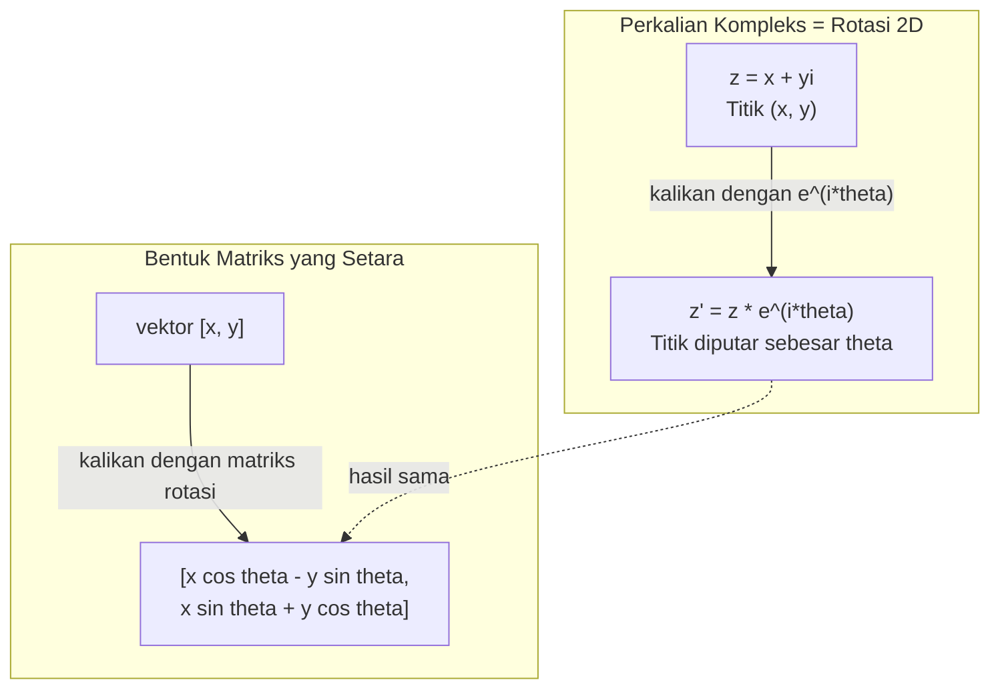
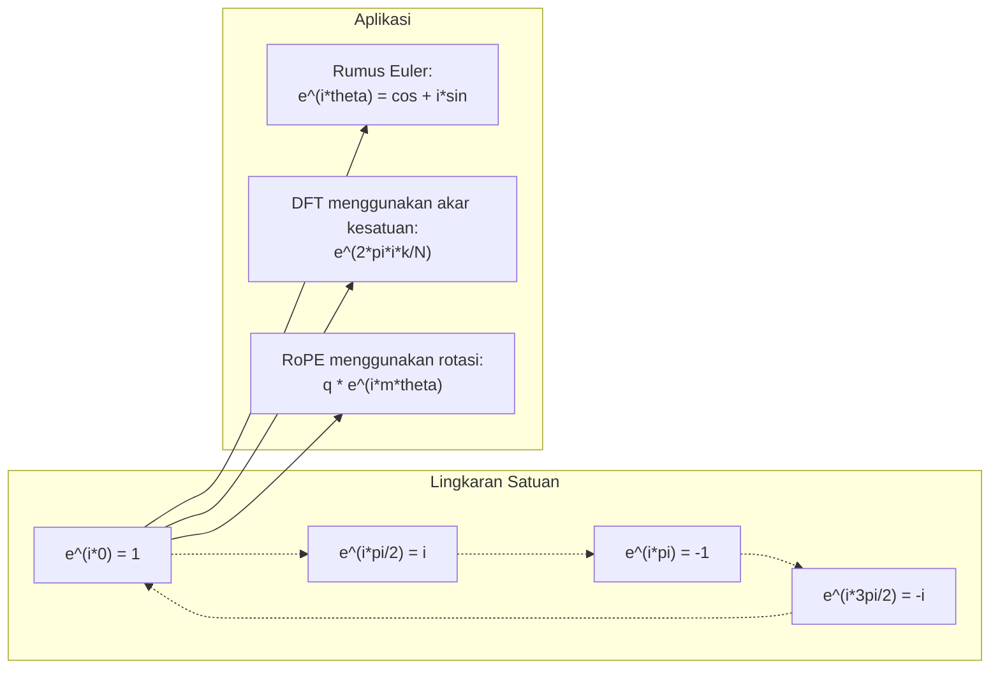

# Bilangan Kompleks untuk AI

> Akar kuadrat dari -1 bukanlah khayalan. Itu adalah kunci untuk rotasi, frekuensi, dan separuh dari pemrosesan sinyal.

**Jenis:** Learn
**Bahasa:** Python, TypeScript
**Prasyarat:** Fase 1, Pelajaran 01-04 (aljabar linear, kalkulus)
**Waktu:** ~60 menit

## Tujuan Pembelajaran

- Melakukan aritmetika kompleks (penjumlahan, perkalian, pembagian, konjugasi) dalam bentuk rektangular maupun polar
- Menerapkan rumus Euler untuk berpindah antara eksponensial kompleks dan fungsi trigonometri
- Mengimplementasikan Transformasi Fourier Diskrit menggunakan akar kesatuan kompleks
- Menjelaskan bagaimana rotasi kompleks mendasari RoPE dan penyandian posisi sinusoidal pada transformer

## Masalahnya

Anda membuka makalah tentang transformasi Fourier dan `i` ada di mana-mana. Anda melihat penyandian posisi transformer dan menemukan `sin` serta `cos` pada frekuensi berbeda -- bagian real dan imajiner dari eksponensial kompleks. Anda membaca tentang komputasi kuantum dan mendapati semuanya dinyatakan dalam ruang vektor kompleks.

Bilangan kompleks tampak abstrak. Sistem bilangan yang dibangun di atas akar kuadrat dari -1 terasa seperti trik matematis. Tetapi itu bukan trik. Itu adalah bahasa alami dari rotasi dan osilasi. Setiap kali sesuatu berputar, bergetar, atau berosilasi, bilangan kompleks adalah alat yang tepat.

Tanpa memahami bilangan kompleks, Anda tidak dapat memahami Transformasi Fourier Diskrit. Anda tidak dapat memahami FFT. Anda tidak dapat memahami cara kerja RoPE (Rotary Position Embedding) pada model bahasa modern. Anda tidak dapat memahami mengapa penyandian posisi sinusoidal pada makalah Transformer awal menggunakan frekuensi yang mereka pakai.

Pelajaran ini membangun aritmetika kompleks dari awal, menghubungkannya dengan geometri, dan menunjukkan kepada Anda secara tepat di mana bilangan kompleks muncul dalam pembelajaran mesin.

## Konsepnya

### Apa itu bilangan kompleks?

Bilangan kompleks memiliki dua bagian: bagian real dan bagian imajiner.

```
z = a + bi

di mana:
  a adalah bagian real
  b adalah bagian imajiner
  i adalah unit imajiner, didefinisikan oleh i^2 = -1
```

Itu saja. Anda memperluas garis bilangan menjadi sebuah bidang. Bilangan real berada pada satu sumbu. Bilangan imajiner berada pada sumbu lainnya. Setiap bilangan kompleks adalah sebuah titik di bidang ini.

### Aritmetika kompleks

**Penjumlahan.** Jumlahkan bagian realnya, jumlahkan bagian imajinernya.

```math
\begin{aligned}
(a + bi) + (c + di) &= (a + c) + (b + d)i \\[4pt]
\text{Contoh: } (3 + 2i) + (1 + 4i) &= 4 + 6i
\end{aligned}
```

**Perkalian.** Gunakan hukum distributif dan ingat bahwa $i^2 = -1$.

```math
\begin{aligned}
(a + bi)(c + di) &= ac + adi + bci + bdi^2 \\
&= ac + adi + bci - bd \\
&= (ac - bd) + (ad + bc)i \\[8pt]
\text{Contoh: } (3 + 2i)(1 + 4i) &= 3 + 12i + 2i + 8i^2 \\
&= 3 + 14i - 8 \\
&= -5 + 14i
\end{aligned}
```

**Konjugat.** Balik tanda bagian imajinernya.

```math
\text{konjugat dari } (a + bi) = a - bi
```

Hasil kali suatu bilangan kompleks dengan konjugatnya selalu real:

```math
(a + bi)(a - bi) = a^2 + b^2
```

**Pembagian.** Kalikan pembilang dan penyebut dengan konjugat dari penyebut.

```math
\frac{a + bi}{c + di} = \frac{(a + bi)(c - di)}{c^2 + d^2}
```

Ini menghilangkan bagian imajiner dari penyebut, memberi Anda bilangan kompleks yang bersih.

### Bidang kompleks

Bidang kompleks memetakan setiap bilangan kompleks ke sebuah titik 2D. Sumbu horizontal adalah sumbu real, sumbu vertikal adalah sumbu imajiner.

```
z = 3 + 2i  sesuai dengan titik (3, 2)
z = -1 + 0i sesuai dengan titik (-1, 0) pada sumbu real
z = 0 + 4i  sesuai dengan titik (0, 4) pada sumbu imajiner
```

Sebuah bilangan kompleks secara bersamaan adalah titik dan vektor dari titik asal. Interpretasi ganda inilah yang membuat bilangan kompleks berguna untuk geometri.

### Bentuk polar

Setiap titik di bidang dapat dijelaskan oleh jaraknya dari titik asal dan sudutnya dari sumbu real positif.

```math
\begin{aligned}
z &= r (\cos\theta + i \sin\theta) \\[4pt]
\text{di mana: } r &= |z| = \sqrt{a^2 + b^2} \quad \text{(magnitudo, atau modulus)} \\
\theta &= \mathop{\mathrm{atan2}}(b, a) \quad \text{(fasa, atau argumen)}
\end{aligned}
```

Bentuk rektangular $(a + bi)$ baik untuk penjumlahan. Bentuk polar $(r, \theta)$ baik untuk perkalian.

**Perkalian dalam bentuk polar.** Kalikan magnitudonya, jumlahkan sudutnya.

```math
\begin{aligned}
z_1 &= r_1 e^{i\theta_1} \\
z_2 &= r_2 e^{i\theta_2} \\[4pt]
z_1 z_2 &= (r_1 r_2) \, e^{i(\theta_1 + \theta_2)}
\end{aligned}
```

Inilah mengapa bilangan kompleks sempurna untuk rotasi. Perkalian dengan bilangan kompleks bermagnitudo 1 adalah rotasi murni.

### Rumus Euler

Jembatan antara eksponensial kompleks dan trigonometri:

```math
e^{i\theta} = \cos\theta + i \sin\theta
```

Ini adalah rumus paling penting dalam pelajaran ini. Ketika $\theta = \pi$:

```math
\begin{aligned}
e^{i\pi} &= \cos\pi + i \sin\pi = -1 + 0i = -1 \\[4pt]
\text{Oleh karena itu: } e^{i\pi} + 1 &= 0
\end{aligned}
```

Lima konstanta fundamental ($e$, $i$, $\pi$, 1, 0) terhubung dalam satu persamaan.

### Mengapa rumus Euler penting bagi ML

Rumus Euler menyatakan bahwa $e^{i\theta}$ menelusuri lingkaran satuan saat $\theta$ berubah. Pada $\theta = 0$, Anda berada di $(1, 0)$. Pada $\theta = \pi/2$, Anda berada di $(0, 1)$. Pada $\theta = \pi$, Anda berada di $(-1, 0)$. Pada $\theta = 3\pi/2$, Anda berada di $(0, -1)$. Satu putaran penuh adalah $\theta = 2\pi$.

Ini berarti eksponensial kompleks ADALAH rotasi. Dan rotasi ada di mana-mana dalam pemrosesan sinyal dan ML.

### Kaitan dengan rotasi 2D

Mengalikan bilangan kompleks $(x + yi)$ dengan $e^{i\theta}$ memutar titik $(x, y)$ sebesar sudut $\theta$ di sekitar titik asal.

```math
\begin{aligned}
&\text{Rotasi via perkalian kompleks:} \\
&\quad (x + yi)(\cos\theta + i \sin\theta) = (x \cos\theta - y \sin\theta) + (x \sin\theta + y \cos\theta)i \\[8pt]
&\text{Rotasi via perkalian matriks:} \\
&\quad \begin{bmatrix} \cos\theta & -\sin\theta \\ \sin\theta & \cos\theta \end{bmatrix} \begin{bmatrix} x \\ y \end{bmatrix} = \begin{bmatrix} x \cos\theta - y \sin\theta \\ x \sin\theta + y \cos\theta \end{bmatrix}
\end{aligned}
```

Keduanya menghasilkan hasil yang identik. Perkalian kompleks ADALAH rotasi 2D. Matriks rotasi hanyalah perkalian kompleks yang ditulis dalam notasi matriks.



### Phasor dan sinyal berputar

Eksponensial kompleks $e^{i\omega t}$ adalah titik yang berputar mengelilingi lingkaran satuan dengan frekuensi sudut $\omega$. Saat $t$ bertambah, titik itu menelusuri lingkaran.

Bagian real dari titik yang berputar ini adalah $\cos(\omega t)$. Bagian imajinernya adalah $\sin(\omega t)$. Sinyal sinusoidal adalah bayangan dari bilangan kompleks yang berputar.

```math
\begin{aligned}
e^{i\omega t} &= \cos(\omega t) + i \sin(\omega t) \\[4pt]
\text{Bagian real: } & \cos(\omega t) \quad \text{-- gelombang kosinus} \\
\text{Bagian imajiner: } & \sin(\omega t) \quad \text{-- gelombang sinus}
\end{aligned}
```

Ini adalah representasi phasor. Alih-alih melacak gelombang sinus yang bergelombang, Anda melacak panah yang berputar halus. Pergeseran fasa menjadi offset sudut. Perubahan amplitudo menjadi perubahan magnitudo. Penjumlahan sinyal menjadi penjumlahan vektor.

### Akar kesatuan

Akar kesatuan ke-$N$ adalah $N$ titik yang tersebar merata pada lingkaran satuan:

```math
w_k = e^{2\pi i k/N} \quad \text{untuk } k = 0, 1, 2, \ldots, N-1
```

Untuk $N = 4$, akar-akarnya adalah: $1, i, -1, -i$ (empat titik kompas).
Untuk $N = 8$, Anda mendapat empat titik kompas ditambah empat garis diagonal.

Akar kesatuan adalah fondasi Transformasi Fourier Diskrit. DFT menguraikan sinyal menjadi komponen-komponen pada $N$ frekuensi yang tersebar merata ini.

### Kaitan dengan DFT

Transformasi Fourier Diskrit dari sinyal $x[0], x[1], \ldots, x[N-1]$ adalah:

```math
X[k] = \sum_{n=0}^{N-1} x[n] \, e^{-2\pi i k n/N}
```

Setiap $X[k]$ mengukur seberapa besar sinyal berkorelasi dengan akar kesatuan ke-$k$ -- sebuah sinusoid kompleks pada frekuensi $k$. DFT memecah sinyal menjadi $N$ phasor yang berputar dan memberi tahu Anda amplitudo serta fasa masing-masing.

### Mengapa i tidaklah khayalan

Kata "imajiner" adalah kecelakaan historis. Descartes menggunakannya dengan nada meremehkan. Tetapi $i$ tidak lebih khayalan daripada bilangan negatif ketika orang awalnya menolaknya. Bilangan negatif menjawab "apa yang harus Anda kurangkan dari 3 agar mendapat 5?" Unit imajiner menjawab "apa yang Anda kuadratkan untuk mendapat -1?"

Lebih berguna lagi: $i$ adalah operator rotasi 90 derajat. Kalikan bilangan real dengan $i$ sekali, Anda berputar 90 derajat ke sumbu imajiner. Kalikan dengan $i$ lagi ($i^2$), Anda berputar 90 derajat lagi -- sekarang Anda menghadap arah real negatif. Itulah sebabnya $i^2 = -1$. Ini tidak misterius. Ini adalah setengah putaran yang dibangun dari dua suku putaran.

Inilah mengapa bilangan kompleks ada di mana-mana dalam rekayasa. Apa pun yang berputar -- gelombang elektromagnetik, keadaan kuantum, osilasi sinyal, penyandian posisi -- secara alami dideskripsikan oleh bilangan kompleks.

### Eksponensial kompleks vs fungsi trigonometri

Sebelum rumus Euler, insinyur menulis sinyal sebagai $A \cos(\omega t + \phi)$ -- amplitudo $A$, frekuensi $\omega$, fasa $\phi$. Ini berhasil tetapi membuat aritmetika menyakitkan. Menjumlahkan dua kosinus dengan fasa berbeda memerlukan identitas trigonometri.

Dengan eksponensial kompleks, sinyal yang sama adalah $A e^{i(\omega t + \phi)}$. Menjumlahkan dua sinyal hanya berarti menjumlahkan dua bilangan kompleks. Perkalian (modulasi) hanya berarti mengalikan magnitudo dan menjumlahkan sudut. Pergeseran fasa menjadi penjumlahan sudut. Pergeseran frekuensi menjadi perkalian dengan phasor.

Seluruh bidang pemrosesan sinyal beralih ke notasi eksponensial kompleks karena matematikanya lebih bersih. "Sinyal real" selalu hanyalah bagian real dari representasi kompleks. Bagian imajiner dibawa sebagai pencatatan pembukuan, membuat semua aljabar beres dengan sendirinya.

### Kaitan dengan transformer

**Penyandian posisi sinusoidal** (makalah Transformer awal):

```math
\begin{aligned}
PE(pos, 2i) &= \sin\left(pos / 10000^{2i/d}\right) \\
PE(pos, 2i+1) &= \cos\left(pos / 10000^{2i/d}\right)
\end{aligned}
```

Pasangan sin dan cos adalah bagian real dan imajiner dari eksponensial kompleks pada frekuensi berbeda. Setiap frekuensi memberikan "resolusi" berbeda untuk menyandikan posisi. Frekuensi rendah berubah lambat (posisi kasar). Frekuensi tinggi berubah cepat (posisi halus). Bersama-sama, keduanya memberi setiap posisi sidik jari frekuensi yang unik.

**RoPE (Rotary Position Embedding)** melangkah lebih jauh. Metode ini secara eksplisit mengalikan vektor query dan key dengan matriks rotasi kompleks. Posisi relatif antara dua token menjadi sudut rotasi. Atensi dihitung menggunakan vektor-vektor yang telah diputar ini, membuat model sensitif terhadap posisi relatif melalui perkalian kompleks.

| Operasi | Bentuk aljabar | Makna geometris |
|---|---|---|
| Penjumlahan | $(a+c) + (b+d)i$ | Penjumlahan vektor di bidang |
| Perkalian | $(ac-bd) + (ad+bc)i$ | Rotasi dan penskalaan |
| Konjugat | $a - bi$ | Refleksi terhadap sumbu real |
| Magnitudo | $\sqrt{a^2 + b^2}$ | Jarak dari titik asal |
| Fasa | $\mathop{\mathrm{atan2}}(b, a)$ | Sudut dari sumbu real positif |
| Pembagian | kalikan dengan konjugat | Membalik rotasi dan menskalakan ulang |
| Pangkat | $r^n e^{in\theta}$ | Putar $n$ kali, skalakan dengan $r^n$ |



```figure
roots-of-unity
```

## Bangun Sendiri

### Langkah 1: Kelas Complex

Bangun kelas bilangan kompleks yang mendukung aritmetika, magnitudo, fasa, dan konversi antara bentuk rektangular dan polar.

```python
import math

class Complex:
    def __init__(self, real, imag=0.0):
        self.real = real
        self.imag = imag

    def __add__(self, other):
        return Complex(self.real + other.real, self.imag + other.imag)

    def __mul__(self, other):
        r = self.real * other.real - self.imag * other.imag
        i = self.real * other.imag + self.imag * other.real
        return Complex(r, i)

    def __truediv__(self, other):
        denom = other.real ** 2 + other.imag ** 2
        r = (self.real * other.real + self.imag * other.imag) / denom
        i = (self.imag * other.real - self.real * other.imag) / denom
        return Complex(r, i)

    def magnitude(self):
        return math.sqrt(self.real ** 2 + self.imag ** 2)

    def phase(self):
        return math.atan2(self.imag, self.real)

    def conjugate(self):
        return Complex(self.real, -self.imag)
```

### Langkah 2: Konversi polar dan rumus Euler

```python
def to_polar(z):
    return z.magnitude(), z.phase()

def from_polar(r, theta):
    return Complex(r * math.cos(theta), r * math.sin(theta))

def euler(theta):
    return Complex(math.cos(theta), math.sin(theta))
```

Verifikasi: `euler(theta).magnitude()` harus selalu 1.0. `euler(0)` harus menghasilkan (1, 0). `euler(pi)` harus menghasilkan (-1, 0).

### Langkah 3: Rotasi

Memutar titik $(x, y)$ sebesar sudut $\theta$ adalah satu perkalian kompleks:

```python
point = Complex(3, 4)
rotated = point * euler(math.pi / 4)
```

Magnitudonya tetap sama. Hanya sudutnya yang berubah.

### Langkah 4: DFT dari aritmetika kompleks

```python
def dft(signal):
    N = len(signal)
    result = []
    for k in range(N):
        total = Complex(0, 0)
        for n in range(N):
            angle = -2 * math.pi * k * n / N
            total = total + Complex(signal[n], 0) * euler(angle)
        result.append(total)
    return result
```

Ini adalah DFT $O(N^2)$. Setiap keluaran $X[k]$ adalah jumlah sampel sinyal yang dikalikan dengan akar kesatuan.

### Langkah 5: DFT invers

DFT invers merekonstruksi sinyal asli dari spektrumnya. Satu-satunya perubahan dari DFT maju: balik tanda pada eksponen dan bagi dengan $N$.

```python
def idft(spectrum):
    N = len(spectrum)
    result = []
    for n in range(N):
        total = Complex(0, 0)
        for k in range(N):
            angle = 2 * math.pi * k * n / N
            total = total + spectrum[k] * euler(angle)
        result.append(Complex(total.real / N, total.imag / N))
    return result
```

Ini memberi Anda rekonstruksi sempurna. Terapkan DFT, lalu IDFT, dan Anda mendapatkan kembali sinyal asli hingga presisi mesin. Tidak ada informasi yang hilang.

### Langkah 6: Akar kesatuan

```python
def roots_of_unity(N):
    return [euler(2 * math.pi * k / N) for k in range(N)]
```

Verifikasi dua sifat:
- Setiap akar memiliki magnitudo tepat 1.
- Jumlah semua $N$ akar adalah nol (mereka saling menghilang karena simetri).

Sifat-sifat inilah yang membuat DFT dapat dibalik. Akar kesatuan membentuk basis ortogonal untuk domain frekuensi.

## Gunakan

Python memiliki dukungan bawaan untuk bilangan kompleks. Literal `j` mewakili unit imajiner.

```python
z = 3 + 2j
w = 1 + 4j

print(z + w)
print(z * w)
print(abs(z))

import cmath
print(cmath.phase(z))
print(cmath.exp(1j * cmath.pi))
```

Untuk larik, numpy menangani bilangan kompleks secara alami:

```python
import numpy as np

z = np.array([1+2j, 3+4j, 5+6j])
print(np.abs(z))
print(np.angle(z))
print(np.conj(z))
print(np.real(z))
print(np.imag(z))

signal = np.sin(2 * np.pi * 5 * np.linspace(0, 1, 128))
spectrum = np.fft.fft(signal)
freqs = np.fft.fftfreq(128, d=1/128)
```

## Kirim

Jalankan `code/complex_numbers.py` atau `npx tsx code/complex_numbers.ts` untuk menghasilkan `outputs/skill-complex-arithmetic.md`.

## Latihan

1. **Aritmetika kompleks dengan tangan.** Hitung $(2 + 3i)(4 - i)$ dan verifikasi dengan kode. Lalu hitung $(5 + 2i) / (1 - 3i)$. Gambar kedua hasil di bidang kompleks dan periksa bahwa perkalian memutar dan menskalakan bilangan pertama.

2. **Urutan rotasi.** Mulai dengan titik $(1, 0)$. Kalikan dengan $e^{i\pi/6}$ dua belas kali. Verifikasi bahwa Anda kembali ke $(1, 0)$ setelah 12 perkalian. Cetak koordinat pada setiap langkah dan konfirmasi bahwa keduanya menelusuri segi-12 beraturan.

3. **DFT dari sinyal yang diketahui.** Buat sinyal yang merupakan jumlah $\sin(2\pi \cdot 3t)$ dan $0.5 \sin(2\pi \cdot 7t)$ yang diambil sampelnya pada 32 titik. Jalankan DFT Anda. Verifikasi bahwa spektrum magnitudo memiliki puncak pada frekuensi 3 dan 7, dengan puncak di 7 setengah tinggi puncak di 3.

4. **Visualisasi akar kesatuan.** Hitung akar kesatuan ke-8. Verifikasi bahwa jumlahnya nol. Verifikasi bahwa mengalikan akar mana pun dengan akar primitif $e^{2\pi i/8}$ menghasilkan akar berikutnya.

5. **Ekuivalensi matriks rotasi.** Untuk 10 sudut acak dan 10 titik acak, verifikasi bahwa perkalian kompleks memberi hasil yang sama dengan perkalian matriks-vektor menggunakan matriks rotasi 2x2. Cetak selisih numerik maksimum.

### Petunjuk

**Latihan 1.** Kembangkan hasil kali dengan $i^2 = -1$, lalu bagi dengan mengalikan pembilang dan penyebut dengan konjugat $1 + 3i$. Periksa hasil kali dengan `Complex(2, 3) * Complex(4, -1)`: `magnitude()`-nya harus sama dengan hasil kali kedua magnitudo, dan `phase()`-nya harus sama dengan jumlah kedua fasa.

**Latihan 2.** Buat langkah dengan `euler(math.pi / 6)` dan kalikan 12 kali. Pada setiap langkah, periksa bahwa magnitudo tetap 1 dan sudut bertambah 30 derajat. Titik akhir harus berada dalam kira-kira 1e-12 dari (1, 0).

**Latihan 3.** Buat titik waktu dengan $t = n/32$ dan panggil `dft`. Lihat hanya bin 0 sampai 15, karena separuh bagian atas adalah cerminan. Magnitudo pada bin $k$ untuk sinus dengan amplitudo $A$ adalah $AN/2$, jadi harapkan sekitar 16 pada bin 3 dan sekitar 8 pada bin 7.

**Latihan 4.** Panggil `roots_of_unity(8)` dan jumlahkan akar-akarnya: magnitudo jumlahnya harus mendekati 0. Bagi setiap akar dengan akar sebelumnya dan periksa bahwa setiap hasil sama dengan `euler(2 * math.pi / 8)`.

**Latihan 5.** Matriks rotasi adalah [[cos t, -sin t], [sin t, cos t]]. Untuk setiap sudut dan titik, hitung `euler(t) * Complex(x, y)` dan hasil kali matriks, lalu rekam selisih absolut terbesar. Harapkan nilai di dekat $10^{-15}$.

## Istilah Kunci

| Istilah | Artinya |
|---|---|
| Bilangan kompleks | Bilangan $a + bi$ dengan $a$ sebagai bagian real, $b$ sebagai bagian imajiner, dan $i^2 = -1$ |
| Unit imajiner | Bilangan $i$, didefinisikan oleh $i^2 = -1$. Tidak khayalan dalam arti filosofis -- ia adalah operator rotasi |
| Bidang kompleks | Bidang 2D tempat sumbu-x real dan sumbu-y imajiner. Disebut juga bidang Argand |
| Magnitudo (modulus) | Jarak dari titik asal: $\sqrt{a^2 + b^2}$. Ditulis $\lvert z \rvert$ |
| Fasa (argumen) | Sudut dari sumbu real positif: $\mathop{\mathrm{atan2}}(b, a)$. Ditulis $\arg(z)$ |
| Konjugat | Bayangan cermin terhadap sumbu real: konjugat dari $a + bi$ adalah $a - bi$ |
| Bentuk polar | Menyatakan $z$ sebagai $r e^{i\theta}$, bukan $a + bi$. Memudahkan perkalian |
| Rumus Euler | $e^{i\theta} = \cos\theta + i \sin\theta$. Menghubungkan eksponensial dengan trigonometri |
| Phasor | Bilangan kompleks berputar $e^{i\omega t}$ yang mewakili sinyal sinusoidal |
| Akar kesatuan | $N$ bilangan kompleks $e^{2\pi i k/N}$ untuk $k = 0$ hingga $N-1$. $N$ titik yang tersebar merata pada lingkaran satuan |
| DFT | Transformasi Fourier Diskrit. Menguraikan sinyal menjadi komponen sinusoidal kompleks menggunakan akar kesatuan |
| RoPE | Rotary Position Embedding. Menggunakan perkalian kompleks untuk menyandikan posisi relatif dalam atensi transformer |

## Bacaan Lebih Lanjut

- [Visual Introduction to Euler's Formula](https://betterexplained.com/articles/intuitive-understanding-of-eulers-formula/) - membangun intuisi geometris tanpa notasi berat
- [Su et al.: RoFormer (2021)](https://arxiv.org/abs/2104.09864) - makalah yang memperkenalkan Rotary Position Embedding menggunakan rotasi kompleks
- [Vaswani et al.: Attention Is All You Need (2017)](https://arxiv.org/abs/1706.03762) - makalah Transformer awal dengan penyandian posisi sinusoidal
- [3Blue1Brown: Euler's formula with introductory group theory](https://www.youtube.com/watch?v=mvmuCPvRoWQ) - penjelasan visual mengapa $e^{i\pi} = -1$
- [Needham: Visual Complex Analysis](https://global.oup.com/academic/product/visual-complex-analysis-9780198534464) - pembahasan visual terbaik tentang bilangan kompleks, penuh wawasan geometris
- [Strang: Introduction to Linear Algebra, Ch. 10](https://math.mit.edu/~gs/linearalgebra/) - bilangan kompleks dalam konteks aljabar linear dan nilai eigen
