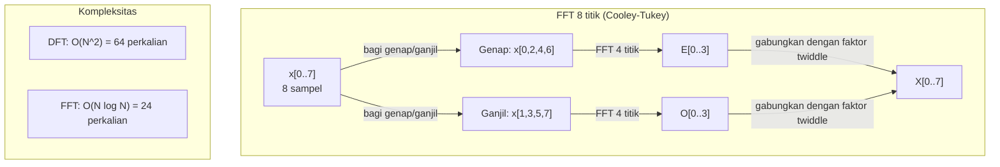
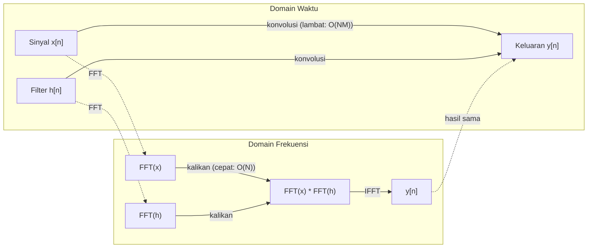

# Transformasi Fourier

> Setiap sinyal adalah jumlah gelombang sinus. Transformasi Fourier memberi tahu Anda gelombang mana saja.

**Jenis:** Build
**Bahasa:** Python, TypeScript
**Prasyarat:** Fase 1, Pelajaran 01-04, 19 (bilangan kompleks)
**Waktu:** ~90 menit

## Tujuan Pembelajaran

- Mengimplementasikan DFT dari awal dan memverifikasinya terhadap FFT Cooley-Tukey $O(N \log N)$
- Menafsirkan koefisien frekuensi: mengekstrak amplitudo, fasa, dan spektrum daya dari suatu sinyal
- Menerapkan teorema konvolusi untuk melakukan konvolusi melalui perkalian FFT
- Menghubungkan dekomposisi frekuensi Fourier dengan penyandian posisi transformer dan lapisan konvolusi CNN

## Masalahnya

Rekaman audio adalah urutan pengukuran tekanan dari waktu ke waktu. Harga saham adalah urutan nilai dari hari ke hari. Citra adalah kisi intensitas piksel di ruang. Semuanya adalah data dalam domain waktu (atau domain ruang). Anda melihat nilai yang berubah seiring suatu indeks.

Namun banyak pola tidak terlihat dalam domain waktu. Apakah sinyal audio ini nada murni atau akor? Apakah harga saham ini memiliki siklus mingguan? Apakah citra ini memiliki tekstur berulang? Pertanyaan-pertanyaan ini berkaitan dengan kandungan frekuensi, dan domain waktu menyembunyikannya.

Transformasi Fourier mengubah data dari domain waktu ke domain frekuensi. Transformasi ini mengambil sinyal dan menguraikannya menjadi gelombang sinus dengan frekuensi berbeda. Setiap gelombang sinus memiliki amplitudo (seberapa kuat ia) dan fasa (di mana ia mulai). Transformasi Fourier memberi tahu Anda keduanya.

Ini penting bagi ML karena pola pikir domain frekuensi muncul di mana-mana. Jaringan saraf konvolusional melakukan konvolusi, yang merupakan perkalian di domain frekuensi. Penyandian posisi transformer menggunakan dekomposisi frekuensi untuk merepresentasikan posisi. Model audio (pengenalan ucapan, generasi musik) bekerja pada spektrogram -- representasi frekuensi dari suara. Model deret waktu mencari pola periodik. Memahami transformasi Fourier memberi Anda kosakata untuk bekerja dengan semuanya.

## Konsepnya

### Definisi DFT

Diberikan $N$ sampel $x[0], x[1], \ldots, x[N-1]$, Transformasi Fourier Diskrit menghasilkan $N$ koefisien frekuensi $X[0], X[1], \ldots, X[N-1]$:

```math
X[k] = \sum_{n=0}^{N-1} x[n] \, e^{-2\pi i k n/N} \qquad \text{untuk } k = 0, 1, \ldots, N-1
```

Setiap $X[k]$ adalah bilangan kompleks. Magnitudonya $\lvert X[k] \rvert$ sebanding dengan amplitudo frekuensi $k$. Tanpa normalisasi, sinus real dengan amplitudo $A$ yang tepat berada pada bin $k$ menghasilkan $\lvert X[k] \rvert = AN/2$, jadi bagi dengan $N/2$ untuk membaca amplitudonya. Fasanya $\angle X[k]$ memberi tahu Anda offset fasa dari frekuensi tersebut.

Wawasan kuncinya: $e^{-2\pi i k n/N}$ adalah phasor yang berputar pada frekuensi $k$. DFT menghitung korelasi antara sinyal dan masing-masing dari $N$ frekuensi yang tersebar merata. Jika sinyal mengandung energi pada frekuensi $k$, korelasinya besar. Jika tidak, nilainya mendekati nol.

### Arti setiap koefisien

**$X[0]$: komponen DC.** Ini adalah jumlah semua sampel -- sebanding dengan rerata. Ini merepresentasikan offset konstan (frekuensi nol) dari sinyal.

```math
X[0] = \sum_{n=0}^{N-1} x[n] \, e^0 = \text{jumlah semua sampel}
```

**$X[k]$ untuk $1 \le k \le N/2$: frekuensi positif.** $X[k]$ merepresentasikan frekuensi $k$ siklus per $N$ sampel. $k$ yang lebih besar berarti frekuensi lebih tinggi (osilasi lebih cepat).

**$X[N/2]$: frekuensi Nyquist.** Frekuensi tertinggi yang dapat direpresentasikan dengan $N$ sampel. Di atasnya, Anda mendapat aliasing -- frekuensi tinggi yang menyamar sebagai frekuensi rendah.

**$X[k]$ untuk $N/2 < k < N$: frekuensi negatif.** Untuk sinyal bernilai real, $X[N-k] = \overline{X[k]}$. Frekuensi negatif adalah cerminan dari frekuensi positif. Itulah sebabnya informasi yang berguna ada pada $N/2 + 1$ koefisien pertama.

### DFT invers

DFT invers merekonstruksi sinyal asli dari koefisien frekuensinya:

```math
x[n] = \frac{1}{N} \sum_{k=0}^{N-1} X[k] \, e^{2\pi i k n/N} \qquad \text{untuk } n = 0, 1, \ldots, N-1
```

Satu-satunya perbedaan dari DFT maju: tanda pada eksponen positif (bukan negatif), dan ada faktor normalisasi $1/N$.

DFT invers adalah rekonstruksi sempurna. Tidak ada informasi yang hilang. Anda dapat pergi dari domain waktu ke domain frekuensi dan kembali tanpa galat apa pun. DFT adalah perubahan basis -- ia mengekspresikan ulang informasi yang sama dalam sistem koordinat yang berbeda.

### FFT: membuatnya cepat

DFT seperti didefinisikan di atas adalah $O(N^2)$: untuk setiap dari $N$ koefisien keluaran, Anda menjumlahkan $N$ sampel masukan. Untuk $N$ = 1 juta, itu adalah $10^{12}$ operasi.

Fast Fourier Transform (FFT) menghitung hasil yang sama dalam $O(N \log N)$. Untuk $N$ = 1 juta, itu sekitar 20 juta operasi alih-alih satu triliun. Inilah yang membuat analisis frekuensi menjadi praktis.

Algoritme Cooley-Tukey (FFT yang paling umum) bekerja dengan membagi dan menaklukkan:

1. Bagi sinyal menjadi sampel berindeks genap dan berindeks ganjil.
2. Hitung DFT dari masing-masing bagian secara rekursif.
3. Gabungkan kedua DFT setengah ukuran menggunakan "faktor twiddle" $e^{-2\pi i k/N}$.

```math
\begin{aligned}
X[k] &= E[k] + e^{-2\pi i k/N} \, O[k] && \text{untuk } k = 0, \ldots, N/2 - 1 \\
X[k + N/2] &= E[k] - e^{-2\pi i k/N} \, O[k] && \text{untuk } k = 0, \ldots, N/2 - 1 \\[6pt]
\text{di mana } E &= \text{DFT dari sampel berindeks genap} \\
O &= \text{DFT dari sampel berindeks ganjil}
\end{aligned}
```

Simetri ini berarti setiap tingkat rekursi melakukan pekerjaan $O(N)$, dan ada $\log_2(N)$ tingkat. Total: $O(N \log N)$.



FFT radix-2 yang dibangun di sini paling cepat ketika panjang sinyal merupakan pangkat dua. Setiap kali sub-masalah memiliki panjang ganjil, metode ini jatuh kembali ke `dft` biasa, sehingga sinyal sering di-zero-padding ke pangkat dua berikutnya untuk kecepatan. Pustaka FFT seperti `numpy.fft` menangani panjang apa pun dengan algoritme mixed-radix, tetapi paling cepat pada panjang yang memiliki faktor prima kecil.

### Analisis spektral

**Spektrum daya** adalah $\lvert X[k] \rvert^2$ -- magnitudo kuadrat dari setiap koefisien frekuensi. Ini menunjukkan berapa banyak energi pada setiap frekuensi.

**Spektrum fasa** adalah $\angle X[k]$ -- offset fasa dari setiap frekuensi. Untuk sebagian besar tugas analisis, Anda peduli pada spektrum daya dan mengabaikan fasa.

```math
\begin{aligned}
\text{Daya pada frekuensi } k: \quad P[k] &= |X[k]|^2 = \mathop{\mathrm{Re}}(X[k])^2 + \mathop{\mathrm{Im}}(X[k])^2 \\
\text{Fasa pada frekuensi } k: \quad \phi[k] &= \mathop{\mathrm{atan2}}(\mathop{\mathrm{Im}}(X[k]), \mathop{\mathrm{Re}}(X[k]))
\end{aligned}
```

### Resolusi frekuensi

Resolusi frekuensi DFT bergantung pada jumlah sampel $N$ dan laju sampel $f_s$.

```math
\begin{aligned}
\text{Frekuensi bin } k: \quad & f_k = k \cdot f_s / N \\
\text{Resolusi frekuensi:} \quad & \Delta f = f_s / N \\
\text{Frekuensi maksimum:} \quad & f_{\max} = f_s / 2 \quad \text{(Nyquist)}
\end{aligned}
```

Untuk membedakan dua frekuensi yang berdekatan, Anda memerlukan lebih banyak sampel. Untuk menangkap frekuensi tinggi, Anda memerlukan laju sampel yang lebih tinggi.

### Teorema konvolusi

Ini adalah salah satu hasil terpenting dalam pemrosesan sinyal dan secara langsung relevan dengan CNN.

**Konvolusi di domain waktu sama dengan perkalian pointwise di domain frekuensi.**

```math
\begin{aligned}
& x * h = \text{IFFT}(\text{FFT}(x) \cdot \text{FFT}(h)) \\[4pt]
& \text{di mana } * \text{ adalah konvolusi dan } \cdot \text{ adalah perkalian elemen demi elemen}
\end{aligned}
```

Mengapa ini penting:

- Konvolusi langsung dari dua sinyal dengan panjang $N$ dan $M$ membutuhkan $O(NM)$ operasi.
- Konvolusi berbasis FFT membutuhkan $O(N \log N)$: transformasikan keduanya, kalikan, transformasikan kembali.
- Untuk kernel besar, konvolusi FFT jauh lebih cepat.
- Ini persis yang terjadi pada lapisan konvolusi dengan bidang reseptif besar.

Catatan: DFT menghitung konvolusi sirkular (sinyal membungkus). Untuk konvolusi linear (tanpa pembungkusan), lakukan zero-padding pada kedua sinyal hingga panjang $N + M - 1$ sebelum menghitung.



### Windowing

DFT mengasumsikan sinyal bersifat periodik -- ia memperlakukan $N$ sampel sebagai satu periode dari sinyal yang berulang tanpa batas. Jika sinyal tidak dimulai dan berakhir pada nilai yang sama, ini menciptakan diskontinuitas di batas, yang muncul sebagai kandungan frekuensi tinggi palsu. Ini disebut kebocoran spektral.

Windowing mengurangi kebocoran dengan meruncingkan sinyal menjadi nol di kedua ujung sebelum menghitung DFT.

Jendela umum:

| Jendela | Bentuk | Lebar lob utama | Level sidelobe | Kasus penggunaan |
|---------|--------|-----------------|----------------|------------------|
| Rektangular | Datar (tanpa jendela) | Paling sempit | Paling tinggi (-13 dB) | Ketika sinyal benar-benar periodik dalam N sampel |
| Hann | Kosinus terangkat | Sedang | Rendah (-31 dB) | Analisis spektral umum |
| Hamming | Kosinus termodifikasi | Sedang | Lebih rendah (-42 dB) | Pemrosesan audio, analisis ucapan |
| Blackman | Kosinus tripel | Lebar | Sangat rendah (-58 dB) | Ketika penekanan sidelobe sangat penting |

```math
\begin{aligned}
\text{Jendela Hann:} \quad & w[n] = 0.5 \left(1 - \cos\frac{2\pi n}{N-1}\right) \\
\text{Jendela Hamming:} \quad & w[n] = 0.54 - 0.46 \cos\frac{2\pi n}{N-1}
\end{aligned}
```

Terapkan jendela dengan mengalikannya elemen demi elemen dengan sinyal sebelum DFT: `X = DFT(x * w)`.

### Sifat-sifat DFT

| Sifat | Domain waktu | Domain frekuensi |
|---|---|---|
| Linearitas | $ax + by$ | $aX + bY$ |
| Pergeseran waktu | $x[n - k]$ | $X[f] e^{-2\pi i f k/N}$ |
| Pergeseran frekuensi | $x[n] e^{2\pi i f_0 n/N}$ | $X[f - f_0]$ |
| Konvolusi | $x * h$ | $X \cdot H$ (pointwise) |
| Perkalian | $x \cdot h$ (pointwise) | $X * H$ (konvolusi sirkular, diskalakan $1/N$) |
| Teorema Parseval | $\sum \lvert x[n] \rvert^2$ | $\frac{1}{N} \sum \lvert X[k] \rvert^2$ |
| Simetri konjugat (masukan real) | $x[n]$ real | $X[k] = \overline{X[N-k]}$ |

Teorema Parseval menyatakan bahwa total energi sama di kedua domain. Energi kebal melalui transformasi.

### Kaitan dengan penyandian posisi

Transformer awal menggunakan penyandian posisi sinusoidal:

```math
\begin{aligned}
PE(pos, 2i) &= \sin\left(pos / 10000^{2i/d_{\text{model}}}\right) \\
PE(pos, 2i+1) &= \cos\left(pos / 10000^{2i/d_{\text{model}}}\right)
\end{aligned}
```

Setiap pasangan dimensi $(2i, 2i+1)$ berosilasi pada frekuensi berbeda. Frekuensi-frekuensinya tersebar secara geometris dari tinggi (dimensi 0,1) ke rendah (dimensi terakhir). Ini memberi setiap posisi pola unik di seluruh pita frekuensi -- mirip dengan cara koefisien Fourier mengidentifikasi sinyal secara unik.

Sifat-sifat utama yang dihasilkannya:

- **Keunikan:** Tidak ada dua posisi yang memiliki penyandian yang sama.
- **Nilai terbatas:** sin dan cos selalu berada dalam $[-1, 1]$.
- **Posisi relatif:** Penyandian posisi $p+k$ dapat dinyatakan sebagai fungsi linear dari penyandian pada posisi $p$. Model dapat belajar memperhatikan posisi relatif.

### Kaitan dengan CNN

Sebuah lapisan konvolusi menerapkan filter (kernel) yang dipelajari pada masukan dengan menggesernya melintasi sinyal atau citra. Secara matematis, ini adalah operasi konvolusi.

Berdasarkan teorema konvolusi, ini setara dengan:
1. FFT masukan
2. FFT kernel
3. Kalikan di domain frekuensi
4. IFFT hasilnya

Implementasi CNN standar menggunakan konvolusi langsung (lebih cepat untuk kernel 3x3 kecil). Tetapi untuk kernel besar atau konvolusi global, pendekatan berbasis FFT jauh lebih cepat. Beberapa arsitektur (seperti FNet) menggantikan atensi sepenuhnya dengan FFT, mencapai akurasi kompetitif dengan kompleksitas $O(N \log N)$ alih-alih $O(N^2)$.

### Spektrogram dan Short-Time Fourier Transform

Satu FFT memberi Anda kandungan frekuensi dari seluruh sinyal, tetapi tidak memberi tahu kapan frekuensi itu muncul. Sebuah chirp (sinyal yang frekuensinya meningkat dari waktu ke waktu) dan sebuah akor (semua frekuensi hadir bersamaan) dapat memiliki spektrum magnitudo yang sama.

Short-Time Fourier Transform (STFT) mengatasi ini dengan menghitung FFT pada jendela-jendela sinyal yang tumpang tindih. Hasilnya adalah spektrogram: representasi 2D dengan waktu pada satu sumbu dan frekuensi pada sumbu lainnya. Intensitas pada setiap titik menunjukkan energi pada frekuensi itu pada waktu itu.

```
Prosedur STFT:
1. Pilih ukuran jendela (mis. 1024 sampel)
2. Pilih ukuran lompatan (mis. 256 sampel -- 75% tumpang tindih)
3. Untuk setiap posisi jendela:
   a. Ekstrak segmen berjendela
   b. Terapkan jendela Hann/Hamming
   c. Hitung FFT
   d. Simpan spektrum magnitudo sebagai satu kolom spektrogram
```

Spektrogram adalah representasi masukan standar untuk model ML audio. Model pengenalan ucapan (Whisper, DeepSpeech) bekerja pada mel-spektrogram -- spektrogram dengan frekuensi yang dipetakan ke skala mel, yang lebih sesuai dengan persepsi nada manusia.

### Aliasing

Jika sinyal mengandung frekuensi di atas $f_s/2$ (frekuensi Nyquist), pengambilan sampel pada laju $f_s$ akan menghasilkan salinan aliased. Sinyal 90 Hz yang diambil sampelnya pada 100 Hz tampak identik dengan sinyal 10 Hz. Tidak ada cara membedakan keduanya hanya dari sampelnya.

```
Contoh:
  Sinyal asli: gelombang sinus 90 Hz
  Laju sampel: 100 Hz
  Frekuensi tampak: 100 - 90 = 10 Hz

  Sampel dari sinyal 90 Hz pada laju sampel 100 Hz
  identik dengan sampel dari sinyal 10 Hz.
  Tidak ada jumlah matematika apa pun yang dapat memulihkan 90 Hz asli.
```

Inilah sebabnya konverter analog-ke-digital menyertakan filter anti-aliasing yang menghilangkan frekuensi di atas Nyquist sebelum pengambilan sampel. Dalam ML, aliasing muncul saat menurunkan sampel peta fitur tanpa filter low-pass yang tepat -- beberapa arsitektur mengatasinya dengan lapisan pooling anti-aliased.

### Zero-padding tidak menambah resolusi

Salah paham umum: melakukan zero-padding pada sinyal sebelum FFT meningkatkan resolusi frekuensi. Tidak demikian. Zero-padding menginterpolasi antar bin frekuensi yang sudah ada, memberi spektrum yang tampak lebih halus. Tetapi ia tidak dapat mengungkap detail frekuensi yang tidak ada dalam sampel asli.

Resolusi frekuensi sejati hanya bergantung pada waktu observasi $T = N / f_s$. Untuk membedakan dua frekuensi yang terpisah $\Delta f$, Anda memerlukan setidaknya $T = 1 / \Delta f$ detik data. Tidak ada jumlah zero-padding yang mengubah batas fundamental ini.

```figure
fourier-synthesis
```

## Bangun Sendiri

### Langkah 1: DFT dari awal

DFT $O(N^2)$ mengikuti langsung dari definisinya.

```python
import math

class Complex:
    ...

def dft(x):
    N = len(x)
    result = []
    for k in range(N):
        total = Complex(0, 0)
        for n in range(N):
            angle = -2 * math.pi * k * n / N
            w = Complex(math.cos(angle), math.sin(angle))
            xn = x[n] if isinstance(x[n], Complex) else Complex(x[n])
            total = total + xn * w
        result.append(total)
    return result
```

### Langkah 2: DFT invers

Struktur yang sama, eksponen positif, bagi dengan $N$.

```python
def idft(X):
    N = len(X)
    result = []
    for n in range(N):
        total = Complex(0, 0)
        for k in range(N):
            angle = 2 * math.pi * k * n / N
            w = Complex(math.cos(angle), math.sin(angle))
            total = total + X[k] * w
        result.append(Complex(total.real / N, total.imag / N))
    return result
```

### Langkah 3: FFT (Cooley-Tukey)

FFT rekursif memerlukan panjang pangkat dua. Bagi menjadi genap dan ganjil, rekursi, lalu gabungkan dengan faktor twiddle.

```python
def fft(x):
    N = len(x)
    if N <= 1:
        return [x[0] if isinstance(x[0], Complex) else Complex(x[0])]
    if N % 2 != 0:
        return dft(x)

    even = fft([x[i] for i in range(0, N, 2)])
    odd = fft([x[i] for i in range(1, N, 2)])

    result = [Complex(0)] * N
    for k in range(N // 2):
        angle = -2 * math.pi * k / N
        twiddle = Complex(math.cos(angle), math.sin(angle))
        t = twiddle * odd[k]
        result[k] = even[k] + t
        result[k + N // 2] = even[k] - t
    return result
```

### Langkah 4: Pembantu analisis spektral

```python
def power_spectrum(X):
    return [xk.real ** 2 + xk.imag ** 2 for xk in X]

def convolve_fft(x, h):
    N = len(x) + len(h) - 1
    padded_N = 1
    while padded_N < N:
        padded_N *= 2

    x_padded = x + [0.0] * (padded_N - len(x))
    h_padded = h + [0.0] * (padded_N - len(h))

    X = fft(x_padded)
    H = fft(h_padded)

    Y = [xk * hk for xk, hk in zip(X, H)]

    y = idft(Y)
    return [y[n].real for n in range(N)]
```

## Gunakan

Untuk pekerjaan nyata, gunakan FFT numpy yang didukung pustaka C yang sangat dioptimalkan.

```python
import numpy as np

signal = np.sin(2 * np.pi * 5 * np.arange(256) / 256)
spectrum = np.fft.fft(signal)
freqs = np.fft.fftfreq(256, d=1/256)

power = np.abs(spectrum) ** 2

positive_freqs = freqs[:len(freqs)//2]
positive_power = power[:len(power)//2]
```

Untuk windowing dan analisis spektral yang lebih lanjut:

```python
from scipy.signal import windows, stft

window = windows.hann(256)
windowed = signal * window
spectrum = np.fft.fft(windowed)
```

Untuk konvolusi:

```python
from scipy.signal import fftconvolve

result = fftconvolve(signal, kernel, mode='full')
```

Untuk spektrogram:

```python
from scipy.signal import stft

frequencies, times, Zxx = stft(signal, fs=sample_rate, nperseg=256)
spectrogram = np.abs(Zxx) ** 2
```

Matriks spektrogram berbentuk (n_frequencies, n_time_frames). Setiap kolom adalah spektrum daya pada satu jendela waktu. Inilah yang dikonsumsi model ML audio sebagai masukan.

## Kirim

Jalankan `code/fourier.py` untuk menghasilkan `outputs/prompt-spectral-analyzer.md`. Versi TypeScript, `code/fourier.ts`, menulis file yang sama.

## Latihan

1. **Identifikasi nada murni.** Buat sinyal dengan satu gelombang sinus pada frekuensi yang tidak diketahui (antara 1 dan 50 Hz), diambil sampelnya pada 128 Hz selama 1 detik. Gunakan DFT Anda untuk mengidentifikasi frekuensinya. Verifikasi bahwa jawabannya cocok. Sekarang tambahkan derau Gaussian dengan deviasi standar 0.5 dan ulangi. Bagaimana derau memengaruhi spektrum?

2. **Verifikasi FFT vs DFT.** Bangkitkan sinyal acak dengan panjang 64. Hitung DFT ($O(N^2){}$) dan FFT. Verifikasi bahwa semua koefisien cocok dalam batas 1e-10. Ukur waktu kedua fungsi pada sinyal dengan panjang 256, 512, 1024, dan 2048. Plot rasio waktu DFT terhadap waktu FFT.

3. **Bukti teorema konvolusi dengan contoh.** Buat sinyal x = [1, 2, 3, 4, 0, 0, 0, 0] dan filter h = [1, 1, 1, 0, 0, 0, 0, 0]. Hitung konvolusi sirkularnya secara langsung (loop bersarang). Lalu hitung via FFT (transformasi, kalikan, transformasi balik). Verifikasi bahwa hasilnya cocok. Sekarang lakukan konvolusi linear dengan zero-padding yang tepat.

4. **Efek windowing.** Buat sinyal yang merupakan jumlah dua gelombang sinus pada 10 Hz dan 12 Hz (sangat berdekatan). Ambil sampel pada 128 Hz selama 1 detik. Hitung spektrum daya tanpa jendela, dengan jendela Hann, dan dengan jendela Hamming. Jendela mana yang memudahkan membedakan kedua puncak? Mengapa?

5. **Analisis penyandian posisi.** Bangkitkan penyandian posisi sinusoidal untuk d_model = 128 dan max_pos = 512. Untuk setiap pasangan posisi $(p_1, p_2)$, hitung hasil kali titik dari penyandiannya. Tunjukkan bahwa hasil kali titik hanya bergantung pada $\lvert p_1 - p_2 \rvert$, bukan pada posisi absolut. Apa yang terjadi pada hasil kali titik saat jarak bertambah?

### Petunjuk

**Latihan 1.** Dengan 128 sampel dalam 1 detik, bin $k$ adalah $k$ Hz, jadi untuk frekuensi bulat, indeks nilai terbesar pada bin 1 sampai 63 adalah frekuensinya. Pilih jumlah hertz bulat. Frekuensi di antara dua bin menyebar ke bin tetangga, dan puncaknya hanya memberi bin terdekat. Gunakan `generate_signal` dan `magnitude_spectrum`. Setelah menambahkan derau, periksa bahwa puncak tetap pada bin yang sama sementara bin lain naik.

**Latihan 2.** Gunakan panjang pangkat dua, karena `fft` membagi sinyal menjadi dua bagian. Periksa `max(abs(a - b))` pada semua koefisien. Rasio waktu harus tumbuh kira-kira sebesar $N / \log_2 N$.

**Latihan 3.** Untuk konvolusi sirkular, hitung $y[n] = \sum_k h[k] x[(n-k) \bmod 8]$ dengan tangan untuk $n$ = 0, 1, dan 2, lalu bandingkan tiga nilai pertama `convolve_direct` dan `convolve_fft`. Konvolusi linear memiliki panjang 4 + 3 - 1 = 6, jadi pertama-tama periksa apakah panjang 8 sudah cukup.

**Latihan 4.** Gunakan `hann_window`, `hamming_window`, `apply_window`, dan `power_spectrum`, lalu hitung puncak terpisah antara 9 dan 13 Hz. 10 Hz dan 12 Hz keduanya menyelesaikan siklus penuh dalam 1 detik, sehingga tanpa jendela mungkin tampak terbaik. Ulangi dengan 10.5 Hz dan 12.5 Hz untuk melihat kebocoran yang dikurangi oleh jendela.

**Latihan 5.** Hitung setiap penyandian dengan `positional_encoding(pos, 128)`. Bandingkan hasil kali titik untuk posisi (0, 10) dengan hasil kali titik untuk (100, 110): kedua nilai harus cocok hingga sekitar 1e-10. Lalu plot hasil kali titik terhadap $\lvert p_1 - p_2 \rvert$ untuk satu $p_1$ tetap.

## Istilah Kunci

| Istilah | Artinya |
|---|---|
| DFT (Transformasi Fourier Diskrit) | Mengubah $N$ sampel domain waktu menjadi $N$ koefisien domain frekuensi. Setiap koefisien adalah korelasi dengan sinusoid kompleks pada frekuensi tersebut |
| FFT (Fast Fourier Transform) | Algoritme $O(N \log N)$ untuk menghitung DFT. Algoritme Cooley-Tukey membagi indeks genap/ganjil secara rekursif |
| DFT invers | Merekonstruksi sinyal domain waktu dari koefisien frekuensi. Rumus sama dengan DFT dengan tanda eksponen dibalik dan penskalaan $1/N$ |
| Bin frekuensi | Setiap indeks $k$ pada keluaran DFT mewakili frekuensi $k f_s/N$ Hz. "Bin" adalah slot frekuensi diskrit |
| Komponen DC | $X[0]$, koefisien frekuensi nol. Se banding dengan rerata sinyal |
| Frekuensi Nyquist | $f_s/2$, frekuensi maksimum yang dapat direpresentasikan pada laju sampel $f_s$. Frekuensi di atasnya mengalami aliasing |
| Spektrum daya | $\lvert X[k] \rvert^2$, magnitudo kuadrat dari setiap koefisien frekuensi. Menunjukkan distribusi energi lintas frekuensi |
| Spektrum fasa | $\angle X[k]$, offset fasa dari setiap komponen frekuensi. Sering diabaikan dalam analisis |
| Kebocoran spektral | Kandungan frekuensi palsu karena memperlakukan sinyal non-periodik sebagai periodik. Dikurangi dengan windowing |
| Fungsi jendela | Fungsi peruncing (Hann, Hamming, Blackman) yang diterapkan sebelum DFT untuk mengurangi kebocoran spektral |
| Faktor twiddle | Eksponensial kompleks $e^{-2\pi i k/N}$ yang digunakan untuk menggabungkan sub-DFT dalam komputasi butterfly FFT |
| Teorema konvolusi | Konvolusi di domain waktu sama dengan perkalian pointwise di domain frekuensi. Fundamental bagi pemrosesan sinyal dan CNN |
| Konvolusi sirkular | Konvolusi tempat sinyal membungkus. Ini yang secara alami dihitung DFT |
| Konvolusi linear | Konvolusi standar tanpa pembungkusan. Dicapai dengan zero-padding sebelum DFT |
| Teorema Parseval | Total energi kekal melalui transformasi Fourier. $\sum \lvert x[n] \rvert^2 = \frac{1}{N} \sum \lvert X[k] \rvert^2$ |
| Aliasing | Ketika frekuensi di atas Nyquist muncul sebagai frekuensi yang lebih rendah akibat laju sampel yang tidak memadai |

## Bacaan Lebih Lanjut

- [Cooley & Tukey: An Algorithm for the Machine Calculation of Complex Fourier Series (1965)](https://www.ams.org/journals/mcom/1965-19-090/S0025-5718-1965-0178586-1/) - makalah FFT awal yang mengubah dunia komputasi
- [3Blue1Brown: But what is the Fourier Transform?](https://www.youtube.com/watch?v=spUNpyF58BY) - pengantar visual terbaik tentang transformasi Fourier
- [Lee-Thorp et al.: FNet: Mixing Tokens with Fourier Transforms (2021)](https://arxiv.org/abs/2105.03824) - menggantikan self-attention dengan FFT pada transformer
- [Smith: The Scientist and Engineer's Guide to Digital Signal Processing](http://www.dspguide.com/) - buku teks daring gratis yang membahas FFT, windowing, dan analisis spektral secara mendalam
- [Vaswani et al.: Attention Is All You Need (2017)](https://arxiv.org/abs/1706.03762) - penyandian posisi sinusoidal yang berasal dari dekomposisi frekuensi Fourier
- [Radford et al.: Whisper (2022)](https://arxiv.org/abs/2212.04356) - pengenalan ucapan menggunakan mel-spektrogram sebagai representasi masukan
