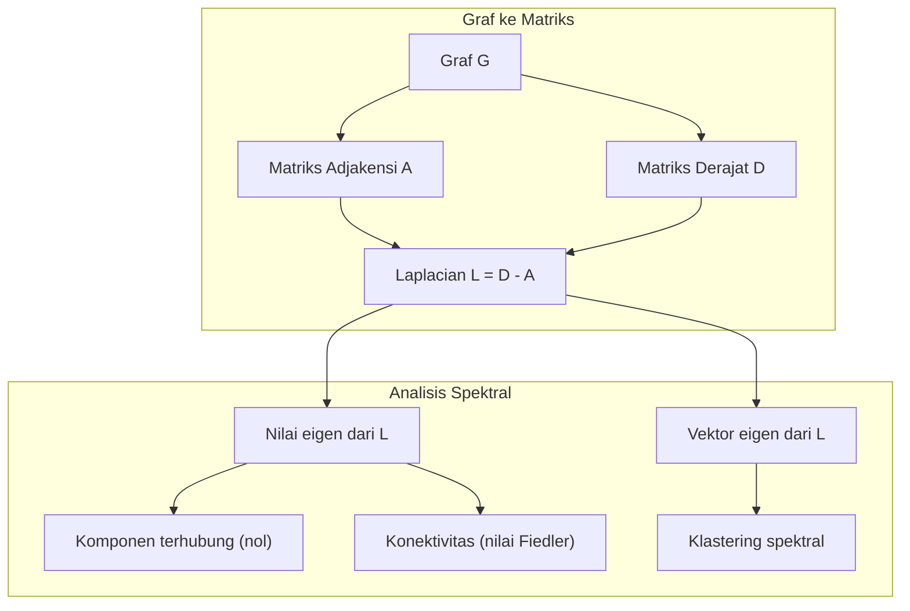
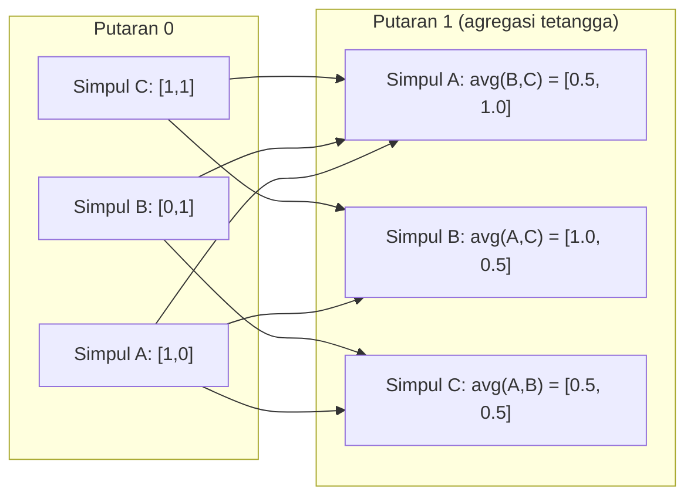

# Teori Graf untuk Pembelajaran Mesin

> Graf adalah struktur data untuk hubungan. Jika data Anda memiliki koneksi, Anda memerlukan teori graf.

**Jenis:** Build
**Bahasa:** Python, TypeScript
**Prasyarat:** Fase 1, Pelajaran 01-03 (aljabar linear, matriks)
**Waktu:** ~90 menit

## Tujuan Pembelajaran

- Membangun kelas graf dengan representasi matriks/daftar adjakensi dan mengimplementasikan penjelajahan BFS serta DFS
- Menghitung Laplacian graf dan menggunakan nilai eigennya untuk mendeteksi komponen terhubung serta mengelompokkan simpul
- Mengimplementasikan satu putaran message passing bergaya GNN sebagai perkalian matriks adjakensi ternormalisasi
- Menerapkan klastering spektral untuk memartisi graf menggunakan vektor Fiedler

## Masalahnya

Jaringan sosial, molekul, basis pengetahuan, jaringan sitasi, peta jalan -- semuanya adalah graf. ML tradisional memperlakukan data sebagai tabel datar. Setiap baris independen. Setiap fitur adalah kolom. Tetapi ketika struktur koneksi itu penting, tabel pun gagal.

Perhatikan sebuah jaringan sosial. Anda ingin memprediksi produk apa yang akan dibeli seorang pengguna. Riwayat pembeliannya penting. Tetapi riwayat pembelian teman-temannya lebih penting lagi. Koneksi-koneksi itu membawa sinyal.

Atau perhatikan sebuah molekul. Anda ingin memprediksi apakah molekul itu mengikat suatu protein. Atom-atomnya penting, tetapi yang benar-benar penting adalah bagaimana atom-atom itu terikat satu sama lain. Struktur itulah datanya.

Graph Neural Networks (GNN) adalah area dengan pertumbuhan tercepat dalam deep learning. GNN mendukung penemuan obat, rekomendasi sosial, deteksi penipuan, dan penalaran basis pengetahuan. Setiap GNN dibangun di atas fondasi yang sama: teori graf dasar.

Anda memerlukan empat hal:
1. Cara merepresentasikan graf sebagai matriks (agar dapat mengalikannya)
2. Algoritme penjelajahan untuk mengeksplorasi struktur graf
3. Laplacian -- matriks tunggal terpenting dalam teori graf spektral
4. Message passing -- operasi yang membuat GNN bekerja

## Konsepnya

### Graf: Simpul dan Sisi

Sebuah graf $G = (V, E)$ terdiri dari simpul (vertex) $V$ dan sisi $E$. Setiap sisi menghubungkan dua simpul.

**Terarah vs tak terarah.** Pada graf tak terarah, sisi $(u, v)$ berarti $u$ terhubung ke $v$ DAN $v$ terhubung ke $u$. Pada graf terarah (digraf), sisi $(u, v)$ berarti $u$ mengarah ke $v$, tetapi belum tentu sebaliknya.

**Berbobot vs tak berbobot.** Pada graf tak berbobot, sisi ada atau tidak ada. Pada graf berbobot, setiap sisi memiliki bobot numerik -- jarak, biaya, atau kekuatan.

| Jenis graf | Contoh |
|---|---|
| Tak terarah, tak berbobot | Jaringan pertemanan Facebook |
| Terarah, tak berbobot | Jaringan pengikut Twitter |
| Tak terarah, berbobot | Peta jalan (jarak) |
| Terarah, berbobot | Tautan halaman web (skor PageRank) |

### Matriks Adjakensi

Matriks adjakensi $A$ adalah representasi inti. Untuk graf dengan $n$ simpul:

```math
A[i][j] = \begin{cases} 1 & \text{jika ada sisi dari simpul } i \text{ ke simpul } j \\ 0 & \text{selainnya} \end{cases}
```

Untuk graf tak terarah, $A$ simetris: $A[i][j] = A[j][i]$. Untuk graf berbobot, $A[i][j]$ = bobot sisi $(i, j)$.

**Contoh -- sebuah segitiga:**

```
Simpul: 0, 1, 2
Sisi: (0,1), (1,2), (0,2)

A = [[0, 1, 1],
     [1, 0, 1],
     [1, 1, 0]]
```

Matriks adjakensi adalah masukan bagi setiap GNN. Operasi matriks pada $A$ sesuai dengan operasi pada graf.

### Derajat

Derajat suatu simpul adalah jumlah sisi yang terhubung dengannya. Untuk graf terarah, anda memiliki in-degree (sisi yang masuk) dan out-degree (sisi yang keluar).

Matriks derajat $D$ bersifat diagonal:

```math
\begin{aligned}
D[i][i] &= \text{derajat simpul } i \\
D[i][j] &= 0 \quad \text{untuk } i \ne j
\end{aligned}
```

Untuk contoh segitiga: $D = \mathop{\mathrm{diag}}(2, 2, 2)$ karena setiap simpul terhubung ke dua simpul lainnya.

Derajat memberi tahu Anda tentang kepentingan simpul. Derajat tinggi = simpul hub (pusat). Distribusi derajat suatu jaringan mengungkap strukturnya. Jaringan sosial mengikuti hukum pangkat (sedikit hub, banyak simpul daun). Graf acak memiliki derajat yang berdistribusi Poisson.

### BFS dan DFS

Kedua algoritme penjelajahan graf yang mendasar. Anda memerlukan keduanya.

**Breadth-First Search (BFS):** Jelajahi semua tetangga terlebih dahulu, lalu tetangga dari tetangga. Menggunakan antrean (FIFO).

```
BFS dari simpul 0:
  Kunjungi 0
  Antrean: [1, 2]        (tetangga dari 0)
  Kunjungi 1
  Antrean: [2, 3]        (tambahkan tetangga dari 1)
  Kunjungi 2
  Antrean: [3]           (tetangga dari 2 sudah dikunjungi)
  Kunjungi 3
  Antrean: []            (selesai)
```

BFS menemukan jalur terpendek pada graf tak berbobot. Jarak dari titik awal ke simpul mana pun sama dengan level BFS saat simpul itu pertama kali ditemukan. Itulah sebabnya BFS digunakan untuk jarak jarak-lompat (hop-count) pada jaringan sosial.

**Depth-First Search (DFS):** Masuk sedalam mungkin sebelum mundur. Menggunakan tumpukan (LIFO) atau rekursi.

```
DFS dari simpul 0:
  Kunjungi 0
  Tumpukan: [1, 2]        (tetangga dari 0)
  Kunjungi 2               (pop dari tumpukan)
  Tumpukan: [1, 3]         (tambahkan tetangga dari 2)
  Kunjungi 3               (pop dari tumpukan)
  Tumpukan: [1]
  Kunjungi 1               (pop dari tumpukan)
  Tumpukan: []             (selesai)
```

DFS berguna untuk:
- Menemukan komponen terhubung (jalankan DFS dari simpul yang belum dikunjungi)
- Deteksi siklus (back edge pada pohon DFS)
- Pengurutan topologis (kebalikan dari urutan selesai DFS)

| Algoritme | Struktur data | Menemukan | Kasus penggunaan |
|---|---|---|---|
| BFS | Antrean | Jalur terpendek | Jarak jaringan sosial, penjelajahan basis pengetahuan |
| DFS | Tumpukan | Komponen, siklus | Konektivitas, pengurutan topologis |

### Laplacian Graf

$L = D - A$. Matriks terpenting dalam teori graf spektral.

Untuk segitiga:

```math
D = \begin{bmatrix} 2 & 0 & 0 \\ 0 & 2 & 0 \\ 0 & 0 & 2 \end{bmatrix} \qquad A = \begin{bmatrix} 0 & 1 & 1 \\ 1 & 0 & 1 \\ 1 & 1 & 0 \end{bmatrix} \qquad L = \begin{bmatrix} 2 & -1 & -1 \\ -1 & 2 & -1 \\ -1 & -1 & 2 \end{bmatrix}
```

Laplacian memiliki sifat-sifat luar biasa:

1. **$L$ semi-definit positif.** Semua nilai eigen $\ge 0$.

2. **Jumlah nilai eigen nol sama dengan jumlah komponen terhubung.** Graf yang terhubung memiliki tepat satu nilai eigen nol. Graf dengan 3 komponen terpisah memiliki tiga nilai eigen nol.

3. **Nilai eigen bukan nol terkecil (nilai Fiedler) mengukur konektivitas.** Nilai Fiedler besar berarti graf terhubung dengan baik. Nilai Fiedler kecil berarti graf memiliki titik lemah -- sebuah leher botol (bottleneck).

4. **Vektor eigen dari nilai Fiedler (vektor Fiedler) mengungkap pemisahan terbaik.** Simpul dengan nilai positif masuk dalam satu kelompok, simpul dengan nilai negatif masuk kelompok lainnya. Ini adalah klastering spektral.



### Sifat Spektral

Nilai eigen dari matriks adjakensi dan Laplacian mengungkap sifat struktural tanpa penjelajahan apa pun.

**Klastering spektral** bekerja seperti ini:
1. Hitung Laplacian $L$
2. Temukan $k$ vektor eigen terkecil dari $L$ (lewati yang pertama, yang berupa semua-satu untuk graf terhubung)
3. Gunakan vektor eigen itu sebagai koordinat baru untuk setiap simpul
4. Jalankan $k$-means pada koordinat tersebut

Mengapa ini bekerja? Vektor eigen $L$ menyandikan fungsi "paling halus" pada graf. Simpul yang terhubung baik mendapat nilai vektor eigen yang mirip. Simpul yang dipisahkan oleh leher botol mendapat nilai yang berbeda. Vektor eigen secara alami memisahkan klaster.

**Kaitan random walk.** Laplacian ternormalisasi berkaitan dengan random walk pada graf. Distribusi stasioner dari random walk sebanding dengan derajat simpul. Waktu pencampuran (seberapa cepat walk konvergen) bergantung pada spectral gap.

### Message Passing

Operasi inti dari Graph Neural Networks. Setiap simpul mengumpulkan pesan dari tetangganya, mengagregasikannya, dan memperbarui keadaannya sendiri.

```math
h_v^{(k+1)} = \text{UPDATE}\left(h_v^{(k)}, \text{AGGREGATE}\left(\{h_u^{(k)} : u \in \text{neighbors}(v)\}\right)\right)
```

Dalam bentuk paling sederhana, AGGREGATE = mean, dan UPDATE = transformasi linear + aktivasi:

```math
h_v^{(k+1)} = \sigma\left(W \cdot \text{mean}\left(\{h_u^{(k)} : u \in \text{neighbors}(v)\}\right)\right)
```

Ini adalah perkalian matriks yang tersamar. Jika $H$ adalah matriks dari semua fitur simpul dan $A$ adalah matriks adjakensi:

```math
H^{(k+1)} = \sigma\left(A_{\text{norm}} H^{(k)} W\right)
```

di mana $A_{\text{norm}}$ adalah matriks adjakensi ternormalisasi (setiap baris berjumlah 1).

Satu putaran message passing memungkinkan setiap simpul "melihat" tetangga terdekatnya. Dua putaran memungkinkannya melihat tetangga dari tetangga. $K$ putaran memberi setiap simpul informasi dari lingkungan $K$-hop-nya.



### Konsep dan Aplikasi ML

| Konsep | Aplikasi ML |
|---|---|
| Matriks adjakensi | Representasi masukan GNN |
| Laplacian graf | Klastering spektral, deteksi komunitas |
| BFS/DFS | Penjelajahan basis pengetahuan, pencarian jalur |
| Distribusi derajat | Kepentingan simpul, rekayasa fitur |
| Message passing | Lapisan GNN (GCN, GAT, GraphSAGE) |
| Nilai eigen dari L | Deteksi komunitas, partisi graf |
| Klastering spektral | Pengelompokan simpul tanpa pengawasan |
| PageRank | Kepentingan simpul, pencarian web |

```figure
graph-degree-distribution
```

## Bangun Sendiri

### Langkah 1: Kelas graf dari awal

```python
class Graph:
    def __init__(self, n_nodes, directed=False):
        self.n = n_nodes
        self.directed = directed
        self.adj = {i: {} for i in range(n_nodes)}

    def add_edge(self, u, v, weight=1.0):
        self.adj[u][v] = weight
        if not self.directed:
            self.adj[v][u] = weight

    def neighbors(self, node):
        return list(self.adj[node].keys())

    def degree(self, node):
        return len(self.adj[node])

    def weighted_degree(self, node):
        return sum(self.adj[node].values())

    def adjacency_matrix(self):
        import numpy as np
        A = np.zeros((self.n, self.n))
        for u in range(self.n):
            for v, w in self.adj[u].items():
                A[u][v] = w
        return A

    def degree_matrix(self):
        import numpy as np
        D = np.zeros((self.n, self.n))
        for i in range(self.n):
            D[i][i] = self.weighted_degree(i)
        return D

    def laplacian(self):
        return self.degree_matrix() - self.adjacency_matrix()
```

Daftar adjakensi (`self.adj`) menyimpan tetangga secara efisien. Konversi ke matriks adjakensi menggunakan numpy karena semua operasi spektral memerlukannya.

### Langkah 2: BFS dan DFS

```python
from collections import deque

def bfs(graph, start):
    visited = set()
    order = []
    distances = {}
    queue = deque([(start, 0)])
    visited.add(start)
    while queue:
        node, dist = queue.popleft()
        order.append(node)
        distances[node] = dist
        for neighbor in graph.neighbors(node):
            if neighbor not in visited:
                visited.add(neighbor)
                queue.append((neighbor, dist + 1))
    return order, distances


def dfs(graph, start):
    visited = set()
    order = []
    stack = [start]
    while stack:
        node = stack.pop()
        if node in visited:
            continue
        visited.add(node)
        order.append(node)
        for neighbor in reversed(graph.neighbors(node)):
            if neighbor not in visited:
                stack.append(neighbor)
    return order
```

BFS menggunakan deque (antrean dua ujung) untuk `popleft` $O(1)$. DFS menggunakan list sebagai tumpukan. Keduanya mengunjungi setiap simpul tepat sekali -- waktu $O(V + E)$.

### Langkah 3: Komponen terhubung dan nilai eigen Laplacian

```python
def connected_components(graph):
    visited = set()
    components = []
    for node in range(graph.n):
        if node not in visited:
            order, _ = bfs(graph, node)
            visited.update(order)
            components.append(order)
    return components


def laplacian_eigenvalues(graph):
    import numpy as np
    L = graph.laplacian()
    eigenvalues = np.linalg.eigvalsh(L)
    return eigenvalues
```

`eigvalsh` ditujukan untuk matriks simetris -- Laplacian selalu simetris untuk graf tak terarah. Fungsi ini mengembalikan nilai eigen dalam urutan menaik. Hitung jumlah nol untuk menemukan jumlah komponen terhubung.

### Langkah 4: Klastering spektral

```python
def spectral_clustering(graph, k=2):
    import numpy as np
    L = graph.laplacian()
    eigenvalues, eigenvectors = np.linalg.eigh(L)
    features = eigenvectors[:, 1:k+1]

    labels = np.zeros(graph.n, dtype=int)
    for i in range(graph.n):
        if features[i, 0] >= 0:
            labels[i] = 0
        else:
            labels[i] = 1
    return labels
```

Untuk $k=2$, tanda vektor Fiedler membagi graf menjadi dua klaster. Untuk $k>2$, Anda akan menjalankan $k$-means pada $k$ vektor eigen pertama (kecuali vektor eigen trivial semua-satu).

### Langkah 5: Message passing

```python
def message_passing(graph, features, weight_matrix):
    import numpy as np
    A = graph.adjacency_matrix()
    row_sums = A.sum(axis=1, keepdims=True)
    row_sums[row_sums == 0] = 1
    A_norm = A / row_sums
    aggregated = A_norm @ features
    output = aggregated @ weight_matrix
    return output
```

Ini adalah satu putaran message passing GNN. Fitur baru setiap simpul adalah rata-rata berbobot dari fitur tetangganya, yang ditransformasikan oleh matriks bobot. Tumpukkan beberapa putaran untuk menyebarkan informasi lebih jauh.

## Gunakan

Dengan networkx dan numpy, operasi yang sama menjadi satu baris perintah:

```python
import networkx as nx
import numpy as np

G = nx.karate_club_graph()

A = nx.adjacency_matrix(G).toarray()
L = nx.laplacian_matrix(G).toarray()

eigenvalues = np.linalg.eigvalsh(L.astype(float))
print(f"Smallest eigenvalues: {eigenvalues[:5]}")
print(f"Connected components: {nx.number_connected_components(G)}")

communities = nx.community.greedy_modularity_communities(G)
print(f"Communities found: {len(communities)}")

pr = nx.pagerank(G)
top_nodes = sorted(pr.items(), key=lambda x: x[1], reverse=True)[:5]
print(f"Top 5 PageRank nodes: {top_nodes}")
```

networkx menangani graf berukuran apa pun dengan backend C yang dioptimalkan. Gunakan itu dalam produksi. Gunakan implementasi dari awal Anda untuk memahami apa yang dilakukannya.

### Analisis spektral dengan numpy

```python
import numpy as np

A = np.array([
    [0, 1, 1, 0, 0],
    [1, 0, 1, 0, 0],
    [1, 1, 0, 1, 0],
    [0, 0, 1, 0, 1],
    [0, 0, 0, 1, 0]
])

D = np.diag(A.sum(axis=1))
L = D - A

eigenvalues, eigenvectors = np.linalg.eigh(L)
print(f"Eigenvalues: {np.round(eigenvalues, 4)}")
print(f"Fiedler value: {eigenvalues[1]:.4f}")
print(f"Fiedler vector: {np.round(eigenvectors[:, 1], 4)}")

fiedler = eigenvectors[:, 1]
group_a = np.where(fiedler >= 0)[0]
group_b = np.where(fiedler < 0)[0]
print(f"Cluster A: {group_a}")
print(f"Cluster B: {group_b}")
```

Vektor Fiedler melakukan pekerjaan berat. Entri positif masuk dalam satu klaster, negatif di klaster lainnya. Tidak diperlukan optimasi iteratif -- cukup satu dekomposisi eigen.

## Kirim

Pelajaran ini menghasilkan:
- `outputs/skill-graph-analysis.md` -- referensi skill untuk menganalisis data berstruktur graf

## Koneksi

| Konsep | Tempat muncul |
|---|---|
| Matriks adjakensi | Masukan GCN, GAT, GraphSAGE |
| Laplacian | Klastering spektral, filter ChebNet |
| BFS | Penjelajahan basis pengetahuan, kueri jalur terpendek |
| Message passing | Setiap lapisan GNN, neural message passing |
| Spectral gap | Konektivitas graf, waktu pencampuran random walk |
| Distribusi derajat | Jaringan hukum pangkat, rekayasa fitur simpul |
| Komponen terhubung | Praproses, penanganan graf yang terputus |
| PageRank | Peringkat kepentingan simpul, inisialisasi atensi |

GNN layak mendapat perhatian khusus. Operasi konvolusi graf pada GCN (Kipf & Welling, 2017) menggunakan matriks adjakensi dengan self-loop yang ditambahkan, $\hat{A} = A + I$:

```math
H^{(l+1)} = \sigma\left(\hat{D}^{-1/2} \hat{A} \hat{D}^{-1/2} H^{(l)} W^{(l)}\right)
```

di mana $\hat{A} = A + I$ (adjakensi plus self-loop) dan $\hat{D}$ adalah matriks derajat dari $\hat{A}$. Self-loop memastikan setiap simpul menyertakan fiturnya sendiri selama agregasi. Ini persis message passing dengan normalisasi simetris. $\hat{D}^{-1/2} \hat{A} \hat{D}^{-1/2}$ adalah matriks adjakensi ternormalisasi. Laplacian muncul karena normalisasi ini berkaitan dengan $L_{\text{sym}} = I - D^{-1/2} A D^{-1/2}$. Memahami Laplacian berarti memahami mengapa GCN bekerja.

## Latihan

1. **Implementasikan PageRank dari awal.** Mulai dengan skor seragam. Pada setiap langkah: score(v) = (1-d)/n + d * sum(score(u)/out_degree(u)) untuk semua u yang mengarah ke v. Gunakan d=0.85. Jalankan hingga konvergen (perubahan < 1e-6). Uji pada graf web kecil.

2. **Temukan komunitas menggunakan klastering spektral.** Buat graf dengan dua klaster yang terpisah jelas (misalnya dua clique yang dihubungkan oleh satu sisi). Jalankan klastering spektral dan verifikasi bahwa metode itu menemukan pemisahan yang benar. Apa yang terjadi saat Anda menambahkan lebih banyak sisi lintas klaster?

3. **Implementasikan algoritme Dijkstra** untuk jalur terpendek pada graf berbobot. Bandingkan hasilnya dengan BFS pada graf yang sama dengan bobot seragam.

4. **Bangun jaringan message passing 2 lapisan.** Terapkan message passing dua kali dengan matriks bobot berbeda. Tunjukkan bahwa setelah 2 putaran, setiap simpul memiliki informasi dari lingkungan 2-hop-nya.

5. **Analisis graf dunia nyata.** Gunakan graf Karate Club (34 simpul, 78 sisi). Hitung distribusi derajat, nilai eigen Laplacian, dan klastering spektral. Bandingkan hasil klastering spektral dengan pemisahan ground truth yang diketahui.

### Petunjuk

**Latihan 1.** Gunakan rumus dari latihan. Simpul tanpa sisi keluar harus membagi skornya secara merata ke semua simpul, jika tidak totalnya turun di bawah 1. Periksa bahwa skor berjumlah 1 setelah setiap langkah dan bandingkan hasil Anda dengan `pagerank(graph)`.

**Latihan 2.** Bangun dua clique dengan `add_edge`, hubungkan keduanya dengan satu sisi, lalu panggil `spectral_clustering(graph, k=2)`. Periksa bahwa setiap clique mendapat satu label. Saat Anda menambahkan sisi lintas, cetak nilai eigen terkecil kedua dari `laplacian()`, yang tumbuh saat kedua kelompok menyatu.

**Latihan 3.** Simpan antrean prioritas dengan `heapq` dan selalu kembangkan simpul dengan jarak terbesar yang diketahui menjadi yang terkecil. Buat setiap bobot 1 dan periksa bahwa setiap jarak Dijkstra sama dengan layer BFS simpul itu dari `bfs(graph, start)`.

**Latihan 4.** Gunakan matriks identitas sebagai `features`, sehingga setiap kolom menandai satu simpul, lalu terapkan `message_passing` dua kali. Maka entri bukan nol pada baris untuk simpul $v$ menunjukkan simpul mana yang mencapai $v$. Bandingkan himpunan itu dengan simpul-simpul dalam jarak 2 dari penjelajahan first-search.

**Latihan 5.** `networkx.karate_club_graph()` memberikan daftar sisi dan ground truth dalam atribut simpul `club`. Salin sisi-sisinya ke dalam `Graph` dan periksa bahwa graf itu memiliki 34 simpul dan 78 sisi. Bandingkan label dari `spectral_clustering` dengan nilai `club`, dan izinkan kedua nama label untuk ditukar.

## Istilah Kunci

| Istilah | Yang orang katakan | Yang sebenarnya dimaksud |
|---|---|---|
| Graf | "Simpul dan sisi" | Struktur matematis $G=(V,E)$ yang menyandikan hubungan berpasangan |
| Matriks adjakensi | "Tabel koneksi" | Matriks $n \times n$ dengan $A[i][j] = 1$ jika simpul $i$ dan $j$ terhubung |
| Derajat | "Seberapa terhubung suatu simpul" | Jumlah sisi yang menyentuh sebuah simpul |
| Laplacian | "D dikurangi A" | $L = D - A$, matriks yang nilai eigennya mengungkap struktur graf |
| Nilai Fiedler | "Konektivitas aljabar" | Nilai eigen bukan nol terkecil dari $L$, mengukur seberapa baik graf terhubung |
| BFS | "Pencarian level demi level" | Penjelajahan yang mengunjungi semua tetangga sebelum masuk lebih dalam, menemukan jalur terpendek |
| DFS | "Masuk dulu sedalam mungkin" | Penjelajahan yang mengikuti satu jalur sampai ujungnya sebelum mundur |
| Message passing | "Simpul berbicara dengan tetangga" | Setiap simpul mengagregasi informasi dari tetangganya, inti dari GNN |
| Klastering spektral | "Klaster dengan vektor eigen" | Memartisi graf menggunakan vektor eigen Laplaciannya |
| Komponen terhubung | "Bagian yang terpisah" | Subgraf maksimal tempat setiap simpul dapat mencapai setiap simpul lainnya |

## Bacaan Lebih Lanjut

- **Kipf & Welling (2017)** -- "Semi-Supervised Classification with Graph Convolutional Networks." Makalah yang meluncurkan GNN modern. Menunjukkan bahwa konvolusi graf spektral menyederhana menjadi message passing.
- **Spielman (2012)** -- "Spectral Graph Theory" catatan kuliah. Pengantar definitif tentang Laplacian, spectral gap, dan partisi graf.
- **Hamilton (2020)** -- "Graph Representation Learning." Buku yang membahas GNN dari dasar hingga aplikasi.
- **Bronstein et al. (2021)** -- "Geometric Deep Learning: Grids, Groups, Graphs, Geodesics, and Gauges." Makalah kerangka penyatu.
- **Veličković et al. (2018)** -- "Graph Attention Networks." Mengembangkan message passing dengan mekanisme atensi.
