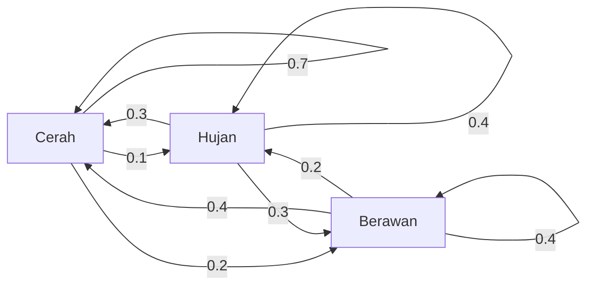
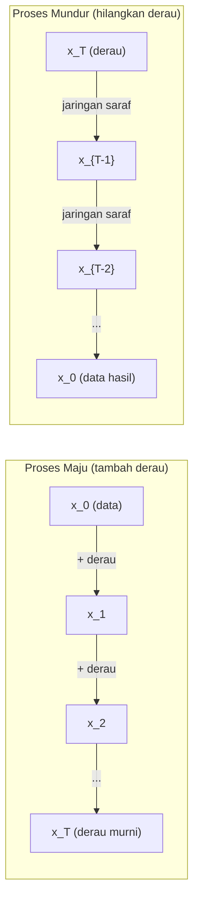

# Proses Stokastik

> Keacakan yang terstruktur. Matematika di balik jalan acak, rantai Markov, dan model difusi.

**Jenis:** Belajar
**Bahasa:** Python
**Prasyarat:** Fase 1, Pelajaran 06-07 (probabilitas, Bayes)
**Waktu:** ~75 menit

## Tujuan Pembelajaran

- Simulasikan jalan acak 1D dan 2D serta verifikasi penskalaan $\sqrt{n}$ dari perpindahan
- Bangun simulator rantai Markov dan hitung distribusi stasionernya melalui dekomposisi eigen
- Terapkan MCMC Metropolis-Hastings dan dinamika Langevin untuk pengambilan sampel dari distribusi target
- Hubungkan proses difusi maju dengan gerak Brown dan jelaskan bagaimana proses mundur menghasilkan data

## Masalah

Banyak sistem AI melibatkan keacakan yang berkembang dari waktu ke waktu. Bukan keacakan statis — melainkan keacakan terstruktur dan berurutan di mana setiap langkah bergantung pada apa yang terjadi sebelumnya.

Model bahasa menghasilkan token satu per satu. Setiap token bergantung pada konteks sebelumnya. Model mengeluarkan distribusi probabilitas, mengambil sampel darinya, lalu lanjut. Itulah proses stokastik.

Model difusi menambahkan derau pada gambar langkah demi langkah hingga menjadi derau murni. Lalu mereka membalik prosesnya, menghilangkan derau langkah demi langkah hingga gambar baru muncul. Proses maju adalah rantai Markov. Proses mundur adalah rantai Markov terlatih yang berjalan mundur.

Agen pembelajaran penguatan mengambil tindakan di lingkungan. Setiap tindakan menghasilkan keadaan baru dengan probabilitas tertentu. Agen mengikuti kebijakan acak di dunia yang acak. Semuanya adalah proses keputusan Markov.

Pengambilan sampel MCMC — tulang punggung inferensi Bayes — membangun rantai Markov yang distribusi stasionernya adalah posterior yang ingin Anda sampel.

Semuanya dibangun di atas empat gagasan dasar:
1. Jalan acak — proses stokastik paling sederhana
2. Rantai Markov — keacakan terstruktur dengan matriks transisi
3. Dinamika Langevin — penurunan gradien dengan derau
4. Metropolis-Hastings — pengambilan sampel dari distribusi apa pun

## Konsep

### Jalan Acak

Mulai di posisi 0. Pada setiap langkah, lempar koin adil. Kepala: bergerak kanan (+1). Ekor: bergerak kiri (-1).

Setelah $n$ langkah, posisi Anda adalah jumlah dari $n$ nilai acak $\pm 1$. Posisi harapan adalah 0 (jalan acaknya tidak bias). Tetapi jarak harapan dari titik asal bertumbuh sebagai $\sqrt{n}$.

Ini berlawanan dengan intuisi. Jalan acaknya adil — tidak ada pergeseran (drift) ke arah mana pun. Namun seiring waktu, ia menjauh semakin jauh dari titik awalnya. Simpangan baku setelah $n$ langkah adalah $\sqrt{n}$.

```
Langkah 0:  Posisi = 0
Langkah 1:  Posisi = +1 atau -1
Langkah 2:  Posisi = +2, 0, atau -2
...
Langkah 100: Jarak harapan dari titik asal ~ 10 (sqrt(100))
Langkah 10000: Jarak harapan dari titik asal ~ 100 (sqrt(10000))
```

**Dalam 2D**, jalan acak bergerak atas, bawah, kiri, atau kanan dengan probabilitas sama. Penskalaan $\sqrt{n}$ yang sama berlaku untuk jarak dari titik asal. Lajurnya membentuk pola menyerupai fraktal.

**Mengapa $\sqrt{n}$?** Setiap langkah adalah +1 atau -1 dengan probabilitas sama. Setelah $n$ langkah, posisi $S_n = X_1 + X_2 + \cdots + X_n$ di mana setiap $X_i$ bernilai $\pm 1$. Varians setiap langkah adalah 1, dan langkah-langkahnya saling bebas, sehingga $\mathop{\mathrm{Var}}(S_n) = n$. Simpangan baku = $\sqrt{n}$. Menurut teorema limit pusat, $S_n / \sqrt{n}$ konvergen ke distribusi normal standar.

Penskalaan $\sqrt{n}$ ini muncul di mana-mana dalam ML. Derau SGD berskala sebagai 1/sqrt(batch_size). Dimensi embedding berskala sebagai $\sqrt{d}$. Akar kuadrat adalah tanda tangan dari penjumlahan acak yang saling bebas.

**Kaitan dengan gerak Brown.** Ambil jalan acak dengan ukuran langkah $1/\sqrt{n}$ dan $n$ langkah per satuan waktu. Saat $n$ menuju tak hingga, jalan acak tersebut konvergen ke gerak Brown $B(t)$ — proses waktu-kontinu di mana $B(t)$ berdistribusi normal dengan rata-rata 0 dan varians $t$.

Gerak Brown adalah landasan matematis difusi. Ia memodelkan goyangan acak partikel dalam fluida, fluktuasi harga saham, dan — yang terpenting — proses derau pada model difusi.

**Keruntuhan penjudi.** Seorang pejalan acak mulai di posisi $k$, dengan batas penyerap di 0 dan $N$. Berapa probabilitas mencapai $N$ sebelum 0? Untuk jalan acak yang adil: $P(\text{reach } N) = k/N$. Ini sangat sederhana dan elegan. Ini terkait dengan teori martingale — jalan acak yang adil adalah martingale (nilai harapan di masa depan = nilai saat ini).

### Rantai Markov

Rantai Markov adalah sistem yang berpindah antarkeadaan sesuai probabilitas tetap. Sifat kuncinya: keadaan berikutnya hanya bergantung pada keadaan saat ini, bukan pada riwayatnya.

```math
P(X_{t+1} = j \mid X_t = i, X_{t-1} = \ldots) = P(X_{t+1} = j \mid X_t = i)
```

Inilah sifat Markov. Ini berarti Anda dapat menggambarkan seluruh dinamika dengan matriks transisi $P$:

```math
P[i][j] = \text{probability of going from state } i \text{ to state } j
```

Setiap baris $P$ berjumlah 1 (Anda harus pergi ke suatu tempat).

**Contoh — Cuaca:**

```
Keadaan: Cerah (0), Hujan (1), Berawan (2)

P = [[0.7, 0.1, 0.2],    (jika cerah: 70% cerah, 10% hujan, 20% berawan)
     [0.3, 0.4, 0.3],    (jika hujan: 30% cerah, 40% hujan, 30% berawan)
     [0.4, 0.2, 0.4]]    (jika berawan: 40% cerah, 20% hujan, 40% berawan)
```

Mulai dari keadaan mana pun. Setelah banyak transisi, distribusi keadaan konvergen ke distribusi stasioner $\pi$, di mana $\pi P = \pi$. Ini adalah vektor eigen kiri dari $P$ dengan eigennilai 1.

Untuk rantai cuaca, distribusi stasionernya adalah [0.55, 0.18, 0.27] — dalam jangka panjang, cuaca cerah 55% dari waktu terlepas dari keadaan awalnya.



**Menghitung distribusi stasioner.** Ada dua pendekatan:

1. **Metode daya**: kalikan distribusi awal apa pun dengan $P$ berulang kali. Setelah iterasi yang cukup, hasilnya konvergen.
2. **Metode eigennilai**: cari vektor eigen kiri dari $P$ dengan eigennilai 1. Ini adalah vektor eigen dari $P^T$ dengan eigennilai 1.

Kedua pendekatan mengharuskan rantai memenuhi syarat konvergensi.

**Syarat konvergensi.** Sebuah rantai Markov konvergen ke distribusi stasioner yang unik jika:
- **Tak tereduksi (irreducible)**: setiap keadaan dapat dicapai dari keadaan mana pun yang lain
- **Aperiodik**: rantai tidak membentuk siklus dengan periode tetap

Kebanyakan rantai yang Anda temui dalam ML memenuhi kedua syarat ini.

**Keadaan penyerap.** Suatu keadaan bersifat penyerap jika setelah masuk ke sana Anda tidak pernah keluar ($P[i][i] = 1$). Rantai Markov penyerap memodelkan proses dengan keadaan terminal — permainan yang berakhir, pelanggan yang berhenti berlangganan, urutan token yang mencapai token akhir teks.

**Waktu pencampuran.** Berapa langkah sampai rantai "dekat" dengan distribusi stasioner? Secara formal, jumlah langkah sampai jarak variasi total dari stasioner turun di bawah suatu ambang. Pencampuran cepat = sedikit langkah yang dibutuhkan. Untuk rantai reversibel, celah spektral dari $P$ (1 dikurangi eigennilai terbesar selain eigennilai 1) mengendalikan waktu pencampuran. Celah lebih besar = pencampuran lebih cepat.

### Kaitan dengan Model Bahasa

Pembangkitan token dalam model bahasa kira-kira adalah proses Markov. Dengan konteks saat ini, model mengeluarkan distribusi atas token berikutnya. Suhu mengendalikan ketajamannya:

```math
P(\text{token}_i) = \frac{\exp(\text{logit}_i / \text{temperature})}{\sum_j \exp(\text{logit}_j / \text{temperature})}
```

- Suhu = 1.0: distribusi standar
- Suhu < 1.0: lebih tajam (lebih deterministik)
- Suhu > 1.0: lebih rata (lebih acak)
- Suhu $\to 0$: argmax (serakah)

Pengambilan sampel top-k memotong hanya token $k$ dengan probabilitas tertinggi. Pengambilan sampel top-p (nukleus) memotong hingga himpunan terkecil token yang probabilitas kumulatifnya melebihi $p$. Keduanya mengubah probabilitas transisi Markov.

### Gerak Brown

Limit waktu-kontinu dari jalan acak. Posisi $B(t)$ memiliki tiga sifat:
1. $B(0) = 0$
2. $B(t) - B(s)$ berdistribusi normal dengan rata-rata 0 dan varians $t - s$ (untuk $t > s$)
3. Increment pada interval yang tidak tumpang tindih saling bebas

Gerak Brown bersifat kontinu tetapi tidak terdiferensiasi di mana pun — ia bergetar di setiap skala. Lajurnya memiliki dimensi fraktal 2 pada bidang.

Dalam simulasi diskrit, Anda mendekati gerak Brown dengan:

```math
B(t + dt) = B(t) + \sqrt{dt} \, z, \quad \text{where } z \sim \mathcal{N}(0, 1)
```

Penskalaan $\sqrt{dt}$ itu penting. Ia berasal dari teorema limit pusat yang diterapkan pada jalan acak.

### Dinamika Langevin

Penurunan gradien menemukan minimum suatu fungsi. Dinamika Langevin menemukan distribusi probabilitas yang proporsional dengan $\exp(-U(x)/T)$, di mana $U$ adalah fungsi energi dan $T$ adalah suhu.

```math
x_{t+1} = x_t - dt \, \nabla U(x_t) + \sqrt{2 T \, dt} \, z_t
```

Dua gaya bekerja pada partikel:
1. **Gaya gradien** ($-dt \cdot \nabla U$): mendorong ke energi rendah (seperti penurunan gradien)
2. **Gaya acak** ($\sqrt{2T dt} \cdot z$): mendorong ke arah acak (eksplorasi)

Pada suhu $T = 0$, ini adalah penurunan gradien murni. Pada suhu tinggi, ini hampir jalan acak. Pada suhu yang tepat, partikel menjelajahi lanskap energi dan menghabiskan lebih banyak waktu di daerah energi rendah.

**Kaitan dengan model difusi.** Proses maju dari model difusi adalah:

```math
x_t = \sqrt{\alpha_t} \, x_{t-1} + \sqrt{1 - \alpha_t} \cdot \text{noise}
```

Ini adalah rantai Markov yang secara bertahap mencampur data dengan derau. Setelah langkah yang cukup, $x_T$ adalah derau Gaussian murni.

Proses mundur — dari derau kembali ke data — juga merupakan rantai Markov, tetapi probabilitas transisinya dipelajari oleh jaringan saraf. Jaringan mempelajari cara memprediksi derau yang ditambahkan pada setiap langkah, lalu menguranginya.



### MCMC: Monte Carlo Rantai Markov

Kadang Anda perlu mengambil sampel dari distribusi $p(x)$ yang dapat Anda evaluasi (sampai konstanta) tetapi tidak dapat disampel secara langsung. Posterior Bayes adalah contoh klasik — Anda mengetahui likelihood dikali prior, tetapi konstanta normalisasi tidak terhitung.

**Metropolis-Hastings** membangun rantai Markov yang distribusi stasionernya adalah $p(x)$:

1. Mulai dari suatu posisi $x$
2. Usulkan posisi baru $x'$ dari distribusi usulan $Q(x' \mid x)$
3. Hitung rasio penerimaan: $a = p(x') Q(x \mid x') / (p(x) Q(x' \mid x))$
4. Terima $x'$ dengan probabilitas $\min(1, a)$. Jika tidak, tetap di $x$.
5. Ulangi.

Jika $Q$ simetris (mis. $Q(x' \mid x) = Q(x \mid x') = \mathcal{N}(x, \sigma^2){}$), rasio menyederhana menjadi $a = p(x') / p(x)$. Anda hanya perlu rasio probabilitas — konstanta normalisasi saling menghilang.

Rantai dijamin konvergen ke $p(x)$ dalam kondisi yang ringan. Tetapi konvergensi bisa lambat jika usulan terlalu kecil (jalan acak) atau terlalu besar (penolakan tinggi). Menyetel usulan adalah seni MCMC.

**Mengapa ini bekerja.** Rasio penerimaan memastikan keseimbangan detail: probabilitas berada di $x$ dan bergerak ke $x'$ sama dengan probabilitas berada di $x'$ dan bergerak ke $x$. Keseimbangan detail menyiratkan bahwa $p(x)$ adalah distribusi stasioner rantai. Jadi setelah langkah yang cukup, sampel-sampel berasal dari $p(x)$.

**Pertimbangan praktis:**
- **Burn-in**: buang $N$ sampel pertama. Rantai perlu waktu untuk mencapai distribusi stasioner dari titik awalnya.
- **Thinning**: simpan setiap sampel ke-$k$ untuk mengurangi autokorelasi.
- **Beberapa rantai**: jalankan beberapa rantai dari titik awal berbeda. Jika mereka konvergen ke distribusi yang sama, Anda memiliki bukti konvergensi.
- **Laju penerimaan**: untuk usulan Gaussian dalam $d$ dimensi, laju penerimaan optimal sekitar 23% (Roberts & Rosenthal, 2001). Terlalu tinggi berarti rantai hampir tidak bergerak. Terlalu rendah berarti semua usulan ditolak.

### Proses Stokastik dalam AI

| Proses | Aplikasi AI |
|---------|---------------|
| Jalan acak | Eksplorasi dalam RL, embedding Node2Vec |
| Rantai Markov | Pembangkitan teks, pengambilan sampel MCMC |
| Gerak Brown | Model difusi (proses maju) |
| Dinamika Langevin | Model generatif berbasis skor, SGLD |
| Proses keputusan Markov | Pembelajaran penguatan |
| Metropolis-Hastings | Inferensi Bayes, pengambilan sampel posterior |

```figure
random-walk-diffusion
```

## Bangun

### Langkah 1: Simulator jalan acak

```python
import numpy as np

def random_walk_1d(n_steps, seed=None):
    rng = np.random.RandomState(seed)
    steps = rng.choice([-1, 1], size=n_steps)
    positions = np.concatenate([[0], np.cumsum(steps)])
    return positions


def random_walk_2d(n_steps, seed=None):
    rng = np.random.RandomState(seed)
    directions = rng.choice(4, size=n_steps)
    dx = np.zeros(n_steps)
    dy = np.zeros(n_steps)
    dx[directions == 0] = 1   # kanan
    dx[directions == 1] = -1  # kiri
    dy[directions == 2] = 1   # atas
    dy[directions == 3] = -1  # bawah
    x = np.concatenate([[0], np.cumsum(dx)])
    y = np.concatenate([[0], np.cumsum(dy)])
    return x, y
```

Jalan acak 1D menyimpan jumlah kumulatif. Setiap langkah adalah +1 atau -1. Setelah $n$ langkah, posisi adalah jumlahnya. Varians bertumbuh linear dengan $n$, sehingga simpangan baku bertumbuh sebagai $\sqrt{n}$.

### Langkah 2: Rantai Markov

```python
class MarkovChain:
    def __init__(self, transition_matrix, state_names=None):
        self.P = np.array(transition_matrix, dtype=float)
        self.n_states = len(self.P)
        self.state_names = state_names or [str(i) for i in range(self.n_states)]

    def step(self, current_state, rng=None):
        if rng is None:
            rng = np.random.RandomState()
        probs = self.P[current_state]
        return rng.choice(self.n_states, p=probs)

    def simulate(self, start_state, n_steps, seed=None):
        rng = np.random.RandomState(seed)
        states = [start_state]
        current = start_state
        for _ in range(n_steps):
            current = self.step(current, rng)
            states.append(current)
        return states

    def stationary_distribution(self):
        eigenvalues, eigenvectors = np.linalg.eig(self.P.T)
        idx = np.argmin(np.abs(eigenvalues - 1.0))
        stationary = np.real(eigenvectors[:, idx])
        stationary = stationary / stationary.sum()
        return np.abs(stationary)
```

Distribusi stasioner adalah vektor eigen kiri dari $P$ dengan eigennilai 1. Kami menemukannya dengan menghitung vektor eigen dari $P^T$ (transposisi mengubah vektor eigen kiri menjadi vektor eigen kanan).

### Langkah 3: Dinamika Langevin

```python
def langevin_dynamics(grad_U, x0, dt, temperature, n_steps, seed=None):
    rng = np.random.RandomState(seed)
    x = np.array(x0, dtype=float)
    trajectory = [x.copy()]
    for _ in range(n_steps):
        noise = rng.randn(*x.shape)
        x = x - dt * grad_U(x) + np.sqrt(2 * temperature * dt) * noise
        trajectory.append(x.copy())
    return np.array(trajectory)
```

Gradien mendorong $x$ ke energi rendah. Derau mencegahnya terjebak. Pada kesetimbangan, distribusi sampel proporsional dengan $\exp(-U(x)/\text{temperature})$.

### Langkah 4: Metropolis-Hastings

```python
def metropolis_hastings(target_log_prob, proposal_std, x0, n_samples, seed=None):
    rng = np.random.RandomState(seed)
    x = np.array(x0, dtype=float)
    samples = [x.copy()]
    accepted = 0
    for _ in range(n_samples - 1):
        x_proposed = x + rng.randn(*x.shape) * proposal_std
        log_ratio = target_log_prob(x_proposed) - target_log_prob(x)
        if np.log(rng.rand()) < log_ratio:
            x = x_proposed
            accepted += 1
        samples.append(x.copy())
    acceptance_rate = accepted / (n_samples - 1)
    return np.array(samples), acceptance_rate
```

Algoritma ini mengusulkan titik baru, memeriksa apakah titik itu memiliki probabilitas lebih tinggi (atau menerimanya dengan probabilitas yang proporsional dengan rasio), lalu mengulang. Laju penerimaan harus sekitar 23-50% agar pencampuran baik.

## Gunakan

Dalam praktiknya, Anda menggunakan pustaka mapan untuk algoritma-algoritma ini. Tetapi memahami mekanismeya penting untuk debugging dan penyetelan.

```python
import numpy as np

rng = np.random.RandomState(42)
walk = np.cumsum(rng.choice([-1, 1], size=10000))
print(f"Final position: {walk[-1]}")
print(f"Expected distance: {np.sqrt(10000):.1f}")
print(f"Actual distance: {abs(walk[-1])}")
```

### NumPy untuk matriks transisi

```python
import numpy as np

P = np.array([[0.7, 0.1, 0.2],
              [0.3, 0.4, 0.3],
              [0.4, 0.2, 0.4]])

distribution = np.array([1.0, 0.0, 0.0])
for _ in range(100):
    distribution = distribution @ P

print(f"Stationary distribution: {np.round(distribution, 4)}")
```

Kalikan distribusi awal dengan $P$ berulang kali. Setelah iterasi yang cukup, hasilnya konvergen ke distribusi stasioner terlepas dari titik awal Anda. Ini adalah metode daya untuk mencari vektor eigen kiri dominan.

### Kaitan dengan kerangka kerja nyata

- **Diffusion PyTorch:** `DDPMScheduler` di `diffusers` Hugging Face mengimplementasikan rantai Markov maju dan mundur
- **NumPyro / PyMC:** gunakan MCMC (sampler NUTS, yang merupakan penyempurnaan Metropolis-Hastings) untuk inferensi Bayes
- **Gymnasium (RL):** fungsi langkah lingkungan mendefinisikan proses keputusan Markov

### Memverifikasi konvergensi rantai Markov

```python
import numpy as np

P = np.array([[0.9, 0.1], [0.3, 0.7]])

eigenvalues = np.linalg.eigvals(P)
spectral_gap = 1 - sorted(np.abs(eigenvalues))[-2]
print(f"Eigenvalues: {eigenvalues}")
print(f"Spectral gap: {spectral_gap:.4f}")
print(f"Approximate mixing time: {1/spectral_gap:.1f} steps")
```

Celah spektral memberi tahu Anda seberapa cepat rantai melupakan keadaan awalnya. Celah 0.2 berarti sekitar 5 langkah untuk bercampur. Celah 0.01 berarti sekitar 100 langkah. Selalu periksa ini sebelum menjalankan simulasi panjang — rantai yang lambat bercampur membuang-buang komputasi.

## Rilis

Pelajaran ini menghasilkan:
- `outputs/prompt-stochastic-process-advisor.md` — prompt yang membantu mengidentifikasi kerangka proses stokastik mana yang berlaku untuk suatu masalah

## Kaitan

| Konsep | Tempat munculnya |
|---------|------------------|
| Jalan acak | Embedding graf Node2Vec, eksplorasi dalam RL |
| Rantai Markov | Pembangkitan token pada LLM, pengambilan sampel MCMC |
| Gerak Brown | Proses difusi maju pada DDPM, model berbasis SDE |
| Dinamika Langevin | Model generatif berbasis skor, stochastic gradient Langevin dynamics (SGLD) |
| Distribusi stasioner | Target konvergensi MCMC, PageRank |
| Metropolis-Hastings | Pengambilan sampel posterior Bayes, simulated annealing |
| Suhu | Pengambilan sampel LLM, eksplorasi Boltzmann dalam RL, simulated annealing |
| Waktu pencampuran | Kecepatan konvergensi MCMC, analisis celah spektral |
| Keadaan penyerap | Token akhir urutan, keadaan terminal dalam RL |
| Keseimbangan detail | Jaminan kebenaran sampler MCMC |

Model difusi layak mendapat perhatian khusus. DDPM (Ho et al., 2020) mendefinisikan rantai Markov maju:

```math
q(x_t \mid x_{t-1}) = \mathcal{N}\left(x_t; \sqrt{1-\beta_t} \, x_{t-1}, \beta_t I\right)
```

di mana $\beta_t$ adalah jadwal derau. Setelah $T$ langkah, $x_T$ kira-kira $\mathcal{N}(0, I)$. Proses mundur diparameterisasi oleh jaringan saraf yang memprediksi derau:

```math
p_\theta(x_{t-1} \mid x_t) = \mathcal{N}\left(x_{t-1}; \mu_\theta(x_t, t), \sigma_t^2 I\right)
```

Setiap langkah pembangkitan adalah satu langkah dalam rantai Markov terlatih. Memahami rantai Markov berarti memahami bagaimana dan mengapa model difusi menghasilkan data.

SGLD (Stochastic Gradient Langevin Dynamics) menggabungkan penurunan gradien mini-batch dengan derau Langevin. Alih-alih menghitung gradien penuh, Anda menggunakan estimasi stokastik dan menambahkan derau terkalibrasi. Saat laju pembelajaran menurun, SGLD beralih dari optimasi ke pengambilan sampel — Anda mendapat sampel posterior Bayes perkiraan secara gratis. Ini adalah salah satu cara paling sederhana untuk memperoleh estimasi ketidakpastian dari jaringan saraf.

Wawasan kunci di seluruh kaitan ini: proses stokastik bukan sekadar alat teoretis. Mereka adalah mekanisme komputasi di dalam sistem AI modern. Saat Anda menyetel suhu LLM, Anda sedang menyesuaikan rantai Markov. Saat Anda melatih model difusi, Anda sedang belajar membalik proses yang menyerupai gerak Brown. Saat Anda menjalankan inferensi Bayes, Anda sedang membangun rantai yang konvergen ke posterior.

## Latihan

1. **Simulasikan 1000 jalan acak dengan 10000 langkah.** Plot distribusi posisi akhir. Verifikasi bahwa distribusinya kira-kira Gaussian dengan rata-rata 0 dan simpangan baku $\sqrt{10000} = 100$.

2. **Bangun pembangkit teks menggunakan rantai Markov.** Latih pada korpus kecil: untuk setiap kata, hitung transisi ke kata berikutnya. Bangun matriks transisi. Hasilkan kalimat baru dengan mengambil sampel dari rantai.

3. **Terapkan simulated annealing** menggunakan Metropolis-Hastings. Mulai pada suhu tinggi (terima hampir semua usulan) lalu dinginkan secara bertahap (terima hanya perbaikan). Gunakan untuk menemukan minimum fungsi dengan banyak minimum lokal.

4. **Bandingkan dinamika Langevin pada berbagai suhu.** Ambil sampel dari potensial sumur-ganda $U(x) = (x^2 - 1)^2$. Pada suhu rendah, sampel berkumpul di satu sumur. Pada suhu tinggi, sampel menyebar ke kedua sumur. Temukan suhu kritis di mana rantai bercampur antarsumur.

5. **Terapkan proses difusi maju.** Mulai dengan sinyal 1D (mis. gelombang sinus). Tambahkan derau secara bertahap selama 100 langkah dengan jadwal derau linear. Tunjukkan bagaimana sinyal terdegradasi menjadi derau murni. Lalu terapkan penyaring derau sederhana yang membalik prosesnya (bahkan yang naif yang hanya mengurangi estimasi derau).

### Petunjuk

**Latihan 1.** Panggil `random_walk_1d(10000, seed=i)` untuk 1000 seed dan simpan setiap posisi akhir. Periksa bahwa rata-ratanya dekat 0, simpangan bakunya dekat 100, dan sekitar 68% posisi akhir berada antara -100 dan 100.

**Latihan 2.** Hitung setiap pasangan kata, lalu bagi setiap baris dengan totalnya agar setiap baris berjumlah 1. Teruskan matriks ke `MarkovChain(transition_matrix, state_names)` dan panggil `simulate`. Periksa bahwa setiap pasangan kata pada hasil Anda juga muncul di korpus.

**Latihan 3.** Terima titik yang lebih buruk dengan probabilitas $\exp(-\Delta / T)$ dan kalikan $T$ dengan faktor seperti 0.99 setelah setiap langkah. Uji pada fungsi yang minimumnya Anda ketahui, lalu bandingkan jawaban Anda dengan pencarian grid halus.

**Latihan 4.** Gradiennya adalah $4x(x^2 - 1)$, jadi teruskan itu ke `langevin_dynamics(grad_U, x0, dt, temperature, n_steps)`. Penghalang di $x = 0$ memiliki tinggi 1, jadi hitung seberapa sering tanda $x$ berubah untuk suhu dari 0.05 hingga 1 dan cari suhu di mana hitungan mulai naik dengan cepat.

**Latihan 5.** Panggil `diffusion_forward(signal, 100)` dan hitung $\bar{\alpha}$ pada langkah terakhir sebagai hasil kali dari $(1 - \beta_t)$. Jika $\bar{\alpha}$ jauh dari 0, sinyal belum menjadi derau murni, jadi naikkan `beta_end`. Uji penyaring derau Anda terlebih dahulu dengan derau sejati: maka $(x_t - \sqrt{1 - \bar{\alpha}_t} \epsilon)/\sqrt{\bar{\alpha}_t}$ harus mengembalikan sinyal asli secara persis.

## Istilah Kunci

| Istilah | Yang orang katakan | Yang sebenarnya dimaksud |
|------|----------------|----------------------|
| Jalan acak | "Gerakan lempar koin" | Proses di mana posisi berubah dengan tambahan acak pada setiap langkah |
| Sifat Markov | "Tanpa ingatan" | Masa depan hanya bergantung pada keadaan saat ini, bukan pada riwayatnya |
| Matriks transisi | "Tabel probabilitas" | $P[i][j]$ = probabilitas berpindah dari keadaan $i$ ke keadaan $j$ |
| Distribusi stasioner | "Rata-rata jangka panjang" | Distribusi $\pi$ di mana $\pi P = \pi$ — kesetimbangan rantai |
| Gerak Brown | "Goyangan acak" | Limit waktu-kontinu dari jalan acak, $B(t) \sim \mathcal{N}(0, t)$ |
| Dinamika Langevin | "Penurunan gradien dengan derau" | Aturan pembaruan yang menggabungkan gradien deterministik dan gangguan acak |
| MCMC | "Berjalan menuju target" | Membangun rantai Markov yang distribusi stasionernya adalah distribusi yang Anda inginkan |
| Metropolis-Hastings | "Usulkan dan terima/tolak" | Algoritma MCMC yang menggunakan rasio penerimaan untuk memastikan konvergensi |
| Suhu | "Tombol keacakan" | Parameter yang mengendalikan trade-off antara eksplorasi dan eksploitasi |
| Proses difusi | "Derau masuk, derau keluar" | Maju: tambahkan derau secara bertahap. Mundur: hilangkan secara bertahap. Menghasilkan data. |

## Bacaan Lanjutan

- **Ho, Jain, Abbeel (2020)** -- "Denoising Diffusion Probabilistic Models." Makalah DDPM yang memulai revolusi model difusi. Derivasi yang jelas dari rantai Markov maju dan mundur.
- **Song & Ermon (2019)** -- "Generative Modeling by Estimating Gradients of the Data Distribution." Pendekatan berbasis skor yang menggunakan dinamika Langevin untuk pengambilan sampel.
- **Roberts & Rosenthal (2004)** -- "General state space Markov chains and MCMC algorithms." Teori di balik kapan dan mengapa MCMC bekerja.
- **Norris (1997)** -- "Markov Chains." Buku teks standar. Membahas konvergensi, distribusi stasioner, dan waktu capai.
- **Welling & Teh (2011)** -- "Bayesian Learning via Stochastic Gradient Langevin Dynamics." Menggabungkan SGD dengan dinamika Langevin untuk inferensi Bayes yang skalabel.
