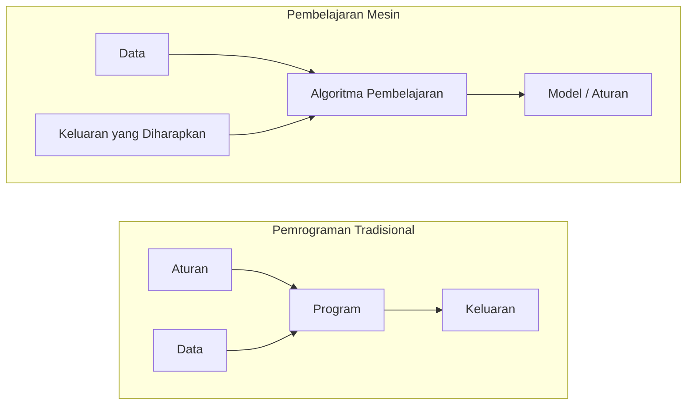
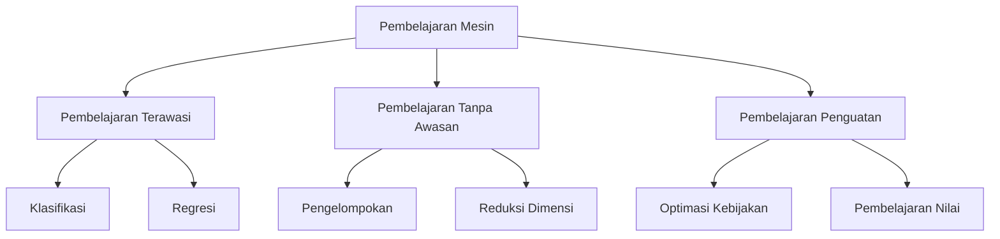
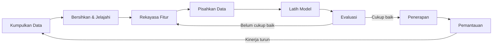
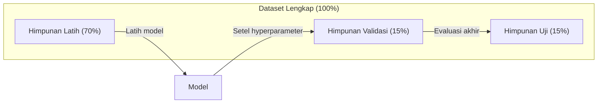
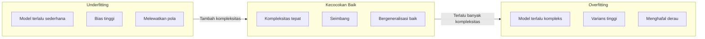
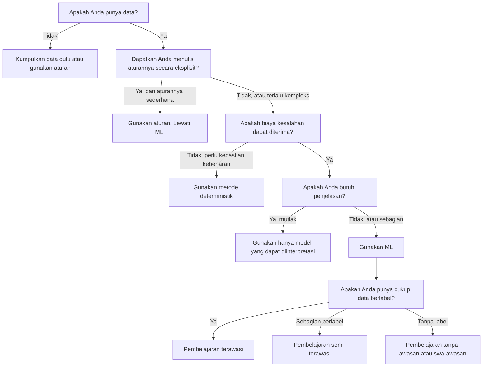

# Apa Itu Pembelajaran Mesin

> Pembelajaran mesin adalah mengajar komputer untuk menemukan pola dalam data, alih-alih menulis aturan dengan tangan.

**Jenis:** Belajar
**Bahasa:** Python
**Prasyarat:** Fase 1 (Dasar-Dasar Matematika)
**Waktu:** ~45 menit

## Tujuan Pembelajaran

- Jelaskan perbedaan antara pembelajaran terawasi, tanpa awasan, dan penguatan, serta identifikasi jenis mana yang cocok untuk suatu masalah
- Terapkan klasifikasi sentroid terdekat dari awal dan evaluasi terhadap baseline acak
- Bedakan tugas klasifikasi dan regresi serta pilih fungsi rugi yang tepat untuk masing-masing
- Evaluasi apakah suatu masalah bisnis cocok untuk ML atau lebih baik diselesaikan dengan aturan deterministik

## Masalah

Anda ingin membangun filter spam. Pendekatan tradisional: duduk dan tulis ratusan aturan. "Jika email mengandung 'FREE MONEY', tandai sebagai spam. Jika memiliki lebih dari 3 tanda seru, tandai sebagai spam." Anda menghabiskan berminggu-minggu menulis aturan. Lalu pembuat spam mengubah kata-kata mereka. Aturan Anda rusak. Anda menulis lebih banyak aturan. Siklusnya tidak pernah berakhir.

Pembelajaran mesin membalik ini. Alih-alih menulis aturan, Anda memberikan komputer ribuan email berlabel ("spam" atau "bukan spam") dan membiarkannya mencari aturannya sendiri. Komputer menemukan pola yang tidak akan pernah Anda pikirkan. Saat pembuat spam mengubah taktik, Anda melatih ulang dengan data baru alih-alih menulis ulang kode.

Pergeseran dari "memprogram aturan" ke "belajar dari data" ini adalah inti dari pembelajaran mesin. Setiap mesin rekomendasi, asisten suara, mobil otonom, dan model bahasa bekerja dengan cara ini.

## Konsep

### Belajar dari Data, Bukan Aturan

Pemrograman tradisional dan pembelajaran mesin menyelesaikan masalah dengan arah yang berlawanan.



Pemrograman tradisional: Anda menulis aturannya. Program menerapkannya pada data untuk menghasilkan keluaran.

Pembelajaran mesin: Anda memberikan data dan keluaran yang diharapkan. Algoritma menemukan aturannya.

"Model" yang dihasilkan dari pelatihan ADALAH aturan-aturan itu, yang dikodekan sebagai bilangan (bobot, parameter). Model menggeneralisasi dari contoh-contoh yang telah dilihatnya untuk membuat prediksi pada data yang belum pernah dilihatnya.

### Tiga Jenis Pembelajaran Mesin



**Pembelajaran Terawasi**: Anda punya pasangan input-output. Model belajar memetakan input ke output.
- "Ini 10.000 foto berlabel kucing atau anjing. Belajarlah membedakannya."
- "Ini fitur dan harga rumah. Belajarlah memprediksi harganya."

**Pembelajaran Tanpa Awasan**: Anda hanya punya input. Tanpa label. Model menemukan struktur sendiri.
- "Ini 10.000 riwayat pembelian pelanggan. Temukan pengelompokan alami."
- "Ini 1.000 titik data berdimensi banyak. Reduksi menjadi 2 dimensi dengan tetap menjaga strukturnya."

**Pembelajaran Penguatan**: Agen mengambil tindakan dalam lingkungan dan menerima hadiah atau penalti. Ia mempelajari strategi (kebijakan) untuk memaksimalkan total hadiah.
- "Mainkan game ini. +1 untuk menang, -1 untuk kalah. Cari strateginya."
- "Kendalikan lengan robot ini. +1 untuk mengambil objek, -0.01 untuk setiap detik yang terbuang."

Sebagian besar yang akan Anda bangun dalam praktiknya menggunakan pembelajaran terawasi. Pembelajaran tanpa awasan umum untuk praproses dan eksplorasi. Pembelajaran penguatan menopang AI game, robotika, dan RLHF untuk model bahasa.

### Melampaui Tiga Jenis Utama

Tiga kategori di atas rapi, tetapi ML di dunia nyata sering mengaburkan batasnya.

**Pembelajaran semi-terawasi** menggunakan himpunan data berlabel yang kecil dan himpunan data tanpa label yang besar. Anda mungkin punya 100 citra medis berlabel dan 100.000 yang tidak berlabel. Tekniknya meliputi:

- **Propagasi label:** bangun graf yang menghubungkan titik-titik data serupa. Label menyebar dari simpul berlabel ke tetangga tanpa label melalui graf.
- **Pseudo-labeling:** latih model pada data berlabel, gunakan untuk memprediksi label data tanpa label, lalu latih ulang pada semuanya. Model membangun himpunan pelatihannya sendiri.
- **Regularisasi konsistensi:** model seharusnya memberikan prediksi yang sama untuk suatu input dan versi input itu yang sedikit diubah. Ini bekerja bahkan tanpa label.

**Pembelajaran swa-awasan** menciptakan pengawasan dari data itu sendiri. Sama sekali tidak perlu label manusia. Model membuat tugas prediksinya sendiri dari struktur data.

- **Pemodelan bahasa tertutup (BERT):** sembunyikan 15% kata dalam kalimat, latih model untuk memprediksi kata yang hilang. "Label" berasal dari teks aslinya.
- **Pembelajaran kontrastif (SimCLR):** ambil gambar, buat dua versi hasil augmentasi. Latih model untuk mengenali keduanya berasal dari gambar yang sama sekaligus membedakannya dari versi augmentasi gambar lain.
- **Prediksi token berikutnya (GPT):** prediksi kata berikutnya dari semua kata sebelumnya. Setiap dokumen teks menjadi contoh pelatihan.

Ini bukan kategori terpisah dari tiga jenis utama. Ini adalah strategi yang menggabungkan ide terawasi dan tanpa awasan. Pembelajaran swa-awasan secara teknis bersifat terawasi (model memprediksi sesuatu), tetapi labelnya dihasilkan otomatis, bukan oleh manusia.

### Klasifikasi lawan Regresi

Ini adalah dua tugas pembelajaran terawasi utama.

| Aspek | Klasifikasi | Regresi |
|--------|---------------|------------|
| Keluaran | Kategori diskrit | Bilangan kontinu |
| Contoh | "Apakah email ini spam?" | "Berapa harga rumahnya nanti?" |
| Ruang keluaran | {kucing, anjing, burung} | Bilangan real apa pun |
| Fungsi rugi | Cross-entropy, akurasi | MSE, MAE |
| Keputusan | Batas-batas antarkelas | Kurva yang cocok dengan data |

Klasifikasi menjawab "kategori mana?" Regresi menjawab "berapa banyak?"

Beberapa masalah bisa dirumuskan dengan salah satu cara. Memprediksi apakah saham naik atau turun adalah klasifikasi. Memprediksi harga persisnya adalah regresi.

### Alur Kerja ML

Setiap proyek pembelajaran mesin mengikuti pipeline yang sama, apa pun algoritmanya.



**Kumpulkan Data**: kumpulkan data mentah. Lebih banyak data hampir selalu lebih baik, tetapi kualitas lebih penting daripada kuantitas.

**Bersihkan & Jelajahi**: tangani nilai yang hilang, hapus duplikat, visualisasikan distribusi, temukan anomali. Langkah ini sering memakan 60-80% dari total waktu proyek.

**Rekayasa Fitur**: ubah data mentah menjadi fitur yang bisa digunakan model. Ubah tanggal menjadi hari dalam seminggu. Normalisasi kolom numerik. Enkode variabel kategori. Fitur yang baik lebih penting daripada algoritma mewah.

**Pisahkan Data**: bagi menjadi himpunan latih, validasi, dan uji. Model dilatih pada data latih, Anda menyetel hyperparameter pada data validasi, dan melaporkan kinerja akhir pada data uji.

**Latih Model**: masukkan data latih ke algoritma. Algoritma menyesuaikan parameter internal untuk meminimalkan fungsi rugi.

**Evaluasi**: ukur kinerja pada data validasi/uji. Jika kinerja tidak memuaskan, kembali dan coba fitur, algoritma, atau hyperparameter lain.

**Penerapan**: pasang model ke produksi agar membuat prediksi pada data baru.

**Pemantauan**: lacak kinerja dari waktu ke waktu. Distribusi data berubah (pergeseran data), dan kinerja model menurun. Saat kinerja turun, latih ulang.

### Pembagian Latih, Validasi, dan Uji

Ini adalah konsep paling penting yang salah dipahami pemula. Anda harus mengevaluasi model pada data yang belum pernah dilihatnya selama pelatihan. Jika tidak, Anda sedang mengukur hafalan, bukan pembelajaran.



| Pembagian | Tujuan | Kapan digunakan | Ukuran umum |
|-------|---------|-----------|-------------|
| Latih | Model belajar dari data ini | Saat pelatihan | 60-80% |
| Validasi | Menyetel hyperparameter, membandingkan model | Setiap kali pelatihan | 10-20% |
| Uji | Estimasi kinerja akhir yang tidak bias | Sekali, di akhir | 10-20% |

Himpunan uji itu suci. Anda melihatnya tepat sekali. Jika Anda terus menyesuaikan model berdasarkan kinerja uji, pada dasarnya Anda sedang melatih pada himpunan uji dan angka yang Anda laporkan menjadi tidak bermakna.

Untuk dataset kecil, gunakan validasi silang k-fold: bagi data menjadi $k$ bagian, latih pada $k-1$ bagian, validasi pada bagian yang tersisa, putar, dan rata-ratakan hasilnya.

### Overfitting lawan Underfitting



**Underfitting**: model terlalu sederhana untuk menangkap pola dalam data. Garis lurus yang mencoba mencocokkan hubungan yang melengkung. Error latih tinggi. Error uji tinggi.

**Overfitting**: model terlalu kompleks dan menghafal data latih, termasuk deraunya. Kurva bergelombang yang melewati setiap titik latih tetapi gagal pada data baru. Error latih rendah. Error uji tinggi.

**Kecocokan baik**: model menangkap pola nyata tanpa menghafal derau. Error latih dan error uji keduanya cukup rendah.

Tanda-tanda overfitting:
- Akurasi latih jauh lebih tinggi daripada akurasi validasi
- Model bekerja baik pada data latih tetapi buruk pada data baru
- Menambah data latih meningkatkan kinerja (model sedang menghafal, bukan belajar)

Solusi untuk overfitting:
- Dapatkan lebih banyak data latih
- Kurangi kompleksitas model (lebih sedikit parameter, arsitektur lebih sederhana)
- Regularisasi (tambahkan penalti untuk bobot besar)
- Dropout (secara acak nolkan neuron selama pelatihan)
- Penghentian awal (hentikan pelatihan saat error validasi mulai naik)

Solusi untuk underfitting:
- Gunakan model yang lebih kompleks
- Tambahkan lebih banyak fitur
- Kurangi regularisasi
- Latih lebih lama

### Trade-off Bias-Varians

Ini adalah kerangka matematis di balik overfitting dan underfitting.

**Bias**: error yang berasal dari asumsi yang salah dalam model. Model linear memiliki bias tinggi ketika hubungan yang sebenarnya nonlinear. Bias tinggi menyebabkan underfitting.

**Varians**: error yang berasal dari kepekaan terhadap fluktuasi kecil dalam data latih. Model dengan varians tinggi memberikan prediksi yang sangat berbeda ketika dilatih pada himpunan data yang berbeda. Varians tinggi menyebabkan overfitting.

| Kompleksitas model | Bias | Varians | Hasil |
|-----------------|------|----------|--------|
| Terlalu rendah (model linear untuk data melengkung) | Tinggi | Rendah | Underfitting |
| Tepat | Sedang | Sedang | Generalisasi baik |
| Terlalu tinggi (polinomial derajat-20 untuk 10 titik) | Rendah | Tinggi | Overfitting |

$\text{Total error} = \text{Bias}^2 + \text{Variance} + \text{Irreducible noise}$

Anda tidak dapat mengurangi derau tak tereduksi (itu adalah keacakan dalam data itu sendiri). Anda ingin menemukan titik manis di mana $\text{bias}^2 + \text{variance}$ diminimalkan.

### Teorema No Free Lunch

Tidak ada satu algoritma pun yang bekerja paling baik untuk setiap masalah. Algoritma yang bekerja baik pada suatu kelas masalah akan bekerja buruk pada kelas lainnya. Inilah sebabnya ilmuwan data mencoba beberapa algoritma dan membandingkan hasilnya.

Dalam praktiknya, pilihannya bergantung pada:
- Berapa banyak data yang Anda miliki
- Berapa banyak fitur yang ada
- Apakah hubungannya linear atau nonlinear
- Apakah Anda memerlukan interpretabilitas
- Berapa daya komputasi yang Anda mampu sediakan

### Kapan TIDAK Menggunakan Pembelajaran Mesin

ML itu kuat tetapi tidak selalu alat yang tepat. Sebelum mengambil model, tanyakan apakah Anda benar-benar membutuhkannya.

**Jangan gunakan ML ketika:**

- **Aturannya sederhana dan jelas.** Perhitungan pajak, algoritma pengurutan, konversi satuan. Jika Anda bisa menulis logikanya dalam beberapa if-statement, model hanya menambah kompleksitas tanpa manfaat.
- **Anda tidak punya data atau sangat sedikit data.** ML membutuhkan contoh untuk belajar. Dengan 10 titik data, Anda tidak bisa melatih apa pun yang bermakna. Kumpulkan data terlebih dahulu.
- **Biaya salah sangat besar dan Anda memerlukan kepastian kebenaran.** Perhitungan dosis obat, kendali reaktor nuklir, verifikasi kriptografi. Model ML bersifat probabilistik. Mereka kadang akan salah. Jika "kadang salah" tidak bisa diterima, gunakan metode deterministik.
- **Tabel lookup atau heuristik menyelesaikan masalah.** Jika ambang sederhana atau tabel mencakup 99% kasus, menambahkan ML meningkatkan biaya pemeliharaan tanpa perbaikan yang berarti.
- **Anda tidak bisa menjelaskan keputusannya dan penjelasan diwajibkan.** Industri yang diatur (peminjaman, asuransi, keadilan pidana) terkadang mewajibkan setiap keputusan dapat dijelaskan sepenuhnya. Sebagian model ML dapat diinterpretasi (regresi linear, pohon keputusan kecil). Kebanyakan tidak.
- **Masalah berubah lebih cepat daripada Anda bisa melatih ulang.** Jika aturan berubah setiap hari sementara pelatihan ulang butuh seminggu, modelnya selalu usang.

Gunakan diagram keputusan ini:



```figure
f3-learning-boundary
```

## Bangun

Kode dalam `code/ml_intro.py` mengimplementasikan klasifikasi sentroid terdekat dari awal — algoritma ML paling sederhana. Kode ini mendemonstrasikan ide intinya: belajar dari data, lalu prediksi pada data baru.

### Langkah 1: Klasifikasi Sentroid Terdekat dari Awal

Klasifikasi sentroid terdekat menghitung pusat (rata-rata) setiap kelas dalam data latih. Untuk memprediksi, ia menetapkan setiap titik baru ke kelas yang pusatnya paling dekat.

```python
class NearestCentroid:
    def fit(self, X, y):
        self.classes = np.unique(y)
        self.centroids = np.array([
            X[y == c].mean(axis=0) for c in self.classes
        ])

    def predict(self, X):
        distances = np.array([
            np.sqrt(((X - c) ** 2).sum(axis=1))
            for c in self.centroids
        ])
        return self.classes[distances.argmin(axis=0)]
```

Itulah seluruh algoritmanya. `fit` menghitung dua rata-rata. `predict` menghitung jarak. Tidak ada penurunan gradien, tidak ada iterasi, tidak ada hyperparameter.

### Langkah 2: Latih pada Data Sintetis

Kami menghasilkan himpunan data klasifikasi 2D dengan dua kelas yang sedikit tumpang tindih. Klasifikasi sentroid menggambar batas keputusan linear di antara pusat kedua kelas.

```python
rng = np.random.RandomState(42)
X_class0 = rng.randn(100, 2) + np.array([1.0, 1.0])
X_class1 = rng.randn(100, 2) + np.array([-1.0, -1.0])
X = np.vstack([X_class0, X_class1])
y = np.array([0] * 100 + [1] * 100)
```

### Langkah 3: Bandingkan dengan Baseline

Setiap model ML harus dibandingkan dengan baseline yang sepele. Di sini, baseline memprediksi kelas secara acak. Jika model ML Anda tidak mengalahkan tebakan acak, ada yang salah.

```python
baseline_preds = rng.choice([0, 1], size=len(y_test))
baseline_acc = np.mean(baseline_preds == y_test)
```

Klasifikasi sentroid seharusnya mendapat akurasi sekitar 90%+ pada himpunan data yang bersih ini. Baseline acak mendapat sekitar 50%.

### Mengapa Ini Penting

Klasifikasi sentroid terdekat sangat sederhana. Ia tidak punya hyperparameter, tidak ada iterasi, tidak ada penurunan gradien. Tetapi ia menangkap pola ML yang mendasar:

1. **Pelajari** representasi dari data latih (sentroid-sentroidnya)
2. **Prediksi** pada data baru menggunakan representasi itu (jarak terdekat)
3. **Evaluasi** terhadap baseline (tebakan acak)

Setiap algoritma ML, dari regresi logistik hingga transformer, mengikuti pola tiga langkah yang sama. Representasinya menjadi lebih kompleks, tetapi alur kerjanya tetap sama.

### Langkah 4: Apa yang Tidak Bisa Dilakukan Klasifikasi Sentroid

Klasifikasi sentroid terdekat mengasumsikan setiap kelas membentuk satu gumpalan. Ia menggambar batas keputusan linear. Ia gagal ketika:

- Kelas memiliki beberapa klaster (mis. digit "1" bisa ditulis dengan beberapa cara berbeda)
- Batas keputusan bersifat nonlinear (mis. satu kelas mengelilingi kelas lain)
- Fitur memiliki skala yang sangat berbeda (jarak didominasi oleh fitur berskala terbesar)

Keterbatasan ini mendorong semua algoritma lain yang akan Anda pelajari. K-nearest neighbors menangani beberapa klaster. Pohon keputusan menangani batas nonlinear. Penskalaan fitur memperbaiki masalah skala. Setiap pelajaran dibangun di atas keterbatasan pelajaran sebelumnya.

## Gunakan

sklearn menyediakan `NearestCentroid` dan generator data sintetis:

```python
from sklearn.neighbors import NearestCentroid
from sklearn.datasets import make_classification
from sklearn.model_selection import train_test_split

X, y = make_classification(
    n_samples=500, n_features=2, n_redundant=0,
    n_clusters_per_class=1, random_state=42
)
X_train, X_test, y_train, y_test = train_test_split(X, y, test_size=0.3)

clf = NearestCentroid()
clf.fit(X_train, y_train)
print(f"Accuracy: {clf.score(X_test, y_test):.3f}")
```

## Rilis

Pelajaran ini menghasilkan `outputs/prompt-ml-problem-framer.md` — prompt yang mengubah masalah bisnis yang kabur menjadi tugas ML yang konkret. Berikan deskripsi masalah ("kita ingin mengurangi churn" atau "prediksi permintaan kuartal depan") dan prompt ini mengidentifikasi jenis pembelajaran, mendefinisikan target prediksi, mencantumkan fitur kandidat, memilih metrik keberhasilan, menetapkan baseline, serta menandai jebakan seperti kebocoran data atau ketimpangan kelas. Gunakan di awal proyek ML apa pun untuk menghindari membangun hal yang salah.

## Istilah Kunci

| Istilah | Yang orang katakan | Yang sebenarnya dimaksud |
|------|----------------|----------------------|
| Model | "AI-nya" | Fungsi matematis dengan parameter yang dapat dipelajari yang memetakan input ke keluaran |
| Pelatihan | "Mengajar AI" | Menjalankan algoritma optimasi untuk menyesuaikan parameter model agar prediksi sesuai dengan keluaran yang diketahui |
| Fitur | "Kolom input" | Properti data yang dapat diukur dan digunakan model untuk membuat prediksi |
| Label | "Jawabannya" | Keluaran yang diketahui untuk sebuah contoh pelatihan, digunakan untuk menghitung sinyal error |
| Hyperparameter | "Pengaturan yang Anda utak-atik" | Parameter yang ditetapkan sebelum pelatihan dan mengendalikan proses pembelajaran (laju pembelajaran, jumlah lapisan) |
| Fungsi rugi | "Seberapa salah modelnya" | Fungsi yang mengukur jarak antara keluaran prediksi dan aktual, yang berusaha diminimalkan oleh pelatihan |
| Overfitting | "Ia menghafal data uji" | Model mempelajari derau khusus pelatihan alih-alih pola umum, sehingga gagal pada data baru |
| Underfitting | "Ia tidak belajar apa pun" | Model terlalu sederhana untuk menangkap pola nyata dalam data |
| Generalisasi | "Ia bekerja pada data baru" | Kemampuan model membuat prediksi akurat pada data yang tidak digunakan dalam pelatihannya |
| Validasi silang | "Menguji pada potongan berbeda" | Berulang kali membagi data menjadi himpunan latih/uji dan merata-ratakan hasil, menghasilkan estimasi kinerja yang lebih tangguh |
| Regularisasi | "Menjaga bobot tetap kecil" | Menambahkan suku penalti pada fungsi rugi yang mencegah model menjadi terlalu kompleks |
| Pergeseran data (data drift) | "Dunia berubah" | Distribusi statistik data yang masuk bergeser dari waktu ke waktu, menurunkan kinerja model |

## Latihan

1. Ambil himpunan data apa pun (mis. Iris, Titanic). Bagilah 70/15/15 menjadi latih/validasi/uji. Jelaskan mengapa Anda tidak boleh menyetel hyperparameter pada himpunan uji.
2. Cantumkan tiga masalah dunia nyata. Untuk masing-masing, identifikasi apakah itu klasifikasi, regresi, atau pengelompokan, serta apakah itu terawasi atau tanpa awasan.
3. Sebuah model mendapat akurasi 99% pada data latih tetapi 60% pada data uji. Diagnosa masalahnya dan cantumkan tiga hal yang akan Anda coba untuk memperbaikinya.

## Bacaan Lanjutan

- [An Introduction to Statistical Learning](https://www.statlearning.com/) - buku teks gratis yang mencakup semua metode ML klasik dengan contoh praktis
- [Google's Machine Learning Crash Course](https://developers.google.com/machine-learning/crash-course) - pengantar visual ringkas tentang konsep-konsep ML
- [Scikit-learn User Guide](https://scikit-learn.org/stable/user_guide.html) - referensi praktis untuk menerapkan ML dalam Python
