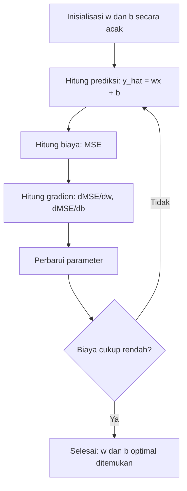

# Regresi Linear

> Regresi linear menggambar garis lurus terbaik menembus data Anda. Ini adalah "hello world" dari pembelajaran mesin.

**Jenis:** Bangun
**Bahasa:** Python, Julia, Rust
**Prasyarat:** Fase 1 (Aljabar Linear, Kalkulus, Optimasi), Fase 2 Pelajaran 1
**Waktu:** ~90 menit

## Tujuan Pembelajaran

- Turunkan aturan pembaruan penurunan gradien untuk kesalahan kuadrat rata-rata dan terapkan regresi linear dari awal
- Bandingkan penurunan gradien dan persamaan normal dari segi kompleksitas komputasi dan kapan masing-masing digunakan
- Bangun model regresi linear berganda dengan standarisasi fitur dan interpretasi bobot yang dipelajari
- Jelaskan bagaimana regresi Ridge (regularisasi L2) mencegah overfitting dengan menghukum bobot besar

## Masalah

Anda punya data: ukuran rumah dan harga jualnya. Anda ingin memprediksi harga rumah baru dari ukurannya. Anda bisa memperkirakannya dengan melihat plot sebar, tetapi Anda memerlukan rumus. Anda memerlukan garis yang paling cocok dengan data agar bisa memasukkan ukuran apa pun dan mendapat prediksi harga.

Regresi linear memberi Anda garis itu. Lebih penting lagi, ia memperkenalkan seluruh loop pelatihan ML: definisikan model, definisikan fungsi biaya, optimalkan parameter. Setiap algoritma ML mengikuti pola yang sama. Kuasai pola ini di sini dengan kasus paling sederhana, dan Anda akan mengenalinya di mana pun.

Ini bukan hanya untuk masalah sederhana. Regresi linear digunakan dalam sistem produksi untuk peramalan permintaan, analisis uji A/B, pemodelan keuangan, dan sebagai baseline untuk setiap tugas regresi.

## Konsep

### Modelnya

Regresi linear mengasumsikan hubungan linear antara input ($x$) dan output ($y$):

```math
y = wx + b
```

- `w` (bobot/kemiringan): seberapa besar $y$ berubah ketika $x$ naik 1
- `b` (bias/intersep): nilai $y$ ketika $x = 0$

Untuk beberapa input (fitur), rumus ini berkembang menjadi:

```math
y = w_1 x_1 + w_2 x_2 + \cdots + w_n x_n + b
```

Atau dalam bentuk vektor: $y = w^T x + b$

Tujuannya: temukan nilai $w$ dan $b$ yang membuat $y$ prediksi sedekat mungkin dengan $y$ aktual di semua contoh pelatihan.

### Fungsi Biaya (Kesalahan Kuadrat Rata-rata)

Bagaimana cara mengukur "sedekat mungkin"? Anda memerlukan satu bilangan yang menangkap seberapa salah prediksi Anda. Pilihan yang paling umum adalah Mean Squared Error (MSE):

```math
\text{MSE} = \frac{1}{n} \sum (y_{\text{predicted}} - y_{\text{actual}})^2
```

Mengapa dikuadratkan? Dua alasan. Pertama, ini menghukum error besar lebih berat daripada error kecil (error 10 adalah 100 kali lebih buruk daripada error 1, bukan 10 kali). Kedua, fungsi kuadrat halus dan dapat dideferensiasi di mana-mana, sehingga optimasi menjadi mudah.

Fungsi biaya membentuk suatu permukaan. Untuk satu bobot $w$ dan bias $b$, permukaan MSE tampak seperti mangkuk (paraboloid konveks). Dasar mangkuk adalah tempat MSE minimum. Pelatihan berarti menemukan dasar itu.

### Penurunan Gradien

Penurunan gradien menemukan dasar mangkuk dengan mengambil langkah menurun.



Gradien memberi tahu Anda dua hal: ke arah mana setiap parameter harus bergerak, dan seberapa jauh.

Untuk MSE dengan $\hat{y} = wx + b$:

```math
\begin{aligned}
\frac{\partial \text{MSE}}{\partial w} &= \frac{2}{n} \sum (\hat{y} - y) \, x \\
\frac{\partial \text{MSE}}{\partial b} &= \frac{2}{n} \sum (\hat{y} - y)
\end{aligned}
```

Aturan pembaruannya:

```math
\begin{aligned}
w &= w - \text{learning\_rate} \cdot \frac{\partial \text{MSE}}{\partial w} \\
b &= b - \text{learning\_rate} \cdot \frac{\partial \text{MSE}}{\partial b}
\end{aligned}
```

Laju pembelajaran mengendalikan ukuran langkah. Terlalu besar: Anda melampaui minimum dan divergen. Terlalu kecil: pelatihan berlangsung sangat lama. Nilai awal yang umum: 0.01, 0.001, atau 0.0001.

### Persamaan Normal (Solusi Bentuk Tertutup)

Khusus untuk regresi linear, ada rumus langsung yang memberikan bobot optimal tanpa iterasi apa pun:

```math
w = (X^T X)^{-1} X^T y
```

Ini membalikkan matriks untuk menyelesaikan $w$ dalam satu langkah. Rumus ini bekerja sempurna untuk himpunan data kecil. Untuk himpunan data besar (jutaan baris atau ribuan fitur), penurunan gradien lebih disukai karena inversi matriks berbiaya $O(n^3)$ dalam jumlah fitur.

### Regresi Linear Berganda

Dengan banyak fitur, model menjadi:

```math
y = w_1 x_1 + w_2 x_2 + \cdots + w_n x_n + b
```

Semua berjalan sama: MSE adalah fungsi biayanya, penurunan gradien memperbarui semua bobot secara bersamaan. Satu-satunya perbedaan adalah Anda mencocokkan hiperbidang alih-alih garis.

Penskalaan fitur penting di sini. Jika satu fitur berkisar 0 sampai 1 dan fitur lain berkisar 0 sampai 1.000.000, penurunan gradien akan kesulitan karena permukaan biaya menjadi memanjang. Standarisasi fitur (kurangi rata-rata, bagi dengan simpangan baku) sebelum pelatihan.

### Regresi Polinomial

Bagaimana jika hubungannya tidak linear? Anda tetap bisa menggunakan regresi linear dengan membuat fitur polinomial:

```math
y = w_1 x + w_2 x^2 + w_3 x^3 + b
```

Ini tetap regresi "linear" karena modelnya linear terhadap bobot ($w_1, w_2, w_3$). Anda hanya menggunakan fitur $x$ yang nonlinear.

Polinomial berderajat lebih tinggi dapat mencocokkan kurva yang lebih kompleks tetapi berisiko overfitting. Polinomial derajat-10 akan melewati setiap titik dalam himpunan data 10 titik tetapi memprediksi buruk pada data baru.

### Skor R-squared

MSE memberi tahu Anda seberapa salah prediksi Anda, tetapi angkanya bergantung pada skala $y$. R-squared ($R^2$) memberikan ukuran yang tidak bergantung pada skala:

```math
\begin{aligned}
R^2 &= 1 - \frac{\text{sum of squared residuals}}{\text{sum of squared deviations from mean}} \\
&= 1 - \frac{SS_{\text{res}}}{SS_{\text{tot}}}
\end{aligned}
```

- $R^2 = 1.0$: prediksi sempurna
- $R^2 = 0.0$: model tidak lebih baik daripada selalu memprediksi rata-rata
- $R^2 < 0.0$: model lebih buruk daripada memprediksi rata-rata

### Pratinjau Regularisasi (Regresi Ridge)

Saat Anda punya banyak fitur, model bisa overfitting dengan memberikan bobot besar. Regresi Ridge (regularisasi L2) menambahkan penalti:

```math
\text{Cost} = \text{MSE} + \lambda \sum w_i^2
```

Suku penalti mencegah bobot besar. Hyperparameter $\lambda$ mengendalikan trade-off: $\lambda$ lebih tinggi berarti bobot lebih kecil dan regularisasi lebih kuat. Ini dibahas mendalam di pelajaran berikutnya. Untuk sekarang, cukup ketahui bahwa itu ada dan mengapa itu membantu.

```figure
linear-regression-fit
```

## Bangun

### Langkah 1: Hasilkan data contoh

```python
import random
import math

random.seed(42)

TRUE_W = 3.0
TRUE_B = 7.0
N_SAMPLES = 100

X = [random.uniform(0, 10) for _ in range(N_SAMPLES)]
y = [TRUE_W * x + TRUE_B + random.gauss(0, 2.0) for x in X]

print(f"Generated {N_SAMPLES} samples")
print(f"True relationship: y = {TRUE_W}x + {TRUE_B} (+ noise)")
print(f"First 5 points: {[(round(X[i], 2), round(y[i], 2)) for i in range(5)]}")
```

### Langkah 2: Regresi linear dari awal dengan penurunan gradien

```python
class LinearRegression:
    def __init__(self, learning_rate=0.01):
        self.w = 0.0
        self.b = 0.0
        self.lr = learning_rate
        self.cost_history = []

    def predict(self, X):
        return [self.w * x + self.b for x in X]

    def compute_cost(self, X, y):
        predictions = self.predict(X)
        n = len(y)
        cost = sum((pred - actual) ** 2 for pred, actual in zip(predictions, y)) / n
        return cost

    def compute_gradients(self, X, y):
        predictions = self.predict(X)
        n = len(y)
        dw = (2 / n) * sum((pred - actual) * x for pred, actual, x in zip(predictions, y, X))
        db = (2 / n) * sum(pred - actual for pred, actual in zip(predictions, y))
        return dw, db

    def fit(self, X, y, epochs=1000, print_every=200):
        for epoch in range(epochs):
            dw, db = self.compute_gradients(X, y)
            self.w -= self.lr * dw
            self.b -= self.lr * db
            cost = self.compute_cost(X, y)
            self.cost_history.append(cost)
            if epoch % print_every == 0:
                print(f"  Epoch {epoch:4d} | Cost: {cost:.4f} | w: {self.w:.4f} | b: {self.b:.4f}")
        return self

    def r_squared(self, X, y):
        predictions = self.predict(X)
        y_mean = sum(y) / len(y)
        ss_res = sum((actual - pred) ** 2 for actual, pred in zip(y, predictions))
        ss_tot = sum((actual - y_mean) ** 2 for actual in y)
        return 1 - (ss_res / ss_tot)


print("=== Training Linear Regression (Gradient Descent) ===")
model = LinearRegression(learning_rate=0.005)
model.fit(X, y, epochs=1000, print_every=200)
print(f"\nLearned: y = {model.w:.4f}x + {model.b:.4f}")
print(f"True:    y = {TRUE_W}x + {TRUE_B}")
print(f"R-squared: {model.r_squared(X, y):.4f}")
```

### Langkah 3: Persamaan normal (solusi bentuk tertutup)

```python
class LinearRegressionNormal:
    def __init__(self):
        self.w = 0.0
        self.b = 0.0

    def fit(self, X, y):
        n = len(X)
        x_mean = sum(X) / n
        y_mean = sum(y) / n
        numerator = sum((X[i] - x_mean) * (y[i] - y_mean) for i in range(n))
        denominator = sum((X[i] - x_mean) ** 2 for i in range(n))
        self.w = numerator / denominator
        self.b = y_mean - self.w * x_mean
        return self

    def predict(self, X):
        return [self.w * x + self.b for x in X]

    def r_squared(self, X, y):
        predictions = self.predict(X)
        y_mean = sum(y) / len(y)
        ss_res = sum((actual - pred) ** 2 for actual, pred in zip(y, predictions))
        ss_tot = sum((actual - y_mean) ** 2 for actual in y)
        return 1 - (ss_res / ss_tot)


print("\n=== Normal Equation (Closed-Form) ===")
model_normal = LinearRegressionNormal()
model_normal.fit(X, y)
print(f"Learned: y = {model_normal.w:.4f}x + {model_normal.b:.4f}")
print(f"R-squared: {model_normal.r_squared(X, y):.4f}")
```

### Langkah 4: Regresi linear berganda

```python
class MultipleLinearRegression:
    def __init__(self, n_features, learning_rate=0.01):
        self.weights = [0.0] * n_features
        self.bias = 0.0
        self.lr = learning_rate
        self.cost_history = []

    def predict_single(self, x):
        return sum(w * xi for w, xi in zip(self.weights, x)) + self.bias

    def predict(self, X):
        return [self.predict_single(x) for x in X]

    def compute_cost(self, X, y):
        predictions = self.predict(X)
        n = len(y)
        return sum((pred - actual) ** 2 for pred, actual in zip(predictions, y)) / n

    def fit(self, X, y, epochs=1000, print_every=200):
        n = len(y)
        n_features = len(X[0])
        for epoch in range(epochs):
            predictions = self.predict(X)
            errors = [pred - actual for pred, actual in zip(predictions, y)]
            for j in range(n_features):
                grad = (2 / n) * sum(errors[i] * X[i][j] for i in range(n))
                self.weights[j] -= self.lr * grad
            grad_b = (2 / n) * sum(errors)
            self.bias -= self.lr * grad_b
            cost = self.compute_cost(X, y)
            self.cost_history.append(cost)
            if epoch % print_every == 0:
                print(f"  Epoch {epoch:4d} | Cost: {cost:.4f}")
        return self

    def r_squared(self, X, y):
        predictions = self.predict(X)
        y_mean = sum(y) / len(y)
        ss_res = sum((actual - pred) ** 2 for actual, pred in zip(y, predictions))
        ss_tot = sum((actual - y_mean) ** 2 for actual in y)
        return 1 - (ss_res / ss_tot)


random.seed(42)
N = 100
X_multi = []
y_multi = []
for _ in range(N):
    size = random.uniform(500, 3000)
    bedrooms = random.randint(1, 5)
    age = random.uniform(0, 50)
    price = 50 * size + 10000 * bedrooms - 1000 * age + 50000 + random.gauss(0, 20000)
    X_multi.append([size, bedrooms, age])
    y_multi.append(price)


def standardize(X):
    n_features = len(X[0])
    means = [sum(X[i][j] for i in range(len(X))) / len(X) for j in range(n_features)]
    stds = []
    for j in range(n_features):
        variance = sum((X[i][j] - means[j]) ** 2 for i in range(len(X))) / len(X)
        stds.append(variance ** 0.5)
    X_scaled = []
    for i in range(len(X)):
        row = [(X[i][j] - means[j]) / stds[j] if stds[j] > 0 else 0 for j in range(n_features)]
        X_scaled.append(row)
    return X_scaled, means, stds


y_mean_val = sum(y_multi) / len(y_multi)
y_std_val = (sum((yi - y_mean_val) ** 2 for yi in y_multi) / len(y_multi)) ** 0.5
y_scaled = [(yi - y_mean_val) / y_std_val for yi in y_multi]

X_scaled, x_means, x_stds = standardize(X_multi)

print("\n=== Multiple Linear Regression (3 features) ===")
print("Features: house size, bedrooms, age")
multi_model = MultipleLinearRegression(n_features=3, learning_rate=0.01)
multi_model.fit(X_scaled, y_scaled, epochs=1000, print_every=200)

print(f"\nWeights (standardized): {[round(w, 4) for w in multi_model.weights]}")
print(f"Bias (standardized): {multi_model.bias:.4f}")
print(f"R-squared: {multi_model.r_squared(X_scaled, y_scaled):.4f}")
```

### Langkah 5: Regresi polinomial

```python
class PolynomialRegression:
    def __init__(self, degree, learning_rate=0.01):
        self.degree = degree
        self.weights = [0.0] * degree
        self.bias = 0.0
        self.lr = learning_rate

    def make_features(self, X):
        return [[x ** (d + 1) for d in range(self.degree)] for x in X]

    def predict(self, X):
        features = self.make_features(X)
        return [sum(w * f for w, f in zip(self.weights, row)) + self.bias for row in features]

    def fit(self, X, y, epochs=1000, print_every=200):
        features = self.make_features(X)
        n = len(y)
        for epoch in range(epochs):
            predictions = [sum(w * f for w, f in zip(self.weights, row)) + self.bias for row in features]
            errors = [pred - actual for pred, actual in zip(predictions, y)]
            for j in range(self.degree):
                grad = (2 / n) * sum(errors[i] * features[i][j] for i in range(n))
                self.weights[j] -= self.lr * grad
            grad_b = (2 / n) * sum(errors)
            self.bias -= self.lr * grad_b
            if epoch % print_every == 0:
                cost = sum(e ** 2 for e in errors) / n
                print(f"  Epoch {epoch:4d} | Cost: {cost:.6f}")
        return self

    def r_squared(self, X, y):
        predictions = self.predict(X)
        y_mean = sum(y) / len(y)
        ss_res = sum((actual - pred) ** 2 for actual, pred in zip(y, predictions))
        ss_tot = sum((actual - y_mean) ** 2 for actual in y)
        return 1 - (ss_res / ss_tot)


random.seed(42)
X_poly = [x / 10.0 for x in range(0, 50)]
y_poly = [0.5 * x ** 2 - 2 * x + 3 + random.gauss(0, 1.0) for x in X_poly]

x_max = max(abs(x) for x in X_poly)
X_poly_norm = [x / x_max for x in X_poly]
y_poly_mean = sum(y_poly) / len(y_poly)
y_poly_std = (sum((yi - y_poly_mean) ** 2 for yi in y_poly) / len(y_poly)) ** 0.5
y_poly_norm = [(yi - y_poly_mean) / y_poly_std for yi in y_poly]

print("\n=== Polynomial Regression (degree 2 vs degree 5) ===")
print("True relationship: y = 0.5x^2 - 2x + 3")

print("\nDegree 2:")
poly2 = PolynomialRegression(degree=2, learning_rate=0.1)
poly2.fit(X_poly_norm, y_poly_norm, epochs=2000, print_every=500)
print(f"  R-squared: {poly2.r_squared(X_poly_norm, y_poly_norm):.4f}")

print("\nDegree 5:")
poly5 = PolynomialRegression(degree=5, learning_rate=0.1)
poly5.fit(X_poly_norm, y_poly_norm, epochs=2000, print_every=500)
print(f"  R-squared: {poly5.r_squared(X_poly_norm, y_poly_norm):.4f}")

print("\nDegree 2 fits the true curve well. Degree 5 fits training data slightly better")
print("but risks overfitting on new data.")
```

### Langkah 6: Regresi Ridge (regularisasi L2)

```python
class RidgeRegression:
    def __init__(self, n_features, learning_rate=0.01, alpha=1.0):
        self.weights = [0.0] * n_features
        self.bias = 0.0
        self.lr = learning_rate
        self.alpha = alpha

    def predict_single(self, x):
        return sum(w * xi for w, xi in zip(self.weights, x)) + self.bias

    def predict(self, X):
        return [self.predict_single(x) for x in X]

    def fit(self, X, y, epochs=1000, print_every=200):
        n = len(y)
        n_features = len(X[0])
        for epoch in range(epochs):
            predictions = self.predict(X)
            errors = [pred - actual for pred, actual in zip(predictions, y)]
            mse = sum(e ** 2 for e in errors) / n
            reg_term = self.alpha * sum(w ** 2 for w in self.weights)
            cost = mse + reg_term
            for j in range(n_features):
                grad = (2 / n) * sum(errors[i] * X[i][j] for i in range(n))
                grad += 2 * self.alpha * self.weights[j]
                self.weights[j] -= self.lr * grad
            grad_b = (2 / n) * sum(errors)
            self.bias -= self.lr * grad_b
            if epoch % print_every == 0:
                print(f"  Epoch {epoch:4d} | Cost: {cost:.4f} | L2 penalty: {reg_term:.4f}")
        return self


print("\n=== Ridge Regression (L2 Regularization) ===")
print("Same data as multiple regression, with alpha=0.1")
ridge = RidgeRegression(n_features=3, learning_rate=0.01, alpha=0.1)
ridge.fit(X_scaled, y_scaled, epochs=1000, print_every=200)
print(f"\nRidge weights: {[round(w, 4) for w in ridge.weights]}")
print(f"Plain weights: {[round(w, 4) for w in multi_model.weights]}")
print("Ridge weights are smaller (shrunk toward zero) due to the L2 penalty.")
```

## Gunakan

Sekarang hal yang sama dengan scikit-learn, yang akan benar-benar Anda pakai di produksi.

```python
from sklearn.linear_model import LinearRegression as SklearnLR
from sklearn.linear_model import Ridge
from sklearn.preprocessing import PolynomialFeatures, StandardScaler
from sklearn.model_selection import train_test_split
from sklearn.metrics import mean_squared_error, r2_score
import numpy as np

np.random.seed(42)
X_sk = np.random.uniform(0, 10, (100, 1))
y_sk = 3.0 * X_sk.squeeze() + 7.0 + np.random.normal(0, 2.0, 100)

X_train, X_test, y_train, y_test = train_test_split(X_sk, y_sk, test_size=0.2, random_state=42)

lr = SklearnLR()
lr.fit(X_train, y_train)
y_pred = lr.predict(X_test)

print("=== Scikit-learn Linear Regression ===")
print(f"Coefficient (w): {lr.coef_[0]:.4f}")
print(f"Intercept (b): {lr.intercept_:.4f}")
print(f"R-squared (test): {r2_score(y_test, y_pred):.4f}")
print(f"MSE (test): {mean_squared_error(y_test, y_pred):.4f}")

poly = PolynomialFeatures(degree=2, include_bias=False)
X_poly_sk = poly.fit_transform(X_train)
X_poly_test = poly.transform(X_test)

lr_poly = SklearnLR()
lr_poly.fit(X_poly_sk, y_train)
print(f"\nPolynomial degree 2 R-squared: {r2_score(y_test, lr_poly.predict(X_poly_test)):.4f}")

scaler = StandardScaler()
X_train_scaled = scaler.fit_transform(X_train)
X_test_scaled = scaler.transform(X_test)

ridge = Ridge(alpha=1.0)
ridge.fit(X_train_scaled, y_train)
print(f"Ridge R-squared: {r2_score(y_test, ridge.predict(X_test_scaled)):.4f}")
print(f"Ridge coefficient: {ridge.coef_[0]:.4f}")
```

Implementasi dari awal Anda dan scikit-learn menghasilkan hasil yang sama. Bedanya: scikit-learn menangani kasus tepi, stabilitas numerik, dan optimasi kinerja. Gunakan pustaka untuk produksi. Gunakan versi dari awal untuk memahami apa yang sebenarnya terjadi.

## Rilis

Pelajaran ini menghasilkan:
- `outputs/skill-regression.md` — skill untuk memilih pendekatan regresi yang tepat berdasarkan masalah

## Latihan

1. Terapkan penurunan gradien batch, penurunan gradien stokastik (SGD), dan penurunan gradien mini-batch. Bandingkan kecepatan konvergensi pada himpunan data yang sama. Mana yang paling cepat convergen? Mana yang kurva biayanya paling halus?
2. Hasilkan data dari fungsi kubik ($y = ax^3 + bx^2 + cx + d + \text{noise}$). Cocokkan polinomial derajat 1, 3, dan 10. Bandingkan $R^2$ latih dan $R^2$ uji. Pada derajat berapa overfitting menjadi jelas?
3. Terapkan regresi Lasso (regularisasi L1: $\text{penalty} = \alpha \sum \lvert w_i \rvert$). Latih pada data perumahan multifitur. Bandingkan bobot mana yang menjadi nol versus Ridge. Mengapa L1 menghasilkan solusi jarang (sparse) sementara L2 tidak?

## Istilah Kunci

| Istilah | Yang orang katakan | Yang sebenarnya dimaksud |
|------|----------------|----------------------|
| Regresi linear | "Gambar garis menembus data" | Temukan bobot $w$ dan bias $b$ yang meminimalkan jumlah selisih kuadrat antara $wx+b$ dan nilai $y$ aktual |
| Fungsi biaya | "Seberapa buruk modelnya" | Fungsi yang memetakan parameter model menjadi satu bilangan pengukur error prediksi, yang diminimalkan oleh optimasi |
| Kesalahan kuadrat rata-rata (MSE) | "Rata-rata error kuadrat" | $\frac{1}{n} \sum (\text{predicted} - \text{actual})^2$, yang menghukum error besar secara tidak proporsional |
| Penurunan gradien | "Jalan menuruni bukit" | Menyesuaikan parameter secara iteratif ke arah yang menurunkan fungsi biaya, menggunakan turunan parsial |
| Laju pembelajaran | "Ukuran langkah" | Skalar yang mengendalikan seberapa besar parameter berubah per langkah penurunan gradien |
| Persamaan normal | "Selesaikan langsung" | Solusi bentuk tertutup $w = (X^T X)^{-1} X^T y$ yang memberikan bobot optimal tanpa iterasi |
| R-squared | "Seberapa baik kecocokannya" | Fraksi variansi pada $y$ yang dijelaskan model, berkisar dari minus tak hingga hingga 1.0 |
| Penskalaan fitur | "Buat fitur sebanding" | Mengubah fitur ke rentang yang serupa (mis. rata-rata nol, varians satuan) agar penurunan gradien konvergen lebih cepat |
| Regularisasi | "Hukum kompleksitas" | Menambahkan suku pada fungsi biaya yang menyusutkan bobot, mencegah overfitting |
| Regresi Ridge | "Regularisasi L2" | Regresi linear dengan penalti $\lambda \sum w_i^2$ yang ditambahkan pada MSE |
| Regresi polinomial | "Mencocokkan kurva dengan matematika linear" | Regresi linear pada fitur polinomial ($x, x^2, x^3, \ldots$), tetap linear terhadap bobot |
| Overfitting | "Menghafal data latih" | Menggunakan model yang begitu kompleks sehingga mencocokkan derau dalam data latih dan gagal pada data baru |

## Bacaan Lanjutan

- [An Introduction to Statistical Learning (ISLR)](https://www.statlearning.com/) -- PDF gratis, bab 3 dan 6 membahas regresi linear dan regularisasi dengan contoh praktis dalam R
- [The Elements of Statistical Learning (ESL)](https://hastie.su.domains/ElemStatLearn/) -- PDF gratis, pendamping ISLR yang lebih matematis dengan pembahasan mendalam tentang ridge dan lasso
- [Stanford CS229 Lecture Notes on Linear Regression](https://cs229.stanford.edu/main_notes.pdf) -- catatan Andrew Ng yang menurunkan persamaan normal dan penurunan gradien dari prinsip dasar
- [scikit-learn LinearRegression documentation](https://scikit-learn.org/stable/modules/linear_model.html) -- referensi praktis untuk LinearRegression, Ridge, Lasso, dan ElasticNet beserta contoh kode
