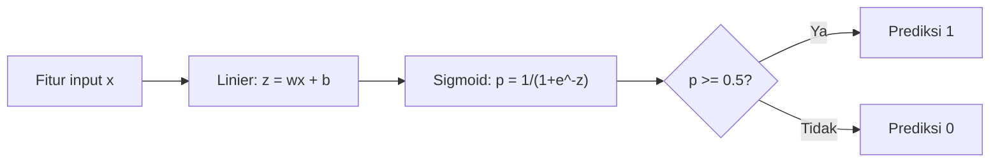
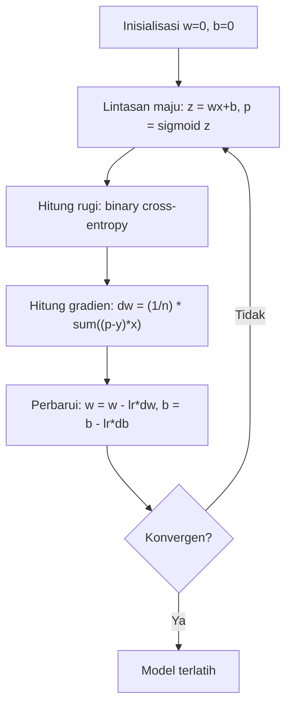

# Regresi Logistik

> Regresi logistik membengkokkan garis lurus menjadi kurva-S untuk menjawab pertanyaan ya-atau-tidak dengan probabilitas.

**Jenis:** Bangun
**Bahasa:** Python, Julia, Rust
**Prasyarat:** Fase 2 Pelajaran 1-2 (Apa Itu ML, Regresi Linear)
**Waktu:** ~90 menit

## Tujuan Pembelajaran

- Terapkan regresi logistik dari awal menggunakan fungsi sigmoid dan rugi binary cross-entropy
- Hitung dan interpretasikan presisi, recall, skor F1, dan matriks konfusi untuk klasifikasi biner
- Jelaskan mengapa MSE gagal untuk klasifikasi dan mengapa binary cross-entropy menghasilkan permukaan biaya yang konveks
- Bangun model regresi softmax untuk klasifikasi multi-kelas dan evaluasi trade-off penyetelan ambang

## Masalah

Anda ingin memprediksi apakah tumor ganas atau jinak berdasarkan ukurannya. Anda mencoba regresi linear. Model mengeluarkan bilangan seperti 0.3, 1.7, atau -0.5. Apa artinya? Apakah 1.7 "sangat ganas"? Apakah -0.5 "sangat jinak"? Regresi linear mengeluarkan bilangan tanpa batas. Klasifikasi memerlukan probabilitas terbatas antara 0 dan 1, serta keputusan yang jelas: ya atau tidak.

Regresi logistik menyelesaikan ini. Ia mengambil kombinasi linear yang sama ($wx + b$) dan melewatkannya melalui fungsi sigmoid, yang memampatkan bilangan apa pun ke rentang (0, 1). Keluarannya adalah probabilitas. Anda menetapkan ambang (biasanya 0.5) dan mengambil keputusan.

Ini adalah salah satu algoritma yang paling banyak digunakan dalam praktik. Meski bernamanya, regresi logistik adalah algoritma klasifikasi, bukan regresi. Namanya berasal dari fungsi logistik (sigmoid) yang digunakannya.

## Konsep

### Mengapa Regresi Linear Gagal untuk Klasifikasi

Bayangkan memprediksi lulus/gagal (1/0) berdasarkan jam belajar. Regresi linear mencocokkan garis menembus data:

```
jam:    1   2   3   4   5   6   7   8   9   10
aktual: 0   0   0   0   1   1   1   1   1   1
```

Cocokan linear mungkin menghasilkan prediksi seperti -0.2 pada jam ke-1 dan 1.3 pada jam ke-10. Nilai-nilai ini bukan probabilitas. Nilainya turun di bawah 0 dan naik di atas 1. Lebih buruk lagi, satu outlier (seseorang yang belajar 50 jam) akan menarik seluruh garis, mengubah prediksi semua orang.

Klasifikasi memerlukan fungsi yang:
- Mengeluarkan nilai antara 0 dan 1 (probabilitas)
- Membentuk transisi yang tajam (batas keputusan)
- Tidak terdistorsi oleh outlier yang jauh dari batas

### Fungsi Sigmoid

Fungsi sigmoid melakukan tepat itu:

```math
\sigma(z) = \frac{1}{1 + e^{-z}}
```

Sifat-sifatnya:
- Saat $z$ besar dan positif, $\sigma(z)$ mendekati 1
- Saat $z$ besar dan negatif, $\sigma(z)$ mendekati 0
- Saat $z = 0$, $\sigma(z) = 0.5$
- Keluarannya selalu antara 0 dan 1
- Fungsinya halus dan dapat dideferensiasi di mana-mana

Turunannya memiliki bentuk yang nyaman: $\sigma'(z) = \sigma(z) (1 - \sigma(z))$. Ini membuat perhitungan gradien menjadi efisien.

### Regresi Logistik = Model Linear + Sigmoid

Model menghitung $z = wx + b$ (sama seperti regresi linear), lalu menerapkan sigmoid:



Keluaran $p$ diinterpretasikan sebagai $P(y=1 \mid x)$, probabilitas bahwa input termasuk kelas 1. Batas keputusan adalah tempat $wx + b = 0$, yang membuat sigmoid mengeluarkan tepat 0.5.

### Rugi Binary Cross-Entropy

Anda tidak bisa menggunakan MSE untuk regresi logistik. MSE dengan sigmoid menghasilkan permukaan biaya non-konveks dengan banyak minimum lokal. Sebagai gantinya, gunakan binary cross-entropy (log loss):

```math
\text{Loss} = -\frac{1}{n} \sum \left( y \log(p) + (1-y) \log(1-p) \right)
```

Mengapa ini bekerja:
- Saat $y=1$ dan $p$ dekat 1: $\log(1) = 0$, sehingga rugi dekat 0 (benar, biaya rendah)
- Saat $y=1$ dan $p$ dekat 0: $\log(0)$ mendekati minus tak hingga, sehingga rugi sangat besar (salah, biaya tinggi)
- Saat $y=0$ dan $p$ dekat 0: $\log(1) = 0$, sehingga rugi dekat 0 (benar, biaya rendah)
- Saat $y=0$ dan $p$ dekat 1: $\log(0)$ mendekati minus tak hingga, sehingga rugi sangat besar (salah, biaya tinggi)

Fungsi rugi ini konveks untuk regresi logistik, sehingga setiap minimum lokal adalah minimum global dan penurunan gradien tidak bisa terjebak dalam minimum yang buruk. Pada data yang benar-benar dapat dipisahkan secara linear, rugi terus turun saat bobot membesar, sehingga tidak ada minimum hingga; regularisasi L2 memperbaiki ini dan membuat minimum menjadi unik.

### Penurunan Gradien untuk Regresi Logistik

Gradien untuk binary cross-entropy dengan sigmoid memiliki bentuk yang rapi:

```math
\begin{aligned}
\frac{\partial L}{\partial w} &= \frac{1}{n} \sum (p - y) \, x \\
\frac{\partial L}{\partial b} &= \frac{1}{n} \sum (p - y)
\end{aligned}
```

Rumus ini tampak identik dengan gradien regresi linear. Bedanya, $p = \sigma(wx + b)$, bukan $p = wx + b$. Sigmoid memperkenalkan nonlinearity, tetapi aturan pembaruan gradien tetap sama.



### Batas Keputusan

Untuk input 2D (dua fitur), batas keputusan adalah garis tempat:

```math
w_1 x_1 + w_2 x_2 + b = 0
```

Titik di satu sisi diklasifikasikan sebagai 1, titik di sisi lain sebagai 0. Regresi logistik selalu menghasilkan batas keputusan linear. Jika Anda memerlukan batas melengkung, tambahkan fitur polinomial atau gunakan model nonlinear.

### Klasifikasi Multi-Kelas dengan Softmax

Regresi logistik biner menangani dua kelas. Untuk $k$ kelas, gunakan fungsi softmax:

```math
\text{softmax}(z_i) = \frac{e^{z_i}}{\sum_j e^{z_j}}
```

Setiap kelas memiliki vektor bobotnya sendiri. Model menghitung skor $z_i$ untuk setiap kelas, lalu softmax mengubah skor menjadi probabilitas yang berjumlah 1. Kelas prediksi adalah kelas dengan probabilitas tertinggi.

Fungsi ruginya menjadi categorical cross-entropy:

```math
\text{Loss} = -\frac{1}{n} \sum \sum_k y_k \log(p_k)
```

di mana $y_k$ bernilai 1 untuk kelas sejati dan 0 untuk semua kelas lain (enkode one-hot).

### Metrik Evaluasi

Akurasi saja tidak cukup. Untuk himpunan data dengan 95% negatif dan 5% positif, model yang selalu memprediksi negatif mendapat akurasi 95% tetapi tidak berguna.

**Matriks Konfusi**:

| | Prediksi Positif | Prediksi Negatif |
|---|------------------------|----------------------|
| Aktual Positif | Positif Sejati (TP) | Negatif Palsu (FN) |
| Aktual Negatif | Positif Palsu (FP) | Negatif Sejati (TN) |

**Presisi**: Dari semua prediksi positif, berapa banyak yang benar-benar positif?
```math
\text{Precision} = \frac{TP}{TP + FP}
```

**Recall** (Sensitivitas): Dari semua kasus positif sejati, berapa banyak yang berhasil kita tangkap?
```math
\text{Recall} = \frac{TP}{TP + FN}
```

**Skor F1**: Rata-rata harmonik presisi dan recall. Menyeimbangkan kedua metrik.
```math
F_1 = 2 \cdot \frac{\text{Precision} \cdot \text{Recall}}{\text{Precision} + \text{Recall}}
```

Kapan memprioritaskan:
- **Presisi**: ketika false positive mahal (filter spam, Anda tidak ingin memblokir email sah)
- **Recall**: ketika false negative mahal (pemeriksaan kanker, Anda tidak ingin melewatkan tumor)
- **F1**: ketika Anda memerlukan satu metrik yang seimbang

```figure
logistic-sigmoid
```

## Bangun

### Langkah 1: Fungsi sigmoid dan pembangkitan data

```python
import random
import math

def sigmoid(z):
    z = max(-500, min(500, z))
    return 1.0 / (1.0 + math.exp(-z))


random.seed(42)
N = 200
X = []
y = []

for _ in range(N // 2):
    X.append([random.gauss(2, 1), random.gauss(2, 1)])
    y.append(0)

for _ in range(N // 2):
    X.append([random.gauss(5, 1), random.gauss(5, 1)])
    y.append(1)

combined = list(zip(X, y))
random.shuffle(combined)
X, y = zip(*combined)
X = list(X)
y = list(y)

print(f"Generated {N} samples (2 classes, 2 features)")
print(f"Class 0 center: (2, 2), Class 1 center: (5, 5)")
print(f"First 5 samples:")
for i in range(5):
    print(f"  Features: [{X[i][0]:.2f}, {X[i][1]:.2f}], Label: {y[i]}")
```

### Langkah 2: Regresi logistik dari awal

```python
class LogisticRegression:
    def __init__(self, n_features, learning_rate=0.01):
        self.weights = [0.0] * n_features
        self.bias = 0.0
        self.lr = learning_rate
        self.loss_history = []

    def predict_proba(self, x):
        z = sum(w * xi for w, xi in zip(self.weights, x)) + self.bias
        return sigmoid(z)

    def predict(self, x, threshold=0.5):
        return 1 if self.predict_proba(x) >= threshold else 0

    def compute_loss(self, X, y):
        n = len(y)
        total = 0.0
        for i in range(n):
            p = self.predict_proba(X[i])
            p = max(1e-15, min(1 - 1e-15, p))
            total += y[i] * math.log(p) + (1 - y[i]) * math.log(1 - p)
        return -total / n

    def fit(self, X, y, epochs=1000, print_every=200):
        n = len(y)
        n_features = len(X[0])
        for epoch in range(epochs):
            dw = [0.0] * n_features
            db = 0.0
            for i in range(n):
                p = self.predict_proba(X[i])
                error = p - y[i]
                for j in range(n_features):
                    dw[j] += error * X[i][j]
                db += error
            for j in range(n_features):
                self.weights[j] -= self.lr * (dw[j] / n)
            self.bias -= self.lr * (db / n)
            loss = self.compute_loss(X, y)
            self.loss_history.append(loss)
            if epoch % print_every == 0:
                print(f"  Epoch {epoch:4d} | Loss: {loss:.4f} | w: [{self.weights[0]:.3f}, {self.weights[1]:.3f}] | b: {self.bias:.3f}")
        return self

    def accuracy(self, X, y):
        correct = sum(1 for i in range(len(y)) if self.predict(X[i]) == y[i])
        return correct / len(y)


split = int(0.8 * N)
X_train, X_test = X[:split], X[split:]
y_train, y_test = y[:split], y[split:]

print("\n=== Training Logistic Regression ===")
model = LogisticRegression(n_features=2, learning_rate=0.1)
model.fit(X_train, y_train, epochs=1000, print_every=200)

print(f"\nTrain accuracy: {model.accuracy(X_train, y_train):.4f}")
print(f"Test accuracy:  {model.accuracy(X_test, y_test):.4f}")
print(f"Weights: [{model.weights[0]:.4f}, {model.weights[1]:.4f}]")
print(f"Bias: {model.bias:.4f}")
```

### Langkah 3: Matriks konfusi dan metrik dari awal

```python
class ClassificationMetrics:
    def __init__(self, y_true, y_pred):
        self.tp = sum(1 for t, p in zip(y_true, y_pred) if t == 1 and p == 1)
        self.tn = sum(1 for t, p in zip(y_true, y_pred) if t == 0 and p == 0)
        self.fp = sum(1 for t, p in zip(y_true, y_pred) if t == 0 and p == 1)
        self.fn = sum(1 for t, p in zip(y_true, y_pred) if t == 1 and p == 0)

    def accuracy(self):
        total = self.tp + self.tn + self.fp + self.fn
        return (self.tp + self.tn) / total if total > 0 else 0

    def precision(self):
        denom = self.tp + self.fp
        return self.tp / denom if denom > 0 else 0

    def recall(self):
        denom = self.tp + self.fn
        return self.tp / denom if denom > 0 else 0

    def f1(self):
        p = self.precision()
        r = self.recall()
        return 2 * p * r / (p + r) if (p + r) > 0 else 0

    def print_confusion_matrix(self):
        print(f"\n  Confusion Matrix:")
        print(f"                  Predicted")
        print(f"                  Pos   Neg")
        print(f"  Actual Pos     {self.tp:4d}  {self.fn:4d}")
        print(f"  Actual Neg     {self.fp:4d}  {self.tn:4d}")

    def print_report(self):
        self.print_confusion_matrix()
        print(f"\n  Accuracy:  {self.accuracy():.4f}")
        print(f"  Precision: {self.precision():.4f}")
        print(f"  Recall:    {self.recall():.4f}")
        print(f"  F1 Score:  {self.f1():.4f}")


y_pred_test = [model.predict(x) for x in X_test]
print("\n=== Classification Report (Test Set) ===")
metrics = ClassificationMetrics(y_test, y_pred_test)
metrics.print_report()
```

### Langkah 4: Analisis batas keputusan

```python
print("\n=== Decision Boundary ===")
w1, w2 = model.weights
b = model.bias
print(f"Decision boundary: {w1:.4f}*x1 + {w2:.4f}*x2 + {b:.4f} = 0")
if abs(w2) > 1e-10:
    print(f"Solved for x2:     x2 = {-w1/w2:.4f}*x1 + {-b/w2:.4f}")

print("\nSample predictions near the boundary:")
test_points = [
    [3.0, 3.0],
    [3.5, 3.5],
    [4.0, 4.0],
    [2.5, 2.5],
    [5.0, 5.0],
]
for point in test_points:
    prob = model.predict_proba(point)
    pred = model.predict(point)
    print(f"  [{point[0]}, {point[1]}] -> prob={prob:.4f}, class={pred}")
```

### Langkah 5: Multi-kelas dengan softmax

```python
class SoftmaxRegression:
    def __init__(self, n_features, n_classes, learning_rate=0.01):
        self.n_features = n_features
        self.n_classes = n_classes
        self.lr = learning_rate
        self.weights = [[0.0] * n_features for _ in range(n_classes)]
        self.biases = [0.0] * n_classes

    def softmax(self, scores):
        max_score = max(scores)
        exp_scores = [math.exp(s - max_score) for s in scores]
        total = sum(exp_scores)
        return [e / total for e in exp_scores]

    def predict_proba(self, x):
        scores = [
            sum(self.weights[k][j] * x[j] for j in range(self.n_features)) + self.biases[k]
            for k in range(self.n_classes)
        ]
        return self.softmax(scores)

    def predict(self, x):
        probs = self.predict_proba(x)
        return probs.index(max(probs))

    def fit(self, X, y, epochs=1000, print_every=200):
        n = len(y)
        for epoch in range(epochs):
            grad_w = [[0.0] * self.n_features for _ in range(self.n_classes)]
            grad_b = [0.0] * self.n_classes
            total_loss = 0.0
            for i in range(n):
                probs = self.predict_proba(X[i])
                for k in range(self.n_classes):
                    target = 1.0 if y[i] == k else 0.0
                    error = probs[k] - target
                    for j in range(self.n_features):
                        grad_w[k][j] += error * X[i][j]
                    grad_b[k] += error
                true_prob = max(probs[y[i]], 1e-15)
                total_loss -= math.log(true_prob)
            for k in range(self.n_classes):
                for j in range(self.n_features):
                    self.weights[k][j] -= self.lr * (grad_w[k][j] / n)
                self.biases[k] -= self.lr * (grad_b[k] / n)
            if epoch % print_every == 0:
                print(f"  Epoch {epoch:4d} | Loss: {total_loss / n:.4f}")
        return self

    def accuracy(self, X, y):
        correct = sum(1 for i in range(len(y)) if self.predict(X[i]) == y[i])
        return correct / len(y)


random.seed(42)
X_3class = []
y_3class = []

centers = [(1, 1), (5, 1), (3, 5)]
for label, (cx, cy) in enumerate(centers):
    for _ in range(50):
        X_3class.append([random.gauss(cx, 0.8), random.gauss(cy, 0.8)])
        y_3class.append(label)

combined = list(zip(X_3class, y_3class))
random.shuffle(combined)
X_3class, y_3class = zip(*combined)
X_3class = list(X_3class)
y_3class = list(y_3class)

split_3 = int(0.8 * len(X_3class))
X_train_3 = X_3class[:split_3]
y_train_3 = y_3class[:split_3]
X_test_3 = X_3class[split_3:]
y_test_3 = y_3class[split_3:]

print("\n=== Multi-class Softmax Regression (3 classes) ===")
softmax_model = SoftmaxRegression(n_features=2, n_classes=3, learning_rate=0.1)
softmax_model.fit(X_train_3, y_train_3, epochs=1000, print_every=200)
print(f"\nTrain accuracy: {softmax_model.accuracy(X_train_3, y_train_3):.4f}")
print(f"Test accuracy:  {softmax_model.accuracy(X_test_3, y_test_3):.4f}")

print("\nSample predictions:")
for i in range(5):
    probs = softmax_model.predict_proba(X_test_3[i])
    pred = softmax_model.predict(X_test_3[i])
    print(f"  True: {y_test_3[i]}, Predicted: {pred}, Probs: [{', '.join(f'{p:.3f}' for p in probs)}]")
```

### Langkah 6: Penyetelan ambang

```python
print("\n=== Threshold Tuning ===")
print("Default threshold: 0.5. Adjusting the threshold trades precision for recall.\n")

thresholds = [0.3, 0.4, 0.5, 0.6, 0.7]
print(f"{'Threshold':>10} {'Accuracy':>10} {'Precision':>10} {'Recall':>10} {'F1':>10}")
print("-" * 52)

for t in thresholds:
    y_pred_t = [1 if model.predict_proba(x) >= t else 0 for x in X_test]
    m = ClassificationMetrics(y_test, y_pred_t)
    print(f"{t:>10.1f} {m.accuracy():>10.4f} {m.precision():>10.4f} {m.recall():>10.4f} {m.f1():>10.4f}")
```

## Gunakan

Sekarang hal yang sama dengan scikit-learn.

```python
from sklearn.linear_model import LogisticRegression as SklearnLR
from sklearn.metrics import accuracy_score, precision_score, recall_score, f1_score
from sklearn.metrics import confusion_matrix, classification_report
from sklearn.model_selection import train_test_split
from sklearn.preprocessing import StandardScaler
import numpy as np

np.random.seed(42)
X_0 = np.random.randn(100, 2) + [2, 2]
X_1 = np.random.randn(100, 2) + [5, 5]
X_sk = np.vstack([X_0, X_1])
y_sk = np.array([0] * 100 + [1] * 100)

X_tr, X_te, y_tr, y_te = train_test_split(X_sk, y_sk, test_size=0.2, random_state=42)

scaler = StandardScaler()
X_tr_sc = scaler.fit_transform(X_tr)
X_te_sc = scaler.transform(X_te)

lr = SklearnLR()
lr.fit(X_tr_sc, y_tr)
y_pred = lr.predict(X_te_sc)

print("=== Scikit-learn Logistic Regression ===")
print(f"Accuracy:  {accuracy_score(y_te, y_pred):.4f}")
print(f"Precision: {precision_score(y_te, y_pred):.4f}")
print(f"Recall:    {recall_score(y_te, y_pred):.4f}")
print(f"F1:        {f1_score(y_te, y_pred):.4f}")
print(f"\nConfusion Matrix:\n{confusion_matrix(y_te, y_pred)}")
print(f"\nClassification Report:\n{classification_report(y_te, y_pred)}")
```

Implementasi dari awal Anda menghasilkan batas keputusan dan metrik yang sama. Scikit-learn menambahkan opsi solver (liblinear, lbfgs, saga), regularisasi otomatis, strategi multi-kelas (one-vs-rest, multinomial), dan optimasi stabilitas numerik.

## Rilis

Pelajaran ini menghasilkan:
- `code/logistic_regression.py` — regresi logistik dari awal beserta metrik
- `code/main.rs` — kode yang sama dalam Rust, hanya stdlib. Jalankan dengan `rustc --edition 2021 code/main.rs && ./main`.

## Latihan

1. Bangkitkan himpunan data yang TIDAK dapat dipisahkan secara linear (mis. dua lingkaran konsentris). Latih regresi logistik dan amati kegagalannya. Lalu tambahkan fitur polinomial ($x_1^2, x_2^2, x_1 x_2$) dan latih lagi. Tunjukkan bahwa akurasi meningkat.
2. Terapkan matriks konfusi multi-kelas untuk model softmax 3 kelas. Hitung presisi dan recall per kelas. Kelas mana yang paling sulit diklasifikasikan?
3. Bangun kurva ROC dari awal. Untuk 100 nilai ambang dari 0 sampai 1, hitung laju positif sejati dan laju positif palsu. Hitung AUC (luas di bawah kurva) menggunakan aturan trapesium.

## Istilah Kunci

| Istilah | Yang orang katakan | Yang sebenarnya dimaksud |
|------|----------------|----------------------|
| Regresi logistik | "Regresi untuk klasifikasi" | Model linear yang diikuti fungsi sigmoid yang mengeluarkan probabilitas kelas |
| Fungsi sigmoid | "Kurva-S" | Fungsi $1/(1+e^{-z})$ yang memetakan bilangan real apa pun ke rentang (0, 1) |
| Binary cross-entropy | "Log loss" | Fungsi rugi $-[y \log(p) + (1-y) \log(1-p)]$ yang menghukum prediksi salah yang yakin dengan berat |
| Batas keputusan | "Garis pemisah" | Permukaan tempat probabilitas keluaran model sama dengan 0.5, memisahkan kelas prediksi |
| Softmax | "Sigmoid multi-kelas" | Fungsi yang mengubah vektor skor menjadi probabilitas yang berjumlah 1 |
| Presisi | "Berapa banyak yang terpilih itu relevan" | $TP / (TP + FP)$, fraksi prediksi positif yang benar-benar positif |
| Recall | "Berapa banyak yang relevan terpilih" | $TP / (TP + FN)$, fraksi kasus positif sejati yang berhasil diidentifikasi model |
| Skor F1 | "Akurasi seimbang" | Rata-rata harmonik presisi dan recall: $2PR / (P+R)$ |
| Matriks konfusi | "Rincian error" | Tabel yang menampilkan jumlah TP, TN, FP, FN untuk setiap pasangan kelas |
| Ambang | "Batas potong" | Nilai probabilitas di atas mana model memprediksi kelas 1 (bawaan 0.5, dapat disetel) |
| Enkode one-hot | "Kolom biner untuk kategori" | Merepresentasikan kelas $k$ sebagai vektor nol dengan 1 di posisi $k$ |
| Cross-entropy kategorikal | "Log loss multi-kelas" | Perluasan binary cross-entropy ke $k$ kelas menggunakan label berenkode one-hot |
