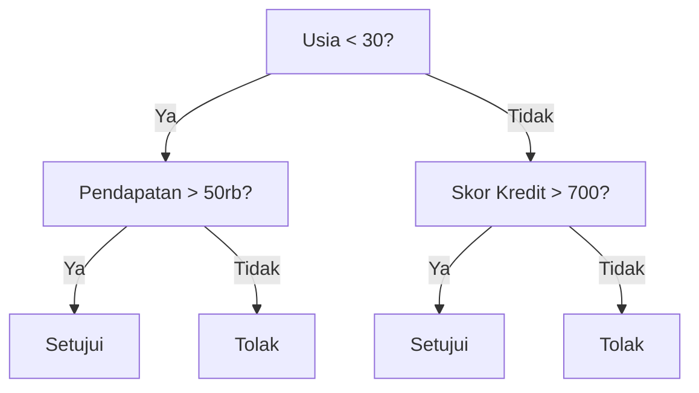
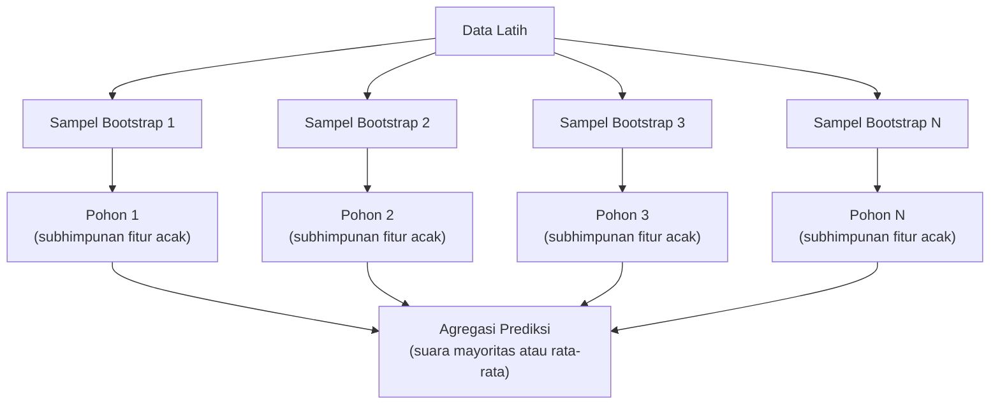

# Pohon Keputusan dan Hutan Acak

> Pohon keputusan hanyalah diagram alur. Tetapi hutan dari pohon-pohon itu adalah salah satu alat paling ampuh dalam ML.

**Jenis:** Build
**Bahasa:** Python, TypeScript
**Prasyarat:** Fase 1 (Pelajaran 09 Teori Informasi, 06 Probabilitas)
**Waktu:** ~90 menit

## Tujuan Pembelajaran

- Terapkan perhitungan ketidakmurnian Gini, entropi, dan perolehan informasi untuk menemukan pemisahan pohon keputusan yang optimal
- Bangun klasifier pohon keputusan dari awal dengan kontrol pemangkasan awal (kedalaman maksimum, sampel minimum)
- Susun hutan acak menggunakan bootstrap sampling dan randomisasi fitur, serta jelaskan mengapa hal itu mengurangi varians
- Bandingkan kepentingan fitur MDI dengan permutation importance dan identifikasi kapan MDI bersifat bias

## Masalah

Anda memiliki data tabular. Baris adalah sampel, kolom adalah fitur, dan ada kolom target yang ingin Anda prediksi. Anda bisa saja melempar jaringan saraf ke sana. Tetapi untuk data tabular, model berbasis pohon (pohon keputusan, hutan acak, pohon gradient boosting) secara konsisten mengungguli deep learning. Kompetisi Kaggle tentang data terstruktur didominasi oleh XGBoost dan LightGBM, bukan transformer.

Mengapa? Pohon menangani jenis fitur campuran (numerik dan kategorikal) tanpa praproses. Pohon menangani hubungan nonlinear tanpa rekayasa fitur. Pohon dapat diinterpretasi: Anda dapat melihat pohonnya dan mengetahui persis mengapa sebuah prediksi dibuat. Dan hutan acak, yang merata-ratakan banyak pohon, sangat tahan terhadap overfitting pada dataset berukuran sedang.

Pelajaran ini membangun pohon keputusan dari awal menggunakan pemisahan rekursif, lalu membangun hutan acak di atasnya. Anda akan menerapkan matematika di balik kriteria pemisahan (ketidakmurnian Gini, entropi, perolehan informasi) dan memahami mengapa ansambel dari pembelajar lemah menjadi kuat.

## Konsep

### Apa yang dilakukan pohon keputusan

Pohon keputusan mempartisi ruang fitur menjadi wilayah-wilayah persegi panjang dengan mengajukan serangkaian pertanyaan ya/tidak.



Setiap simpul internal menguji sebuah fitur terhadap suatu ambang. Setiap simpul daun membuat prediksi. Untuk mengklasifikasikan titik data baru, Anda mulai dari akar dan mengikuti cabang hingga mencapai sebuah daun.

Pohon dibangun dari atas ke bawah dengan memilih, di setiap simpul, fitur dan ambang yang paling baik memisahkan data. "Terbaik" didefinisikan oleh kriteria pemisahan.

### Kriteria pemisahan: mengukur ketidakmurnian

Di setiap simpul, kita memiliki sekumpulan sampel. Kita ingin memisahkannya sehingga simpul anak yang dihasilkan semurni mungkin, artinya setiap anak sebagian besar berisi satu kelas.

**Ketidakmurnian Gini** mengukur probabilitas bahwa sebuah sampel yang dipilih secara acak akan salah diklasifikasi jika diberi label sesuai distribusi kelas di simpul tersebut.

```math
\text{Gini}(S) = 1 - \sum_k p_k^2 \quad \text{where } p_k \text{ is the proportion of class } k \text{ in set } S.
```

Untuk simpul murni (semuanya satu kelas), Gini = 0. Untuk pemisahan biner dengan kelas 50/50, Gini = 0,5. Semakin rendah semakin baik.

```
Contoh: 6 kucing, 4 anjing

Gini = 1 - (0.6^2 + 0.4^2) = 1 - (0.36 + 0.16) = 0.48
```

**Entropi** mengukur kandungan informasi (ketidakteraturan) dalam sebuah simpul. Dibahas di Fase 1 Pelajaran 09.

```math
\text{Entropy}(S) = -\sum_k p_k \log_2(p_k)
```

Untuk simpul murni, entropi = 0. Untuk pemisahan biner 50/50, entropi = 1,0. Semakin rendah semakin baik.

```
Contoh: 6 kucing, 4 anjing

Entropy = -(0.6 * log2(0.6) + 0.4 * log2(0.4))
        = -(0.6 * -0.737 + 0.4 * -1.322)
        = 0.442 + 0.529
        = 0.971 bits
```

**Perolehan informasi** adalah penurunan ketidakmurnian (entropi atau Gini) setelah sebuah pemisahan.

```math
\begin{aligned}
& IG(S, \text{feature}, \text{threshold}) = \text{Impurity}(S) - \text{weighted\_avg}(\text{Impurity}(S_{\text{left}}), \text{Impurity}(S_{\text{right}})) \\[4pt]
& \text{where the weights are the proportions of samples in each child.}
\end{aligned}
```

Algoritma serakah di setiap simpul: coba setiap fitur dan setiap ambang yang mungkin. Pilih pasangan (fitur, ambang) yang memaksimalkan perolehan informasi.

### Cara kerja pemisahan

Untuk dataset dengan $n$ fitur dan $m$ sampel di simpul saat ini:

1. Untuk setiap fitur $j$ ($j = 1$ hingga $n$):
   - Urutkan sampel berdasarkan fitur $j$
   - Coba setiap titik tengah antara nilai berurutan yang berbeda sebagai ambang
   - Hitung perolehan informasi untuk setiap ambang
2. Pilih fitur dan ambang dengan perolehan informasi tertinggi
3. Bagi data menjadi kiri (fitur <= ambang) dan kanan (fitur > ambang)
4. Lakukan rekursi pada setiap anak

Pendekatan serakah ini tidak menjamin pohon yang optimal secara global. Menemukan pohon optimal bersifat NP-hard. Tetapi pemisahan serakah bekerja dengan baik dalam praktiknya.

### Kondisi berhenti

Tanpa kondisi berhenti, pohon tumbuh hingga setiap daun murni atau tidak ada pemisahan yang dapat memisahkan sampelnya, sering kali hingga satu sampel per daun. Ini menghafal data pelatihan dengan sempurna dan generalisasi dengan sangat buruk.

**Pemangkasan awal** menghentikan pohon sebelum tumbuh sepenuhnya:
- Kedalaman maksimum: berhenti memisahkan ketika pohon mencapai kedalaman tertentu
- Sampel minimum per daun: berhenti jika sebuah simpul memiliki kurang dari $k$ sampel
- Perolehan informasi minimum: berhenti jika pemisahan terbaik memperbaiki ketidakmurnian kurang dari suatu ambang
- Simpul daun maksimum: batasi jumlah total daun

**Pemangkasan akhir** menumbuhkan pohon penuh, lalu memangkasnya kembali:
- Pemangkasan kompleksitas biaya (digunakan oleh scikit-learn): menambahkan penalti yang sebanding dengan jumlah daun. Naikkan penalti untuk mendapatkan pohon yang lebih kecil
- Pemangkasan galat tereduksi: hapus subpohon jika galat validasi tidak meningkat

Pemangkasan awal lebih sederhana dan lebih cepat. Pemangkasan akhir sering menghasilkan pohon yang lebih baik karena tidak menghentikan lebih awal pemisahan yang mungkin menuju pemisahan lanjutan yang berguna.

### Pohon keputusan untuk regresi

Untuk regresi, prediksi daun adalah rata-rata nilai target di daun tersebut. Kriteria pemisahan juga berubah:

**Reduksi varians** menggantikan perolehan informasi:

```math
VR(S, \text{feature}, \text{threshold}) = \text{Var}(S) - \text{weighted\_avg}(\text{Var}(S_{\text{left}}), \text{Var}(S_{\text{right}}))
```

Pilih pemisahan yang paling mengurangi varians. Pohon mempartisi ruang masukan menjadi wilayah-wilayah, dan memprediksi suatu konstanta (rata-rata) di setiap wilayah.

### Hutan acak: kekuatan ansambel

Sebuah pohon keputusan tunggal memiliki varians tinggi. Perubahan kecil pada data dapat menghasilkan pohon yang benar-benar berbeda. Hutan acak mengatasi ini dengan merata-ratakan banyak pohon.



Dua sumber keacakan membuat pohon-pohon itu beragam:

**Bagging (bootstrap aggregating):** Setiap pohon dilatih pada sampel bootstrap, yaitu sampel acak dengan penggantian dari data latih. Sekitar 63% sampel awal muncul di setiap bootstrap (sisanya adalah sampel out-of-bag yang dapat digunakan untuk validasi).

**Randomisasi fitur:** Di setiap pemisahan, hanya subhimpunan fitur acak yang dipertimbangkan. Untuk klasifikasi, bawaan adalah $\sqrt{n_{\text{features}}}$. Untuk regresi, $n_{\text{features}}/3$. Ini mencegah semua pohon melakukan pemisahan pada fitur dominan yang sama.

Wawasan kuncinya: merata-ratakan banyak pohon yang tidak berkorelasi mengurangi varians tanpa menaikkan bias. Setiap pohon individual bisa saja biasa-biasa saja. Ansambelnya yang kuat.

### Kepentingan fitur

Hutan acak secara alami menyediakan skor kepentingan fitur. Metode yang paling umum:

**Mean Decrease in Impurity (MDI):** Untuk setiap fitur, jumlahkan total penurunan ketidakmurnian di seluruh pohon dan semua simpul tempat fitur itu digunakan. Fitur yang menghasilkan penurunan ketidakmurnian lebih besar pada pemisahan lebih awal lebih penting.

```math
\text{importance}(\text{feature}_j) = \sum_{\text{nodes where feature}_j \text{ is used}} \frac{n_{\text{samples at node}}}{n_{\text{total samples}}} \cdot \text{impurity\_decrease}
```

Ini cepat (dihitung selama pelatihan) tetapi bias terhadap fitur dengan kardinalitas tinggi dan fitur dengan banyak titik pemisahan yang mungkin.

**Permutation importance** adalah alternatifnya: acak nilai satu fitur dan ukur seberapa besar akurasi model turun. Lebih andal tetapi lebih lambat.

### Kapan pohon mengalahkan jaringan saraf

Pohon dan hutan mendominasi jaringan saraf pada data tabular. Beberapa alasannya:

| Faktor | Pohon | Jaringan saraf |
|--------|-------|----------------|
| Jenis campuran (numerik + kategorikal) | Dukungan bawaan | Perlu enkode |
| Dataset kecil (< 10k baris) | Bekerja baik | Overfit |
| Interaksi fitur | Ditemukan oleh pemisahan | Perlu desain arsitektur |
| Interpretabilitas | Transparansi penuh | Kotak hitam |
| Waktu pelatihan | Menit | Jam |
| Sensitivitas hyperparameter | Rendah | Tinggi |

Jaringan saraf menang ketika data memiliki struktur spasial atau sekuensial (gambar, teks, audio). Untuk tabel fitur yang datar, pohon adalah pilihan utama.

```figure
decision-tree-depth
```

## Bangun Sendiri

### Langkah 1: Ketidakmurnian Gini dan entropi

Bangun kedua kriteria pemisahan dari awal dan verifikasi bahwa keduanya sepakat tentang pemisahan mana yang baik.

```python
import math

def gini_impurity(labels):
    n = len(labels)
    if n == 0:
        return 0.0
    counts = {}
    for label in labels:
        counts[label] = counts.get(label, 0) + 1
    return 1.0 - sum((c / n) ** 2 for c in counts.values())

def entropy(labels):
    n = len(labels)
    if n == 0:
        return 0.0
    counts = {}
    for label in labels:
        counts[label] = counts.get(label, 0) + 1
    return -sum(
        (c / n) * math.log2(c / n) for c in counts.values() if c > 0
    )
```

### Langkah 2: Temukan pemisahan terbaik

Coba setiap fitur dan setiap ambang. Kembalikan yang memiliki perolehan informasi tertinggi.

```python
def information_gain(parent_labels, left_labels, right_labels, criterion="gini"):
    measure = gini_impurity if criterion == "gini" else entropy
    n = len(parent_labels)
    n_left = len(left_labels)
    n_right = len(right_labels)
    if n_left == 0 or n_right == 0:
        return 0.0
    parent_impurity = measure(parent_labels)
    child_impurity = (
        (n_left / n) * measure(left_labels) +
        (n_right / n) * measure(right_labels)
    )
    return parent_impurity - child_impurity
```

### Langkah 3: Bangun kelas DecisionTree

Pemisahan rekursif, prediksi, dan pelacakan kepentingan fitur. `_build` adalah jantung pohon: metode ini berhenti ketika sebuah simpul murni atau mencapai batas pemangkasan awal; jika tidak, metode ini mengambil pemisahan terbaik dan melakukan rekursi ke kedua anak.

```python
import random

class DecisionTree:
    def __init__(self, max_depth=None, min_samples_split=2,
                 min_samples_leaf=1, criterion="gini",
                 max_features=None):
        self.max_depth = max_depth
        self.min_samples_split = min_samples_split
        self.min_samples_leaf = min_samples_leaf
        self.criterion = criterion
        self.max_features = max_features
        self.tree = None
        self.feature_importances_ = None

    def fit(self, X, y):
        self.n_features = len(X[0])
        self.feature_importances_ = [0.0] * self.n_features
        self.n_samples = len(X)
        self.tree = self._build(X, y, depth=0)
        total = sum(self.feature_importances_)
        if total > 0:
            self.feature_importances_ = [
                fi / total for fi in self.feature_importances_
            ]

    def predict(self, X):
        return [self._predict_one(x, self.tree) for x in X]

    def _build(self, X, y, depth):
        if len(set(y)) == 1:
            return {"leaf": True, "value": y[0]}

        if self.max_depth is not None and depth >= self.max_depth:
            return self._make_leaf(y)

        if len(y) < self.min_samples_split:
            return self._make_leaf(y)

        best_feature, best_threshold, best_gain = self._best_split(X, y)

        if best_feature is None or best_gain <= 0:
            return self._make_leaf(y)

        left_X, left_y, right_X, right_y = self._split_data(
            X, y, best_feature, best_threshold
        )

        if len(left_y) < self.min_samples_leaf or len(right_y) < self.min_samples_leaf:
            return self._make_leaf(y)

        weight = len(y) / self.n_samples
        self.feature_importances_[best_feature] += weight * best_gain

        return {
            "leaf": False,
            "feature": best_feature,
            "threshold": best_threshold,
            "left": self._build(left_X, left_y, depth + 1),
            "right": self._build(right_X, right_y, depth + 1),
        }

    def _make_leaf(self, y):
        counts = {}
        for label in y:
            counts[label] = counts.get(label, 0) + 1
        return {"leaf": True, "value": max(counts, key=counts.get)}

    def _best_split(self, X, y):
        best_feature = None
        best_threshold = None
        best_gain = -1.0

        if self.max_features == "sqrt":
            k = max(1, int(math.sqrt(self.n_features)))
            feature_indices = random.sample(range(self.n_features), k)
        elif isinstance(self.max_features, int):
            if self.max_features < 1:
                raise ValueError("max_features must be at least 1 when given as an integer")
            k = min(self.max_features, self.n_features)
            feature_indices = random.sample(range(self.n_features), k)
        else:
            feature_indices = list(range(self.n_features))

        for feature_idx in feature_indices:
            values = sorted(set(X[i][feature_idx] for i in range(len(X))))
            if len(values) <= 1:
                continue

            for i in range(len(values) - 1):
                threshold = (values[i] + values[i + 1]) / 2.0
                left_y = [y[j] for j in range(len(X)) if X[j][feature_idx] <= threshold]
                right_y = [y[j] for j in range(len(X)) if X[j][feature_idx] > threshold]

                if len(left_y) < self.min_samples_leaf or len(right_y) < self.min_samples_leaf:
                    continue

                gain = information_gain(y, left_y, right_y, self.criterion)
                if gain > best_gain:
                    best_gain = gain
                    best_feature = feature_idx
                    best_threshold = threshold

        return best_feature, best_threshold, best_gain

    def _split_data(self, X, y, feature, threshold):
        left_X, left_y, right_X, right_y = [], [], [], []
        for i in range(len(X)):
            if X[i][feature] <= threshold:
                left_X.append(X[i])
                left_y.append(y[i])
            else:
                right_X.append(X[i])
                right_y.append(y[i])
        return left_X, left_y, right_X, right_y

    def _predict_one(self, x, node):
        if node["leaf"]:
            return node["value"]
        if x[node["feature"]] <= node["threshold"]:
            return self._predict_one(x, node["left"])
        return self._predict_one(x, node["right"])
```

### Langkah 4: Bangun kelas RandomForest

Bootstrap sampling, randomisasi fitur, dan voting mayoritas.

```python
class RandomForest:
    def __init__(self, n_trees=100, max_depth=None,
                 min_samples_split=2, max_features="sqrt",
                 criterion="gini"):
        self.n_trees = n_trees
        self.max_depth = max_depth
        self.min_samples_split = min_samples_split
        self.max_features = max_features
        self.criterion = criterion
        self.trees = []

    def fit(self, X, y):
        n = len(X)
        for _ in range(self.n_trees):
            indices = [random.randint(0, n - 1) for _ in range(n)]
            X_boot = [X[i] for i in indices]
            y_boot = [y[i] for i in indices]
            tree = DecisionTree(
                max_depth=self.max_depth,
                min_samples_split=self.min_samples_split,
                max_features=self.max_features,
                criterion=self.criterion,
            )
            tree.fit(X_boot, y_boot)
            self.trees.append(tree)

    def predict(self, X):
        all_preds = [tree.predict(X) for tree in self.trees]
        predictions = []
        for i in range(len(X)):
            votes = {}
            for preds in all_preds:
                v = preds[i]
                votes[v] = votes.get(v, 0) + 1
            predictions.append(max(votes, key=votes.get))
        return predictions
```

Lihat `code/trees.py` untuk implementasi lengkap dengan semua metode bantu. `code/trees.ts` adalah port TypeScript dengan fungsi dan demo yang sama. Jalankan dengan `npx tsx code/trees.ts`.

## Gunakan

Dengan scikit-learn, melatih hutan acak hanya butuh tiga baris:

```python
from sklearn.ensemble import RandomForestClassifier
from sklearn.datasets import load_iris
from sklearn.model_selection import train_test_split

X, y = load_iris(return_X_y=True)
X_train, X_test, y_train, y_test = train_test_split(X, y, random_state=42)

rf = RandomForestClassifier(n_estimators=100, random_state=42)
rf.fit(X_train, y_train)
print(f"Accuracy: {rf.score(X_test, y_test):.4f}")
print(f"Feature importances: {rf.feature_importances_}")
```

Dalam praktiknya, pohon gradient boosted (XGBoost, LightGBM, CatBoost) sering lebih kuat daripada hutan acak karena pohon-pohonnya dibangun secara berurutan, dengan setiap pohon memperbaiki galat pohon sebelumnya. Tetapi hutan acak lebih sulit salah dikonfigurasi dan hampir tidak memerlukan penyetelan hyperparameter.

## Kirimkan

Pelajaran ini menghasilkan `outputs/prompt-tree-interpreter.md` -- sebuah prompt yang menerjemahkan pemisahan pohon keputusan bagi pemangku kepentingan bisnis. Berikan struktur pohon yang telah dilatih (kedalaman, fitur, ambang pemisahan, akurasi), lalu prompt itu menerjemahkan model menjadi aturan berbahasa sehari-hari, memberi peringkat kepentingan fitur, menandai overfitting atau kebocoran, dan merekomendasikan langkah berikutnya. Gunakan kapan pun Anda perlu menjelaskan model berbasis pohon kepada seseorang yang tidak membaca kode.

## Latihan

1. Latih sebuah pohon keputusan tunggal pada dataset 2D dengan 3 kelas. Lacak pemisahannya secara manual dan gambar batas keputusan persegi panjangnya. Bandingkan batas pada max_depth=2 versus max_depth=10.

2. Terapkan pemisahan reduksi varians untuk pohon regresi. Bangkitkan $y = \sin(x) + \text{noise}$ untuk 200 titik dan latih pohon regresi Anda. Plot prediksi konstan bertahap dari pohon terhadap kurva sebenarnya.

3. Bangun hutan acak dengan 1, 5, 10, 50, dan 200 pohon. Plot akurasi latih dan akurasi uji terhadap jumlah pohon. Amati bahwa akurasi uji mendatar tetapi tidak turun (hutan tahan terhadap overfitting).

4. Bandingkan ketidakmurnian Gini versus entropi sebagai kriteria pemisahan pada 5 dataset berbeda. Ukur akurasi dan kedalaman pohon. Pada sebagian besar kasus, keduanya menghasilkan hasil yang hampir identik. Jelaskan mengapa.

5. Terapkan permutation importance. Bandingkan dengan kepentingan MDI pada dataset di mana satu fitur adalah noise acak tetapi memiliki kardinalitas tinggi. MDI akan memberi peringkat tinggi pada fitur noise tersebut. Permutation importance tidak akan demikian.

## Istilah Kunci

| Istilah | Apa yang orang katakan | Apa artinya sebenarnya |
|---------|----------------------|------------------------|
| Pohon keputusan | "Diagram alur untuk prediksi" | Model yang mempartisi ruang fitur menjadi wilayah persegi panjang dengan mempelajari serangkaian pemisahan if/else |
| Ketidakmurnian Gini | "Seberapa campur simpul itu" | Probabilitas salah mengklasifikasi sampel acak di sebuah simpul. 0 = murni, 0,5 = ketidakmurnian maksimum untuk biner |
| Entropi | "Ketidakteraturan dalam simpul" | Kandungan informasi di sebuah simpul. 0 = murni, 1,0 = ketidakpastian maksimum untuk biner. Berasal dari teori informasi |
| Perolehan informasi | "Seberapa baik sebuah pemisahan" | Penurunan ketidakmurnian setelah pemisahan. Kriteria serakah untuk memilih pemisahan |
| Pemangkasan awal | "Hentikan pohon lebih awal" | Menghentikan pertumbuhan pohon lebih awal dengan menetapkan kedalaman maksimum, sampel minimum, atau ambang perolehan minimum |
| Pemangkasan akhir | "Pangkas pohon setelahnya" | Menumbuhkan pohon penuh, lalu menghapus subpohon yang tidak meningkatkan kinerja validasi |
| Bagging | "Latih pada subhimpunan acak" | Bootstrap aggregating. Melatih setiap model pada sampel acak berbeda dengan penggantian |
| Hutan acak | "Sekumpulan pohon" | Ansambel pohon keputusan, masing-masing dilatih pada sampel bootstrap dengan subhimpunan fitur acak di setiap pemisahan |
| Kepentingan fitur (MDI) | "Fitur mana yang penting" | Total penurunan ketidakmurnian yang disumbangkan setiap fitur, dijumlahkan di seluruh pohon dan simpul |
| Permutation importance | "Acak lalu cek" | Penurunan akurasi saat nilai sebuah fitur diacak. Lebih andal daripada MDI untuk fitur bernoise |
| Reduksi varians | "Versi regresi dari perolehan informasi" | Analogi perolehan informasi untuk pohon regresi. Memilih pemisahan yang paling mengurangi varians target |
| Sampel bootstrap | "Sampel acak dengan pengulangan" | Sampel acak yang diambil dengan penggantian dari dataset awal. Ukuran sama, tetapi mengandung duplikat |

## Bacaan Lanjutan

- [Breiman: Random Forests (2001)](https://link.springer.com/article/10.1023/A:1010933404324) -- makalah asli tentang hutan acak
- [Grinsztajn et al.: Why do tree-based models still outperform deep learning on tabular data? (2022)](https://arxiv.org/abs/2207.08815) -- perbandingan ketat antara pohon dan jaringan saraf pada tugas tabular
- [Dokumentasi Decision Trees scikit-learn](https://scikit-learn.org/stable/modules/tree.html) -- panduan praktis dengan alat visualisasi
- [XGBoost: A Scalable Tree Boosting System (Chen & Guestrin, 2016)](https://arxiv.org/abs/1603.02754) -- makalah gradient boosting yang mendominasi Kaggle
