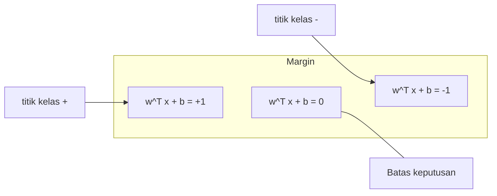
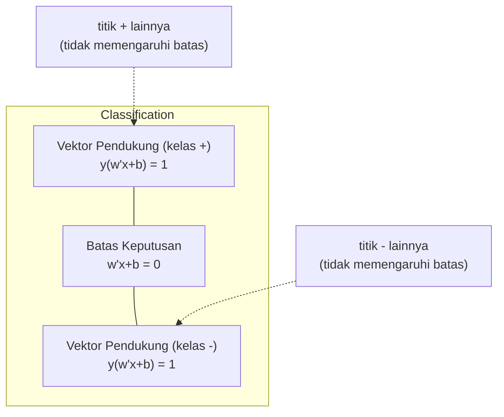
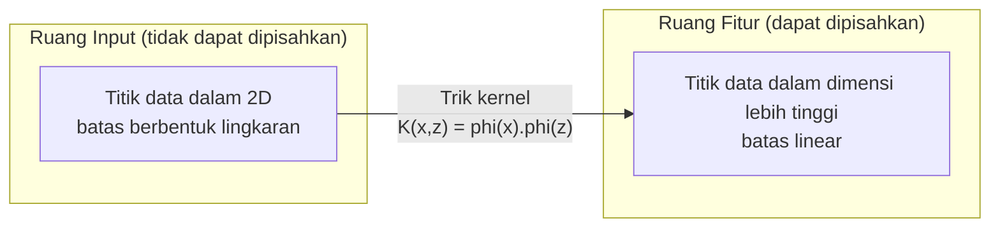

# Support Vector Machines

> Temukan jalan terlebar antara dua kelas. Itulah seluruh idenya.

**Jenis:** Build
**Bahasa:** Python
**Prasyarat:** Fase 1 (Pelajaran 08 Optimasi, 14 Norma dan Jarak, 18 Optimasi Cembung)
**Waktu:** ~90 menit

## Tujuan Pembelajaran

- Mengimplementasikan SVM linear dari awal menggunakan rugi hinge dan penurunan gradien pada formulasi primal
- Menjelaskan prinsip margin maksimum dan mengidentifikasi vektor pendukung dari model yang telah dilatih
- Membandingkan kernel linear, polinomial, dan RBF serta menjelaskan bagaimana trik kernel menghindari pemetaan eksplisit ke ruang berdimensi tinggi
- Menilai trade-off yang dikontrol oleh parameter C antara lebar margin dan kesalahan klasifikasi

## Masalahnya

Anda memiliki dua kelas titik data dan perlu menggambar sebuah garis (atau hyperplane) yang memisahkannya. Tak terhitung banyaknya garis yang bisa bekerja. Mana yang harus Anda pilih?

Yang marginsinya terbesar. Margin adalah jarak antara batas keputusan dan titik data terdekat di masing-masing sisi. Margin yang lebih lebar berarti classifier lebih percaya diri dan lebih baik dalam melakukan generalisasi ke data yang belum pernah dilihat.

Intuisi ini mengarah pada Support Vector Machines, salah satu algoritma paling elegan secara matematis dalam ML. SVM adalah metode klasifikasi dominan sebelum deep learning dan tetap menjadi pilihan terbaik untuk dataset kecil, data berdimensi tinggi, serta masalah yang memerlukan model yang berprinsip, dipahami dengan baik, dan memiliki jaminan teoritis.

SVM terhubung langsung ke Fase 1: optimasinya cembung (Pelajaran 18), margin diukur dengan norma (Pelajaran 14), dan trik kernel memanfaatkan produk titik untuk menangani batas nonlinear tanpa pernah melakukan komputasi di ruang berdimensi tinggi.

## Konsepnya

### Classifier margin maksimum

Dengan data yang dapat dipisahkan secara linear dan label $y_i \in \lbrace -1, +1 \rbrace$ serta vektor fitur $x_i$, kita menginginkan hyperplane $w^T x + b = 0$ yang memisahkan kelas-kelas tersebut.

Jarak dari titik $x_i$ ke hyperplane adalah:

```math
\text{distance} = \frac{\lvert w^T x_i + b \rvert}{\lVert w \rVert}
```

Untuk titik yang terklasifikasi benar: $y_i (w^T x_i + b) > 0$. Margin adalah dua kali jarak dari hyperplane ke titik terdekat di kedua sisi.



Masalah optimasinya:

```math
\begin{aligned}
\text{maximize} \quad & \frac{2}{\lVert w \rVert} \quad \text{(the margin width)} \\
\text{subject to} \quad & y_i (w^T x_i + b) \ge 1 \quad \text{for all } i
\end{aligned}
```

Secara ekuivalen (meminimalkan $\lVert w \rVert^2$ lebih mudah dioptimalkan):

```math
\begin{aligned}
\text{minimize} \quad & \frac{1}{2} \lVert w \rVert^2 \\
\text{subject to} \quad & y_i (w^T x_i + b) \ge 1 \quad \text{for all } i
\end{aligned}
```

Ini adalah program kuadrat cembung. Solusi globalnya unik. Titik data yang tepat berada di batas margin (di mana $y_i (w^T x_i + b) = 1$) adalah vektor pendukung. Mereka adalah satu-satunya titik yang menentukan batas keputusan. Pindahkan atau hapus titik bukan vektor pendukung, dan batasnya tidak berubah.

### Vektor pendukung: sedikit yang krusial



Sebagian besar titik latihan tidak relevan. Hanya vektor pendukung yang penting. Inilah sebabnya SVM hemat memori saat prediksi: Anda hanya perlu menyimpan vektor pendukung, bukan seluruh himpunan latihan.

Jumlah vektor pendukung juga memberi batas pada galat generalisasi. Lebih sedikit vektor pendukung relatif terhadap ukuran dataset berarti generalisasi lebih baik.

### Margin lunak: menangani noise dengan parameter C

Data dunia nyata jarang dapat dipisahkan dengan sempurna. Beberapa titik mungkin berada di sisi batas yang salah, atau di dalam margin. Formulasi margin lunak mengizinkan pelanggaran dengan memperkenalkan variabel slack.

```math
\begin{aligned}
\text{minimize} \quad & \frac{1}{2} \lVert w \rVert^2 + C \sum_i \xi_i \\
\text{subject to} \quad & y_i (w^T x_i + b) \ge 1 - \xi_i \\
& \xi_i \ge 0 \quad \text{for all } i
\end{aligned}
```

Variabel slack $\xi_i$ mengukur seberapa besar titik $i$ melanggar margin. $C$ mengontrol trade-off-nya:

| Nilai $C$ | Perilaku |
|---------|----------|
| $C$ besar | Menghukum pelanggaran dengan berat. Margin sempit, lebih sedikit salah klasifikasi. Overfit |
| $C$ kecil | Mengizinkan lebih banyak pelanggaran. Margin lebar, lebih banyak salah klasifikasi. Underfit |

$C$ adalah kekuatan regularisasi yang dibalik. $C$ besar = regularisasi lebih sedikit. $C$ kecil = regularisasi lebih banyak.

### Rugi hinge: fungsi rugi SVM

SVM margin lunak dapat ditulis ulang sebagai optimasi tanpa kendala:

```math
\text{minimize} \quad \frac{1}{2} \lVert w \rVert^2 + C \sum_i \max(0, 1 - y_i (w^T x_i + b))
```

Suku $\max(0, 1 - y_i f(x_i))$ adalah rugi hinge. Nilainya nol ketika titik terklasifikasi benar dan berada di luar margin. Nilainya linear ketika titik berada di dalam margin atau salah klasifikasi.

```
Rugi hinge untuk satu titik:

rugi
  |
  | \
  |  \
  |   \
  |    \
  |     \_______________
  |
  +-----|-----|-------->  y * f(x)
       0     1

Rugi nol ketika y*f(x) >= 1 (terklasifikasi benar, di luar margin).
Penalti linear ketika y*f(x) < 1.
```

Bandingkan dengan rugi logistik (regresi logistik):

```math
\begin{aligned}
\text{Hinge:} \quad & \max(0, 1 - y f(x)) && \text{Hard cutoff at margin} \\
\text{Logistic:} \quad & \log(1 + \exp(-y f(x))) && \text{Smooth, never exactly zero}
\end{aligned}
```

Rugi hinge menghasilkan solusi jarang (hanya vektor pendukung yang memberi kontribusi bukan nol). Rugi logistik menggunakan semua titik data. Hal ini membuat SVM lebih hemat memori saat prediksi.

### Melatih SVM linear dengan penurunan gradien

Anda dapat melatih SVM linear menggunakan penurunan gradien pada rugi hinge plus regularisasi L2, tanpa menyelesaikan QP berkendala:

```math
\begin{aligned}
& L(w, b) = \frac{\lambda}{2} \lVert w \rVert^2 + \frac{1}{n} \sum_i \max(0, 1 - y_i (w^T x_i + b)) \\[6pt]
& \text{Gradient with respect to } w\text{:} \\
& \quad \text{If } y_i (w^T x_i + b) \ge 1\text{:} \quad \frac{\partial L}{\partial w} = \lambda w \\
& \quad \text{If } y_i (w^T x_i + b) < 1\text{:} \quad \frac{\partial L}{\partial w} = \lambda w - y_i x_i \\[6pt]
& \text{Gradient with respect to } b\text{:} \\
& \quad \text{If } y_i (w^T x_i + b) \ge 1\text{:} \quad \frac{\partial L}{\partial b} = 0 \\
& \quad \text{If } y_i (w^T x_i + b) < 1\text{:} \quad \frac{\partial L}{\partial b} = -y_i
\end{aligned}
```

Ini disebut formulasi primal. Kompleksitasnya $O(n \cdot d)$ per epoch, dengan $n$ adalah jumlah sampel dan $d$ adalah jumlah fitur. Untuk data besar, jarang, dan berdimensi tinggi (klasifikasi teks), ini cepat.

### Formulasi dual dan trik kernel

Dual Lagrangian dari masalah SVM (dari Fase 1 Pelajaran 18, kondisi KKT) adalah:

```math
\begin{aligned}
\text{maximize} \quad & \sum_i \alpha_i - \frac{1}{2} \sum_{i,j} \alpha_i \alpha_j y_i y_j (x_i \cdot x_j) \\
\text{subject to} \quad & 0 \le \alpha_i \le C \\
& \sum_i \alpha_i y_i = 0
\end{aligned}
```

Dual hanya melibatkan produk titik $x_i \cdot x_j$ antar titik data. Inilah wawasan kuncinya. Ganti setiap produk titik dengan fungsi kernel $K(x_i, x_j)$ dan SVM dapat mempelajari batas nonlinear tanpa pernah menghitung transformasinya secara eksplisit.

```math
\begin{aligned}
\text{Linear kernel:} \quad & K(x, z) = x \cdot z \\
\text{Polynomial kernel:} \quad & K(x, z) = (x \cdot z + c)^d \\
\text{RBF (Gaussian):} \quad & K(x, z) = \exp(-\gamma \lVert x - z \rVert^2)
\end{aligned}
```

Kernel RBF memetakan data ke ruang berdimensi tak hingga. Titik yang berdekatan dalam ruang input memiliki nilai kernel mendekati 1. Titik yang saling jauh memiliki nilai kernel mendekati 0. Kernel ini dapat mempelajari batas keputusan halus apa pun.



Trik kernel menghitung produk titik di ruang berdimensi tinggi tanpa pernah pergi ke sana. Untuk kernel polinomial derajat $d$ dalam $D$ dimensi, ruang fitur eksplisit memiliki $O(D^d)$ dimensi. Tetapi $K(x, z)$ dihitung dalam waktu $O(D)$.

### SVM untuk regresi (SVR)

Support Vector Regression mencocokkan sebuah tabung dengan lebar $\epsilon$ di sekitar data. Titik di dalam tabung memiliki rugi nol. Titik di luar tabung dihukum secara linear.

```math
\begin{aligned}
\text{minimize} \quad & \frac{1}{2} \lVert w \rVert^2 + C \sum_i (\xi_i + \xi_i^*) \\
\text{subject to} \quad & y_i - (w^T x_i + b) \le \epsilon + \xi_i \\
& (w^T x_i + b) - y_i \le \epsilon + \xi_i^* \\
& \xi_i, \xi_i^* \ge 0
\end{aligned}
```

Parameter $\epsilon$ mengontrol lebar tabung. Tabung lebih lebar = lebih sedikit vektor pendukung = hasil cocokan lebih halus. Tabung lebih sempit = lebih banyak vektor pendukung = hasil cocokan lebih ketat.

### Mengapa SVM kalah dari deep learning (dan kapan tetap menang)

SVM mendominasi ML dari akhir 1990-an hingga awal 2010-an. Deep learning mengunggulinya karena beberapa alasan:

| Faktor | SVM | Deep learning |
|--------|------|---------------|
| Rekayasa fitur | Memerlukannya | Mempelajari fitur |
| Skalabilitas | $O(n^2)$ sampai $O(n^3)$ untuk kernel | $O(n)$ per epoch dengan SGD |
| Gambar/teks/audio | Membutuhkan fitur buatan tangan | Belajar dari data mentah |
| Dataset besar (>100k) | Lambat | Skalanya baik |
| Akselerasi GPU | Manfaat terbatas | Percepatan besar |

SVM tetap menang dalam situasi ini:
- Dataset kecil (ratusan hingga beberapa ribu sampel)
- Data jarang berdimensi tinggi (teks dengan fitur TF-IDF)
- Saat Anda membutuhkan jaminan matematis (batas margin)
- Saat waktu latihan harus seminimal mungkin (SVM linear sangat cepat)
- Klasifikasi biner dengan struktur margin yang jelas
- Deteksi anomali (one-class SVM)

```figure
svm-margin
```

## Bangun Sendiri

### Langkah 1: Rugi hinge dan gradien

Fondasinya. Hitung rugi hinge untuk sebuah batch dan gradiennya.

```python
def hinge_loss(X, y, w, b):
    n = len(X)
    total_loss = 0.0
    for i in range(n):
        margin = y[i] * (dot(w, X[i]) + b)
        total_loss += max(0.0, 1.0 - margin)
    return total_loss / n
```

### Langkah 2: SVM linear melalui penurunan gradien

Latih dengan meminimalkan rugi hinge teregularisasi. Tidak perlu solver QP.

```python
class LinearSVM:
    def __init__(self, lr=0.001, lambda_param=0.01, n_epochs=1000):
        self.lr = lr
        self.lambda_param = lambda_param
        self.n_epochs = n_epochs
        self.w = None
        self.b = 0.0

    def fit(self, X, y):
        n_features = len(X[0])
        self.w = [0.0] * n_features
        self.b = 0.0

        for epoch in range(self.n_epochs):
            for i in range(len(X)):
                margin = y[i] * (dot(self.w, X[i]) + self.b)
                if margin >= 1:
                    self.w = [wj - self.lr * self.lambda_param * wj
                              for wj in self.w]
                else:
                    self.w = [wj - self.lr * (self.lambda_param * wj - y[i] * X[i][j])
                              for j, wj in enumerate(self.w)]
                    self.b -= self.lr * (-y[i])

    def predict(self, X):
        return [1 if dot(self.w, x) + self.b >= 0 else -1 for x in X]
```

### Langkah 3: Fungsi kernel

Implementasikan kernel linear, polinomial, dan RBF.

```python
def linear_kernel(x, z):
    return dot(x, z)

def polynomial_kernel(x, z, degree=3, c=1.0):
    return (dot(x, z) + c) ** degree

def rbf_kernel(x, z, gamma=0.5):
    diff = [xi - zi for xi, zi in zip(x, z)]
    return math.exp(-gamma * dot(diff, diff))
```

### Langkah 4: Identifikasi margin dan vektor pendukung

Setelah pelatihan, identifikasi titik mana yang merupakan vektor pendukung dan hitung lebar margin.

```python
def find_support_vectors(X, y, w, b, tol=1e-3):
    support_vectors = []
    for i in range(len(X)):
        margin = y[i] * (dot(w, X[i]) + b)
        if abs(margin - 1.0) < tol:
            support_vectors.append(i)
    return support_vectors
```

Lihat `code/svm.py` untuk implementasi lengkap dengan semua demo.

## Gunakan

Dengan scikit-learn:

```python
from sklearn.svm import SVC, LinearSVC, SVR
from sklearn.preprocessing import StandardScaler
from sklearn.pipeline import Pipeline

clf = Pipeline([
    ("scaler", StandardScaler()),
    ("svm", SVC(kernel="rbf", C=1.0, gamma="scale")),
])
clf.fit(X_train, y_train)
print(f"Accuracy: {clf.score(X_test, y_test):.4f}")
print(f"Support vectors: {clf['svm'].n_support_}")
```

Penting: selalu skalakan fitur Anda sebelum melatih SVM. SVM sensitif terhadap besar fitur karena margin bergantung pada $\lVert w \rVert$, dan fitur yang tidak diskalakan mendistorsi geometrinya.

Untuk dataset besar, gunakan `LinearSVC` (formulasi primal, $O(n \cdot d)$ per epoch, linear dalam $n$) alih-alih `SVC` (formulasi dual, $O(n^2)$ sampai $O(n^3){}$):

```python
from sklearn.svm import LinearSVC

clf = Pipeline([
    ("scaler", StandardScaler()),
    ("svm", LinearSVC(C=1.0, max_iter=10000)),
])
```

## Latihan

1. Bangkitkan dataset 2D yang dapat dipisahkan secara linear. Latih LinearSVM Anda dan identifikasi vektor pendukungnya. Verifikasi bahwa vektor pendukung adalah titik-titik yang paling dekat dengan batas keputusan.

2. Variasikan $C$ dari 0.001 sampai 1000 pada dataset bising. Plot batas keputusan untuk setiap nilai $C$. Amati transisi dari margin lebar (underfitting) ke margin sempit (overfitting).

3. Buatlah dataset dengan batas kelas berbentuk lingkaran (bukan linear). Tunjukkan bahwa SVM linear gagal. Hitung matriks kernel RBF dan tunjukkan bahwa kelas-kelas menjadi dapat dipisahkan dalam ruang fitur yang diinduksi kernel.

4. Bandingkan rugi hinge vs rugi logistik pada dataset yang sama. Latih SVM linear dan regresi logistik. Hitung berapa banyak titik latihan yang menyumbang pada batas keputusan masing-masing model (vektor pendukung vs semua titik).

5. Implementasikan SVR (rugi tak sensitif epsilon). Cocokkan dengan $y = \sin(x) + \text{noise}$. Plot tabung epsilon di sekitar prediksi dan sorotilah vektor pendukungnya (titik di luar tabung).

## Istilah Kunci

| Istilah | Arti sebenarnya |
|------|----------------------|
| Vektor pendukung | Titik latihan yang paling dekat dengan batas keputusan. Satu-satunya titik yang menentukan hyperplane |
| Margin | Jarak antara batas keputusan dan vektor pendukung terdekat. SVM memaksimalkannya |
| Rugi hinge | $\max(0, 1 - y f(x))$. Nol ketika terklasifikasi benar dan di luar margin. Penalti linear selainnya |
| Parameter C | Trade-off antara lebar margin dan kesalahan klasifikasi. $C$ besar = margin sempit, $C$ kecil = margin lebar |
| Margin lunak | Formulasi SVM yang mengizinkan pelanggaran margin melalui variabel slack. Menangani data yang tidak dapat dipisahkan |
| Trik kernel | Menghitung produk titik dalam ruang fitur berdimensi tinggi tanpa memetakannya secara eksplisit ke ruang itu |
| Kernel linear | $K(x, z) = x \cdot z$. Setara dengan produk titik biasa. Untuk data yang dapat dipisahkan secara linear |
| Kernel RBF | $K(x, z) = \exp(-\gamma \Vert x-z \Vert^2)$. Memetakan ke dimensi tak hingga. Mempelajari batas halus apa pun |
| Kernel polinomial | $K(x, z) = (x \cdot z + c)^d$. Memetakan ke ruang fitur berupa kombinasi polinomial |
| Formulasi dual | Rumusan ulang masalah SVM yang hanya bergantung pada produk titik antar titik data. Memungkinkan kernel |
| SVR | Support Vector Regression. Mencocokkan tabung epsilon di sekitar data. Titik di dalam tabung memiliki rugi nol |
| Variabel slack | $\xi_i$: mengukur seberapa besar sebuah titik melanggar margin. Nol untuk titik yang terklasifikasi benar di luar margin |
| Margin maksimum | Prinsip memilih hyperplane yang memaksimalkan jarak ke titik terdekat dari masing-masing kelas |

## Bacaan Lanjutan

- [Vapnik: The Nature of Statistical Learning Theory (1995)](https://link.springer.com/book/10.1007/978-1-4757-3264-1) - teks dasar tentang SVM dan pembelajaran statistika
- [Cortes & Vapnik: Support-vector networks (1995)](https://link.springer.com/article/10.1007/BF00994018) - makalah SVM awal
- [Platt: Sequential Minimal Optimization (1998)](https://www.microsoft.com/en-us/research/publication/sequential-minimal-optimization-a-fast-algorithm-for-training-support-vector-machines/) - algoritma SMO yang membuat latihan SVM menjadi praktis
- [scikit-learn SVM documentation](https://scikit-learn.org/stable/modules/svm.html) - panduan praktis dengan detail implementasi
- [LIBSVM: A Library for Support Vector Machines](https://www.csie.ntu.edu.tw/~cjlin/libsvm/) - pustaka C++ di balik sebagian besar implementasi SVM
