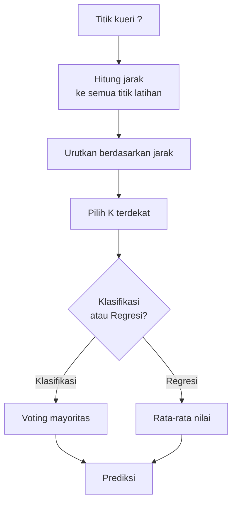
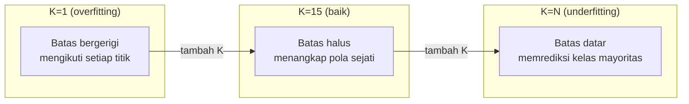
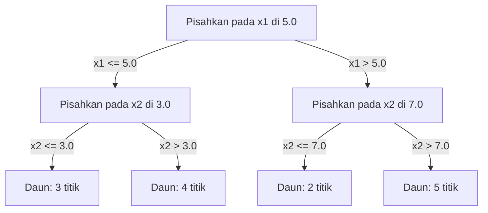

# K-Nearest Neighbors dan Jarak

> Simpan semuanya. Prediksi dengan melihat tetangga Anda. Algoritma paling sederhana yang benar-benar bekerja.

**Jenis:** Build
**Bahasa:** Python, TypeScript
**Prasyarat:** Fase 1 (Pelajaran 14 Norma dan Jarak)
**Waktu:** ~90 menit

## Tujuan Pembelajaran

- Mengimplementasikan klasifikasi dan regresi KNN dari awal dengan K yang dapat diatur dan voting berbobot jarak
- Membandingkan metrik jarak L1, L2, cosine, dan Minkowski serta memilih yang tepat untuk jenis data tertentu
- Menjelaskan kutukan dimensi dan mendemonstrasikan mengapa KNN memburuk di ruang berdimensi tinggi
- Membangun KD-tree untuk pencarian tetangga terdekat yang efisien dan menganalisis kapan algoritma ini mengungguli brute-force

## Masalahnya

Anda memiliki sebuah dataset. Sebuah titik data baru datang. Anda perlu mengklasifikasikannya atau memprediksi nilainya. Alih-alih mempelajari parameter dari data (seperti regresi linear atau SVM), Anda cukup mencari K titik latihan yang paling dekat dengan titik baru itu dan membiarkan mereka memberikan suara.

Inilah K-nearest neighbors. Tidak ada fase latihan. Tidak ada parameter yang dipelajari. Tidak ada fungsi rugi yang diminimalkan. Anda menyimpan seluruh himpunan latihan dan menghitung jarak saat prediksi.

Kedengarannya terlalu sederhana untuk bekerja. Tetapi KNN secara mengejutkan kompetitif untuk banyak masalah, terutama pada dataset kecil hingga menengah, dan memahaminya secara mendalam mengungkap konsep-konsep mendasar: pemilihan metrik jarak (terhubung ke Fase 1 Pelajaran 14), kutukan dimensi, serta perbedaan antara pembelajaran malas dan pembelajaran rajin.

KNN juga muncul di mana-mana dalam AI modern, hanya dengan nama berbeda. Basis data vektor melakukan pencarian KNN atas embedding. Retrieval-augmented generation (RAG) menemukan K potongan dokumen terdekat. Sistem rekomendasi menemukan pengguna atau item yang serupa. Algoritmanya sama. yang berbeda hanyalah skala dan struktur datanya.

## Konsepnya

### Cara kerja KNN

Diberikan dataset berisi titik-titik berlabel dan sebuah titik kueri baru:

1. Hitung jarak dari kueri ke setiap titik dalam dataset
2. Urutkan berdasarkan jarak
3. Ambil K titik terdekat
4. Untuk klasifikasi: voting mayoritas di antara K tetangga
5. Untuk regresi: rata-rata (atau rata-rata terbobot) dari nilai K tetangga



Itulah seluruh algoritmanya. Tidak ada fitting. Tidak ada penurunan gradien. Tidak ada epoch.

### Memilih K

K adalah satu-satunya hiperparameter. K mengontrol trade-off bias-varians:

| K | Perilaku |
|---|----------|
| $K = 1$ | Batas keputusan mengikuti setiap titik. Galat latihan nol. Varians tinggi. Overfit |
| K kecil (3-5) | Sensitif terhadap struktur lokal. Dapat menangkap batas yang kompleks |
| K besar | Batas lebih halus. Lebih tangguh terhadap noise. Dapat underfit |
| $K = N$ | Memrediksi kelas mayoritas untuk setiap titik. Bias maksimum |

Titik awal yang umum adalah $K = \sqrt{N}$ untuk dataset dengan $N$ titik. Gunakan K ganjil untuk klasifikasi biner guna menghindari hasil seri.



### Metrik jarak

Fungsi jarak mendefinisikan arti "dekat". Metrik yang berbeda menghasilkan tetangga yang berbeda, dan prediksi yang berbeda.

**L2 (Euclidean)** adalah pilihan default. Jarak garis lurus.

```math
d(a, b) = \sqrt{\sum_i (a_i - b_i)^2}
```

Sensitif terhadap skala fitur. Selalu standardisasi fitur sebelum menggunakan L2 dengan KNN.

**L1 (Manhattan)** menjumlahkan selisih mutlak. Lebih tangguh terhadap outlier daripada L2 karena tidak mengkuadratkan selisihnya.

```math
d(a, b) = \sum_i \lvert a_i - b_i \rvert
```

**Jarak Cosine** mengukur sudut antarvektor, mengabaikan besarnya. Esensial untuk data teks dan embedding.

```math
d(a, b) = 1 - \frac{a \cdot b}{\lVert a \rVert \, \lVert b \rVert}
```

**Minkowski** menggeneralisasi L1 dan L2 dengan parameter $p$.

```math
\begin{aligned}
& d(a, b) = \left( \sum_i \lvert a_i - b_i \rvert^p \right)^{1/p} \\[6pt]
& p=1\text{: Manhattan} \\
& p=2\text{: Euclidean} \\
& p \to \infty\text{: Chebyshev (max absolute difference)}
\end{aligned}
```

Metrik mana yang digunakan bergantung pada data:

| Jenis data | Metrik terbaik | Alasan |
|-----------|------------|-----|
| Fitur numerik, skala serupa | L2 (Euclidean) | Default, bekerja baik untuk data spasial |
| Fitur numerik, ada outlier | L1 (Manhattan) | Tangguh, tidak memperbesar selisih besar |
| Embedding teks | Cosine | Besar vektor adalah noise, arah adalah makna |
| Jarang berdimensi tinggi | Cosine atau L1 | L2 menderita kutukan dimensi |
| Jenis campuran | Jarak kustom | Gabungkan metrik per jenis fitur |

### KNN terbobot

KNN standar memberikan bobot yang sama kepada keseluruhan K tetangga. Padahal tetangga pada jarak 0,1 seharusnya lebih berpengaruh daripada yang berjarak 5,0.

**KNN berbobot jarak** membobot setiap tetangga secara berbanding terbalik dengan jaraknya:

```math
\begin{aligned}
& \text{weight}_i = \frac{1}{\text{distance}_i + \epsilon} \\[6pt]
& \text{Untuk klasifikasi: voting terbobot} \\
& \text{Untuk regresi: rata-rata terbobot} = \frac{\sum_i w_i y_i}{\sum_i w_i}
\end{aligned}
```

$\epsilon$ mencegah pembagian dengan nol ketika sebuah titik kueri tepat sama dengan titik latihan.

KNN terbobot kurang sensitif terhadap pemilihan K karena tetangga yang jauh memberi kontribusi sangat kecil apa pun nilainya.

### Kutukan dimensi

Kinerja KNN memburuk di dimensi tinggi. Ini bukan kekhawatiran yang kabur. Ini adalah fakta matematis.

**Masalah 1: jarak konvergen.** Seiring bertambahnya dimensi, rasio jarak maksimum terhadap jarak minimum mendekati 1. Semua titik menjadi sama "jauhnya" dari kueri.

```
Dalam d dimensi, untuk titik acak seragam:

d=2:    max_dist / min_dist = sangat bervariasi
d=100:  max_dist / min_dist ~ 1.01
d=1000: max_dist / min_dist ~ 1.001

Ketika semua jarak hampir sama, "terdekat" menjadi tidak bermakna.
```

**Masalah 2: volume meledak.** Untuk menangkap K tetangga dalam fraksi tetap dari data, Anda perlu memperluas radius pencarian untuk mencakup fraksi ruang fitur yang jauh lebih besar. "Lingkungan" di dimensi tinggi mencakup sebagian besar ruang.

**Masalah 3: sudut mendominasi.** Dalam hypercube satuan berdimensi d, sebagian besar volume terkonsentrasi di dekat sudut, bukan di tengah. Bola yang tersimpan di dalam kubus memuat fraksi volume yang terus menyusut seiring pertumbuhan d.

Konsekuensi praktisnya: KNN bekerja baik hingga sekitar 20-50 fitur. Lebih dari itu, Anda memerlukan reduksi dimensi (PCA, UMAP, t-SNE) sebelum menerapkan KNN, atau menggunakan struktur pencarian berbasis pohon yang memanfaatkan dimensionalitas intrinsik data yang lebih rendah.

### KD-tree: pencarian tetangga terdekat yang cepat

KNN brute-force menghitung jarak dari kueri ke setiap titik latihan. Itu $O(n \cdot d)$ per kueri. Untuk dataset besar, ini terlalu lambat.

KD-tree mempartisi ruang secara rekursif sepanjang sumbu fitur. Pada setiap tingkat, algoritma memisahkan pada satu dimensi dengan nilai median.



Untuk menemukan tetangga terdekat, telusuri pohon hingga ke daun yang memuat kueri, lalu mundur dan periksa partisi tetangga hanya jika partisi itu mungkin memuat titik yang lebih dekat.

Waktu kueri rata-rata: $O(\log n)$ untuk dimensi rendah. Tetapi KD-tree memburuk menjadi $O(n)$ di dimensi tinggi ($d > 20$) karena proses mundur semakin sedikit membuang cabang.

### Ball tree: lebih baik pada dimensi sedang

Ball tree mempartisi data menjadi hypersphere bertingkat alih-alih kotak yang sejajar sumbu. Setiap simpul mendefinisikan bola (pusat + jari-jari) yang memuat semua titik di subtree-nya.

Keunggulan dibanding KD-tree:
- Bekerja lebih baik pada dimensi sedang (hingga ~50)
- Menangani struktur yang tidak sejajar sumbu
- Volume pembatas yang lebih rapat berarti lebih banyak cabang yang dipangkas saat pencarian

KD-tree maupun ball tree keduanya algoritma eksak. Untuk pencarian berskala benar-benar besar (jutaan titik, ratusan dimensi), metode tetangga terdekat aproksimatif (HNSW, IVF, product quantization) digunakan sebagai gantinya. Metode-metode itu dibahas dalam Fase 1 Pelajaran 14.

### Pembelajaran malas vs pembelajaran rajin

KNN adalah pembelajar malas (lazy learner): tidak melakukan pekerjaan saat latihan dan melakukan semuanya saat prediksi. Sebagian besar algoritma lain (regresi linear, SVM, jaringan saraf) adalah pembelajar rajin (eager learner): mereka melakukan komputasi berat saat latihan untuk membangun model yang ringkas, sehingga prediksinya cepat.

| Aspek | Malas (KNN) | Rajin (SVM, jaringan saraf) |
|--------|------------|------------------------|
| Waktu latihan | $O(1)$, cukup menyimpan data | $O(n \cdot \text{epochs})$ |
| Waktu prediksi | $O(n \cdot d)$ per kueri | $O(d)$ atau $O(\text{parameters})$ |
| Memori saat prediksi | Menyimpan seluruh himpunan latihan | Hanya menyimpan parameter model |
| Beradaptasi dengan data baru | Tambahkan titik seketika | Latih ulang modelnya |
| Batas keputusan | Implisit, dihitung secara langsung | Eksplisit, tetap setelah latihan |

Pembelajaran malas ideal ketika:
- Dataset berubah sering (tambah/buang titik tanpa melatih ulang)
- Anda hanya memerlukan prediksi untuk sangat sedikit kueri
- Anda menginginkan waktu latihan nol
- Dataset cukup kecil sehingga pencarian brute-force tetap cepat

### KNN untuk regresi

Alih-alih voting mayoritas, KNN untuk regresi merata-ratakan nilai target dari K tetangga.

```math
\begin{aligned}
& \text{prediction} = \frac{1}{K} \sum_{i \in K \text{ nearest neighbors}} y_i \\[6pt]
& \text{Atau dengan pembobotan jarak:} \\
& \text{prediction} = \frac{\sum_i w_i y_i}{\sum_i w_i} \quad \text{where } w_i = \frac{1}{\text{distance}_i + \epsilon}
\end{aligned}
```

Regresi KNN menghasilkan prediksi konstan per bagian (atau halus per bagian dengan pembobotan). Algoritma ini tidak dapat mengekstrapolasi melampaui rentang data latihan. Jika target latihan semuanya antara 0 dan 100, KNN tidak akan pernah memprediksi 200.

```figure
knn-smoothness
```

## Bangun Sendiri

### Langkah 1: Fungsi jarak

Implementasikan jarak L1, L2, cosine, dan Minkowski. Semuanya terhubung langsung ke Fase 1 Pelajaran 14.

```python
import math

def l2_distance(a, b):
    return math.sqrt(sum((ai - bi) ** 2 for ai, bi in zip(a, b)))

def l1_distance(a, b):
    return sum(abs(ai - bi) for ai, bi in zip(a, b))

def cosine_distance(a, b):
    dot_val = sum(ai * bi for ai, bi in zip(a, b))
    norm_a = math.sqrt(sum(ai ** 2 for ai in a))
    norm_b = math.sqrt(sum(bi ** 2 for bi in b))
    if norm_a == 0 or norm_b == 0:
        return 1.0
    return 1.0 - dot_val / (norm_a * norm_b)

def minkowski_distance(a, b, p=2):
    if p == float('inf'):
        return max(abs(ai - bi) for ai, bi in zip(a, b))
    return sum(abs(ai - bi) ** p for ai, bi in zip(a, b)) ** (1 / p)
```

### Langkah 2: Klasifikator dan regresor KNN

Bangun KNN lengkap dengan K yang dapat diatur, metrik jarak, dan pembobotan jarak opsional.

```python
class KNN:
    def __init__(self, k=5, distance_fn=l2_distance, weighted=False,
                 task="classification"):
        self.k = k
        self.distance_fn = distance_fn
        self.weighted = weighted
        self.task = task
        self.X_train = None
        self.y_train = None

    def fit(self, X, y):
        self.X_train = X
        self.y_train = y

    def predict(self, X):
        return [self._predict_one(x) for x in X]
```

### Langkah 3: KD-tree untuk pencarian yang efisien

Bangun KD-tree dari awal yang memisahkan secara rekursif pada median setiap dimensi.

```python
class KDTree:
    def __init__(self, X, indices=None, depth=0):
        # Partisikan data secara rekursif
        self.axis = depth % len(X[0])
        # Pisahkan pada median sumbu saat ini
        ...

    def query(self, point, k=1):
        # Telusuri hingga daun, lalu mundur
        ...
```

Lihat `code/knn.py` untuk implementasi lengkap dengan semua metode pembantu dan demo. `code/knn.ts` adalah port TypeScript dengan fungsi dan demo yang sama. Jalankan dengan `npx tsx code/knn.ts`.

### Langkah 4: Penskalaan fitur

KNN memerlukan penskalaan fitur karena jarak sensitif terhadap besar fitur. Fitur dengan rentang 0 sampai 1000 akan mendominasi fitur dengan rentang 0 sampai 1.

```python
def standardize(X):
    n = len(X)
    d = len(X[0])
    means = [sum(X[i][j] for i in range(n)) / n for j in range(d)]
    stds = [
        max(1e-10, (sum((X[i][j] - means[j]) ** 2 for i in range(n)) / n) ** 0.5)
        for j in range(d)
    ]
    return [[((X[i][j] - means[j]) / stds[j]) for j in range(d)] for i in range(n)], means, stds
```

## Gunakan

Dengan scikit-learn:

```python
from sklearn.neighbors import KNeighborsClassifier
from sklearn.preprocessing import StandardScaler
from sklearn.pipeline import Pipeline

clf = Pipeline([
    ("scaler", StandardScaler()),
    ("knn", KNeighborsClassifier(n_neighbors=5, metric="euclidean")),
])
clf.fit(X_train, y_train)
print(f"Accuracy: {clf.score(X_test, y_test):.4f}")
```

Scikit-learn otomatis menggunakan KD-tree atau ball tree ketika dataset cukup besar dan dimensinya cukup rendah. Untuk data berdimensi tinggi, algoritma ini jatuh kembali ke brute force. Anda dapat mengendalikannya dengan parameter `algorithm`.

Untuk pencarian tetangga terdekat berskala besar (jutaan vektor), gunakan FAISS, Annoy, atau basis data vektor:

```python
import faiss

index = faiss.IndexFlatL2(dimension)
index.add(embeddings)
distances, indices = index.search(query_vectors, k=5)
```

## Latihan

1. Implementasikan klasifikasi KNN pada dataset 2D dengan 3 kelas. Plot batas keputusan untuk $K=1$, $K=5$, $K=15$, dan $K=N$. Amati transisi dari overfitting ke underfitting.

2. Bangkitkan 1000 titik acak dalam 2, 5, 10, 50, 100, dan 500 dimensi. Untuk setiap dimensi, hitung rasio jarak pasangan maksimum terhadap jarak pasangan minimum. Plot rasio terhadap dimensi untuk memvisualisasikan kutukan dimensi.

3. Bandingkan jarak L1, L2, dan cosine untuk KNN pada masalah klasifikasi teks (gunakan vektor TF-IDF). Metrik mana yang memberikan akurasi terbaik? Mengapa cosine cenderung menang pada teks?

4. Implementasikan KD-tree dan ukur waktu kueri vs brute force untuk dataset 1k, 10k, dan 100k titik dalam 2D, 10D, dan 50D. Pada dimensi berapa KD-tree berhenti lebih cepat daripada brute force?

5. Bangun regresor KNN terbobot untuk $y = \sin(x) + \text{noise}$. Bandingkan dengan KNN tanpa bobot untuk $K=3, 10, 30$. Tunjukkan bahwa pembobotan menghasilkan prediksi lebih halus, terutama untuk K besar.

## Istilah Kunci

| Istilah | Arti sebenarnya |
|------|----------------------|
| K-nearest neighbors | Algoritma non-parametrik yang memprediksi dengan mencari K titik latihan terdekat dari sebuah kueri |
| Pembelajaran malas | Tidak ada komputasi saat latihan. Semua pekerjaan terjadi saat prediksi. KNN adalah contoh kanonisnya |
| Pembelajaran rajin | Komputasi berat saat latihan untuk membangun model ringkas. Sebagian besar algoritma ML bersifat rajin |
| Kutukan dimensi | Di dimensi tinggi, jarak konvergen dan lingkungan melebar hingga mencakup sebagian besar ruang, membuat KNN tidak efektif |
| KD-tree | Pohon biner yang mempartisi ruang secara rekursif sepanjang sumbu fitur. Kueri $O(\log n)$ di dimensi rendah |
| Ball tree | Pohon berisi hypersphere bertingkat. Bekerja lebih baik daripada KD-tree pada dimensi sedang (hingga ~50) |
| KNN terbobot | Tetangga dibobot berbanding terbalik dengan jarak. Tetangga yang lebih dekat lebih berpengaruh pada prediksi |
| Penskalaan fitur | Menormalkan fitur ke rentang yang sebanding. Diperlukan oleh metode berbasis jarak seperti KNN |
| Voting mayoritas | Klasifikasi dengan menghitung kelas mana yang paling umum di antara K tetangga |
| Pencarian brute-force | Menghitung jarak ke setiap titik latihan. $O(n \cdot d)$ per kueri. Eksak tetapi lambat untuk $n$ besar |
| Tetangga terdekat aproksimatif | Algoritma (HNSW, LSH, IVF) yang menemukan titik hampir terdekat jauh lebih cepat daripada pencarian eksak |
| Diagram Voronoi | Partisi ruang di mana setiap wilayah memuat semua titik yang lebih dekat ke satu titik latihan daripada ke titik lain. KNN $K=1$ menghasilkan batas Voronoi |

## Bacaan Lanjutan

- [Cover & Hart: Nearest Neighbor Pattern Classification (1967)](https://ieeexplore.ieee.org/document/1053964) - makalah KNN dasar yang membuktikan laju galatnya paling tinggi dua kali laju optimal Bayes
- [Friedman, Bentley, Finkel: An Algorithm for Finding Best Matches in Logarithmic Expected Time (1977)](https://dl.acm.org/doi/10.1145/355744.355745) - makalah KD-tree awal
- [Beyer et al.: When Is "Nearest Neighbor" Meaningful? (1999)](https://link.springer.com/chapter/10.1007/3-540-49257-7_15) - analisis formal kutukan dimensi untuk tetangga terdekat
- [scikit-learn Nearest Neighbors documentation](https://scikit-learn.org/stable/modules/neighbors.html) - panduan praktis dengan pemilihan algoritma
- [FAISS: A Library for Efficient Similarity Search](https://github.com/facebookresearch/faiss) - pustaka Meta untuk pencarian tetangga terdekat aproksimatif skala miliaran
