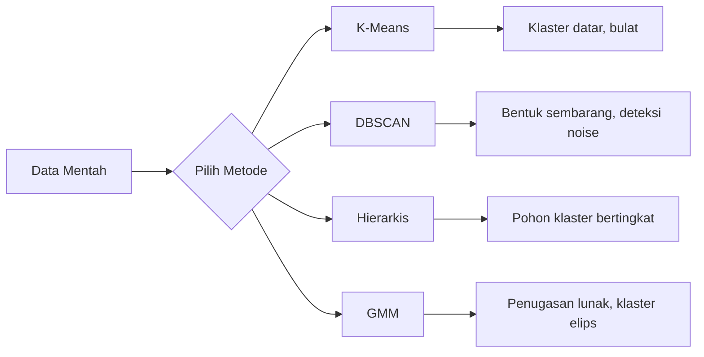

# Pembelajaran Tanpa Pengawasan

> Tanpa label, tanpa guru. Algoritma menemukan strukturnya sendiri.

**Jenis:** Build
**Bahasa:** Python, TypeScript
**Prasyarat:** Fase 1 (Norma & Jarak, Probabilitas & Distribusi), Fase 2 Pelajaran 1-6
**Waktu:** ~90 menit

## Tujuan Pembelajaran

- Mengimplementasikan K-Means, DBSCAN, dan Gaussian Mixture Models dari awal serta membandingkan perilaku clustering-nya
- Menilai kualitas klaster menggunakan skor siluet dan metode elbow untuk memilih K yang optimal
- Menjelaskan kapan DBSCAN mengungguli K-Means dan mengidentifikasi algoritma mana yang menangani klaster non-bulat serta outlier
- Membangun pipeline deteksi anomali menggunakan metode clustering untuk menandai titik yang menyimpang dari pola normal

## Masalahnya

Setiap pelajaran ML sejauh ini mengasumsikan data berlabel: "ini masukan, ini keluaran yang benar." Di dunia nyata, label itu mahal. Sebuah rumah sakit memiliki jutaan rekam pasien tetapi tidak ada yang menandai satu per satu dengan kategori penyakit. Sebuah situs e-commerce memiliki jutaan sesi pengguna tetapi tidak ada yang melabeli segmen pelanggan secara manual. Sebuah tim keamanan memiliki log jaringan tetapi tidak ada yang menandai setiap anomali.

Pembelajaran tanpa pengawasan menemukan pola tanpa diberitahu apa yang harus dicari. Algoritma ini mengelompokkan titik data yang serupa, menemukan struktur tersembunyi, dan menampilkan anomali. Jika pembelajaran terawasi seperti belajar dari buku teks yang disertai kunci jawaban, pembelajaran tanpa pengawasan seperti menatap data mentah sampai polanya memperlihatkan diri sendiri.

Tangkapannya: tanpa label, Anda tidak dapat mengukur secara langsung mana yang "benar" atau "salah." Anda memerlukan alat berbeda untuk menilai apakah struktur yang ditemukan algoritma itu bermakna.

## Konsepnya

### Clustering: Mengelompokkan Hal-Hal yang Serupa

Clustering (pengelompokan) menetapkan setiap titik data ke sebuah kelompok (klaster) sedemikian rupa sehingga titik dalam kelompok yang sama lebih mirip satu sama lain daripada dengan titik di kelompok lain. Pertanyaannya selalu sama: apa arti "mirip"?



### K-Means: Si Kuda Kerja

K-Means mempartisi data menjadi tepat K klaster. Setiap klaster memiliki centroid (pusat massanya), dan setiap titik menjadi milik centroid terdekat.

Algoritma Lloyd:

1. Pilih K titik acak sebagai centroid awal
2. Tetapkan setiap titik data ke centroid terdekat
3. Hitung ulang setiap centroid sebagai rata-rata dari titik-titik yang ditetapkan kepadanya
4. Ulangi langkah 2-3 sampai penetapan tidak berubah lagi

Fungsi objektif (inersia) mengukur total jarak kuadrat dari setiap titik ke centroid yang ditetapkan kepadanya. K-Means meminimalkan nilai ini, tetapi hanya menemukan minimum lokal. Inisialisasi yang berbeda dapat menghasilkan hasil yang berbeda.

### Memilih K

Dua metode standar:

**Metode elbow:** Jalankan K-Means untuk $K = 1, 2, 3, \ldots, n$. Plot inersia terhadap K. Carilah "elbow" tempat penambahan klaster tidak lagi menurunkan inersia secara signifikan.

**Skor siluet:** Untuk setiap titik, ukur seberapa mirip titik itu dengan klasternya sendiri ($a$) dibandingkan dengan klaster lain terdekat ($b$). Koefisien siluet adalah $(b - a) / \max(a, b)$, berkisar dari -1 (klaster salah) sampai +1 (terkelompok dengan baik). Rata-ratkan over semua titik untuk mendapatkan skor global.

### DBSCAN: Clustering Berbasis Kepadatan

K-Means mengasumsikan klaster berbentuk bulat dan mengharuskan Anda memilih K di awal. DBSCAN tidak membuat kedua asumsi itu. Algoritma ini menemukan klaster sebagai wilayah padat yang dipisahkan oleh wilayah jarang.

Dua parameter:
- **eps**: jari-jari lingkungan
- **min_samples**: jumlah minimum titik yang diperlukan untuk membentuk wilayah padat

Tiga jenis titik:
- **Titik inti (core point)**: memiliki setidaknya min_samples titik dalam jarak eps
- **Titik tepi (border point)**: berada dalam jarak eps dari titik inti, tetapi dirinya bukan titik inti
- **Titik noise**: bukan inti maupun tepi. Inilah outlier-nya.

DBSCAN menghubungkan titik-titik inti yang berada dalam jarak eps satu sama lain menjadi satu klaster. Titik tepi bergabung dengan klaster dari titik inti terdekat. Titik noise tidak termasuk klaster mana pun.

Keunggulan: menemukan klaster dengan bentuk apa pun, menentukan jumlah klaster secara otomatis, dan mengidentifikasi outlier. Kelemahan: kesulitan pada klaster dengan kepadatan yang berbeda-beda.

### Clustering Hierarkis

Membangun pohon (dendrogram) berisi klaster bertingkat.

Agglomeratif (bottom-up):
1. Mulai dengan setiap titik sebagai klaster tersendiri
2. Gabungkan dua klaster yang paling dekat
3. Ulangi sampai hanya tersisa satu klaster
4. Potong dendrogram pada tingkat yang diinginkan untuk mendapatkan K klaster

"Kedekatan" antarklaster dapat diukur dengan:
- **Single linkage**: jarak minimum antara dua titik apa pun dalam kedua klaster
- **Complete linkage**: jarak maksimum antara dua titik apa pun
- **Average linkage**: jarak rata-rata atas semua pasangan
- **Metode Ward**: penggabungan yang menyebabkan kenaikan terkecil pada varians total dalam klaster

### Gaussian Mixture Models (GMM)

K-Means memberikan penugasan keras: setiap titik menjadi milik tepat satu klaster. GMM memberikan penugasan lunak: setiap titik memiliki probabilitas menjadi milik masing-masing klaster.

GMM mengasumsikan data dihasilkan dari campuran K distribusi Gaussian, masing-masing dengan rata-rata dan kovariansnya sendiri. Algoritma Expectation-Maximization (EM) bergantian antara:

- **E-step**: menghitung probabilitas bahwa setiap titik menjadi milik masing-masing Gaussian
- **M-step**: memperbarui rata-rata, kovarians, dan bobot campuran setiap Gaussian untuk memaksimalkan likelihood data

GMM dapat memodelkan klaster elips (bukan hanya bulat seperti K-Means) dan secara alami menangani klaster yang tumpang tindih.

### Kapan Menggunakan Mana

| Metode | Paling cocok untuk | Hindari ketika |
|--------|----------|------------|
| K-Means | Dataset besar, klaster bulat, K diketahui | Bentuk tidak beraturan, ada outlier |
| DBSCAN | K tidak diketahui, bentuk sembarang, deteksi outlier | Kepadatan bervariasi, dimensi sangat tinggi |
| Hierarkis | Dataset kecil, memerlukan dendrogram, K tidak diketahui | Dataset besar (memori $O(n^2)$) |
| GMM | Klaster tumpang tindih, memerlukan penugasan lunak | Dataset sangat besar, terlalu banyak dimensi |

### Deteksi Anomali dengan Clustering

Clustering secara alami mendukung deteksi anomali:
- **K-Means**: titik yang jauh dari semua centroid adalah anomali
- **DBSCAN**: titik noise adalah anomali menurut definisinya
- **GMM**: titik dengan probabilitas rendah pada semua Gaussian adalah anomali

```figure
kmeans-step
```

## Bangun Sendiri

### Langkah 1: K-Means dari awal

```python
import math
import random


def euclidean_distance(a, b):
    return math.sqrt(sum((ai - bi) ** 2 for ai, bi in zip(a, b)))


def kmeans(data, k, max_iterations=100, seed=42):
    random.seed(seed)
    n_features = len(data[0])

    centroids = random.sample(data, k)

    for iteration in range(max_iterations):
        clusters = [[] for _ in range(k)]
        assignments = []

        for point in data:
            distances = [euclidean_distance(point, c) for c in centroids]
            nearest = distances.index(min(distances))
            clusters[nearest].append(point)
            assignments.append(nearest)

        new_centroids = []
        for cluster in clusters:
            if len(cluster) == 0:
                new_centroids.append(random.choice(data))
                continue
            centroid = [
                sum(point[j] for point in cluster) / len(cluster)
                for j in range(n_features)
            ]
            new_centroids.append(centroid)

        if all(
            euclidean_distance(old, new) < 1e-6
            for old, new in zip(centroids, new_centroids)
        ):
            print(f"  Converged at iteration {iteration + 1}")
            break

        centroids = new_centroids

    return assignments, centroids
```

### Langkah 2: Metode elbow dan skor siluet

```python
def compute_inertia(data, assignments, centroids):
    total = 0.0
    for point, cluster_id in zip(data, assignments):
        total += euclidean_distance(point, centroids[cluster_id]) ** 2
    return total


def silhouette_score(data, assignments):
    n = len(data)
    if n < 2:
        return 0.0

    clusters = {}
    for i, c in enumerate(assignments):
        clusters.setdefault(c, []).append(i)

    if len(clusters) < 2:
        return 0.0

    scores = []
    for i in range(n):
        own_cluster = assignments[i]
        own_members = [j for j in clusters[own_cluster] if j != i]

        if len(own_members) == 0:
            scores.append(0.0)
            continue

        a = sum(euclidean_distance(data[i], data[j]) for j in own_members) / len(own_members)

        b = float("inf")
        for cluster_id, members in clusters.items():
            if cluster_id == own_cluster:
                continue
            avg_dist = sum(euclidean_distance(data[i], data[j]) for j in members) / len(members)
            b = min(b, avg_dist)

        if max(a, b) == 0:
            scores.append(0.0)
        else:
            scores.append((b - a) / max(a, b))

    return sum(scores) / len(scores)


def find_best_k(data, max_k=10):
    print("Elbow method:")
    inertias = []
    for k in range(1, max_k + 1):
        assignments, centroids = kmeans(data, k)
        inertia = compute_inertia(data, assignments, centroids)
        inertias.append(inertia)
        print(f"  K={k}: inertia={inertia:.2f}")

    print("\nSilhouette scores:")
    for k in range(2, max_k + 1):
        assignments, centroids = kmeans(data, k)
        score = silhouette_score(data, assignments)
        print(f"  K={k}: silhouette={score:.4f}")

    return inertias
```

### Langkah 3: DBSCAN dari awal

```python
def dbscan(data, eps, min_samples):
    n = len(data)
    labels = [-1] * n
    cluster_id = 0

    def region_query(point_idx):
        neighbors = []
        for i in range(n):
            if euclidean_distance(data[point_idx], data[i]) <= eps:
                neighbors.append(i)
        return neighbors

    visited = [False] * n

    for i in range(n):
        if visited[i]:
            continue
        visited[i] = True

        neighbors = region_query(i)

        if len(neighbors) < min_samples:
            labels[i] = -1
            continue

        labels[i] = cluster_id
        seed_set = list(neighbors)
        seed_set.remove(i)

        j = 0
        while j < len(seed_set):
            q = seed_set[j]

            if not visited[q]:
                visited[q] = True
                q_neighbors = region_query(q)
                if len(q_neighbors) >= min_samples:
                    for nb in q_neighbors:
                        if nb not in seed_set:
                            seed_set.append(nb)

            if labels[q] == -1:
                labels[q] = cluster_id

            j += 1

        cluster_id += 1

    return labels
```

### Langkah 4: Gaussian Mixture Model (algoritma EM)

```python
def gmm(data, k, max_iterations=100, seed=42):
    random.seed(seed)
    n = len(data)
    d = len(data[0])

    indices = random.sample(range(n), k)
    means = [list(data[i]) for i in indices]
    variances = [1.0] * k
    weights = [1.0 / k] * k

    def gaussian_pdf(x, mean, variance):
        d = len(x)
        coeff = 1.0 / ((2 * math.pi * variance) ** (d / 2))
        exponent = -sum((xi - mi) ** 2 for xi, mi in zip(x, mean)) / (2 * variance)
        return coeff * math.exp(max(exponent, -500))

    for iteration in range(max_iterations):
        responsibilities = []
        for i in range(n):
            probs = []
            for j in range(k):
                probs.append(weights[j] * gaussian_pdf(data[i], means[j], variances[j]))
            total = sum(probs)
            if total == 0:
                total = 1e-300
            responsibilities.append([p / total for p in probs])

        old_means = [list(m) for m in means]

        for j in range(k):
            r_sum = sum(responsibilities[i][j] for i in range(n))
            if r_sum < 1e-10:
                continue

            weights[j] = r_sum / n

            for dim in range(d):
                means[j][dim] = sum(
                    responsibilities[i][j] * data[i][dim] for i in range(n)
                ) / r_sum

            variances[j] = sum(
                responsibilities[i][j]
                * sum((data[i][dim] - means[j][dim]) ** 2 for dim in range(d))
                for i in range(n)
            ) / (r_sum * d)
            variances[j] = max(variances[j], 1e-6)

        shift = sum(
            euclidean_distance(old_means[j], means[j]) for j in range(k)
        )
        if shift < 1e-6:
            print(f"  GMM converged at iteration {iteration + 1}")
            break

    assignments = []
    for i in range(n):
        assignments.append(responsibilities[i].index(max(responsibilities[i])))

    return assignments, means, weights, responsibilities
```

### Langkah 5: Bangkitkan data uji dan jalankan semuanya

```python
def make_blobs(centers, n_per_cluster=50, spread=0.5, seed=42):
    random.seed(seed)
    data = []
    true_labels = []
    for label, (cx, cy) in enumerate(centers):
        for _ in range(n_per_cluster):
            x = cx + random.gauss(0, spread)
            y = cy + random.gauss(0, spread)
            data.append([x, y])
            true_labels.append(label)
    return data, true_labels


def make_moons(n_samples=200, noise=0.1, seed=42):
    random.seed(seed)
    data = []
    labels = []
    n_half = n_samples // 2
    for i in range(n_half):
        angle = math.pi * i / n_half
        x = math.cos(angle) + random.gauss(0, noise)
        y = math.sin(angle) + random.gauss(0, noise)
        data.append([x, y])
        labels.append(0)
    for i in range(n_half):
        angle = math.pi * i / n_half
        x = 1 - math.cos(angle) + random.gauss(0, noise)
        y = 1 - math.sin(angle) - 0.5 + random.gauss(0, noise)
        data.append([x, y])
        labels.append(1)
    return data, labels


if __name__ == "__main__":
    centers = [[2, 2], [8, 3], [5, 8]]
    data, true_labels = make_blobs(centers, n_per_cluster=50, spread=0.8)

    print("=== K-Means on 3 blobs ===")
    assignments, centroids = kmeans(data, k=3)
    print(f"  Centroids: {[[round(c, 2) for c in cent] for cent in centroids]}")
    sil = silhouette_score(data, assignments)
    print(f"  Silhouette score: {sil:.4f}")

    print("\n=== Elbow Method ===")
    find_best_k(data, max_k=6)

    print("\n=== DBSCAN on 3 blobs ===")
    db_labels = dbscan(data, eps=1.5, min_samples=5)
    n_clusters = len(set(db_labels) - {-1})
    n_noise = db_labels.count(-1)
    print(f"  Found {n_clusters} clusters, {n_noise} noise points")

    print("\n=== GMM on 3 blobs ===")
    gmm_assignments, gmm_means, gmm_weights, _ = gmm(data, k=3)
    print(f"  Means: {[[round(m, 2) for m in mean] for mean in gmm_means]}")
    print(f"  Weights: {[round(w, 3) for w in gmm_weights]}")
    gmm_sil = silhouette_score(data, gmm_assignments)
    print(f"  Silhouette score: {gmm_sil:.4f}")

    print("\n=== DBSCAN on moons (non-spherical clusters) ===")
    moon_data, moon_labels = make_moons(n_samples=200, noise=0.1)
    moon_db = dbscan(moon_data, eps=0.3, min_samples=5)
    n_moon_clusters = len(set(moon_db) - {-1})
    n_moon_noise = moon_db.count(-1)
    print(f"  Found {n_moon_clusters} clusters, {n_moon_noise} noise points")

    print("\n=== K-Means on moons (will fail to separate) ===")
    moon_km, moon_centroids = kmeans(moon_data, k=2)
    moon_sil = silhouette_score(moon_data, moon_km)
    print(f"  Silhouette score: {moon_sil:.4f}")
    print("  K-Means splits moons poorly because they are not spherical")

    print("\n=== Anomaly detection with DBSCAN ===")
    anomaly_data = list(data)
    anomaly_data.append([20.0, 20.0])
    anomaly_data.append([-5.0, -5.0])
    anomaly_data.append([15.0, 0.0])
    anomaly_labels = dbscan(anomaly_data, eps=1.5, min_samples=5)
    anomalies = [
        anomaly_data[i]
        for i in range(len(anomaly_labels))
        if anomaly_labels[i] == -1
    ]
    print(f"  Detected {len(anomalies)} anomalies")
    for a in anomalies[-3:]:
        print(f"    Point {[round(v, 2) for v in a]}")
```

## Gunakan

Dengan scikit-learn, algoritma yang sama menjadi satu baris kode:

```python
from sklearn.cluster import KMeans, DBSCAN, AgglomerativeClustering
from sklearn.mixture import GaussianMixture
from sklearn.metrics import silhouette_score as sklearn_silhouette

km = KMeans(n_clusters=3, random_state=42).fit(data)
db = DBSCAN(eps=1.5, min_samples=5).fit(data)
agg = AgglomerativeClustering(n_clusters=3).fit(data)
gmm_model = GaussianMixture(n_components=3, random_state=42).fit(data)
```

Versi dari awal menunjukkan persis apa yang dihitung pustaka-pustaka ini. K-Means bergantian antara menetapkan dan menghitung ulang. DBSCAN menumbuhkan klaster dari benih padat. GMM bergantian antara ekspektasi dan maksimisasi. Versi pustaka menambahkan stabilitas numerik, inisialisasi yang lebih cerdas (K-Means++), dan akselerasi GPU, tetapi logika intinya sama.

## Kirim

Pelajaran ini menghasilkan implementasi K-Means, DBSCAN, dan GMM yang berfungsi dari awal. Kode clustering dapat digunakan kembali sebagai fondasi untuk metode tanpa pengawasan yang lebih lanjut.

## Latihan

1. Implementasikan inisialisasi K-Means++: alih-alih memilih centroid secara acak, pilih centroid pertama secara acak dan setiap centroid berikutnya dengan probabilitas sebanding dengan jarak kuadratnya ke centroid terdekat yang sudah ada. Bandingkan kecepatan konvergensinya dengan inisialisasi acak.
2. Tambahkan clustering hierarkis aglomeratif ke dalam kode. Implementasikan Ward's linkage dan hasilkan dendrogram (sebagai daftar penggabungan bertingkat). Potong pada berbagai tingkat dan bandingkan dengan hasil K-Means.
3. Bangun pipeline deteksi anomali sederhana: jalankan DBSCAN dan GMM pada data yang sama, tandai titik yang disepakati kedua metode sebagai outlier (noise pada DBSCAN, probabilitas rendah pada GMM). Ukur tumpang tindihnya dan diskusikan kapan kedua metode tidak sepakat.

## Istilah Kunci

| Istilah | Apa yang orang katakan | Arti sebenarnya |
|------|----------------|----------------------|
| Clustering | "Mengelompokkan hal yang serupa" | Mempartisi data menjadi himpunan bagian yang kemiripan dalam kelompoknya melebihi kemiripan antar kelompok, diukur dengan metrik jarak tertentu |
| Centroid | "Pusat sebuah klaster" | Rata-rata semua titik yang ditetapkan ke sebuah klaster; digunakan K-Means sebagai wakil klaster |
| Inersia | "Seberapa rapat klaster-klasternya" | Jumlah jarak kuadrat dari setiap titik ke centroid yang ditetapkan kepadanya; lebih rendah berarti lebih rapat |
| Skor siluet | "Seberapa terpisah klaster-klasternya" | Untuk setiap titik, $(b - a) / \max(a, b)$ dengan $a$ adalah jarak rata-rata dalam klaster dan $b$ adalah jarak rata-rata ke klaster terdekat |
| Titik inti | "Titik di wilayah padat" | Titik dengan setidaknya min_samples tetangga dalam jarak eps, pada DBSCAN |
| Algoritma EM | "K-Means lunak" | Expectation-Maximization: menghitung probabilitas keanggotaan secara berulang (E-step) lalu memperbarui parameter distribusi (M-step) |
| Dendrogram | "Pohon klaster-klaster" | Diagram pohon yang menunjukkan urutan dan jarak penggabungan klaster dalam clustering hierarkis |
| Anomali | "Outlier" | Titik data yang tidak sesuai dengan pola yang diharapkan, diidentifikasi sebagai noise oleh DBSCAN atau berprobabilitas rendah oleh GMM |

## Bacaan Lanjutan

- [Stanford CS229 - Unsupervised Learning](https://cs229.stanford.edu/notes2022fall/main_notes.pdf) - catatan kuliah Andrew Ng tentang clustering dan EM
- [scikit-learn Clustering Guide](https://scikit-learn.org/stable/modules/clustering.html) - perbandingan praktis semua algoritma clustering dengan contoh visual
- [DBSCAN original paper (Ester et al., 1996)](https://www.aaai.org/Papers/KDD/1996/KDD96-037.pdf) - makalah yang memperkenalkan clustering berbasis kepadatan
