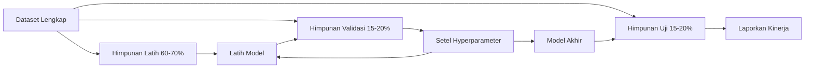

# Evaluasi Model

> Model hanya sebaik cara Anda mengukurnya.

**Jenis:** Build
**Bahasa:** Python
**Prasyarat:** Fase 1 (Probabilitas & Distribusi, Statistik untuk ML), Fase 2 Pelajaran 1-8
**Waktu:** ~90 menit

## Tujuan Pembelajaran

- Terapkan validasi silang K-fold dan stratified K-fold dari awal serta jelaskan mengapa stratifikasi penting untuk data tidak seimbang
- Hitung presisi, recall, F1, AUC-ROC, dan metrik regresi (MSE, RMSE, MAE, R-squared) dari awal
- Tafsirkan kurva pembelajaran untuk mendiagnosis apakah sebuah model mengalami bias tinggi atau varians tinggi
- Identifikasi kesalahan evaluasi umum, termasuk kebocoran data, pemilihan metrik yang salah, dan kontaminasi himpunan uji

## Masalah

Anda melatih sebuah model. Model itu mencapai akurasi 95% pada data Anda. Apakah model itu bagus?

Mungkin ya, mungkin tidak. Jika 95% data Anda termasuk dalam satu kelas, model yang selalu memprediksi kelas itu mendapat akurasi 95% sementara sama sekali tidak berguna. Jika Anda mengevaluasi pada data yang sama dengan data tempat Anda melatih, angka 95% itu tidak bermakna karena model tersebut hanya menghafal jawabannya. Jika dataset Anda memiliki komponen waktu dan Anda mengacak data sebelum pemisahan, model Anda mungkin menggunakan data masa depan untuk memprediksi masa lalu.

Evaluasi model adalah titik di mana sebagian besar proyek ML menjadi salah arah. Metrik yang salah membuat model buruk terlihat baik. Pemisahan yang salah membiarkan model bercuriga. Perbandingan yang salah membuat Anda memilih model yang lebih buruk. Melakukan evaluasi dengan benar bukanlah pilihan. Inilah perbedaan antara model yang bekerja di produksi dan model yang gagal segera setelah melihat data nyata.

## Konsep

### Latih, Validasi, Uji



Tiga pemisahan, tujuan yang berbeda:

- **Himpunan latih**: model belajar dari data ini. Model melihat contoh-contoh ini selama pelatihan.
- **Himpunan validasi**: digunakan untuk menyetel hyperparameter dan memilih antarmodel. Model tidak pernah dilatih pada data ini, tetapi keputusan Anda dipengaruhi olehnya.
- **Himpunan uji**: disentuh tepat sekali, di akhir sekali, untuk melaporkan kinerja akhir. Jika Anda melihat kinerja uji lalu kembali mengubah model, himpunan itu tidak lagi menjadi himpunan uji. Ia telah berubah menjadi himpunan validasi kedua.

Himpunan uji adalah jaminan cadangan Anda bahwa kinerja yang dilaporkan mencerminkan kinerja model pada data yang benar-benar belum pernah dilihat.

### Validasi Silang K-Fold

Pada dataset kecil, satu pemisahan latih/validasi membuang data dan menghasilkan estimasi yang bising. Validasi silang K-fold menggunakan semua data untuk pelatihan sekaligus validasi:

```mermaid
flowchart TB
    subgraph Fold1["Fold 1"]
        direction LR
        V1["Val"] --- T1a["Latih"] --- T1b["Latih"] --- T1c["Latih"] --- T1d["Latih"]
    end
    subgraph Fold2["Fold 2"]
        direction LR
        T2a["Latih"] --- V2["Val"] --- T2b["Latih"] --- T2c["Latih"] --- T2d["Latih"]
    end
    subgraph Fold3["Fold 3"]
        direction LR
        T3a["Latih"] --- T3b["Latih"] --- V3["Val"] --- T3c["Latih"] --- T3d["Latih"]
    end
    subgraph Fold4["Fold 4"]
        direction LR
        T4a["Latih"] --- T4b["Latih"] --- T4c["Latih"] --- V4["Val"] --- T4d["Latih"]
    end
    subgraph Fold5["Fold 5"]
        direction LR
        T5a["Latih"] --- T5b["Latih"] --- T5c["Latih"] --- T5d["Latih"] --- V5["Val"]
    end
    Fold1 --> R["Rata-rata skor"]
    Fold2 --> R
    Fold3 --> R
    Fold4 --> R
    Fold5 --> R
```



1. Bagi data menjadi $K$ fold berukuran sama
2. Untuk setiap fold, latih pada $K-1$ fold dan validasi pada fold yang tersisa
3. Rata-ratakan $K$ skor validasi

$K=5$ atau $K=10$ adalah pilihan yang umum. Setiap titik data digunakan untuk validasi tepat satu kali. Skor rata-rata merupakan estimasi yang lebih stabil daripada pemisahan tunggal mana pun.

**Stratified K-fold**: mempertahankan distribusi kelas di setiap fold. Jika dataset Anda 70% kelas A dan 30% kelas B, setiap fold akan memiliki rasio yang kurang lebih sama. Ini penting untuk dataset tidak seimbang di mana pemisahan acak dapat menaruh semua sampel minoritas dalam satu fold.

### Metrik Klasifikasi

**Matriks konfusi**: fondasinya. Untuk klasifikasi biner:

|  | Diprediksi Positif | Diprediksi Negatif |
|--|---|---|
| Sebenarnya Positif | True Positive (TP) | False Negative (FN) |
| Sebenarnya Negatif | False Positive (FP) | True Negative (TN) |

Dari matriks ini, semua metrik lainnya mengikuti:

- **Akurasi** = $(TP + TN) / (TP + TN + FP + FN)$. Bagian dari prediksi yang benar. Menyesatkan ketika kelas tidak seimbang.
- **Presisi** = $TP / (TP + FP)$. Dari semua yang diprediksi positif, berapa banyak yang benar-benar positif? Gunakan ketika false positive mahal (mis. filter spam yang menandai email asli sebagai spam).
- **Recall** (sensitivitas) = $TP / (TP + FN)$. Dari semua yang benar-benar positif, berapa banyak yang kita tangkap? Gunakan ketika false negative mahal (mis. skrining kanker yang melewatkan tumor).
- **Skor F1** = $2 \cdot \text{precision} \cdot \text{recall} / (\text{precision} + \text{recall})$. Rata-rata harmonik presisi dan recall. Menyeimbangkan keduanya ketika tidak ada yang benar-benar dominan.
- **AUC-ROC**: Area Under the Receiver Operating Characteristic curve. Memplot laju positif benar terhadap laju positif salah pada berbagai ambang klasifikasi. AUC = 0,5 berarti menebak secara acak, AUC = 1,0 berarti pemisahan sempurna. Tidak bergantung pada ambang: metrik ini mengukur seberapa baik model memberi peringkat positif di atas negatif, terlepas dari batas yang Anda pilih.

### Metrik Regresi

- **MSE** (Mean Squared Error) = $\text{mean}((y_{\text{true}} - y_{\text{pred}})^2)$. Menghukum galat besar secara kuadratik. Sensitif terhadap pencilan.
- **RMSE** (Root Mean Squared Error) = $\sqrt{\text{MSE}}$. Satuan sama dengan variabel target. Lebih mudah ditafsirkan daripada MSE.
- **MAE** (Mean Absolute Error) = $\text{mean}(\lvert y_{\text{true}} - y_{\text{pred}} \rvert)$. Memperlakukan semua galat secara linear. Lebih tangguh terhadap pencilan daripada MSE.
- **R-squared** = $1 - SS_{\text{res}} / SS_{\text{tot}}$, dengan $SS_{\text{res}} = \sum (y_{\text{true}} - y_{\text{pred}})^2$ dan $SS_{\text{tot}} = \sum (y_{\text{true}} - y_{\text{mean}})^2$. Bagian varians yang dijelaskan oleh model. $R^2 = 1,0$ adalah sempurna. $R^2 = 0,0$ berarti model tidak lebih baik daripada selalu memprediksi rata-rata. $R^2$ bisa negatif jika model lebih buruk daripada rata-rata.

### Kurva Pembelajaran

Plot skor latih dan validasi sebagai fungsi ukuran himpunan latih:

- **Bias tinggi (underfitting)**: kedua kurva konvergen ke skor yang rendah. Menambah data tidak akan membantu. Anda memerlukan model yang lebih kompleks.
- **Varians tinggi (overfitting)**: skor latih tinggi tetapi skor validasi jauh lebih rendah. Jarak keduanya besar. Menambah data seharusnya membantu.

### Kurva Validasi

Plot skor latih dan validasi sebagai fungsi sebuah hyperparameter:

- Pada kompleksitas rendah: kedua skor rendah (underfitting)
- Pada kompleksitas yang tepat: kedua skor tinggi dan berdekatan
- Pada kompleksitas tinggi: skor latih tetap tinggi tetapi skor validasi turun (overfitting)

Nilai hyperparameter optimal adalah tempat skor validasi mencapai puncaknya.

### Kesalahan Evaluasi Umum

**Kebocoran data**: informasi dari himpunan uji bocor ke dalam pelatihan. Contoh: melakukan fit scaler pada dataset lengkap sebelum pemisahan, menyertakan data masa depan dalam prediksi deret waktu, menggunakan fitur yang berasal dari target. Selalu lakukan pemisahan terlebih dahulu, baru lakukan praproses.

**Ketidakseimbangan kelas**: 99% transaksi sah, 1% penipuan. Model yang selalu memprediksi "sah" mendapat akurasi 99%. Gunakan presisi, recall, F1, atau AUC-ROC sebagai gantinya.

**Metrik yang salah**: mengoptimalkan akurasi ketika yang harus dioptimalkan adalah recall (diagnosis medis), atau mengoptimalkan RMSE ketika data Anda memiliki pencilan berat (gunakan MAE).

**Tidak menggunakan pemisahan stratifikat**: pada data tidak seimbang, pemisahan acak dapat menaruh sangat sedikit sampel minoritas di fold validasi, menghasilkan estimasi yang tidak stabil.

**Terlalu sering menguji**: setiap kali Anda melihat kinerja uji lalu menyesuaikan, Anda melakukan overfitting terhadap himpunan uji. Himpunan uji hanya boleh digunakan sekali.

```figure
precision-recall-threshold
```

## Bangun Sendiri

### Langkah 1: Pemisahan latih/validasi/uji

```python
import random
import math


def train_val_test_split(X, y, train_ratio=0.6, val_ratio=0.2, seed=42):
    random.seed(seed)
    n = len(X)
    indices = list(range(n))
    random.shuffle(indices)

    train_end = int(n * train_ratio)
    val_end = int(n * (train_ratio + val_ratio))

    train_idx = indices[:train_end]
    val_idx = indices[train_end:val_end]
    test_idx = indices[val_end:]

    X_train = [X[i] for i in train_idx]
    y_train = [y[i] for i in train_idx]
    X_val = [X[i] for i in val_idx]
    y_val = [y[i] for i in val_idx]
    X_test = [X[i] for i in test_idx]
    y_test = [y[i] for i in test_idx]

    return X_train, y_train, X_val, y_val, X_test, y_test
```

### Langkah 2: Validasi silang K-fold dan stratified K-fold

```python
def kfold_split(n, k=5, seed=42):
    random.seed(seed)
    indices = list(range(n))
    random.shuffle(indices)

    fold_size = n // k
    folds = []

    for i in range(k):
        start = i * fold_size
        end = start + fold_size if i < k - 1 else n
        val_idx = indices[start:end]
        train_idx = indices[:start] + indices[end:]
        folds.append((train_idx, val_idx))

    return folds


def stratified_kfold_split(y, k=5, seed=42):
    random.seed(seed)

    class_indices = {}
    for i, label in enumerate(y):
        class_indices.setdefault(label, []).append(i)

    for label in class_indices:
        random.shuffle(class_indices[label])

    folds = [{"train": [], "val": []} for _ in range(k)]

    for label, indices in class_indices.items():
        fold_size = len(indices) // k
        for i in range(k):
            start = i * fold_size
            end = start + fold_size if i < k - 1 else len(indices)
            val_part = indices[start:end]
            train_part = indices[:start] + indices[end:]
            folds[i]["val"].extend(val_part)
            folds[i]["train"].extend(train_part)

    return [(f["train"], f["val"]) for f in folds]


def cross_validate(X, y, model_fn, k=5, metric_fn=None, stratified=False):
    n = len(X)

    if stratified:
        folds = stratified_kfold_split(y, k)
    else:
        folds = kfold_split(n, k)

    scores = []
    for train_idx, val_idx in folds:
        X_train = [X[i] for i in train_idx]
        y_train = [y[i] for i in train_idx]
        X_val = [X[i] for i in val_idx]
        y_val = [y[i] for i in val_idx]

        model = model_fn()
        model.fit(X_train, y_train)
        predictions = [model.predict(x) for x in X_val]

        if metric_fn:
            score = metric_fn(y_val, predictions)
        else:
            score = sum(1 for yt, yp in zip(y_val, predictions) if yt == yp) / len(y_val)
        scores.append(score)

    return scores
```

### Langkah 3: Matriks konfusi dan metrik klasifikasi

```python
def confusion_matrix(y_true, y_pred):
    tp = sum(1 for yt, yp in zip(y_true, y_pred) if yt == 1 and yp == 1)
    tn = sum(1 for yt, yp in zip(y_true, y_pred) if yt == 0 and yp == 0)
    fp = sum(1 for yt, yp in zip(y_true, y_pred) if yt == 0 and yp == 1)
    fn = sum(1 for yt, yp in zip(y_true, y_pred) if yt == 1 and yp == 0)
    return tp, tn, fp, fn


def accuracy(y_true, y_pred):
    tp, tn, fp, fn = confusion_matrix(y_true, y_pred)
    total = tp + tn + fp + fn
    return (tp + tn) / total if total > 0 else 0.0


def precision(y_true, y_pred):
    tp, tn, fp, fn = confusion_matrix(y_true, y_pred)
    return tp / (tp + fp) if (tp + fp) > 0 else 0.0


def recall(y_true, y_pred):
    tp, tn, fp, fn = confusion_matrix(y_true, y_pred)
    return tp / (tp + fn) if (tp + fn) > 0 else 0.0


def f1_score(y_true, y_pred):
    p = precision(y_true, y_pred)
    r = recall(y_true, y_pred)
    return 2 * p * r / (p + r) if (p + r) > 0 else 0.0


def roc_curve(y_true, y_scores):
    thresholds = sorted(set(y_scores), reverse=True)
    tpr_list = []
    fpr_list = []

    total_positives = sum(y_true)
    total_negatives = len(y_true) - total_positives

    for threshold in thresholds:
        y_pred = [1 if s >= threshold else 0 for s in y_scores]
        tp = sum(1 for yt, yp in zip(y_true, y_pred) if yt == 1 and yp == 1)
        fp = sum(1 for yt, yp in zip(y_true, y_pred) if yt == 0 and yp == 1)

        tpr = tp / total_positives if total_positives > 0 else 0.0
        fpr = fp / total_negatives if total_negatives > 0 else 0.0

        tpr_list.append(tpr)
        fpr_list.append(fpr)

    return fpr_list, tpr_list, thresholds


def auc_roc(y_true, y_scores):
    fpr_list, tpr_list, _ = roc_curve(y_true, y_scores)

    pairs = sorted(zip(fpr_list, tpr_list))
    fpr_sorted = [p[0] for p in pairs]
    tpr_sorted = [p[1] for p in pairs]

    area = 0.0
    for i in range(1, len(fpr_sorted)):
        width = fpr_sorted[i] - fpr_sorted[i - 1]
        height = (tpr_sorted[i] + tpr_sorted[i - 1]) / 2
        area += width * height

    return area
```

### Langkah 4: Metrik regresi

```python
def mse(y_true, y_pred):
    n = len(y_true)
    return sum((yt - yp) ** 2 for yt, yp in zip(y_true, y_pred)) / n


def rmse(y_true, y_pred):
    return math.sqrt(mse(y_true, y_pred))


def mae(y_true, y_pred):
    n = len(y_true)
    return sum(abs(yt - yp) for yt, yp in zip(y_true, y_pred)) / n


def r_squared(y_true, y_pred):
    mean_y = sum(y_true) / len(y_true)
    ss_res = sum((yt - yp) ** 2 for yt, yp in zip(y_true, y_pred))
    ss_tot = sum((yt - mean_y) ** 2 for yt in y_true)
    if ss_tot == 0:
        return 0.0
    return 1.0 - ss_res / ss_tot
```

### Langkah 5: Kurva pembelajaran

```python
def learning_curve(X, y, model_fn, metric_fn, train_sizes=None, val_ratio=0.2, seed=42):
    random.seed(seed)
    n = len(X)
    indices = list(range(n))
    random.shuffle(indices)

    val_size = int(n * val_ratio)
    val_idx = indices[:val_size]
    pool_idx = indices[val_size:]

    X_val = [X[i] for i in val_idx]
    y_val = [y[i] for i in val_idx]

    if train_sizes is None:
        train_sizes = [int(len(pool_idx) * r) for r in [0.1, 0.2, 0.4, 0.6, 0.8, 1.0]]

    train_scores = []
    val_scores = []

    for size in train_sizes:
        subset = pool_idx[:size]
        X_train = [X[i] for i in subset]
        y_train = [y[i] for i in subset]

        model = model_fn()
        model.fit(X_train, y_train)

        train_pred = [model.predict(x) for x in X_train]
        val_pred = [model.predict(x) for x in X_val]

        train_scores.append(metric_fn(y_train, train_pred))
        val_scores.append(metric_fn(y_val, val_pred))

    return train_sizes, train_scores, val_scores
```

### Langkah 6: Klasifier sederhana untuk pengujian, ditambah demo lengkap

```python
class SimpleLogistic:
    def __init__(self, lr=0.1, epochs=100):
        self.lr = lr
        self.epochs = epochs
        self.weights = None
        self.bias = 0.0

    def sigmoid(self, z):
        z = max(-500, min(500, z))
        return 1.0 / (1.0 + math.exp(-z))

    def fit(self, X, y):
        n_features = len(X[0])
        self.weights = [0.0] * n_features
        self.bias = 0.0

        for _ in range(self.epochs):
            for xi, yi in zip(X, y):
                z = sum(w * x for w, x in zip(self.weights, xi)) + self.bias
                pred = self.sigmoid(z)
                error = yi - pred
                for j in range(n_features):
                    self.weights[j] += self.lr * error * xi[j]
                self.bias += self.lr * error

    def predict_proba(self, x):
        z = sum(w * xi for w, xi in zip(self.weights, x)) + self.bias
        return self.sigmoid(z)

    def predict(self, x):
        return 1 if self.predict_proba(x) >= 0.5 else 0


class SimpleLinearRegression:
    def __init__(self, lr=0.001, epochs=200):
        self.lr = lr
        self.epochs = epochs
        self.weights = None
        self.bias = 0.0

    def fit(self, X, y):
        n_features = len(X[0])
        self.weights = [0.0] * n_features
        self.bias = 0.0
        n = len(X)

        for _ in range(self.epochs):
            for xi, yi in zip(X, y):
                pred = sum(w * x for w, x in zip(self.weights, xi)) + self.bias
                error = yi - pred
                for j in range(n_features):
                    self.weights[j] += self.lr * error * xi[j] / n
                self.bias += self.lr * error / n

    def predict(self, x):
        return sum(w * xi for w, xi in zip(self.weights, x)) + self.bias


def standardize(values):
    n = len(values)
    mean = sum(values) / n
    var = sum((v - mean) ** 2 for v in values) / n
    std = math.sqrt(var) if var > 0 else 1.0
    return [(v - mean) / std for v in values], mean, std


def make_classification_data(n=300, seed=42):
    random.seed(seed)
    X = []
    y = []
    for _ in range(n):
        x1 = random.gauss(0, 1)
        x2 = random.gauss(0, 1)
        label = 1 if (x1 + x2 + random.gauss(0, 0.5)) > 0 else 0
        X.append([x1, x2])
        y.append(label)
    return X, y


def make_regression_data(n=200, seed=42):
    random.seed(seed)
    X = []
    y = []
    for _ in range(n):
        x1 = random.uniform(0, 10)
        x2 = random.uniform(0, 5)
        target = 3 * x1 + 2 * x2 + random.gauss(0, 2)
        X.append([x1, x2])
        y.append(target)
    return X, y


def make_imbalanced_data(n=300, minority_ratio=0.05, seed=42):
    random.seed(seed)
    X = []
    y = []
    for _ in range(n):
        if random.random() < minority_ratio:
            x1 = random.gauss(3, 0.5)
            x2 = random.gauss(3, 0.5)
            label = 1
        else:
            x1 = random.gauss(0, 1)
            x2 = random.gauss(0, 1)
            label = 0
        X.append([x1, x2])
        y.append(label)
    return X, y


if __name__ == "__main__":
    X_clf, y_clf = make_classification_data(300)

    print("=== Train/Validation/Test Split ===")
    X_train, y_train, X_val, y_val, X_test, y_test = train_val_test_split(X_clf, y_clf)
    print(f"  Train: {len(X_train)}, Val: {len(X_val)}, Test: {len(X_test)}")
    print(f"  Train class distribution: {sum(y_train)}/{len(y_train)} positive")
    print(f"  Val class distribution: {sum(y_val)}/{len(y_val)} positive")

    model = SimpleLogistic(lr=0.1, epochs=200)
    model.fit(X_train, y_train)

    print("\n=== Classification Metrics ===")
    y_pred = [model.predict(x) for x in X_test]
    tp, tn, fp, fn = confusion_matrix(y_test, y_pred)
    print(f"  Confusion matrix: TP={tp}, TN={tn}, FP={fp}, FN={fn}")
    print(f"  Accuracy:  {accuracy(y_test, y_pred):.4f}")
    print(f"  Precision: {precision(y_test, y_pred):.4f}")
    print(f"  Recall:    {recall(y_test, y_pred):.4f}")
    print(f"  F1 Score:  {f1_score(y_test, y_pred):.4f}")

    y_scores = [model.predict_proba(x) for x in X_test]
    auc = auc_roc(y_test, y_scores)
    print(f"  AUC-ROC:   {auc:.4f}")

    print("\n=== K-Fold Cross-Validation (K=5) ===")
    cv_scores = cross_validate(
        X_clf, y_clf,
        model_fn=lambda: SimpleLogistic(lr=0.1, epochs=200),
        k=5,
        metric_fn=accuracy,
    )
    mean_cv = sum(cv_scores) / len(cv_scores)
    std_cv = math.sqrt(sum((s - mean_cv) ** 2 for s in cv_scores) / len(cv_scores))
    print(f"  Fold scores: {[round(s, 4) for s in cv_scores]}")
    print(f"  Mean: {mean_cv:.4f} (+/- {std_cv:.4f})")

    print("\n=== Stratified K-Fold Cross-Validation (K=5) ===")
    strat_scores = cross_validate(
        X_clf, y_clf,
        model_fn=lambda: SimpleLogistic(lr=0.1, epochs=200),
        k=5,
        metric_fn=accuracy,
        stratified=True,
    )
    strat_mean = sum(strat_scores) / len(strat_scores)
    strat_std = math.sqrt(sum((s - strat_mean) ** 2 for s in strat_scores) / len(strat_scores))
    print(f"  Fold scores: {[round(s, 4) for s in strat_scores]}")
    print(f"  Mean: {strat_mean:.4f} (+/- {strat_std:.4f})")

    print("\n=== Imbalanced Data: Why Accuracy Lies ===")
    X_imb, y_imb = make_imbalanced_data(300, minority_ratio=0.05)
    positives = sum(y_imb)
    print(f"  Class distribution: {positives} positive, {len(y_imb) - positives} negative ({positives/len(y_imb)*100:.1f}% positive)")

    always_negative = [0] * len(y_imb)
    print(f"  Always-negative baseline:")
    print(f"    Accuracy:  {accuracy(y_imb, always_negative):.4f}")
    print(f"    Precision: {precision(y_imb, always_negative):.4f}")
    print(f"    Recall:    {recall(y_imb, always_negative):.4f}")
    print(f"    F1 Score:  {f1_score(y_imb, always_negative):.4f}")

    X_tr_i, y_tr_i, X_v_i, y_v_i, X_te_i, y_te_i = train_val_test_split(X_imb, y_imb)
    model_imb = SimpleLogistic(lr=0.5, epochs=500)
    model_imb.fit(X_tr_i, y_tr_i)
    y_pred_imb = [model_imb.predict(x) for x in X_te_i]
    print(f"\n  Trained model on imbalanced data:")
    print(f"    Accuracy:  {accuracy(y_te_i, y_pred_imb):.4f}")
    print(f"    Precision: {precision(y_te_i, y_pred_imb):.4f}")
    print(f"    Recall:    {recall(y_te_i, y_pred_imb):.4f}")
    print(f"    F1 Score:  {f1_score(y_te_i, y_pred_imb):.4f}")

    print("\n=== Regression Metrics ===")
    X_reg, y_reg = make_regression_data(200)

    col0 = [x[0] for x in X_reg]
    col1 = [x[1] for x in X_reg]
    col0_s, m0, s0 = standardize(col0)
    col1_s, m1, s1 = standardize(col1)
    X_reg_scaled = [[col0_s[i], col1_s[i]] for i in range(len(X_reg))]

    X_tr_r, y_tr_r, X_v_r, y_v_r, X_te_r, y_te_r = train_val_test_split(X_reg_scaled, y_reg)
    reg_model = SimpleLinearRegression(lr=0.01, epochs=500)
    reg_model.fit(X_tr_r, y_tr_r)
    y_pred_r = [reg_model.predict(x) for x in X_te_r]

    print(f"  MSE:       {mse(y_te_r, y_pred_r):.4f}")
    print(f"  RMSE:      {rmse(y_te_r, y_pred_r):.4f}")
    print(f"  MAE:       {mae(y_te_r, y_pred_r):.4f}")
    print(f"  R-squared: {r_squared(y_te_r, y_pred_r):.4f}")

    mean_baseline = [sum(y_tr_r) / len(y_tr_r)] * len(y_te_r)
    print(f"\n  Mean baseline:")
    print(f"    MSE:       {mse(y_te_r, mean_baseline):.4f}")
    print(f"    R-squared: {r_squared(y_te_r, mean_baseline):.4f}")

    print("\n=== Learning Curve ===")
    sizes, train_sc, val_sc = learning_curve(
        X_clf, y_clf,
        model_fn=lambda: SimpleLogistic(lr=0.1, epochs=200),
        metric_fn=accuracy,
    )
    print(f"  {'Size':>6} {'Train':>8} {'Val':>8}")
    for s, tr, va in zip(sizes, train_sc, val_sc):
        print(f"  {s:>6} {tr:>8.4f} {va:>8.4f}")

    print("\n=== Statistical Model Comparison ===")
    model_a_scores = cross_validate(
        X_clf, y_clf,
        model_fn=lambda: SimpleLogistic(lr=0.1, epochs=100),
        k=5, metric_fn=accuracy,
    )
    model_b_scores = cross_validate(
        X_clf, y_clf,
        model_fn=lambda: SimpleLogistic(lr=0.1, epochs=500),
        k=5, metric_fn=accuracy,
    )
    diffs = [a - b for a, b in zip(model_a_scores, model_b_scores)]
    mean_diff = sum(diffs) / len(diffs)
    std_diff = math.sqrt(sum((d - mean_diff) ** 2 for d in diffs) / len(diffs))
    t_stat = mean_diff / (std_diff / math.sqrt(len(diffs))) if std_diff > 0 else 0.0
    print(f"  Model A (100 epochs) mean: {sum(model_a_scores)/len(model_a_scores):.4f}")
    print(f"  Model B (500 epochs) mean: {sum(model_b_scores)/len(model_b_scores):.4f}")
    print(f"  Mean difference: {mean_diff:.4f}")
    print(f"  Paired t-statistic: {t_stat:.4f}")
    print(f"  (|t| > 2.78 for significance at p<0.05 with df=4)")
```

## Gunakan

Dengan scikit-learn, evaluasi tertanam dalam alur kerja:

```python
from sklearn.model_selection import cross_val_score, StratifiedKFold, learning_curve
from sklearn.metrics import (
    accuracy_score, precision_score, recall_score, f1_score,
    roc_auc_score, confusion_matrix, mean_squared_error, r2_score,
)
from sklearn.linear_model import LogisticRegression

model = LogisticRegression()
scores = cross_val_score(model, X, y, cv=StratifiedKFold(5), scoring="f1")
```

Versi dari awal menunjukkan persis apa yang dilakukan validasi silang (tanpa sihir, hanya perulangan for dan pelacakan indeks), bagaimana setiap metrik dihitung (hanya menghitung TP/FP/TN/FN), dan mengapa stratifikasi penting (mempertahankan rasio kelas di setiap fold). Versi pustaka menambahkan paralelisme, lebih banyak opsi penilaian, dan integrasi dengan pipeline.

## Kirimkan

Pelajaran ini menghasilkan:
- `outputs/skill-evaluation.md` - sebuah skill yang mencakup strategi evaluasi untuk model klasifikasi dan regresi

## Latihan

1. Terapkan kurva presisi-recall: plot presisi terhadap recall pada berbagai ambang. Hitung average precision (luas di bawah kurva PR). Bandingkan kurva PR dengan kurva ROC pada dataset tidak seimbang dan jelaskan kapan masing-masing lebih informatif.
2. Bangun loop validasi silang bersarang: loop luar mengevaluasi kinerja model, loop dalam menyetel hyperparameter. Gunakan untuk membandingkan dua model secara adil tanpa membocorkan data validasi ke dalam evaluasi.
3. Terapkan uji permutasi untuk perbandingan model: acak label, latih ulang, dan ukur kinerjanya. Ulangi 100 kali untuk membangun distribusi nol. Hitung nilai-p dari kinerja model yang diamati terhadap distribusi tersebut.

## Istilah Kunci

| Istilah | Apa yang orang katakan | Apa artinya sebenarnya |
|---------|----------------------|------------------------|
| Overfitting | "Menghafal data latih" | Model menangkap noise dalam data latih, berkinerja baik saat latih tetapi buruk pada data yang belum dilihat |
| Validasi silang | "Menguji pada subhimpunan berbeda" | Secara sistematis mengganti bagian data mana yang digunakan untuk validasi, lalu merata-ratakan hasil di semua putaran |
| Presisi | "Berapa banyak prediksi positif yang benar" | $TP / (TP + FP)$: bagian dari prediksi positif yang benar-benar positif |
| Recall | "Berapa banyak positif sebenarnya yang kita temukan" | $TP / (TP + FN)$: bagian dari positif sebenarnya yang berhasil diidentifikasi |
| AUC-ROC | "Seberapa baik model memisahkan kelas" | Luas di bawah kurva laju true positive terhadap laju false positive di semua ambang, dari 0,5 (acak) hingga 1,0 (sempurna) |
| R-squared | "Berapa banyak varians yang dijelaskan" | $1 - (\text{sum of squared residuals} / \text{total sum of squares})$: bagian varians target yang ditangkap model |
| Kebocoran data | "Modelnya mencontek" | Menggunakan informasi saat pelatihan yang tidak akan tersedia pada saat prediksi, menghasilkan evaluasi yang terlalu optimistis |
| Kurva pembelajaran | "Bagaimana kinerja berubah dengan lebih banyak data" | Plot skor latih dan validasi terhadap ukuran himpunan latih, yang mengungkap underfitting atau overfitting |
| Pemisahan stratifikat | "Menjaga rasio kelas tetap seimbang" | Membagi data sehingga setiap subhimpunan memiliki proporsi tiap kelas yang sama dengan dataset lengkap |

## Bacaan Lanjutan

- [Panduan Model Selection scikit-learn](https://scikit-learn.org/stable/model_selection.html) -- referensi komprehensif tentang validasi silang, metrik, dan penyetelan hyperparameter
- [Beyond Accuracy: Precision and Recall (Google ML Crash Course)](https://developers.google.com/machine-learning/crash-course/classification/precision-and-recall) - penjelasan jelas dengan contoh interaktif
- [A Survey of Cross-Validation Procedures (Arlot & Celisse, 2010)](https://projecteuclid.org/journals/statistics-surveys/volume-4/issue-none/A-survey-of-cross-validation-procedures-for-model-selection/10.1214/09-SS054.full) -- pembahasan mendalam tentang kapan dan mengapa strategi CV berbeda bekerja
