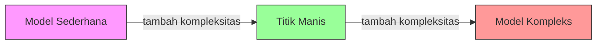
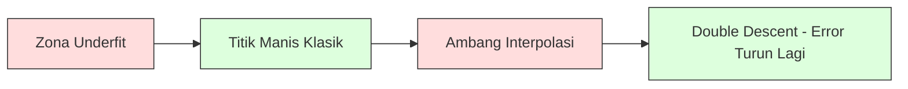
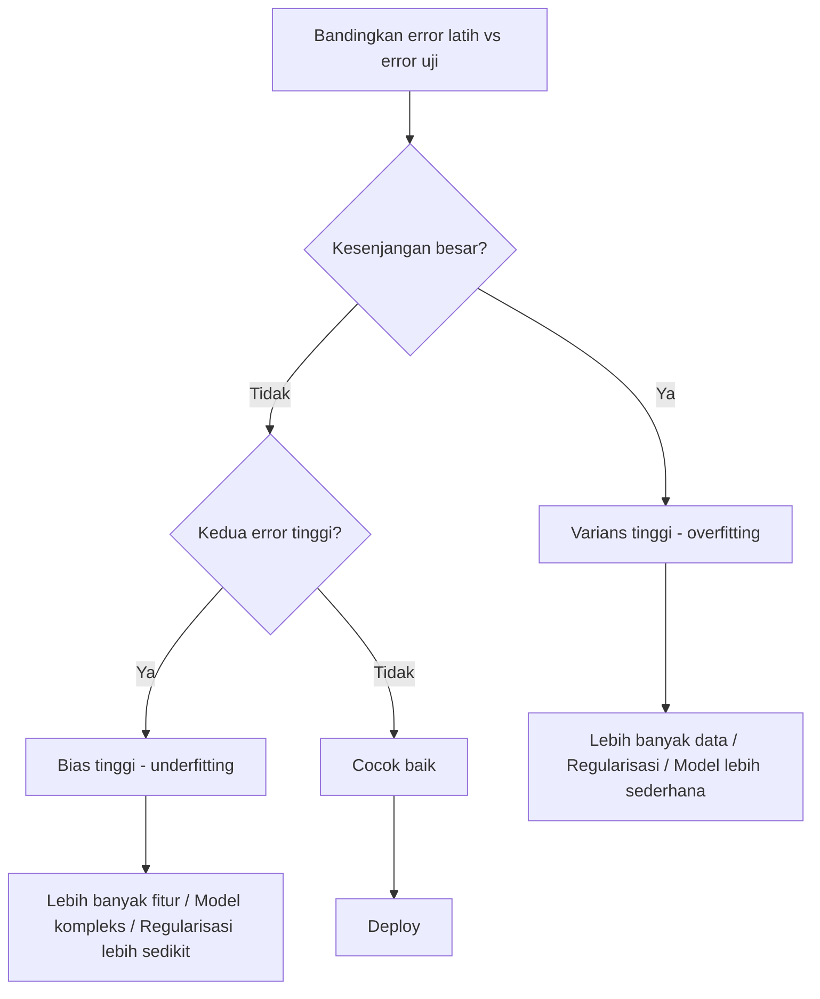
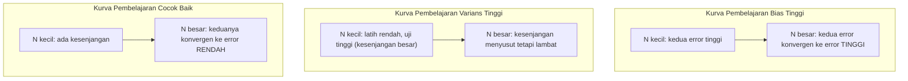
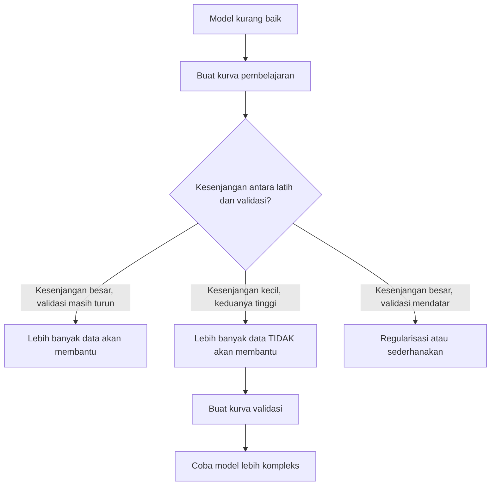

# Trade-off Bias-Varian

> Setiap error model berasal dari salah satu dari tiga sumber: bias, varians, atau noise. Anda hanya dapat mengendalikan dua yang pertama.

**Jenis:** Belajar
**Bahasa:** Python
**Prasyarat:** Fase 2, Pelajaran 01-09 (dasar-dasar ML, regresi, klasifikasi, evaluasi)
**Waktu:** ~75 menit

## Tujuan Pembelajaran

- Turunkan dekomposisi bias-varians dari error prediksi yang diharapkan dan jelaskan peran noise yang tak tereduksi
- Diagnosis apakah sebuah model mengalami bias tinggi atau varians tinggi menggunakan pola error latih dan error uji
- Jelaskan bagaimana teknik regularisasi (L1, L2, dropout, early stopping) menukar bias dengan varians
- Implementasikan eksperimen yang memvisualisasikan trade-off bias-varians pada model dengan kompleksitas yang meningkat

## Masalah

Anda melatih sebuah model. Model itu memiliki error tertentu pada data uji. Dari mana error itu berasal?

Jika model Anda terlalu sederhana (regresi linear pada dataset yang melengkung), ia akan terus-menerus meleset dari pola sebenarnya. Itu bias. Jika model Anda terlalu kompleks (polinomial derajat-20 pada 15 titik data), ia akan cocok sempurna dengan data latih tetapi menghasilkan prediksi yang sangat berbeda pada data baru. Itu varians.

Anda tidak dapat meminimalkan keduanya secara bersamaan untuk kapasitas model yang tetap. Turunkan bias dan varians naik. Turunkan varians dan bias naik. Memahami trade-off ini adalah keterampilan diagnostik paling berguna dalam pembelajaran mesin. Keterampilan ini memberi tahu Anda apakah harus membuat model lebih kompleks atau kurang kompleks, apakah harus mendapatkan lebih banyak data atau merekayasa fitur yang lebih baik, dan apakah harus lebih banyak atau lebih sedikit regularisasi.

## Konsep

### Bias: Error Sistematis

Bias mengukur seberapa jauh prediksi rata-rata model Anda dari nilai sebenarnya. Jika Anda melatih model yang sama pada banyak himpunan latih berbeda yang diambil dari distribusi yang sama, lalu merata-ratakan prediksinya, bias adalah kesenjangan antara rata-rata itu dan kebenaran.

Bias tinggi berarti model terlalu kaku untuk menangkap pola yang sebenarnya. Garis lurus yang dipasangkan pada parabola akan selalu meleset dari kurva, berapa pun data yang Anda berikan. Ini adalah underfitting.

```
Bias tinggi (underfitting):
  Model terus memprediksi kurang lebih kesalahan yang sama.
  Error latih: TINGGI
  Error uji: TINGGI
  Kesenjangan keduanya: KECIL
```

### Varians: Sensitivitas terhadap Data Latih

Varians mengukur seberapa besar prediksi Anda berubah saat Anda melatih pada himpunan data yang berbeda. Jika perubahan kecil pada himpunan latih menyebabkan perubahan besar pada model, variansnya tinggi.

Varians tinggi berarti model tersebut memasukkan noise dalam data latih, bukan sinyal yang mendasarinya. Polinomial derajat-20 akan melewati setiap titik latih tetapi berayun liar di antaranya. Ini adalah overfitting.

```
Varians tinggi (overfitting):
  Model cocok sempurna dengan data latih tetapi gagal pada data baru.
  Error latih: RENDAH
  Error uji: TINGGI
  Kesenjangan keduanya: BESAR
```

### Dekomposisi

Untuk sebarang titik $x$, error prediksi yang diharapkan di bawah loss kuadrat terdekomposisi secara eksak:

```math
\begin{aligned}
& \text{Expected Error} = \text{Bias}^2 + \text{Variance} + \text{Irreducible Noise} \\[6pt]
& \text{where:} \\
& \quad \text{Bias}^2 = (\mathbb{E}[\hat{f}(x)] - f(x))^2 \\
& \quad \text{Variance} = \mathbb{E}[(\hat{f}(x) - \mathbb{E}[\hat{f}(x)])^2] \\
& \quad \text{Noise} = \mathbb{E}[(y - f(x))^2] \quad (\sigma^2)
\end{aligned}
```

- $f(x)$ adalah fungsi sebenarnya
- $\hat{f}(x)$ adalah prediksi model Anda
- $\mathbb{E}[\ldots]$ adalah ekspektasi atas himpunan latih yang berbeda
- $y$ adalah label yang diamati (fungsi sebenarnya ditambah noise)

Suku noise tidak dapat direduksi. Tak ada model yang dapat berkinerja lebih baik daripada $\sigma^2$ pada data bernoise. Tugas Anda adalah menemukan keseimbangan yang tepat antara $\text{bias}^2$ dan varians.

### Kompleksitas Model vs Error



Kurva bentuk-U klasik:

| Kompleksitas | Bias | Varians | Total Error |
|--------------|------|---------|-------------|
| Terlalu rendah | TINGGI | RENDAH | TINGGI (underfitting) |
| Tepat | SEDANG | SEDANG | TERENDAH |
| Terlalu tinggi | RENDAH | TINGGI | TINGGI (overfitting) |

### Regularisasi sebagai Kendali Bias-Varian

Regularisasi secara sengaja menaikkan bias untuk menurunkan varians. Regularisasi membatasi model sehingga tidak dapat mengejar noise.

- **L2 (Ridge):** Menyusutkan semua bobot menuju nol. Mempertahankan semua fitur tetapi mengurangi pengaruhnya.
- **L1 (Lasso):** Mendorong sebagian bobot tepat ke nol. Melakukan seleksi fitur.
- **Dropout:** Menonaktifkan neuron secara acak saat pelatihan. Memaksa representasi yang redundan.
- **Early stopping:** Menghentikan pelatihan sebelum model sepenuhnya cocok dengan data latih.

Kekuatan regularisasi (lambda, laju dropout, jumlah epoch) secara langsung mengendalikan posisi Anda pada kurva bias-varians. Regularisasi lebih kuat berarti bias lebih besar, varians lebih kecil.

### Double Descent: Perspektif Modern

Teori klasik menyatakan: setelah titik manis, kompleksitas tambahan selalu merugikan. Namun penelitian sejak 2019 menunjukkan sesuatu yang tak terduga. Jika Anda terus menaikkan kapasitas model jauh melewati ambang interpolasi (di mana model memiliki cukup parameter untuk mencocokkan data latih dengan sempurna), error uji dapat turun lagi.



Fenomena "double descent" ini menjelaskan mengapa jaringan saraf yang sangat overparameterisasi (dengan jauh lebih banyak parameter daripada contoh latih) tetap menggeneralisasi dengan baik. Trade-off bias-varians klasik tidak salah, tetapi tidak lengkap untuk rezim modern.

Pengamatan utama tentang double descent:
- Fenomena ini terjadi pada model linear, pohon keputusan, dan jaringan saraf
- Lebih banyak data justru dapat merugikan di wilayah interpolasi (double descent per sampel)
- Lebih banyak epoch pelatihan juga dapat menyebabkannya (double descent per epoch)
- Regularisasi melembutkan puncaknya tetapi tidak menghilangkannya

Mengapa ini terjadi? Pada ambang interpolasi, model memiliki kapasitas yang pas untuk mencocokkan semua titik latih. Model dipaksa masuk ke solusi yang sangat spesifik yang melewati setiap titik, dan gangguan kecil pada data menyebabkan perubahan besar pada hasil cocokan. Di sinilah varians mencapai puncak. Di luar ambang tersebut, model memiliki banyak solusi yang mungkin yang semuanya cocok sempurna dengan data. Algoritme pembelajaran (misalnya gradient descent dengan regularisasi implisit) cenderung memilih yang paling sederhana di antaranya. Bias implisit terhadap solusi sederhana inilah yang membuat model overparameterisasi dapat menggeneralisasi.

| Rezim | Parameter vs Sampel | Perilaku |
|-------|--------------------|----------|
| Underparameterized | $p \ll n$ | Trade-off klasik berlaku |
| Ambang interpolasi | $p \sim n$ | Varians mencapai puncak, error uji melonjak |
| Overparameterized | $p \gg n$ | Regularisasi implisit berlaku, error uji turun |

Untuk keperluan praktis: jika Anda menggunakan jaringan saraf atau ansambel pohon besar, jangan berhenti di ambang interpolasi. Baik tetap jauh di bawahnya (dengan regularisasi eksplisit) ataupun melampauinya jauh. Posisi terburuk adalah tepat di ambang tersebut.

### Mendiagnosis Model Anda



| Gejala | Diagnosis | Perbaikan |
|--------|-----------|-----------|
| Error latih tinggi, error uji tinggi | Bias | Lebih banyak fitur, model kompleks, regularisasi lebih sedikit |
| Error latih rendah, error uji tinggi | Varians | Lebih banyak data, regularisasi, model lebih sederhana, dropout |
| Error latih rendah, error uji rendah | Cocok baik | Rilis saja |
| Error latih turun, error uji naik | Overfitting sedang berlangsung | Early stopping |

### Strategi Praktis

**Ketika bias menjadi masalah:**
- Tambahkan fitur polinomial atau interaksi
- Gunakan model yang lebih fleksibel (ansambel pohon alih-alih linear)
- Kurangi kekuatan regularisasi
- Latih lebih lama (jika belum konvergen)

**Ketika varians menjadi masalah:**
- Dapatkan lebih banyak data latih
- Gunakan bagging (random forest)
- Tingkatkan regularisasi (lambda lebih besar, dropout lebih banyak)
- Seleksi fitur (hapus fitur bernoise)
- Gunakan validasi silang untuk mendeteksinya lebih awal

### Metode Ansambel dan Penurunan Varians

Metode ansambel adalah alat paling praktis untuk melawan varians.

**Bagging (Bootstrap Aggregating)** melatih banyak model pada sampel bootstrap yang berbeda dari data latih, lalu merata-ratakan prediksinya. Setiap model individual memiliki varians tinggi, tetapi rata-ratanya jauh lebih rendah variansnya. Random forest adalah bagging yang diterapkan pada pohon keputusan.

Mengapa ini bekerja secara matematis: jika Anda merata-ratakan $N$ prediksi independen, masing-masing dengan varians $\sigma^2$, maka varians rata-ratanya adalah $\sigma^2 / N$. Model-model tersebut tidak benar-benar independen (semuanya melihat data yang serupa), sehingga penurunannya kurang dari $1/N$, tetapi tetap substansial.

**Boosting** menurunkan bias dengan membangun model secara berurutan, di mana setiap model baru berfokus pada error ansambel sejauh ini. Gradient boosting dan AdaBoost adalah contoh utamanya. Boosting dapat overfitting jika Anda menambahkan terlalu banyak model, sehingga Anda memerlukan early stopping atau regularisasi.

| Metode | Efek Utama | Perubahan Bias | Perubahan Varians |
|--------|-----------|----------------|-------------------|
| Bagging | Menurunkan varians | Tidak berubah | Menurun |
| Boosting | Menurunkan bias | Menurun | Dapat naik |
| Stacking | Menurunkan keduanya | Bergantung pada meta-learner | Bergantung pada model dasar |
| Dropout | Bagging implisit | Naik tipis | Menurun |

**Aturan praktis:** jika model dasar Anda memiliki varians tinggi (pohon dalam, polinomial derajat tinggi), gunakan bagging. Jika model dasar Anda memiliki bias tinggi (stump dangkal, model linear sederhana), gunakan boosting.

### Kurva Pembelajaran

Kurva pembelajaran memplot error latih dan validasi sebagai fungsi dari ukuran himpunan latih. Kurva ini adalah alat diagnostik paling praktis yang Anda miliki. Berbeda dengan perbandingan latih/uji tunggal, kurva pembelajaran menunjukkan lintasan model Anda dan memberi tahu apakah lebih banyak data akan membantu.



Cara membacanya:

| Skenario | Error Latih | Error Validasi | Kesenjangan | Artinya | Yang Harus Dilakukan |
|----------|------------|----------------|-------------|---------|----------------------|
| Bias tinggi | Tinggi | Tinggi | Kecil | Model tidak dapat menangkap pola | Lebih banyak fitur, model kompleks, regularisasi lebih sedikit |
| Varians tinggi | Rendah | Tinggi | Besar | Model menghafal data latih | Lebih banyak data, regularisasi, model lebih sederhana |
| Cocok baik | Sedang | Sedang | Kecil | Model menggeneralisasi dengan baik | Rilis saja |
| Varians tinggi, membaik | Rendah | Turun dengan lebih banyak data | Menyusut | Masalah varians yang dapat diperbaiki data | Kumpulkan lebih banyak data |
| Bias tinggi, mendatar | Tinggi | Tinggi dan mendatar | Kecil dan mendatar | Lebih banyak data TIDAK akan membantu | Ubah arsitektur model |

Wawasan kritis: jika kedua kurva sudah mendatar dan kesenjangannya kecil tetapi kedua error tetap tinggi, lebih banyak data tidak berguna. Anda memerlukan model yang lebih baik. Jika kesenjangannya besar dan masih menyusut, lebih banyak data akan membantu.

### Cara Membuat Kurva Pembelajaran

Ada dua pendekatan:

**Pendekatan 1: Variasikan ukuran himpunan latih, model tetap.** Pertahankan model dan hiperparameter tetap. Latih pada himpunan bagian data latih yang semakin besar. Ukur error latih dan error validasi pada setiap ukuran. Ini adalah kurva pembelajaran standar.

**Pendekatan 2: Variasikan kompleksitas model, data tetap.** Pertahankan data tetap. Sapu parameter kompleksitas (derajat polinomial, kedalaman pohon, jumlah lapisan). Ukur error latih dan error validasi pada setiap kompleksitas. Ini adalah kurva validasi dan menunjukkan trade-off bias-varians secara langsung.

Kedua pendekatan saling melengkapi. Pendekatan pertama memberi tahu apakah lebih banyak data akan membantu. Pendekatan kedua memberi tahu apakah model lain akan membantu. Jalankan keduanya sebelum memutuskan langkah berikutnya.



```figure
bias-variance
```

## Bangun

Kode dalam `code/bias_variance.py` menjalankan eksperimen dekomposisi bias-varians secara lengkap. Berikut pendekatannya, langkah demi langkah.

### Langkah 1: Hasilkan Data Sintetis dari Fungsi yang Diketahui

Kita menggunakan `f(x) = sin(1.5x) + 0.5x` dengan noise Gaussian. Dengan mengetahui fungsi sebenarnya, kita dapat menghitung bias dan varians secara eksak.

```python
def true_function(x):
    return np.sin(1.5 * x) + 0.5 * x

def generate_data(n_samples=30, noise_std=0.5, x_range=(-3, 3), seed=None):
    rng = np.random.RandomState(seed)
    x = rng.uniform(x_range[0], x_range[1], n_samples)
    y = true_function(x) + rng.normal(0, noise_std, n_samples)
    return x, y
```

### Langkah 2: Pengambilan Sampel Bootstrap dan Pemasangan Polinomial

Untuk setiap derajat polinomial, kita mengambil banyak himpunan latih bootstrap, memasangkan polinomialnya, dan mencatat prediksi pada grid uji yang tetap. Ini memberi kita distribusi prediksi di setiap titik uji.

```python
def fit_polynomial(x_train, y_train, degree, lam=0.0):
    X = np.column_stack([x_train ** d for d in range(degree + 1)])
    if lam > 0:
        penalty = lam * np.eye(X.shape[1])
        penalty[0, 0] = 0
        w = np.linalg.solve(X.T @ X + penalty, X.T @ y_train)
    else:
        w = np.linalg.lstsq(X, y_train, rcond=None)[0]
    return w
```

Kita memasangkan pada 200 sampel bootstrap yang berbeda. Setiap sampel bootstrap diambil dari distribusi yang mendasari yang sama tetapi berisi titik-titik yang berbeda.

### Langkah 3: Menghitung Dekomposisi Bias² dan Varians

Dengan 200 himpunan prediksi di setiap titik uji, kita dapat menghitung dekomposisi langsung dari definisinya:

```python
mean_pred = predictions.mean(axis=0)
bias_sq = np.mean((mean_pred - y_true) ** 2)
variance = np.mean(predictions.var(axis=0))
total_error = np.mean(np.mean((predictions - y_true) ** 2, axis=1))
```

- `mean_pred` adalah $\mathbb{E}[\hat{f}(x)]$ yang diestimasi dari sampel bootstrap
- `bias_sq` adalah kuadrat kesenjangan antara prediksi rata-rata dan kebenaran
- `variance` adalah penyebaran rata-rata prediksi lintas sampel bootstrap
- `total_error` kira-kira sama dengan $\text{bias}^2 + \text{variance} + \text{noise}$

### Langkah 4: Kurva Pembelajaran

Kurva pembelajaran menyapu ukuran himpunan latih sambil menjaga kompleksitas model tetap. Kurva ini menunjukkan apakah model Anda dibatasi oleh data atau oleh kapasitas.

```python
def demo_learning_curves():
    sizes = [10, 15, 20, 30, 50, 75, 100, 150, 200, 300]
    degree = 5

    for n in sizes:
        train_errors = []
        test_errors = []
        for seed in range(50):
            x_train, y_train = generate_data(n_samples=n, seed=seed * 100)
            w = fit_polynomial(x_train, y_train, degree)
            train_pred = predict_polynomial(x_train, w)
            train_mse = np.mean((train_pred - y_train) ** 2)
            test_pred = predict_polynomial(x_test, w)
            test_mse = np.mean((test_pred - y_test) ** 2)
            train_errors.append(train_mse)
            test_errors.append(test_mse)
        # Rata-rata lintas percobaan memberikan titik kurva pembelajaran
```

Untuk model dengan varians tinggi (derajat 5 dengan data kecil), Anda melihat:
- Error latih mulai rendah dan naik karena lebih banyak data membuat hafalan lebih sulit
- Error uji mulai tinggi dan turun karena model mendapat lebih banyak sinyal
- Kesenjangan menyusut dengan lebih banyak data

Untuk model dengan bias tinggi (derajat 1), kedua error dengan cepat konvergen ke nilai tinggi yang sama dan lebih banyak data tidak membantu.

### Langkah 5: Sapuan Regularisasi

Kode juga menyertakan `demo_regularization_sweep()`, yang menetapkan polinomial derajat tinggi (derajat 15) dan menyapu kekuatan regularisasi Ridge dari 0.001 hingga 100. Ini menunjukkan trade-off bias-varians dari sudut pandang lain: alih-alih memvariasikan kompleksitas model, kita memvariasikan kekuatan batasan.

```python
def demo_regularization_sweep():
    alphas = [0.001, 0.005, 0.01, 0.05, 0.1, 0.5, 1.0, 5.0, 10.0, 50.0, 100.0]
    for alpha in alphas:
        results = bias_variance_decomposition([15], lam=alpha)
        r = results[15]
        print(f"alpha={alpha:.3f}  bias={r['bias_sq']:.4f}  var={r['variance']:.4f}")
```

Pada alpha rendah, polinomial derajat-15 hampir tidak dibatasi. Varians mendominasi karena model mengejar noise di setiap sampel bootstrap. Pada alpha tinggi, penalti begitu kuat sehingga model pada dasarnya menjadi fungsi yang hampir konstan. Bias mendominasi. Alpha optimal berada di antara kedua ekstrem ini.

Ini adalah kurva-U yang sama seperti saat memvariasikan derajat polinomial, tetapi dikendalikan oleh tombol kontinu alih-alih diskrit. Dalam praktiknya, regularisasi adalah cara yang lebih disukai untuk mengendalikan trade-off karena memungkinkan kontrol butir halus tanpa mengubah himpunan fitur.

## Gunakan

sklearn menyediakan `learning_curve` dan `validation_curve` untuk mengotomatiskan diagnostik ini tanpa menulis loop bootstrap.

### Kurva Validasi: Sapuan Kompleksitas Model

```python
from sklearn.model_selection import validation_curve
from sklearn.pipeline import make_pipeline
from sklearn.preprocessing import PolynomialFeatures
from sklearn.linear_model import Ridge

degrees = list(range(1, 16))
train_scores_all = []
val_scores_all = []

for d in degrees:
    pipe = make_pipeline(PolynomialFeatures(d), Ridge(alpha=0.01))
    train_scores, val_scores = validation_curve(
        pipe, X, y, param_name="polynomialfeatures__degree",
        param_range=[d], cv=5, scoring="neg_mean_squared_error"
    )
    train_scores_all.append(-train_scores.mean())
    val_scores_all.append(-val_scores.mean())
```

Ini memberi Anda kurva trade-off bias-varians secara langsung. Di mana skor validasi paling buruk relatif terhadap skor latih, varians mendominasi. Di mana keduanya buruk, bias mendominasi.

### Kurva Pembelajaran: Sapuan Ukuran Himpunan Latih

```python
from sklearn.model_selection import learning_curve

pipe = make_pipeline(PolynomialFeatures(5), Ridge(alpha=0.01))
train_sizes, train_scores, val_scores = learning_curve(
    pipe, X, y, train_sizes=np.linspace(0.1, 1.0, 10),
    cv=5, scoring="neg_mean_squared_error"
)
train_mse = -train_scores.mean(axis=1)
val_mse = -val_scores.mean(axis=1)
```

Plot `train_mse` dan `val_mse` terhadap `train_sizes`. Bentuknya memberi tahu segalanya tentang model Anda.

### Validasi Silang dengan Sapuan Regularisasi

```python
from sklearn.model_selection import cross_val_score

alphas = [0.001, 0.01, 0.1, 1.0, 10.0, 100.0]
for alpha in alphas:
    pipe = make_pipeline(PolynomialFeatures(10), Ridge(alpha=alpha))
    scores = cross_val_score(pipe, X, y, cv=5, scoring="neg_mean_squared_error")
    print(f"alpha={alpha:>7.3f}  MSE={-scores.mean():.4f} +/- {scores.std():.4f}")
```

Ini menyapu kekuatan regularisasi untuk kompleksitas model yang tetap. Anda akan melihat trade-off bias-varians yang sama: alpha rendah berarti varians tinggi, alpha tinggi berarti bias tinggi.

### Menggabungkan Semuanya: Alur Kerja Diagnostik Lengkap

Dalam praktiknya, Anda menjalankan diagnostik ini secara berurutan:

1. Latih model Anda. Hitung error latih dan error uji.
2. Jika keduanya tinggi: Anda memiliki masalah bias. Lompat ke langkah 4.
3. Jika error latih rendah tetapi error uji tinggi: Anda memiliki masalah varians. Buat kurva pembelajaran untuk melihat apakah lebih banyak data akan membantu. Jika tidak, gunakan regularisasi.
4. Buat kurva validasi dengan menyapu parameter kompleksitas utama Anda. Temukan titik manisnya.
5. Pada titik manis itu, buat kurva pembelajaran. Jika kesenjangannya masih besar, Anda memerlukan lebih banyak data atau regularisasi.
6. Coba Ridge/Lasso dengan nilai alpha berbeda menggunakan `cross_val_score`. Pilih alpha dengan error validasi silang terendah.

Ini memerlukan 10-15 menit komputasi untuk sebagian besar dataset tabular dan menghemat jam-jaman menebak.

## Rilis

Pelajaran ini menghasilkan: `outputs/prompt-model-diagnostics.md`

## Latihan

1. Jalankan dekomposisi dengan `noise_std=0` (tanpa noise). Apa yang terjadi pada suku error yang tak tereduksi? Apakah kompleksitas optimal berubah?

2. Tingkatkan ukuran himpunan latih dari 30 menjadi 300. Bagaimana ini memengaruhi komponen varians? Apakah derajat polinomial optimal bergeser?

3. Tambahkan regularisasi L2 (regresi Ridge) ke dalam eksperimen. Untuk polinomial derajat tinggi yang tetap (derajat 15), sapu lambda dari 0 hingga 100. Plot $\text{bias}^2$ dan varians sebagai fungsi lambda.

4. Ubah fungsi sebenarnya dari polinomial menjadi `sin(x)`. Bagaimana dekomposisi bias-varians berubah? Apakah masih ada derajat optimal yang jelas?

5. Implementasikan pembungkus bootstrap aggregating (bagging) sederhana: latih 10 model pada sampel bootstrap dan ratakan prediksinya. Tunjukkan bahwa ini menurunkan varians tanpa menaikkan bias secara berarti.

## Istilah Kunci

| Istilah | Apa yang orang katakan | Apa artinya sebenarnya |
|---------|-----------------------|------------------------|
| Bias | "Model terlalu sederhana" | Error sistematis dari asumsi yang keliru. Kesenjangan antara prediksi rata-rata model dan kebenaran. |
| Varians | "Model overfitting" | Error dari sensitivitas terhadap data latih. Seberapa besar prediksi berubah lintas himpunan latih yang berbeda. |
| Error tak tereduksi | "Noise dalam data" | Error dari keacakan dalam proses pembangkitan data yang sebenarnya. Tak ada model yang dapat menghilangkannya. |
| Underfitting | "Belajar kurang cukup" | Model memiliki bias tinggi. Ia meleset dari pola nyata bahkan pada data latih. |
| Overfitting | "Menghafal data" | Model memiliki varians tinggi. Ia mencocokkan noise dalam data latih yang tidak menggeneralisasi. |
| Regularisasi | "Membatasi model" | Menambahkan penalti untuk mengurangi kompleksitas model, menukar bias dengan varians yang lebih rendah. |
| Double descent | "Lebih banyak parameter dapat membantu" | Error uji turun lagi ketika kapasitas model jauh melebihi ambang interpolasi. |
| Kompleksitas model | "Seberapa fleksibel model itu" | Kapasitas model untuk mencocokkan pola sembarangan. Dikendalikan oleh arsitektur, fitur, atau regularisasi. |

## Bacaan Lanjutan

- [Hastie, Tibshirani, Friedman: Elements of Statistical Learning, Ch. 7](https://hastie.su.domains/ElemStatLearn/) -- pembahasan definitif tentang dekomposisi bias-varians
- [Belkin et al., Reconciling modern machine learning practice and the bias-variance trade-off (2019)](https://arxiv.org/abs/1812.11118) -- makalah double descent
- [Nakkiran et al., Deep Double Descent (2019)](https://arxiv.org/abs/1912.02292) -- double descent per epoch dan per sampel
- [Scott Fortmann-Roe: Understanding the Bias-Variance Tradeoff](http://scott.fortmann-roe.com/docs/BiasVariance.html) -- penjelasan visual yang jelas
