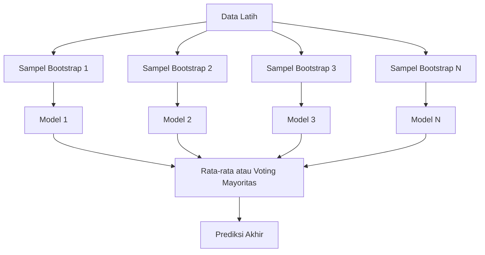
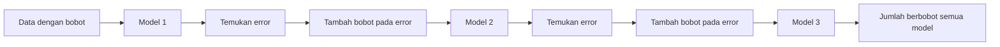
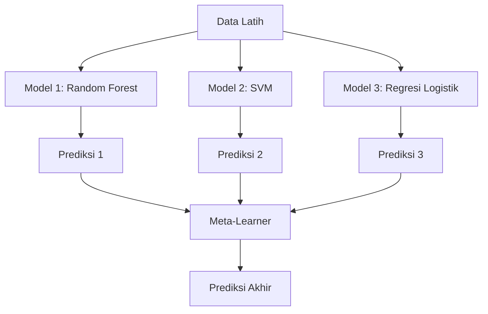

# Metode Ansambel

> Sekumpulan pembelajar lemah, jika digabungkan dengan benar, menjadi pembelajar kuat. Ini bukan metafora. Ini adalah teorema.

**Jenis:** Bangun
**Bahasa:** Python
**Prasyarat:** Fase 2, Pelajaran 10 (Trade-off Bias-Varian)
**Waktu:** ~120 menit

## Tujuan Pembelajaran

- Implementasikan AdaBoost dan gradient boosting dari awal dan jelaskan bagaimana boosting secara berurutan menurunkan bias
- Bangun ansambel bagging dan tunjukkan bagaimana perataan model yang tidak berkorelasi menurunkan varians tanpa menaikkan bias
- Bandingkan bagging, boosting, dan stacking berdasarkan komponen error yang menjadi sasaran setiap metode
- Evaluasi keberagaman ansambel dan jelaskan mengapa akurasi voting mayoritas meningkat dengan lebih banyak pembelajar lemah yang independen

## Masalah

Sebuah pohon keputusan tunggal cepat dilatih dan mudah diinterpretasi, tetapi overfitting. Sebuah model linear tunggal underfitting pada batas yang kompleks. Anda bisa menghabiskan berhari-hari merekayasa arsitektur model yang sempurna. Atau Anda bisa menggabungkan sekumpulan model yang tidak sempurna dan mendapatkan sesuatu yang lebih baik dari masing-masingnya.

Metode ansambel melakukan persis itu. Metode ini adalah teknik paling andal untuk memenangkan kompetisi Kaggle pada data tabular, menjadi penopang sebagian besar sistem ML produksi, dan mengilustrasikan trade-off bias-varians secara nyata. Bagging menurunkan varians. Boosting menurunkan bias. Stacking mempelajari model mana yang harus dipercaya pada input yang mana.

## Konsep

### Mengapa Ansambel Bekerja

Misalkan Anda memiliki $N$ pengklasifikasi independen, masing-masing dengan akurasi $p > 0.5$. Voting mayoritas memiliki akurasi:

```math
P(\text{majority correct}) = \sum_{k > N/2} \binom{N}{k} p^k (1-p)^{N-k}
```

Untuk 21 pengklasifikasi yang masing-masing memiliki akurasi 60%, akurasi voting mayoritas sekitar 74%. Dengan 101 pengklasifikasi, akurasi naik menjadi 84%. Error saling meniadakan ketika model melakukan kesalahan yang berbeda.

Syarat utamanya adalah **keberagaman**. Jika semua model melakukan kesalahan yang sama, menggabungkan mereka tidak membantu apa pun. Ansambel bekerja karena menghasilkan model yang beragam melalui:

- Himpunan latih yang berbeda (bagging)
- Himpunan fitur yang berbeda (random forest)
- Koreksi error berurutan (boosting)
- Keluarga model yang berbeda (stacking)

### Bagging (Bootstrap Aggregating)

Bagging menciptakan keberagaman dengan melatih setiap model pada sampel bootstrap yang berbeda dari data latih.



Sampel bootstrap diambil dengan penggantian dari data asli, dengan ukuran yang sama dengan data asli. Sekitar 63.2% sampel unik muncul di setiap bootstrap. Sisanya sebesar 36.8% (sampel out-of-bag) menyediakan himpunan validasi gratis.

Bagging menurunkan varians tanpa banyak menaikkan bias. Setiap pohon individual overfitting terhadap sampel bootstrap-nya, tetapi overfitting tersebut berbeda untuk setiap pohon, sehingga perataan meniadakan noise.

**Random Forest** adalah bagging dengan tambahan: pada setiap pemisahan, hanya himpunan fitur acak yang dipertimbangkan. Ini memaksa keberagaman yang lebih besar lagi antarpohon. Jumlah kandidat fitur yang umum adalah `sqrt(n_features)` untuk klasifikasi dan `n_features / 3` untuk regresi.

### Boosting (Koreksi Error Berurutan)

Boosting melatih model secara berurutan. Setiap model baru berfokus pada contoh-contoh yang salah diprediksi oleh model sebelumnya.



Boosting menurunkan bias. Setiap model baru mengoreksi error sistematis ansambel sejauh ini. Prediksi akhir adalah jumlah berbobot dari semua model, di mana model yang lebih baik mendapat bobot lebih besar.

Trade-off-nya: boosting dapat overfitting jika Anda menjalankan terlalu banyak putaran, karena ia terus mencocokkan contoh yang semakin sulit, beberapa di antaranya mungkin adalah noise.

### AdaBoost

AdaBoost (Adaptive Boosting) adalah algoritme boosting praktis pertama. Algoritme ini bekerja dengan pembelajar dasar apa pun, biasanya decision stump (pohon kedalaman-1).

Algoritmenya:

```
1. Inisialisasi bobot sampel: w_i = 1/N untuk semua i

2. Untuk t = 1 sampai T:
   a. Latih pembelajar lemah h_t pada data berbobot
   b. Hitung error berbobot:
      err_t = sum(w_i * I(h_t(x_i) != y_i)) / sum(w_i)
   c. Hitung bobot model:
      alpha_t = 0.5 * ln((1 - err_t) / err_t)
   d. Perbarui bobot sampel:
      w_i = w_i * exp(-alpha_t * y_i * h_t(x_i))
   e. Normalisasi bobot agar jumlahnya 1

3. Prediksi akhir: H(x) = sign(sum(alpha_t * h_t(x)))
```

Model dengan error lebih rendah mendapat alpha lebih besar. Sampel yang salah diklasifikasikan mendapat bobot lebih besar sehingga model berikutnya berfokus pada sampel tersebut.

### Gradient Boosting

Gradient boosting menggeneralisasi boosting ke fungsi loss sembarangan. Alih-alih memberi bobot ulang sampel, ia memasangkan setiap model baru pada residual (gradien negatif dari loss) ansambel saat ini.

```
1. Inisialisasi: F_0(x) = argmin_c sum(L(y_i, c))

2. Untuk t = 1 sampai T:
   a. Hitung pseudo-residual:
      r_i = -dL(y_i, F_{t-1}(x_i)) / dF_{t-1}(x_i)
   b. Pasangkan pohon h_t pada residual r_i
   c. Temukan ukuran langkah optimal:
      gamma_t = argmin_gamma sum(L(y_i, F_{t-1}(x_i) + gamma * h_t(x_i)))
   d. Perbarui:
      F_t(x) = F_{t-1}(x) + learning_rate * gamma_t * h_t(x)

3. Prediksi akhir: F_T(x)
```

Untuk loss error kuadrat, pseudo-residual hanyalah residual sebenarnya: $r_i = y_i - F_{t-1}(x_i)$. Setiap pohon secara harfiah mencocokkan error ansambel sebelumnya.

Laju pembelajaran (shrinkage) mengendalikan seberapa besar kontribusi setiap pohon. Laju pembelajaran yang lebih kecil memerlukan lebih banyak pohon tetapi menggeneralisasi lebih baik. Nilai umum: 0.01 hingga 0.3.

### XGBoost: Mengapa Ia Mendominasi Data Tabular

XGBoost (eXtreme Gradient Boosting) adalah gradient boosting dengan optimasi rekayasa yang membuatnya cepat, akurat, dan tahan terhadap overfitting:

- **Objektif teregularisasi:** Penalti L1 dan L2 pada bobot daun mencegah pohon individual terlalu percaya diri
- **Aproksimasi orde kedua:** Menggunakan turunan pertama dan kedua dari loss, menghasilkan keputusan pemisahan yang lebih baik
- **Pemisahan sadar kejarangan:** Menangani nilai hilang secara bawaan dengan mempelajari arah terbaik untuk data yang hilang pada setiap pemisahan
- **Subpemengkoluman:** Seperti random forest, mengambil sampel fitur pada setiap pemisahan untuk keberagaman
- **Sketsa kuantil berbobot:** Menemukan titik pemisahan untuk fitur kontinu secara efisien pada data terdistribusi
- **Struktur blok sadar-cache:** Tata letak memori yang dioptimalkan untuk larik cache CPU

Untuk data tabular, XGBoost (dan penerusnya LightGBM) secara konsisten mengungguli jaringan saraf. Hal ini tidak akan berubah dalam waktu dekat. Jika data Anda muat dalam tabel dengan baris dan kolom, mulailah dengan gradient boosting.

### Stacking (Meta-Pembelajaran)

Stacking menggunakan prediksi dari beberapa model dasar sebagai fitur bagi meta-learner.



Meta-learner mempelajari model dasar mana yang harus dipercaya untuk input yang mana. Jika random forest lebih baik di wilayah tertentu dan SVM di wilayah lain, meta-learner akan belajar mengarahkan sesuai hal tersebut.

Untuk menghindari kebocoran data, prediksi model dasar harus dihasilkan melalui validasi silang pada himpunan latih. Anda tidak pernah melatih model dasar dan menghasilkan meta-fitur pada data yang sama.

### Voting

Ansambel paling sederhana. Cukup gabungkan prediksi secara langsung.

- **Hard voting:** Voting mayoritas pada label kelas.
- **Soft voting:** Rata-ratkan probabilitas prediksi, pilih kelas dengan probabilitas rata-rata tertinggi. Biasanya lebih baik karena menggunakan informasi kepercayaan.

```figure
f3-ensemble-average
```

## Bangun

### Langkah 1: Decision Stump (Pembelajar Dasar)

Kode dalam `code/ensembles.py` mengimplementasikan semuanya dari awal. Kita mulai dengan decision stump: pohon dengan satu pemisahan.

```python
class DecisionStump:
    def __init__(self):
        self.feature_idx = None
        self.threshold = None
        self.polarity = 1
        self.alpha = None

    def fit(self, X, y, weights):
        n_samples, n_features = X.shape
        best_error = float("inf")

        for f in range(n_features):
            thresholds = np.unique(X[:, f])
            for thresh in thresholds:
                for polarity in [1, -1]:
                    pred = np.ones(n_samples)
                    pred[polarity * X[:, f] < polarity * thresh] = -1
                    error = np.sum(weights[pred != y])
                    if error < best_error:
                        best_error = error
                        self.feature_idx = f
                        self.threshold = thresh
                        self.polarity = polarity

    def predict(self, X):
        n = X.shape[0]
        pred = np.ones(n)
        idx = self.polarity * X[:, self.feature_idx] < self.polarity * self.threshold
        pred[idx] = -1
        return pred
```

### Langkah 2: AdaBoost dari Awal

```python
class AdaBoostScratch:
    def __init__(self, n_estimators=50):
        self.n_estimators = n_estimators
        self.stumps = []
        self.alphas = []

    def fit(self, X, y):
        n = X.shape[0]
        weights = np.full(n, 1 / n)

        for _ in range(self.n_estimators):
            stump = DecisionStump()
            stump.fit(X, y, weights)
            pred = stump.predict(X)

            err = np.sum(weights[pred != y])
            err = np.clip(err, 1e-10, 1 - 1e-10)

            alpha = 0.5 * np.log((1 - err) / err)
            weights *= np.exp(-alpha * y * pred)
            weights /= weights.sum()

            stump.alpha = alpha
            self.stumps.append(stump)
            self.alphas.append(alpha)

    def predict(self, X):
        total = sum(a * s.predict(X) for a, s in zip(self.alphas, self.stumps))
        return np.sign(total)
```

### Langkah 3: Gradient Boosting dari Awal

```python
class GradientBoostingScratch:
    def __init__(self, n_estimators=100, learning_rate=0.1, max_depth=3):
        self.n_estimators = n_estimators
        self.lr = learning_rate
        self.max_depth = max_depth
        self.trees = []
        self.initial_pred = None

    def fit(self, X, y):
        self.initial_pred = np.mean(y)
        current_pred = np.full(len(y), self.initial_pred)

        for _ in range(self.n_estimators):
            residuals = y - current_pred
            tree = SimpleRegressionTree(max_depth=self.max_depth)
            tree.fit(X, residuals)
            update = tree.predict(X)
            current_pred += self.lr * update
            self.trees.append(tree)

    def predict(self, X):
        pred = np.full(X.shape[0], self.initial_pred)
        for tree in self.trees:
            pred += self.lr * tree.predict(X)
        return pred
```

### Langkah 4: Bandingkan dengan sklearn

Kode memverifikasi bahwa implementasi dari awal kita menghasilkan akurasi yang serupa dengan `AdaBoostClassifier` dan `GradientBoostingClassifier` dari sklearn, serta membandingkan semua metode secara berdampingan.

## Gunakan

### Kapan Menggunakan Setiap Metode

| Metode | Menurunkan | Terbaik untuk | Perhatikan |
|--------|-----------|---------------|------------|
| Bagging / Random Forest | Varians | Data bernoise, banyak fitur | Tidak membantu bias |
| AdaBoost | Bias | Data bersih, pembelajar dasar sederhana | Sensitif terhadap pencilan dan noise |
| Gradient Boosting | Bias | Data tabular, kompetisi | Lambat dilatih, mudah overfitting tanpa penyetelan |
| XGBoost / LightGBM | Keduanya | ML tabular produksi | Banyak hiperparameter |
| Stacking | Keduanya | Mendapatkan 1-2% akurasi terakhir | Kompleks, risiko overfitting meta-learner |
| Voting | Varians | Kombinasi cepat model beragam | Hanya membantu jika model beragam |

### Tumpukan Produksi untuk Data Tabular

Untuk sebagian besar masalah prediksi tabular, berikut urutan yang dicoba:

1. **LightGBM atau XGBoost** dengan parameter bawaan
2. Setel n_estimators, learning_rate, max_depth, min_child_weight
3. Jika Anda memerlukan 0.5% terakhir, bangun ansambel stacking dengan 3-5 model yang beragam
4. Gunakan validasi silang di seluruh proses

Jaringan saraf pada data tabular hampir selalu lebih buruk daripada gradient boosting, meskipun terus ada upaya riset. TabNet, NODE, dan arsitektur serupa kadang-kadang menyamai tetapi jarang mengalahkan XGBoost yang tersetel dengan baik.

## Rilis

Pelajaran ini menghasilkan `outputs/prompt-ensemble-selector.md` -- sebuah prompt yang membantu Anda memilih metode ansambel yang tepat untuk dataset tertentu. Jelaskan data Anda (ukuran, jenis fitur, tingkat noise, keseimbangan kelas) dan masalah yang sedang Anda selesaikan. Prompt ini menelusuri daftar periksa keputusan, merekomendasikan sebuah metode, menyarankan hiperparameter awal, dan memberi peringatan tentang kesalahan umum untuk metode tersebut. Juga menghasilkan `outputs/skill-ensemble-builder.md` dengan panduan pemilihan lengkap.

## Latihan

1. Ubah implementasi AdaBoost untuk melacak akurasi latih setelah setiap putaran. Plot akurasi terhadap jumlah estimator. Kapan ia konvergen?

2. Implementasikan random forest dari awal dengan menambahkan subpemengacian fitur acak pada pohon regresi. Latih 100 pohon dengan `max_features=sqrt(n_features)` dan ratakan prediksinya. Bandingkan penurunan variansnya dengan satu pohon.

3. Pada implementasi gradient boosting, tambahkan early stopping: lacak loss validasi setelah setiap putaran dan berhenti ketika tidak membaik selama 10 putaran berturut-turut. Berapa banyak pohon yang sebenarnya dibutuhkan?

4. Bangun ansambel stacking dengan tiga model dasar (regresi logistik, pohon keputusan, k-nearest neighbors) dan meta-learner regresi logistik. Gunakan validasi silang 5-lipat untuk menghasilkan meta-fitur. Bandingkan dengan setiap model dasar secara tunggal.

5. Jalankan XGBoost pada dataset yang sama dengan parameter bawaan. Bandingkan akurasinya dengan gradient boosting Anda dari awal. Waktu keduanya. Berapa besar perbedaan kecepatannya?

## Istilah Kunci

| Istilah | Apa yang orang katakan | Apa artinya sebenarnya |
|---------|-----------------------|------------------------|
| Bagging | "Latih pada himpunan bagian acak" | Bootstrap aggregating: latih model pada sampel bootstrap, ratakan prediksi untuk menurunkan varians |
| Boosting | "Fokus pada contoh sulit" | Latih model secara berurutan, masing-masing mengoreksi error ansambel sejauh ini, untuk menurunkan bias |
| AdaBoost | "Berbobot ulang data" | Boosting melalui pembaruan bobot sampel; titik yang salah diklasifikasikan mendapat bobot lebih besar untuk pembelajar berikutnya |
| Gradient boosting | "Pasangkan residual" | Boosting dengan memasangkan setiap model baru pada gradien negatif dari fungsi loss |
| XGBoost | "Senjata Kaggle" | Gradient boosting dengan regularisasi, optimasi orde kedua, dan trik kecepatan tingkat sistem |
| Stacking | "Model di atas model" | Gunakan prediksi model dasar sebagai fitur input bagi meta-learner |
| Random forest | "Banyak pohon teracak" | Bagging dengan pohon keputusan, menambahkan subpemengacian fitur acak pada setiap pemisahan untuk keberagaman |
| Keberagaman ansambel | "Lakukan kesalahan berbeda" | Model harus tidak berkorelasi dalam error agar ansambel lebih baik dari model individual |
| Error out-of-bag | "Validasi gratis" | Sampel yang tidak masuk dalam undian bootstrap (~36.8%) berfungsi sebagai himpunan validasi tanpa perlu holdout |

## Bacaan Lanjutan

- [Schapire & Freund: Boosting: Foundations and Algorithms](https://mitpress.mit.edu/9780262526036/) -- buku karya pencipta AdaBoost
- [Friedman: Greedy Function Approximation: A Gradient Boosting Machine (2001)](https://doi.org/10.1214/aos/1013203451) -- makalah asli gradient boosting
- [Chen & Guestrin: XGBoost (2016)](https://arxiv.org/abs/1603.02754) -- makalah XGBoost
- [Wolpert: Stacked Generalization (1992)](https://www.sciencedirect.com/science/article/abs/pii/S0893608005800231) -- makalah asli stacking
- [scikit-learn Ensemble Methods](https://scikit-learn.org/stable/modules/ensemble.html) -- referensi praktis
