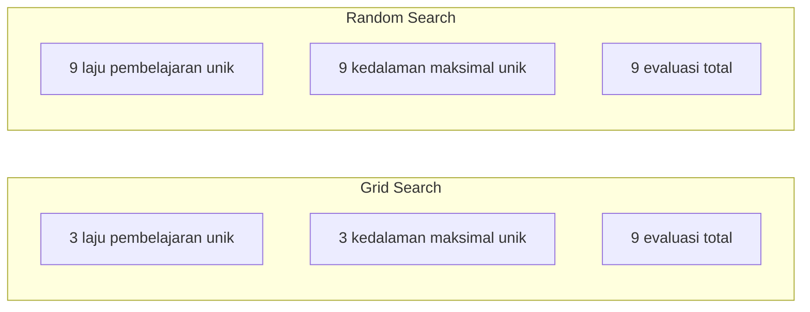
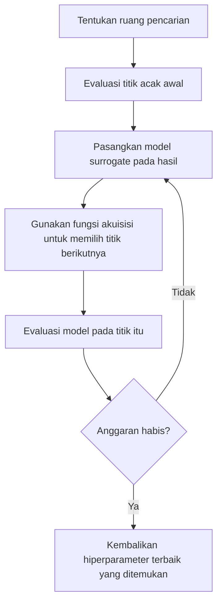
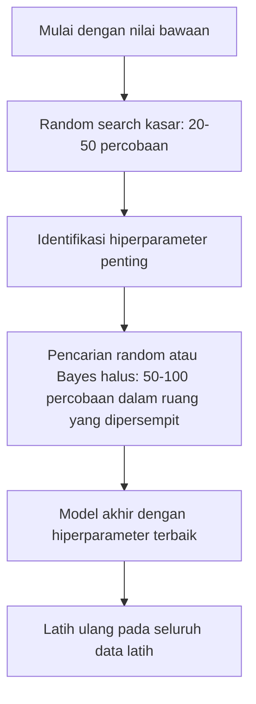
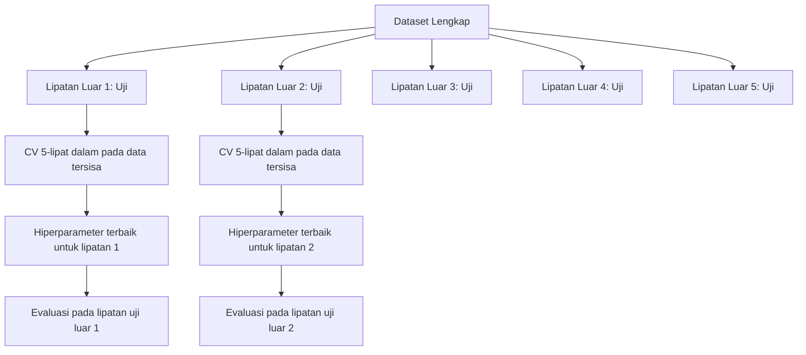

# Penyetelan Hiperparameter

> Hiperparameter adalah tombol yang Anda putar sebelum pelatihan dimulai. Memutarnya dengan baik adalah perbedaan antara model biasa-biasa saja dan model yang hebat.

**Jenis:** Bangun
**Bahasa:** Python
**Prasyarat:** Fase 2, Pelajaran 11 (Metode Ansambel)
**Waktu:** ~90 menit

## Tujuan Pembelajaran

- Implementasikan grid search, random search, dan optimasi Bayes dari awal serta bandingkan efisiensi sampelnya
- Jelaskan mengapa random search mengungguli grid search ketika sebagian besar hiperparameter memiliki dimensi efektif rendah
- Bangun loop optimasi Bayes menggunakan model surrogate dan fungsi akuisisi untuk memandu pencarian
- Rancang strategi penyetelan hiperparameter yang menghindari overfitting pada himpunan validasi melalui validasi silang yang tepat

## Masalah

Model gradient boosting Anda memiliki laju pembelajaran, jumlah pohon, kedalaman maksimal, jumlah sampel minimal per daun, rasio subsampel, dan rasio sampel kolom. Itu enam hiperparameter. Jika masing-masing memiliki 5 nilai wajar, grid memiliki $5^6 = 15{,}625$ kombinasi. Melatih masing-masing memerlukan 10 detik. Itu 43 jam komputasi untuk mencoba semuanya.

Grid search adalah pendekatan yang jelas dan yang terburuk pada skala besar. Random search bekerja lebih baik dengan komputasi lebih sedikit. Optimasi Bayes bekerja lebih baik lagi dengan belajar dari evaluasi sebelumnya. Mengetahui strategi mana yang digunakan, dan hiperparameter mana yang benar-benar penting, menghemat berhari-hari waktu GPU yang terbuang.

## Konsep

### Parameter vs Hiperparameter

Parameter dipelajari selama pelatihan (bobot, bias, ambang pemisahan). Hiperparameter ditetapkan sebelum pelatihan dimulai dan mengendalikan bagaimana pembelajaran terjadi.

| Hiperparameter | Yang dikendalikan | Rentang umum |
|----------------|-------------------|--------------|
| Laju pembelajaran | Ukuran langkah per pembaruan | 0.001 hingga 1.0 |
| Jumlah pohon/epoch | Berapa lama pelatihan berlangsung | 10 hingga 10,000 |
| Kedalaman maksimal | Kompleksitas model | 1 hingga 30 |
| Regularisasi ($\lambda$) | Pencegahan overfitting | 0.0001 hingga 100 |
| Ukuran batch | Noise estimasi gradien | 16 hingga 512 |
| Laju dropout | Fraksi neuron yang dinonaktifkan | 0.0 hingga 0.5 |

### Grid Search

Grid search mengevaluasi setiap kombinasi nilai yang ditentukan. Metode ini komprehensif dan mudah dipahami, tetapi skalanya meningkat secara eksponensial dengan jumlah hiperparameter.

```
Grid untuk 2 hiperparameter:

  learning_rate: [0.01, 0.1, 1.0]
  max_depth:     [3, 5, 7]

  Evaluasi: 3 x 3 = 9 kombinasi

  (0.01, 3)  (0.01, 5)  (0.01, 7)
  (0.1,  3)  (0.1,  5)  (0.1,  7)
  (1.0,  3)  (1.0,  5)  (1.0,  7)
```

Grid search memiliki kelemahan mendasar: jika satu hiperparameter penting dan yang lainnya tidak, sebagian besar evaluasi terbuang. Anda hanya mendapat 3 nilai unik dari parameter yang penting dari 9 evaluasi.

### Random Search

Random search mengambil sampel hiperparameter dari distribusi alih-alih dari grid. Dengan anggaran yang sama yaitu 9 evaluasi, Anda mendapat 9 nilai unik dari setiap hiperparameter.



Mengapa random mengalahkan grid (Bergstra & Bengio, 2012):

- Sebagian besar hiperparameter memiliki dimensi efektif rendah. Biasanya hanya 1-2 dari 6 hiperparameter yang penting untuk suatu masalah.
- Grid search membuang evaluasi pada dimensi yang tidak penting.
- Random search mencakup dimensi yang penting lebih rapat untuk anggaran yang sama.
- Pada 60 percobaan acak, Anda memiliki peluang 95% untuk menemukan titik dalam rentang 5% dari optimum (jika ada dalam ruang pencarian).

### Optimasi Bayes

Random search mengabaikan hasil. Ia tidak belajar bahwa laju pembelajaran tinggi menyebabkan divergensi atau bahwa kedalaman 3 secara konsisten mengungguli kedalaman 10. Optimasi Bayes menggunakan evaluasi sebelumnya untuk memutuskan di mana mencari berikutnya.



Dua komponen utama:

**Model surrogate:** Model yang murah dievaluasi (biasanya proses Gaussian) yang mengaproksimasi fungsi objektif yang mahal. Model ini memberikan prediksi dan estimasi ketidakpastian di titik mana pun dalam ruang pencarian.

**Fungsi akuisisi:** Menentukan di mana evaluasi berikutnya dilakukan dengan menyeimbangkan eksploitasi (mencari di dekat titik baik yang diketahui) dan eksplorasi (mencari di tempat ketidakpastian tinggi). Pilihan umum:

- **Expected Improvement (EI):** Seberapa besar perbaikan terhadap yang terbaik saat ini yang kita harapkan di titik ini?
- **Upper Confidence Bound (UCB):** Prediksi ditambah kelipatan ketidakpastian. UCB yang lebih tinggi berarti titik tersebut menjanjikan atau belum dieksplorasi.
- **Probability of Improvement (PI):** Berapa peluang titik ini mengalahkan yang terbaik saat ini?

Optimasi Bayes biasanya menemukan hiperparameter yang lebih baik daripada random search dengan 2-5x lebih sedikit evaluasi. Overhead pemasangan model surrogate tidak signifikan dibandingkan dengan pelatihan model sebenarnya.

### Early Stopping

Tidak setiap proses pelatihan perlu diselesaikan. Jika sebuah konfigurasi jelas buruk setelah 10 epoch, hentikan dan lanjutkan. Ini adalah early stopping dalam konteks pencarian hiperparameter.

Strategi:
- **Berdasarkan kesabaran:** Berhenti jika loss validasi tidak membaik selama N epoch berturut-turut
- **Pemangkasan median:** Berhenti jika hasil antara percobaan lebih buruk daripada median percobaan yang telah selesai pada langkah yang sama
- **Hyperband:** Alokasikan anggaran kecil ke banyak konfigurasi, lalu tingkatkan anggaran secara bertahap untuk yang terbaik

Hyperband sangat efektif. Metode ini memulai 81 konfigurasi dengan 1 epoch masing-masing, menyimpan sepertiga terbaik, memberi mereka 3 epoch, menyimpan sepertiga terbaik, dan seterusnya. Ini menemukan konfigurasi baik 10-50x lebih cepat daripada mengevaluasi semua konfigurasi dengan anggaran penuh.

### Penjadwal Laju Pembelajaran

Laju pembelajaran hampir selalu merupakan hiperparameter paling penting. Alih-alih menjaganya tetap, penjadwal menyesuaikannya selama pelatihan.

| Penjadwal | Formula | Kapan digunakan |
|-----------|---------|-----------------|
| Peluruhan bertahap | Kalikan dengan 0.1 setiap N epoch | Pelatihan CNN klasik |
| Annealing kosinus | $\text{lr} \cdot 0.5 \cdot (1 + \cos(\pi t / T))$ | Bawaan modern |
| Pemanasan + peluruhan | Naik linear lalu peluruhan kosinus | Transformer |
| Satu siklus | Naik lalu turun dalam satu siklus | Konvergensi cepat |
| Turunkan saat mendatar | Turunkan dengan faktor ketika metrik mandek | Bawaan aman |

### Kepentingan Hiperparameter

Tidak semua hiperparameter sama pentingnya. Riset tentang random forest (Probst et al., 2019) dan gradient boosting menunjukkan pola yang konsisten:

**Kepentingan tinggi:**
- Laju pembelajaran (selalu setel lebih dulu)
- Jumlah estimator / epoch (gunakan early stopping alih-alih menyetel)
- Kekuatan regularisasi

**Kepentingan sedang:**
- Kedalaman maksimal / jumlah lapisan
- Jumlah sampel minimal per daun / peluruhan bobot
- Rasio subsampel

**Kepentingan rendah:**
- Jumlah fitur maksimal (untuk random forest)
- Pilihan fungsi aktivasi tertentu
- Ukuran batch (dalam rentang wajar)

Setel yang penting lebih dulu, biarkan sisanya pada nilai bawaan.

### Strategi Praktis



Alur kerja konkretnya:

1. **Mulai dengan nilai bawaan pustaka.** Nilai-nilai itu dipilih oleh praktisi berpengalaman dan sering sudah 80% sampai tujuan.
2. **Random search kasar.** Rentang luas, 20-50 percobaan. Gunakan early stopping untuk menghentikan proses buruk dengan cepat.
3. **Analisis hasil.** Hiperparameter mana yang berkorelasi dengan kinerja? Persempit ruang pencarian.
4. **Pencarian halus.** Optimasi Bayes atau random search terfokus dalam ruang yang telah dipersempit. 50-100 percobaan.
5. **Latih ulang pada seluruh data latih** dengan hiperparameter terbaik yang ditemukan.

### Integrasi Validasi Silang

Menyetel hiperparameter pada satu pembagian validasi berisiko. Hiperparameter terbaik mungkin overfitting pada lipatan validasi tertentu. Validasi silang bersarang mengatasi ini dengan menggunakan dua loop:

- **Loop luar** (evaluasi): membagi data menjadi latih+validasi dan uji. Melaporkan kinerja tanpa bias.
- **Loop dalam** (penyetelan): membagi latih+validasi menjadi latih dan validasi. Menemukan hiperparameter terbaik.



Setiap lipatan luar menemukan hiperparameter terbaiknya sendiri secara independen. Skor luar adalah estimasi kinerja generalisasi tanpa bias.

Dengan sklearn:

```python
from sklearn.model_selection import cross_val_score, GridSearchCV
from sklearn.ensemble import GradientBoostingRegressor

inner_cv = GridSearchCV(
    GradientBoostingRegressor(),
    param_grid={
        "learning_rate": [0.01, 0.05, 0.1],
        "max_depth": [2, 3, 5],
        "n_estimators": [50, 100, 200],
    },
    cv=5,
    scoring="neg_mean_squared_error",
)

outer_scores = cross_val_score(
    inner_cv, X, y, cv=5, scoring="neg_mean_squared_error"
)

print(f"Nested CV MSE: {-outer_scores.mean():.4f} +/- {outer_scores.std():.4f}")
```

Ini mahal (5 lipatan luar x 5 lipatan dalam x 27 titik grid = 675 pemasangan model), tetapi memberi Anda estimasi kinerja yang dapat dipercaya. Gunakan ini saat melaporkan hasil akhir dalam makalah atau ketika taruhan keputusan tinggi.

### Tips Praktis

**Mulai dengan laju pembelajaran.** Ini selalu merupakan hiperparameter paling penting untuk metode berbasis gradien. Laju pembelajaran yang buruk membuat segala hal lain tidak relevan. Tetapkan hiperparameter lain pada nilai bawaan dan sapu laju pembelajaran lebih dulu.

**Gunakan distribusi log-seragam untuk laju pembelajaran dan regularisasi.** Perbedaan antara 0.001 dan 0.01 sama pentingnya dengan perbedaan antara 0.1 dan 1.0. Pencarian secara linear membuang anggaran pada ujung yang besar.

**Gunakan early stopping alih-alih menyetel n_estimators.** Untuk boosting dan jaringan saraf, tetapkan n_estimators atau epoch tinggi dan biarkan early stopping yang memutuskan kapan berhenti. Ini menghilangkan satu hiperparameter dari pencarian.

**Alokasi anggaran.** Gunakan 60% anggaran penyetelan Anda pada 2 hiperparameter paling penting. Gunakan 40% sisanya untuk sisanya. Dua teratas menyumbang sebagian besar variasi kinerja.

**Skala itu penting.** Jangan pernah mencari ukuran batch pada skala log (16, 32, 64 sudah baik). Selalu cari laju pembelajaran pada skala log. Sesuaikan distribusi pencarian dengan cara hiperparameter memengaruhi model.

| Jenis Model | Hiperparameter Teratas | Pencarian yang Disarankan | Anggaran |
|-------------|-----------------------|---------------------------|----------|
| Random Forest | n_estimators, max_depth, min_samples_leaf | Random search, 50 percobaan | Rendah (pelatihan cepat) |
| Gradient Boosting | learning_rate, n_estimators, max_depth | Bayes, 100 percobaan + early stopping | Sedang |
| Jaringan Saraf | learning_rate, weight_decay, batch_size | Bayes atau random, 100+ percobaan | Tinggi (pelatihan lambat) |
| SVM | C, gamma (kernel RBF) | Grid pada skala log, 25-50 percobaan | Rendah (2 parameter) |
| Lasso/Ridge | alpha | Pencarian 1D pada skala log, 20 percobaan | Sangat rendah |
| XGBoost | learning_rate, max_depth, subsample, colsample | Bayes, 100-200 percobaan + early stopping | Sedang |

**Jika ragu:** random search dengan jumlah percobaan 2x jumlah hiperparameter (mis. 6 hiperparameter = minimal 12 percobaan). Anda akan terkejut betapa seringnya random search dengan 50 percobaan mengalahkan grid search yang dirancang dengan cermat.

```figure
k-fold-cv
```

## Bangun

### Langkah 1: Grid Search dari Awal

Kode dalam `code/tuning.py` mengimplementasikan grid search, random search, dan pengoptimal Bayes sederhana dari awal.

```python
def grid_search(model_fn, param_grid, X_train, y_train, X_val, y_val):
    keys = list(param_grid.keys())
    values = list(param_grid.values())
    best_score = -float("inf")
    best_params = None
    n_evals = 0

    for combo in itertools.product(*values):
        params = dict(zip(keys, combo))
        model = model_fn(**params)
        model.fit(X_train, y_train)
        score = evaluate(model, X_val, y_val)
        n_evals += 1

        if score > best_score:
            best_score = score
            best_params = params

    return best_params, best_score, n_evals
```

### Langkah 2: Random Search dari Awal

```python
def random_search(model_fn, param_distributions, X_train, y_train,
                  X_val, y_val, n_iter=50, seed=42):
    rng = np.random.RandomState(seed)
    best_score = -float("inf")
    best_params = None

    for _ in range(n_iter):
        params = {k: sample(v, rng) for k, v in param_distributions.items()}
        model = model_fn(**params)
        model.fit(X_train, y_train)
        score = evaluate(model, X_val, y_val)

        if score > best_score:
            best_score = score
            best_params = params

    return best_params, best_score, n_iter
```

### Langkah 3: Optimasi Bayes (Disederhanakan)

Ide intinya: pasangkan proses Gaussian pada pasangan (hiperparameter, skor) yang diamati, lalu gunakan fungsi akuisisi untuk memutuskan di mana mencari berikutnya.

```python
class SimpleBayesianOptimizer:
    def __init__(self, search_space, n_initial=5):
        self.search_space = search_space
        self.n_initial = n_initial
        self.X_observed = []
        self.y_observed = []

    def _kernel(self, x1, x2, length_scale=1.0):
        dists = np.sum((x1[:, None, :] - x2[None, :, :]) ** 2, axis=2)
        return np.exp(-0.5 * dists / length_scale ** 2)

    def _fit_gp(self, X_new):
        X_obs = np.array(self.X_observed)
        y_obs = np.array(self.y_observed)
        y_mean = y_obs.mean()
        y_centered = y_obs - y_mean

        K = self._kernel(X_obs, X_obs) + 1e-4 * np.eye(len(X_obs))
        K_star = self._kernel(X_new, X_obs)

        L = np.linalg.cholesky(K)
        alpha = np.linalg.solve(L.T, np.linalg.solve(L, y_centered))
        mu = K_star @ alpha + y_mean

        v = np.linalg.solve(L, K_star.T)
        var = 1.0 - np.sum(v ** 2, axis=0)
        var = np.maximum(var, 1e-6)

        return mu, var

    def _expected_improvement(self, mu, var, best_y):
        sigma = np.sqrt(var)
        z = (mu - best_y) / (sigma + 1e-10)
        ei = sigma * (z * norm_cdf(z) + norm_pdf(z))
        return ei

    def suggest(self):
        if len(self.X_observed) < self.n_initial:
            return sample_random(self.search_space)

        candidates = [sample_random(self.search_space) for _ in range(500)]
        X_cand = np.array([to_vector(c) for c in candidates])
        mu, var = self._fit_gp(X_cand)
        ei = self._expected_improvement(mu, var, max(self.y_observed))
        return candidates[np.argmax(ei)]

    def observe(self, params, score):
        self.X_observed.append(to_vector(params))
        self.y_observed.append(score)
```

Surrogate GP memberikan dua hal di setiap titik kandidat: skor prediksi (mu) dan ketidakpastian (var). Expected Improvement menyeimbangkan keduanya: metode ini menyukai titik-titik di mana model memprediksi skor tinggi ATAU di mana ketidakpastian tinggi. Pada awalnya, sebagian besar titik memiliki ketidakpastian tinggi sehingga pengoptimal melakukan eksplorasi. Kemudian, ia berfokus pada wilayah yang paling menjanjikan.

### Langkah 4: Bandingkan Semua Metode

Jalankan ketiga metode pada objektif sintetis yang sama dan bandingkan. Perbandingan ini menggunakan pembungkus sederhana yang memanggil setiap pengoptimal dengan fungsi objektif langsung (tanpa pelatihan model), sehingga API berbeda dari implementasi berbasis model di atas:

```python
def synthetic_objective(params):
    lr = params["learning_rate"]
    depth = params["max_depth"]
    return -(np.log10(lr) + 2) ** 2 - (depth - 4) ** 2 + 10

param_grid = {
    "learning_rate": [0.001, 0.01, 0.1, 1.0],
    "max_depth": [2, 3, 4, 5, 6, 7, 8],
}

grid_best = None
grid_score = -float("inf")
grid_history = []
for combo in itertools.product(*param_grid.values()):
    params = dict(zip(param_grid.keys(), combo))
    score = synthetic_objective(params)
    grid_history.append((params, score))
    if score > grid_score:
        grid_score = score
        grid_best = params

param_dist = {
    "learning_rate": ("log_float", 0.001, 1.0),
    "max_depth": ("int", 2, 8),
}

rand_best = None
rand_score = -float("inf")
rand_history = []
rng = np.random.RandomState(42)
for _ in range(28):
    params = {k: sample(v, rng) for k, v in param_dist.items()}
    score = synthetic_objective(params)
    rand_history.append((params, score))
    if score > rand_score:
        rand_score = score
        rand_best = params

optimizer = SimpleBayesianOptimizer(param_dist, n_initial=5)
bayes_history = []
for _ in range(28):
    params = optimizer.suggest()
    score = synthetic_objective(params)
    optimizer.observe(params, score)
    bayes_history.append((params, score))
bayes_score = max(s for _, s in bayes_history)

print(f"{'Method':<20} {'Best Score':>12} {'Evaluations':>12}")
print("-" * 50)
print(f"{'Grid Search':<20} {grid_score:>12.4f} {len(grid_history):>12}")
print(f"{'Random Search':<20} {rand_score:>12.4f} {len(rand_history):>12}")
print(f"{'Bayesian Opt':<20} {bayes_score:>12.4f} {len(bayes_history):>12}")
```

Dengan anggaran yang sama, optimasi Bayes biasanya menemukan skor terbaik paling cepat karena tidak membuang evaluasi di wilayah yang jelas buruk. Random search menjangkau wilayah lebih luas daripada grid search. Grid search hanya menang ketika Anda memiliki sangat sedikit hiperparameter dan mampu melakukan pencarian komprehensif.

## Gunakan

### Optuna dalam Praktiknya

Optuna adalah pustaka yang disarankan untuk penyetelan hiperparameter serius. Pustaka ini mendukung pemangkasan, pencarian terdistribusi, dan visualisasi secara bawaan.

```python
import optuna

def objective(trial):
    lr = trial.suggest_float("learning_rate", 1e-4, 1e-1, log=True)
    n_est = trial.suggest_int("n_estimators", 50, 500)
    max_depth = trial.suggest_int("max_depth", 2, 10)

    model = GradientBoostingRegressor(
        learning_rate=lr,
        n_estimators=n_est,
        max_depth=max_depth,
    )
    model.fit(X_train, y_train)
    return mean_squared_error(y_val, model.predict(X_val))

study = optuna.create_study(direction="minimize")
study.optimize(objective, n_trials=100)

print(f"Best params: {study.best_params}")
print(f"Best MSE: {study.best_value:.4f}")
```

Fitur utama Optuna:
- `suggest_float(..., log=True)` untuk parameter yang sebaiknya dicari pada skala log (laju pembelajaran, regularisasi)
- `suggest_int` untuk parameter bilangan bulat
- `suggest_categorical` untuk pilihan diskrit
- MedianPruner bawaan untuk menghentikan percobaan buruk lebih awal
- `study.trials_dataframe()` untuk analisis

### Optuna dengan Pemangkasan

Pemangkasan menghentikan percobaan yang tidak menjanjikan lebih awal, menghemat komputasi besar. Berikut polanya:

```python
import optuna
from sklearn.model_selection import cross_val_score

def objective(trial):
    params = {
        "learning_rate": trial.suggest_float("lr", 1e-4, 0.5, log=True),
        "max_depth": trial.suggest_int("max_depth", 2, 10),
        "n_estimators": trial.suggest_int("n_estimators", 50, 500),
        "subsample": trial.suggest_float("subsample", 0.5, 1.0),
    }

    model = GradientBoostingRegressor(**params)
    scores = cross_val_score(model, X_train, y_train, cv=3,
                             scoring="neg_mean_squared_error")
    mean_score = -scores.mean()

    trial.report(mean_score, step=0)
    if trial.should_prune():
        raise optuna.TrialPruned()

    return mean_score

pruner = optuna.pruners.MedianPruner(n_startup_trials=10, n_warmup_steps=5)
study = optuna.create_study(direction="minimize", pruner=pruner)
study.optimize(objective, n_trials=200)
```

`MedianPruner` menghentikan sebuah percobaan jika nilai antaraannya lebih buruk daripada median semua percobaan yang selesai pada langkah yang sama. Pemangkasan memerlukan pemanggilan `trial.report()` untuk melaporkan metrik antara dan `trial.should_prune()` untuk memeriksa apakah percobaan harus dihentikan. `n_startup_trials=10` memastikan setidaknya 10 percobaan selesai sepenuhnya sebelum pemangkasan dimulai. Ini biasanya menghemat 40-60% dari total komputasi.

### Penyetel Bawaan sklearn

Untuk eksperimen cepat, sklearn menyediakan `GridSearchCV`, `RandomizedSearchCV`, dan `HalvingRandomSearchCV`:

```python
from sklearn.model_selection import RandomizedSearchCV
from scipy.stats import loguniform, randint

param_dist = {
    "learning_rate": loguniform(1e-4, 0.5),
    "max_depth": randint(2, 10),
    "n_estimators": randint(50, 500),
}

search = RandomizedSearchCV(
    GradientBoostingRegressor(),
    param_dist,
    n_iter=100,
    cv=5,
    scoring="neg_mean_squared_error",
    random_state=42,
    n_jobs=-1,
)
search.fit(X_train, y_train)
print(f"Best params: {search.best_params_}")
print(f"Best CV MSE: {-search.best_score_:.4f}")
```

Gunakan `loguniform` dari scipy untuk laju pembelajaran dan regularisasi. Gunakan `randint` untuk hiperparameter bilangan bulat. Flag `n_jobs=-1` memparallelkan ke semua inti CPU.

### Kesalahan Umum dalam Penyetelan Hiperparameter

**Kebocoran data melalui praproses.** Jika Anda memasangkan scaler pada seluruh dataset sebelum validasi silang, informasi dari lipatan validasi bocor ke pelatihan. Selalu letakkan praproses di dalam `Pipeline` agar dipasangkan hanya pada lipatan latih.

**Overfitting pada himpunan validasi.** Menjalankan ribuan percobaan pada dasarnya melatih pada himpunan validasi. Gunakan validasi silang bersarang untuk estimasi kinerja akhir, atau sisihkan himpunan uji terpisah yang tidak pernah Anda sentuh selama penyetelan.

**Mencari rentang yang terlalu sempit.** Jika nilai terbaik Anda berada di batas ruang pencarian, Anda belum mencari cukup luas. Nilai optimal mungkin di luar rentang Anda. Selalu periksa apakah parameter terbaik berada di tepi.

**Mengabaikan efek interaksi.** Laju pembelajaran dan jumlah estimator berinteraksi kuat pada boosting. Laju pembelajaran rendah memerlukan lebih banyak estimator. Menyetel keduanya secara terpisah memberikan hasil yang lebih buruk daripada menyetel keduanya bersamaan.

**Tidak menggunakan early stopping untuk model iteratif.** Untuk gradient boosting dan jaringan saraf, tetapkan n_estimators atau epoch ke nilai tinggi dan gunakan early stopping. Ini secara tegas lebih baik daripada menyetel jumlah iterasi sebagai hiperparameter.

## Latihan

1. Jalankan grid search dan random search dengan total anggaran yang sama (mis. 50 evaluasi). Bandingkan skor terbaik yang ditemukan. Jalankan eksperimen 10 kali dengan benih berbeda. Seberapa sering random search menang?

2. Implementasikan Hyperband dari awal. Mulai dengan 81 konfigurasi, masing-masing dilatih selama 1 epoch. Simpan 1/3 terbaik pada setiap putaran dan kalikan anggaran mereka dengan tiga. Bandingkan total komputasi (jumlah semua epoch lintas konfigurasi) dengan menjalankan 81 konfigurasi dengan anggaran penuh.

3. Tambahkan penjadwal laju pembelajaran (annealing kosinus) pada implementasi gradient boosting dari Pelajaran 11. Apakah ini membantu dibandingkan dengan laju pembelajaran tetap?

4. Gunakan Optuna untuk menyetel RandomForestClassifier pada dataset nyata (mis. dataset kanker payudara sklearn). Gunakan `optuna.visualization.plot_param_importances(study)` untuk melihat hiperparameter mana yang paling penting. Apakah hasilnya sesuai dengan peringkat kepentingan dari pelajaran ini?

5. Implementasikan fungsi akuisisi sederhana (Expected Improvement) dan tunjukkan eksplorasi vs eksploitasi. Plot rata-rata dan ketidakpastian model surrogate, serta tunjukkan di mana EI memilih untuk melakukan evaluasi berikutnya.

## Istilah Kunci

| Istilah | Apa yang orang katakan | Apa artinya sebenarnya |
|---------|-----------------------|------------------------|
| Hiperparameter | "Pengaturan yang Anda pilih" | Nilai yang ditetapkan sebelum pelatihan yang mengendalikan proses pembelajaran, bukan dipelajari dari data |
| Grid search | "Coba setiap kombinasi" | Pencarian komprehensif atas grid parameter yang ditentukan. Biaya eksponensial. |
| Random search | "Cukup ambil sampel acak" | Ambil sampel hiperparameter dari distribusi. Menjangkau dimensi penting lebih baik daripada grid search. |
| Optimasi Bayes | "Pencarian cerdas" | Menggunakan model surrogate dari objektif untuk memutuskan di mana evaluasi berikutnya, menyeimbangkan eksplorasi dan eksploitasi |
| Model surrogate | "Aproksimasi murah" | Model (biasanya proses Gaussian) yang mengaproksimasi fungsi objektif mahal dari evaluasi yang diamati |
| Fungsi akuisisi | "Ke mana mencari berikutnya" | Menilai titik kandidat dengan menyeimbangkan perbaikan yang diharapkan dan ketidakpastian. EI dan UCB adalah pilihan umum. |
| Early stopping | "Berhenti membuang waktu" | Menghentikan pelatihan lebih awal ketika kinerja validasi berhenti membaik |
| Hyperband | "Bracket turnamen untuk konfigurasi" | Alokasi sumber daya adaptif: mulai banyak konfigurasi dengan anggaran kecil, simpan yang terbaik dan tingkatkan anggarannya |
| Penjadwal laju pembelajaran | "Ubah lr selama pelatihan" | Fungsi yang menyesuaikan laju pembelajaran selama pelatihan untuk konvergensi lebih baik |

## Bacaan Lanjutan

- [Bergstra & Bengio: Random Search for Hyper-Parameter Optimization (2012)](https://jmlr.org/papers/v13/bergstra12a.html) -- makalah yang menunjukkan random mengalahkan grid
- [Snoek et al., Practical Bayesian Optimization of Machine Learning Algorithms (2012)](https://arxiv.org/abs/1206.2944) -- optimasi Bayes untuk ML
- [Li et al., Hyperband: A Novel Bandit-Based Approach (2018)](https://jmlr.org/papers/v18/16-558.html) -- makalah Hyperband
- [Optuna: A Next-generation Hyperparameter Optimization Framework](https://arxiv.org/abs/1907.10902) -- makalah Optuna
- [Probst et al., Tunability: Importance of Hyperparameters (2019)](https://jmlr.org/papers/v20/18-444.html) -- hiperparameter mana yang penting
