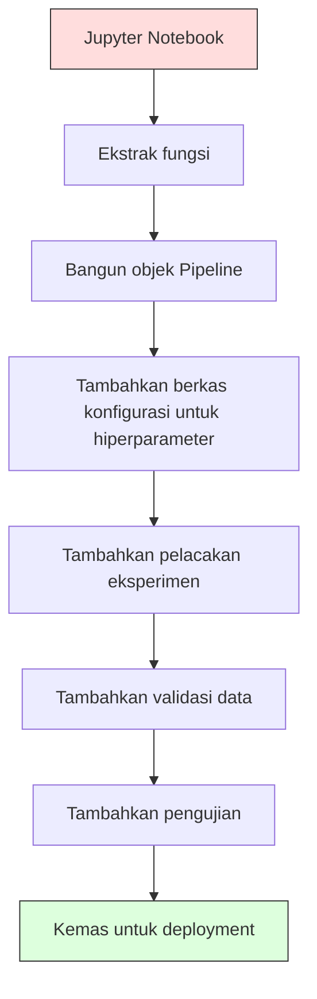

# Pipeline ML

> Sebuah model bukanlah produk. Pipeline-lah produknya. Pipeline mencakup segalanya dari data mentah hingga prediksi yang di-deploy, dan setiap langkah harus dapat direproduksi.

**Jenis:** Bangun
**Bahasa:** Python
**Prasyarat:** Fase 2, Pelajaran 12 (Penyetelan Hiperparameter)
**Waktu:** ~120 menit

## Tujuan Pembelajaran

- Bangun pipeline ML dari awal yang merangkai imputasi, penskalaan, encoding, dan pelatihan model menjadi satu objek yang dapat direproduksi
- Identifikasi skenario kebocoran data dan jelaskan bagaimana pipeline mencegahnya dengan memasangkan transformer hanya pada data latih
- Bangun ColumnTransformer yang menerapkan praproses berbeda pada fitur numerik dan kategorikal
- Implementasikan serialisasi pipeline dan tunjukkan bahwa pipeline yang sama yang telah dipasangkan menghasilkan hasil identik di pelatihan dan produksi

## Masalah

Anda memiliki notebook yang memuat data, mengisi nilai hilang dengan median, menskalakan fitur, melatih model, dan mencetak akurasi. Notebook itu bekerja. Anda merilisnya.

Se bulan kemudian, seseorang melatih ulang model dan mendapat hasil yang berbeda. Median dihitung pada seluruh dataset termasuk data uji (kebocoran data). Parameter penskalaan tidak disimpan, sehingga inferensi menggunakan statistik yang berbeda. Kode rekayasa fitur disalin-tempel antara pelatihan dan penyajian, dan salinan-salinan itu menyimpang. Sebuah kolom kategorikal memperoleh nilai baru di produksi yang belum pernah dilihat oleh encoder.

Ini bukan sekadar hipotesis. Ini adalah alasan paling umum sistem ML gagal di produksi. Pipeline mengatasi semuanya dengan mengemas setiap langkah transformasi ke dalam satu objek yang terurut dan dapat direproduksi.

## Konsep

### Apa Itu Pipeline

Pipeline adalah urutan transformasi data yang terurut diikuti oleh sebuah model. Setiap langkah menerima keluaran langkah sebelumnya sebagai input. Seluruh pipeline dipasangkan sekali pada data latih. Pada waktu inferensi, pipeline yang sama yang telah dipasangkan mengubah data baru dan menghasilkan prediksi.


Pipeline menjamin:
- Transformasi dipasangkan hanya pada data latih (tanpa kebocoran)
- Transformasi yang sama diterapkan pada waktu inferensi
- Seluruh objek dapat diserialisasi dan di-deploy sebagai satu artefak
- Validasi silang menerapkan pipeline per lipatan, mencegah kebocoran halus

### Kebocoran Data: Pembunuh Senyap

Kebocoran data terjadi ketika informasi dari himpunan uji atau data masa depan mencemari pelatihan. Pipeline mencegah bentuk yang paling umum.

**Bocor (salah):**
```python
X = df.drop("target", axis=1)
y = df["target"]

scaler = StandardScaler()
X_scaled = scaler.fit_transform(X)

X_train, X_test = X_scaled[:800], X_scaled[800:]
y_train, y_test = y[:800], y[800:]
```

Scaler melihat data uji. Rata-rata dan simpangan baku menyertakan sampel uji. Ini menggelembungkan estimasi akurasi.

**Benar:**
```python
X_train, X_test = X[:800], X[800:]

scaler = StandardScaler()
X_train_scaled = scaler.fit_transform(X_train)
X_test_scaled = scaler.transform(X_test)
```

Dengan pipeline, Anda tidak perlu memikirkan ini. Pipeline menanganinya secara otomatis.

### Pipeline sklearn

`Pipeline` dari sklearn merangkai transformer dan estimator. Pipeline ini menyediakan `.fit()`, `.predict()`, dan `.score()` yang menerapkan semua langkah secara berurutan.

```python
from sklearn.pipeline import Pipeline
from sklearn.preprocessing import StandardScaler
from sklearn.linear_model import LogisticRegression

pipe = Pipeline([
    ("scaler", StandardScaler()),
    ("model", LogisticRegression()),
])

pipe.fit(X_train, y_train)
predictions = pipe.predict(X_test)
```

Saat Anda memanggil `pipe.fit(X_train, y_train)`:
1. Scaler memanggil `fit_transform` pada X_train
2. Model memanggil `fit` pada X_train yang telah diskalakan

Saat Anda memanggil `pipe.predict(X_test)`:
1. Scaler memanggil `transform` (bukan fit_transform) pada X_test
2. Model memanggil `predict` pada X_test yang telah diskalakan

Scaler tidak pernah melihat data uji saat pemasangan. Ini adalah inti persoalannya.

### ColumnTransformer: Pipeline Berbeda untuk Kolom Berbeda

Dataset nyata memiliki kolom numerik dan kategorikal yang memerlukan praproses berbeda. `ColumnTransformer` menangani hal ini.

```python
from sklearn.compose import ColumnTransformer
from sklearn.preprocessing import StandardScaler, OneHotEncoder
from sklearn.impute import SimpleImputer

numeric_pipe = Pipeline([
    ("impute", SimpleImputer(strategy="median")),
    ("scale", StandardScaler()),
])

categorical_pipe = Pipeline([
    ("impute", SimpleImputer(strategy="most_frequent")),
    ("encode", OneHotEncoder(handle_unknown="ignore")),
])

preprocessor = ColumnTransformer([
    ("num", numeric_pipe, ["age", "income", "score"]),
    ("cat", categorical_pipe, ["city", "gender", "plan"]),
])

full_pipeline = Pipeline([
    ("preprocess", preprocessor),
    ("model", GradientBoostingClassifier()),
])
```

`handle_unknown="ignore"` pada OneHotEncoder sangat penting untuk produksi. Ketika kategori baru muncul (sebuah kota yang belum pernah dilihat model), encoder menghasilkan vektor nol alih-alih mengalami error.

### Pelacakan Eksperimen

Pipeline membuat pelatihan dapat direproduksi, tetapi Anda juga perlu melacak apa yang terjadi lintas eksperimen: hiperparameter mana yang digunakan, versi dataset mana, metrik apa yang dihasilkan, kode mana yang berjalan.

**MLflow** adalah solusi sumber terbuka yang paling umum:

```python
import mlflow

with mlflow.start_run():
    mlflow.log_param("max_depth", 5)
    mlflow.log_param("n_estimators", 100)
    mlflow.log_param("learning_rate", 0.1)

    pipe.fit(X_train, y_train)
    accuracy = pipe.score(X_test, y_test)

    mlflow.log_metric("accuracy", accuracy)
    mlflow.sklearn.log_model(pipe, "model")
```

Setiap proses dicatat dengan parameter, metrik, artefak, dan model lengkap. Anda dapat membandingkan proses, mereproduksi eksperimen apa pun, dan men-deploy versi model mana pun.

**Weights & Biases (wandb)** menyediakan fungsionalitas yang sama dengan dashboard terhosting:

```python
import wandb

wandb.init(project="my-pipeline")
wandb.config.update({"max_depth": 5, "n_estimators": 100})

pipe.fit(X_train, y_train)
accuracy = pipe.score(X_test, y_test)

wandb.log({"accuracy": accuracy})
```

### Pembuatan Versi Model

Setelah pelacakan eksperimen, Anda perlu mengelola versi model. Model mana yang ada di produksi? Mana yang ada di staging? Mana yang digunakan minggu lalu?

Model Registry dari MLflow menyediakan:
- **Pelacakan versi:** Setiap model yang disimpan mendapat nomor versi
- **Transisi tahap:** "Staging", "Production", "Archived"
- **Alur persetujuan:** Model harus secara eksplisit dipromosikan ke produksi
- **Rollback:** Kembali ke versi sebelumnya secara instan

### Pembuatan Versi Data dengan DVC

Kode dibuat versinya dengan git. Data juga sebaiknya dibuat versinya, tetapi git tidak dapat menangani berkas besar. DVC (Data Version Control) mengatasi ini.

```
dvc init
dvc add data/training.csv
git add data/training.csv.dvc data/.gitignore
git commit -m "Track training data"
dvc push
```

DVC menyimpan data aktual di penyimpanan jarak jauh (S3, GCS, Azure) dan menyimpan berkas `.dvc` kecil di git yang mencatat hash. Saat Anda checkout sebuah commit git, `dvc checkout` memulihkan data persis yang digunakan.

Ini berarti setiap commit git mengunci baik kode maupun data. Reproducibilitas penuh.

### Eksperimen yang Dapat Direproduksi

Sebuah eksperimen yang dapat direproduksi memerlukan empat hal:

1. **Benih acak tetap:** Tetapkan benih untuk numpy, random, dan framework (torch, sklearn)
2. **Dependensi terkunci:** requirements.txt atau poetry.lock dengan versi eksak
3. **Data terversi:** DVC atau serupa
4. **Berkas konfigurasi:** Semua hiperparameter dalam konfigurasi, bukan di-hardcode

```python
import numpy as np
import random

def set_seed(seed=42):
    random.seed(seed)
    np.random.seed(seed)
    try:
        import torch
        torch.manual_seed(seed)
        torch.cuda.manual_seed_all(seed)
        torch.backends.cudnn.deterministic = True
    except ImportError:
        pass
```

### Dari Notebook ke Pipeline Produksi



Urutan yang umum:

1. **Eksplorasi Notebook:** Eksperimen cepat, visualisasi, ide fitur
2. **Ekstrak fungsi:** Pindahkan praproses, rekayasa fitur, evaluasi ke dalam modul
3. **Bangun Pipeline:** Rangkai transformasi ke dalam Pipeline sklearn atau kelas kustom
4. **Manajemen konfigurasi:** Pindahkan semua hiperparameter ke konfigurasi YAML/JSON
5. **Pelacakan eksperimen:** Tambahkan pencatatan MLflow atau wandb
6. **Validasi data:** Periksa skema, distribusi, dan pola nilai hilang sebelum pelatihan
7. **Pengujian:** Uji unit untuk transformer, uji integrasi untuk pipeline penuh
8. **Deployment:** Serialisasi pipeline, bungkus dengan API (FastAPI, Flask), kontainerisasi

### Kesalahan Umum Pipeline

| Kesalahan | Mengapa buruk | Perbaikan |
|-----------|---------------|-----------|
| Memasangkan pada data penuh sebelum pembagian | Kebocoran data | Gunakan Pipeline dengan cross_val_score |
| Rekayasa fitur di luar pipeline | Transformasi berbeda saat latih vs sajian | Letakkan semua transformasi di dalam Pipeline |
| Tidak menangani kategori tak dikenal | Error di produksi pada nilai baru | OneHotEncoder(handle_unknown="ignore") |
| Nama kolom di-hardcode | Rusak saat skema berubah | Gunakan daftar nama kolom dari konfigurasi |
| Tanpa validasi data | Prediksi salah secara senyap pada data buruk | Tambahkan pemeriksaan skema sebelum prediksi |
| Kesenjangan latih/sajian | Model melihat fitur berbeda di produksi | Satu objek Pipeline untuk keduanya |

```figure
f3-pipeline-flow
```

## Bangun

Kode dalam `code/pipeline.py` membangun pipeline ML lengkap dari awal:

### Langkah 1: Transformer Kustom

```python
class CustomTransformer:
    def __init__(self):
        self.means = None
        self.stds = None

    def fit(self, X):
        self.means = np.mean(X, axis=0)
        self.stds = np.std(X, axis=0)
        self.stds[self.stds == 0] = 1.0
        return self

    def transform(self, X):
        return (X - self.means) / self.stds

    def fit_transform(self, X):
        return self.fit(X).transform(X)
```

### Langkah 2: Pipeline dari Awal

```python
class PipelineFromScratch:
    def __init__(self, steps):
        self.steps = steps

    def fit(self, X, y=None):
        X_current = X.copy()
        for name, step in self.steps[:-1]:
            X_current = step.fit_transform(X_current)
        name, model = self.steps[-1]
        model.fit(X_current, y)
        return self

    def predict(self, X):
        X_current = X.copy()
        for name, step in self.steps[:-1]:
            X_current = step.transform(X_current)
        name, model = self.steps[-1]
        return model.predict(X_current)
```

### Langkah 3: Validasi Silang dengan Pipeline

Kode menunjukkan bagaimana validasi silang dengan pipeline mencegah kebocoran data: scaler dipasangkan secara terpisah pada data latih setiap lipatan.

### Langkah 4: Pipeline Produksi Lengkap dengan sklearn

Pipeline lengkap dengan `ColumnTransformer`, beberapa jalur praproses, dan sebuah model, dilatih dengan validasi silang dan pencatatan eksperimen yang tepat.

## Rilis

Pelajaran ini menghasilkan:
- `outputs/prompt-ml-pipeline.md` -- sebuah skill untuk membangun dan men-debug pipeline ML
- `code/pipeline.py` -- pipeline lengkap dari awal hingga sklearn

## Latihan

1. Bangun pipeline yang menangani dataset dengan 3 kolom numerik dan 2 kolom kategorikal. Gunakan `ColumnTransformer` untuk menerapkan imputasi median + penskalaan pada data numerik serta imputasi paling umum + one-hot encoding pada data kategorikal. Latih dengan validasi silang 5-lipat.

2. Sengaja perkenalkan kebocoran data: pasangkan scaler pada seluruh dataset sebelum pembagian. Bandingkan skor validasi silang (bocor) dengan skor validasi silang pipeline (bersih). Seberapa besar perbedaannya?

3. Serialisasi pipeline Anda dengan `joblib.dump`. Muat dalam skrip terpisah dan jalankan prediksi. Verifikasi bahwa prediksinya identik.

4. Tambahkan transformer kustom ke pipeline yang membuat fitur polinomial (derajat 2) untuk dua kolom numerik paling penting. Di mana posisinya dalam pipeline?

5. Siapkan pelacakan MLflow untuk pipeline. Jalankan 5 eksperimen dengan hiperparameter berbeda. Gunakan UI MLflow (`mlflow ui`) untuk membandingkan proses dan memilih model terbaik.

## Istilah Kunci

| Istilah | Apa yang orang katakan | Apa artinya sebenarnya |
|---------|-----------------------|------------------------|
| Pipeline | "Rantai transformasi + model" | Urutan transformer yang dipasangkan dan sebuah model yang terurut, diterapkan sebagai satu unit untuk mencegah kebocoran |
| Kebocoran data | "Info uji bocor ke pelatihan" | Menggunakan informasi dari luar himpunan latih untuk membangun model, menggelembungkan estimasi kinerja |
| ColumnTransformer | "Praproses berbeda per kolom" | Menerapkan pipeline berbeda pada himpunan bagian kolom yang berbeda, lalu menggabungkan hasilnya |
| Pelacakan eksperimen | "Mencatat proses Anda" | Merekam parameter, metrik, artefak, dan versi kode untuk setiap proses pelatihan |
| MLflow | "Lacak dan deploy model" | Platform sumber terbuka untuk pelacakan eksperimen, registri model, dan deployment |
| DVC | "Git untuk data" | Sistem kontrol versi untuk berkas data besar, menyimpan hash di git dan data di penyimpanan jarak jauh |
| Registri model | "Katalog versi model" | Sistem yang melacak versi model dengan label tahap (staging, production, archived) |
| Kesenjangan latih/sajian | "Ia bekerja di notebook" | Perbedaan cara data diproses saat pelatihan versus inferensi, menyebabkan error senyap |
| Reproducibilitas | "Kode sama, hasil sama" | Kemampuan mendapat hasil identik dari kode, data, dan konfigurasi yang sama |

## Bacaan Lanjutan

- [scikit-learn Pipeline docs](https://scikit-learn.org/stable/modules/compose.html) -- referensi pipeline resmi
- [MLflow documentation](https://mlflow.org/docs/latest/index.html) -- pelacakan eksperimen dan registri model
- [DVC documentation](https://dvc.org/doc) -- pembuatan versi data
- [Sculley et al., Hidden Technical Debt in Machine Learning Systems (2015)](https://papers.nips.cc/paper/2015/hash/86df7dcfd896fcaf2674f757a2463eba-Abstract.html) -- makalah penting tentang kompleksitas sistem ML
- [Google ML Best Practices: Rules of ML](https://developers.google.com/machine-learning/guides/rules-of-ml) -- saran praktis ML produksi
