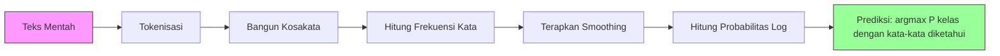

# Naive Bayes

> Asumsi "naive" itu salah, dan tetap berhasil. Itulah keindahannya.

**Jenis:** Build
**Bahasa:** Python
**Prasyarat:** Fase 2, Pelajaran 01-07 (klasifikasi, teorema Bayes)
**Waktu:** ~75 menit

## Tujuan Pembelajaran

- Terapkan Multinomial Naive Bayes dari awal dengan smoothing Laplace untuk klasifikasi teks
- Jelaskan mengapa asumsi independensi naive salah secara matematis, tetapi menghasilkan peringkat kelas yang benar dalam praktiknya
- Bandingkan varian Multinomial, Bernoulli, dan Gaussian Naive Bayes serta pilih yang tepat untuk suatu jenis fitur tertentu
- Evaluasi Naive Bayes dibandingkan regresi logistik pada data jarang berdimensi tinggi dan jelaskan trade-off bias-varian yang berperan

## Masalah

Anda perlu mengklasifikasikan teks. Email menjadi spam atau bukan spam. Ulasan pelanggan menjadi positif atau negatif. Tiket dukungan menjadi kategori-kategori. Anda memiliki ribuan fitur (satu per kata) dan data latih yang terbatas.

Kebanyakan model klasifikasi tersendat di sini. Regresi logistik memerlukan cukup banyak sampel untuk mengestimasi ribuan bobot secara andal. Pohon keputusan membelah pada satu kata demi satu kata dan mengalami overfitting parah. KNN dalam 10.000 dimensi menjadi tidak bermakna karena setiap titik sama jauhnya dari titik mana pun.

Naive Bayes menangani hal ini. Model ini membuat asumsi yang salah secara matematis (bahwa setiap fitur independen terhadap fitur lainnya jika kelasnya diketahui), namun tetap mengungguli model yang "lebih pintar" pada klasifikasi teks, terutama dengan himpunan latih kecil. Model ini dilatih dalam satu kali lintasan melalui data. Model ini diskalakan hingga jutaan fitur. Model ini menghasilkan estimasi probabilitas (meskipun sering kali kurang terkalibrasi karena asumsi independensi).

Memahami mengapa asumsi yang salah menghasilkan prediksi yang baik mengajarkan Anda sesuatu yang fundamental tentang pembelajaran mesin: model terbaik bukanlah model yang paling benar, melainkan model dengan trade-off bias-varian terbaik untuk data Anda.

## Konsep

### Teorema Bayes (Tinjauan Singkat)

Teorema Bayes membalik probabilitas bersyarat:

```math
P(\text{class} \mid \text{features}) = \frac{P(\text{features} \mid \text{class}) \cdot P(\text{class})}{P(\text{features})}
```

Kita ingin `P(class | features)` -- probabilitas bahwa sebuah dokumen termasuk ke dalam suatu kelas dengan mempertimbangkan kata-kata di dalamnya. Kita dapat menghitungnya dari:
- `P(features | class)` -- likelihood melihat kata-kata ini pada dokumen dari kelas tersebut
- `P(class)` -- probabilitas prior kelas tersebut (seberapa umum spam secara umum?)
- `P(features)` -- bukti (evidence), sama untuk semua kelas, sehingga dapat kita abaikan saat membandingkan

Kelas dengan `P(class | features)` tertinggi yang menang.

### Asumsi Independensi Naive

Menghitung `P(features | class)` secara eksak memerlukan estimasi probabilitas gabungan dari seluruh fitur sekaligus. Dengan kosakata 10.000 kata, Anda perlu mengestimasi distribusi atas $2^{10{,}000}$ kombinasi yang mungkin. Mustahil.

Asumsi naive: setiap fitur independen secara bersyarat jika kelasnya diketahui.

```math
P(w_1, w_2, \ldots, w_n \mid \text{class}) = P(w_1 \mid \text{class}) \cdot P(w_2 \mid \text{class}) \cdots P(w_n \mid \text{class})
```

Alih-alih satu distribusi gabungan yang mustahil, kita mengestimasi $n$ distribusi sederhana per fitur. Masing-masing hanya memerlukan hitungan.

Asumsi ini jelas salah. Kata "machine" dan "learning" tidak independen dalam dokumen mana pun. Namun model klasifikasi tidak memerlukan estimasi probabilitas yang benar. Model tersebut memerlukan peringkat yang benar -- kelas mana yang memiliki probabilitas tertinggi. Asumsi independensi memunculkan kesalahan sistematis, tetapi kesalahan-kesalahan itu memengaruhi semua kelas secara serupa, sehingga peringkatnya tetap benar.

### Mengapa Ini Tetap Berhasil

Tiga alasan:

1. **Peringkat daripada kalibrasi.** Klasifikasi hanya memerlukan kelas di peringkat teratas untuk benar. Bahkan jika $P(\text{spam}) = 0.99999$ sementara probabilitas sebenarnya 0,7, model tetap memilih spam dengan benar. Kita tidak memerlukan probabilitas yang benar. Kita memerlukan pemenang yang benar.

2. **Bias tinggi, varians rendah.** Asumsi independensi adalah prior yang kuat. Asumsi ini membatasi model secara ketat, yang mencegah overfitting. Dengan data latih yang terbatas, model yang sedikit salah tetapi stabil mengalahkan model yang secara teoretis benar tetapi sangat tidak stabil. Inilah trade-off bias-varian yang sedang beraksi.

3. **Redundansi fitur saling menghilangkan.** Fitur yang berkorelasi memberikan bukti yang redundan. Model klasifikasi menghitung bukti ini dua kali, tetapi model tersebut menghitungnya dua kali pula untuk kelas yang benar. Jika "machine" dan "learning" selalu muncul bersama, keduanya memberikan bukti untuk kelas "tech". NB menghitung keduanya dua kali, namun keduanya dihitung dua kali untuk kelas yang tepat.

Alasan keempat, bersifat praktis: Naive Bayes sangat cepat. Pelatihan hanya satu kali lintasan melalui data sambil menghitung frekuensi. Prediksi adalah perkalian matriks. Anda dapat melatih model pada sejuta dokumen dalam hitungan detik. Kecepatan ini berarti Anda dapat beriterasi lebih cepat, mencoba lebih banyak himpunan fitur, dan menjalankan lebih banyak eksperimen dibandingkan dengan model yang lebih lambat.

### Matematika Langkah demi Langkah

Mari kita telusuri sebuah contoh konkret. Misalkan kita memiliki dua kelas: spam dan bukan spam. Kosakata kita terdiri dari tiga kata: "free", "money", "meeting".

Data latih:
- Email spam menyebut "free" 80 kali, "money" 60 kali, "meeting" 10 kali (150 kata total)
- Email bukan spam menyebut "free" 5 kali, "money" 10 kali, "meeting" 100 kali (115 kata total)
- 40% email adalah spam, 60% bukan spam

Dengan smoothing Laplace ($\alpha=1$):

```math
\begin{aligned}
P(\text{free} \mid \text{spam}) &= (80 + 1) / (150 + 3) = 81/153 = 0.529 \\
P(\text{money} \mid \text{spam}) &= (60 + 1) / (150 + 3) = 61/153 = 0.399 \\
P(\text{meeting} \mid \text{spam}) &= (10 + 1) / (150 + 3) = 11/153 = 0.072 \\[6pt]
P(\text{free} \mid \text{not-spam}) &= (5 + 1) / (115 + 3) = 6/118 = 0.051 \\
P(\text{money} \mid \text{not-spam}) &= (10 + 1) / (115 + 3) = 11/118 = 0.093 \\
P(\text{meeting} \mid \text{not-spam}) &= (100 + 1) / (115 + 3) = 101/118 = 0.856
\end{aligned}
```

Email baru berisi: "free" (2 kali), "money" (1 kali), "meeting" (0 kali).

```math
\begin{aligned}
\log P(\text{spam} \mid \text{email}) &= \log(0.4) + 2 \log(0.529) + 1 \log(0.399) + 0 \log(0.072) \\
&= -0.916 + 2(-0.637) + (-0.919) + 0 \\
&= -3.109 \\[6pt]
\log P(\text{not-spam} \mid \text{email}) &= \log(0.6) + 2 \log(0.051) + 1 \log(0.093) + 0 \log(0.856) \\
&= -0.511 + 2(-2.976) + (-2.375) + 0 \\
&= -8.838
\end{aligned}
```

Spam menang dengan selisih besar. Kata "free" yang muncul dua kali adalah bukti kuat untuk spam. Perhatikan bahwa "meeting" yang tidak muncul menyumbang nol pada kedua jumlah log ($0 \cdot \log P$) -- pada Multinomial NB, kata yang tidak hadir tidak berpengaruh. Justru Bernoulli NB yang memodelkan ketiadaan kata secara eksplisit.

### Tiga Varian

Naive Bayes hadir dalam tiga varian. Masing-masing memodelkan `P(feature | class)` dengan cara berbeda.

#### Multinomial Naive Bayes

Memodelkan setiap fitur sebagai hitungan. Paling cocok untuk data teks dengan fitur berupa frekuensi kata atau nilai TF-IDF.

```math
P(\text{word}_i \mid \text{class}) = \frac{\text{count of } \text{word}_i \text{ in class} + \alpha}{\text{total words in class} + \alpha \cdot \text{vocab\_size}}
```

`alpha` adalah smoothing Laplace (dijelaskan di bawah). Varian ini adalah andalan untuk klasifikasi teks.

#### Gaussian Naive Bayes

Memodelkan setiap fitur sebagai distribusi normal. Paling cocok untuk fitur kontinu.

```math
P(x_i \mid \text{class}) = \frac{1}{\sqrt{2 \pi \cdot \text{var}}} \cdot \exp\left(-\frac{(x_i - \text{mean})^2}{2 \cdot \text{var}}\right)
```

Setiap kelas memiliki rata-rata dan varians sendiri per fitur. Ini bekerja baik ketika fitur benar-benar mengikuti kurva lonceng di dalam setiap kelas.

#### Bernoulli Naive Bayes

Memodelkan setiap fitur sebagai biner (hadir atau tidak hadir). Paling cocok untuk teks pendek atau vektor fitur biner.

```math
P(\text{word}_i \mid \text{class}) = \frac{\text{docs in class containing } \text{word}_i + \alpha}{\text{total docs in class} + 2 \alpha}
```

Berbeda dengan Multinomial, Bernoulli secara eksplisit menghukum ketiadaan sebuah kata. Jika "free" biasanya muncul pada spam tetapi tidak ada di email ini, Bernoulli menghitung hal itu sebagai bukti melawan spam.

### Kapan Menggunakan Masing-masing Varian

| Varian | Jenis Fitur | Paling Cocok Untuk | Contoh |
|--------|-------------|--------------------|--------|
| Multinomial | Hitungan atau frekuensi | Klasifikasi teks, bag-of-words | Spam email, klasifikasi topik |
| Gaussian | Nilai kontinu | Data tabular dengan fitur yang menyerupai distribusi normal | Klasifikasi Iris, data sensor |
| Bernoulli | Biner (0/1) | Teks pendek, vektor fitur biner | Spam SMS, fitur hadir/tidak hadir |

### Smoothing Laplace

Apa yang terjadi ketika sebuah kata muncul pada data uji tetapi tidak pernah muncul pada data latih untuk suatu kelas tertentu?

Tanpa smoothing: `P(word | class) = 0/N = 0`. Satu nol yang dikalikan ke seluruh hasil perkalian membuat `P(class | features) = 0`, terlepas dari semua bukti lainnya. Satu kata yang belum pernah terlihat menghancurkan seluruh prediksi, betapapun banyak bukti lain yang mendukungnya.

Smoothing Laplace menambahkan hitungan kecil `alpha` (biasanya 1) pada setiap hitungan fitur:

```math
P(\text{word}_i \mid \text{class}) = \frac{\text{count}(\text{word}_i, \text{class}) + \alpha}{\text{total\_words\_in\_class} + \alpha \cdot \text{vocab\_size}}
```

Dengan $\alpha=1$, setiap kata memperoleh probabilitas kecil minimal. Kata "discombobulate" yang muncul pada email uji tidak lagi mematikan probabilitas spam. Smoothing ini memiliki interpretasi Bayes: ekuivalen dengan menempatkan prior Dirichlet seragam pada distribusi kata.

Alpha yang lebih besar berarti smoothing lebih kuat (distribusi lebih seragam). Alpha yang lebih kecil berarti model lebih percaya pada data. Alpha adalah hiperparameter yang Anda setel.

Pengaruh alpha:

| Alpha | Pengaruh | Kapan digunakan |
|-------|----------|-----------------|
| 0.001 | Hampir tanpa smoothing, percaya pada data | Himpunan latih sangat besar, tidak ada fitur baru yang diharapkan |
| 0.1 | Smoothing ringan | Himpunan latih besar |
| 1.0 | Smoothing Laplace standar | Titik awal bawaan |
| 10.0 | Smoothing berat, meratakan distribusi | Himpunan latih sangat kecil, banyak fitur baru yang diharapkan |

### Komputasi dalam Ruang Log

Mengalikan ratusan probabilitas (masing-masing kurang dari 1) menyebabkan underflow floating-point. Hasil perkalian menjadi nol dalam representasi floating-point meskipun nilai sebenarnya adalah bilangan positif yang sangat kecil.

Solusinya: bekerja dalam ruang log. Alih-alih mengalikan probabilitas, jumlahkan logaritmanya:

```math
\log P(\text{class} \mid x_1, x_2, \ldots, x_n) = \log P(\text{class}) + \sum_i \log P(x_i \mid \text{class})
```

Ini mengubah prediksi menjadi produk titik (dot product):

```
log_scores = X @ log_feature_probs.T + log_class_priors
prediction = argmax(log_scores)
```

Perkalian matriks. Itulah sebabnya prediksi Naive Bayes sangat cepat -- operasinya sama dengan model linier satu lapisan.

### Naive Bayes vs Regresi Logistik

Keduanya adalah model klasifikasi linier untuk teks. Perbedaannya terletak pada apa yang dimodelkan oleh masing-masing.

| Aspek | Naive Bayes | Regresi Logistik |
|--------|-------------|------------------|
| Jenis | Generatif (memodelkan $P(X \mid Y){}$) | Diskriminatif (memodelkan $P(Y \mid X){}$) |
| Pelatihan | Menghitung frekuensi | Mengoptimalkan fungsi rugi |
| Data kecil | Lebih baik (prior kuat membantu) | Lebih buruk (tidak cukup untuk mengestimasi bobot) |
| Data besar | Lebih buruk (asumsi yang salah merugikan) | Lebih baik (batas keputusan fleksibel) |
| Fitur | Mengasumsikan independensi | Menangani korelasi |
| Kecepatan | Satu lintasan, sangat cepat | Optimasi iteratif |
| Kalibrasi | Probabilitas buruk | Probabilitas lebih baik |

Aturan praktis: mulailah dengan Naive Bayes. Jika Anda memiliki cukup data dan NB mencapai plateau, beralihlah ke regresi logistik.

### Pipeline Klasifikasi



Dalam praktiknya, kita bekerja dalam ruang log untuk menghindari underflow floating-point. Alih-alih mengalikan banyak probabilitas kecil, kita menjumlahkan logaritmanya:

```math
\log P(\text{class} \mid \text{features}) = \log P(\text{class}) + \sum_i \log P(\text{feature}_i \mid \text{class})
```

```figure
naive-bayes
```

## Bangunlah

Kode dalam `code/naive_bayes.py` mengimplementasikan MultinomialNB dan GaussianNB dari awal.

### MultinomialNB

Implementasi dari awal:

1. **fit(X, y)**: Untuk setiap kelas, hitung frekuensi tiap fitur. Tambahkan smoothing Laplace. Hitung probabilitas log. Simpan prior kelas (log dari frekuensi kelas).

2. **predict_log_proba(X)**: Untuk setiap sampel, hitung $\log P(\text{class})$ + jumlah $\log P(\text{feature}_i \mid \text{class})$ untuk semua kelas. Ini adalah perkalian matriks: X @ log_probs.T + log_priors.

3. **predict(X)**: Kembalikan kelas dengan probabilitas log tertinggi.

```python
class MultinomialNB:
    def __init__(self, alpha=1.0):
        self.alpha = alpha

    def fit(self, X, y):
        classes = np.unique(y)
        n_classes = len(classes)
        n_features = X.shape[1]

        self.classes_ = classes
        self.class_log_prior_ = np.zeros(n_classes)
        self.feature_log_prob_ = np.zeros((n_classes, n_features))

        for i, c in enumerate(classes):
            X_c = X[y == c]
            self.class_log_prior_[i] = np.log(X_c.shape[0] / X.shape[0])
            counts = X_c.sum(axis=0) + self.alpha
            self.feature_log_prob_[i] = np.log(counts / counts.sum())

        return self
```

Wawasan kunci: setelah dilatih, prediksi hanyalah perkalian matriks ditambah bias. Itulah sebabnya Naive Bayes sangat cepat.

### GaussianNB

Untuk fitur kontinu, kita mengestimasi rata-rata dan varians per kelas per fitur:

```python
class GaussianNB:
    def __init__(self):
        pass

    def fit(self, X, y):
        classes = np.unique(y)
        self.classes_ = classes
        self.means_ = np.zeros((len(classes), X.shape[1]))
        self.vars_ = np.zeros((len(classes), X.shape[1]))
        self.priors_ = np.zeros(len(classes))

        for i, c in enumerate(classes):
            X_c = X[y == c]
            self.means_[i] = X_c.mean(axis=0)
            self.vars_[i] = X_c.var(axis=0) + 1e-9
            self.priors_[i] = X_c.shape[0] / X.shape[0]

        return self
```

Prediksi menggunakan PDF Gaussian per fitur, dikalikan lintas fitur (dijumlahkan dalam ruang log).

### Demo: Klasifikasi Teks

Kode menghasilkan data bag-of-words sintetis yang menyimulasikan dua kelas (artikel teknologi vs artikel olahraga). Setiap kelas memiliki distribusi frekuensi kata yang berbeda. MultinomialNB mengklasifikasikannya menggunakan hitungan kata.

Data sintetis bekerja seperti ini: kita membuat 200 "kata" (kolom fitur). Kata 0-39 memiliki frekuensi tinggi pada artikel teknologi dan rendah pada olahraga. Kata 80-119 memiliki frekuensi tinggi pada olahraga dan rendah pada teknologi. Kata 40-79 berfrekuensi sedang pada keduanya. Ini menciptakan skenario realistis di mana beberapa kata merupakan indikator kelas yang kuat dan lainnya adalah noise.

### Demo: Fitur Kontinu

Kode menghasilkan data mirip Iris (3 kelas, 4 fitur, klaster Gaussian). GaussianNB mengklasifikasikan menggunakan rata-rata dan varians per kelas. Setiap kelas memiliki pusat berbeda (vektor rata-rata) dan sebaran berbeda (varians), meniru data dunia nyata yang pengukurannya berbeda secara sistematis antarkategori.

Kode juga mendemonstrasikan:
- **Perbandingan smoothing:** Melatih MultinomialNB dengan berbagai nilai alpha untuk menunjukkan pengaruh kekuatan smoothing terhadap akurasi.
- **Eksperimen ukuran latih:** Bagaimana akurasi NB membaik ketika data latih bertambah dari 20 menjadi 1600 sampel. NB mencapai akurasi yang layak bahkan dengan sangat sedikit sampel -- ini adalah keunggulan utamanya.
- **Matriks kebingungan:** Presisi, recall, dan skor F1 per kelas untuk menunjukkan di mana NB melakukan kesalahan.

### Kecepatan Prediksi

Prediksi Naive Bayes adalah perkalian matriks. Untuk $n$ sampel dengan $d$ fitur dan $k$ kelas:
- MultinomialNB: satu perkalian matriks $(n \times d) \mathbin{@} (d \times k) = O(n \cdot d \cdot k)$
- GaussianNB: $n \cdot k$ evaluasi PDF Gaussian, masing-masing mencakup $d$ fitur = $O(n \cdot d \cdot k)$

Keduanya linier dalam setiap dimensi. Bandingkan dengan KNN (yang memerlukan perhitungan jarak ke semua titik latih) atau SVM dengan kernel RBF (yang memerlukan evaluasi kernel terhadap semua vektor pendukung). NB lebih cepat beberapa tingkat besaran (orders of magnitude) pada saat prediksi.

## Gunakanlah

Dengan sklearn, kedua varian hanya perlu satu baris kode:

```python
from sklearn.naive_bayes import GaussianNB, MultinomialNB

gnb = GaussianNB()
gnb.fit(X_train, y_train)
print(f"GaussianNB accuracy: {gnb.score(X_test, y_test):.3f}")

mnb = MultinomialNB(alpha=1.0)
mnb.fit(X_train_counts, y_train)
print(f"MultinomialNB accuracy: {mnb.score(X_test_counts, y_test):.3f}")
```

Untuk klasifikasi teks dengan sklearn:

```python
from sklearn.feature_extraction.text import CountVectorizer
from sklearn.naive_bayes import MultinomialNB
from sklearn.pipeline import Pipeline

text_clf = Pipeline([
    ("vectorizer", CountVectorizer()),
    ("classifier", MultinomialNB(alpha=1.0)),
])

text_clf.fit(train_texts, train_labels)
accuracy = text_clf.score(test_texts, test_labels)
```

Kode dalam `naive_bayes.py` membandingkan implementasi dari awal dengan sklearn pada data yang sama untuk memverifikasi kebenarannya.

### TF-IDF dengan Naive Bayes

Hitungan kata mentah memberikan bobot yang sama bagi setiap kata per kemunculan. Namun kata umum seperti "the" dan "is" sering muncul di setiap kelas -- keduanya tidak membawa informasi. TF-IDF (Term Frequency - Inverse Document Frequency) menurunkan bobot kata umum dan menaikkan bobot kata yang langka dan diskriminatif.

```python
from sklearn.feature_extraction.text import TfidfVectorizer
from sklearn.naive_bayes import MultinomialNB
from sklearn.pipeline import Pipeline

text_clf = Pipeline([
    ("tfidf", TfidfVectorizer()),
    ("classifier", MultinomialNB(alpha=0.1)),
])
```

Nilai TF-IDF tidak negatif, sehingga cocok dengan MultinomialNB. Kombinasi TF-IDF + MultinomialNB adalah salah satu garis dasar terkuat untuk klasifikasi teks. Kombinasi ini sering mengalahkan model yang lebih kompleks pada dataset dengan kurang dari 10.000 sampel latih.

### BernoulliNB untuk Teks Pendek

Untuk teks pendek (tweet, SMS, pesan obrolan), BernoulliNB dapat mengungguli MultinomialNB. Teks pendek memiliki hitungan kata yang rendah, sehingga informasi frekuensi yang digantungkan MultinomialNB bersifat noisy. BernoulliNB hanya peduli tentang hadir atau tidak hadir, yang lebih andal pada teks pendek.

```python
from sklearn.naive_bayes import BernoulliNB
from sklearn.feature_extraction.text import CountVectorizer

text_clf = Pipeline([
    ("vectorizer", CountVectorizer(binary=True)),
    ("classifier", BernoulliNB(alpha=1.0)),
])
```

Bendera `binary=True` pada CountVectorizer mengonversi semua hitungan menjadi 0/1. Tanpa bendera itu, BernoulliNB tetap bekerja, tetapi melihat hitungan yang tidak menjadi tujuan desainnya.

### Mengkalibrasi Probabilitas NB

Probabilitas NB kurang terkalibrasi. Ketika NB menyatakan $P(\text{spam}) = 0.95$, probabilitas yang sebenarnya mungkin 0,7. Jika Anda memerlukan estimasi probabilitas yang andal (misalnya, untuk menetapkan ambang atau menggabungkan dengan model lain), gunakan CalibratedClassifierCV dari sklearn:

```python
from sklearn.calibration import CalibratedClassifierCV

calibrated_nb = CalibratedClassifierCV(MultinomialNB(), cv=5, method="sigmoid")
calibrated_nb.fit(X_train, y_train)
proba = calibrated_nb.predict_proba(X_test)
```

Ini melatih regresi logistik di atas skor mentah NB menggunakan validasi silang. Probabilitas yang dihasilkan jauh lebih dekat dengan frekuensi kelas yang sebenarnya.

### Jebakan Umum

1. **Nilai fitur negatif.** MultinomialNB memerlukan fitur tak-negatif. Jika Anda memiliki nilai negatif (seperti TF-IDF dengan pengaturan tertentu atau fitur yang distandardisasi), gunakan GaussianNB sebagai gantinya, atau geser fitur agar bernilai positif.

2. **Fitur dengan varians nol.** GaussianNB membagi dengan varians. Jika sebuah fitur memiliki varians nol untuk suatu kelas (semua nilai identik), komputasi probabilitas menjadi rusak. Kode menambahkan suku smoothing kecil (1e-9) pada semua varians untuk mencegah hal ini.

3. **Ketidakseimbangan kelas.** Jika 99% email adalah bukan spam, prior $P(\text{not-spam}) = 0.99$ sangat kuat sehingga mengalahkan bukti likelihood. Anda dapat menetapkan prior kelas secara manual atau menggunakan parameter class_prior di sklearn.

4. **Penskalaan fitur.** MultinomialNB tidak memerlukan penskalaan (model ini bekerja pada hitungan). GaussianNB juga tidak memerlukan penskalaan (model ini mengestimasi statistik per fitur). Ini adalah keunggulan dibanding regresi logistik dan SVM, yang sensitif terhadap skala fitur.

## Terapkanlah

Pelajaran ini menghasilkan:
- `outputs/skill-naive-bayes-chooser.md` -- sebuah skill pengambilan keputusan untuk memilih varian NB yang tepat
- `code/naive_bayes.py` -- MultinomialNB dan GaussianNB dari awal, dengan perbandingan sklearn

### Ketika Naive Bayes Gagal

NB gagal ketika asumsi independensi menyebabkan peringkat yang salah (bukan sekadar probabilitas yang salah). Ini terjadi ketika:

1. **Interaksi fitur yang kuat.** Jika kelas bergantung pada kombinasi dua fitur, bukan pada salah satunya sendiri (pola seperti XOR), NB akan melewatkannya seluruhnya. Setiap fitur secara tunggal tidak memberikan bukti, dan NB tidak dapat menggabungkannya secara nonlinear.

2. **Fitur yang sangat berkorelasi dengan bukti yang bertentangan.** Jika fitur A mengatakan "spam" dan fitur B mengatakan "bukan spam", tetapi A dan B berkorelasi sempurna (keduanya selalu sepakat dalam kenyataan), NB akan melihat bukti yang bertentangan padahal tidak ada.

3. **Himpunan latih yang sangat besar.** Dengan cukup banyak data, model diskriminatif seperti regresi logistik mempelajari batas keputusan yang sebenarnya dan mengungguli NB. Asumsi independensi yang membantu pada data kecil kini justru menghambat model.

Dalam praktiknya, mode kegagalan ini jarang terjadi pada klasifikasi teks. Fitur teks jumlahnya banyak, lemah secara individual, dan kesalahan asumsi independensi cenderung saling menghilangkan. Untuk data tabular dengan sedikit fitur yang sangat berkorelasi, pertimbangkan regresi logistik atau model berbasis pohon terlebih dahulu.

## Latihan

1. **Eksperimen smoothing.** Latih MultinomialNB pada data teks dengan nilai alpha 0.01, 0.1, 1.0, 10.0, dan 100.0. Plot akurasi terhadap alpha. Di mana kinerja mencapai puncaknya? Mengapa alpha yang sangat besar justru merugikan?

2. **Uji independensi fitur.** Ambil dataset teks nyata. Pilih dua kata yang jelas berkorelasi ("machine" dan "learning"). Hitung $P(\text{word}_1 \mid \text{class}) \cdot P(\text{word}_2 \mid \text{class})$ dan bandingkan dengan $P(\text{word}_1 \text{ AND } \text{word}_2 \mid \text{class})$. Seberapa salah asumsi independensi itu? Apakah hal itu memengaruhi akurasi klasifikasi?

3. **Implementasi Bernoulli.** Kembangkan kode dengan kelas BernoulliNB. Konversi bag-of-words menjadi biner (hadir/tidak hadir) dan bandingkan akurasinya dengan MultinomialNB pada data teks. Kapan Bernoulli menang?

4. **NB vs Regresi Logistik.** Latih keduanya pada data teks. Mulai dengan 100 sampel latih dan tingkatkan menjadi 10.000. Plot akurasi terhadap ukuran himpunan latih untuk keduanya. Pada titik apa regresi logistik mengungguli Naive Bayes?

5. **Filter spam.** Bangun klasifikasi spam yang lengkap: tokenisasi teks email mentah, bangun kosakata, buat fitur bag-of-words, latih MultinomialNB, evaluasi dengan presisi dan recall (bukan hanya akurasi -- mengapa?)

## Istilah Kunci

| Istilah | Yang orang katakan | Arti sebenarnya |
|---------|--------------------|-----------------|
| Naive Bayes | "Model klasifikasi probabilistik sederhana" | Model klasifikasi yang menerapkan teorema Bayes dengan asumsi bahwa fitur independen secara bersyarat jika kelasnya diketahui |
| Independensi bersyarat | "Fitur tidak saling memengaruhi" | $P(A, B \mid C) = P(A \mid C) \cdot P(B \mid C)$ -- mengetahui $B$ tidak memberi informasi baru tentang $A$ setelah $C$ diketahui |
| Smoothing Laplace | "Smoothing tambah-satu" | Menambahkan hitungan kecil pada setiap fitur untuk mencegah probabilitas nol mendominasi prediksi |
| Prior | "Apa yang Anda yakini sebelum melihat data" | $P(\text{class})$ -- probabilitas setiap kelas sebelum mengamati fitur apa pun |
| Likelihood | "Seberapa cocok data tersebut" | $P(\text{features} \mid \text{class})$ -- probabilitas mengamati fitur-fitur ini jika kelasnya diketahui |
| Posterior | "Apa yang Anda yakini setelah melihat data" | $P(\text{class} \mid \text{features})$ -- probabilitas kelas yang diperbarui setelah mengamati fitur-fitur tersebut |
| Model generatif | "Memodelkan bagaimana data dihasilkan" | Model yang mempelajari $P(X \mid Y)$ dan $P(Y)$, lalu menggunakan teorema Bayes untuk memperoleh $P(Y \mid X)$ |
| Model diskriminatif | "Memodelkan batas keputusan" | Model yang mempelajari $P(Y \mid X)$ secara langsung tanpa memodelkan bagaimana $X$ dihasilkan |
| Probabilitas log | "Menghindari underflow" | Bekerja dengan $\log P$ alih-alih $P$ untuk mencegah perkalian banyak bilangan kecil menjadi nol dalam representasi floating-point |

## Bacaan Lanjutan

- [dokumentasi Naive Bayes scikit-learn](https://scikit-learn.org/stable/modules/naive_bayes.html) -- ketiga varian dengan detail matematis
- [McCallum dan Nigam, A Comparison of Event Models for Naive Bayes Text Classification (1998)](https://www.cs.cmu.edu/~knigam/papers/multinomial-aaaiws98.pdf) -- perbandingan klasik antara Multinomial dan Bernoulli untuk teks
- [Rennie dkk., Tackling the Poor Assumptions of Naive Bayes Text Classifiers (2003)](https://people.csail.mit.edu/jrennie/papers/icml03-nb.pdf) -- perbaikan NB untuk teks
- [Ng dan Jordan, On Discriminative vs. Generative Classifiers (2001)](https://ai.stanford.edu/~ang/papers/nips01-discriminativegenerative.pdf) -- membuktikan bahwa NB konvergen lebih cepat daripada LR dengan data lebih sedikit
