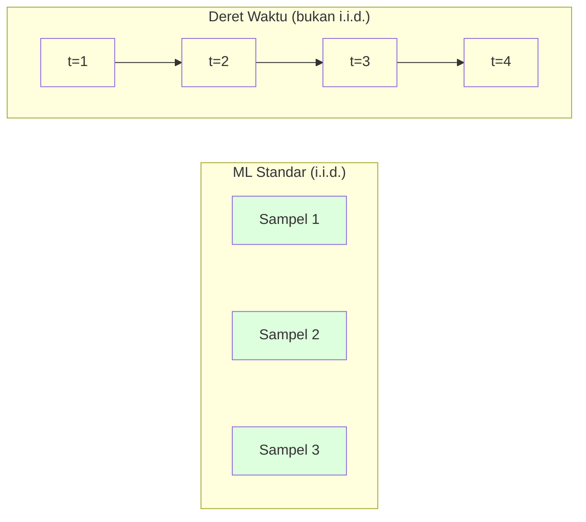
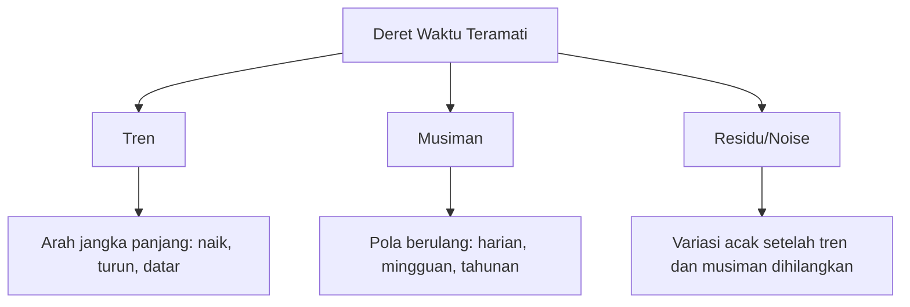
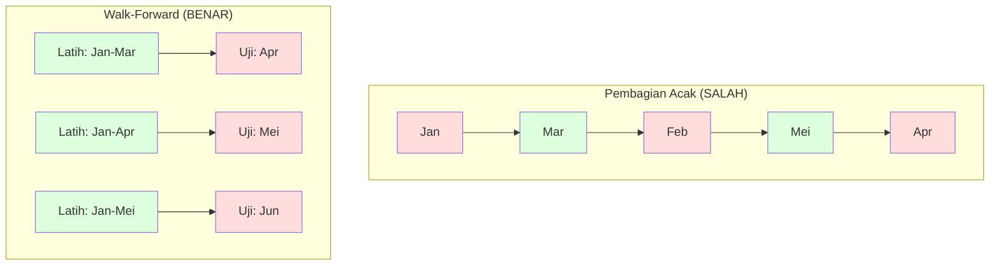

# Dasar-Dasar Deret Waktu

> Kinerja masa lalu memang memprediksi hasil masa depan -- jika Anda memeriksa stasioneritas terlebih dahulu.

**Jenis:** Build
**Bahasa:** Python
**Prasyarat:** Fase 2, Pelajaran 01-09
**Waktu:** ~90 menit

## Tujuan Pembelajaran

- Uraikan deret waktu menjadi komponen tren, musiman, dan residu serta uji stasioneritasnya
- Terapkan fitur lag dan statistik bergulir untuk mengubah deret waktu menjadi masalah pembelajaran terselia
- Bangun kerangka validasi walk-forward yang mencegah data masa depan bocor ke dalam pelatihan
- Jelaskan mengapa pembagian latih/uji acak tidak valid untuk deret waktu dan tunjukkan selisih kinerjanya dibandingkan pembagian temporal yang benar

## Masalah

Anda memiliki data yang diurutkan berdasarkan waktu. Penjualan harian, suhu per jam, penggunaan CPU per menit, harga saham mingguan. Anda ingin memprediksi nilai berikutnya, minggu berikutnya, kuartal berikutnya.

Anda meraih toolkit ML standar Anda: pembagian latih/uji acak, validasi silang, matriks fitur masuk, prediksi keluar. Setiap langkahnya salah.

Deret waktu melanggar asumsi yang diandalkan ML standar. Sampel tidak independen -- suhu hari ini bergantung pada suhu kemarin. Pembagian acak membocorkan informasi masa depan ke masa lalu. Fitur yang tampak hebat dalam backtest gagal dalam produksi karena mengandalkan pola yang bergeser seiring waktu.

Model yang mendapat akurasi 95% dengan validasi silang acak mungkin hanya mendapat 55% dengan evaluasi berbasis waktu yang benar. Selisih ini bukan sekadar teknis belaka. Selisih inilah yang membedakan model yang bekerja di atas kertas dari model yang bekerja dalam produksi.

Pelajaran ini membahas dasar-dasarnya: apa yang membuat data waktu berbeda, cara mengevaluasi model secara jujur, dan cara mengubah deret waktu menjadi fitur yang dapat dikonsumsi model ML standar.

## Konsep

### Apa yang Membuat Deret Waktu Berbeda

ML standar mengasumsikan i.i.d. -- independen dan berdistribusi identik. Setiap sampel diambil dari distribusi yang sama, secara independen terhadap sampel lainnya. Deret waktu melanggar keduanya:

- **Tidak independen.** Harga saham hari ini bergantung pada harga kemarin. Penjualan minggu ini berkorelasi dengan penjualan minggu lalu.
- **Tidak berdistribusi identik.** Distribusinya bergeser seiring waktu. Penjualan bulan Desember tampak berbeda dari penjualan bulan Maret.

Pelanggaran ini tidaklah kecil. Keduanya mengubah cara Anda membangun fitur, cara Anda mengevaluasi model, dan algoritma mana yang bekerja.



Pada ML standar, sampel dapat saling ditukar. Mengacaknya tidak mengubah apa pun. Pada deret waktu, urutan adalah segalanya. Pengacakan merusak sinyalnya.

### Komponen-Komponen Deret Waktu

Setiap deret waktu merupakan kombinasi dari:



- **Tren**: Arah jangka panjang. Pendapatan tumbuh 10% per tahun. Suhu global meningkat.
- **Musiman**: Pola berulang pada interval tetap. Penjualan eceran melonjak pada bulan Desember. Penggunaan pendingin udara mencapai puncaknya pada bulan Juli.
- **Residu**: Apa yang tersisa setelah tren dan musiman dihilangkan. Jika residu tampak seperti white noise, dekomposisi berhasil menangkap sinyalnya.

### Stasioneritas

Suatu deret waktu bersifat stasioner jika sifat statistiknya (rata-rata, varians, autokorelasi) tidak berubah seiring waktu. Kebanyakan metode peramalan mengasumsikan stasioneritas.

**Mengapa ini penting:** Deret yang tidak stasioner memiliki rata-rata yang bergeser. Model yang dilatih pada data bulan Januari mempelajari rata-rata yang berbeda dari yang akan ditampilkan bulan Februari. Model itu akan salah secara sistematis.

**Cara memeriksanya:** Hitung rata-rata bergulir dan simpangan baku bergulir pada jendela-jendela tertentu. Jika keduanya bergeser, deret tersebut tidak stasioner.

**Cara memperbaikinya:** Differencing. Alih-alih memodelkan nilai mentah, model perubahan antara nilai berurutan:

```math
\text{diff}[t] = \text{value}[t] - \text{value}[t-1]
```

Jika satu kali differencing belum membuat deret menjadi stasioner, lakukan lagi (differencing orde kedua). Kebanyakan deret di dunia nyata memerlukan paling banyak dua kali.

**Contoh:**

Deret awal: [100, 102, 106, 112, 120]
Diferensial pertama:  [2, 4, 6, 8] (masih cenderung naik)
Diferensial kedua:  [2, 2, 2] (konstan -- stasioner)

Deret awal memiliki tren kuadratik. Differencing pertama mengubahnya menjadi tren linier. Differencing kedua membuatnya datar. Dalam praktiknya, Anda jarang memerlukan lebih dari dua kali.

**Uji formal:** Uji Augmented Dickey-Fuller (ADF) adalah uji statistik standar untuk stasioneritas. Hipotesis nolnya adalah "deret tidak stasioner". Nilai p di bawah 0,05 berarti Anda dapat menolak hipotesis nol dan menyimpulkan stasioneritas. Kita tidak mengimplementasikan ADF dari awal (uji ini memerlukan tabel distribusi asimtotik), tetapi pendekatan statistik bergulir dalam kode kita memberikan pemeriksaan visual yang praktis.

### Autokorelasi

Autokorelasi mengukur seberapa besar nilai pada waktu $t$ berkorelasi dengan nilai pada waktu $t-k$ ($k$ langkah ke masa lalu). Fungsi autokorelasi (ACF) memplot korelasi ini untuk setiap lag $k$.

**Yang dikatakan ACF:**
- Seberapa jauh deret mengingat. Jika ACF turun ke nol setelah lag 5, nilai yang lebih tua dari 5 langkah tidak relevan.
- Apakah musiman ada. Jika ACF melonjak pada lag 12 (data bulanan), terdapat musiman tahunan.
- Berapa banyak fitur lag yang harus dibuat. Gunakan lag hingga titik di mana ACF menjadi negligible.

**PACF (Partial Autocorrelation Function)** menghilangkan korelasi tidak langsung. Jika hari ini berkorelasi dengan tiga hari lalu hanya karena keduanya berkorelasi dengan kemarin, maka PACF pada lag 3 adalah nol, sementara ACF pada lag 3 tidak.

### Fitur Lag: Mengubah Deret Waktu menjadi Pembelajaran Terselia

Model ML standar memerlukan matriks fitur X dan target y. Deret waktu hanya memberi Anda satu kolom nilai. Jembatannya adalah fitur lag.

Ambil deret [10, 12, 14, 13, 15] dan buat fitur lag-1 serta lag-2:

| lag_2 | lag_1 | target |
|-------|-------|--------|
| 10    | 12    | 14     |
| 12    | 14    | 13     |
| 14    | 13    | 15     |

Kini Anda memiliki masalah regresi standar. Model ML mana pun (regresi linier, random forest, gradient boosting) dapat memprediksi target dari lag.

Fitur tambahan yang dapat Anda rekayasa:
- **Statistik bergulir:** rata-rata, std, min, max atas $k$ nilai terakhir
- **Fitur kalender:** hari dalam minggu, bulan, is_holiday, is_weekend
- **Nilai yang dibedakan:** perubahan dari langkah sebelumnya
- **Statistik ekspansi:** rata-rata kumulatif, jumlah kumulatif
- **Fitur rasio:** nilai saat ini / rata-rata bergulir (seberapa jauh dari rata-rata terakhir)
- **Fitur interaksi:** lag_1 * day_of_week (pengaruh hari kerja terhadap momentum)

**Berapa banyak lag?** Gunakan fungsi autokorelasi. Jika ACF signifikan hingga lag 10, gunakan setidaknya 10 lag. Jika ada musiman mingguan, sertakan lag 7 (dan mungkin 14). Lebih banyak lag memberi model lebih banyak riwayat, tetapi juga lebih banyak fitur untuk dicocokkan, sehingga meningkatkan risiko overfitting.

**Jebakan penyelarasan target.** Saat membuat fitur lag, target harus berupa nilai pada waktu $t$, dan semua fitur harus menggunakan nilai pada waktu $t-1$ atau lebih awal. Jika Anda tanpa sengaja menyertakan nilai pada waktu $t$ sebagai fitur, Anda mendapat prediktor yang sempurna -- dan model yang sama sekali tidak berguna. Ini adalah bug paling umum dalam rekayasa fitur deret waktu.

### Validasi Walk-Forward

Ini adalah konsep paling penting dalam pelajaran ini. Validasi silang k-fold standar secara acak menetapkan sampel ke dalam latih dan uji. Untuk deret waktu, ini membocorkan informasi masa depan.



Validasi walk-forward:
1. Latih pada data hingga waktu $t$
2. Prediksi pada waktu $t+1$ (atau $t+1$ sampai $t+k$ untuk multi-langkah)
3. Geser jendela ke depan
4. Ulangi

Setiap lipatan uji hanya berisi data yang datang setelah seluruh data latih. Tidak ada kebocoran masa depan. Ini memberi Anda estimasi yang jujur tentang kinerja model saat diterapkan.

**Jendela ekspansi** menggunakan seluruh data historis untuk pelatihan (jendela membesar). **Jendela geser** menggunakan jendela latih berukuran tetap (jendela bergeser). Gunakan jendela ekspansi jika Anda yakin data lama masih relevan. Gunakan jendela geser jika dunia berubah dan data lama justru merugikan.

### Intuisi ARIMA

ARIMA adalah model deret waktu klasik. Model ini memiliki tiga komponen:

- **AR (Autoregressive):** Prediksi dari nilai masa lalu. AR(p) menggunakan $p$ nilai terakhir.
- **I (Integrated):** Differencing untuk mencapai stasioneritas. I(d) menerapkan $d$ kali differencing.
- **MA (Moving Average):** Prediksi dari galat prakiraan masa lalu. MA(q) menggunakan $q$ galat terakhir.

ARIMA(p, d, q) menggabungkan ketiganya. Anda memilih $p$, $d$, $q$ berdasarkan analisis ACF/PACF atau pencarian otomatis (auto-ARIMA).

Kita tidak akan mengimplementasikan ARIMA dari awal -- model ini memerlukan optimasi numerik di luar cakupan pelajaran ini. Wawasan kuncinya adalah memahami apa yang dilakukan setiap komponen agar Anda dapat menafsirkan hasil ARIMA dan tahu kapan menggunakannya.

### Kapan Menggunakan Apa

| Pendekatan | Paling Cocok Untuk | Menangani Musiman | Menangani Fitur Eksternal |
|------------|--------------------|-------------------|---------------------------|
| Fitur lag + ML | Data tabular dengan banyak fitur eksternal | Dengan fitur kalender | Ya |
| ARIMA | Deret univariat tunggal, jangka pendek | Varian SARIMA | Tidak (ARIMAX untuk sebagian) |
| Exponential smoothing | Tren + musiman sederhana | Ya (Holt-Winters) | Tidak |
| Prophet | Peramalan bisnis, hari libur | Ya (suku Fourier) | Terbatas |
| Jaringan saraf (LSTM, Transformer) | Sekuens panjang, banyak deret | Dipelajari | Ya |

Untuk kebanyakan masalah praktis, fitur lag + gradient boosting adalah titik awal terkuat. Pendekatan ini menangani fitur eksternal secara alami, tidak memerlukan stasioneritas, dan mudah di-debug.

### Horizon dan Strategi Peramalan

Peramalan satu langkah memprediksi satu langkah waktu ke depan. Peramalan multi-langkah memprediksi beberapa langkah. Ada tiga strategi:

**Rekursif (iterated):** Prediksi satu langkah ke depan, gunakan prediksi tersebut sebagai masukan untuk langkah berikutnya. Sederhana, tetapi galat bertambah -- setiap prediksi menggunakan prediksi sebelumnya, sehingga kesalahan berlipat ganda.

**Direct:** Latih model terpisah untuk setiap horizon. Model-1 memprediksi $t+1$, Model-5 memprediksi $t+5$. Tidak ada penumpukan galat, tetapi setiap model memiliki lebih sedikit sampel latih dan tidak saling berbagi informasi.

**Multi-output:** Latih satu model yang menghasilkan semua horizon secara bersamaan. Informasi dibagikan antarhorizon, tetapi memerlukan model yang mendukung banyak keluaran (atau fungsi rugi kustom).

Untuk kebanyakan masalah praktis, mulailah dengan strategi rekursif untuk horizon pendek (1-5 langkah) dan strategi direct untuk horizon yang lebih panjang.

### Kesalahan Umum dalam Deret Waktu

| Kesalahan | Mengapa terjadi | Cara memperbaiki |
|-----------|-----------------|------------------|
| Pembagian latih/uji acak | Kebiasaan dari ML standar | Gunakan walk-forward atau pembagian temporal |
| Menggunakan fitur masa depan | Fitur pada waktu $t$ tanpa sengaja disertakan | Audit setiap fitur untuk penyelarasan temporal |
| Overfitting pada musiman | Model menghafal pola kalender | Sisihkan satu siklus musiman penuh dalam himpunan uji |
| Mengabaikan perubahan skala | Pendapatan berlipat tetapi pola tetap | Modelkan persentase perubahan, bukan nilai absolut |
| Terlalu banyak fitur lag | "Lebih banyak riwayat lebih baik" | Gunakan ACF untuk menentukan lag yang relevan |
| Tidak melakukan differencing | "Model akan mencari tahu sendiri" | Model pohon menangani tren; model linier memerlukan stasioneritas |

```figure
f3-series-decompose
```

## Bangunlah

Kode dalam `code/time_series.py` mengimplementasikan blok-blok dasar dari awal.

### Pembuat Fitur Lag

```python
def make_lag_features(series, n_lags):
    n = len(series)
    X = np.full((n, n_lags), np.nan)
    for lag in range(1, n_lags + 1):
        X[lag:, lag - 1] = series[:-lag]
    valid = ~np.isnan(X).any(axis=1)
    return X[valid], series[valid]
```

Ini mengubah deret 1D menjadi matriks fitur yang setiap barisnya memuat `n_lags` nilai terakhir sebagai fitur, dan nilai saat ini sebagai target.

### Validasi Silang Walk-Forward

```python
def walk_forward_split(n_samples, n_splits=5, min_train=50):
    assert min_train < n_samples, "min_train must be less than n_samples"
    step = max(1, (n_samples - min_train) // n_splits)
    for i in range(n_splits):
        train_end = min_train + i * step
        test_end = min(train_end + step, n_samples)
        if train_end >= n_samples:
            break
        yield slice(0, train_end), slice(train_end, test_end)
```

Setiap pembagian memastikan data latih benar-benar mendahului data uji. Jendela latih membesar pada setiap lipatan.

### Model Autoregresif Sederhana

Model AR murni hanyalah regresi linier pada fitur lag:

```python
class SimpleAR:
    def __init__(self, n_lags=5):
        self.n_lags = n_lags
        self.weights = None
        self.bias = None

    def fit(self, series):
        X, y = make_lag_features(series, self.n_lags)
        # Selesaikan melalui persamaan normal
        X_b = np.column_stack([np.ones(len(X)), X])
        theta = np.linalg.lstsq(X_b, y, rcond=None)[0]
        self.bias = theta[0]
        self.weights = theta[1:]
        return self
```

Ini secara konseptual identik dengan regresi linier dari Pelajaran 02, tetapi diterapkan pada versi variabel yang sama yang telah di-lag.

### Pemeriksaan Stasioneritas

Kode menghitung statistik bergulir untuk menilai stasioneritas secara visual dan numerik:

```python
def check_stationarity(series, window=50):
    rolling_mean = np.array([
        series[max(0, i - window):i].mean()
        for i in range(1, len(series) + 1)
    ])
    rolling_std = np.array([
        series[max(0, i - window):i].std()
        for i in range(1, len(series) + 1)
    ])
    return rolling_mean, rolling_std
```

Jika rata-rata bergulir bergeser atau simpangan baku bergulir berubah, deret tidak stasioner. Lakukan differencing lalu periksa lagi.

Kode juga memeriksa stasioneritas dengan membandingkan paruh pertama dan paruh kedua deret. Jika rata-ratanya berbeda lebih dari setengah simpangan baku atau rasio variansnya melebihi 2x, deret ditandai sebagai tidak stasioner.

### Autokorelasi

```python
def autocorrelation(series, max_lag=20):
    n = len(series)
    mean = series.mean()
    var = series.var()
    acf = np.zeros(max_lag + 1)
    for k in range(max_lag + 1):
        cov = np.mean((series[:n-k] - mean) * (series[k:] - mean))
        acf[k] = cov / var if var > 0 else 0
    return acf
```

## Gunakanlah

Dengan sklearn, Anda dapat menggunakan fitur lag langsung dengan regresor mana pun:

```python
from sklearn.linear_model import Ridge
from sklearn.ensemble import GradientBoostingRegressor

X, y = make_lag_features(series, n_lags=10)

for train_idx, test_idx in walk_forward_split(len(X)):
    model = Ridge(alpha=1.0)
    model.fit(X[train_idx], y[train_idx])
    predictions = model.predict(X[test_idx])
```

Untuk ARIMA, gunakan statsmodels:

```python
from statsmodels.tsa.arima.model import ARIMA

model = ARIMA(train_series, order=(5, 1, 2))
fitted = model.fit()
forecast = fitted.forecast(steps=30)
```

Kode dalam `time_series.py` mendemonstrasikan kedua pendekatan dan membandingkannya dengan validasi walk-forward.

### TimeSeriesSplit dari sklearn

sklearn menyediakan `TimeSeriesSplit` yang mengimplementasikan validasi walk-forward:

```python
from sklearn.model_selection import TimeSeriesSplit

tscv = TimeSeriesSplit(n_splits=5)
for train_index, test_index in tscv.split(X):
    X_train, X_test = X[train_index], X[test_index]
    y_train, y_test = y[train_index], y[test_index]
    model.fit(X_train, y_train)
    score = model.score(X_test, y_test)
```

Ini ekuivalen dengan `walk_forward_split` buatan kita dari awal, tetapi terintegrasi ke dalam kerangka validasi silang sklearn. Anda dapat menggunakannya dengan `cross_val_score`:

```python
from sklearn.model_selection import cross_val_score

scores = cross_val_score(model, X, y, cv=TimeSeriesSplit(n_splits=5))
print(f"Mean score: {scores.mean():.4f} +/- {scores.std():.4f}")
```

### Metrik Evaluasi

Peramalan deret waktu menggunakan metrik regresi, tetapi dengan konteks yang sadar waktu:

- **MAE (Mean Absolute Error):** Rata-rata $\lvert y_{\text{true}} - y_{\text{pred}} \rvert$. Mudah ditafsirkan dalam satuan asli. "Rata-ratanya, prediksi meleset 3,2 derajat."
- **RMSE (Root Mean Squared Error):** Akar dari rata-rata galat kuadrat. Menghukum galat besar lebih berat daripada MAE. Gunakan ketika galat besar lebih buruk daripada banyak galat kecil.
- **MAPE (Mean Absolute Percentage Error):** Rata-rata |error / true_value| * 100. Tidak bergantung skala, berguna untuk perbandingan antarderet. Namun tidak terdefinisi ketika nilai sebenarnya nol.
- **Perbandingan garis dasar naive:** Selalu bandingkan dengan garis dasar sederhana. Garis dasar naive musiman memprediksi nilai dari satu periode sebelumnya (kemarin, minggu lalu). Jika model Anda tidak dapat mengalahkan naive, ada sesuatu yang salah.

### Fitur Bergulir

Kode mendemonstrasikan penambahan statistik bergulir (rata-rata, std, min, max atas jendela 7 dan 14 hari) pada fitur lag. Fitur-fitur ini memberi model informasi tentang tren dan volatilitas terkini yang tidak dapat ditangkap oleh fitur lag saja.

Misalnya, jika rata-rata bergulir naik, itu menandakan tren naik. Jika simpangan baku bergulir meningkat, itu menandakan volatilitas yang membesar. Ini adalah jenis pola yang dapat dipelajari model berbasis pohon, tetapi tidak dapat dipelajari model linier.

## Terapkanlah

Pelajaran ini menghasilkan:
- `outputs/prompt-time-series-advisor.md` -- sebuah prompt untuk merangkai masalah deret waktu
- `code/time_series.py` -- fitur lag, validasi walk-forward, model AR, pemeriksaan stasioneritas

### Garis Dasar yang Harus Anda Kalahkan

Sebelum membangun model apa pun, tetapkan garis dasar:

1. **Nilai terakhir (persistence).** Prediksi bahwa besok sama dengan hari ini. Untuk banyak deret, ini sangat sulit dikalahkan.
2. **Naive musiman.** Prediksi bahwa hari ini sama dengan hari yang sama minggu lalu (atau tahun lalu). Jika model Anda tidak dapat mengalahkan ini, model itu tidak mempelajari pola berguna apa pun selain musiman.
3. **Rata-rata bergulir.** Prediksi rata-rata dari $k$ nilai terakhir. Menghaluskan noise, tetapi tidak dapat menangkap perubahan mendadak.

Jika model ML canggih Anda kalah dari garis dasar naive musiman, Anda memiliki bug. Penyebab paling umum: kebocoran masa depan pada fitur, metode evaluasi yang salah, atau deret tersebut benar-benar acak dan tidak dapat diprediksi.

### Tips Praktis

1. **Mulailah dengan plotting.** Sebelum pemodelan apa pun, plot deret mentah. Cari tren, musiman, outlier, dan perubahan struktural (perubahan perilaku mendadak). Inspeksi visual 30 detik sering kali memberi tahu Anda lebih banyak daripada satu jam analisis otomatis.

2. **Differencing dulu, model belakangan.** Jika deret memiliki tren yang jelas, lakukan differencing sebelum membuat fitur lag. Model berbasis pohon dapat menangani tren, tetapi model linier tanpa suku tren eksplisit tidak dapat. Berhentilah begitu deret menjadi stasioner: setiap putaran differencing tambahan menambah noise dan membuang informasi level.

3. **Sisihkan setidaknya satu siklus musiman penuh.** Jika Anda memiliki musiman mingguan, himpunan uji Anda memerlukan setidaknya satu minggu penuh. Jika bulanan, setidaknya satu bulan penuh. Jika tidak, Anda tidak dapat mengevaluasi apakah model menangkap pola musiman.

4. **Pantau dalam produksi.** Model deret waktu memburuk seiring waktu karena dunia berubah. Lacak galat prediksi secara bergulir. Ketika galat mulai meningkat, latih ulang model pada data terbaru.

5. **Waspadai perubahan rezim.** Model yang dilatih pada data sebelum pandemi tidak akan memprediksi perilaku sesudah pandemi. Sertakan indikator perubahan rezim yang diketahui sebagai fitur, atau gunakan jendela geser yang melupakan data lama.

6. **Transformasi log pada deret miring.** Pendapatan, harga, dan hitungan sering kali miring ke kanan. Mengambil log menstabilkan varians dan mengubah pola multiplikatif menjadi aditif, yang dapat ditangani model linier. Lakukan peramalan dalam ruang log, lalu eksponasikan kembali ke satuan asli.

## Latihan

1. **Eksperimen stasioneritas.** Hasilkan deret dengan tren linier. Periksa stasioneritas dengan statistik bergulir. Terapkan differencing pertama. Periksa lagi. Berapa kali differencing diperlukan untuk tren kuadratik?

2. **Pemilihan lag.** Hitung ACF pada deret musiman (periode=7). Lag mana yang memiliki autokorelasi tertinggi? Buat fitur lag hanya dengan lag-lag tersebut (bukan lag berurutan). Apakah akurasi membaik dibandingkan menggunakan lag 1 sampai 7?

3. **Walk-forward vs pembagian acak.** Latih regresi Ridge pada fitur lag. Evaluasi dengan pembagian acak 80/20 dan dengan validasi walk-forward. Seberapa besar pembagian acak melebih-lebihkan kinerja?

4. **Rekayasa fitur.** Tambahkan rata-rata bergulir (window=7), simpangan baku bergulir (window=7), dan fitur hari dalam minggu pada fitur lag. Bandingkan akurasi dengan dan tanpa tambahan ini menggunakan validasi walk-forward.

5. **Peramalan multi-langkah.** Ubah model AR agar memprediksi 5 langkah ke depan, bukan 1. Bandingkan dua strategi: (a) prediksi satu langkah, gunakan prediksi sebagai masukan langkah berikutnya (rekursif), dan (b) latih model terpisah untuk setiap horizon (direct). Mana yang lebih akurat?

## Istilah Kunci

| Istilah | Yang orang katakan | Arti sebenarnya |
|---------|--------------------|-----------------|
| Stasioneritas | "Statistiknya tidak berubah seiring waktu" | Deret yang rata-rata, varians, dan struktur autokorelasinya konstan seiring waktu |
| Differencing | "Kurangi nilai berurutan" | Menghitung $y[t] - y[t-1]$ untuk menghilangkan tren dan mencapai stasioneritas |
| Autokorelasi (ACF) | "Seberapa deret berkorelasi dengan dirinya sendiri" | Korelasi antara deret waktu dan salinan dirinya yang di-lag, sebagai fungsi dari lag |
| Autokorelasi parsial (PACF) | "Hanya korelasi langsung" | Autokorelasi pada lag $k$ setelah menghilangkan pengaruh semua lag yang lebih pendek |
| Fitur lag | "Nilai masa lalu sebagai masukan" | Menggunakan $y[t-1], y[t-2], \ldots, y[t-k]$ sebagai fitur untuk memprediksi $y[t]$ |
| Validasi walk-forward | "Validasi silang yang menghormati waktu" | Evaluasi yang data latihnya selalu mendahului data uji secara kronologis |
| ARIMA | "Model deret waktu klasik" | AutoRegressive Integrated Moving Average: menggabungkan nilai masa lalu (AR), differencing (I), dan galat masa lalu (MA) |
| Musiman | "Pola kalender yang berulang" | Siklus teratur dan dapat diprediksi dalam deret waktu yang terikat pada periode kalender (harian, mingguan, tahunan) |
| Tren | "Arah jangka panjang" | Kenaikan atau penurunan yang terus-menerus pada level deret seiring waktu |
| Jendela ekspansi | "Gunakan seluruh riwayat" | Validasi walk-forward yang himpunan latihnya membesar pada setiap lipatan |
| Jendela geser | "Riwayat berukuran tetap" | Validasi walk-forward yang himpunan latihnya berupa jendela panjang tetap yang bergeser ke depan |

## Bacaan Lanjutan

- [Hyndman dan Athanasopoulos, Forecasting: Principles and Practice (edisi ke-3)](https://otexts.com/fpp3/) -- buku teks gratis terbaik tentang peramalan deret waktu
- [Pembagian Deret Waktu scikit-learn](https://scikit-learn.org/stable/modules/generated/sklearn.model_selection.TimeSeriesSplit.html) -- pembagi walk-forward dari sklearn
- [dokumentasi ARIMA statsmodels](https://www.statsmodels.org/stable/generated/statsmodels.tsa.arima.model.ARIMA.html) -- implementasi ARIMA dengan diagnostik
- [Makridakis dkk., The M5 Competition (2022)](https://www.sciencedirect.com/science/article/pii/S0169207021001874) -- kompetisi peramalan skala besar yang membandingkan metode ML dan metode statistik
