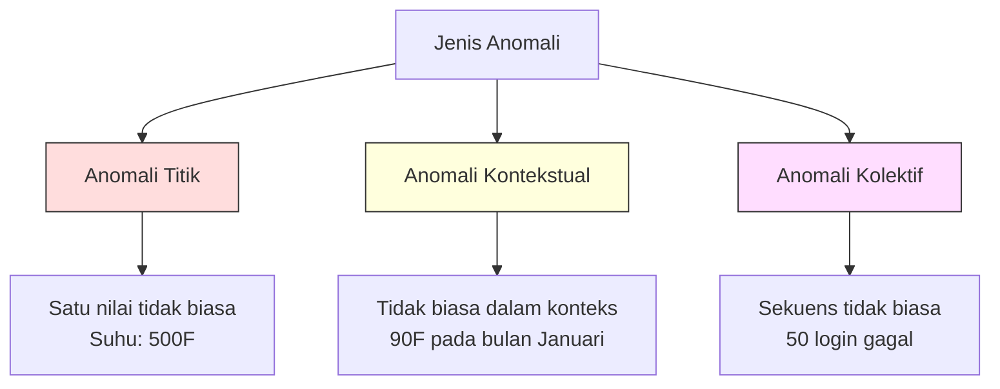
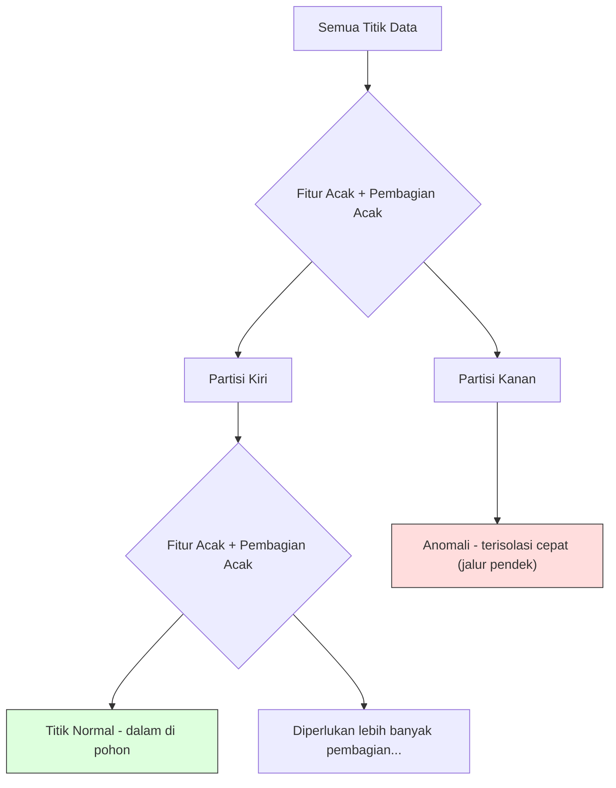
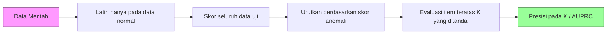

# Deteksi Anomali

> Normal mudah didefinisikan. Abnormal adalah apa pun yang tidak cocok.

**Jenis:** Build
**Bahasa:** Python
**Prasyarat:** Fase 2, Pelajaran 01-09
**Waktu:** ~75 menit

## Tujuan Pembelajaran

- Terapkan metode deteksi anomali Z-score, IQR, dan Isolation Forest dari awal
- Bedakan anomali titik, kontekstual, dan kolektif serta pilih metode deteksi yang tepat untuk masing-masing
- Jelaskan mengapa deteksi anomali dirumuskan sebagai pemodelan data normal, bukan klasifikasi anomali
- Bandingkan deteksi anomali tanpa pengawasan dengan klasifikasi terselia dan evaluasi trade-off antara cakupan anomali baru dan presisi

## Masalah

Sebuah kartu kredit digunakan di New York pukul 14.00, lalu di Tokyo pukul 14.05. Sensor pabrik menunjukkan 150 derajat ketika rentang normalnya adalah 80-120. Sebuah server mengirim 50.000 permintaan per detik ketika rata-rata hariannya adalah 200.

Ini adalah anomali. Menemukannya itu penting. Penipuan merugikan miliaran dolar. Kegagalan peralatan merugikan waktu produksi. Intrusi jaringan merugikan data.

Tantangannya: Anda jarang memiliki contoh anomali yang berlabel. Penipuan hanya mencakup 0,1% transaksi. Kegagalan peralatan terjadi beberapa kali per tahun. Anda tidak dapat melatih model klasifikasi standar karena hampir tidak ada yang dapat dipelajari dari kelas "anomali". Bahkan jika Anda memiliki beberapa label, anomali yang pernah Anda lihat bukanlah satu-satunya jenis yang akan Anda temui. Skema penipuan besok tampak berbeda dari skema hari ini.

Deteksi anomali membalik masalahnya. Alih-alih mempelajari apa yang abnormal, pelajarilah apa yang normal. Apa pun yang menyimpang dari normal mencurigakan. Ini bekerja tanpa label, beradaptasi dengan jenis anomali baru, dan diskalakan ke dataset masif.

## Konsep

### Jenis-Jenis Anomali

Tidak semua anomali sama:

- **Anomali titik.** Satu titik data yang tidak biasa terlepas dari konteks. Pembacaan suhu 500 derajat. Transaksi sebesar $50.000 dari akun yang biasanya menghabiskan $50.
- **Anomali kontekstual.** Titik data yang tidak biasa jika mempertimbangkan konteksnya. Suhu 90 derajat normal di musim panas, anomali di musim dingin. Nilai sama, konteks berbeda.
- **Anomali kolektif.** Sekuens titik data yang tidak biasa sebagai satu kelompok, meskipun setiap titiknya mungkin normal. Lima kali login gagal adalah normal. Lima puluh kali berturut-turut adalah serangan brute-force.

Kebanyakan metode mendeteksi anomali titik. Anomali kontekstual memerlukan fitur waktu atau lokasi. Anomali kolektif memerlukan metode yang sadar sekuens.



### Perumusan Tanpa Pengawasan

Pada klasifikasi standar, Anda memiliki label untuk kedua kelas. Pada deteksi anomali, Anda biasanya berada dalam salah satu dari tiga situasi:

1. **Sepenuhnya tanpa pengawasan.** Tidak ada label sama sekali. Anda melatih detektor pada seluruh data dan berharap anomali cukup langka sehingga tidak merusak model "normal".
2. **Semi-terawiawasi.** Anda memiliki dataset bersih yang hanya berisi data normal. Anda melatih pada himpunan bersih ini dan memberi skor pada semua data lain. Ini adalah pengaturan terkuat jika memungkinkan.
3. **Terawasi lemah.** Anda memiliki beberapa anomali berlabel. Gunakan untuk evaluasi, bukan pelatihan. Latih tanpa pengawasan, lalu ukur presisi/recall pada himpunan bagian yang berlabel.

Wawasan kuncinya: deteksi anomali pada dasarnya berbeda dari klasifikasi. Anda memodelkan distribusi data normal, bukan batas keputusan antara dua kelas.

### Terawasi vs Tanpa Pengawasan: Trade-off-nya

Jika Anda memang memiliki anomali berlabel, haruskah Anda menggunakannya untuk pelatihan (klasifikasi terawasi) atau hanya untuk evaluasi (deteksi tanpa pengawasan)?

**Terawasi (diperlakukan sebagai klasifikasi):**
- Menangkap jenis anomali persis yang pernah Anda lihat sebelumnya
- Presisi lebih tinggi pada jenis anomali yang diketahui
- Sama sekali melewatkan jenis anomali baru
- Memerlukan pelatihan ulang ketika jenis anomali baru muncul
- Membutuhkan cukup banyak contoh anomali (sering kali terlalu sedikit)

**Tanpa pengawasan (model normal, tandai penyimpangan):**
- Menangkap penyimpangan apa pun dari normal, termasuk jenis yang baru
- Tidak memerlukan anomali berlabel
- Tingkat positif palsu lebih tinggi (tidak semua yang tidak biasa itu buruk)
- Lebih tangguh terhadap pergeseran distribusi

Dalam praktiknya, sistem terbaik menggabungkan keduanya: deteksi tanpa pengawasan untuk cakupan luas, model terawasi untuk jenis anomali prioritas tinggi yang diketahui, dan tinjauan manusia untuk kasus-kasus ambigu.

### Metode Z-Score

Pendekatan paling sederhana. Hitung rata-rata dan simpangan baku dari setiap fitur. Tandai titik apa pun yang lebih dari $k$ simpangan baku dari rata-rata.

```text
z_score = (x - mean) / std
anomaly if |z_score| > threshold
```

Ambang baku adalah 3.0 (99,7% data normal berada dalam 3 simpangan baku untuk distribusi Gaussian).

**Keunggulan:** Sederhana. Cepat. Dapat ditafsirkan ("nilai ini 4,5 simpangan baku dari normal").

**Kelemahan:** Mengasumsikan data berdistribusi normal. Sensitif terhadap outlier pada data latih (outlier menggeser rata-rata dan membesar simpangan baku, sehingga lebih sulit terdeteksi). Gagal pada distribusi multimodal.

**Kapan bekerja baik:** Pemantauan satu fitur dengan data yang kira-kira berbentuk kurva lonceng. Waktu respons server, toleransi manufaktur, pembacaan sensor dengan baseline stabil.

**Kapan gagal:** Data dengan beberapa klaster (dua lokasi kantor dengan suhu baseline berbeda), data miring (jumlah transaksi di mana $1000 langka tetapi tidak anomali), data dengan outlier di dalam himpunan latih.

### Metode IQR

Lebih tangguh daripada Z-score. Menggunakan rentang interkuartil alih-alih rata-rata dan simpangan baku.

```
Q1 = 25th percentile
Q3 = 75th percentile
IQR = Q3 - Q1
lower_bound = Q1 - factor * IQR
upper_bound = Q3 + factor * IQR
anomaly if x < lower_bound or x > upper_bound
```

Faktor bawaan adalah 1.5.

**Keunggulan:** Tangguh terhadap outlier (persentil tidak dipengaruhi nilai ekstrem). Bekerja pada distribusi miring. Tidak mengasumsikan kenormalan.

**Kelemahan:** Hanya univariat (diterapkan per fitur secara independen). Tidak dapat mendeteksi anomali yang hanya tidak biasa ketika fitur dipertimbangkan bersama (suatu titik mungkin normal pada setiap fitur secara individual, tetapi anomali dalam ruang gabungan).

**Catatan praktis:** Faktor 1.5 pada IQR sesuai dengan kumis (whiskers) pada box plot. Titik di luar kumis adalah calon outlier. Menggunakan 3.0 alih-alih 1.5 membuat detektor lebih konservatif (lebih sedikit penandaan, lebih sedikit positif palsu). Faktor yang tepat bergantung pada toleransi Anda terhadap alarm palsu.

### Isolation Forest

Wawasan kuncinya: anomali itu sedikit dan berbeda. Dalam partisi acak pada data, anomali lebih mudah diisolasi -- lebih sedikit pembagian acak yang diperlukan untuk memisahkannya dari sisanya.



**Cara kerjanya:**
1. Bangun banyak pohon acak (sebuah isolation forest)
2. Pada setiap simpul, pilih fitur acak dan nilai pembagian acak antara nilai minimum dan maksimum fitur tersebut
3. Terus bagi hingga setiap titik terisolasi (berada di daunnya sendiri)
4. Anomali memiliki panjang jalur rata-rata yang lebih pendek di seluruh pohon

**Mengapa bekerja:** Titik normal berada di wilayah padat. Diperlukan banyak pembagian acak untuk mengisolasi satu titik dari tetangganya. Anomali berada di wilayah jarang. Satu atau dua pembagian acak sudah cukup untuk mengisolasi titik tersebut.

Skor anomali didasarkan pada panjang jalur rata-rata di seluruh pohon, dinormalisasi oleh panjang jalur yang diharapkan dari pohon pencarian biner acak:

```math
\text{score}(x) = 2^{-\text{average\_path\_length}(x) / c(n)}
```

Di mana `c(n)` adalah panjang jalur yang diharapkan untuk $n$ sampel. Skor mendekati 1 berarti anomali. Skor mendekati 0,5 berarti normal. Skor mendekati 0 berarti sangat normal (dalam di klaster padat).

**Keunggulan:** Tidak ada asumsi distribusi. Bekerja pada dimensi tinggi. Diskalakan dengan baik (sublinier terhadap jumlah sampel karena setiap pohon menggunakan subsampel). Menangani jenis fitur campuran.

**Kelemahan:** Kesulitan dengan anomali di wilayah padat (efek penyamaran). Pembagian acak kurang efektif ketika banyak fitur tidak relevan.

**Hiperparameter utama:**
- `n_estimators`: Jumlah pohon. 100 biasanya sudah cukup. Lebih banyak pohon memberi skor lebih stabil, tetapi komputasi lebih lambat.
- `max_samples`: Jumlah sampel per pohon. 256 adalah nilai bawaan pada makalah aslinya. Nilai lebih kecil membuat setiap pohon kurang akurat, tetapi meningkatkan keragaman. Subsampling inilah yang membuat Isolation Forest cepat -- setiap pohon hanya melihat sebagian kecil data.
- `contamination`: Fraksi anomali yang diharapkan. Hanya digunakan untuk menetapkan ambang. Tidak memengaruhi skor itu sendiri.

### Local Outlier Factor (LOF)

LOF membandingkan kepadatan lokal di sekitar suatu titik dengan kepadatan di sekitar tetangganya. Titik di wilayah jarang yang dikelilingi wilayah padat adalah anomali.

**Cara kerjanya:**
1. Untuk setiap titik, temukan $k$ tetangga terdekatnya
2. Hitung kepadatan keterjangkauan lokal (seberapa padat lingkungan tersebut)
3. Bandingkan kepadatan setiap titik dengan kepadatan tetangganya
4. Jika kepadatan suatu titik jauh lebih rendah daripada kepadatan tetangganya, titik itu adalah outlier

**Skor LOF:**
- LOF mendekati 1,0 berarti kepadatan serupa dengan tetangga (normal)
- LOF lebih besar dari 1,0 berarti kepadatan lebih rendah daripada tetangga (kemungkinan anomali)
- LOF jauh lebih besar dari 1,0 (misalnya 2,0 ke atas) berarti kepadatan jauh lebih rendah (kemungkinan besar anomali)

Bagian "lokal" sangat penting. Pertimbangkan dataset dengan dua klaster: klaster padat berisi 1000 titik dan klaster jarang berisi 50 titik. Titik di tepi klaster jarang tidaklah tidak biasa secara global -- titik itu memiliki 50 tetangga. Namun titik itu tidak biasa secara lokal jika tetangga terdekatnya lebih padat daripadanya. LOF menangkap nuansa yang terlewat metode global.

**Keunggulan:** Mendeteksi anomali lokal (titik yang tidak biasa di lingkungannya, meskipun tidak tidak biasa secara global). Bekerja pada klaster dengan kepadatan berbeda.

**Kelemahan:** Lambat pada dataset besar ($O(n^2)$ untuk implementasi naif). Sensitif terhadap pemilihan $k$. Tidak bekerja baik pada dimensi sangat tinggi (kutukan dimensi memengaruhi perhitungan jarak).

### Perbandingan

| Metode | Asumsi | Kecepatan | Menangani Dimensi Tinggi | Mendeteksi Anomali Lokal |
|--------|--------|-----------|--------------------------|--------------------------|
| Z-score | Distribusi normal | Sangat cepat | Ya (per fitur) | Tidak |
| IQR | Tidak ada (per fitur) | Sangat cepat | Ya (per fitur) | Tidak |
| Isolation Forest | Tidak ada | Cepat | Ya | Sebagian |
| LOF | Jarak bermakna | Lambat | Buruk | Ya |

### Tantangan Evaluasi

Mengevaluasi detektor anomali lebih sulit daripada mengevaluasi model klasifikasi:

- **Ketidakseimbangan kelas ekstrem.** Dengan 0,1% anomali, memprediksi "normal" untuk semua memberi akurasi 99,9%. Akurasi menjadi tidak berguna.
- **AUROC menyesatkan.** Dengan ketidakseimbangan berat, AUROC dapat terlihat baik meskipun model melewatkan sebagian besar anomali pada ambang praktis.
- **Metrik yang lebih baik:** Precision@k (dari $k$ item teratas yang ditandai, berapa banyak yang benar-benar anomali), AUPRC (luas di bawah kurva presisi-recall), dan recall pada tingkat positif palsu tetap.



### Pipeline Deteksi Anomali

Dalam praktiknya, deteksi anomali mengikuti alur kerja ini:

1. **Kumpulkan data baseline.** Idealnya, suatu periode yang Anda tahu tidak ada (atau sangat sedikit) anomali.
2. **Rekayasa fitur.** Fitur mentah ditambah fitur turunan (statistik bergulir, fitur waktu, rasio).
3. **Latih detektor.** Latih pada data baseline. Model mempelajari seperti apa rupa "normal".
4. **Beri skor data baru.** Setiap pengamatan baru mendapat skor anomali.
5. **Pemilihan ambang.** Pilih batas skor. Ini adalah keputusan bisnis: ambang lebih tinggi berarti lebih sedikit alarm palsu, tetapi lebih banyak anomali yang terlewat.
6. **Peringatkan dan selidiki.** Titik yang ditandai masuk ke tinjauan manusia atau respons otomatis.
7. **Kumpulkan umpan balik.** Catat apakah item yang ditandai benar-benar anomali atau alarm palsu. Gunakan data ini untuk mengevaluasi detektor dan menyetel ambang dari waktu ke waktu.

Pipeline ini tidak pernah "selesai". Distribusi data bergeser, jenis anomali baru muncul, dan ambang perlu disesuaikan. Perlakukan deteksi anomali sebagai sistem yang hidup, bukan model sekali jadi.

```figure
f3-anomaly-fence
```

## Bangunlah

Kode dalam `code/anomaly_detection.py` mengimplementasikan Z-score, IQR, dan Isolation Forest dari awal.

### Detektor Z-Score

```python
def zscore_detect(X, threshold=3.0):
    mean = X.mean(axis=0)
    std = X.std(axis=0)
    std[std == 0] = 1.0
    z = np.abs((X - mean) / std)
    return z.max(axis=1) > threshold
```

Sederhana dan tervektorisasi. Menandai titik jika ada fitur yang melebihi ambang.

### Detektor IQR

```python
def iqr_detect(X, factor=1.5):
    q1 = np.percentile(X, 25, axis=0)
    q3 = np.percentile(X, 75, axis=0)
    iqr = q3 - q1
    iqr[iqr == 0] = 1.0
    lower = q1 - factor * iqr
    upper = q3 + factor * iqr
    outside = (X < lower) | (X > upper)
    return outside.any(axis=1)
```

### Isolation Forest dari Awal

Implementasi dari awal membangun pohon isolasi yang mempartisi ruang fitur secara acak:

```python
def _c_factor(n):
    if n <= 1:
        return 0.0
    if n == 2:
        return 1.0
    return 2.0 * (np.log(n - 1) + 0.5772156649) - 2.0 * (n - 1.0) / n


class IsolationTree:
    def __init__(self, max_depth):
        self.max_depth = max_depth

    def fit(self, X, depth=0):
        n, p = X.shape
        if depth >= self.max_depth or n <= 1:
            self.is_leaf = True
            self.size = n
            return self
        self.is_leaf = False
        self.feature = np.random.randint(p)
        x_min = X[:, self.feature].min()
        x_max = X[:, self.feature].max()
        if x_min == x_max:
            self.is_leaf = True
            self.size = n
            return self
        self.threshold = np.random.uniform(x_min, x_max)
        left_mask = X[:, self.feature] < self.threshold
        self.left = IsolationTree(self.max_depth).fit(X[left_mask], depth + 1)
        self.right = IsolationTree(self.max_depth).fit(X[~left_mask], depth + 1)
        return self

    def path_length(self, x, depth=0):
        if self.is_leaf:
            return depth + _c_factor(self.size)
        if x[self.feature] < self.threshold:
            return self.left.path_length(x, depth + 1)
        return self.right.path_length(x, depth + 1)
```

Panjang jalur untuk mengisolasi suatu titik menentukan skor anomali. Jalur yang lebih pendek berarti lebih anomali.

Kelas `IsolationForest` membungkus banyak pohon:

```python
class IsolationForest:
    def __init__(self, n_estimators=100, max_samples=256, seed=42):
        self.n_estimators = n_estimators
        self.max_samples = max_samples
        self.seed = seed
        self.trees = []
        self.n_train = 0

    def fit(self, X):
        self.n_train = X.shape[0]
        rng = np.random.RandomState(self.seed)
        self.trees = []
        sample_size = min(self.max_samples, X.shape[0])
        max_depth = int(np.ceil(np.log2(sample_size)))
        for _ in range(self.n_estimators):
            idx = rng.choice(X.shape[0], size=sample_size, replace=False)
            tree = IsolationTree(max_depth=max_depth)
            tree.fit(X[idx])
            self.trees.append(tree)
        return self

    def anomaly_score(self, X):
        avg_path = np.zeros(X.shape[0])
        for tree in self.trees:
            for i in range(X.shape[0]):
                avg_path[i] += tree.path_length(X[i])
        avg_path /= self.n_estimators
        c = _c_factor(min(self.max_samples, self.n_train))
        return 2.0 ** (-avg_path / c) if c > 0 else np.zeros(X.shape[0])
```

Faktor normalisasi `c(n)` (`_c_factor` dalam kode) adalah panjang jalur yang diharapkan dari pencarian yang gagal pada pohon pencarian biner dengan $n$ elemen. Nilainya `2 * H(n-1) - 2*(n-1)/n` dengan `H` adalah bilangan harmonik. Kode menggunakan pendekatan standar `H(i) ≈ ln(i) + 0.5772` (konstanta Euler), seperti makalah Isolation Forest asli. Normalisasi ini memastikan skor dapat dibandingkan antardataset dengan ukuran berbeda.

### Skenario Demo

Kode menghasilkan beberapa skenario uji:

1. **Satu klaster dengan outlier.** Klaster Gaussian 2D dengan anomali yang disuntikkan jauh dari pusat. Semua metode seharusnya bekerja di sini.
2. **Data multimodal.** Tiga klaster dengan ukuran dan kepadatan berbeda. Titik antarklaster adalah anomali. Z-score kesulitan karena rentang per fiturnya lebar.
3. **Data berdimensi tinggi.** 50 fitur, tetapi anomali hanya berbeda pada 5 di antaranya. Menguji apakah metode dapat menemukan anomali pada himpunan bagian fitur.

Setiap demo membandingkan semua metode menggunakan presisi, recall, F1, dan Precision@k.

## Gunakanlah

Dengan sklearn (menggunakan implementasi pustaka, bukan dari awal):

```python
from sklearn.ensemble import IsolationForest
from sklearn.neighbors import LocalOutlierFactor

iso = IsolationForest(n_estimators=100, contamination=0.05, random_state=42)
iso.fit(X_train)
predictions = iso.predict(X_test)

lof = LocalOutlierFactor(n_neighbors=20, contamination=0.05, novelty=True)
lof.fit(X_train)
predictions = lof.predict(X_test)
```

Perhatikan bahwa `contamination` menetapkan fraksi anomali yang diharapkan. Menyetelnya dengan benar itu penting -- terlalu rendah melewatkan anomali, terlalu tinggi menciptakan alarm palsu.

Kode dalam `anomaly_detection.py` membandingkan implementasi dari awal dengan sklearn pada data yang sama.

### Parameter Contamination pada sklearn

Parameter `contamination` pada sklearn menentukan ambang untuk mengubah skor anomali kontinu menjadi prediksi biner. Parameter ini tidak mengubah skor dasarnya.

```python
iso_5 = IsolationForest(contamination=0.05)
iso_10 = IsolationForest(contamination=0.10)
```

Keduanya menghasilkan skor anomali yang sama. Namun `iso_5` menandai 5% teratas, sementara `iso_10` menandai 10% teratas. Jika Anda tidak tahu tingkat anomali yang sebenarnya (biasanya Anda tidak tahu), tetapkan contamination ke "auto" dan gunakan skor mentah secara langsung. Tetapkan ambang Anda sendiri berdasarkan trade-off biaya antara positif palsu dan negatif palsu.

### One-Class SVM

Detektor anomali tanpa pengawasan lain yang layak diketahui. One-Class SVM membangun batas di sekitar data normal dalam ruang fitur berdimensi tinggi (menggunakan kernel trick).

```python
from sklearn.svm import OneClassSVM

oc_svm = OneClassSVM(kernel="rbf", gamma="auto", nu=0.05)
oc_svm.fit(X_train)
predictions = oc_svm.predict(X_test)
```

Parameter `nu` mendekati fraksi anomali. One-Class SVM bekerja baik pada dataset berukuran kecil hingga menengah, tetapi tidak diskalakan ke data sangat besar (matriks kernel tumbuh secara kuadratik).

### Pendekatan Autoencoder (Pratinjau)

Autoencoder adalah jaringan saraf yang belajar mengompresi dan merekonstruksi data. Latih pada data normal. Pada saat uji, anomali memiliki galat rekonstruksi tinggi karena jaringan hanya belajar merekonstruksi pola normal.

Ini dibahas pada Fase 3 (Deep Learning), tetapi prinsipnya sama: modelkan apa yang normal, tandai apa yang menyimpang.

### Deteksi Anomali dengan Ensemble

Sama seperti metode ensemble yang meningkatkan klasifikasi (Pelajaran 11), menggabungkan beberapa detektor anomali meningkatkan deteksi. Pendekatan paling sederhana:

1. Jalankan beberapa detektor (Z-score, IQR, Isolation Forest, LOF)
2. Normalisasi skor setiap detektor ke [0, 1]
3. Rata-rata skor yang sudah dinormalisasi
4. Tandai titik di atas ambang pada skor rata-rata

Ini mengurangi positif palsu karena metode yang berbeda memiliki mode kegagalan yang berbeda. Titik yang ditandai oleh keempat metode hampir pasti anomali. Titik yang hanya ditandai oleh satu metode mungkin merupakan keanehan metode tersebut.

Ensemble yang lebih canggih memberi bobot pada setiap detektor sesuai keandalan yang diperkirakan (diukur pada himpunan validasi dengan anomali diketahui, jika tersedia).

### Pertimbangan Produksi

1. **Pergeseran ambang.** Seiring pergeseran distribusi data, ambang tetap menjadi usang. Pantau distribusi skor anomali dan sesuaikan secara berkala.
2. **Kelelahan alarm.** Terlalu banyak alarm palsu membuat operator berhenti memperhatikan. Mulailah dengan ambang tinggi (lebih sedikit, lebih andal alarmnya) dan turunkan secara bertahap seiring kepercayaan meningkat.
3. **Pendekatan ensemble.** Dalam produksi, gabungkan beberapa detektor. Tandai titik hanya jika beberapa metode setuju bahwa titik itu anomali. Ini sangat mengurangi positif palsu.
4. **Rekayasa fitur.** Fitur mentah jarang cukup. Tambahkan statistik bergulir, rasio, waktu sejak kejadian terakhir, dan fitur spesifik domain. Himpunan fitur yang baik lebih penting daripada pilihan detektor.
5. **Umpan balik.** Ketika operator menyelidiki item yang ditandai dan mengonfirmasi atau menolaknya, masukkan kembali ke dalam sistem. Kumpulkan data berlabel dari waktu ke waktu untuk mengevaluasi dan memperbaiki detektor.

## Terapkanlah

Pelajaran ini menghasilkan:
- `outputs/skill-anomaly-detector.md` -- sebuah skill pengambilan keputusan untuk memilih detektor yang tepat
- `code/anomaly_detection.py` -- Z-score, IQR, dan Isolation Forest dari awal, dengan perbandingan sklearn

### Memilih Ambang

Skor anomali bersifat kontinu. Anda memerlukan ambang untuk mengambil keputusan biner. Ini adalah keputusan bisnis, bukan keputusan teknis.

Pertimbangkan dua skenario:
- **Deteksi penipuan.** Melewatkan penipuan itu mahal (chargeback, kepercayaan pelanggan). Alarm palsu memerlukan 5 menit waktu analis manusia untuk menyelidiki. Tetapkan ambang rendah agar lebih banyak penipuan tertangkap, terima lebih banyak alarm palsu.
- **Pemeliharaan peralatan.** Alarm palsu berarti penghentian produksi yang tidak perlu dengan biaya $50.000. Kegagalan yang terlewat berarti perbaikan senilai $500.000. Tetapkan ambang untuk menyeimbangkan biaya-biaya ini.

Dalam kedua kasus, ambang optimal bergantung pada rasio biaya antara positif palsu dan negatif palsu. Plot presisi dan recall pada berbagai ambang, tumpangkan fungsi biaya, lalu pilih titik biaya minimum.

### Diskalakan ke Produksi

Untuk deteksi anomali real-time dalam produksi:

1. **Pelatihan batch, skoring online.** Latih model secara berkala (harian, mingguan) pada data normal terbaru. Beri skor setiap pengamatan baru begitu tiba.
2. **Komputasi fitur harus cocok.** Jika Anda melatih dengan statistik bergulir atas 30 hari, Anda memerlukan 30 hari riwayat untuk menghitung fitur pengamatan baru. Buffer riwayat yang dibutuhkan.
3. **Pemantauan distribusi skor.** Lacak distribusi skor anomali dari waktu ke waktu. Jika median skor bergeser naik, berarti data berubah atau model sudah usang.
4. **Keterjelasan.** Ketika Anda menandai anomali, katakan mengapa. Z-score: "Fitur X berada 4,2 simpangan baku di atas normal." Isolation Forest: "Titik ini terisolasi dalam rata-rata 3,1 pembagian (titik normal memerlukan 8,5)."

## Latihan

1. **Penyetelan ambang.** Jalankan detektor Z-score dengan ambang dari 1,0 sampai 5,0 dengan langkah 0,5. Plot presisi dan recall pada setiap ambang. Di mana titik optimal untuk data Anda?

2. **Anomali multivariat.** Buat data 2D di mana setiap fitur terlihat normal secara individual, tetapi kombinasinya anomali (misalnya, titik yang jauh dari diagonal klaster utama). Tunjukkan bahwa Z-score per fitur melewatkannya, tetapi Isolation Forest menangkapnya.

3. **LOF dari awal.** Terapkan Local Outlier Factor menggunakan tetangga terdekat k. Bandingkan dengan LocalOutlierFactor milik sklearn pada data yang sama. Gunakan $k=10$ dan $k=50$ -- bagaimana pilihan $k$ memengaruhi hasil?

4. **Deteksi anomali streaming.** Ubah detektor Z-score agar bekerja dalam pengaturan streaming: perbarui rata-rata dan varians berjalan saat titik baru tiba (algoritma online Welford). Bandingkan dengan Z-score batch pada data yang sama.

5. **Evaluasi dunia nyata.** Ambil dataset dengan anomali diketahui (misalnya, penipuan kartu kredit dari Kaggle). Evaluasi keempat metode menggunakan precision@100, precision@500, dan AUPRC. Metode mana yang paling baik? Mengapa?

## Istilah Kunci

| Istilah | Yang orang katakan | Arti sebenarnya |
|---------|--------------------|-----------------|
| Anomali | "Outlier, titik yang tidak biasa" | Titik data yang menyimpang secara signifikan dari pola yang diharapkan dari data normal |
| Anomali titik | "Satu nilai yang aneh" | Pengamatan individual yang tidak biasa terlepas dari konteks |
| Anomali kontekstual | "Nilai normal, konteks salah" | Pengamatan yang tidak biasa jika mempertimbangkan konteksnya (waktu, lokasi, dll.), tetapi mungkin normal dalam konteks lain |
| Isolation Forest | "Pembagian acak untuk menemukan outlier" | Ensemble pohon acak yang mengisolasi anomali dengan lebih sedikit pembagian daripada titik normal |
| Local Outlier Factor | "Bandingkan kepadatan dengan tetangga" | Metode yang menandai titik yang kepadatan lokalnya jauh lebih rendah daripada kepadatan tetangganya |
| Z-score | "Simpangan baku dari rata-rata" | $(x - \text{mean}) / \text{std}$, mengukur seberapa jauh suatu titik dari pusat dalam satuan simpangan baku |
| IQR | "Rentang interkuartil" | $Q3 - Q1$, mengukur sebaran 50% data bagian tengah, digunakan untuk deteksi outlier yang tangguh |
| Kontaminasi | "Fraksi anomali yang diharapkan" | Hiperparameter yang memberi tahu detektor berapa proporsi data yang harus ditandai sebagai anomali |
| Precision@k | "Dari k penandaan teratas, berapa yang benar" | Presisi yang dihitung hanya pada $k$ titik paling mencurigakan, berguna untuk deteksi anomali yang tidak seimbang |
| AUPRC | "Luas di bawah kurva presisi-recall" | Metrik yang merangkum kinerja presisi-recall di semua ambang, lebih baik daripada AUROC untuk data tidak seimbang |

## Bacaan Lanjutan

- [Liu dkk., Isolation Forest (2008)](https://cs.nju.edu.cn/zhouzh/zhouzh.files/publication/icdm08b.pdf) -- makalah asli Isolation Forest
- [Breunig dkk., LOF: Identifying Density-Based Local Outliers (2000)](https://dl.acm.org/doi/10.1145/342009.335388) -- makalah asli LOF
- [dokumentasi Deteksi Outlier scikit-learn](https://scikit-learn.org/stable/modules/outlier_detection.html) -- ringkasan semua detektor anomali sklearn
- [Chandola dkk., Anomaly Detection: A Survey (2009)](https://dl.acm.org/doi/10.1145/1541880.1541882) -- survei komprehensif metode deteksi anomali
- [Goldstein dan Uchida, A Comparative Evaluation of Unsupervised Anomaly Detection Algorithms (2016)](https://journals.plos.org/plosone/article?id=10.1371/journal.pone.0152173) -- perbandingan empiris 10 metode pada dataset nyata
