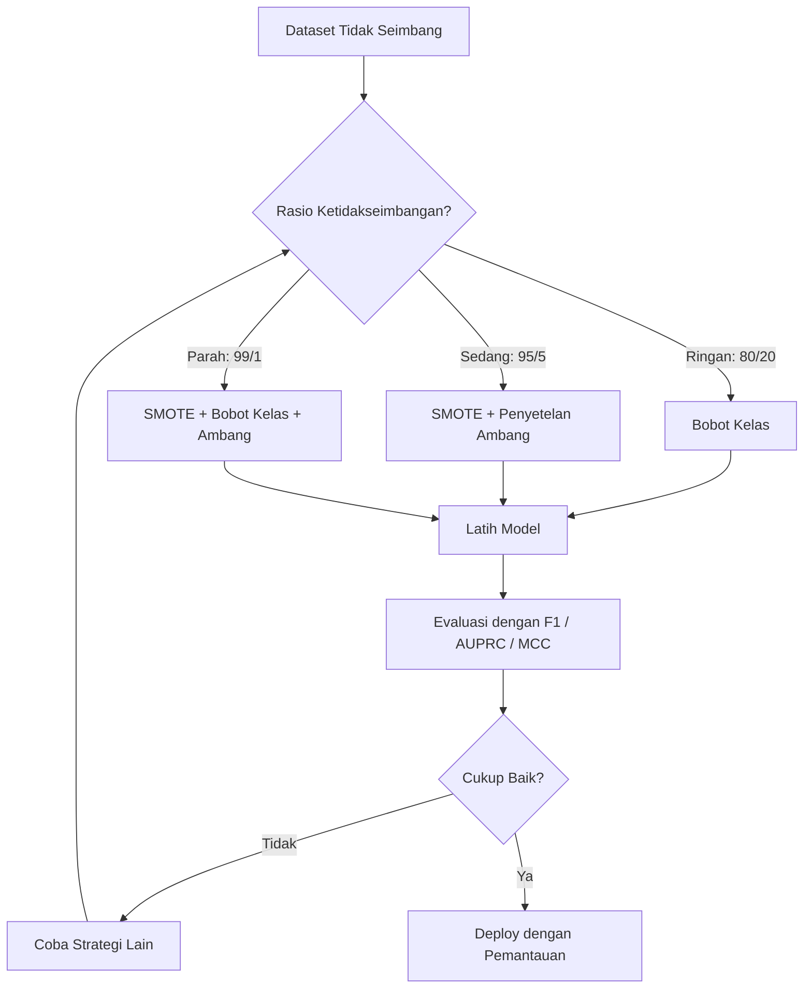
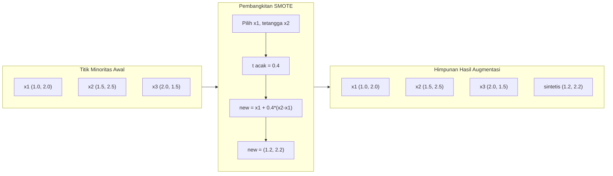
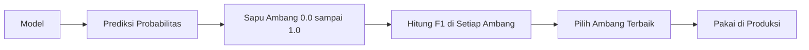
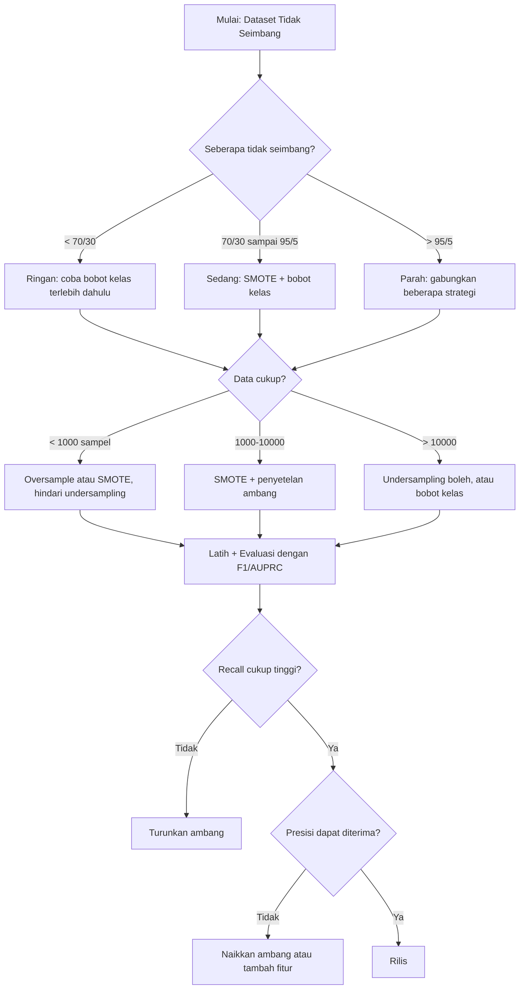

# Menangani Data Tidak Seimbang

> Ketika 99% data Anda "normal", akurasi adalah kebohongan.

**Jenis:** Bangun
**Bahasa:** Python
**Prasyarat:** Fase 2, Pelajaran 01-09 (khususnya metrik evaluasi)
**Waktu:** ~90 menit

## Tujuan Pembelajaran

- Implementasikan SMOTE dari awal dan jelaskan bagaimana oversampling sintetis berbeda dari duplikasi acak
- Evaluasi classifier tidak seimbang memakai F1, AUPRC, dan Koefisien Korelasi Matthews alih-alih akurasi
- Bandingkan bobot kelas, penyetelan ambang, dan strategi resampling, lalu pilih pendekatan yang tepat untuk rasio ketidakseimbangan tertentu
- Bangun pipeline data tidak seimbang lengkap yang menggabungkan SMOTE, bobot kelas, dan optimasi ambang

## Masalahnya

Anda membangun model deteksi penipuan. Model itu mendapat akurasi 99,9%. Anda merayakannya. Lalu Anda menyadari bahwa ia memprediksi "bukan penipuan" untuk setiap transaksi.

Ini bukan bug. Ini adalah hal yang rasional untuk dilakukan ketika hanya 0,1% transaksi yang merupakan penipuan. Model mempelajari bahwa menebak kelas mayoritas terus-menerus meminimalkan error keseluruhan. Secara teknis ia benar dan sama sekali tidak berguna.

Ini terjadi di mana-mana ketika klasifikasi sungguhan berperan. Diagnosis penyakit: tingkat positif 1%. Serangan jaringan: 0,01% insiden. Cacat produksi: 0,5% rusak. Filter spam: 20% spam. Prediksi churn: 5% pengguna pergi. Semakin besar konsekuensi kelas minoritas, semakin langka kelas itu cenderung muncul.

Akurasi gagal karena ia memperlakukan semua prediksi benar secara setara. Menandai transaksi sah dengan benar dan menangkap penipuan dengan benar sama-sama dihitung sebagai satu poin akurasi. Padahal menangkap penipuan adalah alasan model itu ada. Kita membutuhkan metrik, teknik, dan strategi pelatihan yang memaksa model untuk memperhatikan kelas yang langka tetapi penting.

## Konsep

### Mengapa Akurasi Gagal

Perhatikan sebuah dataset dengan 1000 sampel: 990 negatif, 10 positif. Sebuah model yang selalu memprediksi negatif:

|  | Diprediksi Positif | Diprediksi Negatif |
|--|---|---|
| Sebenarnya Positif | 0 (TP) | 10 (FN) |
| Sebenarnya Negatif | 0 (FP) | 990 (TN) |

```math
\text{Accuracy} = (0 + 990) / 1000 = 99.0\%
```

Model itu menangkap nol penipuan. Nol penyakit. Nol cacat. Tetapi akurasi mengatakan 99%. Inilah sebabnya akurasi berbahaya untuk masalah tidak seimbang.

### Metrik yang Lebih Baik

**Presisi** = $\text{TP} / (\text{TP} + \text{FP})$. Dari semua yang ditandai positif, berapa banyak yang benar-benar positif? Presisi tinggi berarti sedikit alarm palsu.

**Recall** = $\text{TP} / (\text{TP} + \text{FN})$. Dari semua yang benar-benar positif, berapa banyak yang berhasil kita tangkap? Recall tinggi berarti sedikit sampel positif yang terlewat.

**Skor F1** = $2 \cdot \text{precision} \cdot \text{recall} / (\text{precision} + \text{recall})$. Rata-rata harmonik. Ia menghukum ketidakseimbangan ekstrem antara presisi dan recall lebih keras daripada rata-rata aritmetika.

**Skor F-beta** = $(1 + \beta^2) \cdot \text{precision} \cdot \text{recall} / (\beta^2 \cdot \text{precision} + \text{recall})$. Ketika $\beta > 1$, recall lebih penting. Ketika $\beta < 1$, presisi lebih penting. F2 umum dipakai dalam deteksi penipuan (melewatkan penipuan lebih buruk daripada alarm palsu).

**AUPRC** (Area Under Precision-Recall Curve). Mirip AUC-ROC tetapi lebih informatif untuk data tidak seimbang. Classifier acak memiliki AUPRC yang sama dengan laju kelas positif (bukan 0,5 seperti ROC). Hal ini membuat perbaikan lebih mudah terlihat.

**Koefisien Korelasi Matthews** = $(\text{TP} \cdot \text{TN} - \text{FP} \cdot \text{FN}) / \sqrt{(\text{TP}+\text{FP})(\text{TP}+\text{FN})(\text{TN}+\text{FP})(\text{TN}+\text{FN})}}$. Rentangnya dari -1 sampai +1. Ia hanya memberi skor tinggi ketika model berkinerja baik pada kedua kelas. Tetap seimbang meski ukuran kedua kelas sangat berbeda.

Untuk model "selalu prediksi negatif" di atas: $\text{precision} = 0/0$ (terdefinisi sebagai tak terdefinisi, sering ditetapkan 0), $\text{recall} = 0/10 = 0$, $\text{F1} = 0$, $\text{MCC} = 0$. Metrik ini dengan tepat mengidentifikasi model itu sebagai tidak berguna.

### Pipeline Data Tidak Seimbang



### SMOTE: Teknik Oversampling Minoritas Sintetis

Oversampling acak menduplikasi sampel minoritas yang sudah ada. Cara ini berfungsi, tetapi berisiko overfitting karena model melihat titik yang identik berulang kali.

SMOTE menciptakan sampel minoritas sintetis baru yang masuk akal tetapi bukan salinan. Algoritmanya:

1. Untuk setiap sampel minoritas $x$, temukan $k$ tetangga terdekat di antara sampel minoritas lainnya
2. Pilih satu tetangga secara acak
3. Buat sampel baru pada ruas garis antara $x$ dan tetangga itu

Rumusnya: `new_sample = x + random(0, 1) * (neighbor - x)`

Ini melakukan interpolasi antar titik minoritas asli, menciptakan sampel di wilayah ruang fitur yang sama tanpa sekadar menyalin data yang sudah ada.



### Strategi Sampling Dibandingkan

**Oversampling Acak**: duplikasi sampel minoritas agar jumlahnya sama dengan kelas mayoritas.
- Kelebihan: sederhana, tidak ada kehilangan informasi
- Kekurangan: duplikat persis menyebabkan overfitting, menambah waktu pelatihan

**Undersampling Acak**: hapus sampel mayoritas agar jumlahnya sama dengan kelas minoritas.
- Kelebihan: pelatihan cepat, sederhana
- Kekurangan: membuang data mayoritas yang mungkin berguna, varians lebih tinggi

**SMOTE**: buat sampel minoritas sintetis melalui interpolasi.
- Kelebihan: menghasilkan titik data baru, mengurangi overfitting dibanding oversampling acak
- Kekurangan: dapat membuat sampel bising di dekat batas keputusan, tidak mempertimbangkan distribusi kelas mayoritas

| Strategi | Data yang Diubah | Risiko | Kapan Dipakai |
|----------|------------------|--------|---------------|
| Oversample | Minoritas diduplikasi | Overfitting | Dataset kecil, ketidakseimbangan sedang |
| Undersample | Mayoritas dihapus | Kehilangan informasi | Dataset besar, ingin pelatihan cepat |
| SMOTE | Minoritas sintetis ditambahkan | Kebisingan batas | Ketidakseimbangan sedang, cukup sampel minoritas untuk k-NN |

### Bobot Kelas

Alih-alih mengubah data, ubah cara model memperlakukan error. Berikan bobot lebih tinggi pada kesalahan mengklasifikasikan kelas minoritas.

Untuk masalah biner dengan 950 sampel negatif dan 50 positif:
- Bobot untuk kelas negatif = $n_{\text{samples}} / (2 \cdot n_{\text{negative}}) = 1000 / (2 \cdot 950) = 0.526$
- Bobot untuk kelas positif = $n_{\text{samples}} / (2 \cdot n_{\text{positive}}) = 1000 / (2 \cdot 50) = 10.0$

Kelas positif mendapat bobot 19 kali lebih besar. Salah mengklasifikasikan satu sampel positif biayanya sama dengan salah mengklasifikasikan 19 sampel negatif. Model dipaksa memperhatikan kelas minoritas.

Pada regresi logistik, ini mengubah fungsi loss:

```math
\text{weighted\_loss} = -\sum \bigl( w_i \cdot [y_i \log(p_i) + (1-y_i) \log(1-p_i)] \bigr)
```

di mana $w_i$ bergantung pada kelas sampel $i$.

Bobot kelas secara matematis setara dengan oversampling secara ekspektasi, tetapi tanpa membuat titik data baru. Hal ini membuatnya lebih cepat dan menghindari risiko overfitting dari sampel yang diduplikasi.

### Penyetelan Ambang

Kebanyakan classifier menghasilkan probabilitas. Ambang bawaan adalah 0,5: jika $P(\text{positive}) \ge 0,5$, prediksi positif. Tetapi 0,5 itu arbitrer. Ketika kelas tidak seimbang, ambang optimal biasanya jauh lebih rendah.

Prosesnya:
1. Latih sebuah model
2. Dapatkan probabilitas prediksi pada himpunan validasi
3. Sapu ambang dari 0,0 sampai 1,0
4. Hitung F1 (atau metrik pilihan Anda) di setiap ambang
5. Pilih ambang yang memaksimalkan metrik Anda



Sebuah model mungkin menghasilkan $P(\text{fraud}) = 0.15$ untuk transaksi penipuan. Pada ambang 0,5, transaksi itu diklasifikasikan sebagai bukan penipuan. Pada ambang 0,10, transaksi itu berhasil tertangkap. Kalibrasi probabilitas kurang penting daripada peringkat — selama penipuan mendapat probabilitas lebih tinggi daripada bukan penipuan, ada ambang yang dapat memisah keduanya.

### Pembelajaran Sensitif Biaya

Generalisasi dari bobot kelas. Alih-alih biaya yang seragam, tetapkan biaya salah klasifikasi yang spesifik:

| | Prediksi Positif | Prediksi Negatif |
|--|---|---|
| Sebenarnya Positif | 0 (benar) | $C_{\text{FN}} = 100$ |
| Sebenarnya Negatif | $C_{\text{FP}} = 1$ | 0 (benar) |

Melewatkan transaksi penipuan (FN) biayanya 100 kali lebih besar daripada alarm palsu (FP). Model mengoptimalkan total biaya, bukan total jumlah error.

Ini adalah pendekatan paling prinsipil ketika Anda dapat memperkirakan biaya dunia nyata. Diagnosis kanker yang terlewat memiliki biaya yang sangat berbeda dengan alarm palsu yang menyebabkan biopsi tambahan. Membuat biaya-biaya ini eksplisit memaksa trade-off yang tepat.

### Diagram Keputusan



```figure
class-imbalance
```

## Bangun

### Langkah 1: Bangkitkan dataset tidak seimbang

```python
import numpy as np


def make_imbalanced_data(n_majority=950, n_minority=50, seed=42):
    rng = np.random.RandomState(seed)

    X_maj = rng.randn(n_majority, 2) * 1.0 + np.array([0.0, 0.0])
    X_min = rng.randn(n_minority, 2) * 0.8 + np.array([2.5, 2.5])

    X = np.vstack([X_maj, X_min])
    y = np.concatenate([np.zeros(n_majority), np.ones(n_minority)])

    shuffle_idx = rng.permutation(len(y))
    return X[shuffle_idx], y[shuffle_idx]
```

### Langkah 2: SMOTE dari awal

```python
def euclidean_distance(a, b):
    return np.sqrt(np.sum((a - b) ** 2))


def find_k_neighbors(X, idx, k):
    distances = []
    for i in range(len(X)):
        if i == idx:
            continue
        d = euclidean_distance(X[idx], X[i])
        distances.append((i, d))
    distances.sort(key=lambda x: x[1])
    return [d[0] for d in distances[:k]]


def smote(X_minority, k=5, n_synthetic=100, seed=42):
    rng = np.random.RandomState(seed)
    n_samples = len(X_minority)
    k = min(k, n_samples - 1)
    synthetic = []

    for _ in range(n_synthetic):
        idx = rng.randint(0, n_samples)
        neighbors = find_k_neighbors(X_minority, idx, k)
        neighbor_idx = neighbors[rng.randint(0, len(neighbors))]
        t = rng.random()
        new_point = X_minority[idx] + t * (X_minority[neighbor_idx] - X_minority[idx])
        synthetic.append(new_point)

    return np.array(synthetic)
```

### Langkah 3: Oversampling dan undersampling acak

```python
def random_oversample(X, y, seed=42):
    rng = np.random.RandomState(seed)
    classes, counts = np.unique(y, return_counts=True)
    max_count = counts.max()

    X_resampled = list(X)
    y_resampled = list(y)

    for cls, count in zip(classes, counts):
        if count < max_count:
            cls_indices = np.where(y == cls)[0]
            n_needed = max_count - count
            chosen = rng.choice(cls_indices, size=n_needed, replace=True)
            X_resampled.extend(X[chosen])
            y_resampled.extend(y[chosen])

    X_out = np.array(X_resampled)
    y_out = np.array(y_resampled)
    shuffle = rng.permutation(len(y_out))
    return X_out[shuffle], y_out[shuffle]


def random_undersample(X, y, seed=42):
    rng = np.random.RandomState(seed)
    classes, counts = np.unique(y, return_counts=True)
    min_count = counts.min()

    X_resampled = []
    y_resampled = []

    for cls in classes:
        cls_indices = np.where(y == cls)[0]
        chosen = rng.choice(cls_indices, size=min_count, replace=False)
        X_resampled.extend(X[chosen])
        y_resampled.extend(y[chosen])

    X_out = np.array(X_resampled)
    y_out = np.array(y_resampled)
    shuffle = rng.permutation(len(y_out))
    return X_out[shuffle], y_out[shuffle]
```

### Langkah 4: Regresi logistik dengan bobot kelas

```python
def sigmoid(z):
    return 1.0 / (1.0 + np.exp(-np.clip(z, -500, 500)))


def logistic_regression_weighted(X, y, weights, lr=0.01, epochs=200):
    n_samples, n_features = X.shape
    w = np.zeros(n_features)
    b = 0.0

    for _ in range(epochs):
        z = X @ w + b
        pred = sigmoid(z)
        error = pred - y
        weighted_error = error * weights

        gradient_w = (X.T @ weighted_error) / n_samples
        gradient_b = np.mean(weighted_error)

        w -= lr * gradient_w
        b -= lr * gradient_b

    return w, b


def compute_class_weights(y):
    classes, counts = np.unique(y, return_counts=True)
    n_samples = len(y)
    n_classes = len(classes)
    weight_map = {}
    for cls, count in zip(classes, counts):
        weight_map[cls] = n_samples / (n_classes * count)
    return np.array([weight_map[yi] for yi in y])
```

### Langkah 5: Penyetelan ambang

```python
def find_optimal_threshold(y_true, y_probs, metric="f1"):
    best_threshold = 0.5
    best_score = -1.0

    for threshold in np.arange(0.05, 0.96, 0.01):
        y_pred = (y_probs >= threshold).astype(int)
        tp = np.sum((y_pred == 1) & (y_true == 1))
        fp = np.sum((y_pred == 1) & (y_true == 0))
        fn = np.sum((y_pred == 0) & (y_true == 1))

        if metric == "f1":
            precision = tp / (tp + fp) if (tp + fp) > 0 else 0.0
            recall = tp / (tp + fn) if (tp + fn) > 0 else 0.0
            score = 2 * precision * recall / (precision + recall) if (precision + recall) > 0 else 0.0
        elif metric == "recall":
            score = tp / (tp + fn) if (tp + fn) > 0 else 0.0
        elif metric == "precision":
            score = tp / (tp + fp) if (tp + fp) > 0 else 0.0

        if score > best_score:
            best_score = score
            best_threshold = threshold

    return best_threshold, best_score
```

### Langkah 6: Fungsi evaluasi

```python
def confusion_matrix_values(y_true, y_pred):
    tp = np.sum((y_pred == 1) & (y_true == 1))
    tn = np.sum((y_pred == 0) & (y_true == 0))
    fp = np.sum((y_pred == 1) & (y_true == 0))
    fn = np.sum((y_pred == 0) & (y_true == 1))
    return tp, tn, fp, fn


def compute_metrics(y_true, y_pred):
    tp, tn, fp, fn = confusion_matrix_values(y_true, y_pred)
    accuracy = (tp + tn) / (tp + tn + fp + fn)
    precision = tp / (tp + fp) if (tp + fp) > 0 else 0.0
    recall = tp / (tp + fn) if (tp + fn) > 0 else 0.0
    f1 = 2 * precision * recall / (precision + recall) if (precision + recall) > 0 else 0.0

    denom = np.sqrt(float((tp + fp) * (tp + fn) * (tn + fp) * (tn + fn)))
    mcc = (tp * tn - fp * fn) / denom if denom > 0 else 0.0

    return {
        "accuracy": accuracy,
        "precision": precision,
        "recall": recall,
        "f1": f1,
        "mcc": mcc,
    }
```

### Langkah 7: Bandingkan semua pendekatan

```python
X, y = make_imbalanced_data(950, 50, seed=42)
split = int(0.8 * len(y))
X_train, X_test = X[:split], X[split:]
y_train, y_test = y[:split], y[split:]

# Baseline: tanpa perlakuan
w_base, b_base = logistic_regression_weighted(
    X_train, y_train, np.ones(len(y_train)), lr=0.1, epochs=300
)
probs_base = sigmoid(X_test @ w_base + b_base)
preds_base = (probs_base >= 0.5).astype(int)

# Di-oversample
X_over, y_over = random_oversample(X_train, y_train)
w_over, b_over = logistic_regression_weighted(
    X_over, y_over, np.ones(len(y_over)), lr=0.1, epochs=300
)
preds_over = (sigmoid(X_test @ w_over + b_over) >= 0.5).astype(int)

# SMOTE
minority_mask = y_train == 1
X_minority = X_train[minority_mask]
synthetic = smote(X_minority, k=5, n_synthetic=len(y_train) - 2 * int(minority_mask.sum()))
X_smote = np.vstack([X_train, synthetic])
y_smote = np.concatenate([y_train, np.ones(len(synthetic))])
w_sm, b_sm = logistic_regression_weighted(
    X_smote, y_smote, np.ones(len(y_smote)), lr=0.1, epochs=300
)
preds_smote = (sigmoid(X_test @ w_sm + b_sm) >= 0.5).astype(int)

# Bobot kelas
sample_weights = compute_class_weights(y_train)
w_cw, b_cw = logistic_regression_weighted(
    X_train, y_train, sample_weights, lr=0.1, epochs=300
)
probs_cw = sigmoid(X_test @ w_cw + b_cw)
preds_cw = (probs_cw >= 0.5).astype(int)

# Penyetelan ambang (setel pada bagian validasi dari himpunan latih, bukan himpunan uji)
val_split = int(0.75 * len(y_train))
X_tr, X_val = X_train[:val_split], X_train[val_split:]
y_tr, y_val = y_train[:val_split], y_train[val_split:]
w_val, b_val = logistic_regression_weighted(
    X_tr, y_tr, compute_class_weights(y_tr), lr=0.1, epochs=300
)
probs_val = sigmoid(X_val @ w_val + b_val)
best_thresh, best_f1 = find_optimal_threshold(y_val, probs_val, metric="f1")
preds_thresh = (probs_cw >= best_thresh).astype(int)
```

Berkas kode menjalankan semuanya dalam satu skrip dan mencetak hasilnya.

## Gunakan

Dengan scikit-learn dan imbalanced-learn, teknik-teknik ini menjadi satu baris:

```python
from sklearn.linear_model import LogisticRegression
from sklearn.metrics import classification_report, f1_score
from sklearn.model_selection import train_test_split
from imblearn.over_sampling import SMOTE
from imblearn.under_sampling import RandomUnderSampler
from imblearn.pipeline import Pipeline

X_train, X_test, y_train, y_test = train_test_split(X, y, stratify=y)

model_weighted = LogisticRegression(class_weight="balanced")
model_weighted.fit(X_train, y_train)
print(classification_report(y_test, model_weighted.predict(X_test)))

smote = SMOTE(random_state=42)
X_resampled, y_resampled = smote.fit_resample(X_train, y_train)
model_smote = LogisticRegression()
model_smote.fit(X_resampled, y_resampled)
print(classification_report(y_test, model_smote.predict(X_test)))

pipeline = Pipeline([
    ("smote", SMOTE()),
    ("model", LogisticRegression(class_weight="balanced")),
])
pipeline.fit(X_train, y_train)
print(classification_report(y_test, pipeline.predict(X_test)))
```

Implementasi dari awal menunjukkan persis apa yang dilakukan setiap teknik. SMOTE hanyalah interpolasi k-NN pada kelas minoritas. Bobot kelas mengalikan loss. Penyetelan ambang adalah loop for atas nilai ambang. Tidak ada keajaiban.

## Kirim

Pelajaran ini menghasilkan:
- `outputs/skill-imbalanced-data.md` — daftar periksa keputusan untuk menangani masalah klasifikasi tidak seimbang

## Latihan

1. **Borderline-SMOTE**: ubah implementasi SMOTE agar hanya menghasilkan sampel sintetis untuk titik minoritas yang dekat dengan batas keputusan (yaitu yang tetangga terdekat k-NN-nya mencakup sampel kelas mayoritas). Bandingkan hasilnya dengan SMOTE standar pada dataset yang kelasnya saling tumpang tindih.

2. **Optimasi matriks biaya**: implementasikan pembelajaran sensitif biaya dengan matriks biaya sebagai parameter. Buat fungsi yang menerima matriks biaya dan mengembalikan prediksi optimal yang meminimalkan biaya ekspektasi. Uji dengan rasio biaya berbeda (1:10, 1:100, 1:1000) dan plot bagaimana trade-off presisi–recall berubah.

3. **Kalibrasi ambang**: implementasikan Platt scaling (latih regresi logistik pada keluaran mentah model untuk menghasilkan probabilitas terkalibrasi). Bandingkan kurva presisi–recall sebelum dan sesudah kalibrasi. Tunjukkan bahwa kalibrasi tidak mengubah peringkat (AUC tetap sama), tetapi membuat probabilitas lebih bermakna.

4. **Ensemble dengan balanced bagging**: latih beberapa model, masing-masing pada sampel bootstrap yang seimbang (semua minoritas + himpunan bagian mayoritas secara acak). Rata-ratakan prediksinya. Bandingkan pendekatan ini dengan satu model yang memakai SMOTE. Ukur baik kinerja maupun varians antarjalankan.

5. **Eksperimen rasio ketidakseimbangan**: ambil dataset seimbang dan tingkatkan rasio ketidakseimbangan secara bertahap (50/50, 70/30, 90/10, 95/5, 99/1). Untuk setiap rasio, latih dengan dan tanpa SMOTE. Plot F1 terhadap rasio ketidakseimbangan untuk kedua pendekatan. Pada rasio berapa SMOTE mulai memberikan perbedaan yang bermakna?

## Istilah Kunci

| Istilah | Apa yang orang katakan | Arti sebenarnya |
|---------|------------------------|-----------------|
| Ketidakseimbangan kelas | "Satu kelas jauh lebih banyak sampelnya" | Distribusi kelas dalam dataset sangat miring, sehingga model cenderung memilih kelas mayoritas |
| SMOTE | "Oversampling sintetis" | Membuat sampel minoritas baru dengan melakukan interpolasi antar sampel minoritas yang ada dan tetangga minoritas terdekatnya (k-NN) |
| Bobot kelas | "Membuat error pada kelas langka lebih mahal" | Mengalikan fungsi loss dengan bobot khusus per kelas agar model lebih berat menghukum salah klasifikasi minoritas |
| Penyetelan ambang | "Memindahkan batas keputusan" | Mengubah ambang probabilitas klasifikasi dari nilai bawaan 0,5 ke nilai yang mengoptimalkan metrik yang diinginkan |
| Trade-off presisi–recall | "Anda tidak bisa mendapat keduanya" | Menurunkan ambang menangkap lebih banyak sampel positif (recall lebih tinggi) tetapi juga menandai lebih banyak positif palsu (presisi lebih rendah), dan sebaliknya |
| AUPRC | "Luas di bawah kurva PR" | Merangkum kurva presisi–recall menjadi satu angka; lebih informatif daripada AUC-ROC ketika kelas sangat tidak seimbang |
| Koefisien Korelasi Matthews | "Metrik yang seimbang" | Korelasi antara label prediksi dan label aktual yang hanya menghasilkan skor tinggi ketika model berkinerja baik pada kedua kelas |
| Pembelajaran sensitif biaya | "Kesalahan yang berbeda biayanya berbeda" | Memasukkan biaya salah klasifikasi dunia nyata ke dalam objektif pelatihan agar model mengoptimalkan total biaya, bukan jumlah error |
| Oversampling acak | "Duplikasi yang minoritas" | Mengulang sampel kelas minoritas untuk menyeimbangkan jumlah kelas; sederhana tetapi berisiko overfitting pada titik yang diduplikasi |

## Bacaan Lebih Lanjut

- [SMOTE: Synthetic Minority Over-sampling Technique (Chawla et al., 2002)](https://arxiv.org/abs/1106.1813) — makalah SMOTE asli, masih menjadi karya paling banyak dikutip tentang pembelajaran dengan data tidak seimbang
- [Learning from Imbalanced Data (He & Garcia, 2009)](https://ieeexplore.ieee.org/document/5128907) — tinjauan komprehensif yang mencakup pendekatan sampling, sensitif biaya, dan algoritmik
- [imbalanced-learn documentation](https://imbalanced-learn.org/stable/) — pustaka Python dengan varian SMOTE, strategi undersampling, dan integrasi pipeline
- [The Precision-Recall Plot Is More Informative than the ROC Plot (Saito & Rehmsmeier, 2015)](https://journals.plos.org/plosone/article?id=10.1371/journal.pone.0118432) — kapan dan mengapa kurva PR lebih disukai daripada kurva ROC untuk masalah tidak seimbang
