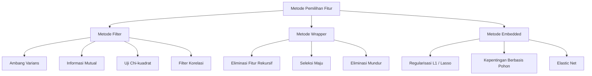
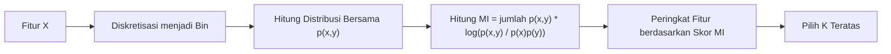
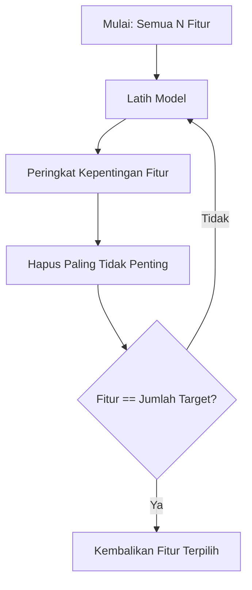
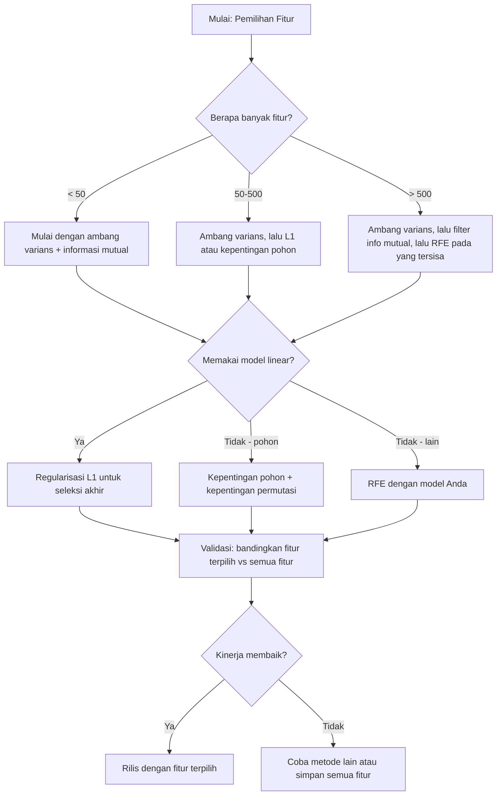

# Pemilihan Fitur

> Lebih banyak fitur tidak lebih baik. Fitur yang tepat yang lebih baik.

**Jenis:** Bangun
**Bahasa:** Python
**Prasyarat:** Fase 2, Pelajaran 01-09, 08 (rekayasa fitur)
**Waktu:** ~75 menit

## Tujuan Pembelajaran

- Implementasikan metode filter (ambang varians, informasi mutual), metode wrapper (RFE), dan metode embedded (L1, kepentingan pohon) dari awal, lalu tambahkan seleksi maju dalam latihan
- Jelaskan mengapa informasi mutual menangkap hubungan nonlinear antara fitur dan target yang terlewat oleh korelasi
- Bandingkan regularisasi L1 (seleksi embedded) dengan RFE (seleksi wrapper) dan evaluasi trade-off komputasionalnya
- Bangun pipeline pemilihan fitur yang menggabungkan beberapa metode dan tunjukkan generalisasi yang membaik pada data yang disisihkan

## Masalahnya

Anda memiliki 500 fitur. Model Anda lambat dilatih, terus-menerus overfit, dan tidak ada yang bisa menjelaskan apa yang dipelajarinya. Anda menambahkan lebih banyak fitur dengan harapan kinerja membaik. Kinerja memburuk.

Ini adalah kutukan dimensi yang sedang beraksi. Sejumlah fitur bertambah, volume ruang fitur meledak. Titik-titik data menjadi jarang. Jarak antar titik konvergen. Model membutuhkan data secara eksponensial lebih banyak untuk menemukan pola nyata. Fitur bising menenggelamkan fitur sinyal. Overfitting menjadi keadaan baku.

Pemilihan fitur adalah penawarnya. Buang kebisingan. Hilangkan redundansi. Simpan fitur-fitur yang benar-benar membawa informasi tentang target. Hasilnya: pelatihan lebih cepat, generalisasi lebih baik, dan model yang benar-benar bisa Anda jelaskan.

Tujuannya bukan memakai semua informasi yang tersedia. Melainkan memakai informasi yang tepat.

## Konsep

### Tiga Kategori Pemilihan Fitur

Setiap metode pemilihan fitur masuk ke dalam salah satu dari tiga kategori:



**Metode filter** menilai setiap fitur secara independen memakai ukuran statistik. Metode ini tidak memakai model. Cepat, tetapi tidak menangkap interaksi antarfitur.

**Metode wrapper** melatih sebuah model untuk mengevaluasi himpunan bagian fitur. Metode ini memakai kinerja model sebagai skor. Hasil lebih baik, tetapi mahal karena model dilatih ulang berkali-kali.

**Metode embedded** memilih fitur sebagai bagian dari pelatihan model. Regularisasi L1 mendorong bobot menjadi nol. Pohon keputusan melakukan split pada fitur yang paling berguna. Seleksi terjadi saat fitting, bukan sebagai langkah terpisah.

### Ambang Varians

Filter paling sederhana. Jika sebuah fitur hampir tidak berubah antarsampel, ia hampir tidak membawa informasi.

Perhatikan sebuah fitur yang bernilai 0,0 untuk 999 dari 1000 sampel. Variansnya mendekati nol. Tidak ada model yang bisa memakainya untuk membedakan kelas. Buang saja.

```math
\text{variance}(x) = \text{mean}\bigl((x - \text{mean}(x))^2\bigr)
```

Tetapkan sebuah ambang (mis. 0,01). Buang setiap fitur dengan varians di bawah ambang itu. Ini menghilangkan fitur konstan atau nyaris konstan tanpa sama sekali melihat variabel target.

Kapan dipakai: sebagai langkah praproses sebelum metode lain. Ia menangkap fitur yang jelas tidak berguna dengan biaya hampir nol.

Keterbatasan: sebuah fitur bisa memiliki varians tinggi dan tetap berupa kebisingan murni. Ambang varians bersifat perlu tetapi tidak cukup.

### Informasi Mutual

Informasi mutual mengukur seberapa besar mengetahui nilai fitur $X$ mengurangi ketidakpastian tentang target $Y$.

```math
I(X; Y) = \sum_x \sum_y p(x, y) \cdot \log \frac{p(x, y)}{p(x) \cdot p(y)}
```

Jika $X$ dan $Y$ independen, $p(x, y) = p(x) \cdot p(y)$, sehingga suku log bernilai nol dan $I(X; Y) = 0$. Semakin banyak $X$ memberi tahu Anda tentang $Y$, semakin tinggi informasi mutualnya.

Keunggulan utama dibanding korelasi: informasi mutual menangkap hubungan nonlinear. Sebuah fitur bisa memiliki korelasi nol dengan target tetapi informasi mutual tinggi karena hubungannya kuadratik atau periodik.

Untuk fitur kontinu, lakukan diskretisasi menjadi bin terlebih dahulu (estimasi berbasis histogram). Jumlah bin memengaruhi estimasi — terlalu sedikit bin kehilangan informasi, terlalu banyak bin menambah kebisingan. Pilihan umum: $\sqrt{n}$ bin atau aturan Sturges ($1 + \log_2 n$).



### Eliminasi Fitur Rekursif (RFE)

RFE adalah metode wrapper. Ia memakai kepentingan fitur milik model sendiri untuk memangkas secara iteratif:

1. Latih model dengan semua fitur
2. Beri peringkat fitur berdasarkan kepentingan (koefisien untuk model linear, penurunan impurity untuk pohon)
3. Hapus fitur yang paling tidak penting
4. Ulangi sampai jumlah fitur yang diinginkan tersisa



RFE mempertimbangkan interaksi antarfitur karena model melihat semua fitur yang tersisa secara bersamaan. Menghapus satu fitur mengubah kepentingan fitur lain. Hal ini membuatnya lebih menyeluruh daripada metode filter.

Biayanya: Anda melatih model sebanyak $N - \text{target}$ kali. Dengan 500 fitur dan target 10, itu berarti 490 kali pelatihan. Untuk model yang mahal, ini lambat. Anda dapat mempercepatnya dengan menghapus beberapa fitur per langkah (mis. buang 10% terbawah setiap putaran).

### Regularisasi L1 (Lasso)

Regularisasi L1 menambahkan nilai absolut bobot ke fungsi loss:

```math
\text{loss} = \text{prediction\_error} + \alpha \cdot \sum \lvert w_i \rvert
```

Parameter alpha mengontrol seberapa agresif fitur dipangkas. Alpha lebih besar berarti lebih banyak bobot yang menjadi tepat nol.

Mengapa tepat nol? Penalti L1 membentuk wilayah kendala berbentuk belah ketupat dalam ruang bobot. Solusi optimal cenderung jatuh di sudut belah ketupat itu, di mana satu atau lebih bobot bernilai nol. Regularisasi L2 (ridge) membentuk kendala berbentuk lingkaran di mana bobot menyusut tetapi jarang mencapai nol.

Ini adalah pemilihan fitur embedded: model mempelajari selama pelatihan fitur mana yang harus diabaikan. Fitur dengan bobot nol secara efektif dihapus.

Kelebihan: satu kali pelatihan, menangani fitur berkorelasi (memilih satu dan mennolkan sisanya), sudah bawaan pada kebanyakan implementasi model linear.

Keterbatasan: hanya berfungsi untuk model linear. Tidak dapat menangkap kepentingan fitur nonlinear.

### Kepentingan Fitur Berbasis Pohon

Pohon keputusan dan ensemblenya (random forest, gradient boosting) secara alami memberi peringkat fitur. Setiap split mengurangi impurity (Gini atau entropi untuk klasifikasi, varians untuk regresi). Fitur yang menghasilkan penurunan impurity lebih besar lebih penting.

Untuk random forest dengan $T$ pohon:

```math
\text{importance}(\text{feature}_j) = \frac{1}{T} \sum_{\text{all trees}} \; \sum_{\text{all nodes splitting on } \text{feature}_j} (\text{n\_samples} \cdot \text{impurity\_decrease})
```

Ini memberi skor kepentingan ternormalisasi untuk setiap fitur. Ia menangani hubungan nonlinear dan interaksi antarfitur secara otomatis.

Perhatian: kepentingan berbasis pohon bias terhadap fitur dengan banyak nilai unik (kardinalitas tinggi). Kolom ID acak akan terlihat penting karena ia memisahkan setiap sampel dengan sempurna. Gunakan kepentingan permutasi sebagai pemeriksaan akal sehat.

### Kepentingan Permutasi

Sebuah metode agnostik model:

1. Latih model dan catat kinerja dasar pada data validasi
2. Untuk setiap fitur: acak nilaiannya secara acak, ukur penurunan kinerja
3. Semakin besar penurunan, semakin penting fitur itu

Jika mengacak sebuah fitur tidak merugikan kinerja, model tidak bergantung padanya. Jika kinerja anjlok, fitur itu sangat kritikal.

Kepentingan permutasi menghindari bias kardinalitas dari kepentingan berbasis pohon. Tetapi ia lambat: satu evaluasi penuh per fitur, diulang beberapa kali demi stabilitas.

### Tabel Perbandingan

| Metode | Jenis | Kecepatan | Nonlinear | Interaksi Fitur |
|--------|-------|-----------|-----------|-----------------|
| Ambang varians | Filter | Sangat cepat | Tidak | Tidak |
| Informasi mutual | Filter | Cepat | Ya | Tidak |
| Filter korelasi | Filter | Cepat | Tidak | Tidak |
| RFE | Wrapper | Lambat | Bergantung pada model | Ya |
| L1 / Lasso | Embedded | Cepat | Tidak (linear) | Tidak |
| Kepentingan pohon | Embedded | Sedang | Ya | Ya |
| Kepentingan permutasi | Agnostik model | Lambat | Ya | Ya |

### Diagram Keputusan



```figure
f3-feature-prune
```

## Bangun

### Langkah 1: Bangkitkan data sintetis dengan struktur fitur yang diketahui

```python
import numpy as np


def make_feature_selection_data(n_samples=500, seed=42):
    rng = np.random.RandomState(seed)

    x1 = rng.randn(n_samples)
    x2 = rng.randn(n_samples)
    x3 = rng.randn(n_samples)
    x4 = x1 + 0.1 * rng.randn(n_samples)
    x5 = x2 + 0.1 * rng.randn(n_samples)

    informative = np.column_stack([x1, x2, x3, x4, x5])

    correlated = np.column_stack([
        x1 * 0.9 + 0.1 * rng.randn(n_samples),
        x2 * 0.8 + 0.2 * rng.randn(n_samples),
        x3 * 0.7 + 0.3 * rng.randn(n_samples),
        x1 * 0.5 + x2 * 0.5 + 0.1 * rng.randn(n_samples),
        x2 * 0.6 + x3 * 0.4 + 0.1 * rng.randn(n_samples),
    ])

    noise = rng.randn(n_samples, 10) * 0.5

    X = np.hstack([informative, correlated, noise])
    y = (2 * x1 - 1.5 * x2 + x3 + 0.5 * rng.randn(n_samples) > 0).astype(int)

    feature_names = (
        [f"info_{i}" for i in range(5)]
        + [f"corr_{i}" for i in range(5)]
        + [f"noise_{i}" for i in range(10)]
    )

    return X, y, feature_names
```

Kita tahu kebenaran dasarnya: fitur 0-4 bersifat informatif (dan 3 serta 4 adalah salinan berkorelasi dari 0 dan 1), fitur 5-9 berkorelasi dengan fitur informatif, fitur 10-19 murni kebisingan. Metode seleksi yang baik harus memberi peringkat 0-4 paling tinggi dan 10-19 paling rendah.

### Langkah 2: Ambang varians

```python
def variance_threshold(X, threshold=0.01):
    variances = np.var(X, axis=0)
    mask = variances > threshold
    return mask, variances
```

### Langkah 3: Informasi mutual (diskrit)

```python
def discretize(x, n_bins=10):
    min_val, max_val = x.min(), x.max()
    if max_val == min_val:
        return np.zeros_like(x, dtype=int)
    bin_edges = np.linspace(min_val, max_val, n_bins + 1)
    binned = np.digitize(x, bin_edges[1:-1])
    return binned


def mutual_information(X, y, n_bins=10):
    n_samples, n_features = X.shape
    mi_scores = np.zeros(n_features)

    y_vals, y_counts = np.unique(y, return_counts=True)
    p_y = y_counts / n_samples

    for f in range(n_features):
        x_binned = discretize(X[:, f], n_bins)
        x_vals, x_counts = np.unique(x_binned, return_counts=True)
        p_x = dict(zip(x_vals, x_counts / n_samples))

        mi = 0.0
        for xv in x_vals:
            for yi, yv in enumerate(y_vals):
                joint_mask = (x_binned == xv) & (y == yv)
                p_xy = np.sum(joint_mask) / n_samples
                if p_xy > 0:
                    mi += p_xy * np.log(p_xy / (p_x[xv] * p_y[yi]))
        mi_scores[f] = mi

    return mi_scores
```

### Langkah 4: Eliminasi Fitur Rekursif

```python
def simple_logistic_importance(X, y, lr=0.1, epochs=100):
    n_samples, n_features = X.shape
    w = np.zeros(n_features)
    b = 0.0

    for _ in range(epochs):
        z = X @ w + b
        pred = 1.0 / (1.0 + np.exp(-np.clip(z, -500, 500)))
        error = pred - y
        w -= lr * (X.T @ error) / n_samples
        b -= lr * np.mean(error)

    return w, b


def rfe(X, y, n_features_to_select=5, lr=0.1, epochs=100):
    n_total = X.shape[1]
    remaining = list(range(n_total))
    rankings = np.ones(n_total, dtype=int)
    rank = n_total

    while len(remaining) > n_features_to_select:
        X_subset = X[:, remaining]
        w, _ = simple_logistic_importance(X_subset, y, lr, epochs)
        importances = np.abs(w)

        least_idx = np.argmin(importances)
        original_idx = remaining[least_idx]
        rankings[original_idx] = rank
        rank -= 1
        remaining.pop(least_idx)

    for idx in remaining:
        rankings[idx] = 1

    selected_mask = rankings == 1
    return selected_mask, rankings
```

### Langkah 5: Pemilihan fitur L1

```python
def soft_threshold(w, alpha):
    return np.sign(w) * np.maximum(np.abs(w) - alpha, 0)


def l1_feature_selection(X, y, alpha=0.1, lr=0.01, epochs=500):
    n_samples, n_features = X.shape
    w = np.zeros(n_features)
    b = 0.0

    for _ in range(epochs):
        z = X @ w + b
        pred = 1.0 / (1.0 + np.exp(-np.clip(z, -500, 500)))
        error = pred - y

        gradient_w = (X.T @ error) / n_samples
        gradient_b = np.mean(error)

        w -= lr * gradient_w
        w = soft_threshold(w, lr * alpha)
        b -= lr * gradient_b

    selected_mask = np.abs(w) > 1e-6
    return selected_mask, w
```

### Langkah 6: Kepentingan berbasis pohon (pohon keputusan sederhana)

```python
def gini_impurity(y):
    if len(y) == 0:
        return 0.0
    classes, counts = np.unique(y, return_counts=True)
    probs = counts / len(y)
    return 1.0 - np.sum(probs ** 2)


def best_split(X, y, feature_idx):
    values = np.unique(X[:, feature_idx])
    if len(values) <= 1:
        return None, -1.0

    best_threshold = None
    best_gain = -1.0
    parent_gini = gini_impurity(y)
    n = len(y)

    for i in range(len(values) - 1):
        threshold = (values[i] + values[i + 1]) / 2.0
        left_mask = X[:, feature_idx] <= threshold
        right_mask = ~left_mask

        n_left = np.sum(left_mask)
        n_right = np.sum(right_mask)

        if n_left == 0 or n_right == 0:
            continue

        gain = parent_gini - (n_left / n) * gini_impurity(y[left_mask]) - (n_right / n) * gini_impurity(y[right_mask])

        if gain > best_gain:
            best_gain = gain
            best_threshold = threshold

    return best_threshold, best_gain


def tree_importance(X, y, n_trees=50, max_depth=5, seed=42):
    rng = np.random.RandomState(seed)
    n_samples, n_features = X.shape
    importances = np.zeros(n_features)

    for _ in range(n_trees):
        sample_idx = rng.choice(n_samples, size=n_samples, replace=True)
        feature_subset = rng.choice(n_features, size=max(1, int(np.sqrt(n_features))), replace=False)

        X_boot = X[sample_idx]
        y_boot = y[sample_idx]

        tree_imp = _build_tree_importance(X_boot, y_boot, feature_subset, max_depth)
        importances += tree_imp

    total = importances.sum()
    if total > 0:
        importances /= total

    return importances


def _build_tree_importance(X, y, feature_subset, max_depth, depth=0):
    n_features = X.shape[1]
    importances = np.zeros(n_features)

    if depth >= max_depth or len(np.unique(y)) <= 1 or len(y) < 4:
        return importances

    best_feature = None
    best_threshold = None
    best_gain = -1.0

    for f in feature_subset:
        threshold, gain = best_split(X, y, f)
        if gain > best_gain:
            best_gain = gain
            best_feature = f
            best_threshold = threshold

    if best_feature is None or best_gain <= 0:
        return importances

    importances[best_feature] += best_gain * len(y)

    left_mask = X[:, best_feature] <= best_threshold
    right_mask = ~left_mask

    importances += _build_tree_importance(X[left_mask], y[left_mask], feature_subset, max_depth, depth + 1)
    importances += _build_tree_importance(X[right_mask], y[right_mask], feature_subset, max_depth, depth + 1)

    return importances
```

### Langkah 7: Jalankan semua metode dan bandingkan

Berkas kode menjalankan kelima metode pada dataset sintetis yang sama dan mencetak tabel perbandingan yang menunjukkan fitur mana yang dipilih oleh masing-masing metode.

## Gunakan

Dengan scikit-learn, pemilihan fitur sudah terintegrasi ke dalam pipeline:

```python
from sklearn.feature_selection import (
    VarianceThreshold,
    mutual_info_classif,
    RFE,
    SelectFromModel,
)
from sklearn.linear_model import Lasso, LogisticRegression
from sklearn.ensemble import RandomForestClassifier

vt = VarianceThreshold(threshold=0.01)
X_filtered = vt.fit_transform(X)

mi_scores = mutual_info_classif(X, y)
top_k = np.argsort(mi_scores)[-10:]

rfe_selector = RFE(LogisticRegression(), n_features_to_select=10)
rfe_selector.fit(X, y)
X_rfe = rfe_selector.transform(X)

lasso_selector = SelectFromModel(Lasso(alpha=0.01))
lasso_selector.fit(X, y)
X_lasso = lasso_selector.transform(X)

rf = RandomForestClassifier(n_estimators=100)
rf.fit(X, y)
importances = rf.feature_importances_
```

Implementasi dari awal menunjukkan persis apa yang terjadi di dalam setiap metode. Ambang varians hanya menghitung `var(X, axis=0)` dan menerapkan mask. Informasi mutual menghitung frekuensi bersama dan marginal dalam tabel kontingensi. RFE adalah loop yang melatih, memberi peringkat, dan memangkas. L1 adalah gradient descent dengan langkah soft-thresholding. Kepentingan pohon mengakumulasi penurunan impurity lintas split. Tidak ada keajaiban — hanya statistik dan loop.

Versi sklearn menambahkan ketangguhan (mis. `mutual_info_classif` memakai estimasi kepadatan k-NN alih-alih binning), kecepatan (implementasi C), dan integrasi pipeline.

## Kirim

Pelajaran ini menghasilkan:
- `outputs/skill-feature-selector.md` — pohon keputusan referensi cepat untuk memilih metode pemilihan fitur yang tepat

## Latihan

1. **Seleksi maju**: implementasikan kebalikan dari RFE. Mulai dengan nol fitur. Pada setiap langkah, tambahkan fitur yang paling meningkatkan kinerja model. Berhenti ketika penambahan fitur tidak lagi membantu. Bandingkan fitur terpilih dengan hasil RFE. Mana yang lebih cepat? Mana yang memberi hasil lebih baik?

2. **Stability selection**: jalankan pemilihan fitur L1 sebanyak 50 kali, masing-masing pada subsampel acak 80% dari data, dengan nilai alpha yang sedikit berbeda. Hitung seberapa sering setiap fitur dipilih. Fitur yang dipilih pada > 80% jalankan disebut "stabil". Bandingkan fitur stabil dengan seleksi L1 sekali jalan. Mana yang lebih andal?

3. **Deteksi multikolinearitas**: hitung matriks korelasi untuk semua fitur. Implementasikan fungsi yang, dengan ambang korelasi (mis. 0,9), menghapus satu fitur dari setiap pasangan yang sangat berkorelasi (menyimpan yang memiliki informasi mutual lebih tinggi dengan target). Uji pada dataset sintetis dan verifikasi bahwa fungsi itu menghapus fitur berkorelasi yang redundan.

4. **Pipeline pemilihan fitur**: rangkaikan ambang varians, filter informasi mutual, dan RFE menjadi satu pipeline. Pertama hapus fitur dengan varians nyaris nol, lalu simpan 50% teratas berdasarkan informasi mutual, lalu jalankan RFE pada fitur yang tersisa. Bandingkan pipeline ini dengan menjalankan RFE saja pada semua fitur. Apakah pipeline lebih cepat? Apakah akurasinya sama?

5. **Kepentingan permutasi dari awal**: implementasikan kepentingan permutasi. Untuk setiap fitur, acak nilaiannya 10 kali, ukur penurunan rata-rata skor F1. Bandingkan peringkatnya dengan kepentingan berbasis pohon. Temukan kasus di mana keduanya tidak sepakat dan jelaskan mengapa (petunjuk: fitur berkorelasi).

## Istilah Kunci

| Istilah | Apa yang orang katakan | Arti sebenarnya |
|---------|------------------------|-----------------|
| Metode filter | "Menilai fitur secara independen" | Pendekatan pemilihan fitur yang memberi peringkat fitur memakai ukuran statistik tanpa melatih model, mengevaluasi setiap fitur secara terpisah |
| Metode wrapper | "Memakai model untuk memilih fitur" | Pendekatan pemilihan fitur yang mengevaluasi himpunan bagian fitur dengan melatih model dan memakai kinerjanya sebagai kriteria seleksi |
| Metode embedded | "Model memilih fitur saat pelatihan" | Pemilihan fitur yang terjadi sebagai bagian dari fitting model, seperti regularisasi L1 yang mendorong bobot menjadi nol |
| Informasi mutual | "Seberapa banyak satu variabel memberi tahu Anda tentang variabel lain" | Ukuran pengurangan ketidakpastian tentang $Y$ dengan pengetahuan tentang $X$, yang menangkap ketergantungan linear maupun nonlinear |
| Eliminasi Fitur Rekursif | "Latih, beri peringkat, pangkas, ulangi" | Metode wrapper iteratif yang melatih model, menghapus fitur paling tidak penting, dan mengulang sampai jumlah target tercapai |
| Regularisasi L1 / Lasso | "Penalti yang mematikan fitur" | Menambahkan jumlah nilai absolut bobot ke fungsi loss, yang mendorong bobot fitur tidak penting menjadi tepat nol |
| Ambang varians | "Hapus fitur konstan" | Membuang fitur yang varians antarsampelnya di bawah ambang tertentu, menyaring fitur yang tidak membawa informasi |
| Kepentingan fitur | "Fitur mana yang paling penting" | Skor yang menunjukkan seberapa besar kontribusi setiap fitur terhadap prediksi model, dihitung dari keuntungan split (pohon) atau besar koefisien (linear) |
| Kepentingan permutasi | "Acak dan ukur kerusakannya" | Evaluasi kepentingan fitur dengan mengacak nilai setiap fitur secara acak dan mengukur penurunan kinerja model yang dihasilkan |
| Kutukan dimensi | "Terlalu banyak fitur, data tidak cukup" | Fenomena di mana penambahan fitur meningkatkan volume ruang fitur secara eksponensial, membuat data menjadi jarang dan jarak tidak bermakna |

## Bacaan Lebih Lanjut

- [An Introduction to Variable and Feature Selection (Guyon & Elisseeff, 2003)](https://jmlr.org/papers/v3/guyon03a.html) — tinjauan fundamental tentang metode pemilihan fitur, masih banyak dijadikan rujukan
- [scikit-learn Feature Selection Guide](https://scikit-learn.org/stable/modules/feature_selection.html) — referensi praktis untuk metode filter, wrapper, dan embedded beserta contoh kode
- [Stability Selection (Meinshausen & Buhlmann, 2010)](https://arxiv.org/abs/0809.2932) — menggabungkan subsampling dengan pemilihan fitur untuk hasil yang tangguh dan dapat diulang
- [Beware Default Random Forest Importances (Strobl et al., 2007)](https://bmcbioinformatics.biomedcentral.com/articles/10.1186/1471-2105-8-25) — menunjukkan bias kardinalitas pada kepentingan berbasis pohon dan mengusulkan kepentingan kondisional sebagai alternatif
