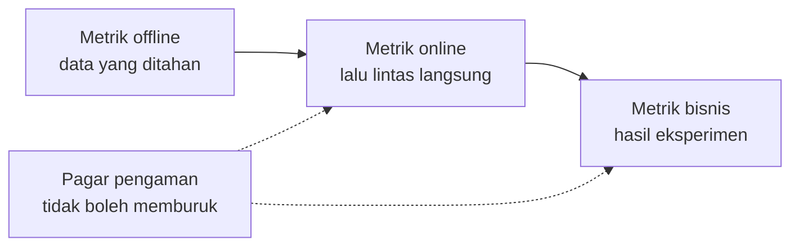

# Desain Sistem ML — Dari Masalah hingga Model Terpasang

> Sebuah model hanyalah satu bagian dari sistem. Desainnya menentukan apa yang diprediksi model, siapa yang bertindak berdasarkan prediksi itu, berapa biayanya, dan apa yang terjadi saat model gagal.

**Jenis:** Build
**Bahasa:** Python, TypeScript
**Prasyarat:** Fase 2, Pelajaran 09 (Evaluasi Model) dan 13 (Pipeline ML)
**Waktu:** ~110 menit

## Tujuan Pembelajaran

- Rumuskan masalah bisnis sebagai tugas ML dengan sebuah prediksi, sebuah keputusan yang menggunakan prediksi itu, dan alasan mengapa aturan saja tidak cukup
- Pisahkan metrik offline, online, bisnis, dan pagar pengaman, serta bandingkan setiap model dengan baseline trivial dan heuristik
- Estimasi biaya harian, latensi, dan keusangan inferensi batch maupun online dari angka lalu lintas
- Pilih pola peluncuran (shadow, canary, uji A/B) dan nilai default yang aman untuk setiap mode kegagalan
- Identifikasi loop umpan balik di mana model mengubah data yang melatih versi berikutnya
- Tulis dokumen desain ML dan nilai dokumen itu dengan daftar periksa tetap

## Masalahnya

Sebuah perusahaan langganan meminta "model churn". Seorang ilmuwan data melatih klasifikator gradient-boosted dan melaporkan AUC sebesar 0,91. Tiga bulan kemudian, tidak ada yang menggunakannya.

Alasan-alasannya tidak ada hubungannya dengan algoritme. Tidak ada yang memutuskan tindakan apa yang dimulai dari sebuah skor. Skor tiba sekali seminggu, sementara tim retensi menelepon pelanggan setiap hari. Label berasal dari tabel pembatalan yang juga menyimpan alasan pembatalan, sehingga satu fitur memuat jawabannya. Tidak ada yang membandingkan model dengan aturan yang sudah dipakai tim dukungan: telepon siapa pun yang tidak aktif selama dua minggu.

Setiap kegagalan ini terjadi sebelum pelatihan dimulai. Itu adalah kegagalan desain, dan dokumen desain satu halaman menanyakan masing-masing. Pelajaran ini mengajarkan keputusan-keputusan dalam dokumen itu. Anda membangun seperangkat alat yang menghargai penyajian batch dan online, membandingkan model dengan baseline-nya, dan menilai dokumen desain dengan daftar periksa.

## Konsepnya

### Dari tujuan bisnis ke tugas ML

Tujuan bisnis bukanlah tugas ML. Anda mengubahnya menjadi tugas ML dengan empat pertanyaan:

1. Apa persisnya yang diprediksi model, dan untuk entitas mana (pengguna, pembayaran, toko, item)?
2. Keputusan apa yang menggunakan prediksi itu, dan siapa atau apa yang mengambil keputusan tersebut?
3. Kapan prediksi dibutuhkan, dan data apa yang tersedia pada saat itu?
4. Bagaimana Anda tahu bahwa keputusan menjadi lebih baik?

| Tujuan bisnis | Prediksi | Keputusan yang menggunakannya | Tugas ML |
|---|---|---|---|
| Kurangi churn | Probabilitas bahwa pengguna membatalkan dalam 30 hari ke depan | Kirim penawaran penyelamatan ke 5 persen teratas setiap malam | Klasifikasi biner |
| Tekan kerugian penipuan | Probabilitas bahwa sebuah pembayaran adalah penipuan | Setujui, tinjau, atau blokir dalam 100 ms | Klasifikasi biner |
| Jaga stok rak tetap penuh | Unit terjual per toko per hari minggu depan | Jumlah pesanan untuk setiap toko | Peramalan |
| Tampilkan item yang relevan | Skor relevansi untuk pasangan (pengguna, item) | Urutan item dalam feed | Ranking |

Kolom kedua memerlukan perhatian paling besar. "Prediksi churn" membiarkan horizon, entitas, dan tindakan terbuka. "Prediksi apakah pengguna ini membatalkan dalam 30 hari ke depan, sehingga pekerjaan malam ini dapat memilih siapa yang mendapat penawaran" menetapkan ketiganya.

### Kapan tidak menggunakan ML

Aturan #1 dalam Rules of Machine Learning milik Google mengatakan jangan takut meluncurkan produk tanpa pembelajaran mesin. Pembelajaran mesin membutuhkan data, dan heuristik sederhana sering membawa Anda sebagian jalan. Jangan gunakan ML dalam kasus-kasus ini:

- Sebuah aturan pendek mencapai tujuan dan tetap benar. Aturan lebih murah untuk dijalankan, diuji, dan dijelaskan.
- Anda tidak memiliki label dan tidak ada cara praktis untuk mengumpulkannya.
- Tidak ada yang bertindak berdasarkan prediksi, sehingga prediksi yang lebih baik tidak mengubah apa pun.
- Data yang tersedia pada saat prediksi tidak memuat sinyalnya.
- Satu kesalahan tidak dapat diterima dan tidak ada orang yang dapat memeriksa keluaran.
- Membangun dan menjalankan sistem lebih mahal daripada nilai keputusan yang lebih baik itu.

Ketika sebuah aturan menjadi panjang dan rapuh, ML mulai menguntungkan. Aturan #3 dalam panduan yang sama lebih mengutamakan ML daripada heuristik yang kompleks, karena model yang dipelajari lebih mudah diperbarui dan dipelihara.

### Tiga lapisan metrik

Anda mengukur sistem ML pada tiga lapisan, ditambah sekumpulan batasan:

| Lapisan | Kapan Anda dapat mengukurnya | Contoh churn |
|---|---|---|
| Metrik offline | Sebelum peluncuran, pada data masa lalu yang ditahan | F1 pada ambang penawaran, presisi dalam 5 persen teratas |
| Metrik online | Selama peluncuran, pada lalu lintas langsung | Tingkat penerimaan penawaran, bagian pengguna yang diberi skor, distribusi skor |
| Metrik bisnis | Beberapa minggu setelah peluncuran, dengan eksperimen | Tingkat churn 30 hari pada kelompok perlakuan versus kelompok holdout |
| Metrik pagar pengaman | Sepanjang waktu | Biaya penawaran per pengguna yang terselamatkan, tingkat berhenti berlangganan, latensi p99 |



Lapisan-lapisan ini sering tidak sepakat. Metrik offline menilai data masa lalu, dan masa lalu tidak memuat model Anda. Metrik online bergantung pada bagaimana orang merespons keputusan itu. Metrik bisnis bergerak lambat dan membawa derau dari segala hal lain di perusahaan.

Pilih metrik offline yang sesuai dengan keputusan. Jika pekerjaan menghubungi 5 persen pengguna teratas, ukur presisi dalam 5 persen teratas. AUC merata-ratakan semua ambang batas, termasuk ambang yang tidak pernah Anda pakai. Aturan #2 dalam panduan yang sama mengatakan untuk merancang dan mengimplementasikan metrik terlebih dahulu, sebelum memutuskan apa yang akan dilakukan sistem ML.

### Baseline

Sebuah nilai metrik tidak berarti apa-apa sendirian. F1 sebesar 0,56 bagus jika alternatif terbaik hanya mencapai 0,30 dan buruk jika sebuah aturan mencapai 0,60. Bandingkan setiap model dengan tiga jenis baseline:

- **Baseline trivial.** Selalu prediksi kelas mayoritas, atau selalu prediksi rata-rata data latihan. Kita memakai pemeriksaan ini dalam pelajaran evaluasi model.
- **Baseline heuristik.** Sebuah aturan dari pengetahuan domain, atau ambang satu fitur yang Anda cocokkan pada data latihan.
- **Sistem saat ini.** Apa pun yang mengambil keputusan hari ini, bahkan ketika itu adalah orang dengan spreadsheet.

Lift adalah skor model dikurangi skor baseline terkuat. Tetapkan lift minimum sebelum melihat hasil, dan buatlah cukup besar untuk membayar sistem tambahan itu. Baseline trivial biasanya lemah. Baseline heuristik adalah yang paling sulit dikalahkan.

### Persyaratan data dan label

Jawab pertanyaan-pertanyaan ini sebelum Anda melatih:

- **Sumber label.** Tabel atau peristiwa mana yang menentukan label, dan siapa pemiliknya?
- **Keterlambatan label.** Berapa lama setelah prediksi hasil yang sebenarnya tiba? Chargeback penipuan dapat tiba berminggu-minggu setelah pembayaran. Label churn tiba pada akhir horizon 30 hari.
- **Kualitas label.** Siapa yang menetapkan label, dan seberapa sering label itu salah?
- **Ketersediaan pada saat prediksi.** Apakah setiap fitur ada pada momen prediksi? Fitur yang ditulis sistem setelah hasil diketahui membocorkan label ke dalam pelatihan.
- **Volume per kelas.** Berapa banyak contoh positif yang ada? Dua ratus contoh positif membatasi Anda pada model sederhana.
- **Pemisahan waktu.** Tahan periode paling baru. Kita memisahkan data berdasarkan waktu dalam pelajaran deret waktu dengan alasan yang sama.

### Anggaran latensi, throughput, dan biaya

Tiga angka membatasi setiap desain penyajian:

- **Anggaran latensi.** Latensi p99 adalah batas waktu yang tidak dilampaui oleh 99 dari 100 permintaan. Pemeriksaan pembayaran mungkin membutuhkan 50 ms. Laporan malam hari bisa memakan waktu berjam-jam.
- **Throughput puncak.** Ukur sistem berdasarkan menit tersibuk, bukan rata-rata harian. QPS puncak sering beberapa kali lipat dari rata-rata.
- **Anggaran biaya.** Nyatakan dalam dolar per hari atau dolar per 1000 prediksi, agar Anda dapat membandingkan desain.

Hukum Little menghubungkan dua angka pertama. Jumlah permintaan yang sedang berjalan sama dengan throughput dikali latensi. Pada 400 permintaan per detik dengan latensi 50 ms masing-masing, ada 20 permintaan yang sedang berjalan pada satu momen.

### Inferensi batch versus inferensi online

Ada dua cara dasar untuk menyajikan prediksi:

- **Inferensi batch.** Sebuah pekerjaan terjadwal memberi skor setiap entitas dan menulis skor ke tabel atau penyimpanan nilai-kunci. Aplikasi membaca skor yang tersimpan pada saat permintaan.
- **Inferensi online.** Aplikasi mengirim fitur ke layanan model pada saat permintaan dan menunggu skor.

| Properti | Batch | Online |
|---|---|---|
| Kesegaran | Seusia operasi terakhir, ditambah waktu operasi | Memakai data dari permintaan |
| Latensi permintaan | Satu pembacaan nilai-kunci, beberapa ms | Pengambilan fitur ditambah waktu model |
| Pendorong biaya | Jumlah entitas dikali operasi per hari | Replika yang diukur untuk QPS puncak |
| Entitas baru | Tidak ada skor sampai operasi berikutnya | Diberi skor pada permintaan pertama |
| Saat rusak | Skor lama tetap dapat dibaca | Permintaan gagal atau waktu habis |

Perangkat dalam pelajaran ini menghargai keduanya. Biaya batch bertambah dengan jumlah entitas dan jumlah operasi per hari. Batas keusangan yang lebih pendek berarti lebih banyak operasi. Biaya online bertambah dengan lalu lintas puncak, karena Anda membayar replika yang menganggur di antara puncak. Pekerjaan batch yang memakan waktu satu jam tidak dapat memenuhi batas keusangan di bawah satu jam berapa pun harganya.

Desain hibrida adalah hal yang umum. Pekerjaan batch malam hari memberi skor pengguna yang sudah dikenal, sementara jalur online memberi skor pengguna baru dan permintaan yang membutuhkan data segar.

### Pola peluncuran

Sebuah model baru mencapai pengguna secara bertahap:

1. **Shadow.** Model baru menerima salinan lalu lintas langsung. Sistem mencatat prediksinya dan tidak pernah menggunakannya. Anda membandingkan latensi, tingkat galat, dan distribusi prediksi dengan model saat ini.
2. **Canary.** Model baru mengambil keputusan nyata untuk bagian kecil lalu lintas, biasanya 1 sampai 5 persen. Anda memperlebar bagian itu secara bertahap dan melakukan pemulihan ketika pagar pengaman dilanggar.
3. **Uji A/B.** Pembagian pengguna secara acak melihat masing-masing model. Anda mengukur metrik bisnis dengan uji statistik, dan Anda membutuhkan lalu lintas serta waktu yang cukup untuk melihat perbedaannya.

Setiap tahap memerlukan pemulihan yang memakan waktu beberapa menit. Biarkan versi model lama tetap terpasang dan alihkan lalu lintas dengan konfigurasi. Fase penyajian LLM membahas ketiga pola yang sama untuk model bahasa dalam [pelajaran shadow dan canary](../../../17-infrastructure-and-production/20-shadow-canary-progressive/docs/en.md) dan [pelajaran uji A/B](../../../17-infrastructure-and-production/21-ab-testing-llm-features/docs/en.md).

### Loop umpan balik

Sebuah loop umpan balik ada ketika keputusan model mengubah data yang melatih versi berikutnya. Sculley dkk. mencantumkan loop umpan balik langsung dan tersembunyi di antara sumber utama utang teknis dalam sistem ML. Tiga kasus umum:

- **Intervensi menyembunyikan label.** Model churn mengirim penawaran, dan penawaran itu mempertahankan sebagian pengguna. Bulan berikutnya, pengguna berisiko tinggi tampak loyal, dan model yang dilatih ulang mempelajari bahwa fitur mereka tidak memprediksi churn.
- **Tindakan yang diblokir tidak memiliki hasil.** Model penipuan memblokir sebuah pembayaran, sehingga pembayaran itu tidak pernah mendapat label chargeback. Model yang dilatih ulang melihat lebih sedikit contoh penipuan dari wilayah yang diblokir.
- **Eksposur membatasi umpan balik.** Model ranking menampilkan item teratasnya, sehingga hanya item itulah yang mengumpulkan klik.

Perbaikannya berbagi satu gagasan: simpan sebagian data yang tidak dipengaruhi model. Tahan sekelompok kecil secara acak yang tidak pernah mendapat intervensi. Berikan sebagian kecil lalu lintas keputusan acak. Catat skor dan keputusan bersama setiap contoh, sehingga pelatihan kemudian dapat membedakan data yang terpengaruh dari data yang bersih.

### Mode kegagalan dan nilai default yang aman

Setiap bagian sistem pasti gagal suatu hari nanti. Tentukan tindakan default untuk setiap kegagalan dalam desain, bukan saat insiden berlangsung:

| Kegagalan | Hasil tanpa rencana | Nilai default yang aman |
|---|---|---|
| Layanan model waktu habis | Permintaan gagal | Gunakan baseline heuristik |
| Pekerjaan batch malam gagal | Skor hilang atau menjadi usang | Sajikan skor terakhir yang baik selama waktu tertentu, lalu aturan |
| Fitur hilang atau di luar rentang | Model memberi skor pada masukan yang buruk | Gunakan nilai default yang terdokumentasi dan catat peristiwa itu |
| Entitas baru tanpa riwayat | Tidak ada skor | Gunakan aturan atau rata-rata populasi |
| Distribusi skor bergeser mendadak | Keputusan salah dalam skala besar | Jeda tindakan otomatis dan beri tahu orang |

Baseline heuristik dari bagian metrik Anda juga menjadi default untuk sebagian besar kegagalan, jadi bangunlah itu terlebih dahulu.

### Dokumen desain

Dokumen desain mencatat setiap keputusan di atas di satu tempat, sebelum pelatihan dimulai. Pemeriksa dalam pelajaran ini menilai versi JSON dari dokumen itu. Enam butiran memblokir tinjauan, karena masing-masing membuat sistem tidak aman atau tidak berguna:

| Bagian | Pertanyaan yang dijawab | Memblokir |
|---|---|---|
| Masalah | Apa yang diprediksi, keputusan apa yang menggunakannya, dan mengapa aturan tidak cukup? | Keputusan |
| Metrik | Metrik offline, online, bisnis, dan pagar pengaman mana yang berlaku? | Metrik bisnis |
| Baseline | Baseline trivial, heuristik, dan sistem saat ini mana yang berlaku? | Baseline heuristik atau sistem saat ini |
| Data | Dari mana label berasal, seberapa terlambat, dan apakah setiap fitur ada pada saat prediksi? | Tidak ada kebocoran |
| Anggaran dan penyajian | Batas latensi, QPS puncak, biaya, dan keusangan apa yang berlaku, dan mode penyajian mana yang cocok? | Tidak |
| Peluncuran | Tahap shadow, canary, dan A/B mana yang berlaku, dan bagaimana Anda melakukan pemulihan? | Shadow atau canary, plus pemulihan |
| Loop umpan balik | Bagaimana model dapat mengubah data masa depannya sendiri, dan apa yang menjaga data tetap bersih? | Tidak |
| Mode kegagalan | Apa tindakan default untuk setiap kegagalan? | Default untuk setiap kegagalan |
| Pemantauan | Apa yang Anda awasi setelah peluncuran? | Tidak |

```figure
mlprod-serving-cost
```

## Bangunlah

Kode dalam `code/main.py` hanya menggunakan pustaka standar. Ia memiliki tiga alat: model biaya penyajian, pembanding baseline, dan pemeriksa dokumen desain.

### Langkah 1: Jelaskan beban kerja dan harga

Sebuah beban kerja memuat angka lalu lintas dan anggaran. Model biaya memuat harga. Harga-harga itu adalah angka bulat untuk latihan, bukan penawaran vendor.

```python
@dataclass(frozen=True)
class Workload:
    name: str
    entities: int
    requests_per_day: int
    peak_qps: float
    max_staleness_hours: float
    latency_budget_ms: float


@dataclass(frozen=True)
class CostModel:
    batch_dollars_per_million: float = 0.40
    batch_job_hours: float = 1.0
    lookup_dollars_per_million: float = 0.25
    lookup_latency_ms: float = 4.0
    replica_dollars_per_hour: float = 0.50
    replica_qps: float = 200.0
    min_replicas: int = 2
    online_latency_ms: float = 35.0
```

### Langkah 2: Hitung biaya penyajian batch dan online

Pekerjaan batch harus selesai di dalam batas keusangan. Waktu antaroperasi adalah batas dikurangi waktu pekerjaan. Setiap operasi memberi skor setiap entitas, baik ada yang meminta skor itu maupun tidak.

```python
def batch_plan(workload: Workload, costs: CostModel) -> ServingPlan:
    refresh_hours = workload.max_staleness_hours - costs.batch_job_hours
    if refresh_hours <= 0:
        return ServingPlan(
            "batch", False, math.inf, costs.lookup_latency_ms, math.inf, 0.0,
            "staleness limit is shorter than one batch job",
        )
    runs_per_day = 24.0 / refresh_hours
    predictions = workload.entities * runs_per_day
    dollars = (
        predictions / 1e6 * costs.batch_dollars_per_million
        + workload.requests_per_day / 1e6 * costs.lookup_dollars_per_million
    )
    ...
```

Penyajian online membayar replika yang cukup untuk menangani puncak, dengan minimal dua untuk ketersediaan:

```python
def online_plan(workload: Workload, costs: CostModel) -> ServingPlan:
    replicas = max(costs.min_replicas, math.ceil(workload.peak_qps / costs.replica_qps))
    dollars = replicas * costs.replica_dollars_per_hour * 24.0
    feasible = costs.online_latency_ms <= workload.latency_budget_ms
    ...
```

`choose_serving` menyimpan rencana yang memenuhi batas latensi dan keusangan serta mengembalikan yang termurah. Ia mengembalikan `None` ketika tidak ada rencana yang cocok, yang memberi tahu Anda untuk mengubah anggaran.

### Langkah 3: Bandingkan model dengan baseline-nya

Pembanding memberi skor model dan setiap baseline dengan metrik yang sama. Ia mengukur lift terhadap baseline terkuat, bukan yang terlemah.

```python
def compare_to_baselines(
    y_true: list,
    model_pred: list,
    baselines: dict[str, list],
    metric,
    metric_name: str,
    higher_is_better: bool = True,
    min_lift: float = 0.02,
) -> BaselineReport:
    if not baselines:
        raise ValueError("a model needs at least one baseline")
    scores = {name: metric(y_true, pred) for name, pred in baselines.items()}
    pick = max if higher_is_better else min
    best_name = pick(scores, key=scores.get)
    model_score = metric(y_true, model_pred)
    lift = model_score - scores[best_name] if higher_is_better else scores[best_name] - model_score
    return BaselineReport(metric_name, {"model": model_score, **scores}, best_name, lift, min_lift)
```

Baseline heuristik adalah aturan satu fitur. `fit_rule` mencoba setiap nilai fitur sebagai ambang pada data latihan dan menyimpan ambang dengan F1 terbaik. Demo melatih regresi logistik kecil pada data churn sintetis dan membandingkannya dengan tiga baseline.

### Langkah 4: Nilai dokumen desain

Setiap butiran daftar periksa memiliki kunci, bobot, penanda pemblokir, pesan, dan fungsi pemeriksa. Butiran pemblokir memiliki bobot 2.

```python
CheckItem("decision", 2, True, "name the action that uses each prediction", lambda d: _text(d, "problem.decision")),
CheckItem("baselines", 2, True, "add a heuristic or current-system baseline", check_baselines),
CheckItem("no_leakage", 2, True, "confirm every feature exists at prediction time",
          lambda d: get_path(d, "data.features_available_at_prediction_time") is True),
CheckItem("serving_fit", 1, False, "pick a serving mode that meets the staleness, latency, and cost budgets",
          check_serving_fit),
```

`check_serving_fit` menggunakan kembali model biaya. Ia membaca angka beban kerja dari dokumen dan menghargai mode yang dipilih. Pemeriksaan gagal ketika mode itu melanggar batas keusangan, anggaran latensi, atau anggaran biaya harian. Dokumen yang mengatakan "batch" dengan batas keusangan tiga menit gagal dalam pemeriksaan ini. Model biaya tidak memiliki rencana hibrida, sehingga dokumen yang mengatakan "hybrid" gagal sampai Anda menambahkan rencana itu dalam Latihan 1.

`review_design_doc` menjumlahkan bobot butiran yang lulus dan membaginya dengan total. Vonya adalah `"ready for review"` hanya ketika skor mencapai 0,85 dan tidak ada butiran pemblokir yang gagal.

### Langkah 5: Jalankan

```bash
python3 code/main.py
npx tsx code/main.ts
```

```console
nightly churn scores
  ok batch        $0.91/day      4 ms  1.0 runs per day over 2,000,000 entities
  ok online      $24.00/day     35 ms  2 replicas sized for 40 peak QPS
  choose: batch

feed ranking, 2-hour freshness
  ok batch       $48.50/day      4 ms  24.0 runs per day over 5,000,000 entities
  ok online      $24.00/day     35 ms  2 replicas sized for 120 peak QPS
  choose: online

=== Model versus baselines (churn, metric F1) ===
  model                    0.564
  days_idle > 12.8688      0.500
  random at base rate      0.232
  majority class           0.000
  model beats the strongest baseline (days_idle > 12.8688) by +0.064
```

Baseline mayoritas mencetak 0 pada F1, karena ia tidak pernah memprediksi churn. Aturan yang dicocokkan adalah pesaing yang sebenarnya. Model mengalahkannya sebesar 0,064, sehingga model itu layak mendapat tempatnya. Dengan fitur yang lebih lemah, aturan dapat menang, dan saat itu aturanlah sistem yang tepat untuk dipasang.

Tinjauan dokumen desain mencetak dokumen lemah dengan enam butiran pemblokir dan dokumen lengkap dengan skor 1,00. Berikan sebuah path untuk meninjau dokumen Anda sendiri:

```bash
python3 code/main.py my_design_doc.json
npx tsx code/main.ts my_design_doc.json
```

## Gunakanlah

Setiap bagian perangkat ini memetakan ke alat yang dipakai tim di produksi.

**Baseline.** scikit-learn menyediakan baseline trivial sebagai estimator, sehingga keduanya dapat dipasang ke pipeline yang sama dengan model:

```python
from sklearn.dummy import DummyClassifier, DummyRegressor
from sklearn.metrics import f1_score

majority = DummyClassifier(strategy="most_frequent").fit(X_train, y_train)
base_rate = DummyClassifier(strategy="stratified", random_state=0).fit(X_train, y_train)
mean_value = DummyRegressor(strategy="mean").fit(X_train, y_reg_train)

print(f1_score(y_test, majority.predict(X_test)))
```

`most_frequent` sesuai dengan `majority_baseline`, dan `stratified` sesuai dengan `base_rate_baseline`. scikit-learn tidak memiliki baseline heuristik, karena heuristik berasal dari domain Anda.

**Penyajian batch.** Penjadwal alur kerja seperti Apache Airflow atau Dagster menjalankan pekerjaan pemberian skor. Pekerjaan itu menulis skor ke tabel gudang data atau ke penyimpanan nilai-kunci seperti Redis atau DynamoDB.

**Penyajian online.** Server model seperti KServe, BentoML, NVIDIA Triton, dan TorchServe membungkus model di balik endpoint HTTP atau gRPC. Layanan web biasa dengan model yang dimuat juga cukup untuk model kecil.

**Peluncuran.** Alat Kubernetes seperti Argo Rollouts membagi lalu lintas untuk rilis canary. Platform eksperimen seperti GrowthBook dan Statsig menetapkan pengguna ke kelompok A/B dan menghitung statistiknya.

**Tinjauan desain.** Breck dkk. menerbitkan ML Test Score, sebuah rubrik 28 pengujian dan kebutuhan pemantauan untuk sistem ML produksi. Pemeriksa kami lebih kecil. Ia mengajukan pertanyaan desain yang mendahului pengujian-pengujian itu.

## Kirimlah

Pelajaran ini menghasilkan `outputs/skill-ml-design-review.md`. Skill ini meninjau dokumen desain ML bagian demi bagian dan menyebutkan celah pemblokir terlebih dahulu. Ia juga memeriksa pilihan penyajian dengan aritmetika biaya batch dan online dari pelajaran ini.

## Latihan

1. Tambahkan rencana hibrida ke `choose_serving`. Beri skor pengguna yang sudah dikenal secara batch dan pengguna baru secara online. Bandingkan biaya hariannya.
2. Ubah data churn sampai model tidak lagi mengalahkan aturan. Laporkan perubahan koefisien terkecil yang menghilangkan lift.
3. Tambahkan butiran `budgets.max_dollars_per_1k_predictions` ke daftar periksa. Tulis pengujian yang gagal tanpa butiran itu.
4. Tulis dokumen desain JSON untuk pemeriksaan penipuan pembayaran. Jalankan pemeriksa dan perbaiki setiap butiran pemblokir.
5. Simulasikan loop umpan balik churn. Hapus label pengguna yang mendapat penawaran, latih ulang, dan ukur perubahan F1.

## Istilah Kunci

| Istilah | Apa yang orang katakan | Apa artinya |
|---|---|---|
| Tugas ML | "Buat model churn" | Target prediksi, sebuah entitas, sebuah horizon, dan keputusan yang memakai prediksi itu |
| Metrik offline | "Skor model" | Metrik yang dihitung pada data masa lalu yang ditahan sebelum peluncuran |
| Metrik online | "Angka langsung" | Metrik yang diukur pada lalu lintas nyata saat model berjalan |
| Metrik bisnis | "Tujuannya" | Hasil perusahaan yang harus diubah oleh keputusan, diukur dengan eksperimen |
| Metrik pagar pengaman | "Jangan merugikan" | Metrik yang tidak boleh memburuk ketika model baru diluncurkan |
| Baseline | "Model bodoh" | Prediktor trivial, heuristik, atau sistem saat ini yang harus dikalahkan model dengan margin tertentu |
| Inferensi batch | "Skor yang sudah dihitung sebelumnya" | Pekerjaan terjadwal memberi skor setiap entitas dan menyimpan hasilnya untuk diambil |
| Inferensi online | "Model waktu nyata" | Model memberi skor setiap permintaan saat permintaan tiba |
| Peluncuran shadow | "Peluncuran gelap" | Model baru memberi skor lalu lintas langsung, dan tidak ada yang memakai keluarannya |
| Rilis canary | "Peluncuran lambat" | Model baru mengambil keputusan untuk bagian kecil lalu lintas yang terus bertambah, dengan pemulihan siap |
| Loop umpan balik | "Model melatih dirinya sendiri" | Keputusan model mengubah data yang melatih versi berikutnya |

## Bacaan Lanjutan

- [Sculley et al., Hidden Technical Debt in Machine Learning Systems (NeurIPS 2015)](https://papers.nips.cc/paper/2015/hash/86df7dcfd896fcaf2674f757a2463eba-Abstract.html): loop umpan balik, keterikatan, dan biaya sistem di sekitar sebuah model
- [Google, Rules of Machine Learning](https://developers.google.com/machine-learning/guides/rules-of-ml): aturan praktis untuk model pertama, metrik, serta konsistensi latihan dan penyajian
- [Breck et al., The ML Test Score (IEEE Big Data 2017)](https://research.google/pubs/the-ml-test-score-a-rubric-for-ml-production-readiness-and-technical-debt-reduction/): 28 pengujian yang mengukur kesiapan produksi
- [Kohavi, Tang, and Xu, Trustworthy Online Controlled Experiments (Cambridge University Press, 2020)](https://experimentguide.com/): cara menjalankan uji A/B yang menghasilkan jawaban benar
- [Sato, Wider, and Windheuser, Continuous Delivery for Machine Learning (2019)](https://martinfowler.com/articles/cd4ml.html): data, model, dan pipeline penerapan berversi
- [Google Cloud, MLOps: Continuous delivery and automation pipelines in machine learning](https://cloud.google.com/architecture/mlops-continuous-delivery-and-automation-pipelines-in-machine-learning): tiga tingkat kematangan untuk otomasi latihan dan penyajian
