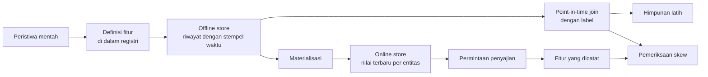

# Feature Store dan Skew Latih–Sajian

> Sebuah fitur punya satu definisi dan dua pembaca. Pelatihan membaca riwayatnya sejak setiap waktu label, sementara penyajian membaca nilai terbarunya. Ketika kedua pembaca tidak sepakat, model melihat masukan yang tidak pernah dilatihnya.

**Jenis:** Bangun
**Bahasa:** Python, TypeScript
**Prasyarat:** Fase 2, Pelajaran 08 (Rekayasa Fitur), 13 (Pipeline ML), 15 (Deret Waktu), dan 19 (Desain Sistem ML)
**Waktu:** ~100 menit

## Tujuan Pembelajaran

- Jelaskan peran offline store, online store, entitas, stempel waktu peristiwa, dan TTL
- Implementasikan join yang benar secara point-in-time dan tunjukkan bagaimana join naif menyalin nilai masa depan ke dalam data latih
- Sebutkan empat penyebab skew latih–sajian: dua jalur kode, fitur usang, nilai bawaan yang berbeda, dan time travel
- Bangun registri fitur di mana satu definisi memberi makan baik jalur pelatihan maupun jalur penyajian
- Isi ulang (backfill) fitur baru untuk tanggal-tanggal lampau tanpa membaca data dari setelah tanggal tersebut
- Deteksi skew dengan membandingkan fitur penyajian yang dicatat dengan jalur pelatihan untuk entitas dan waktu yang sama

## Masalahnya

Sebuah tim membangun model churn. Setiap label menyatakan apakah seorang pengguna tidak melakukan pembelian dalam 30 hari setelah hari label. Tim menggabungkan label dengan tabel fitur pengguna berdasarkan `user_id` dan melatih aturan pada `days_since_last_purchase`. Akurasi offline adalah 0,948.

Pada lalu lintas langsung, model itu lebih buruk daripada versi lama yang lebih sederhana. Tabel fitur menyimpan nilai terbaru untuk setiap pengguna, dari beberapa minggu setelah hari label. Seorang pengguna yang pembelian terakhirnya pada hari 115 menunjukkan 60 hari menganggur pada snapshot hari 175, sehingga fitur itu memuat jawabannya. Sementara itu, tim lain menulis ulang fitur penyajian di layanan yang berbeda. Jendela 30 hari mereka menyertakan satu hari ekstra, dan nilai bawaan untuk pengguna baru adalah -1, bukan 365.

Kedua cacat itu memiliki penyebab yang sama. Pelatihan dan penyajian menghitung "fitur yang sama" dengan dua cara yang berbeda. Pelajaran ini membangun komponen-komponen sebuah feature store dari awal. Anda menulis registri, backfill, join point-in-time, online store dengan TTL, dan pemeriksaan skew. Demo mereproduksi kedua cacat itu dengan angka-angka.

## Konsep

### Dua Pembaca dari Fitur yang Sama

Pelatihan dan penyajian meminta fitur dalam bentuk yang berbeda:

| Properti | Pelatihan (offline) | Penyajian (online) |
|----------|---------------------|--------------------|
| Pertanyaan | "Berapa nilainya untuk 10 juta pasangan (entitas, waktu)?" | "Berapa nilai entitas ini sekarang?" |
| Waktu | Banyak titik di masa lampau | Masa kini |
| Volume | Jutaan baris per job | Satu baris per permintaan |
| Latensi | Beberapa menit tidak masalah | Beberapa milidetik |
| Penyimpanan | Offline store: riwayat lengkap dengan stempel waktu, dalam berkas kolom atau data warehouse | Online store: nilai terbaru per entitas, dalam basis data key-value |

Sebuah feature store menjaga kedua penyimpanan tetap terisi dari satu himpunan definisi fitur. Materialisasi adalah job yang menyalin nilai terbaru dari offline store ke online store.



### Entitas, Stempel Waktu, dan TTL

Empat istilah menjelaskan setiap baris fitur:

- **Entitas.** Kunci yang dijelaskan oleh sebuah fitur, misalnya `user_id` atau `card_id`.
- **Stempel waktu peristiwa.** Waktu ketika nilai itu menjadi benar. Jumlah pembelian "per hari ke-14" memiliki stempel waktu peristiwa hari ke-14.
- **Stempel waktu pembuatan.** Waktu ketika sistem menulis baris itu. Sebuah backfill yang dijalankan hari ini menulis baris dengan stempel waktu peristiwa lama dan stempel waktu pembuatan yang baru.
- **TTL (time to live).** Usia maksimum sebuah nilai. Nilai yang lebih tua dari TTL dianggap hilang, sehingga pembaca memakai nilai bawaan.

Sekelompok fitur dengan entitas, sumber, dan TTL yang sama sering disebut feature view.

### Join yang Benar Secara Point-in-Time

Baris latih memasangkan label dengan nilai fitur yang ada pada waktu label. Join point-in-time melakukan ini untuk setiap label:

1. Temukan baris-baris fitur dari entitas yang sama
2. Simpan baris yang stempel waktu peristiwa itu tidak melebihi waktu label
3. Ambil baris paling terbaru di antaranya
4. Buang jika waktu label dikurangi stempel waktu peristiwa itu lebih dari TTL

Berikut satu pengguna, sebuah label pada hari ke-16, dan baris fitur mingguan:

| Hari baris fitur | `purchases_30d` | Point-in-time join | Join naif pada `user_id` |
|------------------|-----------------|--------------------|--------------------------|
| 7 | 4 | | |
| 14 | 3 | Dipilih | |
| 21 | 1 | Masa depan | |
| 28 | 0 | Masa depan | Dipilih |

Label menanyakan apakah pengguna membeli apa pun pada hari 17 sampai 46. Baris hari ke-28 sudah menghitung hari-hari sepi setelah hari label. Ia menunjukkan 0 pembelian karena pengguna berhenti membeli, dan itulah peristiwa yang diukur label. Join naif menyalin jawaban ke dalam masukan.

Kita membagi data berdasarkan waktu dalam pelajaran deret waktu demi alasan yang sama. Join point-in-time menerapkan aturan itu pada setiap baris, bukan pada satu titik pembagian saja.

### Penyebab Skew Latih–Sajian

Aturan Machine Learning dari Google mendefinisikan skew latih–sajian sebagai perbedaan antara kinerja saat pelatihan dan kinerja saat penyajian. Aturan itu menyebut tiga penyebab: penanganan data yang berbeda di dua pipeline, perubahan data antara pelatihan dan penyajian, serta loop umpan balik. Pada pipeline fitur, empat penyebab konkret muncul berulang kali:

| Penyebab | Apa yang terjadi | Contoh dari demo |
|----------|------------------|------------------|
| Dua jalur kode | Pelatihan dan penyajian menghitung fitur dengan kode yang berbeda | Jendela penyajian menyertakan hari `now - 30`, sementara jendela pelatihan tidak |
| Fitur usang | Nilai yang dibaca penyajian memiliki usia yang berbeda dari nilai yang dipakai pelatihan | Pelatihan membaca snapshot mingguan, sementara layanan baru menghitung nilai segar |
| Nilai bawaan berbeda | Kedua jalur mengisi nilai yang hilang dengan cara berbeda | Pelatihan memakai 365 untuk "belum pernah membeli", penyajian memakai -1 |
| Time travel | Pelatihan membaca nilai dari setelah waktu label | Join naif membaca snapshot terbaru untuk setiap label |

Aturan #32 dalam panduan yang sama menyarankan pemakaian ulang kode antara pipeline pelatihan dan pipeline penyajian kapan pun memungkinkan. Sebuah feature store mengikuti aturan itu dengan satu definisi yang dipanggil kedua jalur.

### Registri Fitur

Registri adalah katalog definisi fitur. Setiap entri memuat nama, entitas, sumber, transformasi, jendela, nilai bawaan, TTL, pemilik, versi, dan deskripsi.

Dua aturan menjaganya tetap aman:

- Kedua jalur membaca definisi dari registri. Tidak ada layanan yang menyimpan salinan pribadi transformasi.
- Perubahan pada definisi menciptakan versi baru. Versi lama tetap ada, sehingga model lama terus memakai fitur yang sama dengan saat mereka dilatih.

### Backfill

Sebuah fitur baru tidak punya riwayat, tetapi pelatihan membutuhkan nilainya pada setiap waktu label lama. Backfill menjalankan definisi pada setiap tanggal lampau dan menulis satu baris per entitas per tanggal. Setiap jalankan hanya membaca peristiwa yang stempel waktunya tidak melebihi tanggal itu.

Backfill membutuhkan komputasi yang bertambah seiring jumlah entitas dikalikan jumlah tanggal. Ia juga membawa kebocoran halus. Backfill yang dijalankan hari ini menulis baris dengan stempel waktu peristiwa lama, tetapi ia dapat membaca data yang datang terlambat atau dikoreksi kemudian. Join point-in-time yang ketat juga memeriksa bahwa stempel waktu pembuatan tidak melebihi waktu label.

### Mendeteksi Skew

Aturan #29 dalam panduan yang sama menyarankan pencatatan fitur pada waktu penyajian dan pemakaiannya dalam pelatihan. Bahkan sampel kecil yang dicatat sudah cukup untuk memeriksa konsistensi. Bandingkan setiap nilai yang dicatat dengan nilai yang dihasilkan jalur pelatihan untuk entitas dan waktu yang sama. Untuk setiap fitur, laporkan persentase ketidakcocokan dan selisih absolut rata-rata.

Untuk menemukan penyebabnya, bandingkan tiga pasangan:

1. Bacaan online store versus join pelatihan. Ini menguji seluruh sistem dan seharusnya menunjukkan skew nol.
2. Komputasi segar versus join pelatihan. Ini mengisolasi keusangan.
3. Jalur kode kedua versus komputasi segar. Ini mengisolasi perbedaan kode, seperti jendela dan nilai bawaan.

```figure
mlprod-pit-join
```

## Bangun

Kode dalam `code/main.py` hanya memakai pustaka standar. Waktu dinyatakan sebagai bilangan bulat hari. Sebuah job batch mingguan menulis snapshot fitur pada hari 7, 14, dan seterusnya sampai 175.

### Langkah 1: Definisi fitur dan registri

Sebuah `FeatureDefinition` menyimpan transformasi sebagai data: agregat, jendela, dan nilai bawaan. Metode `compute`-nya tidak pernah membaca peristiwa setelah `as_of`.

```python
@dataclass(frozen=True)
class FeatureDefinition:
    name: str
    entity: str
    aggregate: str
    window_days: int | None
    default: float
    version: int = 1
    owner: str = "growth-team"
    description: str = ""

    def compute(self, events: list[Event], as_of: int) -> float:
        visible = [e for e in events if e.day <= as_of]
        if self.window_days is not None:
            visible = [e for e in visible if e.day > as_of - self.window_days]
        if self.aggregate == "count":
            return float(len(visible))
        if self.aggregate == "sum":
            return round(sum(e.amount for e in visible), 2)
        if self.aggregate == "days_since_last":
            return float(as_of - max(e.day for e in visible)) if visible else self.default
        raise ValueError(f"unknown aggregate {self.aggregate!r}")
```

`FeatureRegistry.register` menerima definisi yang sama dua kali, tetapi menolak definisi berbeda dengan nama dan versi yang sama. `fill_defaults` memberi kedua jalur nilai bawaan yang sama untuk nilai yang hilang.

Sebuah model mengunci sebuah definisi dengan rujukan seperti `spend_30d@1`. `compute` dan `fill_defaults` menyelesaikan rujukan itu, dan nama tanpa `@` membaca versi terbaru. Rujukan dengan `@` tetapi tanpa nomor versi memunculkan `ValueError`, sehingga typo tidak bisa membaca versi terbaru tanpa peringatan. Rujukan itu juga menjadi kunci pada setiap baris yang disimpan, sehingga backfill, online store, dan bacaan penyajian semuanya memakai definisi yang terkunci.

### Langkah 2: Isi ulang offline store

```python
def backfill(registry: FeatureRegistry, names: list[str], events: list[Event], days: list[int]) -> list[FeatureRow]:
    rows = []
    for entity, entity_events in sorted(group_events(events).items()):
        for day in days:
            rows.append(FeatureRow(entity, day, registry.compute(names, entity_events, day)))
    return rows
```

Demo mengisi ulang tiga fitur untuk 299 pengguna pada 25 hari snapshot, menghasilkan 7475 baris.

### Langkah 3: Join point-in-time

Urutkan baris setiap entitas berdasarkan hari sekali. Untuk setiap label, `bisect_right` menemukan baris terakhir pada atau sebelum hari label. Pemeriksaan TTL membuang baris yang terlalu tua.

```python
def point_in_time_join(labels: list[LabelRow], rows: list[FeatureRow], ttl_days: int | None = None) -> list[JoinedRow]:
    by_entity: dict[str, list[FeatureRow]] = defaultdict(list)
    for row in rows:
        by_entity[row.entity].append(row)
    days_index = {}
    for entity, entity_rows in by_entity.items():
        entity_rows.sort(key=lambda r: r.day)
        days_index[entity] = [r.day for r in entity_rows]
    joined = []
    for label in labels:
        days = days_index.get(label.entity, [])
        pos = bisect.bisect_right(days, label.day) - 1
        match = by_entity[label.entity][pos] if pos >= 0 else None
        if match is not None and ttl_days is not None and label.day - match.day > ttl_days:
            match = None
        joined.append(JoinedRow(
            label.entity, label.day, label.label,
            match.day if match else None, match.values if match else None,
        ))
    return joined
```

### Langkah 4: Ukur kebocoran dari join naif

`naive_latest_join` hanya menggabungkan berdasarkan entitas, sehingga ia mengembalikan baris terbaru untuk setiap label. Demo membangun label pada hari 100, 120, dan 140 lalu menyesuaikan aturan satu fitur pada setiap himpunan latih. Setelah itu ia menguji kedua aturan pada label dari hari 145 dengan fitur point-in-time:

```console
  naive join used a snapshot from after the label day for 100% of rows
  offline accuracy, naive join: 0.948 (rule: idle > 53 days)
  offline accuracy, PIT join:   0.893 (rule: idle > 19 days)
  accuracy on day 145, trained with naive join: 0.763
  accuracy on day 145, trained with PIT join:   0.876
```

Join naif terlihat lebih baik secara offline, 0,948 berbanding 0,893. Pada data baru ia lebih buruk, 0,763 berbanding 0,876. Fitur yang bocor menggeser ambang yang disesuaikan dari 19 menjadi 53 hari menganggur.

### Langkah 5: Online store dan materialisasi

Online store menyimpan satu baris per entitas dan menolak baris yang lebih tua dari TTL. `materialize` hanya menulis baris yang harinya tidak melebihi waktu job.

```python
class OnlineStore:
    def __init__(self, ttl_days: int):
        self.ttl_days = ttl_days
        self._latest: dict[str, FeatureRow] = {}

    def write(self, row: FeatureRow) -> None:
        current = self._latest.get(row.entity)
        if current is None or row.day >= current.day:
            self._latest[row.entity] = row

    def read(self, entity: str, now: int) -> dict[str, float] | None:
        row = self._latest.get(entity)
        if row is None or row.day > now or now - row.day > self.ttl_days:
            return None
        return dict(row.values)
```

Dengan TTL 10 hari, bacaan pada hari 145 mengembalikan baris hari 140. Bacaan pada hari 160, tanpa materialisasi baru, mengembalikan nilai bawaan, karena baris itu sudah berusia 20 hari.

### Langkah 6: Pemeriksaan skew

`detect_skew` membandingkan dua tampilan yang dikunci oleh `(entity, day)`. Ia melaporkan persentase ketidakcocokan dan selisih absolut rata-rata per fitur, serta menandai sebuah fitur ketika lebih dari 1 persen nilainya berbeda. Ia memunculkan `ValueError` ketika kedua tampilan memiliki kunci berbeda atau tidak memiliki kunci sama sekali. Permintaan yang tidak tercatat dapat menyembunyikan skew, dan pemeriksaan tanpa permintaan tidak menunjukkan apa pun.

```python
def detect_skew(
    training: dict[tuple[str, int], dict[str, float]],
    serving: dict[tuple[str, int], dict[str, float]],
    features: list[str],
    tolerance: float = 1e-6,
    max_mismatch_rate: float = 0.01,
) -> list[SkewReport]:
    if set(training) != set(serving):
        raise ValueError(f"{len(set(training) ^ set(serving))} keys are in only one view: log and compare the same requests")
    if not training:
        raise ValueError("no requests to compare")
    keys = sorted(training)
    reports = []
    for feature in features:
        diffs = [abs(training[k][feature] - serving[k][feature]) for k in keys]
        mismatches = sum(1 for d in diffs if d > tolerance)
        rate = mismatches / len(keys)
        mean_diff = sum(diffs) / len(keys)
        reports.append(SkewReport(feature, len(keys), rate, mean_diff, rate > max_mismatch_rate))
    return reports
```

Demo mencatat permintaan pada hari 141 sampai 150 dan menjalankan tiga perbandingan dari bagian konsep. Kumpulan permintaan mencakup 20 pengguna baru tanpa riwayat.

```bash
python3 code/main.py
npx tsx code/main.ts
```

```console
=== Skew checks on 383 logged requests, days 141 to 150 ===
  online store read  vs  training join (one definition, same snapshots)
    ok   days_since_last_purchase   mismatch   0.0%  mean |diff|    0.00
    ok   purchases_30d              mismatch   0.0%  mean |diff|    0.00
    ok   spend_30d                  mismatch   0.0%  mean |diff|    0.00
  fresh compute      vs  training join (staleness only)
    SKEW days_since_last_purchase   mismatch  83.0%  mean |diff|    2.77
    SKEW purchases_30d              mismatch  30.5%  mean |diff|    0.38
    SKEW spend_30d                  mismatch  37.1%  mean |diff|   16.77
  second code path   vs  fresh compute (code differences only)
    SKEW days_since_last_purchase   mismatch   5.5%  mean |diff|   20.07
    SKEW purchases_30d              mismatch  12.5%  mean |diff|    0.13
    SKEW spend_30d                  mismatch  12.5%  mean |diff|    5.09
```

Bacalah tiga blok itu secara berurutan:

- **Satu definisi, snapshot yang sama.** Online store dan join pelatihan membaca baris materialisasi yang sama, sehingga skew bernilai nol.
- **Keusangan.** Nilai segar berbeda dari snapshot mingguan pada sebagian besar permintaan. Data yang lebih segar tidak otomatis lebih baik di sini, karena model belajar dari nilai yang usianya sampai enam hari.
- **Perbedaan kode.** Jalur kode kedua berbeda pada 12,5 persen jumlah dalam jendela, karena jendelanya menyertakan satu hari ekstra. Jalur itu berbeda pada `days_since_last_purchase` hanya untuk pengguna baru, tetapi dengan selisih besar: -1 berbanding 365.

## Gunakan

Feast adalah feature store sumber terbuka. Setiap bagian dari kode dari awal memiliki padanan di Feast:

| Dari awal | Feast |
|-----------|-------|
| `FeatureDefinition`, `FeatureRegistry` | `Entity`, `FeatureView`, dan `Field` dalam repositori fitur, didaftarkan dengan `feast apply` |
| Riwayat `FeatureRow` | Offline store, misalnya `FileSource` atas berkas Parquet atau tabel data warehouse |
| `point_in_time_join` dengan TTL | `store.get_historical_features(entity_df=..., features=[...])` |
| `materialize` | `feast materialize-incremental <end time>` |
| `OnlineStore.read` | `store.get_online_features(features=[...], entity_rows=[...])` |
| Pemeriksaan stempel waktu pembuatan | `created_timestamp_column` pada sumber dan `filter_by_created_timestamp=True` |

Definisinya tampak seperti ini. Kode ini mengikuti panduan cepat Feast dan tidak diperlukan untuk menjalankan pelajaran ini.

```python
from datetime import timedelta

from feast import Entity, FeatureView, Field, FileSource
from feast.types import Float32, Int64

user = Entity(name="user", join_keys=["user_id"])

user_activity_source = FileSource(
    name="user_activity_source",
    path="data/user_activity.parquet",
    timestamp_field="event_timestamp",
    created_timestamp_column="created",
)

user_activity = FeatureView(
    name="user_activity",
    entities=[user],
    ttl=timedelta(days=10),
    schema=[
        Field(name="purchases_30d", dtype=Int64),
        Field(name="spend_30d", dtype=Float32),
        Field(name="days_since_last_purchase", dtype=Int64),
    ],
    source=user_activity_source,
)
```

Pelatihan dan penyajian kemudian membaca feature view yang sama:

```python
from feast import FeatureStore

store = FeatureStore(repo_path=".")

training_df = store.get_historical_features(
    entity_df=labels_df,
    features=["user_activity:purchases_30d", "user_activity:days_since_last_purchase"],
    filter_by_created_timestamp=True,
).to_df()

online = store.get_online_features(
    features=["user_activity:purchases_30d", "user_activity:days_since_last_purchase"],
    entity_rows=[{"user_id": 42}],
).to_dict()
```

`labels_df` memuat satu baris per label dengan `user_id`, `event_timestamp`, dan labelnya. Dokumentasi Feast menyatakan bahwa TTL bersifat relatif terhadap setiap stempel waktu dalam dataframe entitas, bukan terhadap waktu kueri. Hal itu sesuai dengan pemeriksaan TTL dalam `point_in_time_join`. Halaman yang sama menjelaskan `filter_by_created_timestamp=True`, yang mencegah nilai hasil backfill bocor ke dalam data latih. Tidak semua offline store mendukung opsi ini. Store yang tidak mendukung akan memunculkan error alih-alih mengabaikan opsi tersebut.

Tecton, Hopsworks, dan feature store pada platform ML cloud besar memakai pembagian offline/online yang sama. Untuk pemeriksaan skew, TensorFlow Data Validation dapat membandingkan data latih dengan data sajian guna mendeteksi skew. Breck dkk. menjelaskan sistem validasi data dalam TFX, platform ML ujung-ke-ujung milik Google, termasuk skew latih–sajian.

## Kirim

Pelajaran ini menghasilkan `outputs/skill-feature-skew-audit.md`. Skill ini mengaudit pipeline fitur untuk time travel dan skew latih–sajian. Ia menelusuri join, definisi, nilai bawaan, kesegaran tiap jalur, serta pencatatan yang dibutuhkan pemeriksaan skew.

## Latihan

1. Ubah interval snapshot dari 7 hari menjadi 1 hari. Jalankan ulang perbandingan keusangan dan jelaskan hasilnya.
2. Tetapkan TTL menjadi 3 hari. Hitung baris latih yang kehilangan fiturnya dan mendapat nilai bawaan.
3. Tambahkan hari pembuatan pada `FeatureRow`. Buat join mengabaikan baris yang ditulis setelah hari label.
4. Daftarkan `spend_7d` sebagai versi 2 dari `spend_30d`. Lakukan backfill dan cetak kedua versi dari registri.
5. Perbaiki `legacy_serving_features` sampai pemeriksaan skew ketiga lulus. Cantumkan setiap perubahan.

## Istilah Kunci

| Istilah | Apa yang orang katakan | Artinya |
|---------|------------------------|---------|
| Feature store | "Basis data untuk fitur" | Sistem yang menghitung fitur dari satu himpunan definisi dan menyajikannya untuk pelatihan maupun penyajian |
| Offline store | "Data latihnya" | Riwayat fitur lengkap dengan stempel waktu peristiwa, dibaca oleh job pelatihan dan backfill |
| Online store | "Cache fiturnya" | Nilai terbaru per entitas, dibaca oleh jalur penyajian dalam milidetik |
| Entitas | "ID-nya" | Kunci yang dijelaskan oleh sebuah fitur, misalnya pengguna atau kartu |
| Stempel waktu peristiwa | "Ketika hal itu terjadi" | Waktu ketika sebuah nilai fitur menjadi benar |
| Join point-in-time | "Join berdasarkan waktu tertentu" | Join yang memasangkan setiap label dengan baris fitur terbaru pada atau sebelum waktu label |
| TTL | "Masa kedaluwarsa" | Usia maksimum sebuah nilai fitur sebelum pembaca menganggapnya hilang |
| Materialisasi | "Sinkronisasi ke online" | Job yang menyalin nilai fitur terbaru dari offline store ke online store |
| Backfill | "Menghitung riwayat" | Menjalankan definisi fitur pada tanggal-tanggal lampau untuk menciptakan riwayatnya |
| Skew latih–sajian | "Tadi berhasil secara offline" | Perbedaan antara fitur atau perilaku saat pelatihan dan saat penyajian |

## Bacaan Lebih Lanjut

- [Feast, Point-in-time joins](https://docs.feast.dev/getting-started/concepts/point-in-time-joins): semantika TTL dan filter stempel waktu pembuatan
- [Feast documentation](https://docs.feast.dev/): feature view, offline store, online store, dan materialisasi
- [Google, Rules of Machine Learning](https://developers.google.com/machine-learning/guides/rules-of-ml): aturan tentang skew latih–sajian, dari Aturan #29 sampai Aturan #37
- [Breck et al., Data Validation for Machine Learning (SysML 2019)](https://research.google/pubs/data-validation-for-machine-learning/): validasi data di Google, termasuk skew latih–sajian
- [TensorFlow Data Validation guide](https://www.tensorflow.org/tfx/guide/tfdv): pemeriksaan skema, deteksi skew, dan deteksi drift
- [Sculley et al., Hidden Technical Debt in Machine Learning Systems (NeurIPS 2015)](https://papers.nips.cc/paper/2015/hash/86df7dcfd896fcaf2674f757a2463eba-Abstract.html): dependensi data dan utang pipeline di sekitar sebuah model
