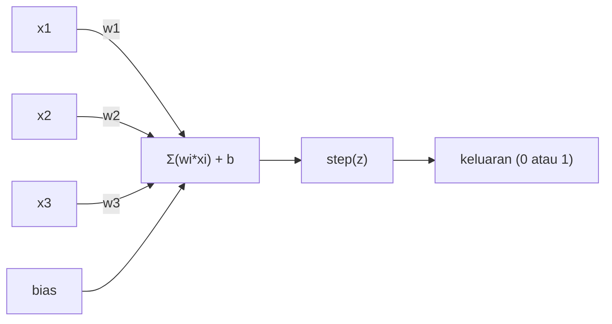
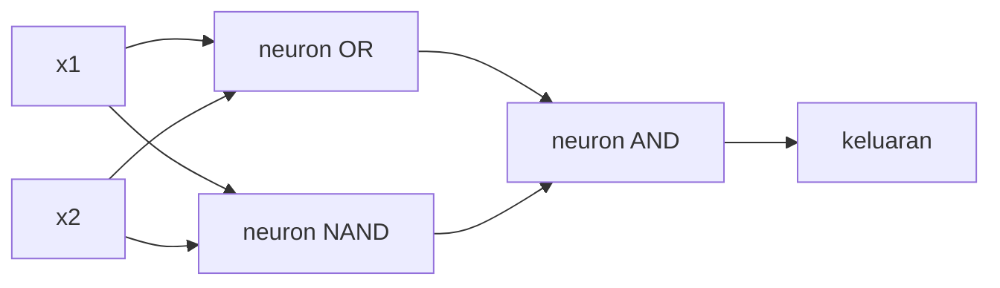

# Perceptron

> Perceptron adalah atom jaringan saraf. Belah ia terbuka dan Anda akan menemukan bobot, bias, dan sebuah keputusan.

**Jenis:** Bangun
**Bahasa:** Python, Julia, Rust
**Prasyarat:** Fase 1 (Intuisi Aljabar Linear)
**Waktu:** ~60 menit

## Tujuan Pembelajaran

- Terapkan perceptron dari awal dalam Python, termasuk aturan pembaruan bobot dan fungsi aktivasi langkah
- Jelaskan mengapa satu perceptron hanya dapat menyelesaikan masalah yang terpisah secara linier dan tunjukkan kasus gagal XOR
- Bangun multilayer perceptron dengan menggabungkan gerbang OR, NAND, dan AND untuk menyelesaikan XOR
- Latih jaringan dua lapis dengan aktivasi sigmoid dan propagasi balik untuk mempelajari XOR secara otomatis

## Masalahnya

Anda mengetahui vektor dan hasil kali titik. Anda mengetahui bahwa matriks mengubah masukan menjadi keluaran. Tetapi bagaimana sebuah mesin *belajar* transformasi mana yang harus dipakai?

Perceptron menjawabnya. Ia adalah mesin pembelajar paling sederhana yang mungkin: ambil beberapa masukan, kalikan dengan bobot, tambahkan bias, dan buat keputusan biner. Lalu sesuaikan. Selesai. Setiap jaringan saraf yang pernah dibangun adalah tumpukan gagasan ini berlapis-lapis.

Memahami perceptron berarti memahami apa arti "pembelajaran" sebenarnya dalam kode: menyesuaikan angka sampai keluaran sesuai dengan realitas.

## Konsepnya

### Satu Neuron, Satu Keputusan

Sebuah perceptron mengambil $n$ masukan, mengalikan masing-masing dengan sebuah bobot, menjumlahkannya, menambahkan bias, dan meneruskan hasilnya melalui fungsi aktivasi.



Fungsi langkah itu brutal: jika jumlah berbobot ditambah bias $\ge 0$, keluarkan 1. Jika tidak, keluarkan 0.

```math
\text{step}(z) = \begin{cases} 1 & \text{if } z \ge 0 \\ 0 & \text{if } z < 0 \end{cases}
```

Ini adalah klasifikator linier. Bobot dan bias menentukan sebuah garis (atau hiperplan dalam dimensi lebih tinggi) yang membelah ruang masukan menjadi dua wilayah.

### Batas Keputusan

Untuk dua masukan, perceptron menggambar sebuah garis melalui ruang 2D:

```
  x2
   ┤
   │  Kelas 1        /
   │    (0)          /
   │                /
   │               / w1·x1 + w2·x2 + b = 0
   │              /
   │             /     Kelas 2
   │            /        (1)
   ┼───────────/──────────── x1
```

Semua yang berada di satu sisi garis mengeluarkan 0. Semua yang di sisi lain mengeluarkan 1. Pelatihan menggeser garis itu sampai ia memisahkan kelas dengan benar.

### Aturan Pembelajaran

Aturan pembelajaran perceptron sederhana:

```
Untuk setiap contoh latihan (x, y_true):
    y_pred = predict(x)
    error = y_true - y_pred

    Untuk setiap bobot:
        w_i = w_i + learning_rate * error * x_i
    bias = bias + learning_rate * error
```

Jika prediksinya benar, $\text{error} = 0$, tidak ada yang berubah. Jika ia memprediksi 0 tetapi seharusnya 1, bobot bertambah. Jika ia memprediksi 1 tetapi seharusnya 0, bobot berkurang. Laju pembelajaran mengontrol seberapa besar setiap penyesuaian.

### Masalah XOR

Di sinilah ia rusak. Lihat gerbang-gerbang logika ini:

```
Gerbang AND:        Gerbang OR:         Gerbang XOR:
x1  x2  out         x1  x2  out         x1  x2  out
0   0   0           0   0   0           0   0   0
0   1   0           0   1   1           0   1   1
1   0   0           1   0   1           1   0   1
1   1   1           1   1   1           1   1   0
```

AND dan OR terpisah secara linier: Anda dapat menggambar satu garis untuk memisahkan 0 dari 1. XOR tidak. Tidak ada satu garis pun yang dapat memisahkan [0,1] dan [1,0] dari [0,0] dan [1,1].

```
AND (terpisah):         XOR (tidak terpisah):

  x2                      x2
  1 ┤  0     1            1 ┤  1     0
    │     /                 │
  0 ┤  0 / 0              0 ┤  0     1
    ┼──/──────── x1         ┼──────────── x1
       garis berhasil!      tidak ada satu garis pun yang berhasil!
```

Ini adalah batas mendasar. Satu perceptron hanya dapat menyelesaikan masalah yang terpisah secara linier. Minsky dan Papert membuktikan hal ini pada 1969, dan hampir membunuh riset jaringan saraf selama satu dekade.

Perbaikannya: tumpuk perceptron menjadi lapisan-lapisan. Multilayer perceptron dapat menyelesaikan XOR dengan menggabungkan dua keputusan linier menjadi satu keputusan nonlinear.

```figure
perceptron-boundary
```

## Bangunlah

### Langkah 1: Kelas Perceptron

```python
class Perceptron:
    def __init__(self, n_inputs, learning_rate=0.1):
        self.weights = [0.0] * n_inputs
        self.bias = 0.0
        self.lr = learning_rate

    def predict(self, inputs):
        total = sum(w * x for w, x in zip(self.weights, inputs))
        total += self.bias
        return 1 if total >= 0 else 0

    def train(self, training_data, epochs=100):
        for epoch in range(epochs):
            errors = 0
            for inputs, target in training_data:
                prediction = self.predict(inputs)
                error = target - prediction
                if error != 0:
                    errors += 1
                    for i in range(len(self.weights)):
                        self.weights[i] += self.lr * error * inputs[i]
                    self.bias += self.lr * error
            if errors == 0:
                print(f"Converged at epoch {epoch + 1}")
                return
        print(f"Did not converge after {epochs} epochs")
```

### Langkah 2: Latih pada gerbang logika

```python
and_data = [
    ([0, 0], 0),
    ([0, 1], 0),
    ([1, 0], 0),
    ([1, 1], 1),
]

or_data = [
    ([0, 0], 0),
    ([0, 1], 1),
    ([1, 0], 1),
    ([1, 1], 1),
]

not_data = [
    ([0], 1),
    ([1], 0),
]

print("=== AND Gate ===")
p_and = Perceptron(2)
p_and.train(and_data)
for inputs, _ in and_data:
    print(f"  {inputs} -> {p_and.predict(inputs)}")

print("\n=== OR Gate ===")
p_or = Perceptron(2)
p_or.train(or_data)
for inputs, _ in or_data:
    print(f"  {inputs} -> {p_or.predict(inputs)}")

print("\n=== NOT Gate ===")
p_not = Perceptron(1)
p_not.train(not_data)
for inputs, _ in not_data:
    print(f"  {inputs} -> {p_not.predict(inputs)}")
```

### Langkah 3: Lihat XOR gagal

```python
xor_data = [
    ([0, 0], 0),
    ([0, 1], 1),
    ([1, 0], 1),
    ([1, 1], 0),
]

print("\n=== XOR Gate (single perceptron) ===")
p_xor = Perceptron(2)
p_xor.train(xor_data, epochs=1000)
for inputs, expected in xor_data:
    result = p_xor.predict(inputs)
    status = "OK" if result == expected else "WRONG"
    print(f"  {inputs} -> {result} (expected {expected}) {status}")
```

Ia tidak akan pernah konvergen. Ini adalah bukti keras bahwa satu perceptron tidak dapat mempelajari XOR.

### Langkah 4: Selesaikan XOR dengan dua lapis

Triknya: $\text{XOR} = (x_1 \text{ OR } x_2) \text{ AND NOT } (x_1 \text{ AND } x_2)$. Gabungkan tiga perceptron:



```python
def xor_network(x1, x2):
    or_neuron = Perceptron(2)
    or_neuron.weights = [1.0, 1.0]
    or_neuron.bias = -0.5

    nand_neuron = Perceptron(2)
    nand_neuron.weights = [-1.0, -1.0]
    nand_neuron.bias = 1.5

    and_neuron = Perceptron(2)
    and_neuron.weights = [1.0, 1.0]
    and_neuron.bias = -1.5

    hidden1 = or_neuron.predict([x1, x2])
    hidden2 = nand_neuron.predict([x1, x2])
    output = and_neuron.predict([hidden1, hidden2])
    return output


print("\n=== XOR Gate (multi-layer network) ===")
for inputs, expected in xor_data:
    result = xor_network(inputs[0], inputs[1])
    print(f"  {inputs} -> {result} (expected {expected})")
```

Keempat kasus benar. Menumpuk perceptron menjadi lapisan menciptakan batas keputusan yang tidak dapat dihasilkan oleh satu perceptron pun.

### Langkah 5: Latih Jaringan Dua Lapis

Langkah 4 menghubungkan bobot secara manual. Itu berhasil untuk XOR, tetapi tidak untuk masalah nyata di mana Anda tidak mengetahui bobot yang tepat sebelumnya. Perbaikannya: ganti fungsi langkah dengan sigmoid dan pelajari bobotnya secara otomatis melalui propagasi balik.

```python
class TwoLayerNetwork:
    def __init__(self, learning_rate=0.5):
        import random
        random.seed(0)
        self.w_hidden = [[random.uniform(-1, 1), random.uniform(-1, 1)] for _ in range(2)]
        self.b_hidden = [random.uniform(-1, 1), random.uniform(-1, 1)]
        self.w_output = [random.uniform(-1, 1), random.uniform(-1, 1)]
        self.b_output = random.uniform(-1, 1)
        self.lr = learning_rate

    def sigmoid(self, x):
        import math
        x = max(-500, min(500, x))
        return 1.0 / (1.0 + math.exp(-x))

    def forward(self, inputs):
        self.inputs = inputs
        self.hidden_outputs = []
        for i in range(2):
            z = sum(w * x for w, x in zip(self.w_hidden[i], inputs)) + self.b_hidden[i]
            self.hidden_outputs.append(self.sigmoid(z))
        z_out = sum(w * h for w, h in zip(self.w_output, self.hidden_outputs)) + self.b_output
        self.output = self.sigmoid(z_out)
        return self.output

    def train(self, training_data, epochs=10000):
        for epoch in range(epochs):
            total_error = 0
            for inputs, target in training_data:
                output = self.forward(inputs)
                error = target - output
                total_error += error ** 2

                d_output = error * output * (1 - output)

                saved_w_output = self.w_output[:]
                hidden_deltas = []
                for i in range(2):
                    h = self.hidden_outputs[i]
                    hd = d_output * saved_w_output[i] * h * (1 - h)
                    hidden_deltas.append(hd)

                for i in range(2):
                    self.w_output[i] += self.lr * d_output * self.hidden_outputs[i]
                self.b_output += self.lr * d_output

                for i in range(2):
                    for j in range(len(inputs)):
                        self.w_hidden[i][j] += self.lr * hidden_deltas[i] * inputs[j]
                    self.b_hidden[i] += self.lr * hidden_deltas[i]
```

```python
net = TwoLayerNetwork(learning_rate=2.0)
net.train(xor_data, epochs=10000)
for inputs, expected in xor_data:
    result = net.forward(inputs)
    predicted = 1 if result >= 0.5 else 0
    print(f"  {inputs} -> {result:.4f} (rounded: {predicted}, expected {expected})")
```

Ada dua perbedaan utama dari Langkah 4. Pertama, sigmoid menggantikan fungsi langkah -- ia halus, sehingga gradien ada di mana-mana. Kedua, metode `train` menyebarkan galat mundur dari keluaran ke lapisan tersembunyi, menyesuaikan setiap bobot sebanding dengan kontribusinya terhadap galat. Itulah propagasi balik dalam 20 baris.

Ini adalah jembatan menuju Pelajaran 03. Matematika di balik `d_output` dan `hidden_deltas` adalah aturan rantai yang diterapkan pada graf jaringan. Kita akan menurunkannya dengan cermat di sana.

## Gunakanlah

Semuanya yang Anda bangun dari awal ada dalam satu impor:

```python
from sklearn.linear_model import Perceptron as SkPerceptron
import numpy as np

X = np.array([[0,0],[0,1],[1,0],[1,1]])
y = np.array([0, 0, 0, 1])

clf = SkPerceptron(max_iter=100, tol=1e-3)
clf.fit(X, y)
print([clf.predict([x])[0] for x in X])
```

Lima baris. Kelas `Perceptron` Anda yang berisi 30 baris melakukan hal yang sama. Versi sklearn menambahkan pemeriksaan konvergensi, beberapa fungsi rugi, dan dukungan masukan jarang -- tetapi loop intinya identik: jumlah berbobot, fungsi langkah, pembaruan bobot saat galat.

Jurang yang sebenarnya muncul pada skala. Apa yang berubah pada jaringan produksi:

- Fungsi langkah menjadi sigmoid, ReLU, atau aktivasi halus lainnya
- Bobot dipelajari otomatis melalui propagasi balik (Pelajaran 03)
- Lapisan menjadi lebih dalam: 3, 10, 100+ lapisan
- Prinsip yang sama berlaku: setiap lapisan menciptakan fitur baru dari keluaran lapisan sebelumnya

Satu perceptron hanya dapat menggambar garis lurus. Tumpuklah ia, dan Anda dapat menggambar bentuk apa pun.

## Kirimlah

Pelajaran ini menghasilkan:
- `outputs/skill-perceptron.md` - sebuah skill yang membahas kapan arsitektur satu lapis versus banyak lapis dibutuhkan

## Latihan

1. Latih sebuah perceptron pada gerbang NAND (gerbang universal -- sirkuit logika apa pun dapat dibangun dari NAND). Verifikasi bahwa bobot dan biasnya membentuk batas keputusan yang valid.
2. Ubah kelas Perceptron untuk melacak batas keputusan ($w_1 x_1 + w_2 x_2 + b = 0$) pada setiap epoch. Cetak bagaimana garis itu bergeser selama pelatihan pada gerbang AND.
3. Bangun perceptron tiga masukan yang mengeluarkan 1 hanya ketika paling sedikit 2 dari 3 masukan bernilai 1 (fungsi voting mayoritas). Apakah ini terpisah secara linier? Mengapa?

## Istilah Kunci

| Istilah | Apa yang orang katakan | Apa artinya sebenarnya |
|---|---|---|
| Perceptron | "Neuron palsu" | Klasifikator linier: hasil kali titik masukan dan bobot, ditambah bias, melalui fungsi langkah |
| Bobot | "Seberapa penting sebuah masukan" | Pengali yang menskalakan kontribusi setiap masukan terhadap keputusan |
| Bias | "Ambang batas" | Konstanta yang menggeser batas keputusan, memungkinkan perceptron aktif meskipun masukan nol |
| Fungsi aktivasi | "Hal yang meremas nilai" | Fungsi yang diterapkan setelah jumlah berbobot -- fungsi langkah untuk perceptron, sigmoid/ReLU untuk jaringan modern |
| Terpisah secara linier | "Anda bisa menggambar garis di antaranya" | Dataset di mana satu hiperplan dapat memisahkan kelas dengan sempurna |
| Masalah XOR | "Hal yang tidak bisa dilakukan perceptron" | Bukti bahwa jaringan satu lapis tidak dapat mempelajari fungsi yang tidak terpisah secara linier |
| Batas keputusan | "Tempat klasifikator beralih" | Hiperplan $w \cdot x + b = 0$ yang membelah ruang masukan menjadi dua kelas |
| Multilayer perceptron | "Jaringan saraf sungguhan" | Perceptron yang ditumpuk berlapis, di mana keluaran setiap lapisan menjadi masukan lapisan berikutnya |

## Bacaan Lanjutan

- Frank Rosenblatt, "The Perceptron: A Probabilistic Model for Information Storage and Organization in the Brain" (1958) -- makalah asli yang memulai semuanya
- Minsky & Papert, "Perceptrons" (1969) -- buku yang membuktikan XOR tidak dapat diselesaikan oleh jaringan satu lapis dan membunuh riset perceptron selama satu dekade
- Michael Nielsen, "Neural Networks and Deep Learning", Bab 1 (http://neuralnetworksanddeeplearning.com/) -- gratis daring, penjelasan visual terbaik tentang bagaimana perceptron membentuk jaringan
