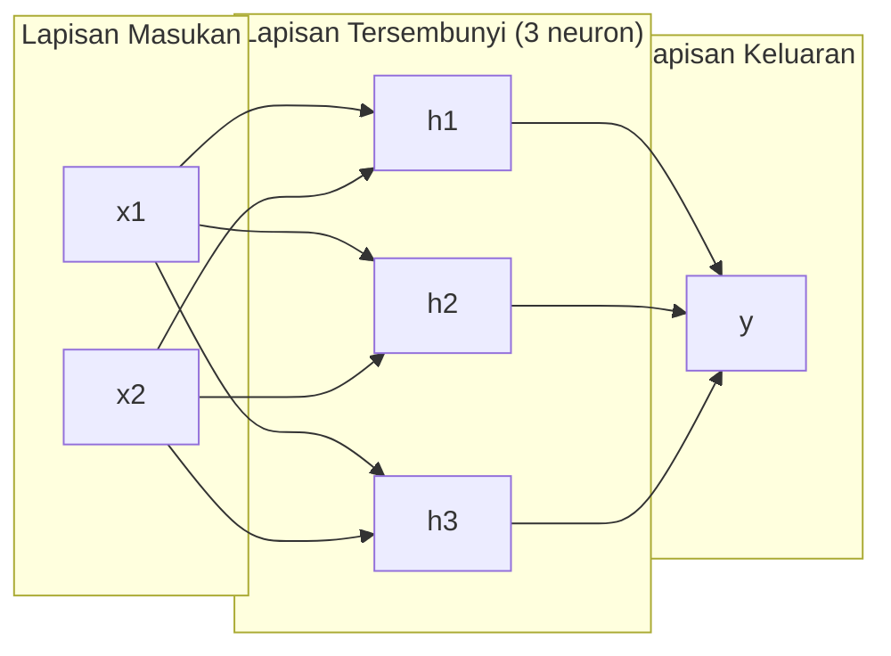
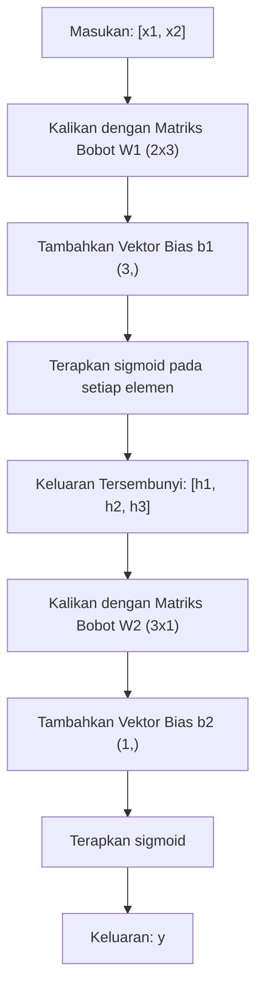
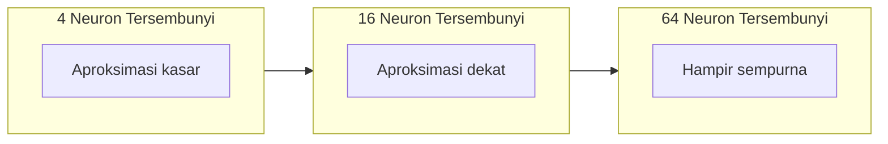

# Jaringan Banyak Lapis dan Forward Pass

> Satu neuron menggambar sebuah garis. Tumpuklah, dan Anda dapat menggambar apa pun.

**Jenis:** Bangun
**Bahasa:** Python, TypeScript
**Prasyarat:** Fase 01 (Dasar Matematika), Pelajaran 03.01 (Perceptron)
**Waktu:** ~90 menit

## Tujuan Pembelajaran

- Bangun jaringan banyak lapis dari awal dengan kelas Layer dan Network yang melakukan forward pass lengkap
- Telusuri dimensi matriks melalui setiap lapisan jaringan dan identifikasi ketidaksesuaian bentuk
- Jelaskan bagaimana penumpukan aktivasi nonlinear memungkinkan jaringan mempelajari batas keputusan melengkung
- Selesaikan masalah XOR dengan arsitektur 2-2-1 memakai bobot sigmoid yang disetel manual

## Masalahnya

Satu neuron adalah penggambar garis. Selesai. Satu garis lurus melalui data Anda. Setiap masalah nyata dalam AI -- pengenalan gambar, pemahaman bahasa, bermain Go -- memerlukan kurva. Menumpuk neuron menjadi lapisanlah yang memberi Anda kurva.

Pada 1969, Minsky dan Papert membuktikan batas ini bersifat fatal: jaringan satu lapis tidak dapat mempelajari XOR. Bukan "sulit mempelajari" -- secara matematis tidak bisa. Tabel kebenaran XOR menempatkan [0,1] dan [1,0] di satu sisi, [0,0] dan [1,1] di sisi lain. Tidak ada satu garis pun yang memisahkannya.

Ini membunuh pendanaan riset jaringan saraf lebih dari satu dekade. Perbaikannya jelas dalam retrospeksi: berhenti memakai satu lapis. Tumpuk neuron menjadi lapisan. Biarkan lapisan pertama memotong ruang masukan menjadi fitur-fitur baru, dan biarkan lapisan kedua menggabungkan fitur-fitur itu menjadi keputusan yang tidak bisa dibuat satu garis pun.

Tumpukan itu adalah jaringan banyak lapis. Ia adalah fondasi setiap model deep learning di produksi saat ini. Forward pass -- data mengalir dari masukan melalui lapisan tersembunyi menuju keluaran -- adalah hal pertama yang perlu Anda bangun sebelum apa pun berfungsi.

## Konsepnya

### Lapisan: Masukan, Tersembunyi, Keluaran

Sebuah jaringan banyak lapis memiliki tiga jenis lapisan:

**Lapisan masukan** -- sebenarnya bukan lapisan. Ia menampung data mentah Anda. Dua fitur berarti dua simpul masukan. Tidak ada komputasi yang terjadi di sini.

**Lapisan tersembunyi** -- tempat kerja dilakukan. Setiap neuron mengambil setiap keluaran dari lapisan sebelumnya, menerapkan bobot dan bias, lalu meneruskan hasilnya melalui fungsi aktivasi. Disebut "tersembunyi" karena Anda tidak pernah melihat nilai-nilai ini langsung dalam data latihan.

**Lapisan keluaran** -- jawaban akhir. Untuk klasifikasi biner, satu neuron dengan sigmoid. Untuk banyak kelas, satu neuron per kelas.



Ini adalah jaringan 2-3-1. Dua masukan, tiga neuron tersembunyi, satu keluaran. Setiap koneksi membawa bobot. Setiap neuron (kecuali masukan) membawa bias.

Setiap lapisan menghasilkan vektor angka yang disebut keadaan tersembunyi. Untuk teks, keadaan tersembunyi menambah dimensi -- menyandikan sebuah kata sebagai 768 angka untuk menangkap makna semantik. Untuk gambar, keadaan itu mengurangi dimensi -- memampatkan jutaan piksel menjadi representasi yang terkelola. Keadaan tersembunyi adalah tempat pembelajaran hidup.

### Neuron dan Aktivasi

Setiap neuron melakukan tiga hal:

1. Kalikan setiap masukan dengan bobot yang bersesuaian
2. Jumlahkan semua hasil kali dan tambahkan bias
3. Teruskan jumlah itu melalui fungsi aktivasi

Untuk saat ini, aktivasi adalah sigmoid:

```math
\text{sigmoid}(z) = \frac{1}{1 + e^{-z}}
```

Sigmoid meremas angka apa pun ke rentang (0, 1). Masukan positif besar mendorong ke 1. Masukan negatif besar mendorong ke 0. Nol dipetakan ke 0,5. Kurva halus inilah yang membuat pembelajaran mungkin -- tidak seperti langkah keras perceptron, sigmoid memiliki gradien di mana-mana.

### Forward Pass: Bagaimana Data Mengalir

Forward pass mendorong data masukan melalui jaringan, lapis demi lapis, sampai mencapai keluaran. Tidak ada pembelajaran yang terjadi selama forward pass. Ini murni komputasi: kalikan, tambahkan, aktifkan, ulangi.



Pada setiap lapisan, tiga operasi terjadi berurutan:

```math
\begin{aligned}
z &= W \cdot \text{input} + b \quad \text{(linear transformation)} \\
a &= \text{sigmoid}(z) \quad \text{(activation)}
\end{aligned}
```

Keluaran dari satu lapisan menjadi masukan bagi lapisan berikutnya. Itulah seluruh forward pass.

### Dimensi Matriks

Melacak dimensi adalah keterampilan debugging paling penting dalam deep learning. Berikut adalah jaringan 2-3-1:

| Langkah | Operasi | Dimensi | Bentuk Hasil |
|---|---|---|---|
| Masukan | $x$ | -- | (2,) |
| Linear tersembunyi | $W_1 x + b_1$ | $W_1$: (3, 2), $b_1$: (3,) | (3,) |
| Aktivasi tersembunyi | $\text{sigmoid}(z_1)$ | -- | (3,) |
| Linear keluaran | $W_2 h + b_2$ | $W_2$: (1, 3), $b_2$: (1,) | (1,) |
| Aktivasi keluaran | $\text{sigmoid}(z_2)$ | -- | (1,) |

Aturannya: matriks bobot $W$ pada lapisan $k$ memiliki bentuk (neuron_di_lapisan_k, neuron_di_lapisan_k_minus_1). Baris sesuai dengan lapisan saat ini. Kolom sesuai dengan lapisan sebelumnya. Jika bentuknya tidak cocok, Anda memiliki bug.

### Teorema Aproksimasi Universal

Pada 1989, George Cybenko membuktikan sesuatu yang luar biasa: jaringan saraf dengan satu lapisan tersembunyi dan neuron yang cukup banyak dapat mengaproksimasi fungsi kontinu apa pun dengan akurasi setinggi apa pun.

Ini tidak berarti satu lapisan tersembunyi selalu terbaik. Ini berarti arsitekturnya mampu secara teoretis. Dalam praktiknya, jaringan lebih dalam (lebih banyak lapisan, lebih sedikit neuron per lapisan) mempelajari fungsi yang sama dengan jauh lebih sedikit parameter total daripada jaringan dangkal-lebar. Itulah sebabnya deep learning berfungsi.

Intuisinya: setiap neuron di lapisan tersembunyi mempelajari satu "tonjolan" atau fitur. Cukup banyak tonjolan yang ditempatkan di lokasi yang tepat dapat mengaproksimasi kurva halus apa pun. Lebih banyak neuron, lebih banyak tonjolan, aproksimasi lebih baik.



### Komponabilitas

Jaringan saraf dapat dikomposisi. Anda dapat menumpuknya, merantaikannya, menjalankannya secara paralel. Model Whisper memakai jaringan encoder untuk memproses audio dan jaringan decoder terpisah untuk menghasilkan teks. LLM modern bersifat decoder-only. BERT bersifat encoder-only. T5 adalah encoder-decoder. Pilihan arsitektur menentukan apa yang dapat dilakukan model.

```figure
mlp-forward
```

## Bangunlah

Python murni. Tanpa numpy. Setiap operasi matriks ditulis dari awal.

### Langkah 1: Aktivasi Sigmoid

```python
import math

def sigmoid(x):
    x = max(-500.0, min(500.0, x))
    return 1.0 / (1.0 + math.exp(-x))
```

Pembatasan pada [-500, 500] mencegah overflow. `math.exp(500)` besar tetapi masih terbatas. `math.exp(1000)` adalah tak hingga.

### Langkah 2: Kelas Layer

Operasi paling penting dalam seluruh deep learning adalah perkalian matriks. Setiap lapisan, setiap attention head, setiap forward pass -- semuanya perkalian matriks sampai ke dasarnya. Sebuah lapisan linear mengambil vektor masukan, mengalikannya dengan matriks bobot, dan menambahkan vektor bias: $y = Wx + b$. Persamaan tunggal itu adalah 90 persen komputasi dalam jaringan saraf.

Sebuah lapisan menyimpan matriks bobot dan vektor bias. Metode forward-nya mengambil vektor masukan dan mengembalikan keluaran yang telah diaktivasi.

```python
class Layer:
    def __init__(self, n_inputs, n_neurons, weights=None, biases=None):
        if weights is not None:
            self.weights = weights
        else:
            import random
            self.weights = [
                [random.uniform(-1, 1) for _ in range(n_inputs)]
                for _ in range(n_neurons)
            ]
        if biases is not None:
            self.biases = biases
        else:
            self.biases = [0.0] * n_neurons

    def forward(self, inputs):
        self.last_input = inputs
        self.last_output = []
        for neuron_idx in range(len(self.weights)):
            z = sum(
                w * x for w, x in zip(self.weights[neuron_idx], inputs)
            )
            z += self.biases[neuron_idx]
            self.last_output.append(sigmoid(z))
        return self.last_output
```

Matriks bobot memiliki bentuk (n_neurons, n_inputs). Setiap baris adalah bobot satu neuron atas semua masukan. Metode forward mengulangi neuron, menghitung jumlah berbobot ditambah bias, menerapkan sigmoid, dan mengumpulkan hasilnya.

### Langkah 3: Kelas Network

Sebuah jaringan adalah daftar lapisan. Forward pass merantaikannya: keluaran lapisan $k$ menjadi masukan lapisan $k+1$.

```python
class Network:
    def __init__(self, layers):
        self.layers = layers

    def forward(self, inputs):
        current = inputs
        for layer in self.layers:
            current = layer.forward(current)
        return current
```

Itulah seluruh forward pass. Empat baris logika. Data masuk, mengalir melalui setiap lapisan, dan keluar di sisi lain.

### Langkah 4: XOR dengan Bobot yang Disetel Manual

Pada Pelajaran 01, kita menyelesaikan XOR dengan menggabungkan perceptron OR, NAND, dan AND. Sekarang lakukan hal yang sama dengan kelas Layer dan Network kita. Arsitektur 2-2-1: dua masukan, dua neuron tersembunyi, satu keluaran.

```python
hidden = Layer(
    n_inputs=2,
    n_neurons=2,
    weights=[[20.0, 20.0], [-20.0, -20.0]],
    biases=[-10.0, 30.0],
)

output = Layer(
    n_inputs=2,
    n_neurons=1,
    weights=[[20.0, 20.0]],
    biases=[-30.0],
)

xor_net = Network([hidden, output])

xor_data = [
    ([0, 0], 0),
    ([0, 1], 1),
    ([1, 0], 1),
    ([1, 1], 0),
]

for inputs, expected in xor_data:
    result = xor_net.forward(inputs)
    predicted = 1 if result[0] >= 0.5 else 0
    print(f"  {inputs} -> {result[0]:.6f} (rounded: {predicted}, expected: {expected})")
```

Bobot besar (20, -20) membuat sigmoid bertindak seperti fungsi langkah. Neuron tersembunyi pertama mengaproksimasi OR. Yang kedua mengaproksimasi NAND. Neuron keluaran menggabungkan keduanya menjadi AND, yaitu XOR.

### Langkah 5: Klasifikasi Lingkaran

Masalah yang lebih sulit: klasifikasikan titik 2D sebagai di dalam atau di luar lingkaran jari-jari 0,5 yang berpusat di titik asal. Ini memerlukan batas keputusan melengkung -- mustahil bagi satu perceptron.

```python
import random
import math

random.seed(42)

data = []
for _ in range(200):
    x = random.uniform(-1, 1)
    y = random.uniform(-1, 1)
    label = 1 if (x * x + y * y) < 0.25 else 0
    data.append(([x, y], label))

circle_net = Network([
    Layer(n_inputs=2, n_neurons=8),
    Layer(n_inputs=8, n_neurons=1),
])
```

Dengan bobot acak, jaringan tidak akan mengklasifikasikan dengan baik. Tetapi forward pass tetap berjalan. Di situlah intinya -- forward pass hanyalah komputasi. Mempelajari bobot yang tepat adalah propagasi balik, yang datang di Pelajaran 03.

```python
correct = 0
for inputs, expected in data:
    result = circle_net.forward(inputs)
    predicted = 1 if result[0] >= 0.5 else 0
    if predicted == expected:
        correct += 1

print(f"Accuracy with random weights: {correct}/{len(data)} ({100*correct/len(data):.1f}%)")
```

Bobot acak menghasilkan akurasi buruk -- sering lebih buruk daripada menebak kelas mayoritas. Setelah pelatihan (Pelajaran 03), arsitektur yang sama dengan 8 neuron tersembunyi akan menggambar batas melengkung yang memisahkan dalam dari luar.

## Gunakanlah

PyTorch melakukan semua hal di atas dalam empat baris:

```python
import torch
import torch.nn as nn

model = nn.Sequential(
    nn.Linear(2, 8),
    nn.Sigmoid(),
    nn.Linear(8, 1),
    nn.Sigmoid(),
)

x = torch.tensor([[0.0, 0.0], [0.0, 1.0], [1.0, 0.0], [1.0, 1.0]])
output = model(x)
print(output)
```

`nn.Linear(2, 8)` adalah kelas Layer Anda: matriks bobot berbentuk (8, 2), vektor bias berbentuk (8,). `nn.Sigmoid()` adalah fungsi sigmoid Anda yang diterapkan per elemen. `nn.Sequential` adalah kelas Network Anda: meruntai lapisan secara berurutan.

Perbedaannya adalah kecepatan dan skala. PyTorch berjalan di GPU, menangani batch jutaan sampel, dan menghitung gradien secara otomatis untuk propagasi balik. Tetapi logika forward pass identik dengan apa yang Anda bangun dari awal.

## Kirimlah

Pelajaran ini menghasilkan prompt yang dapat digunakan kembali untuk merancang arsitektur jaringan:

- `outputs/prompt-network-architect.md`

Gunakan prompt itu ketika Anda perlu memutuskan berapa banyak lapisan, berapa neuron per lapisan, dan fungsi aktivasi mana yang dipakai untuk suatu masalah.

## Latihan

1. Bangun jaringan 2-4-2-1 (dua lapisan tersembunyi) dan jalankan forward pass pada data XOR dengan bobot acak. Cetak keluaran lapisan tersembunyi antara untuk melihat bagaimana representasi berubah pada setiap lapisan.

2. Ubah ukuran lapisan tersembunyi pada klasifikator lingkaran dari 8 menjadi 2, lalu menjadi 32. Jalankan forward pass dengan bobot acak setiap kali. Apakah jumlah neuron tersembunyi mengubah rentang atau distribusi keluaran? Mengapa?

3. Terapkan metode `count_parameters` pada kelas Network yang mengembalikan jumlah total bobot dan bias yang dapat dilatih. Ujilah pada jaringan 784-256-128-10 (arsitektur MNIST klasik). Berapa banyak parameter yang dimiliki jaringan itu?

4. Bangun forward pass untuk jaringan 3-4-4-2. Beri masukan nilai warna RGB (ternormalisasi ke 0-1) dan amati dua keluarannya. Ini adalah arsitektur untuk klasifikator warna sederhana dengan dua kelas.

5. Ganti sigmoid dengan fungsi "langkah bocor": kembalikan 0,01 * z jika z < 0, jika tidak 1,0. Jalankan forward pass pada XOR dengan bobot yang sama seperti Langkah 4. Apakah fungsi itu tetap bekerja? Mengapa sigmoid yang halus lebih disukai daripada pemotongan keras?

## Istilah Kunci

| Istilah | Apa yang orang katakan | Apa artinya sebenarnya |
|---|---|---|
| Forward pass | "Menjalankan model" | Mendorong masukan melalui setiap lapisan -- kalikan dengan bobot, tambahkan bias, aktifkan -- untuk menghasilkan keluaran |
| Lapisan tersembunyi | "Bagian tengah" | Lapisan apa pun antara masukan dan keluaran yang nilainya tidak diamati langsung dalam data |
| Jaringan banyak lapis | "Jaringan saraf dalam" | Lapisan-lapisan neuron yang ditumpuk secara berurutan, di mana keluaran setiap lapisan menjadi masukan lapisan berikutnya |
| Fungsi aktivasi | "Nonlinearitasnya" | Fungsi yang diterapkan setelah transformasi linear yang memasukkan kurva ke dalam batas keputusan |
| Sigmoid | "Kurva-S" | $\sigma(z) = 1/(1+e^{-z})$, meremas bilangan real apa pun ke (0,1), halus dan terdiferensialkan di mana-mana |
| Matriks bobot | "Parameter-paramternya" | Matriks $W$ berbentuk (neuron_lapisan_saat_ini, neuron_lapisan_sebelumnya) yang memuat kekuatan koneksi yang dapat dipelajari |
| Vektor bias | "Pergeserannya" | Vektor yang ditambahkan setelah perkalian matriks yang memungkinkan neuron aktif meskipun semua masukan nol |
| Aproksimasi universal | "Jaringan saraf bisa mempelajari apa saja" | Satu lapisan tersembunyi dengan neuron cukup banyak dapat mengaproksimasi fungsi kontinu apa pun -- tetapi "cukup" bisa berarti miliaran |
| Transformasi linear | "Langkah perkalian matriks" | $z = W x + b$, komputasi sebelum aktivasi yang memetakan masukan ke ruang baru |
| Batas keputusan | "Tempat klasifikator beralih" | Permukaan dalam ruang masukan di mana keluaran jaringan melintasi ambang klasifikasi |

## Bacaan Lanjutan

- Michael Nielsen, "Neural Networks and Deep Learning", Bab 1-2 (http://neuralnetworksanddeeplearning.com/) -- penjelasan gratis paling jelas tentang forward pass dan struktur jaringan, dengan visualisasi interaktif
- Cybenko, "Approximation by Superpositions of a Sigmoidal Function" (1989) -- makalah asli teorema aproksimasi universal, yang mengejutkan tetap mudah dibaca
- 3Blue1Brown, "But what is a neural network?" (https://www.youtube.com/watch?v=aircAruvnKk) -- penelusuran visual 20 menit tentang lapisan, bobot, dan forward pass yang membangun model mental yang tepat
- Goodfellow, Bengio, Courville, "Deep Learning", Bab 6 (https://www.deeplearningbook.org/) -- referensi standar untuk jaringan banyak lapis, gratis daring
