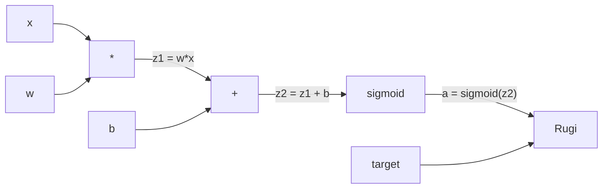
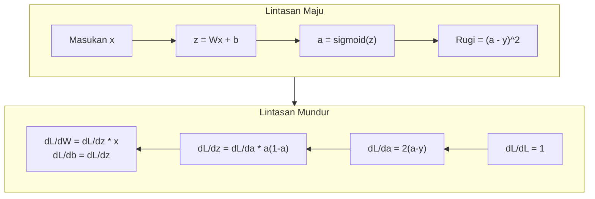

# Propagasi Balik dari Nol

> Propagasi balik adalah algoritma yang membuat pembelajaran menjadi mungkin. Tanpa itu, jaringan saraf hanyalah pembangkit bilangan acak yang mahal.

**Jenis:** Membangun
**Bahasa:** Python, Julia, Rust
**Prasyarat:** Pelajaran 03.02 (Jaringan Multilapisan)
**Waktu:** ~120 menit

## Tujuan Pembelajaran

- Mengimplementasikan mesin autograd berbasis Value yang membangun graf komputasi dan menghitung gradien melalui pengurutan topologis
- Menurunkan lintasan mundur untuk penjumlahan, perkalian, dan sigmoid menggunakan aturan rantai
- Melatih jaringan multilapisan pada XOR dan klasifikasi lingkaran hanya dengan mesin propagasi balik buatan Anda sendiri
- Mengidentifikasi masalah gradien menghilang pada jaringan sigmoid dalam dan menjelaskan mengapa gradien menyusut secara eksponensial

## Masalahnya

Jaringan Anda memiliki satu lapisan tersembunyi dengan 768 masukan dan 3072 keluaran. Itu 2,359,296 bobot. Jaringan itu membuat prediksi yang salah. Bobot mana yang menyebabkan galat tersebut? Menguji setiap bobot satu per satu berarti 2,3 juta lintasan maju. Propagasi balik menghitung semua 2,3 juta gradien dalam satu lintasan mundur. Ini bukan sekadar optimasi. Ini perbedaan antara "dapat dilatih" dan "mustahil".

Pendekatan naif: ambil satu bobot, geser sedikit, jalankan lagi lintasan maju, ukur apakah rugi naik atau turun. Itu memberi Anda gradien untuk bobot itu. Sekarang lakukan untuk setiap bobot di jaringan. Kalikan dengan ribuan langkah pelatihan dan jutaan titik data. Anda akan membutuhkan waktu geologis untuk melatih apa pun yang berguna.

Propagasi balik menyelesaikan ini. Satu lintasan maju, satu lintasan mundur, semua gradien terhitung. Triknya adalah aturan rantai dari kalkulus, diterapkan secara sistematis pada graf komputasi. Ini algoritma yang membuat deep learning menjadi praktis. Tanpa itu, kita masih akan terjebak pada masalah mainan.

## Konsepnya

### Aturan Rantai, Diterapkan pada Jaringan

Anda sudah melihat aturan rantai di Fase 01, Pelajaran 05. Pengulangan singkat: jika $y = f(g(x))$, maka $\frac{dy}{dx} = f'(g(x)) \cdot g'(x)$. Anda mengalikan turunan sepanjang rantai.

Pada jaringan saraf, "rantai" adalah urutan operasi dari masukan hingga rugi. Setiap lapisan menerapkan bobot, menambah bias, lalu melewati fungsi aktivasi. Fungsi rugi membandingkan keluaran akhir dengan target. Propagasi balik menelusuri rantai ini ke belakang, menghitung bagaimana setiap operasi berkontribusi terhadap galat.

### Graf Komputasi

Setiap lintasan maju membangun sebuah graf. Setiap simpul adalah operasi (perkalian, penjumlahan, sigmoid). Setiap sisi membawa nilai ke depan dan gradien ke belakang.



Lintasan maju: nilai mengalir dari kiri ke kanan. $x$ dan $w$ menghasilkan $z_1 = w x$. Tambahkan $b$ untuk mendapat $z_2$. Sigmoid menghasilkan aktivasi $a$. Bandingkan $a$ dengan target $y$ menggunakan fungsi rugi.

Lintasan mundur: gradien mengalir dari kanan ke kiri. Mulai dengan $\partial L/\partial a$ (bagaimana rugi berubah terhadap aktivasi). Kalikan dengan $\partial a/\partial z_2$ (turunan sigmoid). Itu menghasilkan $\partial L/\partial z_2$. Bagi menjadi $\partial L/\partial b$ (yang sama dengan $\partial L/\partial z_2$, karena $z_2 = z_1 + b$) dan $\partial L/\partial z_1$. Lalu $\partial L/\partial w = \partial L/\partial z_1 \cdot x$ dan $\partial L/\partial x = \partial L/\partial z_1 \cdot w$.

Setiap simpul dalam graf punya satu tugas selama lintasan mundur: ambil gradien yang datang dari atas, kalikan dengan turunan lokalnya, lalu teruskan ke bawah.

### Maju vs Mundur



Lintasan maju menyimpan setiap nilai antara: z, a, masukan ke setiap lapisan. Lintasan mundur membutuhkan nilai-nilai yang tersimpan ini untuk menghitung gradien. Ini trade-off memori–komputasi di jantung propagasi balik. Anda menukar memori (menyimpan aktivasi) dengan kecepatan (satu lintasan, bukan jutaan).

### Aliran Gradien Melalui Jaringan

Untuk jaringan 3 lapisan, gradien merantai melalui setiap lapisan:


Di setiap lapisan, gradien dikalikan dengan turunan sigmoid. Turunan sigmoid adalah $a(1 - a)$, yang mencapai maksimum 0,25 (saat $a = 0.5$). Tiga lapisan dalam, gradien telah dikalikan paling banyak $0.25^3 = 0.0156$. Sepuluh lapisan dalam: $0.25^{10} = 0.000001$.

### Gradien Menghilang

Inilah masalah gradien menghilang. Sigmoid mengompres keluarannya antara 0 dan 1. Turunannya selalu kurang dari 0,25. Tumpuk cukup banyak lapisan sigmoid dan gradien menyusut menjadi hampir nol. Lapisan awal hampir tidak belajar karena menerima gradien yang mendekati nol.

```
sigmoid(z):     Rentang keluaran [0, 1]
sigmoid'(z):    Nilai maksimum 0.25 (di z = 0)

Setelah 5 lapisan:   gradien * 0.25^5 = 0.001x nilai awal
Setelah 10 lapisan:  gradien * 0.25^10 = 0.000001x nilai awal
```

Inilah sebabnya jaringan sigmoid dalam hampir mustahil dilatih. Perbaikannya -- ReLU dan variannya -- adalah topik Pelajaran 04. Untuk sekarang, pahami bahwa propagasi balik bekerja dengan sempurna. Masalahnya ada pada apa yang sedang dikerjakannya.

### Menurunkan Gradien untuk Jaringan 2 Lapisan

Matematika konkret untuk jaringan dengan masukan $x$, lapisan tersembunyi dengan sigmoid, lapisan keluaran dengan sigmoid, dan rugi MSE.

Lintasan maju:

```math
\begin{aligned}
z_1 &= W_1 x + b_1 \\
a_1 &= \text{sigmoid}(z_1) \\
z_2 &= W_2 a_1 + b_2 \\
a_2 &= \text{sigmoid}(z_2) \\
L &= (a_2 - y)^2
\end{aligned}
```

Lintasan mundur (menerapkan aturan rantai langkah demi langkah):

```math
\begin{aligned}
\frac{\partial L}{\partial a_2} &= 2(a_2 - y) \\
\frac{\partial a_2}{\partial z_2} &= a_2 (1 - a_2) \\
\frac{\partial L}{\partial z_2} &= \frac{\partial L}{\partial a_2} \cdot \frac{\partial a_2}{\partial z_2} = 2(a_2 - y) \cdot a_2 (1 - a_2) \\[6pt]
\frac{\partial L}{\partial W_2} &= \frac{\partial L}{\partial z_2} \cdot a_1 \\
\frac{\partial L}{\partial b_2} &= \frac{\partial L}{\partial z_2} \\[6pt]
\frac{\partial L}{\partial a_1} &= \frac{\partial L}{\partial z_2} \cdot W_2 \\
\frac{\partial a_1}{\partial z_1} &= a_1 (1 - a_1) \\
\frac{\partial L}{\partial z_1} &= \frac{\partial L}{\partial a_1} \cdot \frac{\partial a_1}{\partial z_1} \\[6pt]
\frac{\partial L}{\partial W_1} &= \frac{\partial L}{\partial z_1} \cdot x \\
\frac{\partial L}{\partial b_1} &= \frac{\partial L}{\partial z_1}
\end{aligned}
```

Setiap gradien adalah hasil kali turunan lokal yang ditelusuri kembali dari rugi. Itu saja propagasi balik itu.

```figure
backprop-vanishing
```

## Bangunlah

### Langkah 1: Simpul Value

Setiap bilangan dalam komputasi kita menjadi sebuah Value. Objek itu menyimpan data, gradiennya, dan cara pembuatannya (sehingga objek itu tahu bagaimana menghitung gradien ke belakang).

```python
class Value:
    def __init__(self, data, children=(), op=''):
        self.data = data
        self.grad = 0.0
        self._backward = lambda: None
        self._children = set(children)
        self._op = op

    def __repr__(self):
        return f"Value(data={self.data:.4f}, grad={self.grad:.4f})"
```

Belum ada gradien (0.0). Belum ada fungsi mundur (no-op). `_children` melacak Value mana yang menghasilkan objek ini, sehingga kita dapat mengurutkan graf secara topologis nanti.

### Langkah 2: Operasi dengan Fungsi Mundur

Setiap operasi membuat Value baru dan mendefinisikan bagaimana gradien mengalir mundur melaluinya.

```python
def __add__(self, other):
    other = other if isinstance(other, Value) else Value(other)
    out = Value(self.data + other.data, (self, other), '+')

    def _backward():
        self.grad += out.grad
        other.grad += out.grad

    out._backward = _backward
    return out

def __mul__(self, other):
    other = other if isinstance(other, Value) else Value(other)
    out = Value(self.data * other.data, (self, other), '*')

    def _backward():
        self.grad += other.data * out.grad
        other.grad += self.data * out.grad

    out._backward = _backward
    return out
```

Untuk penjumlahan: $\partial(a+b)/\partial a = 1$, $\partial(a+b)/\partial b = 1$. Jadi kedua masukan menerima gradien keluaran secara langsung.

Untuk perkalian: $\partial(ab)/\partial a = b$, $\partial(ab)/\partial b = a$. Setiap masukan menerima nilai masukan lainnya dikali gradien keluaran.

`+=` sangat krusial. Sebuah Value mungkin digunakan dalam beberapa operasi. Gradiennya adalah jumlah dari gradien semua jalur.

### Langkah 3: Sigmoid dan Rugi

```python
import math

def sigmoid(self):
    x = self.data
    x = max(-500, min(500, x))
    s = 1.0 / (1.0 + math.exp(-x))
    out = Value(s, (self,), 'sigmoid')

    def _backward():
        self.grad += (s * (1 - s)) * out.grad

    out._backward = _backward
    return out
```

Turunan sigmoid: $\text{sigmoid}(x) \cdot (1 - \text{sigmoid}(x))$. Kita sudah menghitung $\text{sigmoid}(x) = s$ selama lintasan maju. Gunakan kembali. Tanpa kerja ekstra.

```python
def mse_loss(predicted, target):
    diff = predicted + Value(-target)
    return diff * diff
```

MSE untuk satu keluaran: $(\text{predicted} - \text{target})^2$. Kita menyatakan pengurangan sebagai penjumlahan dengan Value yang dinegasikan.

### Langkah 4: Lintasan Mundur

Pengurutan topologis memastikan kita memproses simpul dalam urutan yang benar -- gradien sebuah simpul terkumpul sepenuhnya sebelum kita menjalankan propagasi melaluinya.

```python
def backward(self):
    topo = []
    visited = set()

    def build_topo(v):
        if v not in visited:
            visited.add(v)
            for child in v._children:
                build_topo(child)
            topo.append(v)

    build_topo(self)
    self.grad = 1.0
    for v in reversed(topo):
        v._backward()
```

Mulai dari rugi (gradien = 1.0, karena $dL/dL = 1$). Telusuri mundur graf yang sudah diurutkan. `_backward` setiap simpul mendorong gradien ke simpul anaknya.

### Langkah 5: Lapisan dan Jaringan

```python
import random

class Neuron:
    def __init__(self, n_inputs):
        scale = (2.0 / n_inputs) ** 0.5
        self.weights = [Value(random.uniform(-scale, scale)) for _ in range(n_inputs)]
        self.bias = Value(0.0)

    def __call__(self, x):
        act = sum((wi * xi for wi, xi in zip(self.weights, x)), self.bias)
        return act.sigmoid()

    def parameters(self):
        return self.weights + [self.bias]


class Layer:
    def __init__(self, n_inputs, n_outputs):
        self.neurons = [Neuron(n_inputs) for _ in range(n_outputs)]

    def __call__(self, x):
        out = [n(x) for n in self.neurons]
        return out[0] if len(out) == 1 else out

    def parameters(self):
        params = []
        for n in self.neurons:
            params.extend(n.parameters())
        return params


class Network:
    def __init__(self, sizes):
        self.layers = []
        for i in range(len(sizes) - 1):
            self.layers.append(Layer(sizes[i], sizes[i + 1]))

    def __call__(self, x):
        for layer in self.layers:
            x = layer(x)
            if not isinstance(x, list):
                x = [x]
        return x[0] if len(x) == 1 else x

    def parameters(self):
        params = []
        for layer in self.layers:
            params.extend(layer.parameters())
        return params

    def zero_grad(self):
        for p in self.parameters():
            p.grad = 0.0
```

Sebuah Neuron menerima masukan, menghitung jumlah terbobot + bias, dan menerapkan sigmoid. Inisialisasi bobot diskalakan oleh $\sqrt{2/n_{\text{inputs}}}$ untuk mencegah saturasi sigmoid pada jaringan yang lebih dalam. Sebuah Layer adalah daftar Neuron. Sebuah Network adalah daftar Layer. Metode `parameters()` mengumpulkan semua Value yang dapat dipelajari agar kita dapat memperbaruinya.

### Langkah 6: Latih pada XOR

```python
random.seed(42)
net = Network([2, 4, 1])

xor_data = [
    ([0.0, 0.0], 0.0),
    ([0.0, 1.0], 1.0),
    ([1.0, 0.0], 1.0),
    ([1.0, 1.0], 0.0),
]

learning_rate = 1.0

for epoch in range(1000):
    total_loss = Value(0.0)
    for inputs, target in xor_data:
        x = [Value(i) for i in inputs]
        pred = net(x)
        loss = mse_loss(pred, target)
        total_loss = total_loss + loss

    net.zero_grad()
    total_loss.backward()

    for p in net.parameters():
        p.data -= learning_rate * p.grad

    if epoch % 100 == 0:
        print(f"Epoch {epoch:4d} | Loss: {total_loss.data:.6f}")

print("\nXOR Results:")
for inputs, target in xor_data:
    x = [Value(i) for i in inputs]
    pred = net(x)
    print(f"  {inputs} -> {pred.data:.4f} (expected {target})")
```

Perhatikan rugi menurun. Dari prediksi acak menjadi keluaran XOR yang benar, semuanya digerakkan oleh propagasi balik yang menghitung gradien dan menggeser bobot ke arah yang tepat.

### Langkah 7: Klasifikasi Lingkaran

Di Pelajaran 02, Anda menyetel bobot secara manual untuk klasifikasi lingkaran. Sekarang biarkan jaringan yang mempelajarinya.

```python
random.seed(7)

def generate_circle_data(n=100):
    data = []
    for _ in range(n):
        x1 = random.uniform(-1.5, 1.5)
        x2 = random.uniform(-1.5, 1.5)
        label = 1.0 if x1 * x1 + x2 * x2 < 1.0 else 0.0
        data.append(([x1, x2], label))
    return data

circle_data = generate_circle_data(80)

circle_net = Network([2, 8, 1])
learning_rate = 0.5

for epoch in range(2000):
    random.shuffle(circle_data)
    total_loss_val = 0.0
    for inputs, target in circle_data:
        x = [Value(i) for i in inputs]
        pred = circle_net(x)
        loss = mse_loss(pred, target)
        circle_net.zero_grad()
        loss.backward()
        for p in circle_net.parameters():
            p.data -= learning_rate * p.grad
        total_loss_val += loss.data

    if epoch % 200 == 0:
        correct = 0
        for inputs, target in circle_data:
            x = [Value(i) for i in inputs]
            pred = circle_net(x)
            predicted_class = 1.0 if pred.data > 0.5 else 0.0
            if predicted_class == target:
                correct += 1
        accuracy = correct / len(circle_data) * 100
        print(f"Epoch {epoch:4d} | Loss: {total_loss_val:.4f} | Accuracy: {accuracy:.1f}%")
```

Di sini kita menggunakan SGD daring (online SGD) -- memperbarui bobot setelah setiap sampel, bukan mengumpulkan seluruh batch. Ini memecah simetri lebih cepat dan menghindari saturasi sigmoid pada lanskap rugi keseluruhan. Mengacak data setiap epoch mencegah jaringan menghafal urutannya.

Tanpa penyetelan manual. Jaringan menemukan batas keputusan berbentuk lingkaran dengan sendirinya. Itulah kekuatan propagasi balik: Anda mendefinisikan arsitektur, fungsi rugi, dan data. Algoritma yang mencari tahu bobotnya.

## Gunakanlah

PyTorch melakukan semua hal di atas dalam beberapa baris. Ide intinya identik -- autograd membangun graf komputasi selama lintasan maju dan menelusurinya ke belakang untuk menghitung gradien.

```python
import torch
import torch.nn as nn

model = nn.Sequential(
    nn.Linear(2, 4),
    nn.Sigmoid(),
    nn.Linear(4, 1),
    nn.Sigmoid(),
)
optimizer = torch.optim.SGD(model.parameters(), lr=1.0)
criterion = nn.MSELoss()

X = torch.tensor([[0,0],[0,1],[1,0],[1,1]], dtype=torch.float32)
y = torch.tensor([[0],[1],[1],[0]], dtype=torch.float32)

for epoch in range(1000):
    pred = model(X)
    loss = criterion(pred, y)
    optimizer.zero_grad()
    loss.backward()
    optimizer.step()

print("PyTorch XOR Results:")
with torch.no_grad():
    for i in range(4):
        pred = model(X[i])
        print(f"  {X[i].tolist()} -> {pred.item():.4f} (expected {y[i].item()})")
```

`loss.backward()` adalah `total_loss.backward()` milik Anda. `optimizer.step()` adalah `p.data -= lr * p.grad` buatan Anda secara manual. `optimizer.zero_grad()` adalah `net.zero_grad()` milik Anda. Algoritma yang sama, implementasi kelas industri. PyTorch menangani akselerasi GPU, presisi campuran, checkpointing gradien, dan ratusan jenis lapisan. Tetapi lintasan mundur tetap aturan rantai yang sama yang diterapkan pada graf komputasi yang sama.

Pelatihan menjalankan lintasan maju, lalu lintasan mundur, lalu memperbarui bobot. Inferensi hanya menjalankan lintasan maju. Tanpa gradien, tanpa pembaruan. Pembedaan ini penting karena inferensi yang terjadi di produksi. Saat Anda memanggil API seperti Claude atau GPT, Anda menjalankan inferensi -- prompt Anda mengalir maju melalui jaringan, dan token keluar di ujung lainnya. Tidak ada bobot yang berubah. Memahami propagasi balik penting karena propagasi baliklah yang membentuk setiap bobot dalam jaringan itu.

## Terbitkan

Pelajaran ini menghasilkan:
- `outputs/prompt-gradient-debugger.md` -- prompt yang dapat digunakan ulang untuk mendiagnosis masalah gradien (menghilang, meledak, NaN) pada jaringan saraf apa pun

## Latihan

1. Tambahkan metode `__sub__` ke kelas Value $(a - b = a + (-1 \cdot b))$. Lalu implementasikan metode `__neg__`. Verifikasi bahwa gradiennya benar dengan membandingkan dengan perhitungan manual untuk ekspresi sederhana seperti $(a - b)^2$.

2. Tambahkan metode `relu` ke Value (keluaran $\max(0, x)$, turunannya 1 jika $x \gt 0$, jika tidak 0). Ganti sigmoid dengan relu pada lapisan tersembunyi dan latih lagi pada XOR. Bandingkan kecepatan konvergensi. Anda seharusnya melihat pelatihan yang lebih cepat -- ini memberi gambaran Pelajaran 04.

3. Implementasikan metode `__pow__` pada Value untuk pangkat bilangan bulat. Gunakan itu untuk mengganti `mse_loss` dengan ekspresi `(predicted - target) ** 2` yang semestinya. Verifikasi bahwa gradiennya sama dengan implementasi awal.

4. Tambahkan pemotongan gradien ke loop pelatihan: setelah memanggil `backward()`, jepit semua gradien ke [-1, 1]. Latih jaringan yang lebih dalam (4+ lapisan dengan sigmoid) dan bandingkan kurva rugi dengan dan tanpa pemotongan. Ini pertahanan pertama Anda terhadap gradien meledak.

5. Buatlah visualisasi: setelah pelatihan pada XOR, cetak gradien setiap parameter dalam jaringan. Identifikasi lapisan mana yang memiliki gradien terkecil. Ini mendemonstrasikan masalah gradien menghilang yang Anda baca di bagian Konsep.

## Istilah Kunci

| Istilah | Kata orang pada umumnya | Makna sebenarnya |
|------|----------------|----------------|
| Propagasi balik (backpropagation) | "Jaringan itu belajar" | Algoritma yang menghitung $\partial L/\partial w$ untuk setiap bobot dengan menerapkan aturan rantai secara mundur melalui graf komputasi |
| Graf komputasi | "Struktur jaringan" | Graf asiklik berarah tempat simpul adalah operasi dan sisi membawa nilai (maju) dan gradien (mundur) |
| Aturan rantai | "Kalikan turunannya" | Jika $y = f(g(x))$, maka $\frac{dy}{dx} = f'(g(x)) \cdot g'(x)$ -- landasan matematis propagasi balik |
| Gradien | "Arah kenaikan paling curam" | Turunan parsial rugi terhadap suatu parameter -- memberi tahu Anda cara mengubah parameter itu untuk menurunkan rugi |
| Gradien menghilang | "Jaringan dalam tidak belajar" | Gradien menyusut secara eksponensial saat menjalar melalui lapisan dengan aktivasi yang mengalami saturasi seperti sigmoid |
| Lintasan maju | "Menjalankan jaringan" | Menghitung keluaran dari masukan dengan menerapkan operasi setiap lapisan secara berurutan dan menyimpan nilai antara |
| Lintasan mundur | "Menghitung gradien" | Menelusuri graf komputasi secara terbalik, mengumpulkan gradien di setiap simpul dengan aturan rantai |
| Laju pembelajaran | "Seberapa cepat belajarnya" | Skalar yang mengontrol ukuran langkah saat memperbarui bobot: $w_{\text{new}} = w_{\text{old}} - \text{lr} \cdot \text{gradient}$ |
| Pengurutan topologis | "Urutan yang tepat" | Pengurutan simpul graf di mana setiap simpul muncul setelah semua simpul yang menjadi prasyaratnya -- memastikan gradien terkumpul sepenuhnya sebelum propagasi |
| Autograd | "Diferensiasi otomatis" | Sistem yang membangun graf komputasi selama komputasi maju dan secara otomatis menghitung gradien -- yang dilakukan mesin PyTorch |

## Bacaan Lanjutan

- Rumelhart, Hinton & Williams, "Learning representations by back-propagating errors" (1986) -- makalah yang membuat propagasi balik menjadi arus utama dan membuka jalan bagi pelatihan jaringan multilapisan
- 3Blue1Brown, seri "Neural Networks" (https://www.youtube.com/playlist?list=PLZHQObOWTQDNU6R1_67000Dx_ZCJB-3pi) -- penjelasan visual terbaik tentang propagasi balik dan aliran gradien melalui jaringan
