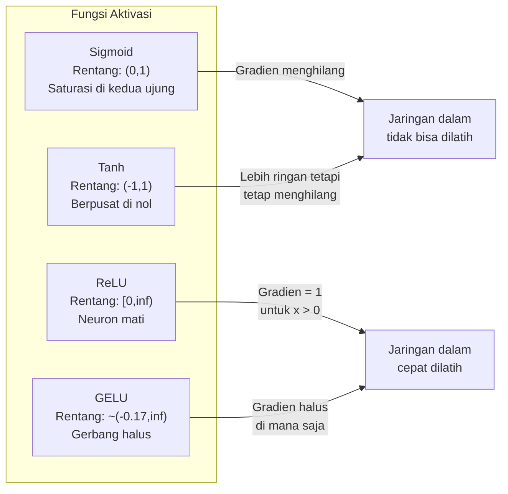
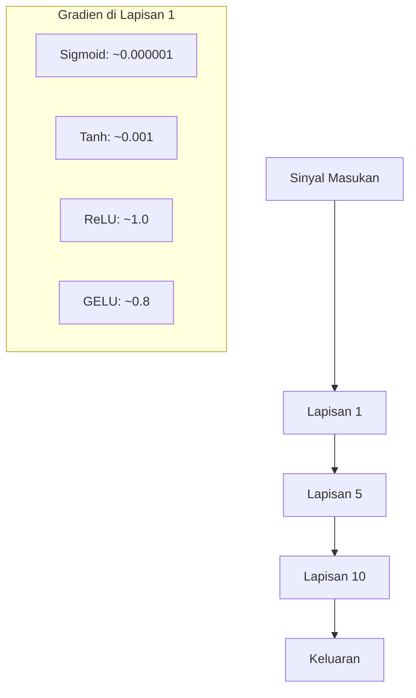
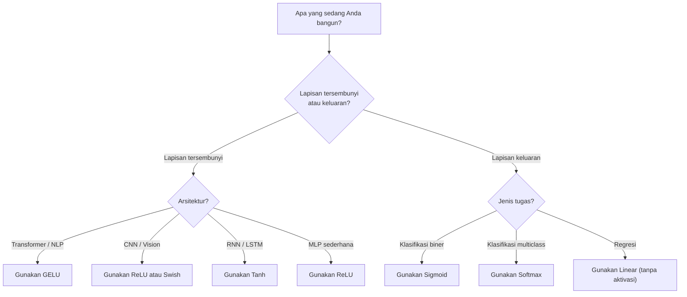

# Fungsi Aktivasi

> Tanpa nonlinearitas, jaringan 100 lapisan Anda hanyalah perkalian matriks yang mewah. Aktivasi adalah gerbang yang membiarkan jaringan saraf berpikir dalam kurva.

**Jenis:** Membangun
**Bahasa:** Python
**Prasyarat:** Pelajaran 03.03 (Propagasi Balik)
**Waktu:** ~75 menit

## Tujuan Pembelajaran

- Mengimplementasikan sigmoid, tanh, ReLU, Leaky ReLU, GELU, Swish, dan softmax beserta turunannya dari nol
- Mendiagnosis masalah gradien menghilang dengan mengukur besar aktivasi melalui 10+ lapisan dengan aktivasi yang berbeda
- Mendeteksi neuron mati dalam jaringan ReLU dan menjelaskan mengapa GELU menghindari mode kegagalan ini
- Memilih fungsi aktivasi yang tepat untuk arsitektur tertentu (transformer, CNN, RNN, lapisan keluaran)

## Masalahnya

Tumpuk dua transformasi linear: $y = W_2(W_1 x + b_1) + b_2$. Kembangkan: $y = W_2 W_1 x + W_2 b_1 + b_2$. Itu hanya $y = Ax + c$ -- satu transformasi linear. Tidak peduli berapa banyak lapisan linear yang Anda tumpuk, hasilnya menyusut menjadi satu perkalian matriks. Jaringan 100 lapisan Anda memiliki daya representasi yang sama dengan satu lapisan.

Ini bukan sekadar rasa penasaran teoretis. Ini berarti jaringan linear dalam secara harfiah tidak dapat mempelajari XOR, tidak dapat mengklasifikasikan dataset spiral, tidak dapat mengenali wajah. Tanpa fungsi aktivasi, kedalaman hanyalah ilusi.

Fungsi aktivasi memutus linearitas. Fungsi itu membengkokkan keluaran setiap lapisan melalui fungsi nonlinear, memberi jaringan kemampuan untuk melengkungkan batas keputusan, menghampiri fungsi sembarang, dan benar-benar belajar. Tetapi pilih aktivasi yang salah dan gradien Anda menghilang menjadi nol (sigmoid pada jaringan dalam), meledak tak terhingga (aktivasi tak terbatas tanpa inisialisasi yang cermat), atau neuron Anda mati secara permanen (ReLU dengan bias negatif besar). Pilihan fungsi aktivasi secara langsung menentukan apakah jaringan Anda belajar sama sekali.

## Konsepnya

### Mengapa Nonlinearitas Itu Perlu

Perkalian matriks bersifat komponabel. Mengalikan vektor dengan matriks $A$ lalu matriks $B$ identik dengan mengalikannya dengan $AB$. Ini berarti menumpuk sepuluh lapisan linear secara matematis setara dengan satu lapisan linear dengan satu matriks besar. Semua parameter itu, semua kedalaman itu -- terbuang. Anda membutuhkan sesuatu untuk memutus rantai. Itulah yang dilakukan fungsi aktivasi.

Berikut buktinya. Sebuah lapisan linear menghitung $f(x) = Wx + b$. Tumpuk dua:

```math
\begin{aligned}
\text{Lapisan 1:} \quad h &= W_1 x + b_1 \\
\text{Lapisan 2:} \quad y &= W_2 h + b_2
\end{aligned}
```

Substitusikan:

```math
\begin{aligned}
y &= W_2 (W_1 x + b_1) + b_2 \\
y &= (W_2 W_1) x + (W_2 b_1 + b_2) \\
y &= A x + c
\end{aligned}
```

Satu lapisan. Sisipkan aktivasi nonlinear $g()$ di antara lapisan:

```math
\begin{aligned}
h &= g(W_1 x + b_1) \\
y &= W_2 h + b_2
\end{aligned}
```

Kini substitusinya gagal. $W_2 g(W_1 x + b_1) + b_2$ tidak dapat direduksi menjadi satu transformasi linear. Jaringan dapat merepresentasikan fungsi nonlinear. Setiap lapisan tambahan dengan aktivasi menambah kapasitas representasi.

### Sigmoid

Fungsi aktivasi awal untuk jaringan saraf.

```math
\text{sigmoid}(x) = \frac{1}{1 + e^{-x}}
```

Rentang keluaran: (0, 1). Halus, terdiferensialkan, memetakan bilangan real apa pun menjadi nilai yang menyerupai probabilitas.

Turunannya:

```math
\text{sigmoid}'(x) = \text{sigmoid}(x) \cdot (1 - \text{sigmoid}(x))
```

Nilai maksimum turunan ini adalah 0,25, terjadi di $x = 0$. Dalam propagasi balik, gradien dikalikan lintas lapisan. Sepuluh lapisan sigmoid berarti gradien dikalikan paling banyak 0,25 sepuluh kali:

```math
0.25^{10} = 0.000000953674
```

Kurang dari sepersejuta sinyal awal. Inilah masalah gradien menghilang. Gradien pada lapisan awal menjadi begitu kecil sehingga bobot hampir tidak pernah diperbarui. Jaringan tampak belajar -- rugi menurun di lapisan belakang -- tetapi lapisan pertama membeku. Jaringan sigmoid dalam sederhananya tidak bisa dilatih.

Masalah tambahan: keluaran sigmoid selalu positif (0 hingga 1), yang berarti gradien pada bobot selalu bertanda sama. Ini menyebabkan zig-zag selama penurunan gradien.

### Tanh

Versi sigmoid yang terpusat.

```math
\tanh(x) = \frac{e^x - e^{-x}}{e^x + e^{-x}}
```

Rentang keluaran: (-1, 1). Berpusat di nol, yang menghilangkan masalah zig-zag.

Turunannya:

```math
\tanh'(x) = 1 - \tanh(x)^2
```

Turunan maksimum adalah 1.0 di $x = 0$ -- empat kali lebih baik dari sigmoid. Tetapi masalah gradien menghilang tetap ada. Untuk masukan positif atau negatif besar, turunan mendekati nol. Sepuluh lapisan tetap menghancurkan gradien, hanya saja tidak seagresif sebelumnya.

### ReLU: Terobosan

Rectified Linear Unit. Dipopulerkan untuk deep learning oleh Nair dan Hinton pada 2010 (fungsinya sendiri berasal dari karya Fukushima tahun 1969), fungsi ini mengubah segalanya.

```math
\text{relu}(x) = \max(0, x)
```

Rentang keluaran: $[0, \infty)$. Turunannya sangat sederhana:

```math
\text{relu}'(x) = \begin{cases} 1 & \text{jika } x > 0 \\ 0 & \text{jika } x \le 0 \end{cases}
```

Tidak ada gradien menghilang untuk masukan positif. Gradiennya tepat 1, diteruskan langsung. Inilah sebabnya jaringan dalam menjadi dapat dilatih -- ReLU mempertahankan besar gradien lintas lapisan.

Tetapi ada mode kegagalan: masalah neuron mati. Jika masukan terbobot sebuah neuron selalu negatif (akibat bias negatif besar atau inisialisasi bobot yang kurang beruntung), keluarannya selalu nol, gradiennya selalu nol, dan neuron itu tidak pernah diperbarui. Neuron itu mati secara permanen. Dalam praktiknya, 10-40% neuron dalam jaringan ReLU dapat mati selama pelatihan.

### Leaky ReLU

Perbaikan paling sederhana untuk neuron mati.

```math
\text{leaky\_relu}(x) = \begin{cases} x & \text{jika } x > 0 \\ \alpha x & \text{jika } x \le 0 \end{cases}
```

Di mana $\alpha$ adalah konstanta kecil, biasanya 0.01. Sisi negatif memiliki kemiringan kecil alih-alih nol, sehingga neuron mati tetap mendapat sinyal gradien dan dapat pulih.

### GELU: Pilihan Utama Modern

Gaussian Error Linear Unit. Diperkenalkan oleh Hendrycks dan Gimpel pada 2016. Aktivasi baku di BERT, GPT, dan sebagian besar transformer modern.

```math
\text{gelu}(x) = x \cdot \Phi(x)
```

Di mana $\Phi(x)$ adalah fungsi distribusi kumulatif dari distribusi normal standar. Pendekatan yang digunakan dalam praktiknya:

```math
\text{gelu}(x) \approx 0.5 \cdot x \cdot \left(1 + \tanh\left(\sqrt{2/\pi} \cdot (x + 0.044715 \cdot x^3)\right)\right)
```

GELU halus di mana saja, mengizinkan nilai negatif kecil (tidak seperti ReLU yang memotong keras ke nol), dan memiliki interpretasi probabilistik: fungsi ini memberi bobot pada setiap masukan berdasarkan kemungkinannya bernilai positif di bawah distribusi Gaussian. Gerbang halus ini mengungguli ReLU pada arsitektur transformer karena memberikan aliran gradien yang lebih baik dan sepenuhnya menghindari masalah neuron mati.

### Swish / SiLU

Aktivasi swa-gerbang (self-gated) yang ditemukan oleh Ramachandran dkk. pada 2017 melalui pencarian otomatis.

```math
\text{swish}(x) = x \cdot \text{sigmoid}(x)
```

Swish secara formal adalah $x \cdot \text{sigmoid}(x)$. Google menemukannya melalui pencarian otomatis dalam ruang fungsi aktivasi -- sebuah jaringan saraf yang merancang bagian-bagian jaringan saraf.

Seperti GELU, fungsi ini halus, nonmonoton, dan mengizinkan nilai negatif kecil. Perbedaannya halus: Swish memakai sigmoid untuk gerbang sementara GELU memakai CDF Gaussian. Dalam praktiknya, kinerjanya hampir identik. Swish digunakan dalam EfficientNet dan beberapa model visi. GELU mendominasi model bahasa.

### Softmax: Aktivasi Keluaran

Tidak digunakan di lapisan tersembunyi. Softmax mengubah vektor skor mentah (logit) menjadi distribusi probabilitas.

```math
\text{softmax}(x_i) = \frac{e^{x_i}}{\sum_j e^{x_j}}
```

Setiap keluaran berada antara 0 dan 1. Semua keluaran berjumlah 1. Ini menjadikannya aktivasi akhir baku untuk klasifikasi multiclass. Logit terbesar mendapat probabilitas tertinggi, tetapi tidak seperti argmax, softmax dapat terdiferensiasi dan mempertahankan informasi tentang keyakinan relatif.

### Perbandingan Bentuk



### Perbandingan Aliran Gradien



### Aktivasi Mana, Kapan



```figure
softmax-temperature
```

## Bangunlah

### Langkah 1: Implementasikan Semua Fungsi Aktivasi beserta Turunannya

Setiap fungsi menerima satu bilangan float dan mengembalikan bilangan float. Setiap fungsi turunan menerima masukan yang sama dan mengembalikan gradiennya.

```python
import math

def sigmoid(x):
    x = max(-500, min(500, x))
    return 1.0 / (1.0 + math.exp(-x))

def sigmoid_derivative(x):
    s = sigmoid(x)
    return s * (1 - s)

def tanh_act(x):
    return math.tanh(x)

def tanh_derivative(x):
    t = math.tanh(x)
    return 1 - t * t

def relu(x):
    return max(0.0, x)

def relu_derivative(x):
    return 1.0 if x > 0 else 0.0

def leaky_relu(x, alpha=0.01):
    return x if x > 0 else alpha * x

def leaky_relu_derivative(x, alpha=0.01):
    return 1.0 if x > 0 else alpha

def gelu(x):
    return 0.5 * x * (1 + math.tanh(math.sqrt(2 / math.pi) * (x + 0.044715 * x ** 3)))

def gelu_derivative(x):
    phi = 0.5 * (1 + math.erf(x / math.sqrt(2)))
    pdf = math.exp(-0.5 * x * x) / math.sqrt(2 * math.pi)
    return phi + x * pdf

def swish(x):
    return x * sigmoid(x)

def swish_derivative(x):
    s = sigmoid(x)
    return s + x * s * (1 - s)

def softmax(xs):
    max_x = max(xs)
    exps = [math.exp(x - max_x) for x in xs]
    total = sum(exps)
    return [e / total for e in exps]
```

### Langkah 2: Visualisasi Tempat Gradien Mati

Hitung gradien pada 100 titik berjarak sama dari -5 hingga 5. Cetak histogram teks yang menunjukkan di mana gradien setiap aktivasi mendekati nol.

```python
def gradient_scan(name, derivative_fn, start=-5, end=5, n=100):
    step = (end - start) / n
    near_zero = 0
    healthy = 0
    for i in range(n):
        x = start + i * step
        g = derivative_fn(x)
        if abs(g) < 0.01:
            near_zero += 1
        else:
            healthy += 1
    pct_dead = near_zero / n * 100
    print(f"{name:15s}: {healthy:3d} healthy, {near_zero:3d} near-zero ({pct_dead:.0f}% dead zone)")

gradient_scan("Sigmoid", sigmoid_derivative)
gradient_scan("Tanh", tanh_derivative)
gradient_scan("ReLU", relu_derivative)
gradient_scan("Leaky ReLU", leaky_relu_derivative)
gradient_scan("GELU", gelu_derivative)
gradient_scan("Swish", swish_derivative)
```

### Langkah 3: Eksperimen Gradien Menghilang

Loporkan sinyal melalui N lapisan dengan sigmoid versus ReLU. Ukur bagaimana besar aktivasi berubah.

```python
import random

def vanishing_gradient_experiment(activation_fn, name, n_layers=10, n_inputs=5):
    random.seed(42)
    values = [random.gauss(0, 1) for _ in range(n_inputs)]

    print(f"\n{name} through {n_layers} layers:")
    for layer in range(n_layers):
        weights = [random.gauss(0, 1) for _ in range(n_inputs)]
        z = sum(w * v for w, v in zip(weights, values))
        activated = activation_fn(z)
        magnitude = abs(activated)
        bar = "#" * int(magnitude * 20)
        print(f"  Layer {layer+1:2d}: magnitude = {magnitude:.6f} {bar}")
        values = [activated] * n_inputs

vanishing_gradient_experiment(sigmoid, "Sigmoid")
vanishing_gradient_experiment(relu, "ReLU")
vanishing_gradient_experiment(gelu, "GELU")
```

### Langkah 4: Detektor Neuron Mati

Buat jaringan ReLU, lewatkan masukan acak melaluinya, lalu hitung berapa banyak neuron yang tidak pernah aktif.

```python
def dead_neuron_detector(n_inputs=5, hidden_size=20, n_samples=1000):
    random.seed(0)
    weights = [[random.gauss(0, 1) for _ in range(n_inputs)] for _ in range(hidden_size)]
    biases = [random.gauss(0, 1) for _ in range(hidden_size)]

    fire_counts = [0] * hidden_size

    for _ in range(n_samples):
        inputs = [random.gauss(0, 1) for _ in range(n_inputs)]
        for neuron_idx in range(hidden_size):
            z = sum(w * x for w, x in zip(weights[neuron_idx], inputs)) + biases[neuron_idx]
            if relu(z) > 0:
                fire_counts[neuron_idx] += 1

    dead = sum(1 for c in fire_counts if c == 0)
    rarely_fire = sum(1 for c in fire_counts if 0 < c < n_samples * 0.05)
    healthy = hidden_size - dead - rarely_fire

    print(f"\nDead Neuron Report ({hidden_size} neurons, {n_samples} samples):")
    print(f"  Dead (never fired):     {dead}")
    print(f"  Barely alive (<5%):     {rarely_fire}")
    print(f"  Healthy:                {healthy}")
    print(f"  Dead neuron rate:       {dead/hidden_size*100:.1f}%")

    for i, c in enumerate(fire_counts):
        status = "DEAD" if c == 0 else "WEAK" if c < n_samples * 0.05 else "OK"
        bar = "#" * (c * 40 // n_samples)
        print(f"  Neuron {i:2d}: {c:4d}/{n_samples} fires [{status:4s}] {bar}")

dead_neuron_detector()
```

### Langkah 5: Perbandingan Pelatihan -- Sigmoid vs ReLU vs GELU

Latih jaringan dua lapisan yang sama pada dataset lingkaran (titik di dalam lingkaran = kelas 1, di luar = kelas 0) dengan tiga aktivasi berbeda. Bandingkan kecepatan konvergensi.

```python
def make_circle_data(n=200, seed=42):
    random.seed(seed)
    data = []
    for _ in range(n):
        x = random.uniform(-2, 2)
        y = random.uniform(-2, 2)
        label = 1.0 if x * x + y * y < 1.5 else 0.0
        data.append(([x, y], label))
    return data


class ActivationNetwork:
    def __init__(self, activation_fn, activation_deriv, hidden_size=8, lr=0.1):
        random.seed(0)
        self.act = activation_fn
        self.act_d = activation_deriv
        self.lr = lr
        self.hidden_size = hidden_size

        self.w1 = [[random.gauss(0, 0.5) for _ in range(2)] for _ in range(hidden_size)]
        self.b1 = [0.0] * hidden_size
        self.w2 = [random.gauss(0, 0.5) for _ in range(hidden_size)]
        self.b2 = 0.0

    def forward(self, x):
        self.x = x
        self.z1 = []
        self.h = []
        for i in range(self.hidden_size):
            z = self.w1[i][0] * x[0] + self.w1[i][1] * x[1] + self.b1[i]
            self.z1.append(z)
            self.h.append(self.act(z))

        self.z2 = sum(self.w2[i] * self.h[i] for i in range(self.hidden_size)) + self.b2
        self.out = sigmoid(self.z2)
        return self.out

    def backward(self, target):
        error = self.out - target
        d_out = error * self.out * (1 - self.out)

        for i in range(self.hidden_size):
            d_h = d_out * self.w2[i] * self.act_d(self.z1[i])
            self.w2[i] -= self.lr * d_out * self.h[i]
            for j in range(2):
                self.w1[i][j] -= self.lr * d_h * self.x[j]
            self.b1[i] -= self.lr * d_h
        self.b2 -= self.lr * d_out

    def train(self, data, epochs=200):
        losses = []
        for epoch in range(epochs):
            total_loss = 0
            correct = 0
            for x, y in data:
                pred = self.forward(x)
                self.backward(y)
                total_loss += (pred - y) ** 2
                if (pred >= 0.5) == (y >= 0.5):
                    correct += 1
            avg_loss = total_loss / len(data)
            accuracy = correct / len(data) * 100
            losses.append(avg_loss)
            if epoch % 50 == 0 or epoch == epochs - 1:
                print(f"    Epoch {epoch:3d}: loss={avg_loss:.4f}, accuracy={accuracy:.1f}%")
        return losses


data = make_circle_data()

configs = [
    ("Sigmoid", sigmoid, sigmoid_derivative),
    ("ReLU", relu, relu_derivative),
    ("GELU", gelu, gelu_derivative),
]

results = {}
for name, act_fn, act_d_fn in configs:
    print(f"\n=== Training with {name} ===")
    net = ActivationNetwork(act_fn, act_d_fn, hidden_size=8, lr=0.1)
    losses = net.train(data, epochs=200)
    results[name] = losses

print("\n=== Final Loss Comparison ===")
for name, losses in results.items():
    print(f"  {name:10s}: start={losses[0]:.4f} -> end={losses[-1]:.4f} (improvement: {(1 - losses[-1]/losses[0])*100:.1f}%)")
```

## Gunakanlah

PyTorch menyediakan semuanya dalam bentuk fungsional maupun modul:

```python
import torch
import torch.nn as nn
import torch.nn.functional as F

x = torch.randn(4, 10)

relu_out = F.relu(x)
gelu_out = F.gelu(x)
sigmoid_out = torch.sigmoid(x)
swish_out = F.silu(x)

logits = torch.randn(4, 5)
probs = F.softmax(logits, dim=1)

model = nn.Sequential(
    nn.Linear(10, 64),
    nn.GELU(),
    nn.Linear(64, 32),
    nn.GELU(),
    nn.Linear(32, 5),
)
```

Lapisan tersembunyi pada transformer: GELU. Lapisan tersembunyi pada CNN: ReLU. Lapisan keluaran untuk klasifikasi: softmax. Lapisan keluaran untuk regresi: tidak ada (linear). Lapisan keluaran untuk probabilitas: sigmoid. Selesai. Mulailah dengan nilai baku ini. Ubah hanya jika Anda punya bukti.

RNN dan LSTM memakai tanh untuk keadaan tersembunyi dan sigmoid untuk gerbang, tetapi jika Anda membangun dari nol hari ini, kemungkinan besar Anda tidak memakai RNN. Jika neuron dalam jaringan ReLU Anda mati, beralihlah ke GELU. Jangan langsung mengambil Leaky ReLU kecuali Anda punya alasan khusus -- GELU menyelesaikan masalah neuron mati dan memberikan aliran gradien yang lebih baik.

## Terbitkan

Pelajaran ini menghasilkan:
- `outputs/prompt-activation-selector.md` -- prompt yang dapat digunakan ulang untuk membantu Anda memilih fungsi aktivasi yang tepat bagi arsitektur apa pun

## Latihan

1. Implementasikan Parametric ReLU (PReLU) di mana kemiringan negatif $\alpha$ adalah parameter yang dapat dipelajari. Latih pada dataset lingkaran dan bandingkan dengan Leaky ReLU tetap.

2. Jalankan eksperimen gradien menghilang dengan 50 lapisan alih-alih 10. Plot besar sinyal di setiap lapisan untuk sigmoid, tanh, ReLU, dan GELU. Pada lapisan ke berapa sinyal setiap aktivasi secara efektif mencapai nol?

3. Implementasikan ELU (Exponential Linear Unit): $\text{elu}(x) = x$ jika $x \gt 0$, $\alpha (e^x - 1)$ jika $x \le 0$. Bandingkan tingkat neuron matinya dengan ReLU pada jaringan yang sama.

4. Buat "pemantau kesehatan gradien" yang berjalan selama pelatihan: pada setiap epoch, hitung rata-rata besar gradien di setiap lapisan. Cetak peringatan ketika gradien lapisan mana pun turun di bawah 0.001 atau melebihi 100.

5. Ubah perbandingan pelatihan agar memakai dataset XOR dari Pelajaran 01 alih-alih lingkaran. Aktivasi mana yang paling cepat konvergen pada XOR? Mengapa ini berbeda dari hasil lingkaran?

## Istilah Kunci

| Istilah | Kata orang pada umumnya | Makna sebenarnya |
|------|----------------|----------------|
| Fungsi aktivasi | "Bagian nonlinear" | Fungsi yang diterapkan pada keluaran setiap neuron untuk memutus linearitas, memungkinkan jaringan mempelajari pemetaan nonlinear |
| Gradien menghilang | "Gradien hilang di jaringan dalam" | Gradien menyusut secara eksponensial lintas lapisan ketika turunan aktivasi kurang dari 1, membuat lapisan awal tidak dapat dilatih |
| Gradien meledak | "Gradien meledak" | Gradien tumbuh secara eksponensial lintas lapisan ketika pengali efektif melebihi 1, menyebabkan pelatihan tidak stabil |
| Neuron mati | "Neuron yang berhenti belajar" | Neuron ReLU yang masukannya secara permanen negatif, menghasilkan keluaran nol dan gradien nol |
| Sigmoid | "Mengompres nilai ke 0-1" | Fungsi logistik $1/(1+e^{-x})$, penting secara historis tetapi menyebabkan gradien menghilang pada jaringan dalam |
| ReLU | "Memotong nilai negatif ke nol" | $\max(0, x)$ -- aktivasi yang membuat deep learning praktis dengan mempertahankan besar gradien |
| GELU | "Aktivasi transformer" | Gaussian Error Linear Unit, aktivasi halus yang memberi bobot masukan berdasarkan probabilitasnya bernilai positif |
| Swish/SiLU | "ReLU swa-gerbang" | $x \cdot \text{sigmoid}(x)$, ditemukan melalui pencarian otomatis, digunakan dalam EfficientNet |
| Softmax | "Mengubah skor menjadi probabilitas" | Menormalkan vektor logit menjadi distribusi probabilitas di mana semua nilai berada dalam (0,1) dan berjumlah 1 |
| Leaky ReLU | "ReLU yang tidak mati" | $\max(\alpha x, x)$ dengan $\alpha$ kecil (0.01), mencegah neuron mati dengan mengizinkan gradien negatif kecil |
| Saturasi | "Bagian datar sigmoid" | Daerah di mana turunan aktivasi mendekati nol, menghalangi aliran gradien |
| Logit | "Skor mentah sebelum softmax" | Keluaran tak ternormalisasi dari lapisan akhir sebelum menerapkan softmax atau sigmoid |

## Bacaan Lanjutan

- Nair & Hinton, "Rectified Linear Units Improve Restricted Boltzmann Machines" (2010) -- makalah yang memperkenalkan ReLU dan memungkinkan pelatihan jaringan dalam
- Hendrycks & Gimpel, "Gaussian Error Linear Units (GELUs)" (2016) -- memperkenalkan fungsi aktivasi yang menjadi pilihan baku transformer
- Ramachandran dkk., "Searching for Activation Functions" (2017) -- memakai pencarian otomatis untuk menemukan Swish, menunjukkan bahwa desain aktivasi dapat diotomatisasi
- Glorot & Bengio, "Understanding the difficulty of training deep feedforward neural networks" (2010) -- makalah yang mendiagnosis gradien menghilang/meledak dan mengusulkan inisialisasi Xavier
- Goodfellow, Bengio, Courville, "Deep Learning" Bab 6.3 (https://www.deeplearningbook.org/) -- pembahasan mendalam tentang unit tersembunyi dan fungsi aktivasi
