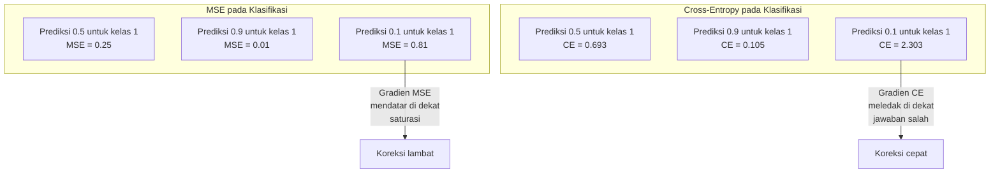
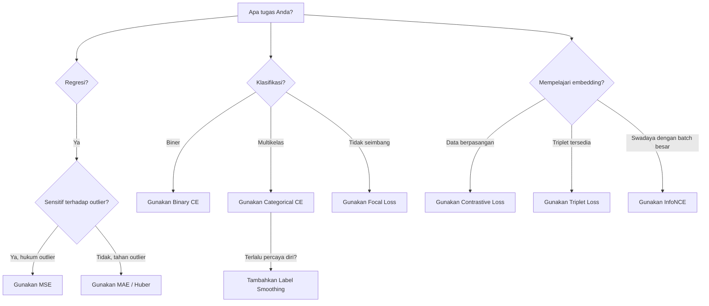
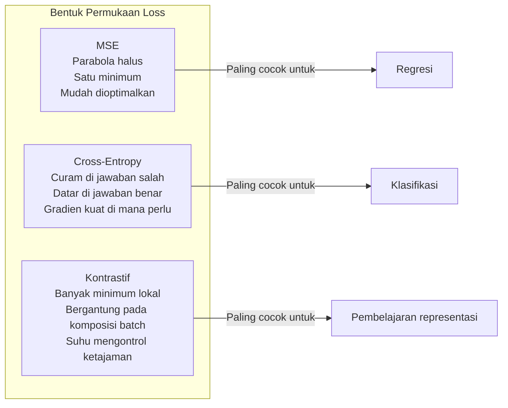

# Fungsi Loss

> Jaringan Anda membuat prediksi. Kebenaran mengatakan sebaliknya. Seberapa salah prediksi itu? Angka itulah loss. Pilih fungsi loss yang salah dan model Anda akan mengoptimalkan hal yang sama sekali berbeda.

**Jenis:** Bangun
**Bahasa:** Python
**Prasyarat:** Pelajaran 03.04 (Fungsi Aktivasi)
**Waktu:** ~75 menit

## Tujuan Pembelajaran

- Implementasikan MSE, binary cross-entropy, categorical cross-entropy, dan contrastive loss (InfoNCE) dari awal beserta gradiennya
- Jelaskan mengapa MSE gagal untuk klasifikasi dengan mendemonstrasikan mode gagal "prediksi 0,5 untuk semuanya"
- Terapkan label smoothing pada cross-entropy dan jelaskan bagaimana ia mencegah prediksi yang terlalu percaya diri
- Pilih fungsi loss yang tepat untuk regresi, klasifikasi biner, klasifikasi multikelas, dan tugas pembelajaran embedding

## Masalahnya

Model yang meminimalkan MSE pada masalah klasifikasi akan dengan percaya diri memprediksi 0,5 untuk semuanya. Ia sedang meminimalkan loss. Ia juga tidak berguna.

Fungsi loss adalah satu-satunya hal yang benar-benar dioptimalkan model Anda. Bukan akurasi. Bukan skor F1. Bukan metrik apa pun yang Anda laporkan kepada atasan. Pengoptimal mengambil gradien fungsi loss dan menyesuaikan bobot agar angka itu lebih kecil. Jika fungsi loss tidak menangkap apa yang Anda pedulikan, model akan menemukan cara termurah secara matematis untuk memuaskannya, dan cara itu hampir tidak pernah menjadi apa yang Anda inginkan.

Berikut contoh konkret. Anda memiliki tugas klasifikasi biner. Dua kelas, pembagian 50/50. Anda memakai MSE sebagai loss. Model memprediksi 0,5 untuk setiap masukan. MSE rata-rata adalah 0,25, yang merupakan nilai minimum tanpa perlu belajar apa pun. Model itu memiliki daya diskriminasi nol, tetapi secara teknis ia telah meminimalkan fungsi loss Anda. Beralih ke cross-entropy dan model yang sama dipaksa mendorong prediksi ke arah 0 atau 1, karena -log(0,5) = 0,693 adalah loss yang buruk, sementara -log(0,99) = 0,01 memberi hadiah pada prediksi benar yang percaya diri. Pilihan fungsi loss adalah perbedaan antara model yang belajar dan model yang memanipulasi metrik.

Keadaannya memburuk. Dalam pembelajaran swadaya (self-supervised), Anda bahkan tidak punya label. Contrastive loss sepenuhnya menentukan sinyal belajar: apa yang dianggap serupa, apa yang dianggap berbeda, dan seberapa keras model harus mendorong keduanya menjauh. Salah menentukan contrastive loss dan embedding Anda akan kolaps menjadi satu titik — setiap masukan dipetakan ke vektor yang sama. Secara teknis loss nol. Sama sekali tidak berguna.

## Konsep

### Mean Squared Error (MSE)

Nilai bawaan untuk regresi. Hitung selisih kuadrat antara prediksi dan target, lalu rata-rata atas semua sampel.

```math
\text{MSE} = \frac{1}{n} \sum (y_{\text{pred}} - y_{\text{true}})^2
```

Mengapa kuadrat penting: ia menghukum error besar secara kuadratik. Error 2 biayanya 4 kali error 1. Error 10 biayanya 100 kali. Ini membuat MSE sensitif terhadap outlier — satu prediksi yang sangat salah mendominasi loss.

Angka nyata: jika model Anda memprediksi harga rumah dan meleset $10.000 pada kebanyakan rumah tetapi meleset $200.000 pada satu mansion, MSE akan dengan agresif mencoba memperbaiki mansion itu, berpotensi merusak kinerja pada 99 rumah lainnya.

Gradien MSE terhadap sebuah prediksi adalah:

```math
\frac{\partial \text{MSE}}{\partial y_{\text{pred}}} = \frac{2}{n} (y_{\text{pred}} - y_{\text{true}})
```

Linier terhadap error. Error lebih besar mendapat gradien lebih besar. Ini adalah fitur untuk regresi (error besar butuh koreksi besar) dan bug untuk klasifikasi (Anda ingin menghukum jawaban salah yang percaya diri secara eksponensial, bukan linier).

### Cross-Entropy Loss

Fungsi loss untuk klasifikasi. Berakar pada teori informasi — ia mengukur divergensi antara distribusi probabilitas yang diprediksi dan distribusi yang sebenarnya.

**Binary Cross-Entropy (BCE):**

```math
\text{BCE} = -\left(y \log(p) + (1 - y) \log(1 - p)\right)
```

di mana $y$ adalah label sebenarnya (0 atau 1) dan $p$ adalah probabilitas prediksi.

Mengapa $-\log(p)$ berfungsi: ketika label sebenarnya 1 dan Anda memprediksi $p = 0,99$, lossnya $-\log(0,99) = 0,01$. Ketika Anda memprediksi $p = 0,01$, lossnya $-\log(0,01) = 4,6$. Selisih 460 kali itulah sebabnya cross-entropy berfungsi. Ia tanpa ampun menghukum prediksi salah yang percaya diri, tetapi hampir tidak menghukum prediksi benar yang percaya diri.

Gradiennya menceritakan hal yang sama:

```math
\frac{\partial \text{BCE}}{\partial p} = -\frac{y}{p} + \frac{1-y}{1-p}
```

Ketika $y = 1$ dan $p$ mendekati nol, gradiennya $-1/p$ yang mendekati tak hingga negatif. Model mendapat sinyal besar untuk memperbaiki kesalahannya. Ketika $p$ mendekati 1, gradiennya kecil. Sudah benar, tidak ada yang perlu diperbaiki.

**Categorical Cross-Entropy:**

Untuk klasifikasi multikelas dengan target berbentuk one-hot.

```math
\text{CCE} = -\sum_i y_i \log(p_i)
```

Hanya kelas sebenarnya yang menyumbang loss (karena semua $y_i$ lainnya bernilai nol). Jika ada 10 kelas dan kelas yang benar mendapat probabilitas 0,1 (tebakan acak), lossnya $-\log(0,1) = 2,3$. Jika kelas yang benar mendapat probabilitas 0,9, lossnya $-\log(0,9) = 0,105$. Model belajar memusatkan massa probabilitas pada jawaban yang tepat.

### Mengapa MSE Gagal untuk Klasifikasi



Gradien MSE mendatar ketika prediksi mendekati 0 atau 1 (karena sigmoid jenuh). Gradien cross-entropy mengompensasinya — fungsi $-\log$ meniadakan wilayah datar sigmoid, menghasilkan gradien kuat tepat di tempat yang paling membutuhkannya.

### Label Smoothing

Label one-hot standar menyatakan "ini 100% kelas 3 dan 0% sisanya." Itu adalah klaim yang kuat. Label smoothing melunakkannya:

```math
\text{smooth\_label} = (1 - \alpha) \cdot \text{one\_hot} + \frac{\alpha}{\text{num\_classes}}
```

Dengan $\alpha = 0,1$ dan 10 kelas: alih-alih [0, 0, 1, 0, ...], target menjadi [0,01, 0,01, 0,91, 0,01, ...]. Model menargetkan 0,91 alih-alih 1,0.

Mengapa ini berfungsi: model yang berusaha menghasilkan tepat 1,0 melalui softmax perlu mendorong logit hingga tak hingga. Ini menyebabkan kepercayaan berlebihan, merusak generalisasi, dan membuat model rapuh terhadap pergeseran distribusi. Label smoothing membatasi target pada 0,9 (dengan $\alpha = 0,1$), menjaga logit tetap dalam rentang wajar. GPT dan kebanyakan model modern memakai label smoothing atau padanannya.

### Contrastive Loss

Tanpa label. Tanpa kelas. Hanya pasangan masukan dan pertanyaan: apakah keduanya serupa atau berbeda?

**Contrastive loss gaya SimCLR (NT-Xent / InfoNCE):**

Ambil satu gambar. Buat dua tampilan augmented darinya (crop, rotasi, jitter warna). Keduanya adalah "pasangan positif" — embedding-nya harus serupa. Setiap gambar lain dalam batch membentuk "pasangan negatif" — embedding-nya harus berbeda.

```math
L = -\log \frac{\exp(\text{sim}(z_i, z_j) / \tau)}{\sum_k \exp(\text{sim}(z_i, z_k) / \tau)}
```

di mana $\text{sim}()$ adalah cosine similarity, $z_i$ dan $z_j$ adalah pasangan positif, penjumlahan dilakukan atas semua negatif, dan $\tau$ (suhu) mengontrol seberapa tajam distribusinya. Suhu lebih rendah = negatif lebih sulit = pemisahan lebih agresif.

Angka nyata: ukuran batch 256 berarti 255 negatif per pasangan positif. Suhu $\tau = 0,07$ (nilai bawaan SimCLR). Lossnya tampak seperti softmax atas kesamaan — ia menginginkan kesamaan pasangan positif menjadi yang tertinggi di antara ke-256 pilihan.

**Triplet Loss:**

Menerima tiga masukan: anchor, positif (kelas sama), negatif (kelas berbeda).

```math
L = \max\left(0, d(\text{anchor}, \text{positive}) - d(\text{anchor}, \text{negative}) + \text{margin}\right)
```

Margin (biasanya 0,2-1,0) menetapkan jarak minimum antara jarak positif dan negatif. Jika negatif sudah cukup jauh, lossnya nol — tidak ada gradien, tidak ada pembaruan. Ini membuat pelatihan efisien, tetapi membutuhkan triplet mining yang cermat (memilih negatif sulit yang dekat dengan anchor).

### Focal Loss

Untuk dataset tidak seimbang. Cross-entropy standar memperlakukan semua contoh yang diklasifikasikan dengan benar secara setara. Focal loss menurunkan bobot contoh yang mudah:

```math
\text{FL} = -\alpha (1 - p_t)^\gamma \log(p_t)
```

di mana $p_t$ adalah probabilitas prediksi dari kelas sebenarnya dan $\gamma$ mengontrol pemusatan. Dengan $\gamma = 0$, ini adalah cross-entropy standar. Dengan $\gamma = 2$ (nilai bawaan):

- Contoh mudah ($p_t = 0,9$): bobot $= (0,1)^2 = 0,01$. Secara efektif diabaikan.
- Contoh sulit ($p_t = 0,1$): bobot $= (0,9)^2 = 0,81$. Sinyal gradien penuh.

Focal loss diperkenalkan oleh Lin dkk. untuk deteksi objek, di mana 99% wilayah kandidat adalah latar belakang (negatif mudah). Tanpa focal loss, model tenggelam dalam contoh latar belakang yang mudah dan tidak pernah belajar mendeteksi objek. Dengan focal loss, model memusatkan kapasitasnya pada kasus yang sulit dan ambigu serta benar-benar penting.

### Pohon Keputusan Fungsi Loss



### Lanskap Loss



```figure
cross-entropy-loss
```

## Bangun

### Langkah 1: MSE dan gradiennya

```python
def mse(predictions, targets):
    n = len(predictions)
    total = 0.0
    for p, t in zip(predictions, targets):
        total += (p - t) ** 2
    return total / n

def mse_gradient(predictions, targets):
    n = len(predictions)
    grads = []
    for p, t in zip(predictions, targets):
        grads.append(2.0 * (p - t) / n)
    return grads
```

### Langkah 2: Binary Cross-Entropy

Masalah log(0) itu nyata. Jika model memprediksi tepat 0 untuk contoh positif, $\log(0) = -\infty$. Pemotongan nilai mencegahnya.

```python
import math

def binary_cross_entropy(predictions, targets, eps=1e-15):
    n = len(predictions)
    total = 0.0
    for p, t in zip(predictions, targets):
        p_clipped = max(eps, min(1 - eps, p))
        total += -(t * math.log(p_clipped) + (1 - t) * math.log(1 - p_clipped))
    return total / n

def bce_gradient(predictions, targets, eps=1e-15):
    grads = []
    for p, t in zip(predictions, targets):
        p_clipped = max(eps, min(1 - eps, p))
        grads.append(-(t / p_clipped) + (1 - t) / (1 - p_clipped))
    return grads
```

### Langkah 3: Categorical Cross-Entropy dengan Softmax

Softmax mengubah logit mentah menjadi probabilitas. Lalu kita menghitung cross-entropy terhadap target one-hot.

```python
def softmax(logits):
    max_val = max(logits)
    exps = [math.exp(x - max_val) for x in logits]
    total = sum(exps)
    return [e / total for e in exps]

def categorical_cross_entropy(logits, target_index, eps=1e-15):
    probs = softmax(logits)
    p = max(eps, probs[target_index])
    return -math.log(p)

def cce_gradient(logits, target_index):
    probs = softmax(logits)
    grads = list(probs)
    grads[target_index] -= 1.0
    return grads
```

Gradien softmax + cross-entropy menyederhana dengan indah: ia sekadar (probabilitas prediksi - 1) untuk kelas sebenarnya, dan (probabilitas prediksi) untuk semua kelas lainnya. Penyederhanaan elegan ini bukan kebetulan — itulah sebabnya softmax dan cross-entropy dipasangkan.

### Langkah 4: Label Smoothing

```python
def label_smoothed_cce(logits, target_index, num_classes, alpha=0.1, eps=1e-15):
    probs = softmax(logits)
    loss = 0.0
    for i in range(num_classes):
        if i == target_index:
            smooth_target = 1.0 - alpha + alpha / num_classes
        else:
            smooth_target = alpha / num_classes
        p = max(eps, probs[i])
        loss += -smooth_target * math.log(p)
    return loss
```

### Langkah 5: Contrastive Loss (InfoNCE sederhana)

```python
def cosine_similarity(a, b):
    dot = sum(x * y for x, y in zip(a, b))
    norm_a = math.sqrt(sum(x * x for x in a))
    norm_b = math.sqrt(sum(x * x for x in b))
    if norm_a < 1e-10 or norm_b < 1e-10:
        return 0.0
    return dot / (norm_a * norm_b)

def contrastive_loss(anchor, positive, negatives, temperature=0.07):
    sim_pos = cosine_similarity(anchor, positive) / temperature
    sim_negs = [cosine_similarity(anchor, neg) / temperature for neg in negatives]

    max_sim = max(sim_pos, max(sim_negs)) if sim_negs else sim_pos
    exp_pos = math.exp(sim_pos - max_sim)
    exp_negs = [math.exp(s - max_sim) for s in sim_negs]
    total_exp = exp_pos + sum(exp_negs)

    return -math.log(max(1e-15, exp_pos / total_exp))
```

### Langkah 6: MSE vs Cross-Entropy pada Klasifikasi

Latih jaringan yang sama dari pelajaran 04 (dataset lingkaran) dengan kedua fungsi loss. Amati cross-entropy converge lebih cepat.

```python
import random

def sigmoid(x):
    x = max(-500, min(500, x))
    return 1.0 / (1.0 + math.exp(-x))

def make_circle_data(n=200, seed=42):
    random.seed(seed)
    data = []
    for _ in range(n):
        x = random.uniform(-2, 2)
        y = random.uniform(-2, 2)
        label = 1.0 if x * x + y * y < 1.5 else 0.0
        data.append(([x, y], label))
    return data


class LossComparisonNetwork:
    def __init__(self, loss_type="bce", hidden_size=8, lr=0.1):
        random.seed(0)
        self.loss_type = loss_type
        self.lr = lr
        self.hidden_size = hidden_size

        self.w1 = [[random.gauss(0, 0.5) for _ in range(2)] for _ in range(hidden_size)]
        self.b1 = [0.0] * hidden_size
        self.w2 = [random.gauss(0, 0.5) for _ in range(hidden_size)]
        self.b2 = 0.0

    def forward(self, x):
        self.x = x
        self.z1 = []
        self.h = []
        for i in range(self.hidden_size):
            z = self.w1[i][0] * x[0] + self.w1[i][1] * x[1] + self.b1[i]
            self.z1.append(z)
            self.h.append(max(0.0, z))

        self.z2 = sum(self.w2[i] * self.h[i] for i in range(self.hidden_size)) + self.b2
        self.out = sigmoid(self.z2)
        return self.out

    def backward(self, target):
        if self.loss_type == "mse":
            d_loss = 2.0 * (self.out - target)
        else:
            eps = 1e-15
            p = max(eps, min(1 - eps, self.out))
            d_loss = -(target / p) + (1 - target) / (1 - p)

        d_sigmoid = self.out * (1 - self.out)
        d_out = d_loss * d_sigmoid

        for i in range(self.hidden_size):
            d_relu = 1.0 if self.z1[i] > 0 else 0.0
            d_h = d_out * self.w2[i] * d_relu
            self.w2[i] -= self.lr * d_out * self.h[i]
            for j in range(2):
                self.w1[i][j] -= self.lr * d_h * self.x[j]
            self.b1[i] -= self.lr * d_h
        self.b2 -= self.lr * d_out

    def compute_loss(self, pred, target):
        if self.loss_type == "mse":
            return (pred - target) ** 2
        else:
            eps = 1e-15
            p = max(eps, min(1 - eps, pred))
            return -(target * math.log(p) + (1 - target) * math.log(1 - p))

    def train(self, data, epochs=200):
        losses = []
        for epoch in range(epochs):
            total_loss = 0.0
            correct = 0
            for x, y in data:
                pred = self.forward(x)
                self.backward(y)
                total_loss += self.compute_loss(pred, y)
                if (pred >= 0.5) == (y >= 0.5):
                    correct += 1
            avg_loss = total_loss / len(data)
            accuracy = correct / len(data) * 100
            losses.append((avg_loss, accuracy))
            if epoch % 50 == 0 or epoch == epochs - 1:
                print(f"    Epoch {epoch:3d}: loss={avg_loss:.4f}, accuracy={accuracy:.1f}%")
        return losses
```

## Gunakan

PyTorch menyediakan semua fungsi loss standar dengan kestabilan numerik bawaan:

```python
import torch
import torch.nn as nn
import torch.nn.functional as F

predictions = torch.tensor([0.9, 0.1, 0.7], requires_grad=True)
targets = torch.tensor([1.0, 0.0, 1.0])

mse_loss = F.mse_loss(predictions, targets)
bce_loss = F.binary_cross_entropy(predictions, targets)

logits = torch.randn(4, 10)
labels = torch.tensor([3, 7, 1, 9])
ce_loss = F.cross_entropy(logits, labels)
ce_smooth = F.cross_entropy(logits, labels, label_smoothing=0.1)
```

Gunakan `F.cross_entropy` (bukan `F.nll_loss` plus softmax manual). Ia menggabungkan log-softmax dan negative log-likelihood dalam satu operasi yang stabil secara numerik. Menerapkan softmax terpisah lalu mengambil log kurang stabil — Anda kehilangan presisi pada pengurangan eksponensial besar.

Untuk pembelajaran kontrastif, kebanyakan tim memakai implementasi khusus atau pustaka seperti `lightly` atau `pytorch-metric-learning`. Loop intinya selalu sama: hitung kesamaan berpasangan, bentuk softmax atas positif dan negatif, lalu lakukan backpropagasi.

## Kirim

Pelajaran ini menghasilkan:
- `outputs/prompt-loss-function-selector.md` — prompt yang dapat dipakai ulang untuk memilih fungsi loss yang tepat
- `outputs/prompt-loss-debugger.md` — prompt diagnostik untuk ketika kurva loss Anda terlihat salah

## Latihan

1. Implementasikan Huber loss (smooth L1 loss), yang merupakan MSE untuk error kecil dan MAE untuk error besar. Latih sebuah jaringan regresi yang memprediksi $y = \sin(x)$ dengan MSE versus Huber ketika 5% target latih diberi derau acak (outlier). Bandingkan error uji akhir.

2. Tambahkan focal loss ke loop pelatihan klasifikasi biner. Buat dataset tidak seimbang (90% kelas 0, 10% kelas 1). Bandingkan BCE standar dengan focal loss ($\gamma = 2$) pada recall kelas minoritas setelah 200 epoch.

3. Implementasikan triplet loss dengan semi-hard negative mining. Bangkitkan data embedding 2D untuk 5 kelas. Untuk setiap anchor, temukan negatif tersulit yang masih lebih jauh daripada positif (semi-hard). Bandingkan konvergensinya dengan pemilihan triplet acak.

4. Jalankan perbandingan MSE versus cross-entropy, tetapi lacak besar gradien di setiap lapisan selama pelatihan. Plot norma gradien rata-rata per epoch. Verifikasi bahwa cross-entropy menghasilkan gradien lebih besar pada epoch awal ketika model paling tidak pasti.

5. Implementasikan loss divergensi KL dan verifikasi bahwa meminimalkan $\mathrm{KL}(\text{true} \Vert \text{predicted})$ memberi gradien yang sama dengan cross-entropy ketika distribusi sebenarnya berbentuk one-hot. Lalu coba target lunak (seperti distilasi pengetahuan) yang distribusi "sebenarnya"-nya berasal dari keluaran softmax model guru.

## Istilah Kunci

| Istilah | Apa yang orang katakan | Arti sebenarnya |
|---------|------------------------|-----------------|
| Fungsi loss | "Seberapa salah model itu" | Fungsi terdiferensialasi yang memetakan prediksi dan target ke sebuah skalar yang diminimalkan pengoptimal |
| MSE | "Rata-rata error kuadrat" | Rata-rata selisih kuadrat antara prediksi dan target; menghukum error besar secara kuadratik |
| Cross-entropy | "Loss klasifikasinya" | Mengukur divergensi antara distribusi probabilitas prediksi dan distribusi sebenarnya memakai $-\log(p)$ |
| Binary cross-entropy | "BCE" | Cross-entropy untuk dua kelas: $-(y \log(p) + (1-y) \log(1-p))$ |
| Label smoothing | "Melunakkan target" | Mengganti target keras 0/1 dengan nilai lunak (mis. 0,1/0,9) untuk mencegah kepercayaan berlebihan dan memperbaiki generalisasi |
| Contrastive loss | "Tarik bersama, tolak menjauh" | Loss yang mempelajari representasi dengan membuat pasangan serupa berdekatan dan pasangan tidak serupa berjauhan dalam ruang embedding |
| InfoNCE | "Loss-nya CLIP/SimCLR" | Cross-entropy ternormalisasi dan berskala suhu atas skor kesamaan; memperlakukan pembelajaran kontrastif sebagai klasifikasi |
| Focal loss | "Solusi untuk data tidak seimbang" | Cross-entropy yang dibobot $(1-p_t)^\gamma$ untuk menurunkan bobot contoh mudah dan fokus pada contoh sulit |
| Triplet loss | "Anchor-positif-negatif" | Mendorong anchor lebih dekat ke positif daripada negatif dengan selisih margin minimum dalam ruang embedding |
| Suhu | "Tombol ketajaman" | Pembagi skalar pada logit/kesamaan yang mengontrol seberapa tajam distribusi hasilnya; lebih rendah = lebih tajam |

## Bacaan Lebih Lanjut

- Lin et al., "Focal Loss for Dense Object Detection" (2017) — memperkenalkan focal loss untuk menangani ketidakseimbangan kelas ekstrem dalam deteksi objek (RetinaNet)
- Chen et al., "A Simple Framework for Contrastive Learning of Visual Representations" (SimCLR, 2020) — menetapkan pipeline pembelajaran kontrastif modern dengan loss NT-Xent
- Szegedy et al., "Rethinking the Inception Architecture" (2016) — memperkenalkan label smoothing sebagai teknik regularisasi, kini standar pada kebanyakan model besar
- Hinton et al., "Distilling the Knowledge in a Neural Network" (2015) — distilasi pengetahuan memakai target lunak dan divergensi KL, fondasi kompresi model
