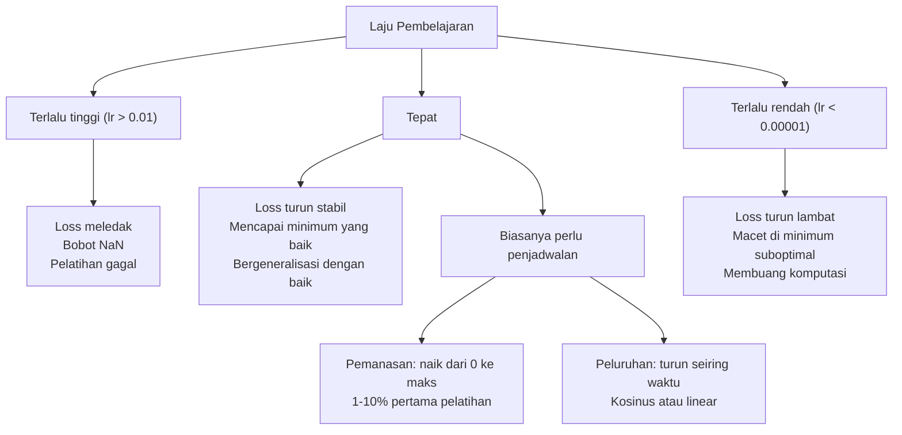
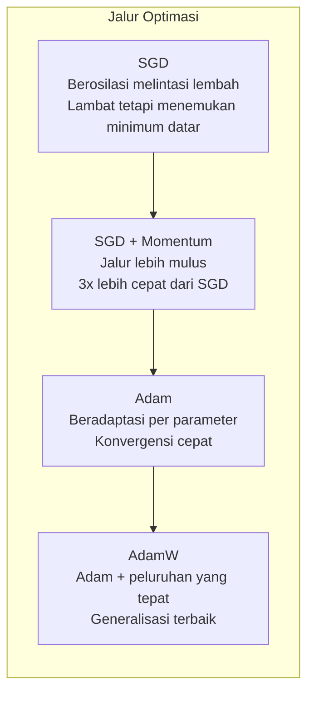
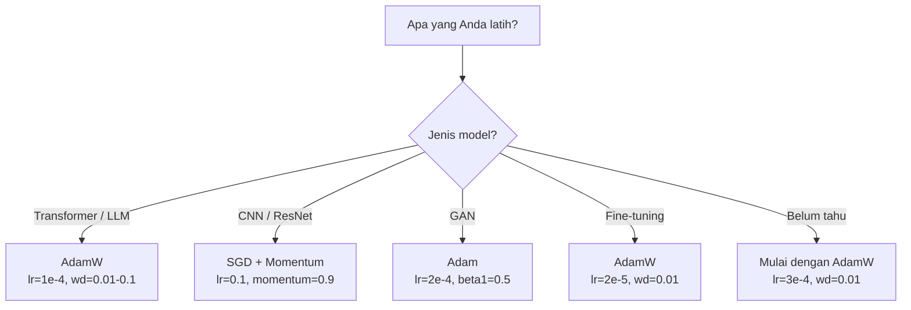

# Pengoptimal

> Penurunan gradien memberi tahu Anda arah mana yang harus ditempuh. Ia tidak mengatakan seberapa jauh atau seberapa cepat. SGD adalah kompas. Adam adalah GPS dengan data lalu lintas.

**Jenis:** Build
**Bahasa:** Python, TypeScript
**Prasyarat:** Pelajaran 03.05 (Fungsi Rugi)
**Waktu:** ~75 menit

## Tujuan Pembelajaran

- Implementasikan SGD, SGD dengan momentum, Adam, dan pengoptimal AdamW dari awal dalam Python
- Jelaskan bagaimana koreksi bias Adam mengompensasi estimasi momen yang diinisialisasi nol pada langkah-langkah awal pelatihan
- Tunjukkan mengapa AdamW menghasilkan generalisasi yang lebih baik daripada Adam dengan regularisasi L2 pada tugas yang sama
- Pilih pengoptimal dan hiperparameter default yang tepat untuk transformer, CNN, GAN, dan fine-tuning

## Masalah

Anda telah menghitung gradien. Anda tahu bahwa bobot #4.721 harus dikurangi 0,003 untuk menurunkan loss. Tetapi 0,003 dalam satuan apa? Diskalakan dengan apa? Dan haruskah Anda bergerak sejauh itu pada langkah 1 seperti pada langkah 1.000?

Penurunan gradien vanilla menerapkan laju pembelajaran yang sama pada setiap parameter di setiap langkah: $w = w - \text{lr} \cdot \text{gradient}$. Hal ini menimbulkan tiga masalah yang membuat pelatihan jaringan saraf menjadi menyakitkan dalam praktiknya.

Pertama, osilasi. Lanskap loss jarang berbentuk seperti mangkuk yang mulus. Bentuknya lebih seperti lembah yang panjang dan sempit. Gradien menunjukkan arah melintasi lembah (arah curam), bukan searah lembah (arah landai). Penurunan gradien memantul bolak-balik melintasi dimensi sempit sambil membuat kemajuan kecil searah dimensi yang berguna. Anda pernah melihat ini: loss turun cepat lalu mendatar, bukan karena model telah konvergen, tetapi karena ia berosilasi.

Kedua, satu laju pembelajaran untuk semua parameter itu salah. Sebagian bobot membutuhkan pembaruan besar (berada pada tahap awal yang underfitting). Bobot lain membutuhkan pembaruan sangat kecil (sudah dekat dengan nilai optimalnya). Laju pembelajaran yang cocok untuk yang pertama merusak yang kedua, dan sebaliknya.

Ketiga, titik pelana. Pada dimensi tinggi, lanskap loss memiliki wilayah datar yang luas tempat gradien mendekati nol. SGD vanilla merayap melewatinya dengan kecepatan gradien, yang secara efektif nol. Model tampak macet. Ia tidak macet — ia berada di wilayah datar dengan penurunan yang berguna di sisi lainnya. Namun SGD tidak memiliki mekanisme untuk menerobos.

Adam menyelesaikan ketiganya. Ia mempertahankan dua rata-rata berjalan per parameter — gradien rata-rata (momentum, menangani osilasi) dan gradien kuadrat rata-rata (laju adaptif, menangani perbedaan skala). Digabungkan dengan koreksi bias untuk beberapa langkah pertama, ia memberi Anda satu pengoptimal yang bekerja pada 80% masalah dengan hiperparameter default. Pelajaran ini membangunnya dari awal agar Anda memahami tepat kapan dan mengapa ia gagal pada 20% sisanya.

## Konsep

### Penurunan Gradien Stokastik (SGD)

Pengoptimal paling sederhana. Hitung gradien pada mini-batch lalu melangkah ke arah sebaliknya.

```math
w = w - \text{lr} \cdot \text{gradient}
```

"Stokastik" berarti Anda menggunakan himpunan bagian data acak (mini-batch) untuk mengestimasi gradien, bukan seluruh dataset. Kebisingan ini sebenarnya berguna — ia membantu keluar dari minimum lokal yang tajam. Namun kebisingan itu juga menyebabkan osilasi.

Laju pembelajaran adalah satu-satunya tombol. Terlalu tinggi: loss divergen. Terlalu rendah: pelatihan berlangsung tanpa henti. Nilai optimal bergantung pada arsitektur, data, ukuran batch, dan tahap pelatihan saat ini. Untuk SGD vanilla pada jaringan modern, nilai khas berkisar antara 0,01 hingga 0,1. Namun bahkan dalam satu kali pelatihan, laju pembelajaran ideal berubah.

### Momentum

Analogi bola yang menggelinding menuruni bukit sudah terlalu sering dipakai, tetapi tepat. Alih-alih melangkah hanya dengan gradien, Anda mempertahankan kecepatan yang mengakumulasi gradien-gradien masa lalu.

```math
\begin{aligned}
m_t &= \beta \, m_{t-1} + \text{gradient} \\
w &= w - \text{lr} \cdot m_t
\end{aligned}
```

Beta (biasanya 0,9) mengontrol seberapa banyak riwayat yang disimpan. Dengan $\beta = 0.9$, momentum kira-kira adalah rata-rata 10 gradien terakhir ($1 / (1 - 0.9) = 10$).

Mengapa ini memperbaiki osilasi: gradien yang menunjukkan arah sama saling terakumulasi. Gradien yang arahnya berbalik saling menghilangkan. Di lembah sempit itu, komponen "melintang" mengubah tanda setiap langkah dan diredam. Komponen "searah lembah" tetap konsisten dan diperkuat. Hasilnya adalah akselerasi yang mulus ke arah yang berguna.

Angka nyata: SGD saja pada lanskap loss yang kondisinya buruk mungkin membutuhkan 10.000 langkah. SGD dengan momentum ($\beta = 0.9$) biasanya membutuhkan 3.000–5.000 langkah pada masalah yang sama. Percepatannya bukan sekadar marginal.

### RMSProp

Metode laju pembelajaran adaptif per parameter pertama yang benar-benar berhasil. Diusulkan oleh Hinton dalam kuliah Coursera (tidak pernah diterbitkan secara formal).

```math
\begin{aligned}
s_t &= \beta \, s_{t-1} + (1 - \beta) \cdot \text{gradient}^2 \\
w &= w - \text{lr} \cdot \frac{\text{gradient}}{\sqrt{s_t} + \epsilon}
\end{aligned}
```

$s_t$ melacak rata-rata berjalan dari gradien kuadrat. Parameter dengan gradien yang konsisten besar dibagi dengan bilangan besar (laju pembelajaran efektif lebih kecil). Parameter dengan gradien kecil dibagi dengan bilangan kecil (laju pembelajaran efektif lebih besar).

Ini menyelesaikan masalah "satu laju pembelajaran untuk semua parameter". Bobot yang sudah menerima pembaruan besar kemungkinan dekat dengan targetnya — perlambat. Bobot yang menerima pembaruan sangat kecil mungkin kurang terlatih — percepat.

Epsilon (biasanya 1e-8) mencegah pembagian dengan nol ketika suatu parameter belum diperbarui.

### Adam: Momentum + RMSProp

Adam menggabungkan kedua gagasan ini. Ia mempertahankan dua rata-rata bergerak eksponensial per parameter:

```math
\begin{aligned}
m_t &= \beta_1 m_{t-1} + (1 - \beta_1) \cdot \text{gradient} && \text{(momen pertama: rata-rata)} \\
v_t &= \beta_2 v_{t-1} + (1 - \beta_2) \cdot \text{gradient}^2 && \text{(momen kedua: varians)}
\end{aligned}
```

**Koreksi bias** adalah detail kunci yang kebanyakan penjelasan lewatkan. Pada langkah 1, $m_1 = (1 - \beta_1) \cdot \text{gradient}$. Dengan $\beta_1 = 0.9$, itu adalah $0.1 \cdot \text{gradient}$ — sepuluh kali terlalu kecil. Rata-rata bergerak belum memanas. Koreksi bias mengompensasinya:

```math
\begin{aligned}
\hat{m} &= \frac{m_t}{1 - \beta_1^t} \\
\hat{v} &= \frac{v_t}{1 - \beta_2^t}
\end{aligned}
```

Pada langkah 1 dengan $\beta_1 = 0.9$: $\hat{m} = m_1 / (1 - 0.9) = m_1 / 0.1 =$ gradien aktual. Pada langkah 100: $(1 - 0.9^{100})$ kira-kira 1,0, sehingga koreksinya hilang. Koreksi bias hanya penting untuk sekitar 10 langkah pertama dan tidak relevan setelah sekitar 50 langkah.

Pembaruan:

```math
w = w - \text{lr} \cdot \frac{\hat{m}}{\sqrt{\hat{v}} + \epsilon}
```

Nilai default Adam: $\text{lr} = 0.001$, $\beta_1 = 0.9$, $\beta_2 = 0.999$, $\epsilon = 10^{-8}$. Nilai default ini bekerja untuk 80% masalah. Ketika tidak, ubah lr terlebih dahulu. Lalu $\beta_2$. Hampir tidak pernah mengubah $\beta_1$ atau $\epsilon$.

### AdamW: Peluruhan Bobot yang Dilakukan dengan Benar

Regularisasi L2 menambahkan $\lambda w^2$ pada loss. Pada SGD vanilla, ini setara dengan peluruhan bobot (mengurangi $\lambda w$ dari bobot pada setiap langkah). Pada Adam, kesetaraan ini rusak.

Wawasan Loshchilov & Hutter: ketika Anda menambahkan L2 pada loss lalu Adam memproses gradiennya, laju pembelajaran adaptif juga menskalakan suku regularisasi. Parameter dengan varians gradien besar mendapat regularisasi lebih kecil. Parameter dengan varians kecil mendapat lebih besar. Ini bukan yang Anda inginkan — Anda menginginkan regularisasi seragam terlepas dari statistik gradien.

AdamW memperbaikinya dengan menerapkan peluruhan bobot langsung pada bobot, setelah pembaruan Adam:

```math
w = w - \text{lr} \cdot \frac{\hat{m}}{\sqrt{\hat{v}} + \epsilon} - \text{lr} \cdot \lambda w
```

Suku peluruhan bobot ($\text{lr} \cdot \lambda w$) tidak diskalakan oleh faktor adaptif Adam. Setiap parameter mendapat penyusutan proporsional yang sama.

Ini tampak seperti detail kecil. Tidak. AdamW konvergen ke solusi yang lebih baik daripada Adam + regularisasi L2 pada hampir setiap tugas. Ia adalah pengoptimal default di PyTorch untuk melatih transformer, model difusi, dan sebagian besar arsitektur modern. BERT, GPT, LLaMA, Stable Diffusion — semuanya dilatih dengan AdamW.

### Laju Pembelajaran: Hiperparameter Paling Penting



Jika Anda menyetel satu hiperparameter, setel laju pembelajaran. Perubahan 10 kali lipat pada laju pembelajaran lebih penting daripada keputusan arsitektur apa pun yang Anda buat. Nilai default umum:

- SGD: lr = 0,01 hingga 0,1
- Adam/AdamW: lr = 1e-4 hingga 3e-4
- Fine-tuning model pra-terlatih: lr = 1e-5 hingga 5e-5
- Pemanasan laju pembelajaran: kenaikan linear pada 1-10% langkah pertama

### Perbandingan Pengoptimal



### Kapan Setiap Pengoptimal Unggul



```figure
optimizer-trajectory
```

## Bangun

### Langkah 1: SGD Vanilla

```python
class SGD:
    def __init__(self, lr=0.01):
        self.lr = lr

    def step(self, params, grads):
        for i in range(len(params)):
            params[i] -= self.lr * grads[i]
```

### Langkah 2: SGD dengan Momentum

```python
class SGDMomentum:
    def __init__(self, lr=0.01, beta=0.9):
        self.lr = lr
        self.beta = beta
        self.velocities = None

    def step(self, params, grads):
        if self.velocities is None:
            self.velocities = [0.0] * len(params)
        for i in range(len(params)):
            self.velocities[i] = self.beta * self.velocities[i] + grads[i]
            params[i] -= self.lr * self.velocities[i]
```

### Langkah 3: Adam

```python
import math

class Adam:
    def __init__(self, lr=0.001, beta1=0.9, beta2=0.999, epsilon=1e-8):
        self.lr = lr
        self.beta1 = beta1
        self.beta2 = beta2
        self.epsilon = epsilon
        self.m = None
        self.v = None
        self.t = 0

    def step(self, params, grads):
        if self.m is None:
            self.m = [0.0] * len(params)
            self.v = [0.0] * len(params)

        self.t += 1

        for i in range(len(params)):
            self.m[i] = self.beta1 * self.m[i] + (1 - self.beta1) * grads[i]
            self.v[i] = self.beta2 * self.v[i] + (1 - self.beta2) * grads[i] ** 2

            m_hat = self.m[i] / (1 - self.beta1 ** self.t)
            v_hat = self.v[i] / (1 - self.beta2 ** self.t)

            params[i] -= self.lr * m_hat / (math.sqrt(v_hat) + self.epsilon)
```

### Langkah 4: AdamW

```python
class AdamW:
    def __init__(self, lr=0.001, beta1=0.9, beta2=0.999, epsilon=1e-8, weight_decay=0.01):
        self.lr = lr
        self.beta1 = beta1
        self.beta2 = beta2
        self.epsilon = epsilon
        self.weight_decay = weight_decay
        self.m = None
        self.v = None
        self.t = 0

    def step(self, params, grads):
        if self.m is None:
            self.m = [0.0] * len(params)
            self.v = [0.0] * len(params)

        self.t += 1

        for i in range(len(params)):
            self.m[i] = self.beta1 * self.m[i] + (1 - self.beta1) * grads[i]
            self.v[i] = self.beta2 * self.v[i] + (1 - self.beta2) * grads[i] ** 2

            m_hat = self.m[i] / (1 - self.beta1 ** self.t)
            v_hat = self.v[i] / (1 - self.beta2 ** self.t)

            params[i] -= self.lr * m_hat / (math.sqrt(v_hat) + self.epsilon)
            params[i] -= self.lr * self.weight_decay * params[i]
```

### Langkah 5: Perbandingan Pelatihan

Latih jaringan dua lapis yang sama pada dataset lingkaran dari pelajaran 05 dengan keempat pengoptimal. Bandingkan konvergensinya.

```python
import random

def sigmoid(x):
    x = max(-500, min(500, x))
    return 1.0 / (1.0 + math.exp(-x))

def make_circle_data(n=200, seed=42):
    random.seed(seed)
    data = []
    for _ in range(n):
        x = random.uniform(-2, 2)
        y = random.uniform(-2, 2)
        label = 1.0 if x * x + y * y < 1.5 else 0.0
        data.append(([x, y], label))
    return data


class OptimizerTestNetwork:
    def __init__(self, optimizer, hidden_size=8):
        random.seed(0)
        self.hidden_size = hidden_size
        self.optimizer = optimizer

        self.w1 = [[random.gauss(0, 0.5) for _ in range(2)] for _ in range(hidden_size)]
        self.b1 = [0.0] * hidden_size
        self.w2 = [random.gauss(0, 0.5) for _ in range(hidden_size)]
        self.b2 = 0.0

    def get_params(self):
        params = []
        for row in self.w1:
            params.extend(row)
        params.extend(self.b1)
        params.extend(self.w2)
        params.append(self.b2)
        return params

    def set_params(self, params):
        idx = 0
        for i in range(self.hidden_size):
            for j in range(2):
                self.w1[i][j] = params[idx]
                idx += 1
        for i in range(self.hidden_size):
            self.b1[i] = params[idx]
            idx += 1
        for i in range(self.hidden_size):
            self.w2[i] = params[idx]
            idx += 1
        self.b2 = params[idx]

    def forward(self, x):
        self.x = x
        self.z1 = []
        self.h = []
        for i in range(self.hidden_size):
            z = self.w1[i][0] * x[0] + self.w1[i][1] * x[1] + self.b1[i]
            self.z1.append(z)
            self.h.append(max(0.0, z))

        self.z2 = sum(self.w2[i] * self.h[i] for i in range(self.hidden_size)) + self.b2
        self.out = sigmoid(self.z2)
        return self.out

    def compute_grads(self, target):
        eps = 1e-15
        p = max(eps, min(1 - eps, self.out))
        d_loss = -(target / p) + (1 - target) / (1 - p)
        d_sigmoid = self.out * (1 - self.out)
        d_out = d_loss * d_sigmoid

        grads = [0.0] * (self.hidden_size * 2 + self.hidden_size + self.hidden_size + 1)
        idx = 0
        for i in range(self.hidden_size):
            d_relu = 1.0 if self.z1[i] > 0 else 0.0
            d_h = d_out * self.w2[i] * d_relu
            grads[idx] = d_h * self.x[0]
            grads[idx + 1] = d_h * self.x[1]
            idx += 2

        for i in range(self.hidden_size):
            d_relu = 1.0 if self.z1[i] > 0 else 0.0
            grads[idx] = d_out * self.w2[i] * d_relu
            idx += 1

        for i in range(self.hidden_size):
            grads[idx] = d_out * self.h[i]
            idx += 1

        grads[idx] = d_out
        return grads

    def train(self, data, epochs=300):
        losses = []
        for epoch in range(epochs):
            total_loss = 0.0
            correct = 0
            for x, y in data:
                pred = self.forward(x)
                grads = self.compute_grads(y)
                params = self.get_params()
                self.optimizer.step(params, grads)
                self.set_params(params)

                eps = 1e-15
                p = max(eps, min(1 - eps, pred))
                total_loss += -(y * math.log(p) + (1 - y) * math.log(1 - p))
                if (pred >= 0.5) == (y >= 0.5):
                    correct += 1
            avg_loss = total_loss / len(data)
            accuracy = correct / len(data) * 100
            losses.append((avg_loss, accuracy))
            if epoch % 75 == 0 or epoch == epochs - 1:
                print(f"    Epoch {epoch:3d}: loss={avg_loss:.4f}, accuracy={accuracy:.1f}%")
        return losses
```

## Gunakan

Pengoptimal PyTorch menangani grup parameter, gradient clipping, dan penjadwalan laju pembelajaran:

```python
import torch
import torch.optim as optim

model = torch.nn.Sequential(
    torch.nn.Linear(784, 256),
    torch.nn.ReLU(),
    torch.nn.Linear(256, 10),
)

optimizer = optim.AdamW(model.parameters(), lr=3e-4, weight_decay=0.01)

scheduler = optim.lr_scheduler.CosineAnnealingLR(optimizer, T_max=100)

for epoch in range(100):
    optimizer.zero_grad()
    output = model(torch.randn(32, 784))
    loss = torch.nn.functional.cross_entropy(output, torch.randint(0, 10, (32,)))
    loss.backward()
    torch.nn.utils.clip_grad_norm_(model.parameters(), max_norm=1.0)
    optimizer.step()
    scheduler.step()
```

Polanya selalu: zero_grad, forward, loss, backward, (clip), step, (schedule). Hafal urutan ini. Salah urutan (misalnya, memanggil scheduler.step() sebelum optimizer.step()) adalah sumber umum bug yang halus.

Untuk CNN, banyak praktisi masih lebih memilih SGD + momentum (lr=0.1, momentum=0.9, weight_decay=1e-4) dengan penjadwalan bertahap atau kosinus. SGD menemukan minimum yang lebih datar, yang sering kali lebih bergeneralisasi. Untuk transformer dan LLM, AdamW dengan pemanasan + peluruhan kosinus adalah default universal. Jangan melawan konsensus tanpa alasan yang terukur.

## Kirim

Pelajaran ini menghasilkan:
- `outputs/prompt-optimizer-selector.md` — prompt keputusan untuk memilih pengoptimal dan laju pembelajaran yang tepat untuk arsitektur apa pun

## Latihan

1. Implementasikan momentum Nesterov, yaitu menghitung gradien pada posisi "lookahead" ($w - \text{lr} \cdot \beta v$) alih-alih posisi saat ini. Bandingkan konvergensinya dengan momentum standar pada dataset lingkaran.

2. Implementasikan penjadwalan pemanasan laju pembelajaran: kenaikan linear dari 0 ke max_lr pada 10% langkah pelatihan pertama, lalu peluruhan kosinus ke 0. Latih dengan Adam + pemanasan versus Adam tanpa pemanasan. Ukur berapa epoch yang dibutuhkan untuk mencapai akurasi 90% pada dataset lingkaran.

3. Lacak laju pembelajaran efektif untuk setiap parameter selama pelatihan Adam. Laju efektifnya adalah $\text{lr} \cdot \hat{m} / (\sqrt{\hat{v}} + \epsilon)$. Plot distribusi laju efektif setelah 10, 50, dan 200 langkah. Apakah semua parameter diperbarui dengan kecepatan yang sama?

4. Implementasikan gradient clipping (pemotongan berdasarkan norma global). Tetapkan norma gradien maksimum ke 1.0. Latih dengan dan tanpa pemotongan menggunakan laju pembelajaran tinggi (lr=0.01 untuk Adam). Hitung berapa banyak percobaan yang divergen (loss menjadi NaN) dengan dan tanpa pemotongan pada 10 seed acak.

5. Bandingkan Adam versus AdamW pada jaringan dengan bobot besar. Inisialisasi semua bobot dengan nilai acak dalam [-5, 5] (jauh lebih besar dari normal). Latih selama 200 epoch dengan weight_decay=0.1. Plot norma L2 bobot selama pelatihan untuk kedua pengoptimal. AdamW seharusnya menunjukkan penyusutan bobot yang lebih cepat.

## Istilah Kunci

| Istilah | Apa yang orang katakan | Apa artinya sebenarnya |
|---------|----------------|----------------------|
| Laju pembelajaran | "Ukuran langkah" | Pengali skalar pada pembaruan gradien; hiperparameter paling berdampak dalam pelatihan |
| SGD | "Penurunan gradien dasar" | Penurunan gradien stokastik: memperbarui bobot dengan mengurangi $\text{lr} \cdot \text{gradient}$, dihitung pada mini-batch |
| Momentum | "Analogi bola bergulir" | Rata-rata bergerak eksponensial dari gradien masa lalu; meredam osilasi dan mempercepat arah yang konsisten |
| RMSProp | "Laju pembelajaran adaptif" | Membagi gradien setiap parameter dengan RMS berjalan dari gradien terakhirnya; menyamakan laju pembelajaran |
| Adam | "Pengoptimal default" | Menggabungkan momentum (momen pertama) dan RMSProp (momen kedua) dengan koreksi bias untuk langkah-langkah awal |
| AdamW | "Adam yang dilakukan dengan benar" | Adam dengan peluruhan bobot yang dipisahkan; menerapkan regularisasi langsung pada bobot alih-alih melalui gradien |
| Koreksi bias | "Pemanasan untuk rata-rata berjalan" | Membagi dengan $(1 - \beta^t)$ untuk mengompensasi inisialisasi nol pada estimasi momen Adam |
| Peluruhan bobot | "Menyusutkan bobot" | Mengurangi sebagian nilai bobot pada setiap langkah; regularizer yang menghukum bobot besar |
| Penjadwalan laju pembelajaran | "Mengubah lr seiring waktu" | Fungsi yang menyesuaikan laju pembelajaran selama pelatihan; pemanasan + peluruhan kosinus adalah default modern |
| Gradient clipping | "Membatasi norma gradien" | Menurunkan skala vektor gradien ketika normanya melebihi ambang batas; mencegah pembaruan gradien yang meledak |

## Bacaan Lanjutan

- Kingma & Ba, "Adam: A Method for Stochastic Optimization" (2014) — makalah Adam asli dengan analisis konvergensi dan turunan koreksi bias
- Loshchilov & Hutter, "Decoupled Weight Decay Regularization" (2017) — membuktikan bahwa regularisasi L2 dan peluruhan bobot tidak setara pada Adam, dan mengusulkan AdamW
- Smith, "Cyclical Learning Rates for Training Neural Networks" (2017) — memperkenalkan uji rentang LR dan penjadwalan siklik yang menghilangkan kebutuhan menyetel laju pembelajaran tetap
- Ruder, "An Overview of Gradient Descent Optimization Algorithms" (2016) — tinjauan terbaik tentang semua varian pengoptimal, dengan perbandingan dan intuisi yang jelas
