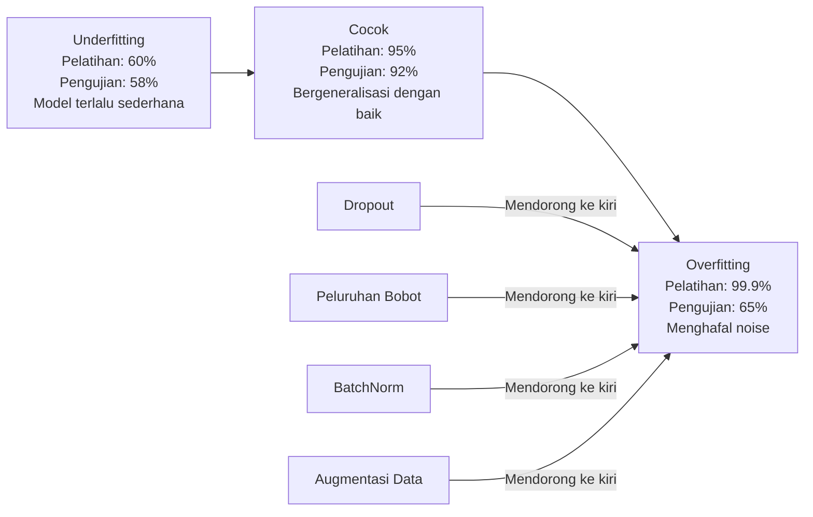
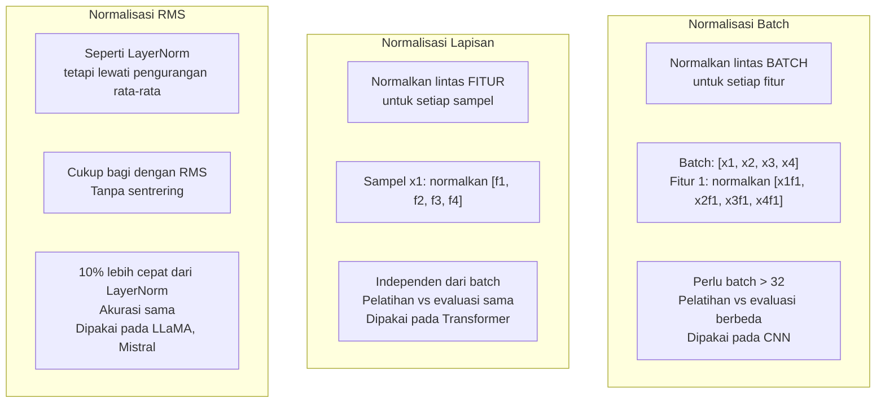
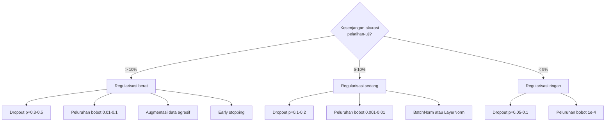

# Regularisasi

> Model Anda meraih 99% pada data pelatihan dan 60% pada data uji. Model itu menghafal alih-alih belajar. Regularisasi adalah pajak yang Anda kenakan pada kompleksitas untuk memaksa generalisasi.

**Jenis:** Build
**Bahasa:** Python, TypeScript
**Prasyarat:** Pelajaran 03.06 (Optimizer)
**Waktu:** ~75 menit

## Tujuan Pembelajaran

- Implementasikan dropout dengan penskalaan terbalik, peluruhan bobot L2, normalisasi batch, normalisasi lapisan, dan RMSNorm dari awal
- Ukur kesenjangan akurasi antara pelatihan dan pengujian serta diagnosis overfitting menggunakan eksperimen regularisasi
- Jelaskan mengapa transformer menggunakan LayerNorm alih-alih BatchNorm dan mengapa LLM modern lebih memilih RMSNorm
- Terapkan kombinasi teknik regularisasi yang tepat berdasarkan tingkat keparahan overfitting

## Masalah

Jaringan saraf dengan parameter yang cukup banyak dapat menghafal dataset apa pun. Ini bukan hipotesis belaka -- Zhang dkk. (2017) membuktikannya dengan melatih jaringan standar pada ImageNet menggunakan label acak. Jaringan-jaringan itu mencapai rugi pelatihan nyata-nol pada penugasan label yang benar-benar acak. Mereka menghafal sejuta pasangan input-output acak tanpa pola apa pun untuk dipelajari. Rugi pelatihan sempurna. Akurasi uji nol.

Inilah masalah overfitting, dan masalah ini memburuk seiring model yang semakin besar. GPT-3 memiliki 175 miliar parameter. Himpunan pelatihannya berisi sekitar 500 miliar token. Dengan sebanyak itu parameter, model memiliki kapasitas cukup untuk menghafal potongan-potongan signifikan data pelatihan secara verbatim. Tanpa regularisasi, model itu hanya akan memuntahkan kembali contoh-contoh pelatihan alih-alih mempelajari pola yang dapat digeneralisasi.

Kesenjangan antara kinerja pelatihan dan kinerja pengujian disebut kesenjangan overfitting. Setiap teknik dalam pelajaran ini menyerang kesenjangan itu dari sudut yang berbeda. Dropout memaksa jaringan untuk tidak bergantung pada satu neuron pun. Peluruhan bobot mencegah satu bobot pun tumbuh terlalu besar. Normalisasi batch menghaluskan lanskap rugi sehingga pengoptimal menemukan minimum yang lebih datar dan lebih dapat digeneralisasi. Normalisasi lapisan melakukan hal yang sama tetapi bekerja di tempat normalisasi batch gagal (batch kecil, urutan dengan panjang berubah-ubah). RMSNorm melakukannya 10% lebih cepat dengan menghilangkan perhitungan rata-rata. Setiap teknik sederhana. Bersama-sama, teknik-teknik itulah yang membedakan model yang menghafal dari model yang bergeneralisasi.

## Konsep

### Spektrum Overfitting

Setiap model berada di suatu titik pada spektrum yang membentang dari underfitting (terlalu sederhana untuk menangkap pola) hingga overfitting (terlalu kompleks sehingga menangkap noise). Titik ideal ada di antaranya, dan regularisasi mendorong model ke arah titik itu dari sisi overfitting.



### Dropout

Teknik regularisasi paling sederhana dengan interpretasi paling elegan. Selama pelatihan, atur secara acak keluaran setiap neuron menjadi nol dengan probabilitas $p$.

```math
\text{output} = \text{activation}(z) \cdot \text{mask} \quad \text{where }\text{mask}[i] \sim \text{Bernoulli}(1 - p)
```

Dengan $p = 0.5$, separuh neuron dinolkan pada setiap forward pass. Jaringan harus mempelajari representasi redundan karena tidak dapat memprediksi neuron mana yang akan tersedia. Ini mencegah ko-adaptasi -- neuron yang belajar bergantung pada kehadiran neuron tertentu.

Interpretasi ensemble: jaringan dengan $N$ neuron dan dropout menciptakan $2^N$ subjaringan yang mungkin (setiap kombinasi neuron yang aktif atau nonaktif). Pelatihan dengan dropout kira-kira melatih semua $2^N$ subjaringan secara bersamaan, masing-masing pada mini-batch yang berbeda. Saat pengujian, Anda menggunakan semua neuron (tanpa dropout) dan menskalakan keluaran dengan $(1 - p)$ agar sesuai dengan nilai harapan selama pelatihan. Ini setara dengan merata-ratakan prediksi dari $2^N$ subjaringan -- ensemble besar dari satu model.

Dalam praktiknya, penskalaan diterapkan saat pelatihan, bukan saat pengujian (inverted dropout):

```math
\begin{aligned}
\text{During training:} \quad & \text{output} = \text{activation}(z) \cdot \text{mask} / (1 - p) \\
\text{During testing:} \quad & \text{output} = \text{activation}(z) \quad \text{(no change needed)}
\end{aligned}
```

Ini lebih rapi karena kode pengujian sama sekali tidak perlu tahu tentang dropout.

Nilai default: p = 0.1 untuk transformer, p = 0.5 untuk MLP, p = 0.2-0.3 untuk CNN. Dropout lebih tinggi = regularisasi lebih kuat = risiko underfitting lebih besar.

### Peluruhan Bobot (Regularisasi L2)

Tambahkan magnitudo kuadrat dari semua bobot ke dalam rugi:

```math
\text{total\_loss} = \text{task\_loss} + \frac{\lambda}{2} \sum_i w_i^2
```

Gradien dari suku regularisasi adalah $\lambda w$. Artinya, pada setiap langkah, setiap bobot dikecilkan ke arah nol sebanding dengan magnitudonya. Bobot besar dikenai penalti lebih berat. Model didorong ke solusi yang tidak ada satu bobot pun yang mendominasi.

Mengapa ini membantu generalisasi: model yang overfit cenderung memiliki bobot besar yang memperkuat noise dalam data pelatihan. Peluruhan bobot menjaga bobot tetap kecil, yang membatasi kapasitas efektif model dan memaksanya bergantung pada fitur yang tangguh dan dapat digeneralisasi, bukan pada keanehan yang dihafal.

Hiperparameter $\lambda$ mengontrol kekuatan. Nilai umum:

- 0.01 untuk AdamW pada transformer
- 1e-4 untuk SGD pada CNN
- 0.1 untuk model yang sangat overfit

Seperti dibahas dalam pelajaran 06: peluruhan bobot dan regularisasi L2 ekuivalen pada SGD, tetapi tidak pada Adam. Selalu gunakan AdamW (peluruhan bobot terpisah/decoupled) saat melatih dengan Adam.

### Normalisasi Batch

Normalkan keluaran setiap lapisan lintas mini-batch sebelum meneruskannya ke lapisan berikutnya.

Untuk mini-batch aktivasi pada suatu lapisan:

```math
\begin{aligned}
\mu &= \frac{1}{B} \sum_i x_i && \text{(batch mean)} \\
\sigma^2 &= \frac{1}{B} \sum_i (x_i - \mu)^2 && \text{(batch variance)} \\
\hat{x} &= \frac{x_i - \mu}{\sqrt{\sigma^2 + \epsilon}} && \text{(normalize)} \\
y &= \gamma \hat{x} + \beta && \text{(scale and shift)}
\end{aligned}
```

Gamma dan beta adalah parameter yang dapat dipelajari dan memungkinkan jaringan membatalkan normalisasi jika itu optimal. Tanpa keduanya, Anda memaksa keluaran setiap lapisan memiliki rata-rata nol dan varians satu, yang mungkin bukan yang diinginkan jaringan.

**Pemisahan pelatihan vs inferensi:** Selama pelatihan, $\mu$ dan $\sigma$ berasal dari mini-batch saat ini. Selama inferensi, Anda menggunakan rata-rata berjalan yang dikumpulkan selama pelatihan (rata-rata bergerak eksponensial dengan momentum = 0.1, artinya 90% lama + 10% baru).

Mengapa BatchNorm bekerja masih diperdebatkan. Makalah aslinya mengklaim bahwa teknik ini mengurangi "pergeseran kovariat internal" (distribusi masukan lapisan yang berubah saat lapisan sebelumnya diperbarui). Santurkar dkk. (2018) menunjukkan penjelasan itu salah. Alasan sebenarnya: BatchNorm membuat lanskap rugi lebih halus. Gradien lebih prediktif, konstanta Lipschitz lebih kecil, dan pengoptimal dapat mengambil langkah lebih besar dengan aman. Inilah sebabnya BatchNorm memungkinkan Anda menggunakan laju pembelajaran lebih tinggi dan konvergensi lebih cepat.

BatchNorm memiliki keterbatasan mendasar: teknik ini bergantung pada statistik batch. Dengan ukuran batch 1, rata-rata dan varians tidak bermakna. Dengan batch kecil (< 32), statistiknya bising dan merusak kinerja. Ini penting untuk tugas seperti deteksi objek (yang membatasi ukuran batch karena memori) dan pemodelan bahasa (yang panjang uratannya berubah-ubah).

### Normalisasi Lapisan

Normalkan lintas fitur, bukan lintas batch. Untuk satu sampel:

```math
\begin{aligned}
\mu &= \frac{1}{D} \sum_j x_j && \text{(feature mean)} \\
\sigma^2 &= \frac{1}{D} \sum_j (x_j - \mu)^2 && \text{(feature variance)} \\
\hat{x} &= \frac{x_j - \mu}{\sqrt{\sigma^2 + \epsilon}} \\
y &= \gamma \hat{x} + \beta
\end{aligned}
```

$D$ adalah dimensi fitur. Setiap sampel dinormalkan secara independen -- tidak bergantung pada ukuran batch. Inilah sebabnya transformer menggunakan LayerNorm alih-alih BatchNorm. Panjang urutan berubah-ubah, ukuran batch sering kecil (atau 1 saat generasi), dan komputasinya identik antara pelatihan dan inferensi.

LayerNorm pada transformer diterapkan setelah setiap blok self-attention dan setiap blok feed-forward (Post-LN), atau sebelum keduanya (Pre-LN, yang lebih stabil untuk pelatihan).

### RMSNorm

LayerNorm tanpa pengurangan rata-rata. Diusulkan oleh Zhang & Sennrich (2019).

```math
\begin{aligned}
\text{rms} &= \sqrt{\frac{1}{D} \sum_j x_j^2} \\
y &= \gamma \cdot \frac{x}{\text{rms}}
\end{aligned}
```

Sekarang itu saja. Tidak ada perhitungan rata-rata, tidak ada parameter beta. Observasinya: re-sentrering (pengurangan rata-rata) pada LayerNorm memberi kontribusi sangat kecil terhadap kinerja model, tetapi memakan komputasi. Menghilangkannya menghasilkan akurasi yang sama dengan overhead sekitar 10% lebih rendah.

LLaMA, LLaMA 2, LLaMA 3, Mistral, dan sebagian besar LLM modern menggunakan RMSNorm alih-alih LayerNorm. Pada skala miliaran parameter dan triliunan token, penghematan 10% itu signifikan.

### Perbandingan Normalisasi



### Augmentasi Data sebagai Regularisasi

Bukan modifikasi model, melainkan modifikasi data. Ubah masukan pelatihan sambil mempertahankan label:

- Gambar: pemotongan acak (crop), pembalikan (flip), rotasi, pergeseran warna (color jitter), cutout
- Teks: penggantian sinonim, back-translation, penghapusan acak
- Audio: peregangan waktu, pergeseran nada, penambahan noise

Efeknya identik dengan regularisasi: teknik ini meningkatkan ukuran efektif himpunan pelatihan, sehingga model lebih sulit menghafal contoh-contoh spesifik. Model yang hanya melihat setiap gambar sekali dalam bentuk aslinya dapat menghafalnya. Model yang melihat 50 versi augmentasi dari setiap gambar dipaksa mempelajari struktur yang invarian.

### Penghentian Awal (Early Stopping)

Regularizer paling sederhana: hentikan pelatihan ketika rugi validasi mulai meningkat. Pada titik itu model belum overfit. Dalam praktiknya, Anda melacak rugi validasi setiap epoch, menyimpan model terbaik, dan melanjutkan pelatihan selama jendela "sabar" (patience), biasanya 5-20 epoch. Jika rugi validasi tidak membaik dalam jendela tersebut, Anda berhenti dan memuat model tersimpan terbaik.

### Kapan Memakai Apa



```figure
l2-regularization
```

## Bangun

### Langkah 1: Dropout (Mode Latih dan Evaluasi)

```python
import random
import math


class Dropout:
    def __init__(self, p=0.5):
        self.p = p
        self.training = True
        self.mask = None

    def forward(self, x):
        if not self.training:
            return list(x)
        self.mask = []
        output = []
        for val in x:
            if random.random() < self.p:
                self.mask.append(0)
                output.append(0.0)
            else:
                self.mask.append(1)
                output.append(val / (1 - self.p))
        return output

    def backward(self, grad_output):
        grads = []
        for g, m in zip(grad_output, self.mask):
            if m == 0:
                grads.append(0.0)
            else:
                grads.append(g / (1 - self.p))
        return grads
```

### Langkah 2: Peluruhan Bobot L2

```python
def l2_regularization(weights, lambda_reg):
    penalty = 0.0
    for w in weights:
        penalty += w * w
    return lambda_reg * 0.5 * penalty

def l2_gradient(weights, lambda_reg):
    return [lambda_reg * w for w in weights]
```

### Langkah 3: Normalisasi Batch

```python
class BatchNorm:
    def __init__(self, num_features, momentum=0.1, eps=1e-5):
        self.gamma = [1.0] * num_features
        self.beta = [0.0] * num_features
        self.eps = eps
        self.momentum = momentum
        self.running_mean = [0.0] * num_features
        self.running_var = [1.0] * num_features
        self.training = True
        self.num_features = num_features

    def forward(self, batch):
        batch_size = len(batch)
        if self.training:
            mean = [0.0] * self.num_features
            for sample in batch:
                for j in range(self.num_features):
                    mean[j] += sample[j]
            mean = [m / batch_size for m in mean]

            var = [0.0] * self.num_features
            for sample in batch:
                for j in range(self.num_features):
                    var[j] += (sample[j] - mean[j]) ** 2
            var = [v / batch_size for v in var]

            for j in range(self.num_features):
                self.running_mean[j] = (1 - self.momentum) * self.running_mean[j] + self.momentum * mean[j]
                self.running_var[j] = (1 - self.momentum) * self.running_var[j] + self.momentum * var[j]
        else:
            mean = list(self.running_mean)
            var = list(self.running_var)

        self.x_hat = []
        output = []
        for sample in batch:
            normalized = []
            out_sample = []
            for j in range(self.num_features):
                x_h = (sample[j] - mean[j]) / math.sqrt(var[j] + self.eps)
                normalized.append(x_h)
                out_sample.append(self.gamma[j] * x_h + self.beta[j])
            self.x_hat.append(normalized)
            output.append(out_sample)
        return output
```

### Langkah 4: Normalisasi Lapisan

```python
class LayerNorm:
    def __init__(self, num_features, eps=1e-5):
        self.gamma = [1.0] * num_features
        self.beta = [0.0] * num_features
        self.eps = eps
        self.num_features = num_features

    def forward(self, x):
        mean = sum(x) / len(x)
        var = sum((xi - mean) ** 2 for xi in x) / len(x)

        self.x_hat = []
        output = []
        for j in range(self.num_features):
            x_h = (x[j] - mean) / math.sqrt(var + self.eps)
            self.x_hat.append(x_h)
            output.append(self.gamma[j] * x_h + self.beta[j])
        return output
```

### Langkah 5: RMSNorm

```python
class RMSNorm:
    def __init__(self, num_features, eps=1e-6):
        self.gamma = [1.0] * num_features
        self.eps = eps
        self.num_features = num_features

    def forward(self, x):
        rms = math.sqrt(sum(xi * xi for xi in x) / len(x) + self.eps)
        output = []
        for j in range(self.num_features):
            output.append(self.gamma[j] * x[j] / rms)
        return output
```

### Langkah 6: Pelatihan dengan dan tanpa Regularisasi

```python
def sigmoid(x):
    x = max(-500, min(500, x))
    return 1.0 / (1.0 + math.exp(-x))


def make_circle_data(n=200, seed=42):
    random.seed(seed)
    data = []
    for _ in range(n):
        x = random.uniform(-2, 2)
        y = random.uniform(-2, 2)
        label = 1.0 if x * x + y * y < 1.5 else 0.0
        data.append(([x, y], label))
    return data


class RegularizedNetwork:
    def __init__(self, hidden_size=16, lr=0.05, dropout_p=0.0, weight_decay=0.0):
        random.seed(0)
        self.hidden_size = hidden_size
        self.lr = lr
        self.dropout_p = dropout_p
        self.weight_decay = weight_decay
        self.dropout = Dropout(p=dropout_p) if dropout_p > 0 else None

        self.w1 = [[random.gauss(0, 0.5) for _ in range(2)] for _ in range(hidden_size)]
        self.b1 = [0.0] * hidden_size
        self.w2 = [random.gauss(0, 0.5) for _ in range(hidden_size)]
        self.b2 = 0.0

    def forward(self, x, training=True):
        self.x = x
        self.z1 = []
        self.h = []
        for i in range(self.hidden_size):
            z = self.w1[i][0] * x[0] + self.w1[i][1] * x[1] + self.b1[i]
            self.z1.append(z)
            self.h.append(max(0.0, z))

        if self.dropout and training:
            self.dropout.training = True
            self.h = self.dropout.forward(self.h)
        elif self.dropout:
            self.dropout.training = False
            self.h = self.dropout.forward(self.h)

        self.z2 = sum(self.w2[i] * self.h[i] for i in range(self.hidden_size)) + self.b2
        self.out = sigmoid(self.z2)
        return self.out

    def backward(self, target):
        eps = 1e-15
        p = max(eps, min(1 - eps, self.out))
        d_loss = -(target / p) + (1 - target) / (1 - p)
        d_sigmoid = self.out * (1 - self.out)
        d_out = d_loss * d_sigmoid

        for i in range(self.hidden_size):
            d_relu = 1.0 if self.z1[i] > 0 else 0.0
            d_h = d_out * self.w2[i] * d_relu
            self.w2[i] -= self.lr * (d_out * self.h[i] + self.weight_decay * self.w2[i])
            for j in range(2):
                self.w1[i][j] -= self.lr * (d_h * self.x[j] + self.weight_decay * self.w1[i][j])
            self.b1[i] -= self.lr * d_h
        self.b2 -= self.lr * d_out

    def evaluate(self, data):
        correct = 0
        total_loss = 0.0
        for x, y in data:
            pred = self.forward(x, training=False)
            eps = 1e-15
            p = max(eps, min(1 - eps, pred))
            total_loss += -(y * math.log(p) + (1 - y) * math.log(1 - p))
            if (pred >= 0.5) == (y >= 0.5):
                correct += 1
        return total_loss / len(data), correct / len(data) * 100

    def train_model(self, train_data, test_data, epochs=300):
        history = []
        for epoch in range(epochs):
            total_loss = 0.0
            correct = 0
            for x, y in train_data:
                pred = self.forward(x, training=True)
                self.backward(y)
                eps = 1e-15
                p = max(eps, min(1 - eps, pred))
                total_loss += -(y * math.log(p) + (1 - y) * math.log(1 - p))
                if (pred >= 0.5) == (y >= 0.5):
                    correct += 1
            train_loss = total_loss / len(train_data)
            train_acc = correct / len(train_data) * 100
            test_loss, test_acc = self.evaluate(test_data)
            history.append((train_loss, train_acc, test_loss, test_acc))
            if epoch % 75 == 0 or epoch == epochs - 1:
                gap = train_acc - test_acc
                print(f"    Epoch {epoch:3d}: train_acc={train_acc:.1f}%, test_acc={test_acc:.1f}%, gap={gap:.1f}%")
        return history
```

## Gunakan

PyTorch menyediakan semua modul normalisasi dan regularisasi:

```python
import torch
import torch.nn as nn

model = nn.Sequential(
    nn.Linear(784, 256),
    nn.BatchNorm1d(256),
    nn.ReLU(),
    nn.Dropout(0.3),
    nn.Linear(256, 128),
    nn.BatchNorm1d(128),
    nn.ReLU(),
    nn.Dropout(0.3),
    nn.Linear(128, 10),
)

model.train()
out_train = model(torch.randn(32, 784))

model.eval()
out_test = model(torch.randn(1, 784))
```

Tombol `model.train()` / `model.eval()` sangat penting. Tombol ini mengaktifkan/memati dropout dan memberi tahu BatchNorm untuk memakai statistik batch atau statistik berjalan. Lupa memanggil `model.eval()` sebelum inferensi adalah salah satu bug paling umum dalam deep learning. Akurasi uji Anda akan berfluktuasi secara acak karena dropout masih aktif dan BatchNorm masih memakai statistik mini-batch.

Untuk transformer, polanya berbeda:

```python
class TransformerBlock(nn.Module):
    def __init__(self, d_model=512, nhead=8, dropout=0.1):
        super().__init__()
        self.attention = nn.MultiheadAttention(d_model, nhead, dropout=dropout)
        self.norm1 = nn.LayerNorm(d_model)
        self.ff = nn.Sequential(
            nn.Linear(d_model, d_model * 4),
            nn.GELU(),
            nn.Linear(d_model * 4, d_model),
            nn.Dropout(dropout),
        )
        self.norm2 = nn.LayerNorm(d_model)
        self.dropout = nn.Dropout(dropout)

    def forward(self, x):
        attended, _ = self.attention(x, x, x)
        x = self.norm1(x + self.dropout(attended))
        x = self.norm2(x + self.ff(x))
        return x
```

LayerNorm, bukan BatchNorm. Dropout p=0.1, bukan p=0.5. Itulah nilai default transformer.

## Hasil Akhir

Pelajaran ini menghasilkan:
- `outputs/prompt-regularization-advisor.md` -- prompt yang mendiagnosis overfitting dan merekomendasikan strategi regularisasi yang tepat

## Latihan

1. Implementasikan spatial dropout untuk data 2D: alih-alih menjatuhkan neuron individual, jatuhkan seluruh kanal fitur. Simulasikan dengan memperlakukan kelompok fitur berurutan sebagai kanal dan menjatuhkan seluruh kelompok. Bandingkan kesenjangan pelatihan-uji dengan dropout standar pada dataset lingkaran dengan hidden_size=32.

2. Implementasikan label smoothing dari pelajaran 05 yang dikombinasikan dengan dropout dari pelajaran ini. Latih dengan empat konfigurasi: keduanya tidak ada, hanya dropout, hanya label smoothing, dan keduanya ada. Ukur kesenjangan akurasi pelatihan-uji akhir untuk masing-masing. Kombinasi mana yang memberi kesenjangan terkecil?

3. Tambahkan lapisan BatchNorm antara lapisan tersembunyi dan aktivasi pada jaringan dataset lingkaran Anda. Latih dengan dan tanpa BatchNorm pada laju pembelajaran 0.01, 0.05, dan 0.1. BatchNorm seharusnya memungkinkan pelatihan stabil pada laju pembelajaran lebih tinggi tempat jaringan biasa divergen.

4. Implementasikan early stopping: lacak rugi uji setiap epoch, simpan bobot terbaik, dan berhenti jika rugi uji tidak membaik selama 20 epoch. Jalankan jaringan teregulasi selama 1000 epoch. Laporkan epoch mana yang memiliki akurasi uji terbaik dan berapa epoch komputasi yang Anda hemat.

5. Bandingkan LayerNorm vs RMSNorm pada jaringan 4 lapisan (bukan hanya 2). Inisialisasi keduanya dengan bobot yang sama. Latih selama 200 epoch dan bandingkan akurasi akhir, kecepatan pelatihan (waktu per epoch), dan magnitudo gradien pada lapisan pertama. Verifikasi bahwa RMSNorm lebih cepat dengan akurasi yang sama.

## Istilah Kunci

| Istilah | Apa yang orang katakan | Apa artinya sebenarnya |
|---------|----------------------|------------------------|
| Overfitting | "Model menghafal data" | Saat kinerja pelatihan model jauh melebihi kinerja ujinya, menandakan model mempelajari noise alih-alih sinyal |
| Regularisasi | "Mencegah overfitting" | Teknik apa pun yang membatasi kompleksitas model untuk meningkatkan generalisasi: dropout, peluruhan bobot, normalisasi, augmentasi |
| Dropout | "Penghapusan neuron acak" | Menolkan neuron secara acak selama pelatihan dengan probabilitas $p$, memaksa representasi redundan; ekuivalen dengan melatih sebuah ensemble |
| Peluruhan bobot | "Penalti L2" | Mengecilkan semua bobot ke arah nol dengan mengurangi $\lambda w$ pada setiap langkah; menghukum kompleksitas melalui magnitudo bobot |
| Normalisasi batch | "Normalkan per batch" | Menormalkan keluaran lapisan lintas dimensi batch memakai statistik batch saat pelatihan dan rata-rata berjalan saat inferensi |
| Normalisasi lapisan | "Normalkan per sampel" | Menormalkan lintas fitur dalam setiap sampel; independen dari batch, dipakai pada transformer yang ukuran batch-nya berubah-ubah |
| RMSNorm | "LayerNorm tanpa rata-rata" | Normalisasi akar kuadrat rata-rata; menghilangkan pengurangan rata-rata dari LayerNorm untuk peningkatan kecepatan 10% dengan akurasi setara |
| Early stopping | "Berhenti sebelum overfit" | Menghentikan pelatihan saat rugi validasi berhenti membaik; regularizer paling sederhana, sering dipakai bersama teknik lain |
| Augmentasi data | "Lebih banyak data dari data yang lebih sedikit" | Mengubah masukan pelatihan (flip, crop, noise) untuk meningkatkan ukuran dataset efektif dan memaksa pembelajaran invarian |
| Kesenjangan generalisasi | "Pemisahan pelatihan-uji" | Selisih antara kinerja pelatihan dan kinerja uji; regularisasi bertujuan meminimalkan kesenjangan ini |

## Bacaan Lanjutan

- Srivastava dkk., "Dropout: A Simple Way to Prevent Neural Networks from Overfitting" (2014) -- makalah dropout asli dengan interpretasi ensemble dan eksperimen ekstensif
- Ioffe & Szegedy, "Batch Normalization: Accelerating Deep Network Training by Reducing Internal Covariate Shift" (2015) -- memperkenalkan BatchNorm dan prosedur pelatatihannya, salah satu makalah deep learning yang paling banyak dikutip
- Zhang & Sennrich, "Root Mean Square Layer Normalization" (2019) -- menunjukkan RMSNorm menyamai akurasi LayerNorm dengan komputasi lebih sedikit; diadopsi oleh LLaMA dan Mistral
- Zhang dkk., "Understanding Deep Learning Requires Rethinking Generalization" (2017) -- makalah penting yang menunjukkan jaringan saraf dapat menghafal label acak, menantang pandangan tradisional tentang generalisasi
