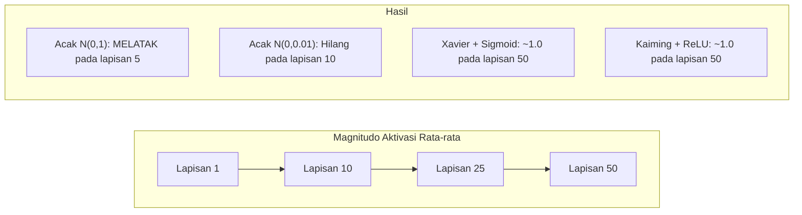
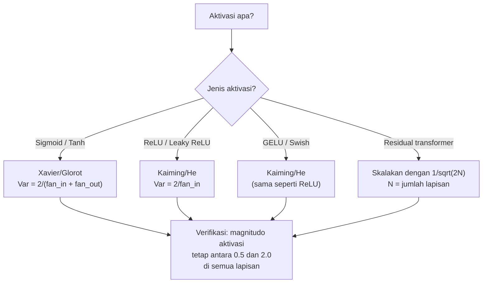

# Inisialisasi Bobot dan Stabilitas Pelatihan

> Inisialisasi yang salah dan pelatihan tidak pernah dimulai. Inisialisasi yang tepat dan 50 lapisan dilatih selancar 3 lapisan.

**Jenis:** Build
**Bahasa:** Python, TypeScript
**Prasyarat:** Pelajaran 03.04 (Fungsi Aktivasi), Pelajaran 03.07 (Regularisasi)
**Waktu:** ~90 menit

## Tujuan Pembelajaran

- Implementasikan strategi inisialisasi nol, acak, Xavier/Glorot, dan Kaiming/He serta ukur pengaruhnya terhadap magnitudo aktivasi lintas 50 lapisan
- Turunkan alasan Xavier memakai Var(w) = 2/(fan_in + fan_out) dan Kaiming memakai Var(w) = 2/fan_in
- Tunjukkan masalah simetri pada inisialisasi nol dan jelaskan mengapa skala acak saja tidak cukup
- Padankan strategi inisialisasi yang tepat dengan fungsi aktivasi: Xavier untuk sigmoid/tanh, Kaiming untuk ReLU/GELU

## Masalah

Inisialisasi semua bobot dengan nol. Tidak ada yang belajar. Setiap neuron menghitung fungsi yang sama, menerima gradien yang sama, dan diperbarui dengan cara yang sama. Setelah 10.000 epoch, lapisan tersembunyi 512 neuron Anda masih berisi 512 salinan neuron yang sama. Anda membayar 512 parameter dan mendapat 1.

Inisialisasi terlalu besar. Aktivasi meledak melintasi jaringan. Pada lapisan 10, nilai mencapai 1e15. Pada lapisan 20, nilainya melimpah menjadi infinity. Gradien mengikuti lintasan yang sama tetapi berlawanan arah.

Inisialisasi secara acak dari distribusi normal standar. Ini bekerja untuk 3 lapisan. Pada 50 lapisan, sinyal menyusut menjadi nol atau meledak menjadi tak hingga, bergantung pada apakah skala acaknya sedikit terlalu kecil atau sedikit terlalu besar. Batas antara "bekerja" dan "rusak" sangat tipis.

Inisialisasi bobot adalah keputusan paling diremehkan dalam deep learning. Arsitektur mendapat makalah. Optimizer mendapat postingan blog. Inisialisasi hanya mendapat catatan kaki. Tetapi jika salah, tidak ada yang penting lagi -- jaringan Anda sudah mati sebelum pelatihan dimulai.

## Konsep

### Masalah Simetri

Setiap neuron dalam sebuah lapisan memiliki struktur yang sama: kalikan masukan dengan bobot, tambahkan bias, terapkan aktivasi. Jika semua bobot dimulai dari nilai yang sama (nol adalah kasus ekstrem), setiap neuron menghitung keluaran yang sama. Selama propagasi balik, setiap neuron menerima gradien yang sama. Pada langkah pembaruan, setiap neuron berubah dengan jumlah yang sama.

Anda mandek. Jaringan memiliki ratusan parameter, tetapi semuanya bergerak serempak. Ini disebut simetri, dan inisialisasi acak adalah cara kasar untuk memecahnya. Setiap neuron mulai dari titik berbeda dalam ruang bobot, sehingga setiap neuron mempelajari fitur yang berbeda.

Namun "acak" saja tidak cukup. *Skala* dari keacakan itulah yang menentukan apakah jaringan dapat dilatih.

### Propagasi Varians Lintas Lapisan

Perhatikan satu lapisan dengan fan_in masukan:

```math
z = w_1 x_1 + w_2 x_2 + \cdots + w_n x_n
```

Jika setiap bobot $w_i$ diambil dari distribusi dengan varians $\mathrm{Var}(w)$ dan setiap masukan $x_i$ memiliki varians $\mathrm{Var}(x)$, varians keluarannya adalah:

```math
\mathrm{Var}(z) = \text{fan}_{\text{in}} \cdot \mathrm{Var}(w) \cdot \mathrm{Var}(x)
```

Jika $\mathrm{Var}(w) = 1$ dan $\text{fan}_{\text{in}} = 512$, varians keluaran adalah 512 kali varians masukan. Setelah 10 lapisan: $512^{10} = 1.2 \times 10^{27}$. Sinyal Anda meledak.

Jika $\mathrm{Var}(w) = 0.001$, varians keluaran menyusut sebesar $0.001 \cdot 512 = 0.512$ per lapisan. Setelah 10 lapisan: $0.512^{10} = 0.00013$. Sinyal Anda hilang.

Tujuannya: pilih $\mathrm{Var}(w)$ sehingga $\mathrm{Var}(z) = \mathrm{Var}(x)$. Magnitudo sinyal tetap konstan lintas lapisan.

### Inisialisasi Xavier/Glorot

Glorot dan Bengio (2010) menurunkan solusi untuk aktivasi sigmoid dan tanh. Agar varians tetap konstan baik di forward pass maupun backward pass:

```math
\mathrm{Var}(w) = \frac{2}{\text{fan}_{\text{in}} + \text{fan}_{\text{out}}}
```

Dalam praktiknya, bobot diambil dari:

```math
w \sim \text{Uniform}(-\text{limit}, \text{limit}) \quad \text{where } \text{limit} = \sqrt{\frac{6}{\text{fan}_{\text{in}} + \text{fan}_{\text{out}}}}
```

atau:

```math
w \sim \text{Normal}\left(0, \sqrt{\frac{2}{\text{fan}_{\text{in}} + \text{fan}_{\text{out}}}}\right)
```

Ini bekerja karena sigmoid dan tanh kira-kira linear di dekat nol, tempat aktivasi yang terinisialisasi dengan baik berada. Varians tetap stabil melintasi puluhan lapisan.

### Inisialisasi Kaiming/He

ReLU mematikan separuh keluaran (semuanya yang negatif menjadi nol). fan_in efektif berkurang separuh karena rata-rata separuh masukan dinolkan. Inisialisasi Xavier tidak memperhitungkan ini -- ia meremehkan varians yang dibutuhkan.

He dkk. (2015) menyesuaikan rumusnya:

```math
\mathrm{Var}(w) = \frac{2}{\text{fan}_{\text{in}}}
```

Bobot diambil dari:

```math
w \sim \text{Normal}\left(0, \sqrt{\frac{2}{\text{fan}_{\text{in}}}}\right)
```

Faktor 2 mengompensasi ReLU yang menolkan separuh aktivasi. Tanpa faktor itu, sinyal menyusut ~0.5x per lapisan. Dengan 50 lapisan: $0.5^{50} = 8.8 \times 10^{-16}$. Inisialisasi Kaiming mencegahnya.

### Inisialisasi Transformer

GPT-2 memperkenalkan pola yang berbeda. Koneksi residual menambahkan keluaran setiap sub-lapisan ke masukannya:

```math
x = x + \text{sublayer}(x)
```

Setiap penambahan menaikkan varians. Dengan $N$ lapisan residual, varians tumbuh sebanding dengan $N$. GPT-2 menskalakan bobot lapisan residual dengan $1/\sqrt{2N}$, dengan $N$ sebagai jumlah lapisan. Ini menjaga magnitudo sinyal kumulatif tetap stabil.

Llama 3 (405 miliar parameter, 126 lapisan) memakai skema serupa. Tanpa penskalaan ini, aliran residual akan tumbuh tak terbatas melintasi 126 lapisan blok atensi dan feedforward.

```mermaid
flowchart TD
    subgraph "Inisialisasi Nol"
        Z1["Lapisan 1<br/>Semua bobot = 0"] --> Z2["Lapisan 2<br/>Semua neuron identik"]
        Z2 --> Z3["Lapisan 3<br/>Masih identik"]
        Z3 --> ZR["Hasil: 1 neuron efektif<br/>berapa pun lebar jaringan"]
    end

    subgraph "Inisialisasi Xavier"
        X1["Lapisan 1<br/>Var = 2/(fan_in+fan_out)"] --> X2["Lapisan 2<br/>Sinyal stabil"]
        X2 --> X3["Lapisan 50<br/>Sinyal stabil"]
        X3 --> XR["Hasil: Dilatih dengan<br/>sigmoid/tanh"]
    end

    subgraph "Inisialisasi Kaiming"
        K1["Lapisan 1<br/>Var = 2/fan_in"] --> K2["Lapisan 2<br/>Sinyal stabil"]
        K2 --> K3["Lapisan 50<br/>Sinyal stabil"]
        K3 --> KR["Hasil: Dilatih dengan<br/>ReLU/GELU"]
    end
```



### Magnitudo Aktivasi Lintas 50 Lapisan



### Memilih Inisialisasi yang Tepat



```figure
weight-init-variance
```

## Bangun

### Langkah 1: Strategi Inisialisasi

Empat cara untuk menginisialisasi matriks bobot. Masing-masing mengembalikan daftar dari daftar (matriks 2D) dengan fan_in kolom dan fan_out baris.

```python
import math
import random


def zero_init(fan_in, fan_out):
    return [[0.0 for _ in range(fan_in)] for _ in range(fan_out)]


def random_init(fan_in, fan_out, scale=1.0):
    return [[random.gauss(0, scale) for _ in range(fan_in)] for _ in range(fan_out)]


def xavier_init(fan_in, fan_out):
    std = math.sqrt(2.0 / (fan_in + fan_out))
    return [[random.gauss(0, std) for _ in range(fan_in)] for _ in range(fan_out)]


def kaiming_init(fan_in, fan_out):
    std = math.sqrt(2.0 / fan_in)
    return [[random.gauss(0, std) for _ in range(fan_in)] for _ in range(fan_out)]
```

### Langkah 2: Fungsi Aktivasi

Kita memerlukan sigmoid, tanh, dan ReLU untuk menguji setiap strategi inisialisasi dengan aktivasi yang sesuai.

```python
def sigmoid(x):
    x = max(-500, min(500, x))
    return 1.0 / (1.0 + math.exp(-x))


def tanh_act(x):
    return math.tanh(x)


def relu(x):
    return max(0.0, x)
```

### Langkah 3: Forward Pass Lintas 50 Lapisan

Lemparkan data acak melalui jaringan dalam dan ukur magnitudo aktivasi rata-rata di setiap lapisan.

```python
def forward_deep(init_fn, activation_fn, n_layers=50, width=64, n_samples=100):
    random.seed(42)
    layer_magnitudes = []

    inputs = [[random.gauss(0, 1) for _ in range(width)] for _ in range(n_samples)]

    for layer_idx in range(n_layers):
        weights = init_fn(width, width)
        biases = [0.0] * width

        new_inputs = []
        for sample in inputs:
            output = []
            for neuron_idx in range(width):
                z = sum(weights[neuron_idx][j] * sample[j] for j in range(width)) + biases[neuron_idx]
                output.append(activation_fn(z))
            new_inputs.append(output)
        inputs = new_inputs

        magnitudes = []
        for sample in inputs:
            magnitudes.append(sum(abs(v) for v in sample) / width)
        mean_mag = sum(magnitudes) / len(magnitudes)
        layer_magnitudes.append(mean_mag)

    return layer_magnitudes
```

### Langkah 4: Eksperimen

Jalankan semua kombinasi: inisialisasi nol, acak N(0,1), acak N(0,0.01), Xavier dengan sigmoid, Xavier dengan tanh, Kaiming dengan ReLU. Cetak magnitudo pada lapisan-lapisan kunci.

```python
def run_experiment():
    configs = [
        ("Zero init + Sigmoid", lambda fi, fo: zero_init(fi, fo), sigmoid),
        ("Random N(0,1) + ReLU", lambda fi, fo: random_init(fi, fo, 1.0), relu),
        ("Random N(0,0.01) + ReLU", lambda fi, fo: random_init(fi, fo, 0.01), relu),
        ("Xavier + Sigmoid", xavier_init, sigmoid),
        ("Xavier + Tanh", xavier_init, tanh_act),
        ("Kaiming + ReLU", kaiming_init, relu),
    ]

    print(f"{'Strategy':<30} {'L1':>10} {'L5':>10} {'L10':>10} {'L25':>10} {'L50':>10}")
    print("-" * 80)

    for name, init_fn, act_fn in configs:
        mags = forward_deep(init_fn, act_fn)
        row = f"{name:<30}"
        for idx in [0, 4, 9, 24, 49]:
            val = mags[idx]
            if val > 1e6:
                row += f" {'EXPLODED':>10}"
            elif val < 1e-6:
                row += f" {'VANISHED':>10}"
            else:
                row += f" {val:>10.4f}"
        print(row)
```

### Langkah 5: Demonstrasi Simetri

Tunjukkan bahwa inisialisasi nol menghasilkan neuron yang identik.

```python
def symmetry_demo():
    random.seed(42)
    weights = zero_init(2, 4)
    biases = [0.0] * 4

    inputs = [0.5, -0.3]
    outputs = []
    for neuron_idx in range(4):
        z = sum(weights[neuron_idx][j] * inputs[j] for j in range(2)) + biases[neuron_idx]
        outputs.append(sigmoid(z))

    print("\nSymmetry Demo (4 neurons, zero init):")
    for i, out in enumerate(outputs):
        print(f"  Neuron {i}: output = {out:.6f}")
    all_same = all(abs(outputs[i] - outputs[0]) < 1e-10 for i in range(len(outputs)))
    print(f"  All identical: {all_same}")
    print(f"  Effective parameters: 1 (not {len(weights) * len(weights[0])})")
```

### Langkah 6: Laporan Magnitudo per Lapisan

Cetak diagram batang visual dari magnitudo aktivasi lintas 50 lapisan.

```python
def magnitude_report(name, magnitudes):
    print(f"\n{name}:")
    for i, mag in enumerate(magnitudes):
        if i % 5 == 0 or i == len(magnitudes) - 1:
            if mag > 1e6:
                bar = "X" * 50 + " EXPLODED"
            elif mag < 1e-6:
                bar = "." + " VANISHED"
            else:
                bar_len = min(50, max(1, int(mag * 10)))
                bar = "#" * bar_len
            print(f"  Layer {i+1:3d}: {bar} ({mag:.6f})")
```

## Gunakan

PyTorch menyediakan semua ini sebagai fungsi bawaan:

```python
import torch
import torch.nn as nn

layer = nn.Linear(512, 256)

nn.init.xavier_uniform_(layer.weight)
nn.init.xavier_normal_(layer.weight)

nn.init.kaiming_uniform_(layer.weight, nonlinearity='relu')
nn.init.kaiming_normal_(layer.weight, nonlinearity='relu')

nn.init.zeros_(layer.bias)
```

Saat Anda memanggil `nn.Linear(512, 256)`, PyTorch memilih inisialisasi Kaiming uniform sebagai default. Itulah sebabnya kebanyakan jaringan sederhana "langsung bekerja" -- PyTorch sudah membuat pilihan yang tepat. Tetapi ketika Anda membangun arsitektur kustom atau melampaui 20 lapisan, Anda perlu memahami apa yang terjadi dan mungkin mengganti default itu.

Untuk transformer, model HuggingFace biasanya menangani inisialisasi dalam metode `_init_weights` mereka. Implementasi GPT-2 menskalakan proyeksi residual dengan $1/\sqrt{N}$. Jika Anda membangun transformer dari awal, Anda perlu menambahkan ini sendiri.

## Hasil Akhir

Pelajaran ini menghasilkan:
- `outputs/prompt-init-strategy.md` -- prompt yang mendiagnosis masalah inisialisasi bobot dan merekomendasikan strategi yang tepat

## Latihan

1. Tambahkan inisialisasi LeCun ($\mathrm{Var} = 1/\text{fan}_{\text{in}}$, dirancang untuk aktivasi SELU). Jalankan eksperimen 50 lapisan dengan inisialisasi LeCun + tanh dan bandingkan dengan Xavier + tanh.

2. Implementasikan penskalaan residual GPT-2: kalikan keluaran setiap lapisan dengan $1/\sqrt{2N}$ sebelum menambahkannya ke aliran residual. Jalankan 50 lapisan dengan dan tanpa penskalaan, ukur seberapa cepat magnitudo residual bertumbuh.

3. Buat fungsi "pemeriksaan kesehatan inisialisasi" yang menerima dimensi lapisan dan jenis aktivasi suatu jaringan, lalu merekomendasikan inisialisasi yang benar dan memperingatkan jika inisialisasi saat ini akan menimbulkan masalah.

4. Jalankan eksperimen dengan $\text{fan}_{\text{in}} = 16$ versus $\text{fan}_{\text{in}} = 1024$. Xavier dan Kaiming beradaptasi terhadap fan_in, tetapi inisialisasi acak tidak. Tunjukkan bagaimana kesenjangan antara "bekerja" dan "rusak" melebar pada lapisan yang lebih besar.

5. Implementasikan inisialisasi ortogonal (bangkitkan matriks acak, hitung SVD-nya, gunakan matriks ortogonal U). Bandingkan dengan Kaiming pada jaringan ReLU 50 lapisan.

## Istilah Kunci

| Istilah | Apa yang orang katakan | Apa artinya sebenarnya |
|---------|----------------------|------------------------|
| Inisialisasi bobot | "Atur bobot awal secara acak" | Strategi memilih nilai bobot awal yang menentukan apakah jaringan dapat dilatih sama sekali |
| Pemecahan simetri | "Buat neuron berbeda" | Memakai inisialisasi acak agar neuron mempelajari fitur yang berbeda alih-alih menghitung fungsi identik |
| Fan-in | "Jumlah masukan sebuah neuron" | Jumlah koneksi masuk, yang menentukan bagaimana varians masukan terakumulasi dalam jumlah terbobot |
| Fan-out | "Jumlah keluaran sebuah neuron" | Jumlah koneksi keluar, relevan untuk menjaga varians gradien selama propagasi balik |
| Inisialisasi Xavier/Glorot | "Inisialisasi sigmoid" | $\mathrm{Var}(w) = 2/(\text{fan}_{\text{in}} + \text{fan}_{\text{out}})$, dirancang menjaga varians lintas aktivasi sigmoid dan tanh |
| Inisialisasi Kaiming/He | "Inisialisasi ReLU" | $\mathrm{Var}(w) = 2/\text{fan}_{\text{in}}$, memperhitungkan ReLU yang menolkan separuh aktivasi |
| Propagasi varians | "Bagaimana sinyal tumbuh atau menyusut lintas lapisan" | Analisis matematis tentang bagaimana varians aktivasi berubah lapisan demi lapisan berdasarkan skala bobot |
| Penskalaan residual | "Trik inisialisasi GPT-2" | Menskalakan bobot koneksi residual dengan $1/\sqrt{2N}$ untuk mencegah pertumbuhan varians lintas $N$ lapisan transformer |
| Jaringan mati | "Tidak ada yang dilatih" | Jaringan yang inisialisasinya buruk sehingga semua gradien menjadi nol atau semua aktivasi jenuh |
| Aktivasi meledak | "Nilai menjadi tak hingga" | Saat varians bobot terlalu tinggi sehingga magnitudo aktivasi tumbuh secara eksponensial lintas lapisan |

## Bacaan Lanjutan

- Glorot & Bengio, "Understanding the difficulty of training deep feedforward neural networks" (2010) -- makalah inisialisasi Xavier asli dengan analisis varians
- He dkk., "Delving Deep into Rectifiers" (2015) -- memperkenalkan inisialisasi Kaiming untuk jaringan ReLU
- Radford dkk., "Language Models are Unsupervised Multitask Learners" (2019) -- makalah GPT-2 dengan inisialisasi penskalaan residual
- Mishkin & Matas, "All You Need is a Good Init" (2016) -- inisialisasi unit-variance sekuensial per lapisan, alternatif empiris terhadap rumus analitis
