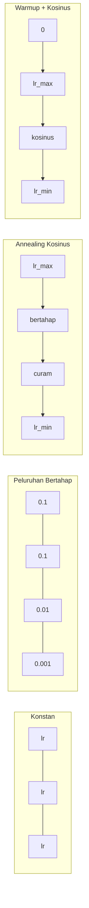
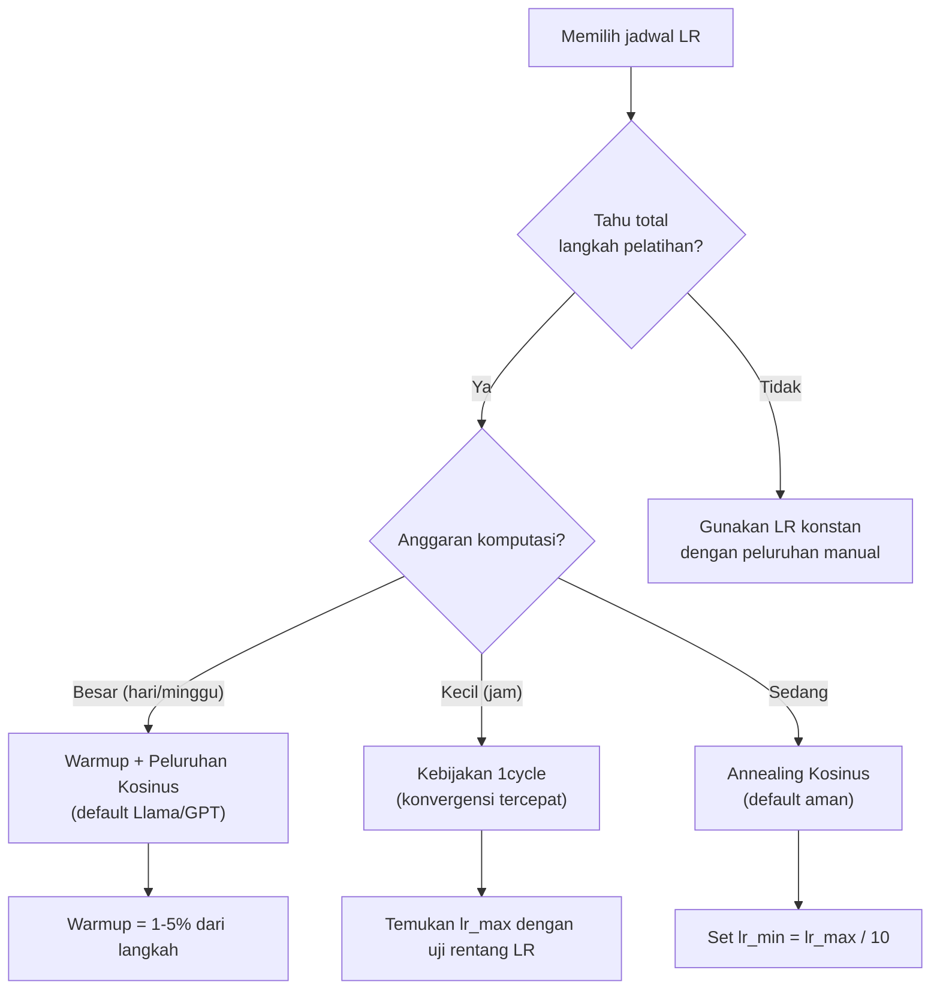
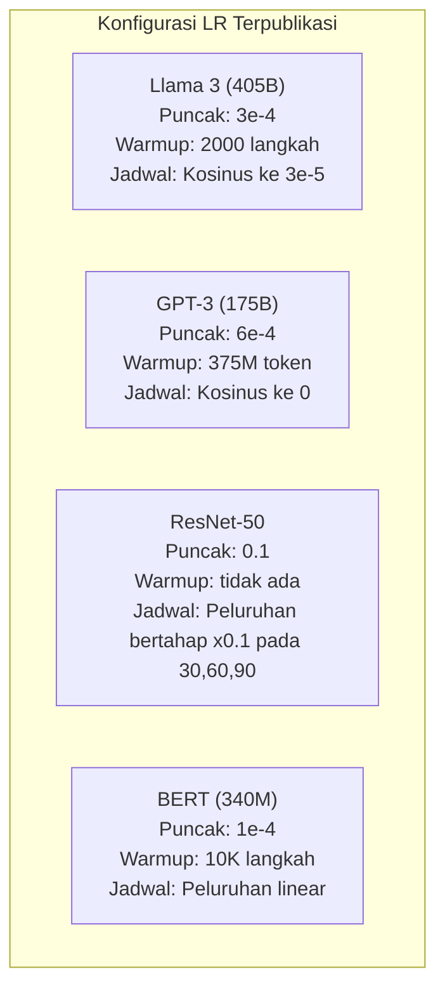

# Jadwal Laju Pembelajaran dan Warmup

> Laju pembelajaran adalah hiperparameter tunggal paling penting. Bukan arsitektur. Bukan ukuran dataset. Bukan fungsi aktivasi. Laju pembelajaran. Jika Anda tidak menyetel apa pun, setel ini.

**Jenis:** Build
**Bahasa:** Python, TypeScript
**Prasyarat:** Pelajaran 03.06 (Optimizer), Pelajaran 03.08 (Inisialisasi Bobot)
**Waktu:** ~90 menit

## Tujuan Pembelajaran

- Implementasikan jadwal laju pembelajaran konstan, peluruhan bertahap, annealing kosinus, warmup + kosinus, dan 1cycle dari awal
- Tunjukkan tiga mode kegagalan dalam pemilihan laju pembelajaran: divergensi (terlalu tinggi), mandek (terlalu rendah), dan osilasi (tanpa peluruhan)
- Jelaskan mengapa warmup diperlukan bagi optimizer berbasis Adam dan bagaimana warmup menstabilkan awal pelatihan
- Bandingkan kecepatan konvergensi kelima jadwal pada tugas yang sama dan pilih jadwal yang tepat untuk anggaran pelatihan tertentu

## Masalah

Setel laju pembelajaran ke 0.1. Pelatihan divergen -- rugi melonjak ke tak hingga dalam 3 langkah. Setel ke 0.0001. Pelatihan merayap -- setelah 100 epoch, model hampir tidak bergerak dari kondisi acak. Setel ke 0.01. Pelatihan berjalan selama 50 epoch, lalu rugi berosilasi di sekitar minimum yang tidak pernah bisa dicapai karena langkahnya terlalu besar.

Laju pembelajaran optimal bukan konstan. Laju itu berubah selama pelatihan. Awalnya, Anda menginginkan langkah besar untuk menempuh jarak dengan cepat. Menjelang akhir pelatihan, Anda menginginkan langkah kecil untuk menetap di minimum yang tajam. Selisih antara model dengan akurasi 90% dan model dengan akurasi 95% sering kali hanya terletak pada jadwalnya.

Setiap model besar yang dipublikasikan dalam tiga tahun terakhir memakai jadwal laju pembelajaran. Llama 3 memakai puncak lr=3e-4 dengan 2000 langkah warmup dan peluruhan kosinus ke 3e-5. GPT-3 memakai lr=6e-4 dengan warmup selama 375 juta token. Ini bukan pilihan sembarangan. Hasil ini berasal dari penyapuan hiperparameter ekstensif yang menelan biaya jutaan dolar.

Anda perlu memahami jadwal karena nilai default tidak akan bekerja untuk masalah Anda. Saat menyetel halus model pra-pelatihan, jadwal yang tepat berbeda dengan pelatihan dari awal. Saat Anda menaikkan ukuran batch, periode warmup perlu diubah. Saat pelatihan rusak pada langkah 10.000, Anda perlu tahu apakah itu masalah jadwal atau hal lain.

## Konsep

### Laju Pembelajaran Konstan

Pendekatan paling sederhana. Pilih sebuah angka, pakai untuk setiap langkah.

```math
\text{lr}(t) = \text{lr}_0
```

Jarang optimal. Laju ini terlalu tinggi untuk akhir pelatihan (osilasi di sekitar minimum) atau terlalu rendah untuk awal (komputasi terbuang untuk langkah kecil). Cukup baik untuk model kecil dan debugging. Pilihan yang buruk untuk apa pun yang dilatih lebih dari satu jam.

### Peluruhan Bertahap

Pendekatan lawas dari era ResNet. Turunkan laju pembelajaran dengan faktor (biasanya 10x) pada epoch tertentu.

```math
\text{lr}(t) = \text{lr}_0 \cdot \gamma^{\lfloor \text{epoch} / \text{step\_size} \rfloor}
```

Dengan $\gamma = 0.1$ dan step_size = 30 artinya: lr turun 10x setiap 30 epoch. ResNet-50 memakai ini -- lr=0.1, turun 10x pada epoch 30, 60, dan 90.

Masalahnya: titik peluruhan optimal bergantung pada dataset dan arsitektur. Pindah ke masalah lain dan Anda perlu menyetel ulang kapan penurunan terjadi. Transisinya mendadak -- rugi dapat melonjak ketika laju berubah tiba-tiba.

### Annealing Kosinus

Peluruhan mulus dari laju pembelajaran maksimum ke minimum, mengikuti kurva kosinus:

```math
\text{lr}(t) = \text{lr}_{\min} + 0.5 \cdot (\text{lr}_{\max} - \text{lr}_{\min}) \cdot \left(1 + \cos\left(\frac{\pi t}{T}\right)\right)
```

Dengan $t$ sebagai langkah saat ini dan $T$ sebagai total jumlah langkah.

Pada $t=0$, suku kosinus bernilai 1, sehingga $\text{lr} = \text{lr}_{\max}$. Pada $t=T$, suku kosinus bernilai -1, sehingga $\text{lr} = \text{lr}_{\min}$. Peluruhan awalnya lembut, berakselerasi di tengah, lalu menjadi lembut lagi menjelang akhir.

Ini adalah default untuk sebagian besar proses pelatihan modern. Tidak ada hiperparameter yang perlu disetel selain $\text{lr}_{\max}$ dan $\text{lr}_{\min}$. Bentuk kosinus cocok dengan observasi empiris bahwa sebagian besar pembelajaran terjadi di tengah pelatihan -- Anda menginginkan ukuran langkah yang wajar selama periode krusial itu.

### Warmup: Mengapa Anda Mulai dari Kecil

Adam dan optimizer adaptif lain menyimpan estimasi berjalan dari rata-rata dan varians gradien. Pada langkah 0, estimasi-estimasi itu diinisialisasi ke nol. Beberapa pembaruan gradien pertama didasarkan pada statistik sampah. Jika laju pembelajaran Anda besar pada periode ini, model mengambil langkah yang sangat besar dan buruk arahnya.

Warmup memperbaiki ini. Mulai dengan laju pembelajaran sangat kecil (sering lr_max / warmup_steps atau bahkan nol) lalu naikkan secara linier ke $\text{lr}_{\max}$ selama $N$ langkah pertama. Pada saat Anda mencapai laju penuh, statistik Adam sudah stabil.

```math
\text{lr}(t) = \text{lr}_{\max} \cdot \frac{t}{\text{warmup\_steps}} \quad \text{for } t < \text{warmup\_steps}
```

Warmup umum: 1-5% dari total langkah pelatihan. Llama 3 dilatih pada ~1,8 triliun token dan melakukan warmup selama 2000 langkah. GPT-3 melakukan warmup selama 375 juta token.

### Warmup Linier + Peluruhan Kosinus

Default modern. Naik secara linier, lalu turun dengan kosinus:

```
if t < warmup_steps:
    lr(t) = lr_max * (t / warmup_steps)
else:
    progress = (t - warmup_steps) / (total_steps - warmup_steps)
    lr(t) = lr_min + 0.5 * (lr_max - lr_min) * (1 + cos(pi * progress))
```

Inilah yang dipakai Llama, GPT, PaLM, dan sebagian besar transformer modern. Warmup mencegah ketidakstabilan awal. Peluruhan kosinus menetapkan model ke minimum yang baik.

### Kebijakan 1cycle

Penemuan Leslie Smith (2018): naikkan laju pembelajaran dari nilai rendah ke nilai tinggi pada paruh pertama pelatihan, lalu turunkan lagi pada paruh kedua. Kontraintuitif -- mengapa Anda harus *menaikkan* laju pembelajaran di tengah pelatihan?

Teorinya: laju pembelajaran tinggi bertindak sebagai regularisasi dengan menambahkan noise ke lintasan optimasi. Model menjelajahi lebih banyak lanskap rugi selama fase kenaikan, menemukan cekungan yang lebih baik. Fase penurunan kemudian menyempurnakan model di dalam cekungan terbaik yang ditemukan.

```
Phase 1 (0 to T/2):    lr ramps from lr_max/25 to lr_max
Phase 2 (T/2 to T):    lr ramps from lr_max to lr_max/10000
```

1cycle sering melatih lebih cepat daripada annealing kosinus untuk anggaran komputasi tetap. Komprominya: Anda harus mengetahui total jumlah langkah lebih awal.

### Bentuk-Bentuk Jadwal



### Diagram Keputusan



### Angka Nyata dari Model yang Dipublikasikan



```figure
lr-schedule
```

## Bangun

### Langkah 1: Fungsi-Fungsi Jadwal

Setiap fungsi menerima langkah saat ini dan mengembalikan laju pembelajaran pada langkah itu.

```python
import math


def constant_schedule(step, lr=0.01, **kwargs):
    return lr


def step_decay_schedule(step, lr=0.1, step_size=100, gamma=0.1, **kwargs):
    return lr * (gamma ** (step // step_size))


def cosine_schedule(step, lr=0.01, total_steps=1000, lr_min=1e-5, **kwargs):
    if step >= total_steps:
        return lr_min
    return lr_min + 0.5 * (lr - lr_min) * (1 + math.cos(math.pi * step / total_steps))


def warmup_cosine_schedule(step, lr=0.01, total_steps=1000, warmup_steps=100, lr_min=1e-5, **kwargs):
    if total_steps <= warmup_steps:
        return lr * (step / max(warmup_steps, 1))
    if step < warmup_steps:
        return lr * step / warmup_steps
    progress = (step - warmup_steps) / (total_steps - warmup_steps)
    return lr_min + 0.5 * (lr - lr_min) * (1 + math.cos(math.pi * progress))


def one_cycle_schedule(step, lr=0.01, total_steps=1000, **kwargs):
    mid = max(total_steps // 2, 1)
    if step < mid:
        return (lr / 25) + (lr - lr / 25) * step / mid
    else:
        progress = (step - mid) / max(total_steps - mid, 1)
        return lr * (1 - progress) + (lr / 10000) * progress
```

### Langkah 2: Visualisasi Semua Jadwal

Cetak plot berbasis teks yang menunjukkan bagaimana setiap jadwal berevolusi selama pelatihan.

```python
def visualize_schedule(name, schedule_fn, total_steps=500, **kwargs):
    steps = list(range(0, total_steps, total_steps // 20))
    if total_steps - 1 not in steps:
        steps.append(total_steps - 1)

    lrs = [schedule_fn(s, total_steps=total_steps, **kwargs) for s in steps]
    max_lr = max(lrs) if max(lrs) > 0 else 1.0

    print(f"\n{name}:")
    for s, lr_val in zip(steps, lrs):
        bar_len = int(lr_val / max_lr * 40)
        bar = "#" * bar_len
        print(f"  Step {s:4d}: lr={lr_val:.6f} {bar}")
```

### Langkah 3: Jaringan Pelatihan

Jaringan dua lapisan sederhana pada dataset lingkaran, sama seperti pelajaran sebelumnya, tetapi sekarang kita mengubah jadwalnya.

```python
import random


def sigmoid(x):
    x = max(-500, min(500, x))
    return 1.0 / (1.0 + math.exp(-x))


def relu(x):
    return max(0.0, x)


def relu_deriv(x):
    return 1.0 if x > 0 else 0.0


def make_circle_data(n=200, seed=42):
    random.seed(seed)
    data = []
    for _ in range(n):
        x = random.uniform(-2, 2)
        y = random.uniform(-2, 2)
        label = 1.0 if x * x + y * y < 1.5 else 0.0
        data.append(([x, y], label))
    return data


def train_with_schedule(schedule_fn, schedule_name, data, epochs=300, base_lr=0.05, **kwargs):
    random.seed(0)
    hidden_size = 8
    total_steps = epochs * len(data)

    std = math.sqrt(2.0 / 2)
    w1 = [[random.gauss(0, std) for _ in range(2)] for _ in range(hidden_size)]
    b1 = [0.0] * hidden_size
    w2 = [random.gauss(0, std) for _ in range(hidden_size)]
    b2 = 0.0

    step = 0
    epoch_losses = []

    for epoch in range(epochs):
        total_loss = 0
        correct = 0

        for x, target in data:
            lr = schedule_fn(step, lr=base_lr, total_steps=total_steps, **kwargs)

            z1 = []
            h = []
            for i in range(hidden_size):
                z = w1[i][0] * x[0] + w1[i][1] * x[1] + b1[i]
                z1.append(z)
                h.append(relu(z))

            z2 = sum(w2[i] * h[i] for i in range(hidden_size)) + b2
            out = sigmoid(z2)

            error = out - target
            d_out = error * out * (1 - out)

            for i in range(hidden_size):
                d_h = d_out * w2[i] * relu_deriv(z1[i])
                w2[i] -= lr * d_out * h[i]
                for j in range(2):
                    w1[i][j] -= lr * d_h * x[j]
                b1[i] -= lr * d_h
            b2 -= lr * d_out

            total_loss += (out - target) ** 2
            if (out >= 0.5) == (target >= 0.5):
                correct += 1
            step += 1

        avg_loss = total_loss / len(data)
        accuracy = correct / len(data) * 100
        epoch_losses.append(avg_loss)

    return epoch_losses
```

### Langkah 4: Bandingkan Semua Jadwal

Latih jaringan yang sama dengan setiap jadwal dan bandingkan rugi akhir serta perilaku konvergensi.

```python
def compare_schedules(data):
    configs = [
        ("Constant", constant_schedule, {}),
        ("Step Decay", step_decay_schedule, {"step_size": 15000, "gamma": 0.1}),
        ("Cosine", cosine_schedule, {"lr_min": 1e-5}),
        ("Warmup+Cosine", warmup_cosine_schedule, {"warmup_steps": 3000, "lr_min": 1e-5}),
        ("1cycle", one_cycle_schedule, {}),
    ]

    print(f"\n{'Schedule':<20} {'Start Loss':>12} {'Mid Loss':>12} {'End Loss':>12} {'Best Loss':>12}")
    print("-" * 70)

    for name, schedule_fn, extra_kwargs in configs:
        losses = train_with_schedule(schedule_fn, name, data, epochs=300, base_lr=0.05, **extra_kwargs)
        mid_idx = len(losses) // 2
        best = min(losses)
        print(f"{name:<20} {losses[0]:>12.6f} {losses[mid_idx]:>12.6f} {losses[-1]:>12.6f} {best:>12.6f}")
```

### Langkah 5: LR Terlalu Tinggi vs Terlalu Rendah

Tunjukkan tiga mode kegagalan: terlalu tinggi (divergensi), terlalu rendah (merayap), dan tepat.

```python
def lr_sensitivity(data):
    learning_rates = [1.0, 0.1, 0.01, 0.001, 0.0001]

    print("\nLR Sensitivity (constant schedule, 100 epochs):")
    print(f"  {'LR':>10} {'Start Loss':>12} {'End Loss':>12} {'Status':>15}")
    print("  " + "-" * 52)

    for lr in learning_rates:
        losses = train_with_schedule(constant_schedule, f"lr={lr}", data, epochs=100, base_lr=lr)
        start = losses[0]
        end = losses[-1]

        if end > start or math.isnan(end) or end > 1.0:
            status = "DIVERGED"
        elif end > start * 0.9:
            status = "BARELY MOVED"
        elif end < 0.15:
            status = "CONVERGED"
        else:
            status = "LEARNING"

        end_str = f"{end:.6f}" if not math.isnan(end) else "NaN"
        print(f"  {lr:>10.4f} {start:>12.6f} {end_str:>12} {status:>15}")
```

## Gunakan

PyTorch menyediakan penjadwal di `torch.optim.lr_scheduler`:

```python
import torch
import torch.optim as optim
from torch.optim.lr_scheduler import CosineAnnealingLR, OneCycleLR, StepLR

model = nn.Sequential(nn.Linear(10, 64), nn.ReLU(), nn.Linear(64, 1))
optimizer = optim.Adam(model.parameters(), lr=3e-4)

scheduler = CosineAnnealingLR(optimizer, T_max=1000, eta_min=1e-5)

for step in range(1000):
    loss = train_step(model, optimizer)
    scheduler.step()
```

Untuk warmup + kosinus, gunakan penjadwal lambda atau `get_cosine_schedule_with_warmup` dari HuggingFace:

```python
from transformers import get_cosine_schedule_with_warmup

scheduler = get_cosine_schedule_with_warmup(
    optimizer,
    num_warmup_steps=2000,
    num_training_steps=100000,
)
```

Fungsi HuggingFace itulah yang dipakai sebagian besar skrip fine-tuning Llama dan GPT. Jika ragu, gunakan warmup + kosinus dengan warmup = 3-5% dari total langkah. Ini bekerja untuk hampir semua hal.

## Hasil Akhir

Pelajaran ini menghasilkan:
- `outputs/prompt-lr-schedule-advisor.md` -- prompt yang merekomendasikan jadwal laju pembelajaran dan hiperparameter yang tepat untuk konfigurasi pelatihan Anda

## Latihan

1. Implementasikan peluruhan eksponensial: $\text{lr}(t) = \text{lr}_0 \cdot \gamma^t$ dengan $\gamma = 0.999$. Bandingkan dengan annealing kosinus pada dataset lingkaran.

2. Implementasikan uji rentang laju pembelajaran (Leslie Smith): latih selama beberapa ratus langkah sambil menaikkan LR secara eksponensial dari 1e-7 ke 1. Plot rugi terhadap LR. LR maksimum optimal adalah tepat sebelum rugi mulai meningkat.

3. Latih dengan warmup + kosinus tetapi ubah-ubah panjang warmup: 0%, 1%, 5%, 10%, 20% dari total langkah. Temukan titik ideal tempat pelatihan paling stabil.

4. Implementasikan annealing kosinus dengan warm restart (SGDR): setel ulang laju pembelajaran ke $\text{lr}_{\max}$ setiap $T$ langkah dan turunkan lagi. Bandingkan dengan kosinus standar pada proses pelatihan yang lebih lama.

5. Bangun "ahli bedah jadwal" yang memantau rugi pelatihan dan otomatis beralih dari warmup ke kosinus saat rugi stabil, serta menurunkan lr jika rugi mandek terlalu lama.

## Istilah Kunci

| Istilah | Apa yang orang katakan | Apa artinya sebenarnya |
|---------|----------------------|------------------------|
| Laju pembelajaran | "Seberapa cepat model belajar" | Skalar yang mengalikan gradien untuk menentukan ukuran pembaruan parameter |
| Jadwal | "Ubah LR dari waktu ke waktu" | Fungsi yang memetakan langkah pelatihan ke laju pembelajaran, dirancang mengoptimalkan konvergensi |
| Warmup | "Mulai dengan LR kecil" | Menaikkan LR secara linier dari hampir nol ke nilai target selama $N$ langkah pertama untuk menstabilkan statistik optimizer |
| Annealing kosinus | "Peluruhan LR mulus" | Menurunkan LR mengikuti kurva kosinus dari $\text{lr}_{\max}$ ke $\text{lr}_{\min}$ selama pelatihan |
| Peluruhan bertahap | "Turunkan LR pada tonggak" | Mengalikan LR dengan faktor (biasanya 0.1) pada interval epoch tetap |
| Kebijakan 1cycle | "Naik lalu turun" | Metode Leslie Smith menaikkan lalu menurunkan LR dalam satu siklus untuk konvergensi lebih cepat |
| Uji rentang LR | "Temukan laju pembelajaran terbaik" | Melatih sebentar sambil menaikkan LR untuk menemukan nilai tempat rugi mulai divergen |
| Kosinus dengan warm restart | "Setel ulang dan ulangi" | Menyetel ulang LR secara berkala ke $\text{lr}_{\max}$ dan menurunkannya lagi (SGDR) |
| Eta min | "Lantai untuk LR" | Laju pembelajaran minimum yang dicapai jadwal melalui peluruhan |
| Laju pembelajaran puncak | "LR maksimum" | LR tertinggi yang dicapai selama pelatihan, biasanya setelah warmup |

## Bacaan Lanjutan

- Loshchilov & Hutter, "SGDR: Stochastic Gradient Descent with Warm Restarts" (2017) -- memperkenalkan annealing kosinus dan warm restart
- Smith, "Super-Convergence: Very Fast Training of Neural Networks Using Large Learning Rates" (2018) -- makalah kebijakan 1cycle
- Touvron dkk., "Llama 2: Open Foundation and Fine-Tuned Chat Models" (2023) -- mendokumentasikan jadwal warmup + kosinus yang dipakai pada skala besar
- Goyal dkk., "Accurate, Large Minibatch SGD: Training ImageNet in 1 Hour" (2017) -- aturan penskalaan linear dan warmup untuk pelatihan batch besar
