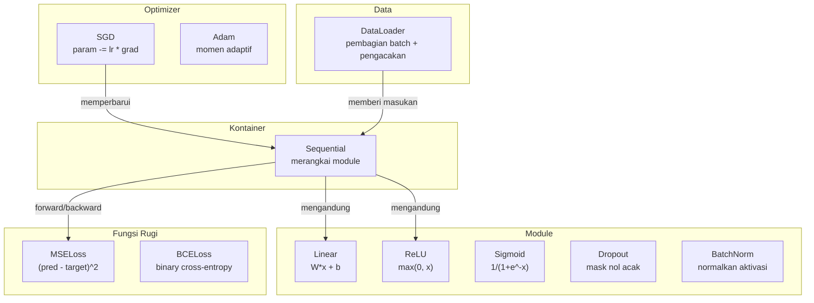
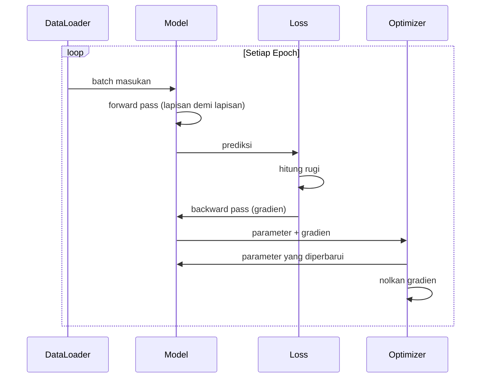
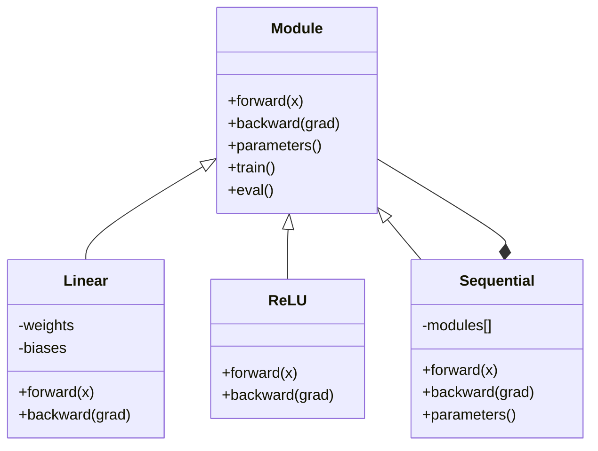

# Bangun Mini Framework Anda Sendiri

> Anda telah membangun neuron, lapisan, jaringan, propagasi balik, aktivasi, fungsi rugi, optimizer, regularisasi, inisialisasi, dan jadwal LR. Semuanya sebagai bagian-bagian terpisah. Sekarang rangkai semuanya menjadi sebuah framework. Bukan PyTorch. Bukan TensorFlow. Milik Anda.

**Jenis:** Build
**Bahasa:** Python, TypeScript
**Prasyarat:** Seluruh Fase 03 (Pelajaran 01-09)
**Waktu:** ~120 menit

## Tujuan Pembelajaran

- Bangun framework deep learning lengkap (~500 baris) berisi Module, Linear, ReLU, Sigmoid, Dropout, BatchNorm, Sequential, fungsi rugi, optimizer, dan DataLoader
- Jelaskan abstraksi Module (forward, backward, parameters) dan mengapa peralihan mode train/eval diperlukan
- Rangkai semua komponen ke dalam loop pelatihan yang bekerja untuk melatih jaringan 4 lapisan pada klasifikasi lingkaran
- Petakan setiap komponen framework Anda ke padanan PyTorch-nya (nn.Module, nn.Sequential, optim.Adam, DataLoader)

## Masalah

Anda memiliki sepuluh pelajaran berisi balok-balok bangunan yang tersebar di berkas-berkas terpisah. Sebuah kelas `Value` di sini, sebuah loop pelatihan di sana, inisialisasi bobot di berkas lain, jadwal laju pembelajaran di berkas lainnya lagi. Untuk melatih sebuah jaringan, Anda menyalin-menempel dari lima pelajaran berbeda dan merangkainya dengan tangan.

Itulah yang diselesaikan framework. PyTorch memberi Anda `nn.Module`, `nn.Sequential`, `optim.Adam`, `DataLoader`, dan pola loop pelatihan yang mengikat semuanya. TensorFlow memberi Anda `keras.Layer`, `keras.Sequential`, `keras.optimizers.Adam`. Semuanya bukan sihir. Itu adalah pola organisasi yang membuat kita dapat mendefinisikan, melatih, dan mengevaluasi jaringan tanpa perlu terus-menerus menciptakan kembali pipa-pipa dasarnya.

Anda akan membangun hal yang sama dalam ~500 baris Python. Tanpa numpy. Tanpa dependensi eksternal. Sebuah framework yang dapat mendefinisikan jaringan feedforward apa pun, melatihnya dengan SGD atau Adam, membagi data ke batch, menerapkan dropout dan normalisasi batch, memakai aktivasi apa pun, serta menjadwalkan laju pembelajaran.

Saat selesai, Anda akan memahami persis apa yang terjadi saat menulis `model = nn.Sequential(...)` di PyTorch. Anda akan mengerti mengapa `model.train()` dan `model.eval()` ada. Anda akan mengerti mengapa `optimizer.zero_grad()` adalah panggilan terpisah. Anda akan memahami semuanya, karena Anda membangun semuanya sendiri.

## Konsep

### Abstraksi Module

Setiap lapisan di PyTorch mewarisi dari `nn.Module`. Sebuah Module memiliki tiga tanggung jawab:

1. **forward()** -- menghitung keluaran dari masukan yang diberikan
2. **parameters()** -- mengembalikan semua bobot yang dapat dilatih
3. **backward()** -- menghitung gradien (ditangani autograd di PyTorch, eksplisit di framework kita)

Lapisan Linear adalah Module. Aktivasi ReLU adalah Module. Lapisan dropout adalah Module. Lapisan normalisasi batch adalah Module. Semuanya memiliki antarmuka yang sama.

### Kontainer Sequential

`nn.Sequential` merangkai Module. Forward pass: lemparkan data melalui Module 1, lalu Module 2, lalu Module 3. Backward pass: balik urutan rantainya. Kontainer itu sendiri adalah Module -- ia memiliki forward(), parameters(), dan backward(). Ini adalah pola komposit: rangkaian Module adalah sebuah Module juga.

### Mode Latih vs Mode Evaluasi

Dropout menolkan neuron secara acak saat pelatihan tetapi meneruskan semuanya saat evaluasi. Normalisasi batch memakai statistik batch saat pelatihan tetapi rata-rata berjalan saat evaluasi. Metode `train()` dan `eval()` mengaktifkan/mematikan perilaku ini. Setiap Module memiliki flag `training`.

### Optimizer

Optimizer memperbarui parameter memakai gradien mereka. SGD: `param -= lr * grad`. Adam: menyimpan estimasi momentum dan varians, lalu memperbarui. Optimizer tidak tahu apa-apa tentang arsitektur jaringan -- ia hanya melihat daftar parameter dan gradien mereka yang datar.

### DataLoader

Pembagian ke dalam batch penting karena dua alasan. Pertama, untuk masalah besar Anda tidak dapat memuat seluruh dataset ke dalam memori. Kedua, gradient descent mini-batch menghasilkan noise yang membantu keluar dari minimum lokal. DataLoader membagi data menjadi batch dan secara opsional mengacak urutannya antar epoch.

### Arsitektur Framework



### Loop Pelatihan



### Hierarki Module



```figure
gradient-clipping
```

## Bangun

### Langkah 1: Kelas Dasar Module

Antarmuka abstrak yang diimplementasikan setiap lapisan.

```python
class Module:
    def __init__(self):
        self.training = True

    def forward(self, x):
        raise NotImplementedError

    def backward(self, grad):
        raise NotImplementedError

    def parameters(self):
        return []

    def train(self):
        self.training = True

    def eval(self):
        self.training = False
```

### Langkah 2: Lapisan Linear

Balok bangunan dasar. Menyimpan bobot dan bias, menghitung Wx + b saat forward, serta gradien bobot/masukan saat backward.

```python
import math
import random


class Linear(Module):
    def __init__(self, fan_in, fan_out):
        super().__init__()
        std = math.sqrt(2.0 / fan_in)
        self.weights = [[random.gauss(0, std) for _ in range(fan_in)] for _ in range(fan_out)]
        self.biases = [0.0] * fan_out
        self.weight_grads = [[0.0] * fan_in for _ in range(fan_out)]
        self.bias_grads = [0.0] * fan_out
        self.fan_in = fan_in
        self.fan_out = fan_out
        self.input = None

    def forward(self, x):
        self.input = x
        output = []
        for i in range(self.fan_out):
            val = self.biases[i]
            for j in range(self.fan_in):
                val += self.weights[i][j] * x[j]
            output.append(val)
        return output

    def backward(self, grad):
        input_grad = [0.0] * self.fan_in
        for i in range(self.fan_out):
            self.bias_grads[i] += grad[i]
            for j in range(self.fan_in):
                self.weight_grads[i][j] += grad[i] * self.input[j]
                input_grad[j] += grad[i] * self.weights[i][j]
        return input_grad

    def parameters(self):
        params = []
        for i in range(self.fan_out):
            for j in range(self.fan_in):
                params.append((self.weights, i, j, self.weight_grads))
            params.append((self.biases, i, None, self.bias_grads))
        return params
```

### Langkah 3: Module Aktivasi

ReLU, Sigmoid, dan Tanh sebagai Module. Masing-masing menyimpan apa yang dibutuhkan untuk backward pass.

```python
class ReLU(Module):
    def __init__(self):
        super().__init__()
        self.mask = None

    def forward(self, x):
        self.mask = [1.0 if v > 0 else 0.0 for v in x]
        return [max(0.0, v) for v in x]

    def backward(self, grad):
        return [g * m for g, m in zip(grad, self.mask)]


class Sigmoid(Module):
    def __init__(self):
        super().__init__()
        self.output = None

    def forward(self, x):
        self.output = []
        for v in x:
            v = max(-500, min(500, v))
            self.output.append(1.0 / (1.0 + math.exp(-v)))
        return self.output

    def backward(self, grad):
        return [g * o * (1 - o) for g, o in zip(grad, self.output)]


class Tanh(Module):
    def __init__(self):
        super().__init__()
        self.output = None

    def forward(self, x):
        self.output = [math.tanh(v) for v in x]
        return self.output

    def backward(self, grad):
        return [g * (1 - o * o) for g, o in zip(grad, self.output)]
```

### Langkah 4: Module Dropout

Menolkan elemen secara acak saat pelatihan. Menskalakan elemen yang tersisa dengan 1/(1-p) agar nilai harapan tetap sama. Tidak melakukan apa-apa saat evaluasi.

```python
class Dropout(Module):
    def __init__(self, p=0.5):
        super().__init__()
        self.p = p
        self.mask = None

    def forward(self, x):
        if not self.training:
            return x
        self.mask = [0.0 if random.random() < self.p else 1.0 / (1 - self.p) for _ in x]
        return [v * m for v, m in zip(x, self.mask)]

    def backward(self, grad):
        if self.mask is None:
            return grad
        return [g * m for g, m in zip(grad, self.mask)]
```

### Langkah 5: Module BatchNorm

Menormalkan aktivasi menjadi rata-rata nol dan varians satu per fitur lintas batch. Menyimpan statistik berjalan untuk mode evaluasi.

```python
class BatchNorm(Module):
    def __init__(self, size, momentum=0.1, eps=1e-5):
        super().__init__()
        self.size = size
        self.gamma = [1.0] * size
        self.beta = [0.0] * size
        self.gamma_grads = [0.0] * size
        self.beta_grads = [0.0] * size
        self.running_mean = [0.0] * size
        self.running_var = [1.0] * size
        self.momentum = momentum
        self.eps = eps
        self.x_norm = None
        self.std_inv = None
        self.batch_input = None

    def forward_batch(self, batch):
        batch_size = len(batch)
        output_batch = []

        if self.training:
            mean = [0.0] * self.size
            for sample in batch:
                for j in range(self.size):
                    mean[j] += sample[j]
            mean = [m / batch_size for m in mean]

            var = [0.0] * self.size
            for sample in batch:
                for j in range(self.size):
                    var[j] += (sample[j] - mean[j]) ** 2
            var = [v / batch_size for v in var]

            self.std_inv = [1.0 / math.sqrt(v + self.eps) for v in var]

            self.x_norm = []
            self.batch_input = batch
            for sample in batch:
                normed = [(sample[j] - mean[j]) * self.std_inv[j] for j in range(self.size)]
                self.x_norm.append(normed)
                output = [self.gamma[j] * normed[j] + self.beta[j] for j in range(self.size)]
                output_batch.append(output)

            for j in range(self.size):
                self.running_mean[j] = (1 - self.momentum) * self.running_mean[j] + self.momentum * mean[j]
                self.running_var[j] = (1 - self.momentum) * self.running_var[j] + self.momentum * var[j]
        else:
            std_inv = [1.0 / math.sqrt(v + self.eps) for v in self.running_var]
            for sample in batch:
                normed = [(sample[j] - self.running_mean[j]) * std_inv[j] for j in range(self.size)]
                output = [self.gamma[j] * normed[j] + self.beta[j] for j in range(self.size)]
                output_batch.append(output)

        return output_batch

    def forward(self, x):
        result = self.forward_batch([x])
        return result[0]

    def backward(self, grad):
        if self.x_norm is None:
            return grad
        for j in range(self.size):
            self.gamma_grads[j] += self.x_norm[0][j] * grad[j]
            self.beta_grads[j] += grad[j]
        return [grad[j] * self.gamma[j] * self.std_inv[j] for j in range(self.size)]

    def parameters(self):
        params = []
        for j in range(self.size):
            params.append((self.gamma, j, None, self.gamma_grads))
            params.append((self.beta, j, None, self.beta_grads))
        return params
```

### Langkah 6: Kontainer Sequential

Merangkai module. Forward berjalan dari kiri ke kanan, backward dari kanan ke kiri.

```python
class Sequential(Module):
    def __init__(self, *modules):
        super().__init__()
        self.modules = list(modules)

    def forward(self, x):
        for module in self.modules:
            x = module.forward(x)
        return x

    def backward(self, grad):
        for module in reversed(self.modules):
            grad = module.backward(grad)
        return grad

    def parameters(self):
        params = []
        for module in self.modules:
            params.extend(module.parameters())
        return params

    def train(self):
        self.training = True
        for module in self.modules:
            module.train()

    def eval(self):
        self.training = False
        for module in self.modules:
            module.eval()
```

### Langkah 7: Fungsi Rugi

MSE dan Binary Cross-Entropy. Masing-masing mengembalikan nilai rugi dan menyediakan backward() yang mengembalikan gradien.

```python
class MSELoss:
    def __call__(self, predicted, target):
        self.predicted = predicted
        self.target = target
        n = len(predicted)
        self.loss = sum((p - t) ** 2 for p, t in zip(predicted, target)) / n
        return self.loss

    def backward(self):
        n = len(self.predicted)
        return [2 * (p - t) / n for p, t in zip(self.predicted, self.target)]


class BCELoss:
    def __call__(self, predicted, target):
        self.predicted = predicted
        self.target = target
        eps = 1e-7
        n = len(predicted)
        self.loss = 0
        for p, t in zip(predicted, target):
            p = max(eps, min(1 - eps, p))
            self.loss += -(t * math.log(p) + (1 - t) * math.log(1 - p))
        self.loss /= n
        return self.loss

    def backward(self):
        eps = 1e-7
        n = len(self.predicted)
        grads = []
        for p, t in zip(self.predicted, self.target):
            p = max(eps, min(1 - eps, p))
            grads.append((-t / p + (1 - t) / (1 - p)) / n)
        return grads
```

### Langkah 8: Optimizer SGD dan Adam

Keduanya menerima daftar parameter dan memperbarui bobot memakai gradien.

```python
class SGD:
    def __init__(self, parameters, lr=0.01):
        self.params = parameters
        self.lr = lr

    def step(self):
        for container, i, j, grad_container in self.params:
            if j is not None:
                container[i][j] -= self.lr * grad_container[i][j]
            else:
                container[i] -= self.lr * grad_container[i]

    def zero_grad(self):
        for container, i, j, grad_container in self.params:
            if j is not None:
                grad_container[i][j] = 0.0
            else:
                grad_container[i] = 0.0


class Adam:
    def __init__(self, parameters, lr=0.001, beta1=0.9, beta2=0.999, eps=1e-8):
        self.params = parameters
        self.lr = lr
        self.beta1 = beta1
        self.beta2 = beta2
        self.eps = eps
        self.t = 0
        self.m = [0.0] * len(parameters)
        self.v = [0.0] * len(parameters)

    def step(self):
        self.t += 1
        for idx, (container, i, j, grad_container) in enumerate(self.params):
            if j is not None:
                g = grad_container[i][j]
            else:
                g = grad_container[i]

            self.m[idx] = self.beta1 * self.m[idx] + (1 - self.beta1) * g
            self.v[idx] = self.beta2 * self.v[idx] + (1 - self.beta2) * g * g

            m_hat = self.m[idx] / (1 - self.beta1 ** self.t)
            v_hat = self.v[idx] / (1 - self.beta2 ** self.t)

            update = self.lr * m_hat / (math.sqrt(v_hat) + self.eps)

            if j is not None:
                container[i][j] -= update
            else:
                container[i] -= update

    def zero_grad(self):
        for container, i, j, grad_container in self.params:
            if j is not None:
                grad_container[i][j] = 0.0
            else:
                grad_container[i] = 0.0
```

### Langkah 9: DataLoader

Membagi data menjadi batch dan secara opsional mengacaknya setiap epoch.

```python
class DataLoader:
    def __init__(self, data, batch_size=32, shuffle=True):
        self.data = data
        self.batch_size = batch_size
        self.shuffle = shuffle

    def __iter__(self):
        indices = list(range(len(self.data)))
        if self.shuffle:
            random.shuffle(indices)
        for start in range(0, len(indices), self.batch_size):
            batch_indices = indices[start:start + self.batch_size]
            batch = [self.data[i] for i in batch_indices]
            inputs = [item[0] for item in batch]
            targets = [item[1] for item in batch]
            yield inputs, targets

    def __len__(self):
        return (len(self.data) + self.batch_size - 1) // self.batch_size
```

### Langkah 10: Latih Jaringan 4 Lapisan pada Klasifikasi Lingkaran

Rangkai semuanya. Definisikan model, pilih rugi, pilih optimizer, jalankan loop pelatihan.

```python
def make_circle_data(n=500, seed=42):
    random.seed(seed)
    data = []
    for _ in range(n):
        x = random.uniform(-2, 2)
        y = random.uniform(-2, 2)
        label = 1.0 if x * x + y * y < 1.5 else 0.0
        data.append(([x, y], [label]))
    return data


def train():
    random.seed(42)

    model = Sequential(
        Linear(2, 16),
        ReLU(),
        Linear(16, 16),
        ReLU(),
        Linear(16, 8),
        ReLU(),
        Linear(8, 1),
        Sigmoid(),
    )

    criterion = BCELoss()
    optimizer = Adam(model.parameters(), lr=0.01)

    data = make_circle_data(500)
    split = int(len(data) * 0.8)
    train_data = data[:split]
    test_data = data[split:]

    loader = DataLoader(train_data, batch_size=16, shuffle=True)

    model.train()

    for epoch in range(100):
        total_loss = 0
        total_correct = 0
        total_samples = 0

        for batch_inputs, batch_targets in loader:
            batch_loss = 0
            for x, t in zip(batch_inputs, batch_targets):
                pred = model.forward(x)
                loss = criterion(pred, t)
                batch_loss += loss

                optimizer.zero_grad()
                grad = criterion.backward()
                model.backward(grad)
                optimizer.step()

                predicted_class = 1.0 if pred[0] >= 0.5 else 0.0
                if predicted_class == t[0]:
                    total_correct += 1
                total_samples += 1

            total_loss += batch_loss

        avg_loss = total_loss / total_samples
        accuracy = total_correct / total_samples * 100

        if epoch % 10 == 0 or epoch == 99:
            print(f"Epoch {epoch:3d} | Loss: {avg_loss:.6f} | Train Accuracy: {accuracy:.1f}%")

    model.eval()
    correct = 0
    for x, t in test_data:
        pred = model.forward(x)
        predicted_class = 1.0 if pred[0] >= 0.5 else 0.0
        if predicted_class == t[0]:
            correct += 1
    test_accuracy = correct / len(test_data) * 100
    print(f"\nTest Accuracy: {test_accuracy:.1f}% ({correct}/{len(test_data)})")

    return model, test_accuracy
```

## Gunakan

Berikut padanan PyTorch dari apa yang baru saja Anda bangun:

```python
import torch
import torch.nn as nn
from torch.utils.data import DataLoader, TensorDataset

model = nn.Sequential(
    nn.Linear(2, 16),
    nn.ReLU(),
    nn.Linear(16, 16),
    nn.ReLU(),
    nn.Linear(16, 8),
    nn.ReLU(),
    nn.Linear(8, 1),
    nn.Sigmoid(),
)

criterion = nn.BCELoss()
optimizer = torch.optim.Adam(model.parameters(), lr=0.01)

for epoch in range(100):
    model.train()
    for inputs, targets in dataloader:
        optimizer.zero_grad()
        predictions = model(inputs)
        loss = criterion(predictions, targets)
        loss.backward()
        optimizer.step()

    model.eval()
    with torch.no_grad():
        test_predictions = model(test_inputs)
```

Strukturnya identik. `Sequential`, `Linear`, `ReLU`, `Sigmoid`, `BCELoss`, `Adam`, `zero_grad`, `backward`, `step`, `train`, `eval`. Setiap konsep dipetakan satu-ke-satu. Bedanya, PyTorch menangani autograd otomatis (tidak perlu mengimplementasikan backward() di setiap module), berjalan di GPU, dan telah dioptimalkan selama bertahun-tahun. Tetapi tulangnya sama.

Sekarang, saat melihat kode PyTorch, Anda tahu persis apa yang terjadi di setiap baris. Pemahaman itulah tujuan keseluruhannya.

## Hasil Akhir

Pelajaran ini menghasilkan:
- `outputs/prompt-framework-architect.md` -- prompt untuk merancang arsitektur jaringan saraf memakai abstraksi framework

## Latihan

1. Tambahkan kelas `SoftmaxCrossEntropyLoss` untuk klasifikasi multi-kelas. Terapkan softmax pada prediksi, hitung rugi cross-entropy, dan tangani backward pass gabungan. Uji pada dataset spiral 3 kelas.

2. Implementasikan penjadwalan laju pembelajaran di optimizer: tambahkan metode `set_lr()` dan rangkai jadwal kosinus dari Pelajaran 09. Latih klasifikator lingkaran dengan warmup + kosinus dan bandingkan dengan LR konstan.

3. Tambahkan metode `save()` dan `load()` pada Sequential yang menyerialkan semua bobot ke berkas JSON dan memuatnya kembali. Verifikasi bahwa model yang dimuat menghasilkan prediksi yang sama dengan model aslinya.

4. Implementasikan peluruhan bobot (regularisasi L2) pada optimizer Adam. Tambahkan parameter `weight_decay` yang mengecilkan bobot ke arah nol setiap langkah. Bandingkan pelatihan dengan decay=0 versus decay=0.01.

5. Ganti loop pelatihan per sampel dengan akumulasi gradien mini-batch yang proper: akumulasikan gradien dari semua sampel dalam sebuah batch, lalu bagi dengan ukuran batch dan ambil satu langkah optimizer. Ukur apakah ini mengubah kecepatan konvergensi.

## Istilah Kunci

| Istilah | Apa yang orang katakan | Apa artinya sebenarnya |
|---------|----------------------|------------------------|
| Module | "Sebuah lapisan" | Abstraksi dasar dalam framework -- apa pun yang memiliki forward(), backward(), dan parameters() |
| Sequential | "Tumpuk lapisan berurutan" | Kontainer yang merangkai module, menerapkannya berurutan saat forward dan berbalik saat backward |
| Forward pass | "Jalankan jaringan" | Menghitung keluaran dengan melewatkan masukan melalui setiap module secara berurutan |
| Backward pass | "Hitung gradien" | Menyalurkan gradien rugi melalui setiap module secara terbalik untuk menghitung gradien parameter |
| Parameter | "Bobot yang dapat dilatih" | Semua nilai dalam jaringan yang dapat diperbarui optimizer -- bobot dan bias |
| Optimizer | "Yang memperbarui bobot" | Algoritma yang memakai gradien untuk memperbarui parameter, mengimplementasikan SGD, Adam, atau aturan lain |
| DataLoader | "Yang memberi data" | Iterator yang membagi dataset menjadi batch dan secara opsional mengacak urutannya antar epoch |
| Mode pelatihan | "model.train()" | Flag yang mengaktifkan perilaku stokastik seperti dropout dan normalisasi batch dengan statistik batch |
| Mode evaluasi | "model.eval()" | Flag yang mematikan dropout dan memakai statistik berjalan untuk normalisasi batch |
| Zero grad | "Bersihkan gradien" | Mengatur ulang semua gradien parameter ke nol sebelum menghitung gradien batch berikutnya |

## Bacaan Lanjutan

- Paszke dkk., "PyTorch: An Imperative Style, High-Performance Deep Learning Library" (2019) -- makalah yang menjelaskan keputusan desain PyTorch
- Chollet, "Deep Learning with Python, Second Edition" (2021) -- Bab 3 membahas internal Keras dengan abstraksi module/lapisan yang sama
- Johnson, "Tiny-DNN" (https://github.com/tiny-dnn/tiny-dnn) -- framework deep learning C++ header-only untuk memahami internal framework
