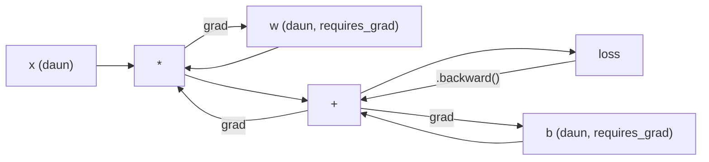
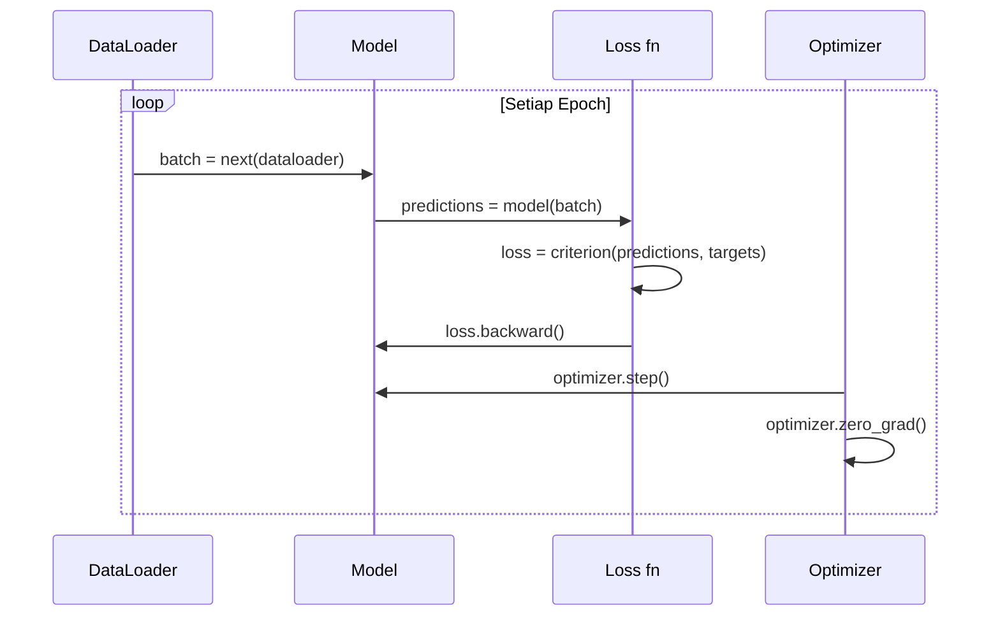

# Pengantar PyTorch

> Anda membangun mesin dari piston dan poros engkol. Sekarang pelajarilah mesin yang benar-benar dikendarai semua orang.

**Jenis:** Build
**Bahasa:** Python
**Prasyarat:** Pelajaran 03.10 (Bangun Mini Framework Anda Sendiri)
**Waktu:** ~75 menit

## Tujuan Pembelajaran

- Bangun dan latih jaringan saraf memakai nn.Module, nn.Sequential, dan autograd PyTorch
- Gunakan tensor PyTorch, akselerasi GPU, dan loop pelatihan standar (zero_grad, forward, loss, backward, step)
- Konversikan komponen mini framework dari awal Anda ke padanan PyTorch-nya
- Profilkan dan bandingkan kecepatan pelatihan antara framework murni Python Anda dan PyTorch pada tugas yang sama

## Masalah

Anda punya mini framework yang bekerja. Lapisan Linear, ReLU, dropout, normalisasi batch, Adam, sebuah DataLoader, dan loop pelatihan. Framework itu melatih jaringan 4 lapisan pada masalah klasifikasi lingkaran dalam Python murni.

Framework itu juga 500x lebih lambat daripada PyTorch pada masalah yang sama.

Mini framework Anda memproses satu sampel demi satu sampel dengan loop Python bersarang. PyTorch meneruskan operasi yang sama ke kernel C++/CUDA yang dioptimalkan dan berjalan di GPU. Pada satu NVIDIA A100, PyTorch melatih ResNet-50 (25,6 juta parameter) pada ImageNet (1,28 juta gambar) dalam sekitar 6 jam. Framework Anda akan membutuhkan kurang lebih 3.000 jam untuk tugas yang sama -- andaikata tidak kehabisan memori lebih dulu.

Kecepatan bukan satu-satunya kesenjangan. Framework Anda tidak punya dukungan GPU. Tidak ada diferensiasi otomatis -- Anda menulis backward() sendiri untuk setiap modul. Tidak ada serialisasi. Tidak ada pelatihan terdistribusi. Tidak ada mixed precision. Tidak ada cara mendebug aliran gradien tanpa pernyataan print.

PyTorch menutup semua kesenjangan itu. Dan dilakukannya sambil mempertahankan model mental yang persis sudah Anda bangun: Module, forward(), parameters(), backward(), optimizer.step(). Konsepnya berpindah satu-ke-satu. Sintaksnya hampir identik. Bedanya, PyTorch membungkus satu dekade rekayasa sistem di balik antarmuka yang sama seperti yang Anda rancang dari awal.

## Konsep

### Mengapa PyTorch Menang

Pada 2015, TensorFlow mengharuskan Anda mendefinisikan graf komputasi statis sebelum menjalankan apa pun. Anda membangun graf, mengompilasinya, lalu melewatkan data melaluinya. Debugging berarti menatap visualisasi graf. Mengubah arsitektur berarti membangun ulang graf dari nol.

PyTorch diluncurkan pada 2017 dengan falsafah yang berbeda: eksekusi eager. Anda menulis Python. Kodenya langsung berjalan. `y = model(x)` benar-benar menghitung y sekarang juga, bukan "tambahkan simpul ke graf yang akan menghitung y nanti". Ini berarti alat debugging Python standar berfungsi. print() berfungsi. pdb berfungsi. if/else di forward pass Anda berfungsi.

Pada 2020, pasar sudah bersuara. Pangsa PyTorch dalam makalah riset ML naik dari 7% (2017) menjadi lebih dari 75% (2022). Meta, Google DeepMind, OpenAI, Anthropic, dan Hugging Face semuanya memakai PyTorch sebagai framework utama. TensorFlow 2.x mengadopsi eksekusi eager sebagai respons -- pengakuan terselubung bahwa desain PyTorch benar.

Pelajaraninya: pengalaman pengembang berakumulasi. Framework yang 10% lebih lambat tetapi 50% lebih cepat didiagnosis akan menang setiap kali.

### Tensor

Tensor adalah larik multidimensi dengan tiga sifat penting: bentuk (shape), dtype, dan device.

```python
import torch

x = torch.zeros(3, 4)           # bentuk: (3, 4), dtype: float32, device: cpu
x = torch.randn(2, 3, 224, 224) # batch 2 gambar RGB, 224x224
x = torch.tensor([1, 2, 3])     # dari daftar Python
```

**Shape** adalah dimensi. Skalar berbentuk (), vektor (n,), matriks (m, n), dan batch gambar (batch, channels, height, width).

**Dtype** mengontrol presisi dan memori.

| dtype | Bit | Rentang | Kasus penggunaan |
|-------|------|-------|----------|
| float32 | 32 | ~7 digit desimal | Pelatihan default |
| float16 | 16 | ~3,3 digit desimal | Mixed precision |
| bfloat16 | 16 | Rentang sama seperti float32, presisi lebih rendah | Pelatihan LLM |
| int8 | 8 | -128 sampai 127 | Inferensi terkuantisasi |

**Device** menentukan tempat komputasi berlangsung.

```python
device = torch.device("cuda" if torch.cuda.is_available() else "cpu")
x = torch.randn(3, 4, device=device)
x = x.to("cuda")
x = x.cpu()
```

Setiap operasi mengharuskan semua tensor berada pada device yang sama. Ini adalah error PyTorch nomor satu yang ditemui pemula: `RuntimeError: Expected all tensors to be on the same device`. Perbaikinya dengan memindahkan semuanya ke device yang sama sebelum komputasi.

**Pengubahan bentuk (reshaping)** memakan waktu konstan -- teknik ini mengubah metadata, bukan data.

```python
x = torch.randn(2, 3, 4)
x.view(2, 12)      # ubah bentuk menjadi (2, 12) -- harus kontigu
x.reshape(6, 4)    # ubah bentuk menjadi (6, 4) -- selalu bekerja
x.permute(2, 0, 1) # susun ulang dimensi
x.unsqueeze(0)     # tambah dimensi: (1, 2, 3, 4)
x.squeeze()        # hapus dimensi berukuran 1
```

### Autograd

Mini framework Anda mengharuskan Anda mengimplementasikan backward() untuk setiap modul. PyTorch tidak. PyTorch merekam setiap operasi pada tensor ke dalam graf asiklik terarah (graf komputasi), lalu melintasi graf itu secara terbalik untuk menghitung gradien secara otomatis.



Perbedaan utama dengan framework Anda: PyTorch memakai autodiff berbasis pita (tape-based). Setiap operasi ditambahkan ke "pita" selama forward pass. Memanggil `.backward()` memutar ulang pita itu secara terbalik.

```python
x = torch.randn(3, requires_grad=True)
y = x ** 2 + 3 * x
z = y.sum()
z.backward()
print(x.grad)  # dz/dx = 2x + 3
```

Tiga aturan autograd:

1. Hanya tensor daun dengan `requires_grad=True` yang mengakumulasi gradien
2. Gradien secara default saling menumpuk -- panggil `optimizer.zero_grad()` sebelum setiap backward pass
3. `torch.no_grad()` mematikan pelacakan gradien (pakai saat evaluasi)

### nn.Module

`nn.Module` adalah kelas dasar untuk setiap komponen jaringan saraf di PyTorch. Anda sudah membangun abstraksi ini di Pelajaran 10. Versi PyTorch menambahkan pendaftaran parameter otomatis, penemuan modul secara rekursif, manajemen device, dan serialisasi state dict.

```python
import torch.nn as nn

class MLP(nn.Module):
    def __init__(self, input_dim, hidden_dim, output_dim):
        super().__init__()
        self.layer1 = nn.Linear(input_dim, hidden_dim)
        self.relu = nn.ReLU()
        self.layer2 = nn.Linear(hidden_dim, output_dim)

    def forward(self, x):
        x = self.layer1(x)
        x = self.relu(x)
        x = self.layer2(x)
        return x
```

Saat Anda menetapkan sebuah `nn.Module` atau `nn.Parameter` sebagai atribut di `__init__`, PyTorch mendaftarkannya secara otomatis. `model.parameters()` mengumpulkan secara rekursif setiap parameter yang terdaftar. Inilah sebabnya Anda tidak pernah perlu mengumpulkan bobot manual seperti di mini framework.

Blok bangunan utama:

| Module | Fungsinya | Parameter |
|--------|-------------|------------|
| nn.Linear(in, out) | $Wx + b$ | in*out + out |
| nn.Conv2d(in_ch, out_ch, k) | Konvolusi 2D | in_ch*out_ch*k*k + out_ch |
| nn.BatchNorm1d(features) | Normalkan aktivasi | 2 * features |
| nn.Dropout(p) | Penolkan acak | 0 |
| nn.ReLU() | $\max(0, x)$ | 0 |
| nn.GELU() | Gaussian error linear | 0 |
| nn.Embedding(vocab, dim) | Tabel pencarian | vocab * dim |
| nn.LayerNorm(dim) | Normalisasi per sampel | 2 * dim |

### Fungsi Rugi dan Optimizer

PyTorch menyediakan versi siap produksi dari semua yang Anda bangun.

**Fungsi rugi** (dari `torch.nn`):

| Rugi | Tugas | Masukan |
|------|--------|-------|
| nn.MSELoss() | Regresi | Bentuk apa pun |
| nn.CrossEntropyLoss() | Klasifikasi multi-kelas | Logit (bukan softmax) |
| nn.BCEWithLogitsLoss() | Klasifikasi biner | Logit (bukan sigmoid) |
| nn.L1Loss() | Regresi (robust) | Bentuk apa pun |
| nn.CTCLoss() | Penyejajaran urutan | Probabilitas log |

Catatan: `CrossEntropyLoss` menggabungkan `LogSoftmax` + `NLLLoss` secara internal. Lempar logit mentah, bukan keluaran softmax. Ini kesalahan umum yang menghasilkan gradien salah tanpa peringatan.

**Optimizer** (dari `torch.optim`):

| Optimizer | Kapan dipakai | LR umum |
|-----------|-------------|-----------|
| SGD(params, lr, momentum) | CNN, pipeline yang tersetel baik | 0.01--0.1 |
| Adam(params, lr) | Titik awal default | 1e-3 |
| AdamW(params, lr, weight_decay) | Transformer, fine-tuning | 1e-4--1e-3 |
| LBFGS(params) | Skala kecil, orde kedua | 1.0 |

### Loop Pelatihan

Setiap loop pelatihan PyTorch mengikuti pola 5 langkah yang sama. Anda sudah mempelajarinya di Pelajaran 10.



Pola kanoniknya:

```python
for epoch in range(num_epochs):
    model.train()
    for inputs, targets in train_loader:
        inputs, targets = inputs.to(device), targets.to(device)
        optimizer.zero_grad()
        outputs = model(inputs)
        loss = criterion(outputs, targets)
        loss.backward()
        optimizer.step()
```

Lima baris di dalam loop batch. Lima baris yang melatih GPT-4, Stable Diffusion, dan LLaMA. Arsitekturnya berubah. Datanya berubah. Lima baris ini tidak berubah.

### Dataset dan DataLoader

`Dataset` PyTorch adalah kelas abstrak dengan dua metode: `__len__` dan `__getitem__`. `DataLoader` membungkusnya dengan pembagian batch, pengacakan, dan pemuatan data multiproses.

```python
from torch.utils.data import Dataset, DataLoader

class MNISTDataset(Dataset):
    def __init__(self, images, labels):
        self.images = images
        self.labels = labels

    def __len__(self):
        return len(self.labels)

    def __getitem__(self, idx):
        return self.images[idx], self.labels[idx]

loader = DataLoader(dataset, batch_size=64, shuffle=True, num_workers=4)
```

`num_workers=4` memunculkan 4 proses untuk memuat data secara paralel selagi GPU melatih batch saat ini. Pada beban kerja yang terikat disk (gambar besar, audio), ini saja dapat menggandakan kecepatan pelatihan.

### Pelatihan GPU

Memindahkan model ke GPU:

```python
device = torch.device("cuda" if torch.cuda.is_available() else "cpu")
model = model.to(device)
```

Ini memindahkan secara rekursif setiap parameter dan buffer ke GPU. Lalu pindahkan setiap batch selama pelatihan:

```python
inputs, targets = inputs.to(device), targets.to(device)
```

**Mixed precision** memotong penggunaan memori menjadi setengahnya dan menggandakan throughput pada GPU modern (A100, H100, RTX 4090) dengan menjalankan forward/backward dalam float16 sambil menyimpan bobot utama (master weights) dalam float32:

```python
from torch.amp import autocast, GradScaler

scaler = GradScaler()
for inputs, targets in loader:
    with autocast(device_type="cuda"):
        outputs = model(inputs)
        loss = criterion(outputs, targets)
    scaler.scale(loss).backward()
    scaler.step(optimizer)
    scaler.update()
    optimizer.zero_grad()
```

### Perbandingan: Mini Framework vs PyTorch vs JAX

| Fitur | Mini Framework (L10) | PyTorch | JAX |
|---------|---------------------|---------|-----|
| Autodiff | backward() manual | Autograd berbasis pita | Transformasi fungsional |
| Eksekusi | Eager (loop Python) | Eager (kernel C++) | Dilacak + dikompilasi JIT |
| Dukungan GPU | Tidak | Ya (CUDA, ROCm, MPS) | Ya (CUDA, TPU) |
| Kecepatan (MLP MNIST) | ~300s/epoch | ~0,5s/epoch | ~0,3s/epoch |
| Sistem Module | Kelas Module kustom | nn.Module | Fungsi stateless (Flax/Equinox) |
| Debugging | print() | print(), pdb, breakpoint() | Lebih sulit (pelacakan JIT memutus print) |
| Ekosistem | Tidak ada | Hugging Face, Lightning, timm | Flax, Optax, Orbax |
| Kurva pembelajaran | Anda yang membangunnya | Sedang | Curam (paradigma fungsional) |
| Pemakaian produksi | Masalah mainan | Meta, OpenAI, Anthropic, HF | Google DeepMind, Midjourney |

```figure
dropout-mask
```

## Bangun

MLP 3 lapisan yang dilatih pada MNIST hanya dengan primitif PyTorch. Tanpa pembungkus tingkat tinggi. Tanpa `torchvision.datasets`. Kita mengunduh dan mengurai data mentah sendiri.

### Langkah 1: Muat MNIST dari Berkas Mentah

MNIST dikirimkan sebagai 4 berkas ter-gzip: gambar pelatihan (60.000 x 28 x 28), label pelatihan, gambar uji (10.000 x 28 x 28), label uji. Kita mengunduhnya dan mengurai format biner.

```python
import torch
import torch.nn as nn
import struct
import gzip
import urllib.request
import os

def download_mnist(path="./mnist_data"):
    base_url = "https://storage.googleapis.com/cvdf-datasets/mnist/"
    files = [
        "train-images-idx3-ubyte.gz",
        "train-labels-idx1-ubyte.gz",
        "t10k-images-idx3-ubyte.gz",
        "t10k-labels-idx1-ubyte.gz",
    ]
    os.makedirs(path, exist_ok=True)
    for f in files:
        filepath = os.path.join(path, f)
        if not os.path.exists(filepath):
            urllib.request.urlretrieve(base_url + f, filepath)

def load_images(filepath):
    with gzip.open(filepath, "rb") as f:
        magic, num, rows, cols = struct.unpack(">IIII", f.read(16))
        data = f.read()
        images = torch.frombuffer(bytearray(data), dtype=torch.uint8)
        images = images.reshape(num, rows * cols).float() / 255.0
    return images

def load_labels(filepath):
    with gzip.open(filepath, "rb") as f:
        magic, num = struct.unpack(">II", f.read(8))
        data = f.read()
        labels = torch.frombuffer(bytearray(data), dtype=torch.uint8).long()
    return labels
```

### Langkah 2: Definisikan Model

MLP 3 lapisan: 784 -> 256 -> 128 -> 10. Aktivasi ReLU. Dropout untuk regularisasi. Tanpa normalisasi batch agar tetap sederhana.

```python
class MNISTModel(nn.Module):
    def __init__(self):
        super().__init__()
        self.net = nn.Sequential(
            nn.Linear(784, 256),
            nn.ReLU(),
            nn.Dropout(0.2),
            nn.Linear(256, 128),
            nn.ReLU(),
            nn.Dropout(0.2),
            nn.Linear(128, 10),
        )

    def forward(self, x):
        return self.net(x)
```

Lapisan keluaran menghasilkan 10 logit mentah (satu per digit). Tanpa softmax -- `CrossEntropyLoss` menangani itu secara internal.

Jumlah parameter: $784 \cdot 256 + 256 + 256 \cdot 128 + 128 + 128 \cdot 10 + 10 = 235{,}146$. Sangat kecil menurut standar modern. GPT-2 small memiliki 124 juta. Ini dilatih dalam hitungan detik.

### Langkah 3: Loop Pelatihan

Pola kanonik forward-loss-backward-step.

```python
def train_one_epoch(model, loader, criterion, optimizer, device):
    model.train()
    total_loss = 0
    correct = 0
    total = 0
    for images, labels in loader:
        images, labels = images.to(device), labels.to(device)
        optimizer.zero_grad()
        outputs = model(images)
        loss = criterion(outputs, labels)
        loss.backward()
        optimizer.step()
        total_loss += loss.item() * images.size(0)
        _, predicted = outputs.max(1)
        correct += predicted.eq(labels).sum().item()
        total += labels.size(0)
    return total_loss / total, correct / total


def evaluate(model, loader, criterion, device):
    model.eval()
    total_loss = 0
    correct = 0
    total = 0
    with torch.no_grad():
        for images, labels in loader:
            images, labels = images.to(device), labels.to(device)
            outputs = model(images)
            loss = criterion(outputs, labels)
            total_loss += loss.item() * images.size(0)
            _, predicted = outputs.max(1)
            correct += predicted.eq(labels).sum().item()
            total += labels.size(0)
    return total_loss / total, correct / total
```

Perhatikan `torch.no_grad()` selama evaluasi. Ini mematikan autograd, mengurangi penggunaan memori, dan mempercepat inferensi. Tanpa itu, PyTorch membangun graf komputasi yang tidak pernah Anda pakai.

### Langkah 4: Rangkai Semuanya

```python
def main():
    device = torch.device("cuda" if torch.cuda.is_available() else "cpu")

    download_mnist()
    train_images = load_images("./mnist_data/train-images-idx3-ubyte.gz")
    train_labels = load_labels("./mnist_data/train-labels-idx1-ubyte.gz")
    test_images = load_images("./mnist_data/t10k-images-idx3-ubyte.gz")
    test_labels = load_labels("./mnist_data/t10k-labels-idx1-ubyte.gz")

    train_dataset = torch.utils.data.TensorDataset(train_images, train_labels)
    test_dataset = torch.utils.data.TensorDataset(test_images, test_labels)
    train_loader = torch.utils.data.DataLoader(
        train_dataset, batch_size=64, shuffle=True
    )
    test_loader = torch.utils.data.DataLoader(
        test_dataset, batch_size=256, shuffle=False
    )

    model = MNISTModel().to(device)
    criterion = nn.CrossEntropyLoss()
    optimizer = torch.optim.Adam(model.parameters(), lr=1e-3)

    num_params = sum(p.numel() for p in model.parameters())
    print(f"Device: {device}")
    print(f"Parameters: {num_params:,}")
    print(f"Train samples: {len(train_dataset):,}")
    print(f"Test samples: {len(test_dataset):,}")
    print()

    for epoch in range(10):
        train_loss, train_acc = train_one_epoch(
            model, train_loader, criterion, optimizer, device
        )
        test_loss, test_acc = evaluate(
            model, test_loader, criterion, device
        )
        print(
            f"Epoch {epoch+1:2d} | "
            f"Train Loss: {train_loss:.4f} | Train Acc: {train_acc:.4f} | "
            f"Test Loss: {test_loss:.4f} | Test Acc: {test_acc:.4f}"
        )

    torch.save(model.state_dict(), "mnist_mlp.pt")
    print(f"\nModel saved to mnist_mlp.pt")
    print(f"Final test accuracy: {test_acc:.4f}")
```

Keluaran yang diharapkan setelah 10 epoch: ~97,8% akurasi uji. Waktu pelatihan di CPU: ~30 detik. Di GPU: ~5 detik. Pada mini framework Anda dengan arsitektur yang sama: ~45 menit.

## Gunakan

### Perbandingan Singkat: Mini Framework vs PyTorch

| Mini Framework (Pelajaran 10) | PyTorch |
|---------------------------|---------|
| `model = Sequential(Linear(784, 256), ReLU(), ...)` | `model = nn.Sequential(nn.Linear(784, 256), nn.ReLU(), ...)` |
| `pred = model.forward(x)` | `pred = model(x)` |
| `optimizer.zero_grad()` | `optimizer.zero_grad()` |
| `grad = criterion.backward()` lalu `model.backward(grad)` | `loss.backward()` |
| `optimizer.step()` | `optimizer.step()` |
| Tanpa GPU | `model.to("cuda")` |
| Backward manual untuk setiap modul | Autograd menangani semuanya |

Antarmukanya hampir identik. Bedanya ada pada segala sesuatu di balik layar.

### Menyimpan dan Memuat Model

```python
torch.save(model.state_dict(), "model.pt")

model = MNISTModel()
model.load_state_dict(torch.load("model.pt", weights_only=True))
model.eval()
```

Selalu simpan `state_dict()` (kamus parameter), bukan objek model. Menyimpan objek model memakai pickle, yang rusak saat Anda merefaktor kode. State dict bersifat portabel.

### Penjadwalan Laju Pembelajaran

```python
scheduler = torch.optim.lr_scheduler.CosineAnnealingLR(
    optimizer, T_max=10
)
for epoch in range(10):
    train_one_epoch(model, train_loader, criterion, optimizer, device)
    scheduler.step()
```

PyTorch menyediakan lebih dari 15 penjadwal: StepLR, ExponentialLR, CosineAnnealingLR, OneCycleLR, ReduceLROnPlateau. Semuanya tersambung ke antarmuka optimizer yang sama.

## Hasil Akhir

Pelajaran ini menghasilkan dua artefak:

- `outputs/prompt-pytorch-debugger.md` -- prompt untuk mendiagnosis kegagalan pelatihan PyTorch umum
- `outputs/skill-pytorch-patterns.md` -- referensi skill untuk pola-pola pelatihan PyTorch

## Latihan

1. **Tambahkan normalisasi batch.** Sisipkan `nn.BatchNorm1d` setelah setiap lapisan linear (sebelum aktivasi). Bandingkan akurasi uji dan kecepatan pelatihan dengan versi yang hanya memakai dropout. Normalisasi batch seharusnya mencapai 98%+ dalam lebih sedikit epoch.

2. **Implementasikan pencari laju pembelajaran.** Latih selama satu epoch dengan laju pembelajaran yang naik secara eksponensial (dari 1e-7 ke 1.0). Plot rugi terhadap LR. LR optimal adalah tepat sebelum rugi mulai naik. Gunakan ini untuk memilih LR yang lebih baik bagi model MNIST.

3. **Port ke GPU dengan mixed precision.** Tambahkan `torch.amp.autocast` dan `GradScaler` ke loop pelatihan. Ukur throughput (sampel/detik) dengan dan tanpa mixed precision di GPU. Pada A100, harapkan peningkatan kecepatan ~2x.

4. **Bangun Dataset kustom.** Unduh Fashion-MNIST (format sama seperti MNIST tetapi berisi pakaian). Implementasikan kelas `FashionMNISTDataset(Dataset)` dengan `__getitem__` dan `__len__`. Latih MLP yang sama dan bandingkan akurasinya. Fashion-MNIST lebih sulit -- harapkan ~88% versus ~98%.

5. **Ganti Adam dengan SGD + momentum.** Latih dengan `SGD(params, lr=0.01, momentum=0.9)`. Bandingkan kurva konvergensi. Lalu tambahkan penjadwal `CosineAnnealingLR` dan lihat apakah SGD menyusul Adam pada epoch 10.

## Istilah Kunci

| Istilah | Apa yang orang katakan | Apa artinya sebenarnya |
|---------|----------------------|------------------------|
| Tensor | "Larik multidimensi" | Larik bertipe dan sadar-device dengan dukungan diferensiasi otomatis yang tertanam di setiap operasi |
| Autograd | "Propagasi balik otomatis" | Sistem berbasis pita yang merekam operasi saat forward pass, lalu memutarnya ulang secara terbalik untuk menghitung gradien eksak |
| nn.Module | "Sebuah lapisan" | Kelas dasar untuk blok komputasi terdiferensiasi apa pun -- mendaftarkan parameter, mendukung penyarangan, menangani mode train/eval |
| state_dict | "Bobot model" | OrderedDict yang memetakan nama parameter ke tensor -- representasi model terlatih yang portabel dan dapat diserialkan |
| .backward() | "Hitung gradien" | Melintasi graf komputasi secara terbalik, menghitung dan mengakumulasi gradien untuk setiap tensor daun dengan requires_grad=True |
| .to(device) | "Pindah ke GPU" | Memindahkan secara rekursif semua parameter dan buffer ke device yang ditentukan (CPU, CUDA, MPS) |
| DataLoader | "Pipeline data" | Iterator yang membagi data ke batch, mengacaknya, dan secara opsional memparalelkan pemuatan data dari Dataset |
| Mixed precision | "Pakai float16" | Melatih dengan forward/backward float16 untuk kecepatan sambil menjaga bobot utama float32 agar stabil secara numerik |
| Eksekusi eager | "Jalankan sekarang" | Operasi langsung dijalankan saat dipanggil, bukan ditunda ke langkah kompilasi nanti -- pilihan desain inti yang membedakan PyTorch dari TF 1.x |
| zero_grad | "Setel ulang gradien" | Mengatur semua gradien parameter ke nol sebelum backward pass berikutnya, karena PyTorch mengakumulasi gradien secara default |

## Bacaan Lanjutan

- Paszke dkk., "PyTorch: An Imperative Style, High-Performance Deep Learning Library" (2019) -- makalah asli yang menjelaskan kompromi desain PyTorch
- Tutorial PyTorch: "Learning PyTorch with Examples" (https://pytorch.org/tutorials/beginner/pytorch_with_examples.html) -- jalur resmi dari tensor ke nn.Module
- Panduan Penyetelan Kinerja PyTorch (https://pytorch.org/tutorials/recipes/recipes/tuning_guide.html) -- mixed precision, worker DataLoader, pinned memory, dan optimasi produksi lainnya
- Horace He, "Making Deep Learning Go Brrrr" (https://horace.io/brrr_intro.html) -- mengapa pelatihan GPU cepat, dengan strategi optimasi khusus PyTorch
