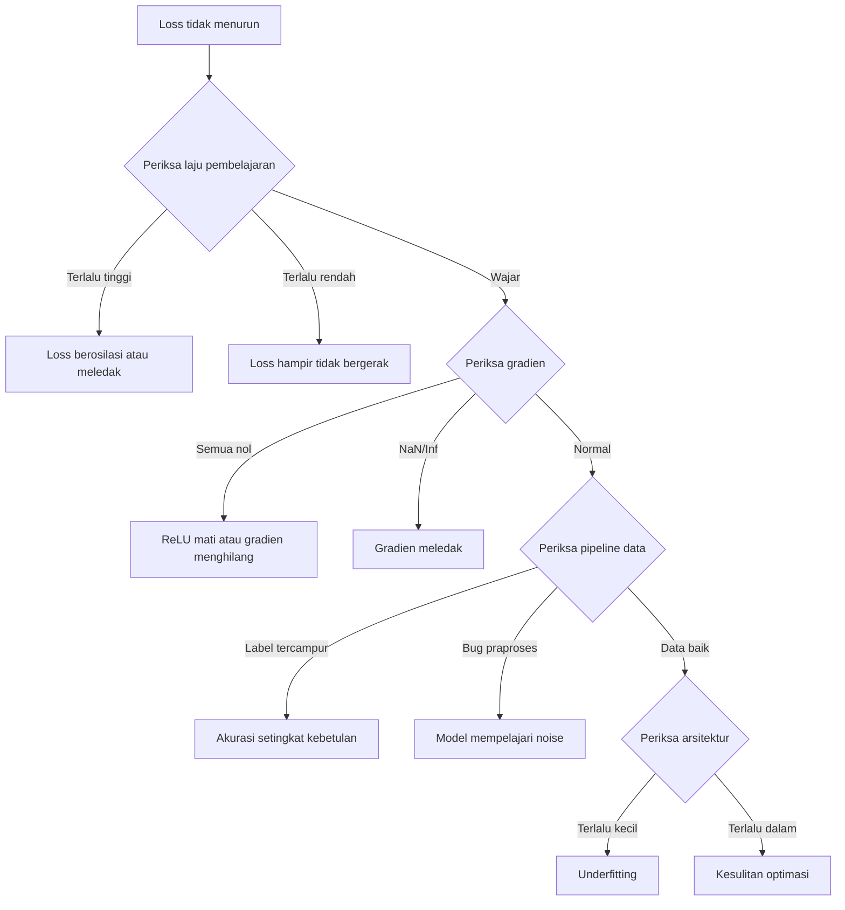
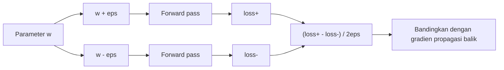
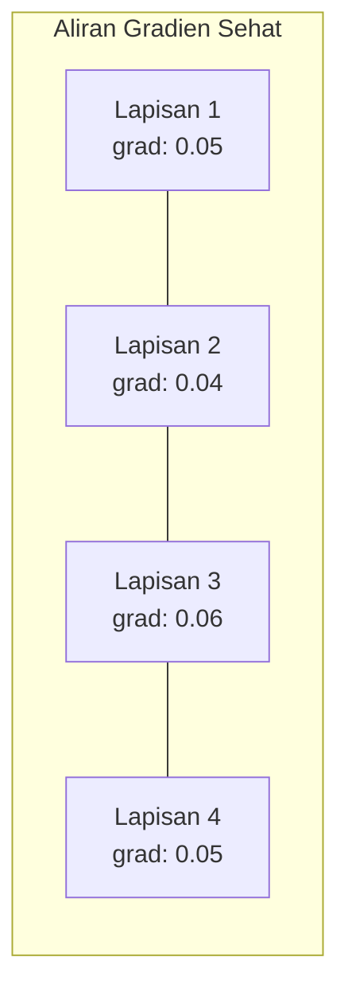
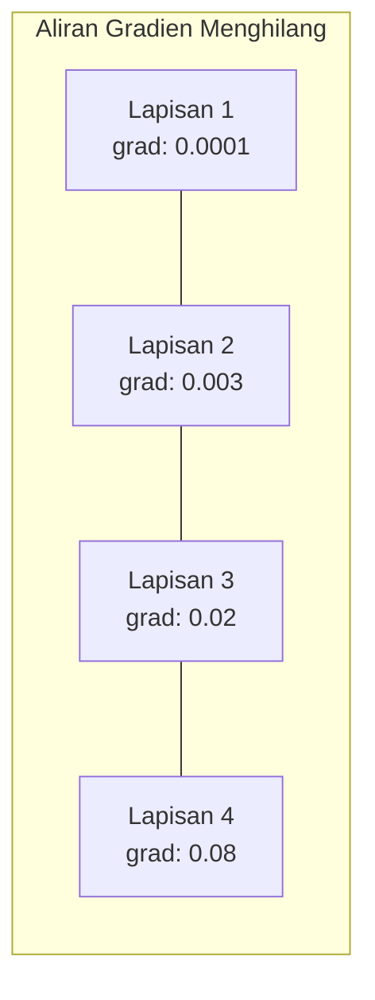
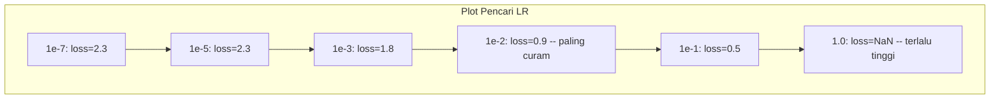

# Debugging Jaringan Saraf

> Jaringan Anda terkompilasi. Kode berjalan. Sebuah angka dihasilkan. Angkanya salah dan tidak ada yang crash. Selamat datang di jenis debugging tersulit -- jenis yang tanpa pesan error.

**Jenis:** Build
**Bahasa:** Python, PyTorch
**Prasyarat:** Pelajaran 01-10 Fase 03 (khususnya propagasi balik, fungsi rugi, optimizer)
**Waktu:** ~90 menit

## Tujuan Pembelajaran

- Mendiagnosis kegagalan umum jaringan saraf (loss NaN, kurva loss datar, overfitting, osilasi) menggunakan strategi debugging sistematis
- Menerapkan teknik "overfit satu batch" untuk memverifikasi bahwa arsitektur model dan loop pelatihan sudah benar
- Memeriksa besar gradien, distribusi aktivasi, dan norma bobot untuk mengidentifikasi masalah gradien menghilang/meledak
- Membangun daftar periksa debugging yang mencakup pipeline data, arsitektur model, fungsi rugi, optimizer, dan masalah laju pembelajaran

## Masalah

Perangkat lunak tradisional crash saat rusak. Pointer null melempar exception. Ketidaksesuaian tipe gagal saat kompilasi. Error off-by-one menghasilkan keluaran yang jelas salah.

Jaringan saraf tidak memberi Anda kemewahan itu.

Jaringan saraf yang rusak tetap berjalan sampai selesai, mencetak nilai loss, dan menghasilkan prediksi. Loss mungkin turun. Prediksi mungkin tampak masuk akal. Tetapi modelnya diam-diam salah -- mempelajari jalan pintas, menghafal noise, atau konvergen ke minimum lokal yang tidak berguna. Peneliti Google memperkirakan 60-70% waktu debugging ML dihabiskan untuk bug "senyap" yang tidak menghasilkan error tetapi menurunkan kualitas model.

Perbedaan antara model yang bekerja dan model yang rusak sering kali hanya satu baris yang salah tempat: `zero_grad()` yang hilang, dimensi yang tertransposisi, atau laju pembelajaran yang meleset 10x. "Recipe for Training Neural Networks" (2019) yang kanonik dibuka dengan kalimat ini: "Kesalahan jaringan saraf yang paling umum adalah bug yang tidak membuat program crash."

Pelajaran ini mengajarkan Anda menemukan bug tersebut.

## Konsep

### Pola Pikir Debugging

Lupakan debugging print-and-pray. Debugging jaringan saraf memerlukan pendekatan sistematis karena loop umpan baliknya lambat (menit hingga jam per pelatihan) dan gejalanya ambigu (loss buruk bisa berarti 20 hal berbeda).

Aturan emas: **mulai dari yang sederhana, tambahkan kompleksitas satu bagian demi satu bagian, dan verifikasi setiap bagian secara terpisah.**



### Gejala 1: Loss Tidak Menurun

Ini keluhan yang paling umum. Loop pelatihan berjalan, epoch bergulir, dan loss tetap datar atau berosilasi liar.

**Laju pembelajaran salah.** Terlalu tinggi: loss berosilasi atau meloncat ke NaN. Terlalu rendah: loss turun sangat lambat sehingga tampak datar. Untuk Adam, mulai dari 1e-3. Untuk SGD, mulai dari 1e-1 atau 1e-2. Selalu coba 3 laju pembelajaran yang masing-masing berselisih 10x (mis. 1e-2, 1e-3, 1e-4) sebelum menyimpulkan ada masalah lain.

**ReLU mati.** Jika neuron ReLU menerima masukan negatif besar, keluarnya 0 dan gradiennya 0. Neuron itu tidak pernah aktif lagi. Jika cukup banyak neuron mati, jaringan tidak bisa belajar. Cara cek: cetak fraksi aktivasi yang tepat sama dengan 0 setelah setiap lapisan ReLU. Jika >50% mati, ganti ke LeakyReLU atau turunkan laju pembelajaran.

**Gradien menghilang.** Pada jaringan dalam dengan aktivasi sigmoid atau tanh, gradien menyusut secara eksponensial saat merambat mundur. Saat mencapai lapisan pertama, gradien sudah ~0. Lapisan awal berhenti belajar. Perbaikan: gunakan ReLU/GELU, tambahkan koneksi residual, atau gunakan batch normalization.

**Gradien meledak.** Masalah sebaliknya -- gradien tumbuh secara eksponensial. Umum pada RNN dan jaringan sangat dalam. Loss meloncat ke NaN. Perbaikan: pemotongan gradien (`torch.nn.utils.clip_grad_norm_`), turunkan laju pembelajaran, atau tambahkan normalisasi.

### Gejala 2: Loss Menurun Tetapi Model Buruk

Loss turun. Akurasi pelatihan mencapai 99%. Tetapi akurasi test hanya 55%. Atau model menghasilkan keluaran yang tidak masuk akal pada data nyata.

**Overfitting.** Model menghafal data pelatihan alih-alih mempelajari pola. Jarak antara loss pelatihan dan validasi semakin membesar seiring waktu. Perbaikan: lebih banyak data, dropout, penurunan bobot, early stopping, augmentasi data.

**Kebocoran data.** Data test bocor ke dalam pelatihan. Akurasi terlalu tinggi secara mencurigakan. Penyebab umum: mengacak data sebelum membagi, praproses dengan statistik dari seluruh dataset, dan sampel duplikat lintas pembagian. Perbaikan: bagi dulu, baru praproses, dan cek duplikat.

**Kesalahan label.** 5-10% label pada sebagian besar dataset nyata salah (Northcutt et al., 2021 -- "Pervasive Label Errors in Test Sets"). Model mempelajari noise itu. Perbaikan: gunakan confident learning untuk menemukan dan memperbaiki contoh yang salah label, atau gunakan pemotongan loss untuk mengabaikan sampel ber-loss tinggi.

### Gejala 3: NaN atau Inf pada Loss

Nilai loss menjadi `nan` atau `inf`. Pelatihan mati.

**Laju pembelajaran terlalu tinggi.** Pembaruan gradien melampaui target sampai bobot meledak. Perbaikan: turunkan 10x.

**log(0) atau log(negatif).** Fungsi rugi cross-entropy menghitung `log(p)`. Jika model mengeluarkan tepat 0 atau probabilitas negatif, log meledak. Perbaikan: jepit prediksi ke `[eps, 1-eps]` dengan `eps=1e-7`.

**Pembagian dengan nol.** Batch normalization membagi dengan standar deviasi. Batch bernilai konstan memiliki std=0. Perbaikan: tambahkan epsilon ke penyebut (PyTorch melakukan ini secara default, tetapi implementasi kustom mungkin tidak).

**Overflow numerik.** Aktivasi besar yang dimasukkan ke `exp()` menghasilkan Inf. Softmax sangat rentan. Perbaikan: kurangi nilai maksimum sebelum eksponensiasi (trik log-sum-exp).

### Teknik 1: Pemeriksaan Gradien

Bandingkan gradien analitik (dari propagasi balik) dengan gradien numerik (dari beda hingga). Jika keduanya tidak cocok, ada bug pada propagasi balik Anda.

Gradien numerik untuk parameter `w`:

```math
\text{grad\_numerical} = \frac{\text{loss}(w + \text{eps}) - \text{loss}(w - \text{eps})}{2 \cdot \text{eps}}
```

Metrik kesesuaian (selisih relatif):

```math
\text{rel\_diff} = \frac{\lvert \text{grad\_analytical} - \text{grad\_numerical} \rvert}{\max(\lvert \text{grad\_analytical} \rvert, \lvert \text{grad\_numerical} \rvert, 10^{-8})}
```

Jika `rel_diff < 1e-5`: benar. Jika `rel_diff > 1e-3`: hampir pasti ada bug.



### Teknik 2: Statistik Aktivasi

Pantau rata-rata dan standar deviasi aktivasi setelah setiap lapisan selama pelatihan. Jaringan yang sehat mempertahankan aktivasi dengan rata-rata mendekati 0 dan std mendekati 1 (setelah normalisasi) atau setidaknya terbatas.

| Indikator kesehatan | Rata-rata | Std | Diagnosis |
|---------------------|-----------|-----|-----------|
| Sehat | ~0 | ~1 | Jaringan belajar normal |
| Tersaturasi | >>0 atau <<0 | ~0 | Aktivasi macet pada nilai ekstrem |
| Mati | 0 | 0 | Neuron mati (semuanya nol) |
| Meledak | >>10 | >>10 | Aktivasi tumbuh tanpa batas |

### Teknik 3: Visualisasi Aliran Gradien

Plot besar gradien rata-rata untuk setiap lapisan. Pada jaringan sehat, besar gradien kurang lebih serupa antarlapisan. Jika lapisan awal memiliki gradien 1000x lebih kecil daripada lapisan akhir, Anda mengalami gradien menghilang.





### Teknik 4: Uji Overfit-Satu-Batch

Teknik debugging tunggal terpenting dalam deep learning.

Ambil satu batch kecil (8-32 sampel). Latih selama 100+ iterasi. Loss harus turun ke hampir nol dan akurasi pelatihan harus mencapai 100%. Jika tidak, model atau loop pelatihan Anda memiliki bug fundamental -- jangan lanjut ke pelatihan penuh.

Uji ini menangkap:
- Fungsi rugi yang rusak
- Propagasi balik yang rusak
- Arsitektur terlalu kecil untuk merepresentasikan data
- Optimizer tidak terhubung ke parameter model
- Data dan label tidak selaras

Uji ini butuh 30 detik dan menghemat jam-jam debugging pelatihan penuh.

### Teknik 5: Pencari Laju Pembelajaran

Leslie Smith (2017) mengusulkan menyapu laju pembelajaran dari sangat kecil (1e-7) hingga sangat besar (10) selama satu epoch sambil mencatat loss. Plot loss terhadap laju pembelajaran. Laju pembelajaran optimal kurang lebih 10x lebih kecil daripada laju saat loss mulai turun paling cepat.



LR terbaik pada contoh ini: ~1e-3 (satu orde besaran sebelum titik paling curam).

### Bug PyTorch Umum

Ini adalah bug yang paling banyak membuang waktu kolektif komunitas PyTorch:

| Bug | Gejala | Perbaikan |
|-----|--------|-----------|
| Lupa `optimizer.zero_grad()` | Gradien terakumulasi lintas batch, loss berosilasi | Tambahkan `optimizer.zero_grad()` sebelum `loss.backward()` |
| Lupa `model.eval()` saat pengujian | Dropout dan batch norm berbeda perilakunya, akurasi test berubah antarjalan | Tambahkan `model.eval()` dan `torch.no_grad()` |
| Bentuk tensor salah | Broadcasting senyap menghasilkan hasil salah, tanpa error | Cetak bentuk setelah setiap operasi saat debugging |
| Ketidaksesuaian CPU/GPU | `RuntimeError: expected CUDA tensor` | Gunakan `.to(device)` pada model DAN data |
| Tensor tidak di-detach | Graf komputasi tumbuh terus, OOM | Gunakan `.detach()` atau `with torch.no_grad()` |
| Operasi in-place merusak autograd | `RuntimeError: modified by in-place operation` | Ganti `x += 1` dengan `x = x + 1` |
| Data tidak dinormalisasi | Loss macet di tingkat kebetulan | Normalisasi masukan menjadi mean=0, std=1 |
| Label bertipe salah | Cross-entropy mengharapkan `Long`, mendapat `Float` | Ubah tipe label: `labels.long()` |

### Tabel Master Debugging

| Gejala | Penyebab yang mungkin | Hal pertama yang dicoba |
|--------|-----------------------|-------------------------|
| Loss macet di -log(1/num_classes) | Model memprediksi distribusi seragam | Cek pipeline data, verifikasi label cocok dengan masukan |
| Loss NaN setelah beberapa langkah | Laju pembelajaran terlalu tinggi | Turunkan LR 10x |
| Loss NaN seketika | log(0) atau pembagian dengan nol | Tambahkan epsilon pada operasi log/pembagian |
| Loss berosilasi liar | LR terlalu tinggi atau batch terlalu kecil | Turunkan LR, besarkan batch |
| Loss turun lalu mendatar | LR terlalu tinggi untuk fase fine-tuning | Tambahkan jadwal LR (peluruhan kosinus atau bertahap) |
| Akurasi pelatihan tinggi, test rendah | Overfitting | Tambahkan dropout, penurunan bobot, lebih banyak data |
| Akurasi pelatihan = test = kebetulan | Model tidak belajar apa pun | Jalankan uji overfit-satu-batch |
| Akurasi pelatihan = test, tapi keduanya rendah | Underfitting | Model lebih besar, lebih banyak lapisan, lebih banyak fitur |
| Semua gradien nol | ReLU mati atau graf terputus | Ganti ke LeakyReLU, cek `.requires_grad` |
| Kehabisan memori saat pelatihan | Batch terlalu besar atau graf tidak dibebaskan | Kurangi ukuran batch, gunakan `torch.no_grad()` saat evaluasi |

```figure
learning-curves
```

## Bangun

Sebuah toolkit diagnostik yang memantau aktivasi, gradien, dan kurva loss. Anda akan secara sengaja merusak sebuah jaringan lalu menggunakan toolkit untuk mendiagnosis setiap masalah.

### Langkah 1: Kelas NetworkDebugger

Memasang hook pada model PyTorch untuk merekam statistik aktivasi dan gradien per lapisan.

```python
import torch
import torch.nn as nn
import math


class NetworkDebugger:
    def __init__(self, model):
        self.model = model
        self.activation_stats = {}
        self.gradient_stats = {}
        self.loss_history = []
        self.lr_losses = []
        self.hooks = []
        self._register_hooks()

    def _register_hooks(self):
        for name, module in self.model.named_modules():
            if isinstance(module, (nn.Linear, nn.Conv2d, nn.ReLU, nn.LeakyReLU)):
                hook = module.register_forward_hook(self._make_activation_hook(name))
                self.hooks.append(hook)
                hook = module.register_full_backward_hook(self._make_gradient_hook(name))
                self.hooks.append(hook)

    def _make_activation_hook(self, name):
        def hook(module, input, output):
            with torch.no_grad():
                out = output.detach().float()
                self.activation_stats[name] = {
                    "mean": out.mean().item(),
                    "std": out.std().item(),
                    "fraction_zero": (out == 0).float().mean().item(),
                    "min": out.min().item(),
                    "max": out.max().item(),
                }
        return hook

    def _make_gradient_hook(self, name):
        def hook(module, grad_input, grad_output):
            if grad_output[0] is not None:
                with torch.no_grad():
                    grad = grad_output[0].detach().float()
                    self.gradient_stats[name] = {
                        "mean": grad.mean().item(),
                        "std": grad.std().item(),
                        "abs_mean": grad.abs().mean().item(),
                        "max": grad.abs().max().item(),
                    }
        return hook

    def record_loss(self, loss_value):
        self.loss_history.append(loss_value)

    def check_loss_health(self):
        if len(self.loss_history) < 2:
            return "NOT_ENOUGH_DATA"
        recent = self.loss_history[-10:]
        if any(math.isnan(v) or math.isinf(v) for v in recent):
            return "NAN_OR_INF"
        if len(self.loss_history) >= 20:
            first_half = sum(self.loss_history[:10]) / 10
            second_half = sum(self.loss_history[-10:]) / 10
            if second_half >= first_half * 0.99:
                return "NOT_DECREASING"
        if len(recent) >= 5:
            diffs = [recent[i+1] - recent[i] for i in range(len(recent)-1)]
            if max(diffs) - min(diffs) > 2 * abs(sum(diffs) / len(diffs)):
                return "OSCILLATING"
        return "HEALTHY"

    def check_activations(self):
        issues = []
        for name, stats in self.activation_stats.items():
            if stats["fraction_zero"] > 0.5:
                issues.append(f"DEAD_NEURONS: {name} has {stats['fraction_zero']:.0%} zero activations")
            if abs(stats["mean"]) > 10:
                issues.append(f"EXPLODING_ACTIVATIONS: {name} mean={stats['mean']:.2f}")
            if stats["std"] < 1e-6:
                issues.append(f"COLLAPSED_ACTIVATIONS: {name} std={stats['std']:.2e}")
        return issues if issues else ["HEALTHY"]

    def check_gradients(self):
        issues = []
        grad_magnitudes = []
        for name, stats in self.gradient_stats.items():
            grad_magnitudes.append((name, stats["abs_mean"]))
            if stats["abs_mean"] < 1e-7:
                issues.append(f"VANISHING_GRADIENT: {name} abs_mean={stats['abs_mean']:.2e}")
            if stats["abs_mean"] > 100:
                issues.append(f"EXPLODING_GRADIENT: {name} abs_mean={stats['abs_mean']:.2e}")
        if len(grad_magnitudes) >= 2:
            first_mag = grad_magnitudes[0][1]
            last_mag = grad_magnitudes[-1][1]
            if last_mag > 0 and first_mag / last_mag > 100:
                issues.append(f"GRADIENT_RATIO: first/last = {first_mag/last_mag:.0f}x (vanishing)")
        return issues if issues else ["HEALTHY"]

    def print_report(self):
        print("\n=== NETWORK DEBUGGER REPORT ===")
        print(f"\nLoss health: {self.check_loss_health()}")
        if self.loss_history:
            print(f"  Last 5 losses: {[f'{v:.4f}' for v in self.loss_history[-5:]]}")
        print("\nActivation diagnostics:")
        for item in self.check_activations():
            print(f"  {item}")
        print("\nGradient diagnostics:")
        for item in self.check_gradients():
            print(f"  {item}")
        print("\nPer-layer activation stats:")
        for name, stats in self.activation_stats.items():
            print(f"  {name}: mean={stats['mean']:.4f} std={stats['std']:.4f} zero={stats['fraction_zero']:.1%}")
        print("\nPer-layer gradient stats:")
        for name, stats in self.gradient_stats.items():
            print(f"  {name}: abs_mean={stats['abs_mean']:.2e} max={stats['max']:.2e}")

    def remove_hooks(self):
        for hook in self.hooks:
            hook.remove()
        self.hooks.clear()
```

### Langkah 2: Uji Overfit-Satu-Batch

```python
def overfit_one_batch(model, x_batch, y_batch, criterion, lr=0.01, steps=200):
    optimizer = torch.optim.Adam(model.parameters(), lr=lr)
    model.train()
    print("\n=== OVERFIT ONE BATCH TEST ===")
    print(f"Batch size: {x_batch.shape[0]}, Steps: {steps}")

    for step in range(steps):
        optimizer.zero_grad()
        output = model(x_batch)
        loss = criterion(output, y_batch)
        loss.backward()
        optimizer.step()

        if step % 50 == 0 or step == steps - 1:
            with torch.no_grad():
                preds = (output > 0).float() if output.shape[-1] == 1 else output.argmax(dim=1)
                targets = y_batch if y_batch.dim() == 1 else y_batch.squeeze()
                acc = (preds.squeeze() == targets).float().mean().item()
            print(f"  Step {step:3d} | Loss: {loss.item():.6f} | Accuracy: {acc:.1%}")

    final_loss = loss.item()
    if final_loss > 0.1:
        print(f"\n  FAIL: Loss did not converge ({final_loss:.4f}). Model or training loop is broken.")
        return False
    print(f"\n  PASS: Loss converged to {final_loss:.6f}")
    return True
```

### Langkah 3: Pencari Laju Pembelajaran

```python
def find_learning_rate(model, x_data, y_data, criterion, start_lr=1e-7, end_lr=10, steps=100):
    import copy
    original_state = copy.deepcopy(model.state_dict())
    optimizer = torch.optim.SGD(model.parameters(), lr=start_lr)
    lr_mult = (end_lr / start_lr) ** (1 / steps)

    model.train()
    results = []
    best_loss = float("inf")
    current_lr = start_lr

    print("\n=== LEARNING RATE FINDER ===")

    for step in range(steps):
        optimizer.zero_grad()
        output = model(x_data)
        loss = criterion(output, y_data)

        if math.isnan(loss.item()) or loss.item() > best_loss * 10:
            break

        best_loss = min(best_loss, loss.item())
        results.append((current_lr, loss.item()))

        loss.backward()
        optimizer.step()

        current_lr *= lr_mult
        for param_group in optimizer.param_groups:
            param_group["lr"] = current_lr

    model.load_state_dict(original_state)

    if len(results) < 10:
        print("  Could not complete LR sweep -- loss diverged too quickly")
        return results

    min_loss_idx = min(range(len(results)), key=lambda i: results[i][1])
    suggested_lr = results[max(0, min_loss_idx - 10)][0]

    print(f"  Swept {len(results)} steps from {start_lr:.0e} to {results[-1][0]:.0e}")
    print(f"  Minimum loss {results[min_loss_idx][1]:.4f} at lr={results[min_loss_idx][0]:.2e}")
    print(f"  Suggested learning rate: {suggested_lr:.2e}")

    return results
```

### Langkah 4: Pemeriksa Gradien

```python
def _flat_to_multi_index(flat_idx, shape):
    multi_idx = []
    remaining = flat_idx
    for dim in reversed(shape):
        multi_idx.insert(0, remaining % dim)
        remaining //= dim
    return tuple(multi_idx)


def gradient_check(model, x, y, criterion, eps=1e-4):
    model.train()
    x_double = x.double()
    y_double = y.double()
    model_double = model.double()

    print("\n=== GRADIENT CHECK ===")
    overall_max_diff = 0
    checked = 0

    for name, param in model_double.named_parameters():
        if not param.requires_grad:
            continue

        layer_max_diff = 0

        model_double.zero_grad()
        output = model_double(x_double)
        loss = criterion(output, y_double)
        loss.backward()
        analytical_grad = param.grad.clone()

        num_checks = min(5, param.numel())
        for i in range(num_checks):
            idx = _flat_to_multi_index(i, param.shape)
            original = param.data[idx].item()

            param.data[idx] = original + eps
            with torch.no_grad():
                loss_plus = criterion(model_double(x_double), y_double).item()

            param.data[idx] = original - eps
            with torch.no_grad():
                loss_minus = criterion(model_double(x_double), y_double).item()

            param.data[idx] = original

            numerical = (loss_plus - loss_minus) / (2 * eps)
            analytical = analytical_grad[idx].item()

            denom = max(abs(numerical), abs(analytical), 1e-8)
            rel_diff = abs(numerical - analytical) / denom

            layer_max_diff = max(layer_max_diff, rel_diff)
            checked += 1

        overall_max_diff = max(overall_max_diff, layer_max_diff)
        status = "OK" if layer_max_diff < 1e-5 else "MISMATCH"
        print(f"  {name}: max_rel_diff={layer_max_diff:.2e} [{status}]")

    model.float()

    print(f"\n  Checked {checked} parameters")
    if overall_max_diff < 1e-5:
        print("  PASS: Gradients match (rel_diff < 1e-5)")
    elif overall_max_diff < 1e-3:
        print("  WARN: Small differences (1e-5 < rel_diff < 1e-3)")
    else:
        print("  FAIL: Gradient mismatch detected (rel_diff > 1e-3)")
    return overall_max_diff
```

### Langkah 5: Jaringan yang Sengaja Dirusak

Sekarang terapkan toolkit pada jaringan yang rusak dan diagnosislah masing-masing.

```python
def demo_broken_networks():
    torch.manual_seed(42)
    x = torch.randn(64, 10)
    y = (x[:, 0] > 0).long()

    print("\n" + "=" * 60)
    print("BUG 1: Learning rate too high (lr=10)")
    print("=" * 60)
    model1 = nn.Sequential(nn.Linear(10, 32), nn.ReLU(), nn.Linear(32, 2))
    debugger1 = NetworkDebugger(model1)
    optimizer1 = torch.optim.SGD(model1.parameters(), lr=10.0)
    criterion = nn.CrossEntropyLoss()
    for step in range(20):
        optimizer1.zero_grad()
        out = model1(x)
        loss = criterion(out, y)
        debugger1.record_loss(loss.item())
        loss.backward()
        optimizer1.step()
    debugger1.print_report()
    debugger1.remove_hooks()

    print("\n" + "=" * 60)
    print("BUG 2: Dead ReLUs from bad initialization")
    print("=" * 60)
    model2 = nn.Sequential(nn.Linear(10, 32), nn.ReLU(), nn.Linear(32, 32), nn.ReLU(), nn.Linear(32, 2))
    with torch.no_grad():
        for m in model2.modules():
            if isinstance(m, nn.Linear):
                m.weight.fill_(-1.0)
                m.bias.fill_(-5.0)
    debugger2 = NetworkDebugger(model2)
    optimizer2 = torch.optim.Adam(model2.parameters(), lr=1e-3)
    for step in range(50):
        optimizer2.zero_grad()
        out = model2(x)
        loss = criterion(out, y)
        debugger2.record_loss(loss.item())
        loss.backward()
        optimizer2.step()
    debugger2.print_report()
    debugger2.remove_hooks()

    print("\n" + "=" * 60)
    print("BUG 3: Missing zero_grad (gradients accumulate)")
    print("=" * 60)
    model3 = nn.Sequential(nn.Linear(10, 32), nn.ReLU(), nn.Linear(32, 2))
    debugger3 = NetworkDebugger(model3)
    optimizer3 = torch.optim.SGD(model3.parameters(), lr=0.01)
    for step in range(50):
        out = model3(x)
        loss = criterion(out, y)
        debugger3.record_loss(loss.item())
        loss.backward()
        optimizer3.step()
    debugger3.print_report()
    debugger3.remove_hooks()

    print("\n" + "=" * 60)
    print("HEALTHY NETWORK: Correct setup for comparison")
    print("=" * 60)
    model_good = nn.Sequential(nn.Linear(10, 32), nn.ReLU(), nn.Linear(32, 2))
    debugger_good = NetworkDebugger(model_good)
    optimizer_good = torch.optim.Adam(model_good.parameters(), lr=1e-3)
    for step in range(50):
        optimizer_good.zero_grad()
        out = model_good(x)
        loss = criterion(out, y)
        debugger_good.record_loss(loss.item())
        loss.backward()
        optimizer_good.step()
    debugger_good.print_report()
    debugger_good.remove_hooks()

    print("\n" + "=" * 60)
    print("OVERFIT-ONE-BATCH TEST (healthy model)")
    print("=" * 60)
    model_test = nn.Sequential(nn.Linear(10, 32), nn.ReLU(), nn.Linear(32, 2))
    overfit_one_batch(model_test, x[:8], y[:8], criterion)

    print("\n" + "=" * 60)
    print("LEARNING RATE FINDER")
    print("=" * 60)
    model_lr = nn.Sequential(nn.Linear(10, 32), nn.ReLU(), nn.Linear(32, 2))
    find_learning_rate(model_lr, x, y, criterion)

    print("\n" + "=" * 60)
    print("GRADIENT CHECK")
    print("=" * 60)
    model_grad = nn.Sequential(nn.Linear(10, 8), nn.ReLU(), nn.Linear(8, 2))
    gradient_check(model_grad, x[:4], y[:4], criterion)
```

## Gunakan

### Alat Bawaan PyTorch

```python
import torch
import torch.nn as nn

model = nn.Sequential(
    nn.Linear(768, 256),
    nn.ReLU(),
    nn.Linear(256, 10),
)

with torch.autograd.detect_anomaly():
    output = model(input_tensor)
    loss = criterion(output, target)
    loss.backward()

for name, param in model.named_parameters():
    if param.grad is not None:
        print(f"{name}: grad_mean={param.grad.abs().mean():.2e}")
```

### Integrasi Weights & Biases

```python
import wandb

wandb.init(project="debug-training")

for epoch in range(100):
    loss = train_one_epoch()
    wandb.log({
        "loss": loss,
        "lr": optimizer.param_groups[0]["lr"],
        "grad_norm": torch.nn.utils.clip_grad_norm_(model.parameters(), float("inf")),
    })

    for name, param in model.named_parameters():
        if param.grad is not None:
            wandb.log({f"grad/{name}": wandb.Histogram(param.grad.cpu().numpy())})
```

### TensorBoard

```python
from torch.utils.tensorboard import SummaryWriter

writer = SummaryWriter("runs/debug_experiment")

for epoch in range(100):
    loss = train_one_epoch()
    writer.add_scalar("Loss/train", loss, epoch)

    for name, param in model.named_parameters():
        writer.add_histogram(f"weights/{name}", param, epoch)
        if param.grad is not None:
            writer.add_histogram(f"gradients/{name}", param.grad, epoch)
```

### Daftar Periksa Debug (Sebelum Pelatihan Penuh)

1. Jalankan uji overfit-satu-batch. Jika gagal, berhenti.
2. Cetak ringkasan model -- verifikasi bahwa jumlah parameter wajar.
3. Jalankan satu forward pass dengan data acak -- cek bentuk keluaran.
4. Latih selama 5 epoch -- verifikasi bahwa loss turun.
5. Cek statistik aktivasi -- tidak ada lapisan mati, tidak ada ledakan.
6. Cek aliran gradien -- tidak ada yang menghilang, tidak ada yang meledak.
7. Verifikasi pipeline data -- cetak 5 sampel acak beserta labelnya.

## Deploy

Pelajaran ini menghasilkan:
- `outputs/prompt-nn-debugger.md` -- sebuah prompt untuk mendiagnosis kegagalan pelatihan jaringan saraf
- `outputs/skill-debug-checklist.md` -- daftar periksa pohon keputusan untuk debugging masalah pelatihan

Pola deploy utama untuk debugging:
- Tambahkan hook pemantauan ke skrip pelatihan produksi
- Catat statistik aktivasi dan gradien ke W&B atau TensorBoard setiap N langkah
- Terapkan alert otomatis untuk loss NaN, neuron mati (>80% nol), atau gradien meledak
- Selalu jalankan uji overfit-satu-batch saat mengubah arsitektur atau pipeline data

## Latihan

1. **Tambahkan detektor gradien meledak.** Ubah `NetworkDebugger` agar mendeteksi saat gradien melebihi ambang batas dan secara otomatis menyarankan nilai pemotongan gradien. Uji pada jaringan 20 lapisan tanpa normalisasi.

2. **Buat penghidup neuron mati.** Tulis fungsi yang mengidentifikasi neuron ReLU mati (selalu mengeluarkan 0) dan menginisialisasi ulang bobot masukannya dengan inisialisasi Kaiming. Tunjukkan bahwa fungsi ini memulihkan jaringan dengan >70% neuron mati.

3. **Terapkan pencari laju pembelajaran dengan plotting.** Kembangkan `find_learning_rate` agar menyimpan hasil sebagai CSV dan tulis skrip terpisah yang membaca CSV dan menampilkan kurva LR terhadap loss menggunakan matplotlib. Identifikasi LR optimal untuk ResNet-18 pada CIFAR-10.

4. **Buat validator pipeline data.** Tulis fungsi yang memeriksa: sampel duplikat lintas pembagian train/test, ketidakseimbangan distribusi label (rasio >10:1), normalisasi masukan (rata-rata mendekati 0, std mendekati 1), dan nilai NaN/Inf pada data. Jalankan pada dataset yang sengaja dirusak.

5. **Debug kegagalan nyata.** Ambil mini-framework dari Pelajaran 10, masukkan bug halus (mis. transpos matriks bobot saat propagasi balik), dan gunakan pemeriksaan gradien untuk menemukan tepat parameter mana yang gradiennya salah. Dokumentasikan proses debuggingnya.

## Istilah Kunci

| Istilah | Apa yang orang katakan | Arti sebenarnya |
|---------|------------------------|-----------------|
| Bug senyap | "Kode jalan tapi hasilnya buruk" | Bug yang tidak menghasilkan error tetapi menurunkan kualitas model -- mode kegagalan dominan di ML |
| ReLU mati | "Neuronnya mati" | Neuron ReLU yang masukan selalu negatif, sehingga mengeluarkan 0 dan menerima gradien 0 selamanya |
| Gradien menghilang | "Lapisan awal berhenti belajar" | Gradien menyusut secara eksponensial melalui lapisan, membuat bobot di lapisan awal efektif beku |
| Gradien meledak | "Loss menjadi NaN" | Gradien tumbuh secara eksponensial melalui lapisan, menyebabkan pembaruan bobot terlalu besar hingga overflow |
| Pemeriksaan gradien | "Verifikasi propagasi balik benar" | Membandingkan gradien analitik dari propagasi balik dengan gradien numerik dari beda hingga |
| Overfit-satu-batch | "Uji debug terpenting" | Melatih pada satu batch kecil untuk memverifikasi model BISA belajar -- jika tidak, ada yang rusak secara fundamental |
| Pencari LR | "Sapu untuk menemukan laju pembelajaran yang tepat" | Menaikkan laju pembelajaran secara eksponensial selama satu epoch dan memilih laju tepat sebelum loss menyimpang |
| Kebocoran data | "Data test bocor ke pelatihan" | Saat informasi dari himpunan test mengontaminasi pelatihan, menghasilkan akurasi yang artifisial tinggi |
| Statistik aktivasi | "Pantau kesehatan lapisan" | Melacak rata-rata, std, dan fraksi nol dari keluaran setiap lapisan untuk mendeteksi neuron yang mati, tersaturasi, atau meledak |
| Pemotongan gradien | "Batasi besar gradien" | Menyusutkan gradien saat normanya melebihi ambang batas, mencegah pembaruan gradien yang meledak |

## Bacaan Lanjutan

- Smith, "Cyclical Learning Rates for Training Neural Networks" (2017) -- makalah yang memperkenalkan uji rentang laju pembelajaran (pencari LR)
- Northcutt et al., "Pervasive Label Errors in Test Sets Destabilize Machine Learning Benchmarks" (2021) -- menunjukkan bahwa 3-6% label pada ImageNet, CIFAR-10, dan benchmark besar lainnya salah
- Zhang et al., "Understanding Deep Learning Requires Rethinking Generalization" (2017) -- makalah yang menunjukkan jaringan saraf dapat menghafal label acak, itulah sebabnya uji overfit-satu-batch bekerja
- Dokumentasi PyTorch tentang `torch.autograd.detect_anomaly` dan `torch.autograd.set_detect_anomaly` untuk deteksi NaN/Inf bawaan
